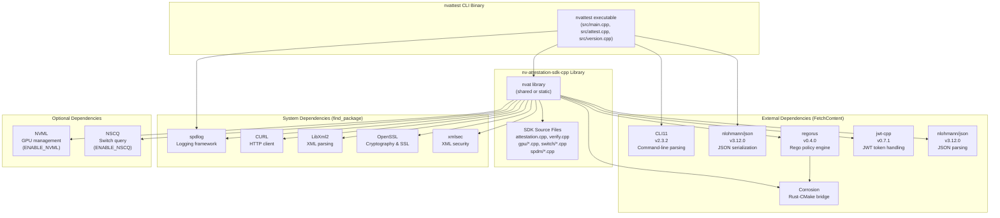
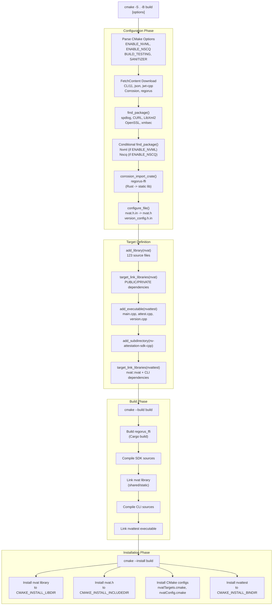
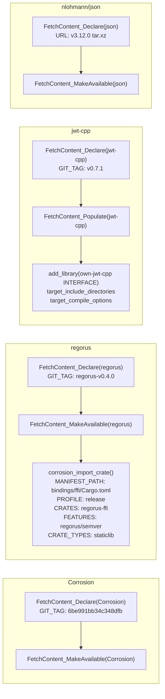
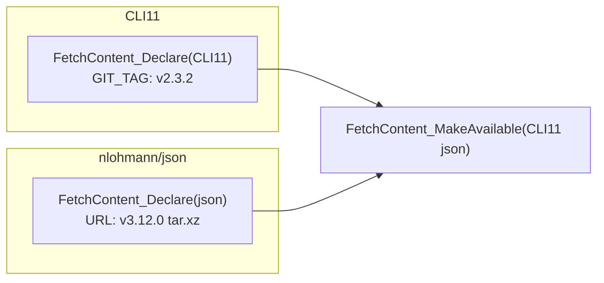
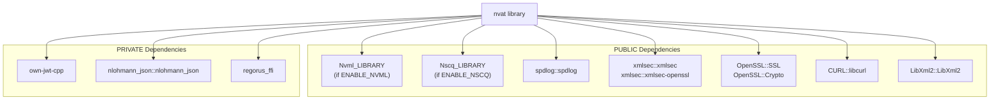
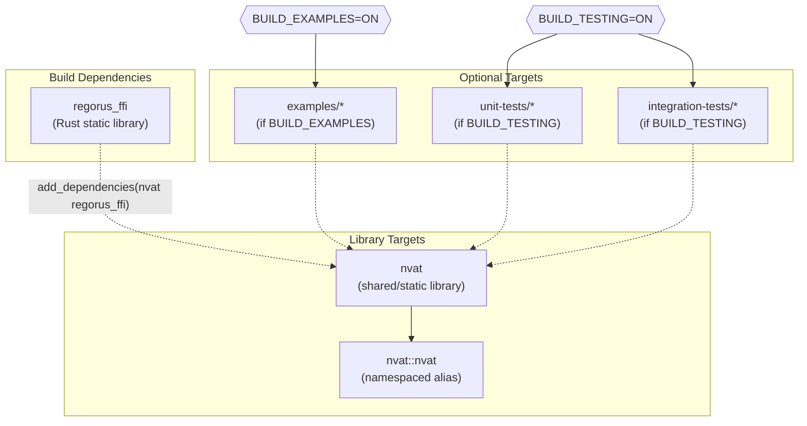
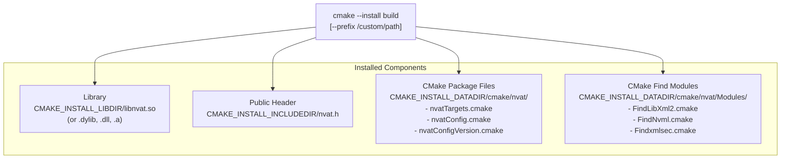

<!-- source: DeepWiki mcp.deepwiki.com · repo NVIDIA/attestation-sdk · page 6.1 Building from Source · fetched 2026-10-26 -->

# Building from Source

<details>
<summary>Relevant source files</summary>

The following files were used as context for generating this wiki page:

- [nv-attestation-cli/CMakeLists.txt](nv-attestation-cli/CMakeLists.txt)
- [nv-attestation-sdk-cpp/CMakeLists.txt](nv-attestation-sdk-cpp/CMakeLists.txt)
- [nv-attestation-sdk-cpp/cmake/Config.cmake.in](nv-attestation-sdk-cpp/cmake/Config.cmake.in)

</details>


This document provides comprehensive instructions for building the NVIDIA Attestation SDK and CLI tool from source using CMake. It covers the build system architecture, configuration options, dependency management, and installation procedures. For information on running tests after building, see [Testing Infrastructure](#6.3). For details on code organization and module structure, see [Code Organization](#6.2).

## Purpose and Scope

This page explains how to configure and build both the `nv-attestation-sdk-cpp` library and the `nvattest` CLI tool. It documents all CMake build options, dependency resolution mechanisms, build targets, and installation procedures. The build system uses CMake 3.11+ and FetchContent for dependency management, with special handling for Rust-based components through Corrosion.

## Build System Architecture

The repository contains two CMake projects: the core SDK library (`nv-attestation-sdk-cpp`) and the CLI tool (`nv-attestation-cli`). The CLI build includes the SDK as a subdirectory, creating a unified build process.

### Component Dependencies



**Sources:** [nv-attestation-cli/CMakeLists.txt:1-70](), [nv-attestation-sdk-cpp/CMakeLists.txt:1-273]()

### Build Process Flow



**Sources:** [nv-attestation-cli/CMakeLists.txt:1-70](), [nv-attestation-sdk-cpp/CMakeLists.txt:1-273]()

## Prerequisites

Before building, ensure the following system dependencies are installed:

| Dependency | Purpose | Required By |
|------------|---------|-------------|
| CMake 3.11+ | Build system generator | SDK, CLI |
| C++14 compiler | C++ compilation (GCC/Clang) | SDK, CLI |
| Rust toolchain | Building regorus-ffi | SDK |
| spdlog | Logging framework | SDK, CLI |
| CURL | HTTP client library | SDK |
| LibXml2 | XML parsing | SDK |
| OpenSSL | Cryptography and SSL/TLS | SDK |
| xmlsec | XML security operations | SDK |
| NVML (optional) | GPU management library | SDK (with ENABLE_NVML) |
| NSCQ (optional) | Switch query library | SDK (with ENABLE_NSCQ) |

**Sources:** [nv-attestation-sdk-cpp/CMakeLists.txt:85-101]()

## Building the SDK

### Basic Build

To build the SDK with default options (shared library, no device support):

```bash
cd nv-attestation-sdk-cpp
cmake -S . -B build
cmake --build build
```

This produces `libnvat.so` (or `libnvat.dylib` on macOS, `nvat.dll` on Windows) in the `build/` directory.

**Sources:** [nv-attestation-sdk-cpp/CMakeLists.txt:1-7]()

### SDK Build Options

The SDK provides several CMake options to control the build configuration:

#### CMAKE_CXX_STANDARD
**Type:** STRING  
**Default:** `14`  
**Description:** C++ standard version. Must be 14 or higher.

**Usage:**
```bash
cmake -S . -B build -DCMAKE_CXX_STANDARD=17
```

**Sources:** [nv-attestation-sdk-cpp/CMakeLists.txt:4-7]()

#### BUILD_SHARED_LIBS
**Type:** BOOL  
**Default:** `ON`  
**Description:** Build shared libraries instead of static libraries.

**Usage:**
```bash
# Build static library
cmake -S . -B build -DBUILD_SHARED_LIBS=OFF
```

**Sources:** [nv-attestation-sdk-cpp/CMakeLists.txt:12]()

#### ENABLE_NVML
**Type:** BOOL  
**Default:** `OFF`  
**Description:** Enable NVML support for GPU attestation. When enabled, adds GPU evidence collection capability via NVIDIA Management Library.

**Effect:**
- Adds `ENABLE_NVML` preprocessor definition [nv-attestation-sdk-cpp/CMakeLists.txt:94]()
- Links against `${Nvml_LIBRARY}` [nv-attestation-sdk-cpp/CMakeLists.txt:200]()
- Includes `${Nvml_INCLUDE_DIR}` [nv-attestation-sdk-cpp/CMakeLists.txt:162]()

**Usage:**
```bash
cmake -S . -B build -DENABLE_NVML=ON
```

**Sources:** [nv-attestation-sdk-cpp/CMakeLists.txt:15](), [nv-attestation-sdk-cpp/CMakeLists.txt:91-95]()

#### ENABLE_NSCQ
**Type:** BOOL  
**Default:** `OFF`  
**Description:** Enable NSCQ support for NVSwitch attestation. When enabled, adds switch evidence collection capability via NSCQ library.

**Effect:**
- Adds `ENABLE_NSCQ` preprocessor definition [nv-attestation-sdk-cpp/CMakeLists.txt:100]()
- Links against `${Nscq_LIBRARY}` [nv-attestation-sdk-cpp/CMakeLists.txt:201]()
- Includes `${Nscq_INCLUDE_DIR}` [nv-attestation-sdk-cpp/CMakeLists.txt:163]()

**Usage:**
```bash
cmake -S . -B build -DENABLE_NSCQ=ON
```

**Sources:** [nv-attestation-sdk-cpp/CMakeLists.txt:16](), [nv-attestation-sdk-cpp/CMakeLists.txt:97-101]()

#### BUILD_TESTING
**Type:** BOOL  
**Default:** `OFF`  
**Description:** Build unit tests and integration tests. Enables test targets in `unit-tests/` and `integration-tests/` subdirectories.

**Usage:**
```bash
cmake -S . -B build -DBUILD_TESTING=ON
cmake --build build
ctest --test-dir build
```

**Sources:** [nv-attestation-sdk-cpp/CMakeLists.txt:14](), [nv-attestation-sdk-cpp/CMakeLists.txt:183-188]()

#### BUILD_EXAMPLES
**Type:** BOOL  
**Default:** `OFF`  
**Description:** Build example executables in the `examples/` folder.

**Usage:**
```bash
cmake -S . -B build -DBUILD_EXAMPLES=ON
```

**Sources:** [nv-attestation-sdk-cpp/CMakeLists.txt:13](), [nv-attestation-sdk-cpp/CMakeLists.txt:178-181]()

#### SANITIZER
**Type:** STRING  
**Default:** `OFF`  
**Options:** `thread`, `address`, `undefined`, `leak`, `OFF`  
**Description:** Enable compiler sanitizers for debugging memory issues, data races, and undefined behavior.

**Effect:**
- Adds `-fsanitize=${SANITIZER}` compile and link options [nv-attestation-sdk-cpp/CMakeLists.txt:174-175]()
- Forces debug symbols with `-g3 -O0 -fno-omit-frame-pointer` [nv-attestation-sdk-cpp/CMakeLists.txt:113]()

**Usage:**
```bash
# Address sanitizer for memory errors
cmake -S . -B build -DSANITIZER=address

# Thread sanitizer for race conditions
cmake -S . -B build -DSANITIZER=thread
```

**Sources:** [nv-attestation-sdk-cpp/CMakeLists.txt:17](), [nv-attestation-sdk-cpp/CMakeLists.txt:112-114](), [nv-attestation-sdk-cpp/CMakeLists.txt:172-176]()

#### CMAKE_COMPILE_WARNING_AS_ERROR
**Type:** BOOL  
**Default:** `ON`  
**Description:** Treat compiler warnings as errors.

**Effect:**
- Sets `-Werror` flag on CMake < 3.24 [nv-attestation-sdk-cpp/CMakeLists.txt:104-106]()
- Uses `CMAKE_COMPILE_WARNING_AS_ERROR` property on CMake >= 3.24

**Usage:**
```bash
cmake -S . -B build -DCMAKE_COMPILE_WARNING_AS_ERROR=OFF
```

**Sources:** [nv-attestation-sdk-cpp/CMakeLists.txt:8-10](), [nv-attestation-sdk-cpp/CMakeLists.txt:104-106]()

### SDK Build Configuration Matrix

Common build configurations:

| Configuration | Options | Use Case |
|--------------|---------|----------|
| Development (GPU) | `-DENABLE_NVML=ON -DBUILD_TESTING=ON -DCMAKE_BUILD_TYPE=Debug` | GPU development with tests |
| Development (Switch) | `-DENABLE_NSCQ=ON -DBUILD_TESTING=ON -DCMAKE_BUILD_TYPE=Debug` | Switch development with tests |
| Production (GPU) | `-DENABLE_NVML=ON -DCMAKE_BUILD_TYPE=Release` | Production GPU deployment |
| Production (Both) | `-DENABLE_NVML=ON -DENABLE_NSCQ=ON -DCMAKE_BUILD_TYPE=Release` | Full device support |
| Static Library | `-DBUILD_SHARED_LIBS=OFF -DCMAKE_BUILD_TYPE=Release` | Static linking distribution |
| Memory Debugging | `-DSANITIZER=address -DCMAKE_BUILD_TYPE=Debug` | Memory leak detection |

**Sources:** [nv-attestation-sdk-cpp/CMakeLists.txt:12-17]()

## Building the CLI

The CLI tool (`nvattest`) includes the SDK as a subdirectory, providing a unified build process.

### Basic CLI Build

```bash
cd nv-attestation-cli
cmake -S . -B build
cmake --build build
```

This produces the `nvattest` executable in the `build/` directory. The SDK is automatically built as part of this process using [nv-attestation-cli/CMakeLists.txt:44-47]().

**Sources:** [nv-attestation-cli/CMakeLists.txt:1-70]()

### CLI Build Options

#### BUILD_TESTING
**Type:** BOOL  
**Default:** `OFF`  
**Description:** Build CLI tests. When enabled, builds the test suite in `tests/` subdirectory.

**Usage:**
```bash
cmake -S . -B build -DBUILD_TESTING=ON
cmake --build build
ctest --test-dir build
```

**Sources:** [nv-attestation-cli/CMakeLists.txt:4](), [nv-attestation-cli/CMakeLists.txt:62-66]()

### Passing SDK Options Through CLI Build

SDK build options can be passed through the CLI build:

```bash
# Build CLI with GPU support
cmake -S . -B build -DENABLE_NVML=ON

# Build CLI with both GPU and Switch support
cmake -S . -B build -DENABLE_NVML=ON -DENABLE_NSCQ=ON

# Build CLI with tests and GPU support
cmake -S . -B build -DBUILD_TESTING=ON -DENABLE_NVML=ON
```

**Sources:** [nv-attestation-cli/CMakeLists.txt:44-47]()

## Dependency Management

### FetchContent Dependencies

The build system uses CMake's FetchContent module to automatically download and build several dependencies:

#### SDK FetchContent Dependencies



**Sources:** [nv-attestation-sdk-cpp/CMakeLists.txt:25-83]()

**Key Details:**

1. **Corrosion** [nv-attestation-sdk-cpp/CMakeLists.txt:25-32](): Enables building Rust crates as part of the CMake build.

2. **regorus** [nv-attestation-sdk-cpp/CMakeLists.txt:34-54](): Rego policy engine built as a static library from Rust source. Always built in Release mode for performance.

3. **jwt-cpp** [nv-attestation-sdk-cpp/CMakeLists.txt:56-79](): Uses custom FetchContent_Populate to prevent header installation. Creates interface library `own-jwt-cpp` with special handling for C++17 extension warnings.

4. **nlohmann/json** [nv-attestation-sdk-cpp/CMakeLists.txt:81-82](): JSON parsing library with `EXCLUDE_FROM_ALL` to prevent installation.

#### CLI FetchContent Dependencies



**Sources:** [nv-attestation-cli/CMakeLists.txt:17-25]()

### System Dependencies

The following dependencies must be installed on the system and are located using `find_package()`:

| Package | CMake Variable | Purpose |
|---------|---------------|---------|
| spdlog | `spdlog::spdlog` | Logging framework (SDK and CLI) |
| CURL | `CURL::libcurl` | HTTP client for RIM/OCSP/NRAS services |
| LibXml2 | `LibXml2::LibXml2` | XML parsing for certificate chains |
| OpenSSL | `OpenSSL::SSL`, `OpenSSL::Crypto` | Cryptography and SSL/TLS |
| xmlsec | `xmlsec::xmlsec`, `xmlsec::xmlsec-openssl` | XML signature verification |

**Sources:** [nv-attestation-sdk-cpp/CMakeLists.txt:85-89]()

### Optional Device Dependencies

These dependencies are conditionally required based on build options:

| Package | Enabled By | CMake Module | Purpose |
|---------|-----------|--------------|---------|
| Nvml | `ENABLE_NVML=ON` | `cmake/FindNvml.cmake` | GPU evidence collection |
| Nscq | `ENABLE_NSCQ=ON` | `cmake/FindNscq.cmake` | Switch evidence collection |

**Sources:** [nv-attestation-sdk-cpp/CMakeLists.txt:91-101](), [nv-attestation-sdk-cpp/cmake/Config.cmake.in:13-19]()

### Dependency Linking

#### SDK Library Linking



**Rationale:** PUBLIC dependencies are part of the SDK's API and must be available to downstream consumers. PRIVATE dependencies are internal implementation details.

**Sources:** [nv-attestation-sdk-cpp/CMakeLists.txt:198-213]()

#### CLI Executable Linking

All CLI dependencies are PRIVATE since executables don't expose an API:

| Target | Dependencies |
|--------|--------------|
| `nvattest` | `nvat::nvat`, `nlohmann_json::nlohmann_json`, `CLI11::CLI11`, `spdlog::spdlog` |

**Sources:** [nv-attestation-cli/CMakeLists.txt:52-57]()

## Build Targets

### SDK Targets



**Sources:** [nv-attestation-sdk-cpp/CMakeLists.txt:123-152](), [nv-attestation-sdk-cpp/CMakeLists.txt:178-188](), [nv-attestation-sdk-cpp/CMakeLists.txt:216]()

**Build Commands:**

```bash
# Build main library only
cmake --build build --target nvat

# Build specific test
cmake --build build --target unit_test_name

# Build all
cmake --build build
```

### CLI Targets

| Target | Description | Source Files |
|--------|-------------|--------------|
| `nvattest` | Main CLI executable | `src/main.cpp`, `src/version.cpp`, `src/attest.cpp` |
| CLI tests | Test suite (if `BUILD_TESTING=ON`) | `tests/cli_tests.cpp` |

**Sources:** [nv-attestation-cli/CMakeLists.txt:27-31](), [nv-attestation-cli/CMakeLists.txt:62-66]()

## Generated Files

### Configuration-Time Generation

The build system generates several files during CMake configuration:

#### SDK Generated Files

| Generated File | Template | Purpose | Variables |
|---------------|----------|---------|-----------|
| `build/include/nvat.h` | `include/nvat.h.in` | Public API header with version | `PROJECT_VERSION` |
| `build/nvatConfig.cmake` | `cmake/Config.cmake.in` | CMake package config | `ENABLE_NVML`, `ENABLE_NSCQ` |
| `build/nvatConfigVersion.cmake` | (auto-generated) | Version compatibility check | `PROJECT_VERSION` |

**Sources:** [nv-attestation-sdk-cpp/CMakeLists.txt:121](), [nv-attestation-sdk-cpp/CMakeLists.txt:253-263]()

#### CLI Generated Files

| Generated File | Template | Purpose |
|---------------|----------|---------|
| `build/version_config.h` | `src/version_config.h.in` | Version constants for CLI |
| `build/config.toml` | `config.toml` | Default configuration file (copied) |

**Sources:** [nv-attestation-cli/CMakeLists.txt:35-41]()

### Build-Time Generation

During the build phase, Corrosion generates additional files:

1. **regorus_ffi.h**: FFI header for Rust regorus library [nv-attestation-sdk-cpp/CMakeLists.txt:216]()
2. **libregorus_ffi.a**: Compiled Rust static library

## Installation

### SDK Installation

The SDK installs the following components:



**Installation Command:**

```bash
# Install to default prefix (/usr/local on Unix)
sudo cmake --install build

# Install to custom prefix
cmake --install build --prefix /opt/nvidia
```

**Sources:** [nv-attestation-sdk-cpp/CMakeLists.txt:218-270]()

#### Installation Locations

| Component | Default Path (Unix) | CMake Variable |
|-----------|---------------------|----------------|
| Library | `/usr/local/lib/libnvat.so` | `CMAKE_INSTALL_LIBDIR` |
| Header | `/usr/local/include/nvat.h` | `CMAKE_INSTALL_INCLUDEDIR` |
| CMake configs | `/usr/local/share/cmake/nvat/` | `CMAKE_INSTALL_DATADIR/cmake/nvat` |
| Find modules | `/usr/local/share/cmake/nvat/Modules/` | `CMAKE_INSTALL_DATADIR/cmake/nvat/Modules` |

**Sources:** [nv-attestation-sdk-cpp/CMakeLists.txt:218-250]()

### CLI Installation

The CLI tool installs only the executable:

```bash
# Install to default prefix
sudo cmake --install build

# Install to custom prefix
cmake --install build --prefix /opt/nvidia
```

**Installed Path:** `${CMAKE_INSTALL_BINDIR}/nvattest` (typically `/usr/local/bin/nvattest`)

**Sources:** [nv-attestation-cli/CMakeLists.txt:68]()

### Using Installed SDK

After installation, downstream projects can use the SDK via `find_package()`:

```cmake
find_package(nvat REQUIRED)

add_executable(my_app main.cpp)
target_link_libraries(my_app PRIVATE nvat::nvat)
```

The installed `nvatConfig.cmake` automatically handles transitive dependencies and conditional features (NVML/NSCQ).

**Sources:** [nv-attestation-sdk-cpp/cmake/Config.cmake.in:1-22]()

## Compiler Flags and Standards

### C++ Standard

Both projects require C++14 minimum:

| Project | Setting | Source |
|---------|---------|--------|
| SDK | `set(CMAKE_CXX_STANDARD 14 CACHE STRING ...)` | [nv-attestation-sdk-cpp/CMakeLists.txt:4-7]() |
| CLI | `set(CMAKE_CXX_STANDARD 14)` | [nv-attestation-cli/CMakeLists.txt:7]() |

### Warning Flags

Common warning flags applied to both projects:

```cmake
add_compile_options(-Wall -Wextra -Wpedantic -pedantic)
```

Temporarily disabled during development:
```cmake
add_compile_options(-Wno-unused -Wno-unused-parameter)
```

**Sources:** [nv-attestation-sdk-cpp/CMakeLists.txt:103-109]()

### Debug Flags

Debug symbols and optimization are controlled by build type and sanitizer selection:

| Condition | Flags | Reason |
|-----------|-------|--------|
| `CMAKE_BUILD_TYPE=Debug` | `-g3 -O0 -fno-omit-frame-pointer` | Full debug info |
| `SANITIZER!=OFF` | `-g3 -O0 -fno-omit-frame-pointer` | Sanitizer needs symbols |
| Always (Debug mode) | `-g -O0` (CLI only) | CLI debug builds |

**Sources:** [nv-attestation-sdk-cpp/CMakeLists.txt:111-114](), [nv-attestation-cli/CMakeLists.txt:10-11]()

### File Path Mapping

For cleaner log messages, the SDK remaps `__FILE__` macros:

```cmake
add_compile_options(-ffile-prefix-map=${CMAKE_SOURCE_DIR}/src/=)
```

This makes log messages show relative paths like `attestation.cpp` instead of full paths.

**Sources:** [nv-attestation-sdk-cpp/CMakeLists.txt:116-119]()

## Build System Details

### Library Versioning

The SDK library uses semantic versioning:

| Property | Value | Source |
|----------|-------|--------|
| Project Version | `0.0.0` | [nv-attestation-sdk-cpp/CMakeLists.txt:2]() |
| SOVERSION | `0` | [nv-attestation-sdk-cpp/CMakeLists.txt:154]() |

The SOVERSION determines library compatibility. Binary compatibility is maintained within the same SOVERSION.

**Sources:** [nv-attestation-sdk-cpp/CMakeLists.txt:154-158]()

### CMake Module Path

Custom CMake find modules are located in `nv-attestation-sdk-cpp/cmake/`:

```cmake
list(APPEND CMAKE_MODULE_PATH "${CMAKE_CURRENT_SOURCE_DIR}/cmake")
```

This allows using custom `Find*.cmake` files for dependencies like Nvml, Nscq, and xmlsec.

**Sources:** [nv-attestation-sdk-cpp/CMakeLists.txt:23]()

### CTest Integration

Both projects integrate with CTest for testing:

```cmake
include(CTest)
```

This enables running tests with:
```bash
ctest --test-dir build --output-on-failure
```

**Sources:** [nv-attestation-sdk-cpp/CMakeLists.txt:19](), [nv-attestation-cli/CMakeLists.txt:13]()

### CPack Integration

Both projects include CPack for package generation:

```cmake
include(CPack)
```

This enables creating distribution packages:
```bash
cmake --build build
cpack --config build/CPackConfig.cmake
```

**Sources:** [nv-attestation-sdk-cpp/CMakeLists.txt:272](), [nv-attestation-cli/CMakeLists.txt:70]()

## Troubleshooting

### Common Build Issues

| Problem | Cause | Solution |
|---------|-------|----------|
| `find_package(spdlog)` fails | spdlog not installed | Install via package manager: `apt install libspdlog-dev` |
| `find_package(Nvml)` fails | NVML library not found | Install CUDA toolkit or disable: `-DENABLE_NVML=OFF` |
| regorus_ffi build fails | Rust toolchain missing | Install Rust: `curl --proto '=https' --tlsv1.2 -sSf https://sh.rustup.rs \| sh` |
| jwt-cpp warnings | C++17 features in C++14 mode | Expected; suppressed by `-Wno-c++17-extensions` |
| Link errors with xmlsec | xmlsec1-openssl variant missing | Install: `apt install libxmlsec1-openssl-dev` |

### Clean Build

To perform a clean build:

```bash
# Remove build directory
rm -rf build

# Reconfigure and rebuild
cmake -S . -B build [options]
cmake --build build
```

### Verbose Build

To see full compiler commands:

```bash
cmake --build build --verbose
```

Or use:
```bash
cmake -S . -B build -DCMAKE_VERBOSE_MAKEFILE=ON
cmake --build build
```

**Sources:** All CMakeLists.txt files referenced above.

---

