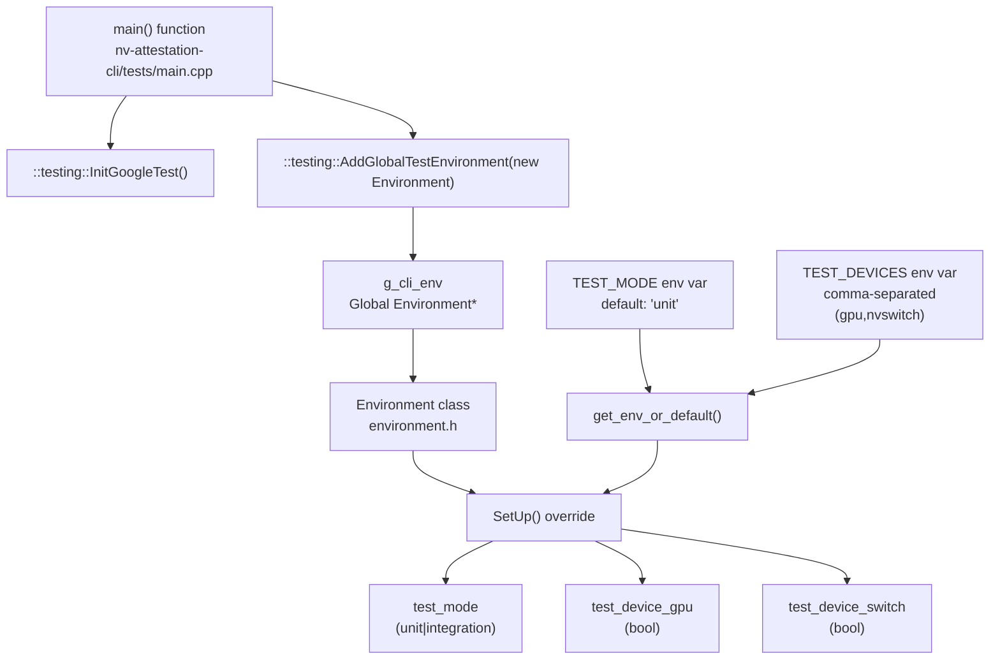
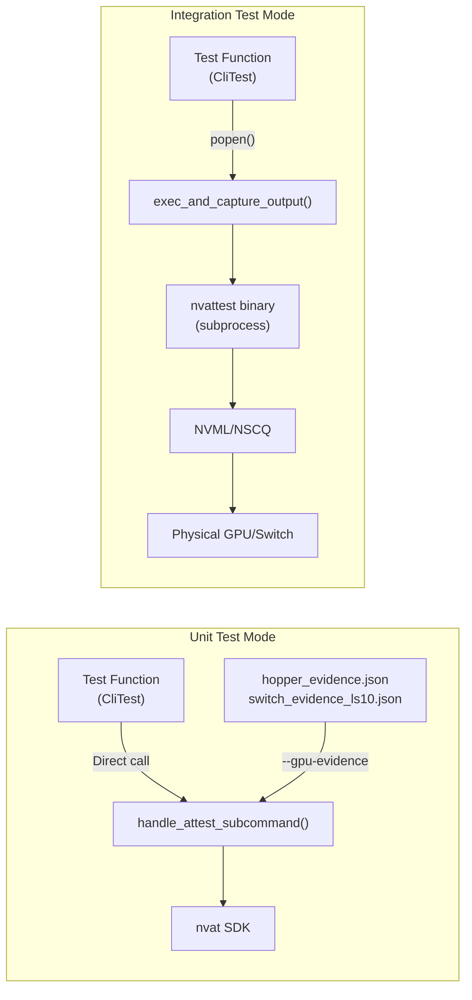
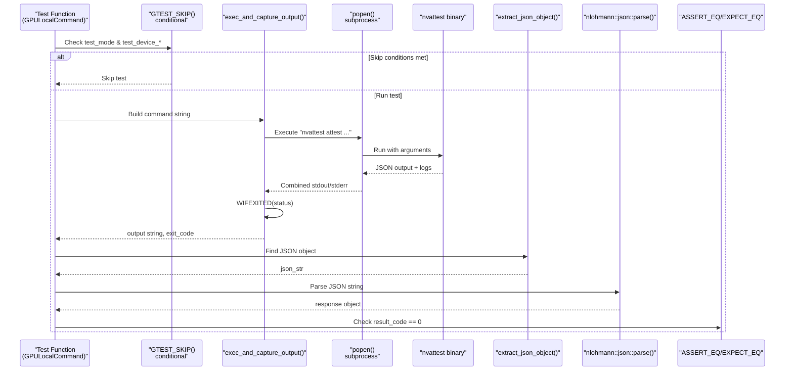
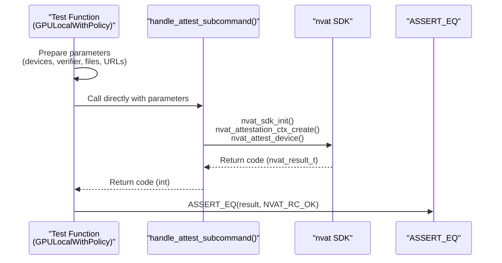

<!-- source: DeepWiki mcp.deepwiki.com · repo NVIDIA/attestation-sdk · page 6.3 Testing Infrastructure · fetched 2026-10-26 -->

# Testing Infrastructure

<details>
<summary>Relevant source files</summary>

The following files were used as context for generating this wiki page:

- [nv-attestation-cli/tests/CMakeLists.txt](nv-attestation-cli/tests/CMakeLists.txt)
- [nv-attestation-cli/tests/cli_tests.cpp](nv-attestation-cli/tests/cli_tests.cpp)
- [nv-attestation-cli/tests/environment.h](nv-attestation-cli/tests/environment.h)
- [nv-attestation-cli/tests/main.cpp](nv-attestation-cli/tests/main.cpp)

</details>


## Purpose and Scope

This document describes the testing infrastructure for the NVIDIA Attestation SDK CLI tool. It covers the Google Test-based test framework, environment configuration, test execution modes (unit and integration), test data organization, and how to run and extend the test suite. For information about the CLI tool itself, see [CLI Tool Architecture](#3.3). For details on test data formats, see [Test Data Reference](#8.4).

## Testing Framework Overview

The testing infrastructure is built on Google Test (GTest) and provides comprehensive coverage of the `nvattest` CLI tool. The test suite is located in the `nv-attestation-cli/tests/` directory and validates both direct function calls (unit tests) and full CLI execution (integration tests).

### Test Suite Components

The test suite consists of three primary source files that work together to provide a flexible testing framework:

| File | Purpose | Key Components |
|------|---------|----------------|
| [nv-attestation-cli/tests/main.cpp]() | Test runner entry point | `main()`, global environment setup |
| [nv-attestation-cli/tests/environment.h]() | Environment configuration | `Environment` class, `get_env_or_default()` |
| [nv-attestation-cli/tests/cli_tests.cpp]() | Test cases | `CliTest` fixture, test functions |
| [nv-attestation-cli/tests/CMakeLists.txt]() | Build configuration | Target definition, dependencies |

Sources: [nv-attestation-cli/tests/main.cpp:1-27](), [nv-attestation-cli/tests/environment.h:1-76](), [nv-attestation-cli/tests/cli_tests.cpp:1-317](), [nv-attestation-cli/tests/CMakeLists.txt:1-45]()

## Test Environment Configuration



The test environment is configured through the `Environment` class, which inherits from `::testing::Environment`. During setup, it reads environment variables to determine test behavior:

### Environment Variables

| Variable | Values | Default | Purpose |
|----------|--------|---------|---------|
| `TEST_MODE` | `"unit"`, `"integration"` | `"unit"` | Controls test execution mode |
| `TEST_DEVICES` | `"gpu"`, `"nvswitch"`, or comma-separated | `""` | Specifies devices for integration tests |

The `Environment::SetUp()` method processes these variables and populates the following fields:

- `test_mode`: String indicating `"unit"` or `"integration"` mode
- `test_device_gpu`: Boolean flag for GPU device testing
- `test_device_switch`: Boolean flag for Switch device testing

The global pointer `g_cli_env` provides access to this configuration throughout the test suite.

Sources: [nv-attestation-cli/tests/environment.h:36-73](), [nv-attestation-cli/tests/main.cpp:21-26]()

## Test Execution Modes

The test infrastructure supports two distinct execution modes, each serving different testing purposes:

### Unit Test Mode

In unit test mode (`TEST_MODE=unit`), tests directly invoke the `nvattest::handle_attest_subcommand()` function with pre-serialized evidence files. This mode:

- Does not require physical GPU or Switch hardware
- Uses test evidence from `common-test-data/serialized_test_evidence/`
- Provides fast, repeatable tests suitable for CI/CD pipelines
- Validates core attestation logic in isolation

### Integration Test Mode

In integration test mode (`TEST_MODE=integration`), tests execute the full `nvattest` CLI binary as a subprocess. This mode:

- Requires physical hardware specified in `TEST_DEVICES`
- Collects live evidence via NVML (GPU) or NSCQ (Switch)
- Validates end-to-end functionality including hardware interaction
- Requires external services (RIM, OCSP, NRAS) for remote verification



Sources: [nv-attestation-cli/tests/cli_tests.cpp:86-114](), [nv-attestation-cli/tests/cli_tests.cpp:206-218](), [nv-attestation-cli/tests/cli_tests.cpp:43-61]()

## Test Data Organization

The test suite relies on pre-serialized evidence files and Rego policy files located in the `common-test-data/` directory:

### Test Evidence Files

| File Path | Device Type | Purpose |
|-----------|-------------|---------|
| `common-test-data/serialized_test_evidence/hopper_evidence.json` | GPU (Hopper) | GPU attestation test evidence |
| `common-test-data/serialized_test_evidence/switch_evidence_ls10.json` | NVSwitch (LS10) | Switch attestation test evidence |

### Test Policy Files

| File Path | Device Type | Purpose |
|-----------|-------------|---------|
| `common-test-data/relying_party_policy.rego` | GPU | GPU attestation policy |
| `common-test-data/switch_relying_party_policy.rego` | NVSwitch | Switch attestation policy |

All tests use a consistent nonce value: `0x931d8dd0add203ac3d8b4fbde75e115278eefcdceac5b87671a748f32364dfcb`

Sources: [nv-attestation-cli/tests/cli_tests.cpp:92-93](), [nv-attestation-cli/tests/cli_tests.cpp:153-154](), [nv-attestation-cli/tests/cli_tests.cpp:209-211]()

## Test Case Structure

```mermaid
flowchart TD
    CliTest["CliTest fixture<br/>: ::testing::Test"]
    
    subgraph "Integration Tests"
        GPULocalCommand["GPULocalCommand<br/>TEST_F"]
        GPURemoteCommand["GPURemoteCommand<br/>TEST_F"]
        SwitchLocalCommand["SwitchLocalCommand<br/>TEST_F"]
        SwitchRemoteCommand["SwitchRemoteCommand<br/>TEST_F"]
        
        exec_and_capture["exec_and_capture_output()<br/>popen() + WIFEXITED()"]
        extract_json["extract_json_object()<br/>brace matching"]
        
        GPULocalCommand --> exec_and_capture
        GPURemoteCommand --> exec_and_capture
        SwitchLocalCommand --> exec_and_capture
        SwitchRemoteCommand --> exec_and_capture
        
        exec_and_capture --> extract_json
    end
    
    subgraph "Unit Tests"
        GPULocalWithPolicy["GPULocalWithPolicy<br/>TEST_F"]
        GPULocalNoPolicy["GPULocalNoPolicy<br/>TEST_F"]
        GPURemoteWithPolicy["GPURemoteWithPolicy<br/>TEST_F"]
        GPURemoteNoPolicy["GPURemoteNoPolicy<br/>TEST_F"]
        SwitchLocalWithPolicy["SwitchLocalWithPolicy<br/>TEST_F"]
        SwitchLocalNoPolicy["SwitchLocalNoPolicy<br/>TEST_F"]
        SwitchRemoteWithPolicy["SwitchRemoteWithPolicy<br/>TEST_F"]
        SwitchRemoteNoPolicy["SwitchRemoteNoPolicy<br/>TEST_F"]
        
        handle_attest["handle_attest_subcommand()<br/>nvattest::"]
        
        GPULocalWithPolicy --> handle_attest
        GPULocalNoPolicy --> handle_attest
        GPURemoteWithPolicy --> handle_attest
        GPURemoteNoPolicy --> handle_attest
        SwitchLocalWithPolicy --> handle_attest
        SwitchLocalNoPolicy --> handle_attest
        SwitchRemoteWithPolicy --> handle_attest
        SwitchRemoteNoPolicy --> handle_attest
    end
    
    CliTest --> GPULocalCommand
    CliTest --> GPULocalWithPolicy
```



### Test Case Matrix

The test suite provides comprehensive coverage across multiple dimensions:

| Test Name | Device | Verifier | Policy | Mode | Line Range |
|-----------|--------|----------|--------|------|------------|
| `GPULocalCommand` | GPU | local | Yes | Both | [86-114]() |
| `GPURemoteCommand` | GPU | remote | Yes | Both | [116-145]() |
| `SwitchLocalCommand` | Switch | local | Yes | Both | [147-174]() |
| `SwitchRemoteCommand` | Switch | remote | Yes | Both | [176-204]() |
| `GPULocalWithPolicy` | GPU | local | Yes | Unit | [206-218]() |
| `GPULocalNoPolicy` | GPU | local | No | Unit | [220-232]() |
| `GPURemoteWithPolicy` | GPU | remote | Yes | Unit | [234-246]() |
| `GPURemoteNoPolicy` | GPU | remote | No | Unit | [248-260]() |
| `SwitchLocalWithPolicy` | Switch | local | Yes | Unit | [262-274]() |
| `SwitchLocalNoPolicy` | Switch | local | No | Unit | [276-288]() |
| `SwitchRemoteWithPolicy` | Switch | remote | Yes | Unit | [290-302]() |
| `SwitchRemoteNoPolicy` | Switch | remote | No | Unit | [304-316]() |

Sources: [nv-attestation-cli/tests/cli_tests.cpp:86-316]()

## Test Execution Flow

### Integration Test Execution



Integration tests follow this pattern:

1. **Skip Check**: Tests inspect `g_cli_env->test_mode` and device flags to determine if they should run
2. **Command Construction**: Build full CLI command with appropriate arguments based on test mode
3. **Subprocess Execution**: Use `exec_and_capture_output()` to run the `nvattest` binary via `popen()`
4. **Output Parsing**: Extract JSON from combined stdout/stderr using brace-matching in `extract_json_object()`
5. **Validation**: Parse JSON and assert on `result_code` field

Sources: [nv-attestation-cli/tests/cli_tests.cpp:86-114](), [nv-attestation-cli/tests/cli_tests.cpp:43-84]()

### Unit Test Execution



Unit tests follow a simpler pattern:

1. **Parameter Preparation**: Initialize all parameters as local variables (nonce, devices, verifier mode, file paths, URLs)
2. **Direct Function Call**: Invoke `nvattest::handle_attest_subcommand()` directly with parameters
3. **Result Validation**: Assert the return code equals `NVAT_RC_OK` (0)

Sources: [nv-attestation-cli/tests/cli_tests.cpp:206-218]()

## Test Helper Functions

### exec_and_capture_output()

```cpp
std::string exec_and_capture_output(const std::string& command, int& exit_code)
```

Executes a shell command as a subprocess and captures combined stdout/stderr output. Uses `popen()` to create a pipe, reads output in 4KB chunks, and extracts the exit code via `WIFEXITED()` and `WEXITSTATUS()` macros.

Sources: [nv-attestation-cli/tests/cli_tests.cpp:43-61]()

### extract_json_object()

```cpp
bool extract_json_object(const std::string& input, std::string& json_out)
```

Extracts the last valid JSON object from a string by scanning backwards from the end and matching braces. This handles cases where the CLI outputs log messages before the JSON result. Returns `true` if a balanced JSON object is found.

Sources: [nv-attestation-cli/tests/cli_tests.cpp:63-84]()

## Build Configuration

The test executable is configured in [nv-attestation-cli/tests/CMakeLists.txt]():

### Target Definition

```cmake
add_executable(nv-attestation-cli-tests
    main.cpp
    cli_tests.cpp
    environment.h
    ${nvattest_SOURCE_DIR}/attest.cpp
)
```

The test executable includes `attest.cpp` directly to enable unit testing of `handle_attest_subcommand()` without going through the full CLI.

Sources: [nv-attestation-cli/tests/CMakeLists.txt:8-13]()

### Dependencies

| Library | Purpose |
|---------|---------|
| `GTest::gtest` | Test framework core |
| `GTest::gmock` | Mocking support |
| `nlohmann_json::nlohmann_json` | JSON parsing in tests |
| `spdlog::spdlog` | Logging (inherited from attest.cpp) |
| `CLI11::CLI11` | CLI parsing (inherited from attest.cpp) |
| `nvat::nvat` or `nvat` | Attestation SDK library |

Sources: [nv-attestation-cli/tests/CMakeLists.txt:27-42]()

### Sanitizer Support

The build system supports optional sanitizers for detecting memory and threading issues:

```cmake
option(SANITIZER "Select a sanitizer" OFF)

if (SANITIZER)
    target_compile_options(nv-attestation-cli-tests PRIVATE -fsanitize=${SANITIZER} -fno-sanitize-recover=all)
    target_link_options(nv-attestation-cli-tests PRIVATE -fsanitize=${SANITIZER} -fno-sanitize-recover=all)
endif()
```

Enable with: `cmake -DSANITIZER=address` or `cmake -DSANITIZER=thread`

Sources: [nv-attestation-cli/tests/CMakeLists.txt:6-22]()

### Test Discovery

Google Test's CMake integration automatically discovers test cases:

```cmake
include(GoogleTest)
gtest_discover_tests(nv-attestation-cli-tests PROPERTIES LABELS "cli")
```

This allows running tests via CTest with filtering by label: `ctest -L cli`

Sources: [nv-attestation-cli/tests/CMakeLists.txt:44-45]()

## Running Tests

### Unit Tests (Default)

Run all unit tests without requiring hardware:

```bash
# Build tests
cd build
cmake ..
make nv-attestation-cli-tests

# Run with ctest
ctest -L cli

# Or run directly
./nv-attestation-cli/tests/nv-attestation-cli-tests
```

### Integration Tests with GPU

Run integration tests with a physical GPU:

```bash
export TEST_MODE=integration
export TEST_DEVICES=gpu
ctest -L cli
```

### Integration Tests with Switch

Run integration tests with a physical NVSwitch:

```bash
export TEST_MODE=integration
export TEST_DEVICES=nvswitch
ctest -L cli
```

### Integration Tests with Both Devices

```bash
export TEST_MODE=integration
export TEST_DEVICES=gpu,nvswitch
ctest -L cli
```

### Running Specific Tests

Use Google Test filtering:

```bash
# Run only GPU tests
./nv-attestation-cli/tests/nv-attestation-cli-tests --gtest_filter="CliTest.GPU*"

# Run only local verifier tests
./nv-attestation-cli/tests/nv-attestation-cli-tests --gtest_filter="*Local*"

# Run with verbose output
./nv-attestation-cli/tests/nv-attestation-cli-tests --gtest_filter="*" --gtest_print_time=1
```

Sources: [nv-attestation-cli/tests/environment.h:44-68](), [nv-attestation-cli/tests/cli_tests.cpp:86-89]()

---

