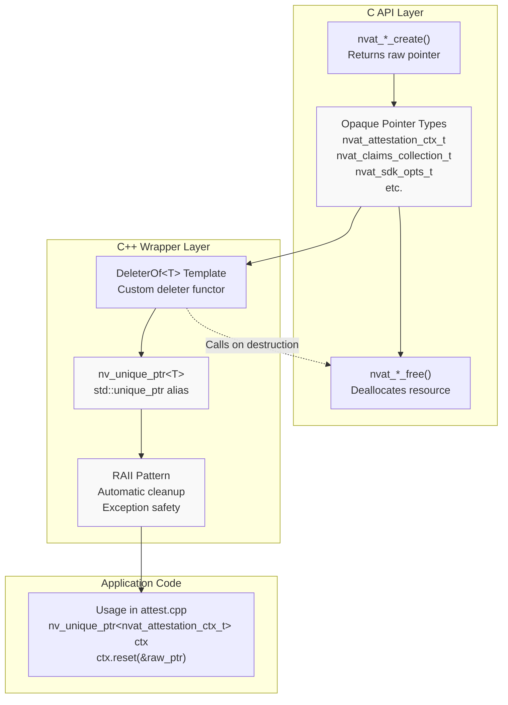
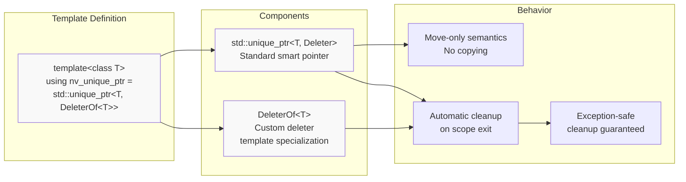
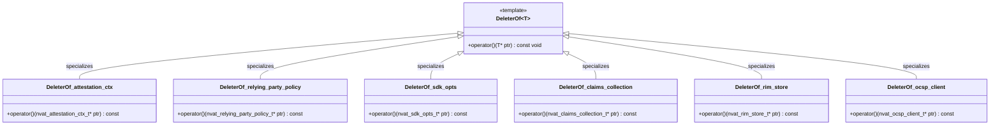
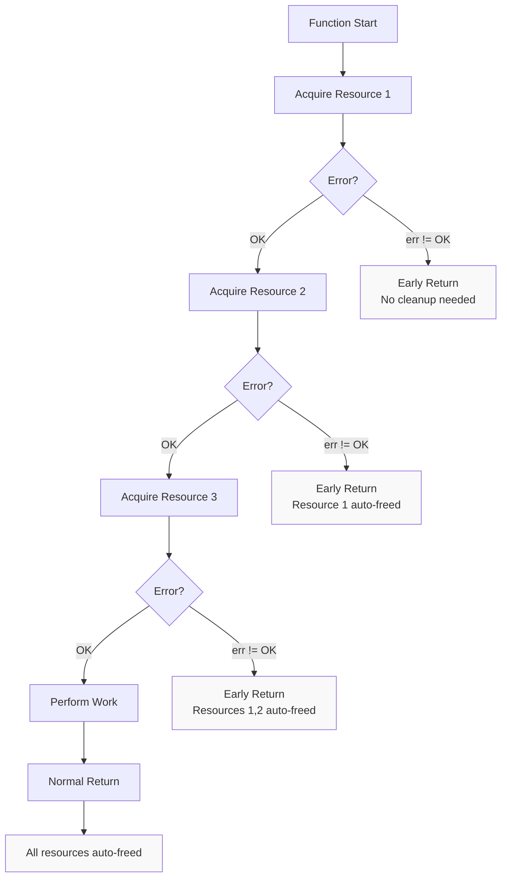

<!-- source: DeepWiki mcp.deepwiki.com · repo NVIDIA/attestation-sdk · page 6.5 Resource Management Patterns · fetched 2026-10-26 -->

# Resource Management Patterns

<details>
<summary>Relevant source files</summary>

The following files were used as context for generating this wiki page:

- [nv-attestation-cli/src/attest.cpp](nv-attestation-cli/src/attest.cpp)
- [nv-attestation-cli/src/nvattest_types.h](nv-attestation-cli/src/nvattest_types.h)

</details>


This document describes the C++ resource management patterns used in the NVIDIA Attestation CLI to safely manage SDK resources. The SDK provides a C API with opaque pointer types that require explicit memory management. The CLI wraps these in RAII-compliant smart pointers to ensure automatic cleanup and exception safety.

For information about the SDK's C API structure, see [Core SDK (nv-attestation-sdk-cpp)](#3.2). For build system configuration, see [Building from Source](#6.1).

## Overview

The attestation SDK exposes a C API with opaque pointer types (e.g., `nvat_attestation_ctx_t`, `nvat_claims_collection_t`) that are dynamically allocated and must be explicitly freed. The CLI implements a C++ wrapper layer using custom deleters and `std::unique_ptr` to provide automatic resource management through RAII (Resource Acquisition Is Initialization).



Sources: [nv-attestation-cli/src/nvattest_types.h:1-76](), [nv-attestation-cli/src/attest.cpp:1-359]()

## SDK Opaque Pointer Types

The SDK defines opaque pointer types that represent various attestation resources. These types are incomplete types in the public API, with their actual structure hidden in the SDK implementation. This enforces encapsulation and ABI stability.

### Managed SDK Types

The following table lists all SDK types managed by the CLI's resource management system:

| SDK Type | Purpose | Create Function | Free Function |
|----------|---------|-----------------|---------------|
| `nvat_attestation_ctx_t` | Main attestation context | `nvat_attestation_ctx_create()` | `nvat_attestation_ctx_free()` |
| `nvat_relying_party_policy_t` | Rego policy object | `nvat_relying_party_policy_create_rego_from_str()` | `nvat_relying_party_policy_free()` |
| `nvat_sdk_opts_t` | SDK initialization options | `nvat_sdk_opts_create()` | `nvat_sdk_opts_free()` |
| `nvat_claims_collection_t` | Attestation result claims | `nvat_attest_device()` (output) | `nvat_claims_collection_free()` |
| `nvat_rim_store_t` | RIM service client | `nvat_rim_store_create_remote()` | `nvat_rim_store_free()` |
| `nvat_ocsp_client_t` | OCSP verification client | `nvat_ocsp_client_create_default()` | `nvat_ocsp_client_free()` |

Each type follows the same pattern:
1. Created via a `nvat_*_create*()` function that returns a raw pointer
2. Freed via a corresponding `nvat_*_free()` function that accepts a pointer-to-pointer
3. Operations performed via `nvat_*_*()` functions that accept the pointer

Sources: [nv-attestation-cli/src/nvattest_types.h:27-73](), [nv-attestation-cli/src/attest.cpp:164-296]()

## The nv_unique_ptr Template

The CLI defines a custom smart pointer alias `nv_unique_ptr<T>` that wraps `std::unique_ptr` with a custom deleter. This provides automatic memory management for SDK resources while maintaining move semantics and preventing accidental copying.



The template definition is concise:

```cpp
template<class T> using nv_unique_ptr = std::unique_ptr<T, DeleterOf<T>>;
```

This allows usage such as:
- `nv_unique_ptr<nvat_attestation_ctx_t> ctx;`
- `nv_unique_ptr<nvat_claims_collection_t> claims;`

Sources: [nv-attestation-cli/src/nvattest_types.h:75]()

## Custom Deleters

The `DeleterOf<T>` template provides specialized deleters for each SDK type. Each specialization implements the function call operator to invoke the appropriate SDK free function.

### Deleter Implementation Pattern

Each deleter follows this structure:

```cpp
template<> struct DeleterOf<nvat_TYPE_t> {
    void operator()(nvat_TYPE_t* ptr) const {
        if (ptr) {
            nvat_TYPE_free(ptr);
        }
    }
};
```

The deleter:
1. Accepts a pointer-to-pointer to the SDK type
2. Checks for null to handle uninitialized pointers
3. Calls the corresponding SDK free function
4. Is `const` to allow usage with const smart pointers

### Complete Deleter Specializations



Sources: [nv-attestation-cli/src/nvattest_types.h:25-73]()

## Resource Lifecycle Pattern

The typical lifecycle of an SDK resource managed by `nv_unique_ptr` follows a consistent pattern throughout the codebase.

### Standard Resource Acquisition Pattern

```mermaid
sequenceDiagram
    participant App as "Application Code"
    participant Smart as "nv_unique_ptr&lt;T&gt;"
    participant Raw as "Raw Pointer"
    participant SDK as "SDK C API"
    
    App->>Smart: Declare nv_unique_ptr&lt;T&gt; wrapper
    Note over Smart: Initialized to nullptr
    
    App->>Raw: Declare T raw_ptr = nullptr
    
    App->>SDK: nvat_T_create(&raw_ptr)
    SDK-->>Raw: raw_ptr now points to resource
    
    alt Success
        App->>App: Check err == NVAT_RC_OK
        App->>Smart: wrapper.reset(&raw_ptr)
        Note over Smart: Takes ownership<br/>raw_ptr remains valid
        
        App->>App: Use resource via wrapper.get()
        
        Note over Smart: Scope exit
        Smart->>SDK: DeleterOf&lt;T&gt;::operator()<br/>calls nvat_T_free(&raw_ptr)
        SDK-->>Smart: Resource freed
    else Error
        App->>App: return AttestOutput(err)
        Note over Raw: raw_ptr still nullptr<br/>No cleanup needed
    end
```

This pattern is consistently applied throughout [nv-attestation-cli/src/attest.cpp:164-335]().

### Example: Attestation Context Lifecycle

The following excerpt demonstrates the complete lifecycle of an attestation context:

1. **Declaration** [nv-attestation-cli/src/attest.cpp:198-199]()
   ```cpp
   nv_unique_ptr<nvat_attestation_ctx_t> ctx;
   nvat_attestation_ctx_t raw_ctx = nullptr;
   ```

2. **Creation** [nv-attestation-cli/src/attest.cpp:200-202]()
   ```cpp
   err = nvat_attestation_ctx_create(&raw_ctx);
   if (err != NVAT_RC_OK) return AttestOutput(err);
   ctx.reset(&raw_ctx);
   ```

3. **Configuration** [nv-attestation-cli/src/attest.cpp:204-284]()
   ```cpp
   err = nvat_attestation_ctx_set_device_type(*(ctx.get()), NVAT_DEVICE_GPU);
   err = nvat_attestation_ctx_set_verifier_type(*(ctx.get()), NVAT_VERIFY_LOCAL);
   // ... additional configuration
   ```

4. **Usage** [nv-attestation-cli/src/attest.cpp:296]()
   ```cpp
   err = nvat_attest_device(*(ctx.get()), nonce_ptr, &detached_eat, &raw_claims);
   ```

5. **Automatic Cleanup** - Occurs when function returns or exits scope
   ```cpp
   // No explicit cleanup code needed
   // DeleterOf<nvat_attestation_ctx_t> automatically called
   ```

Sources: [nv-attestation-cli/src/attest.cpp:198-335]()

## Usage Patterns in attest.cpp

The `attest()` function demonstrates comprehensive usage of the resource management system, managing multiple SDK resources simultaneously.

### Multi-Resource Management

```mermaid
graph TB
    subgraph "Function: attest()"
        ENTRY["Function Entry"]
        
        subgraph "SDK Options Resource"
            OPTS_DECL["nv_unique_ptr&lt;nvat_sdk_opts_t&gt; opts"]
            OPTS_CREATE["nvat_sdk_opts_create(&raw_opts)"]
            OPTS_RESET["opts.reset(&raw_opts)"]
            OPTS_USE["nvat_sdk_init(*(opts.get()))"]
        end
        
        subgraph "Attestation Context Resource"
            CTX_DECL["nv_unique_ptr&lt;nvat_attestation_ctx_t&gt; ctx"]
            CTX_CREATE["nvat_attestation_ctx_create(&raw_ctx)"]
            CTX_RESET["ctx.reset(&raw_ctx)"]
            CTX_CONFIG["nvat_attestation_ctx_set_*"]
            CTX_USE["nvat_attest_device(*(ctx.get()), ...)"]
        end
        
        subgraph "Optional Resources"
            RIM_DECL["nv_unique_ptr&lt;nvat_rim_store_t&gt; rim_store"]
            OCSP_DECL["nv_unique_ptr&lt;nvat_ocsp_client_t&gt; ocsp_client"]
            POLICY_DECL["nv_unique_ptr&lt;nvat_relying_party_policy_t&gt; rp_policy"]
        end
        
        subgraph "Output Resources"
            CLAIMS_DECL["nv_unique_ptr&lt;nvat_claims_collection_t&gt; claims"]
            CLAIMS_RESET["claims.reset(&raw_claims)"]
            CLAIMS_USE["nvat_claims_collection_serialize_json"]
        end
        
        EXIT["Function Exit<br/>All resources auto-freed"]
    end
    
    ENTRY --> OPTS_DECL
    OPTS_DECL --> OPTS_CREATE
    OPTS_CREATE --> OPTS_RESET
    OPTS_RESET --> OPTS_USE
    
    OPTS_USE --> CTX_DECL
    CTX_DECL --> CTX_CREATE
    CTX_CREATE --> CTX_RESET
    CTX_RESET --> CTX_CONFIG
    CTX_CONFIG --> CTX_USE
    
    CTX_CONFIG -.->|"if configured"| RIM_DECL
    CTX_CONFIG -.->|"if configured"| OCSP_DECL
    CTX_CONFIG -.->|"if configured"| POLICY_DECL
    
    CTX_USE --> CLAIMS_DECL
    CLAIMS_DECL --> CLAIMS_RESET
    CLAIMS_RESET --> CLAIMS_USE
    
    CLAIMS_USE --> EXIT
    
    style ENTRY fill:#f9f9f9
    style EXIT fill:#f9f9f9
```



### Resource Acquisition Points

The following table maps each resource to its acquisition point in the code:

| Resource | Declaration | Creation | Reset | Usage |
|----------|------------|----------|-------|-------|
| `opts` | [Line 164]() | [Line 166]() | [Line 170]() | [Line 193]() |
| `ctx` | [Line 198]() | [Line 200]() | [Line 202]() | [Line 205-296]() |
| `rim_store` | [Line 233]() | [Line 235]() | [Line 239]() | [Line 240]() |
| `ocsp_client` | [Line 248]() | [Line 250]() | [Line 254]() | [Line 255]() |
| `rp_policy` | [Line 132]() | [Line 134]() | [Line 138]() | [Line 140]() |
| `claims` | [Line 286]() | [Line 296]() (output) | [Line 314]() | [Line 315]() |

Sources: [nv-attestation-cli/src/attest.cpp:149-335]()

### Exception Safety and Error Handling

The resource management system provides exception safety through RAII. Early returns on error automatically clean up all previously acquired resources:



Example from code [nv-attestation-cli/src/attest.cpp:200-228]():
```cpp
err = nvat_attestation_ctx_create(&raw_ctx);
if (err != NVAT_RC_OK) return AttestOutput(err);  // opts auto-freed
ctx.reset(&raw_ctx);

// ... configuration ...

if (!switch_evidence.empty()) {
    err = nvat_attestation_ctx_set_switch_evidence_source_json_file(*(ctx.get()), switch_evidence.c_str());
    if (err != NVAT_RC_OK) {
        return AttestOutput(err);  // Both opts and ctx auto-freed
    }
}
```

Sources: [nv-attestation-cli/src/attest.cpp:149-335]()

## Pointer Dereferencing Pattern

To use SDK resources with API functions, the code employs a consistent dereferencing pattern using `*(wrapper.get())`. This is necessary because:

1. The smart pointer holds a `pointer-to-pointer` (`nvat_TYPE_t*`)
2. SDK functions expect a `pointer` (`nvat_TYPE_t`)
3. The `get()` method returns the stored pointer-to-pointer
4. Dereferencing with `*` yields the underlying pointer value

### Dereferencing Examples

| Operation | Code Pattern | Location |
|-----------|--------------|----------|
| Get raw pointer value | `*(ctx.get())` | Throughout |
| Pass to SDK function | `nvat_attestation_ctx_set_device_type(*(ctx.get()), ...)` | [Line 205]() |
| Pass to SDK function | `nvat_sdk_init(*(opts.get()))` | [Line 193]() |
| Pass to SDK function | `nvat_attest_device(*(ctx.get()), ...)` | [Line 296]() |

The pattern `*(wrapper.get())` appears consistently throughout [nv-attestation-cli/src/attest.cpp:164-335]() whenever SDK resources are passed to API functions.

Sources: [nv-attestation-cli/src/attest.cpp:193-315]()

## Best Practices

The resource management implementation in the CLI demonstrates several best practices:

### 1. Consistent Create-Reset Pattern

Always follow the three-step pattern:
1. Declare the smart pointer: `nv_unique_ptr<nvat_TYPE_t> wrapper;`
2. Declare the raw pointer: `nvat_TYPE_t raw_ptr = nullptr;`
3. Create and reset: `nvat_TYPE_create(&raw_ptr); wrapper.reset(&raw_ptr);`

This pattern is visible throughout [nv-attestation-cli/src/attest.cpp:164-335]().

### 2. Early Error Returns

Check error codes immediately after each operation and return early on failure. The RAII system ensures all previously acquired resources are cleaned up automatically:

```cpp
err = nvat_sdk_opts_create(&raw_opts);
if (err != NVAT_RC_OK) {
    return AttestOutput(err);  // Safe: no resources acquired yet
}
opts.reset(&raw_opts);

err = nvat_attestation_ctx_create(&raw_ctx);
if (err != NVAT_RC_OK) {
    return AttestOutput(err);  // Safe: opts automatically freed
}
ctx.reset(&raw_ctx);
```

### 3. No Explicit Cleanup Code

Never call free functions manually. Let the smart pointer destructor handle cleanup. The codebase contains no explicit calls to `nvat_*_free()` functions outside of the deleter implementations.

### 4. Move Semantics for Transfer

Use move semantics when transferring ownership (not currently used in the CLI but supported by the design):

```cpp
nv_unique_ptr<nvat_attestation_ctx_t> create_context() {
    nv_unique_ptr<nvat_attestation_ctx_t> ctx;
    nvat_attestation_ctx_t raw_ctx = nullptr;
    nvat_attestation_ctx_create(&raw_ctx);
    ctx.reset(&raw_ctx);
    return ctx;  // Automatic move
}
```

### 5. Scope-Based Resource Lifetimes

Keep resource lifetimes as short as possible by declaring them in the narrowest scope. While the `attest()` function manages resources at function scope, helper functions like `set_relying_party_policy()` [nv-attestation-cli/src/attest.cpp:115-146]() demonstrate scoped resource management where the policy object is only needed temporarily.

Sources: [nv-attestation-cli/src/nvattest_types.h:1-76](), [nv-attestation-cli/src/attest.cpp:1-359]()

## Summary

The resource management system in the NVIDIA Attestation CLI provides:

- **Automatic cleanup**: RAII ensures resources are freed when smart pointers go out of scope
- **Exception safety**: Early returns and exceptions automatically clean up acquired resources
- **Type safety**: Custom deleters ensure the correct free function is called for each type
- **Consistent patterns**: The create-reset-use pattern is applied uniformly throughout the codebase
- **Zero overhead**: Smart pointers add no runtime overhead compared to manual management
- **Memory leak prevention**: All SDK resources are guaranteed to be freed exactly once

This system successfully bridges the gap between the C-style SDK API and modern C++ resource management, providing robust and maintainable code without sacrificing performance or safety.

Sources: [nv-attestation-cli/src/nvattest_types.h:1-76](), [nv-attestation-cli/src/attest.cpp:1-359]()

---

