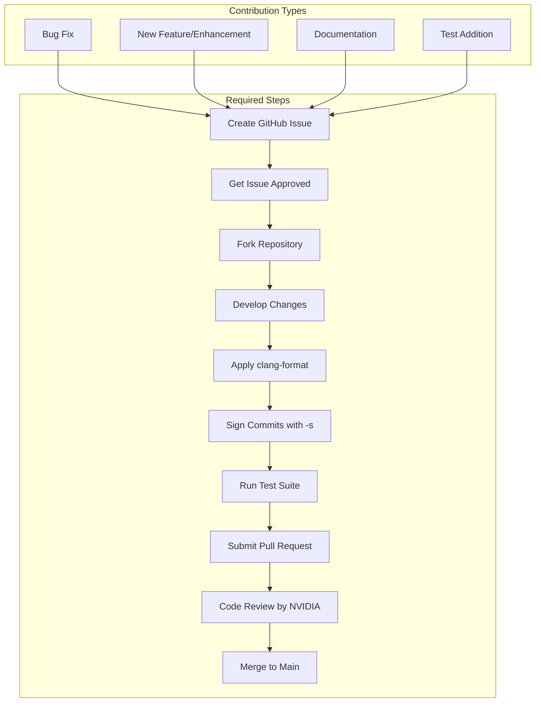
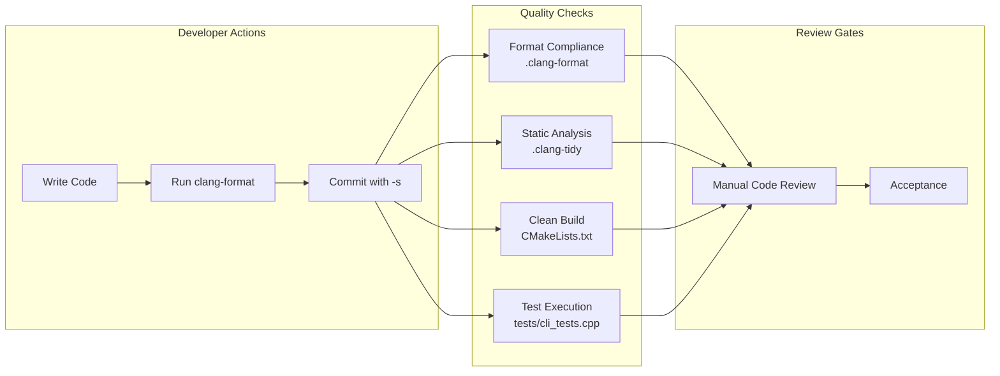
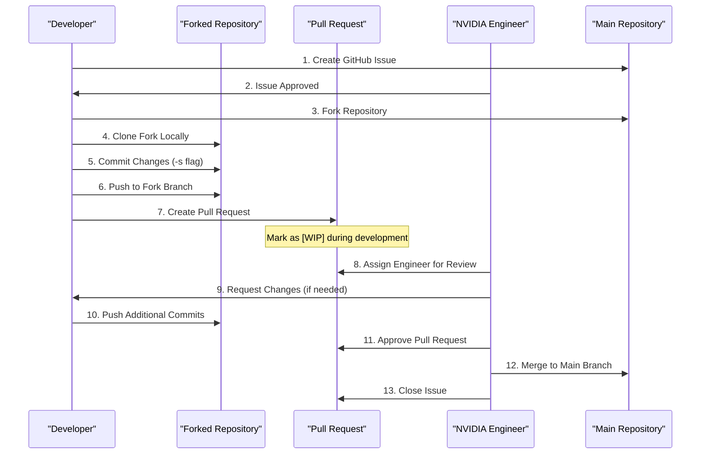

<!-- source: DeepWiki mcp.deepwiki.com · repo NVIDIA/attestation-sdk · page 7 Contributing · fetched 2026-10-26 -->

# Contributing

<details>
<summary>Relevant source files</summary>

The following files were used as context for generating this wiki page:

- [CODE_OF_CONDUCT.md](CODE_OF_CONDUCT.md)
- [CONTRIBUTING.md](CONTRIBUTING.md)
- [SECURITY.md](SECURITY.md)

</details>


**Purpose and Scope**: This page provides an overview of how to contribute to the NVIDIA Attestation SDK project, including community standards, contribution workflows, and quality requirements. For detailed step-by-step contribution procedures, see [Contribution Workflow](#7.1). For community behavioral expectations, see [Code of Conduct](#7.2). For reporting security issues, see [Security Policy](#7.3).

## Overview

The NVIDIA Attestation SDK welcomes community contributions to enhance device attestation capabilities, fix bugs, improve documentation, and extend hardware support. All contributions must follow established guidelines to maintain code quality, security, and project consistency.

The project follows a fork-and-pull-request model hosted on GitHub. All contributions require issue tracking, code review by NVIDIA engineers, adherence to coding standards, commit signing via Developer Certificate of Origin (DCO), and successful test execution before acceptance.

**Sources**: [CONTRIBUTING.md:1-140]()

## Contribution Prerequisites

Before contributing code, developers must ensure they have:

| Requirement | Description | Reference |
|-------------|-------------|-----------|
| **GitHub Account** | Required to fork repository and submit pull requests | [CONTRIBUTING.md:79-81]() |
| **DCO Understanding** | All commits must be signed-off certifying contribution rights | [CONTRIBUTING.md:99-140]() |
| **Build Environment** | Functional build environment with all dependencies installed | See [Installation Guide](#2.1) |
| **Code Formatting Tools** | `clang-format` and `git-clang-format` for code style compliance | [CONTRIBUTING.md:16-33]() |
| **Testing Capability** | Ability to run test suite to verify changes | [CONTRIBUTING.md:56]() |

Contributors should review the existing codebase structure (see [Code Organization](#6.2)) and understand the testing infrastructure (see [Testing Infrastructure](#6.3)) before starting development work.

**Sources**: [CONTRIBUTING.md:1-140]()

## Contribution Types and Requirements



**Diagram**: Contribution workflow showing required steps from issue creation to merge

All code contributions follow a mandatory path: issue creation, approval, development with formatting, commit signing, testing, pull request submission, and review. The issue approval step ([CONTRIBUTING.md:6-7]()) ensures alignment with project goals before development begins.

**Sources**: [CONTRIBUTING.md:4-97]()

## Code Quality Enforcement

The project enforces strict code quality standards through automated tooling and manual review processes.



**Diagram**: Code quality enforcement pipeline from development to acceptance

### Code Formatting Standards

All source code must adhere to formatting rules defined in `.clang-format` at the repository root. Developers must run `clang-format` before committing changes:

```bash
# Format git staged changes
git-clang-format --style file

# Format specific files
clang-format -style=file -i -fallback-style=none path/to/file.cpp
```

The formatting rules enforce consistent conventions for class naming, function/method naming, variable naming, comment style, indentation, and line length ([CONTRIBUTING.md:16-21]()).

**Sources**: [CONTRIBUTING.md:16-33]()

### Static Analysis Requirements

The build system integrates `clang-tidy` for static code analysis. Configuration is specified in `.clang-tidy`, which enables checks for code correctness, performance, readability, and modern C++ best practices. For details on enabled checks and patterns, see [Code Quality Standards](#6.4).

**Sources**: [CONTRIBUTING.md:11-12](), see also [Code Quality Standards](#6.4)

### Build Cleanliness

All contributions must produce clean builds with zero warnings or errors ([CONTRIBUTING.md:54]()):

```bash
# Build must complete successfully
cmake -B build -S .
cmake --build build

# Build log must be clean
# No warnings, no errors
```

**Sources**: [CONTRIBUTING.md:54]()

## Testing Requirements

Every contribution must pass existing tests, and new functionality requires accompanying test coverage.

| Contribution Type | Testing Requirement | Location |
|-------------------|-------------------|----------|
| **Bug Fix** | Existing tests must pass | `nv-attestation-cli/tests/cli_tests.cpp` |
| **New Feature** | New tests required for feature validation | `nv-attestation-cli/tests/` |
| **New Component** | Test sample required to verify functionality | `nv-attestation-cli/tests/` |
| **Code Refactoring** | All existing tests must pass unchanged | `nv-attestation-cli/tests/cli_tests.cpp` |

Developers must execute the test suite before submitting pull requests ([CONTRIBUTING.md:56]()):

```bash
# Run test suite
cd build
ctest --output-on-failure
```

For new OSS components (plugins, samples), accompanying tests are mandatory to demonstrate and verify the functionality ([CONTRIBUTING.md:62-64]()).

**Sources**: [CONTRIBUTING.md:56](), [CONTRIBUTING.md:62-64]()

## Commit Requirements

### Developer Certificate of Origin (DCO)

All commits require sign-off using the `-s` flag to certify that the contributor has the right to submit the code under the project's license. This implements the Developer Certificate of Origin version 1.1:

```bash
# Sign commits
git commit -s -m "Fix attestation verification for GPU devices"

# Produces commit message with:
# Signed-off-by: Your Name <your@email.com>
```

Contributions without proper sign-off will not be accepted ([CONTRIBUTING.md:103]()).

**Sources**: [CONTRIBUTING.md:99-140]()

### Commit Message Format

Commit messages must follow imperative mood and reference the corresponding GitHub issue number:

```
#<Issue Number> - <Commit Title>

<Commit Body>
```

Example:
```
#42 - Add support for nvswitch attestation verification

Implement verification logic for nvswitch devices using NSCQ
library. Adds new device type handling in attestation context
and corresponding test coverage.

Signed-off-by: Developer Name <dev@example.com>
```

**Sources**: [CONTRIBUTING.md:47-52]()

## Pull Request Workflow



**Diagram**: Pull request workflow from fork to merge

The workflow follows these steps:

1. **Issue Creation**: Developer creates GitHub issue describing bug, feature, or change ([CONTRIBUTING.md:6-7]())
2. **Fork Repository**: After approval, fork the upstream repository ([CONTRIBUTING.md:79]())
3. **Local Development**: Clone fork and develop changes on feature branch ([CONTRIBUTING.md:81-88]())
4. **Stage Changes**: Apply formatting, sign commits, run tests
5. **Pull Request**: Create PR from fork branch to upstream branch ([CONTRIBUTING.md:90-92]())
6. **Work-in-Progress**: Mark PRs as `[WIP]` during active development ([CONTRIBUTING.md:94]())
7. **Code Review**: At least one NVIDIA engineer reviews the code ([CONTRIBUTING.md:93]())
8. **Manual Testing**: Developer and/or reviewer perform manual testing ([CONTRIBUTING.md:96]())
9. **Acceptance**: PR merged after successful review and testing ([CONTRIBUTING.md:96]())

**Sources**: [CONTRIBUTING.md:76-97]()

## Community Standards

The project maintains community standards through three governance documents:

| Document | Purpose | Contact |
|----------|---------|---------|
| **CODE_OF_CONDUCT.md** | Defines behavioral expectations and harassment-free participation | GitHub_Conduct@nvidia.com |
| **CONTRIBUTING.md** | Specifies technical contribution requirements and workflows | GitHub issues |
| **SECURITY.md** | Provides security vulnerability reporting procedures | psirt@nvidia.com |

All community participants must adhere to the Contributor Covenant Code of Conduct, which prohibits harassment, discrimination, and unprofessional behavior. Violations are reported to GitHub_Conduct@nvidia.com ([CODE_OF_CONDUCT.md:66]()).

For detailed behavioral expectations, see [Code of Conduct](#7.2). For security vulnerability reporting, see [Security Policy](#7.3).

**Sources**: [CODE_OF_CONDUCT.md:1-85](), [SECURITY.md:1-15](), [CONTRIBUTING.md:1-140]()

## Coding Guidelines Highlights

Key coding guidelines that contributors must follow:

### Style Consistency
- Follow existing conventions in files, submodules, and modules when adding code ([CONTRIBUTING.md:14]())
- Adhere to class, function, variable naming conventions enforced by `.clang-format`
- Maintain consistent comment style and indentation

### Code Complexity
- Avoid introducing unnecessary complexity ([CONTRIBUTING.md:41]())
- Preserve maintainability and readability
- Keep PRs concise and focused on single concerns ([CONTRIBUTING.md:43-45]())
- Avoid committing commented-out code ([CONTRIBUTING.md:44]())

### Feature Additions
When adding or disabling functionality ([CONTRIBUTING.md:66-69]()):
- Add CMake option with default value matching existing behavior
- Selectively include/exclude files in `CMakeLists.txt` rather than using `#if` guards around entire file bodies
- Use `#if` guards for minor changes within existing files

### Documentation Requirements
All OSS components must include ([CONTRIBUTING.md:58-60]()):
- README files describing functionality, dependencies, and known issues
- Reference existing `README.md` files in samples and plugins for format guidance

**Sources**: [CONTRIBUTING.md:10-74]()

## CMake Build System Integration

Contributions affecting the build system must maintain compatibility with the existing CMake structure:

```
nv-attestation-sdk/
├── CMakeLists.txt                    # Root CMake configuration
├── nv-attestation-sdk-cpp/
│   └── CMakeLists.txt                # SDK library build
└── nv-attestation-cli/
    └── CMakeLists.txt                # CLI tool build
```

When adding build options, follow the existing pattern of enabling/disabling features:

```cmake
# Example pattern from build system
option(ENABLE_NVML "Enable NVML support for GPU attestation" ON)
option(ENABLE_NSCQ "Enable NSCQ support for Switch attestation" OFF)
```

For detailed build system documentation, see [Build System Reference](#8.3).

**Sources**: [CONTRIBUTING.md:66-69]()

## Contribution Checklist

Before submitting a pull request, verify:

- [ ] GitHub issue created and approved
- [ ] Code follows conventions in [CODING-GUIDELINES.md]()
- [ ] `clang-format` applied to all modified files
- [ ] Build completes cleanly with no warnings or errors
- [ ] All existing tests pass
- [ ] New tests added for new functionality
- [ ] Commits signed with `-s` flag (DCO)
- [ ] Commit messages reference issue number
- [ ] README/documentation updated if adding new component
- [ ] PR description clearly explains changes

**Sources**: [CONTRIBUTING.md:1-140]()

## Related Documentation

For additional information on contributing to the project:

- **[Contribution Workflow](#7.1)**: Detailed step-by-step guide for code contributions
- **[Code of Conduct](#7.2)**: Community behavioral standards and enforcement
- **[Security Policy](#7.3)**: Reporting security vulnerabilities responsibly
- **[Code Quality Standards](#6.4)**: Detailed clang-tidy configuration and requirements
- **[Testing Infrastructure](#6.3)**: Test framework, environment setup, and test execution

**Sources**: [CONTRIBUTING.md:1-140](), [CODE_OF_CONDUCT.md:1-85](), [SECURITY.md:1-15]()

---

