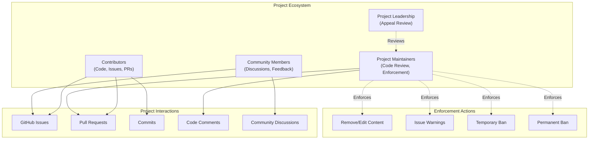
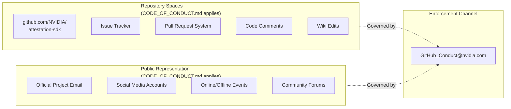
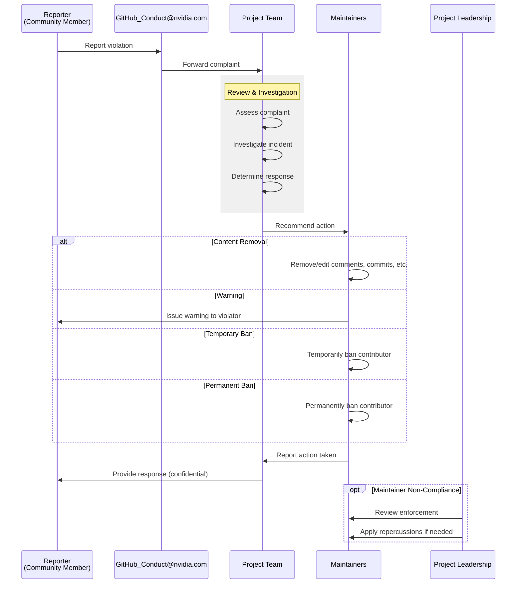
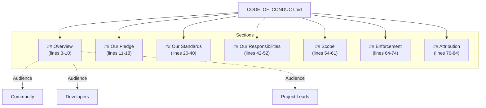

<!-- source: DeepWiki mcp.deepwiki.com · repo NVIDIA/attestation-sdk · page 7.2 Code of Conduct · fetched 2026-10-26 -->

# Code of Conduct

Relevant source files

The following files were used as context for generating this wiki page:

- [CODE_OF_CONDUCT.md](CODE_OF_CONDUCT.md)

## Purpose and Scope

This document defines the community standards and behavioral expectations for all participants in the NVIDIA Attestation SDK project. The Code of Conduct establishes guidelines for creating a welcoming, inclusive, and harassment-free environment for contributors, maintainers, and community members. This applies to all project spaces including the repository, issues, pull requests, and any communication channels where the project is represented.

For information about the technical contribution workflow, see [Contribution Workflow](#7.1). For security-related reporting procedures, see [Security Policy](#7.3).

**Sources:** [CODE_OF_CONDUCT.md:1-85]()

---

## Code of Conduct Framework

The NVIDIA Attestation SDK follows the **Contributor Covenant Code of Conduct version 1.4**, a widely-adopted community standard for open-source projects. This framework establishes baseline behavioral expectations and enforcement procedures to ensure productive and respectful collaboration.

The Code of Conduct document is located at [CODE_OF_CONDUCT.md]() in the repository root and is intended for three primary audiences:
- **Community members** participating in discussions
- **Developers** contributing code and documentation  
- **Project leads** responsible for enforcement

**Sources:** [CODE_OF_CONDUCT.md:1-10](), [CODE_OF_CONDUCT.md:76-84]()

---

## Community Standards

### The Pledge

All contributors and maintainers pledge to make participation in the NVIDIA Attestation SDK project a harassment-free experience for everyone, regardless of:

| Category | Protected Characteristics |
|----------|---------------------------|
| Physical | Age, body size, disability |
| Identity | Gender identity and expression, sexual identity and orientation |
| Background | Ethnicity, race, nationality, religion |
| Professional | Level of experience, education, socio-economic status |
| Appearance | Personal appearance |
| Expression | Sex characteristics |

This pledge applies universally to all interactions within project spaces and when representing the project publicly.

**Sources:** [CODE_OF_CONDUCT.md:11-18]()

### Positive Behaviors

The following behaviors contribute to creating a positive environment:

| Behavior | Description |
|----------|-------------|
| **Welcoming language** | Using inclusive terminology and avoiding exclusionary phrases |
| **Respect for diversity** | Acknowledging and respecting differing viewpoints and experiences |
| **Constructive feedback** | Accepting criticism gracefully and providing it respectfully |
| **Community focus** | Prioritizing what benefits the community over individual preferences |
| **Empathy** | Demonstrating understanding toward other community members |

**Sources:** [CODE_OF_CONDUCT.md:20-29]()

### Unacceptable Behaviors

The following behaviors are explicitly prohibited:

| Violation Type | Examples |
|----------------|----------|
| **Sexual misconduct** | Sexualized language or imagery, unwelcome sexual attention or advances |
| **Harassment** | Trolling, insulting/derogatory comments, personal or political attacks |
| **Privacy violations** | Publishing others' private information (physical or electronic addresses) without permission |
| **Inappropriate conduct** | Other behavior reasonably considered inappropriate in a professional setting |

Violations can occur in both public and private interactions within project spaces.

**Sources:** [CODE_OF_CONDUCT.md:31-40]()

---

## Roles and Responsibilities

### Participant Roles

**Sources:** [CODE_OF_CONDUCT.md:42-53](), [CODE_OF_CONDUCT.md:72-74]()

### Maintainer Responsibilities

Project maintainers bear specific responsibilities under the Code of Conduct:

| Responsibility | Description |
|----------------|-------------|
| **Clarify standards** | Define and communicate acceptable behavior standards |
| **Corrective action** | Take appropriate and fair action in response to violations |
| **Content moderation** | Remove, edit, or reject contributions not aligned with the Code of Conduct |
| **Contributor management** | Temporarily or permanently ban contributors for inappropriate behavior |
| **Confidentiality** | Maintain confidentiality regarding incident reporters |

Maintainers must exercise these responsibilities consistently and fairly. Maintainers who fail to enforce the Code of Conduct in good faith may face repercussions from project leadership.

**Sources:** [CODE_OF_CONDUCT.md:42-53](), [CODE_OF_CONDUCT.md:72-74]()

---

## Scope of Application

### Project Spaces

**Sources:** [CODE_OF_CONDUCT.md:54-61]()

The Code of Conduct applies in two primary contexts:

**1. Within Project Spaces:**
- The repository at `https://github.com/NVIDIA/attestation-sdk`
- Issue tracking and bug reports
- Pull requests and code reviews
- Commit comments and discussions
- Wiki edits and documentation contributions

**2. Public Representation:**
- When using official project email addresses
- When posting via official social media accounts
- When acting as an appointed representative at events (online or offline)
- Any context where an individual explicitly represents the project or its community

Project maintainers may further define and clarify what constitutes project representation in specific contexts.

**Sources:** [CODE_OF_CONDUCT.md:54-61]()

---

## Enforcement Process

### Reporting Violations

**Sources:** [CODE_OF_CONDUCT.md:64-74]()

### Reporting Procedure

Instances of abusive, harassing, or otherwise unacceptable behavior should be reported by contacting:

**Enforcement Email:** `GitHub_Conduct@nvidia.com`

All complaints submitted to this address will be:
1. **Reviewed** by the project team
2. **Investigated** thoroughly
3. **Responded to** with action deemed necessary and appropriate to the circumstances

The project team is obligated to maintain **confidentiality** regarding the reporter of an incident.

**Sources:** [CODE_OF_CONDUCT.md:64-70]()

### Enforcement Actions

Project maintainers may take the following corrective actions:

| Action | Scope | Examples |
|--------|-------|----------|
| **Content Moderation** | Remove or edit contributions | Delete offensive comments in [GitHub issues](), edit inappropriate [commit messages](), reject [pull requests]() with violations |
| **Warning** | Notify violator | Formal warning about behavior, request for modification |
| **Temporary Ban** | Suspend participation | Temporary restriction from contributing, commenting, or interacting |
| **Permanent Ban** | Permanent exclusion | Indefinite ban from all project spaces and representation |

Specific enforcement policies may be posted separately as the project evolves.

**Sources:** [CODE_OF_CONDUCT.md:42-53](), [CODE_OF_CONDUCT.md:64-70]()

### Maintainer Accountability

Maintainers themselves are subject to the Code of Conduct. Maintainers who fail to follow or enforce the Code of Conduct in good faith may face temporary or permanent repercussions as determined by project leadership.

**Sources:** [CODE_OF_CONDUCT.md:72-74]()

---

## Document Management

### File Location and Format

The Code of Conduct is maintained as a standalone Markdown document:

**File:** [CODE_OF_CONDUCT.md:1-85]()  
**Format:** Markdown  
**Location:** Repository root

The document structure follows this organization:

**Sources:** [CODE_OF_CONDUCT.md:1-85]()

### Attribution and License

The NVIDIA Attestation SDK Code of Conduct is adapted from the **Contributor Covenant version 1.4**, available at:
- Canonical URL: `https://www.contributor-covenant.org/version/1/4/code-of-conduct.html`
- Homepage: `https://www.contributor-covenant.org`
- FAQ: `https://www.contributor-covenant.org/faq`

The Contributor Covenant is a widely-adopted standard used by thousands of open-source projects to establish baseline community behavioral expectations.

**Sources:** [CODE_OF_CONDUCT.md:76-84]()

---

## Integration with Project Governance

The Code of Conduct is one component of the project's governance framework:

| Document | Purpose | Relationship to Code of Conduct |
|----------|---------|--------------------------------|
| [CODE_OF_CONDUCT.md]() | Community behavior standards | **This document** |
| `CONTRIBUTING.md` | Technical contribution guidelines | References Code of Conduct for behavioral expectations (see [Contribution Workflow](#7.1)) |
| `SECURITY.md` | Security vulnerability reporting | Separate enforcement channel for security issues (see [Security Policy](#7.3)) |
| `LICENSE` | Software licensing terms | Legal framework independent of behavioral standards |

Contributors should familiarize themselves with all governance documents to ensure full compliance with project requirements.

**Sources:** [CODE_OF_CONDUCT.md:3-10]()

---

