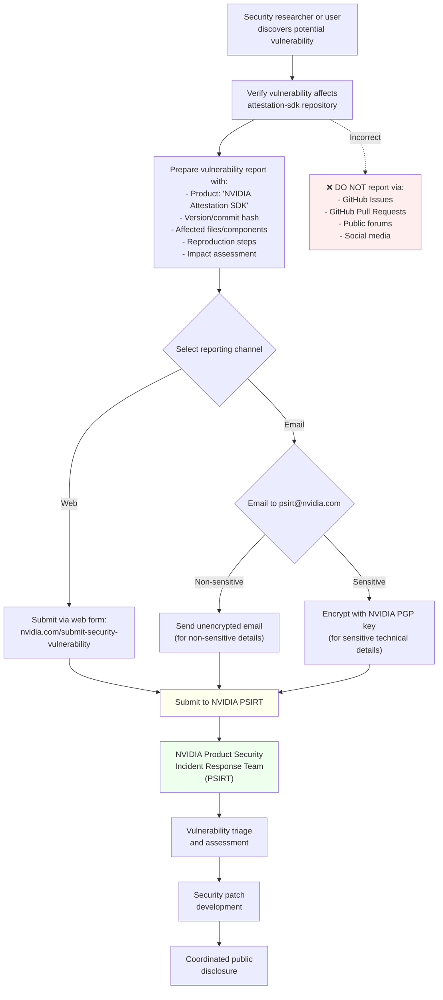
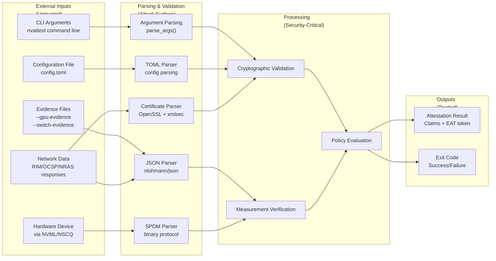

<!-- source: DeepWiki mcp.deepwiki.com · repo NVIDIA/attestation-sdk · page 7.3 Security Policy · fetched 2026-10-26 -->

# Security Policy

<details>
<summary>Relevant source files</summary>

The following files were used as context for generating this wiki page:

- [SECURITY.md](SECURITY.md)

</details>


## Purpose and Scope

This document describes the security vulnerability reporting policy for the NVIDIA Attestation SDK repository. It outlines the proper channels for reporting potential security issues and the information required when submitting security vulnerability reports. This policy applies to all components in the repository including the core SDK ([nv-attestation-sdk-cpp]()) and the CLI tool ([nv-attestation-cli]()).

For information about general contribution guidelines and code review processes, see [Contribution Workflow](#7.1). For community behavioral standards, see [Code of Conduct](#7.2).

**Sources:** [SECURITY.md:1-15]()

## Overview

NVIDIA maintains a dedicated security posture for all software products and services, including open source repositories. The attestation SDK handles sensitive security operations including cryptographic verification, certificate validation, and trusted computing measurements. Due to the security-critical nature of attestation operations, vulnerabilities in this codebase could have significant impact on confidential computing deployments.

The security policy is formally documented in the repository root to ensure visibility and accessibility to all users and contributors.

**Sources:** [SECURITY.md:1-5]()

## Reporting Security Vulnerabilities

### Critical Requirement: Do Not Use GitHub

Security vulnerabilities **must not** be reported through GitHub issues, pull requests, discussions, or any other public GitHub mechanism. Public disclosure of security vulnerabilities before they are addressed can expose users to exploitation and compromise the security of systems using the attestation SDK.

**Sources:** [SECURITY.md:5]()

### Official Reporting Channels

NVIDIA provides two official channels for security vulnerability reports:

| Channel | Details | Primary Use Case |
|---------|---------|------------------|
| **Web Form** | [NVIDIA Security Vulnerability Submission Form](https://www.nvidia.com/object/submit-security-vulnerability.html) | Preferred method for structured submissions |
| **Email** | `psirt@nvidia.com` | Direct communication with NVIDIA Product Security Incident Response Team |

**Sources:** [SECURITY.md:9-11]()

### Secure Communication with PGP Encryption

When submitting vulnerability reports via email, NVIDIA strongly encourages the use of PGP encryption to protect sensitive technical details during transmission. The [NVIDIA public PGP key](https://www.nvidia.com/en-us/security/pgp-key) is available for encrypting email communications to `psirt@nvidia.com`.

This encryption layer is particularly important when discussing:
- Proof-of-concept exploit code
- Specific memory addresses or offsets
- Cryptographic weaknesses in implementation
- Attestation bypass techniques

**Sources:** [SECURITY.md:12]()

### Required Information for Vulnerability Reports

When reporting a security vulnerability, include the following information to facilitate efficient triage and remediation:

```
Required Fields:
- Product/Driver name: "NVIDIA Attestation SDK" or specific component
- Version/branch: Git commit hash, release tag, or branch name
- Vulnerability description: Technical details of the issue
- Affected components: Specific files, functions, or modules
- Impact assessment: Potential security consequences
- Reproduction steps: How to trigger the vulnerability
```

For the attestation SDK specifically, helpful context includes:

- **Component identification**: Whether the issue affects the SDK ([nv-attestation-sdk-cpp/src]()) or CLI ([nv-attestation-cli/src]())
- **Device type**: If the vulnerability is specific to GPU attestation ([gpu/]() modules) or Switch attestation ([switch/]() modules)
- **Verification mode**: Whether the issue affects local verification, remote verification, or both
- **Attack scenario**: Whether this could be exploited by a malicious device, a compromised verifier, or a man-in-the-middle attacker

**Sources:** [SECURITY.md:13-14]()

## Security Reporting Workflow

The following diagram illustrates the proper workflow for reporting security vulnerabilities in the NVIDIA Attestation SDK:



**Sources:** [SECURITY.md:1-15]()

## Component-Specific Security Considerations

When reporting vulnerabilities, understanding the security-sensitive components helps provide more actionable information:

```mermaid
graph TB
    subgraph "Security-Critical Components"
        subgraph "Cryptographic Operations"
            CERT_VERIFY["Certificate Verification<br/>attestation.cpp<br/>verify.cpp"]
            OCSP["OCSP Validation<br/>Certificate revocation checks"]
            JWT_OPS["JWT Token Handling<br/>jwt-cpp integration"]
        end
        
        subgraph "Evidence Processing"
            EVIDENCE["Evidence Collection<br/>gpu/evidence.cpp<br/>switch/evidence.cpp"]
            SPDM["SPDM Protocol Parsing<br/>spdm_measurement_records.cpp"]
            MEASUREMENTS["Measurement Validation<br/>Reference vs. actual values"]
        end
        
        subgraph "Policy Enforcement"
            REGO_ENGINE["Rego Policy Engine<br/>regorus_rego_engine.cpp"]
            POLICY_EVAL["Policy Evaluation<br/>claims_evaluator.cpp"]
            RIM_STORE["RIM Store Access<br/>rim.cpp"]
        end
        
        subgraph "External Communication"
            HTTP_CLIENT["HTTP/HTTPS Client<br/>CURL operations"]
            RIM_FETCH["RIM Service Interaction"]
            NRAS_API["NRAS Remote Attestation"]
        end
    end
    
    subgraph "Common Vulnerability Classes"
        AUTH_BYPASS["Authentication Bypass"]
        CRYPTO_WEAK["Cryptographic Weakness"]
        INJECTION["Injection Attacks"]
        DOS["Denial of Service"]
        INFO_LEAK["Information Disclosure"]
        BUFFER_OVERFLOW["Memory Corruption"]
    end
    
    CERT_VERIFY -.->|"May be affected by"| AUTH_BYPASS
    CERT_VERIFY -.->|"May be affected by"| CRYPTO_WEAK
    
    EVIDENCE -.->|"May be affected by"| INJECTION
    SPDM -.->|"May be affected by"| BUFFER_OVERFLOW
    
    REGO_ENGINE -.->|"May be affected by"| AUTH_BYPASS
    POLICY_EVAL -.->|"May be affected by"| DOS
    
    HTTP_CLIENT -.->|"May be affected by"| INFO_LEAK
    HTTP_CLIENT -.->|"May be affected by"| INJECTION
```



**Sources:** [nv-attestation-sdk-cpp/src/attestation.cpp](), [nv-attestation-sdk-cpp/src/verify.cpp](), [nv-attestation-sdk-cpp/src/gpu/evidence.cpp](), [nv-attestation-sdk-cpp/src/switch/evidence.cpp](), [nv-attestation-sdk-cpp/src/spdm_measurement_records.cpp](), [nv-attestation-sdk-cpp/src/regorus_rego_engine.cpp](), [nv-attestation-sdk-cpp/src/claims_evaluator.cpp](), [nv-attestation-sdk-cpp/src/rim.cpp]()

## Attack Surface Mapping

Understanding the attack surface helps security researchers identify areas where vulnerabilities may exist:



**Sources:** [nv-attestation-cli/src/main.cpp](), [nv-attestation-cli/src/attest.cpp](), [nv-attestation-sdk-cpp/src/attestation.cpp]()

## Security Review Checklist for Contributors

While all contributions go through code review (see [Contribution Workflow](#7.1)), contributors should perform self-review for common security issues before submitting:

| Security Category | Items to Check |
|------------------|----------------|
| **Input Validation** | • All external inputs validated<br/>• Buffer boundaries checked<br/>• Integer overflow prevention<br/>• Path traversal prevention |
| **Cryptography** | • No custom crypto implementations<br/>• Standard algorithms used correctly<br/>• Secure random number generation<br/>• Certificate validation not bypassed |
| **Memory Safety** | • No use-after-free<br/>• No double-free<br/>• Proper null pointer checks<br/>• RAII patterns for resource management |
| **Error Handling** | • No sensitive data in error messages<br/>• Proper cleanup on error paths<br/>• No information leaks in timing |
| **Dependencies** | • Known vulnerable versions avoided<br/>• Minimal attack surface<br/>• Proper dependency pinning |

Code quality tools help catch some security issues automatically. The repository uses `clang-tidy` with security-focused checks enabled. See [Code Quality Standards](#6.4) for configuration details.

**Sources:** [SECURITY.md:1-15](), [.clang-tidy]()

## Responsible Disclosure Timeline

While not explicitly documented in [SECURITY.md:1-15](), responsible disclosure typically follows this timeline:

1. **Initial Report**: Security researcher submits vulnerability to NVIDIA PSIRT
2. **Acknowledgment**: NVIDIA confirms receipt (typically within 5 business days)
3. **Investigation**: NVIDIA security team investigates and validates the issue
4. **Remediation**: Development team creates security patch
5. **Testing**: Patch undergoes security testing and validation
6. **Coordinated Disclosure**: Public disclosure after patch is available

During this process, NVIDIA requests that security researchers:
- Do not publicly disclose the vulnerability
- Do not exploit the vulnerability beyond proof-of-concept validation
- Provide reasonable time for NVIDIA to develop and release a patch

This coordinated approach protects users of the attestation SDK while ensuring researchers receive appropriate credit for their findings.

**Sources:** [SECURITY.md:1-15]()

## Contact Information Summary

| Purpose | Contact Method | Details |
|---------|---------------|---------|
| **Primary Security Reports** | Web Form | https://www.nvidia.com/object/submit-security-vulnerability.html |
| **Direct Email** | Email | psirt@nvidia.com |
| **Encrypted Email** | PGP | Use [NVIDIA PGP key](https://www.nvidia.com/en-us/security/pgp-key) |
| **General Contributions** | GitHub | See [Contribution Workflow](#7.1) for non-security issues |
| **Community Questions** | GitHub Discussions | For public, non-security related questions |

**Important**: Never use GitHub for security vulnerability reports. All security issues must be reported through the official channels listed above.

**Sources:** [SECURITY.md:9-12]()

---

