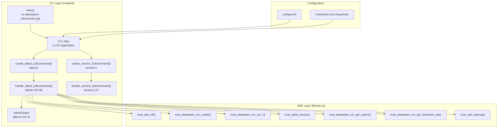
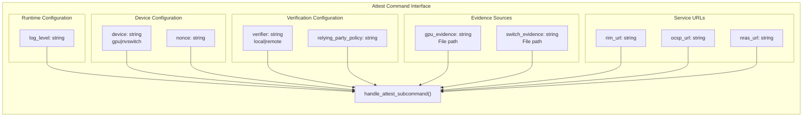
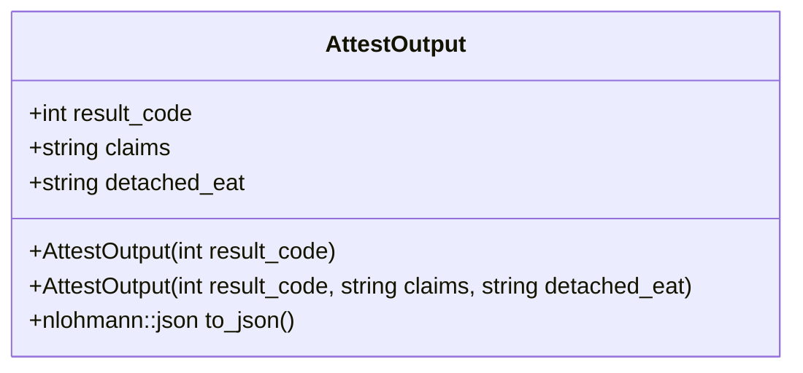
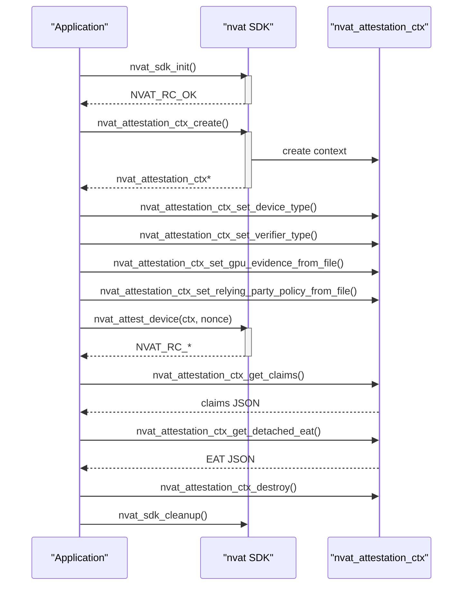
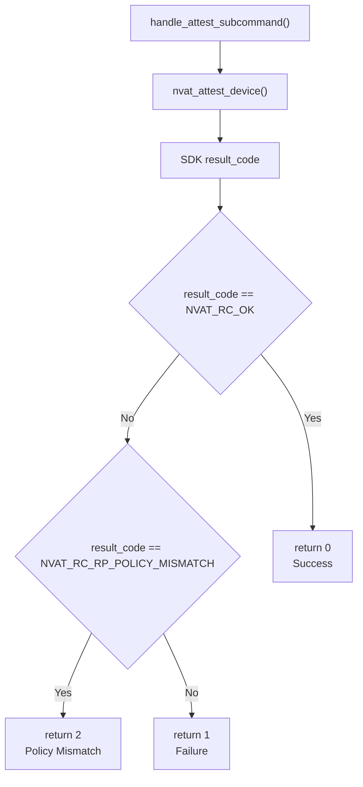
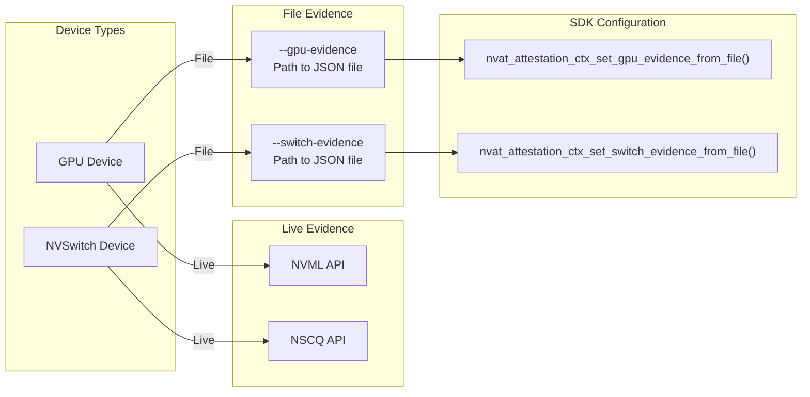
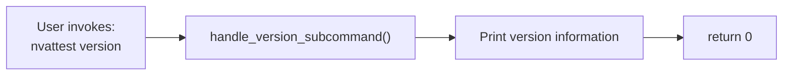

<!-- source: DeepWiki mcp.deepwiki.com · repo NVIDIA/attestation-sdk · page 8 Reference · fetched 2026-10-26 -->

# Reference

<details>
<summary>Relevant source files</summary>

The following files were used as context for generating this wiki page:

- [nv-attestation-cli/config.toml](nv-attestation-cli/config.toml)
- [nv-attestation-cli/src/attest.h](nv-attestation-cli/src/attest.h)
- [nv-attestation-cli/src/version.h](nv-attestation-cli/src/version.h)

</details>


This section provides comprehensive technical reference documentation for the NVIDIA Attestation SDK and CLI tool. It includes API structures, configuration schemas, key data types, and command interfaces. For detailed command usage patterns, see [Using the CLI](#4). For build configuration options, see [Build System Reference](#8.3). For error code listings, see [Error Codes and Handling](#8.2).

## API Structure Overview

The attestation system exposes two primary programming interfaces: the C SDK API provided by the `nvat` library, and the CLI command interface provided by the `nvattest` tool.

### SDK and CLI Interface Relationship



**Sources:** [nv-attestation-cli/src/attest.h:1-101](), [nv-attestation-cli/src/version.h:1-40]()

## CLI Command Reference Structure

The CLI tool provides a structured command interface with two subcommands. Each subcommand has its own handler function and configuration options.

### CLI Subcommand API

| Subcommand | Handler Function | Purpose | Key Parameters |
|------------|-----------------|---------|----------------|
| `attest` | `handle_attest_subcommand()` | Perform device attestation | `device`, `verifier`, `nonce`, evidence paths, policy, service URLs |
| `version` | `handle_version_subcommand()` | Display version information | None |

**Sources:** [nv-attestation-cli/src/attest.h:59-71](), [nv-attestation-cli/src/version.h:30-37]()

### Attest Subcommand Parameters



**Sources:** [nv-attestation-cli/src/attest.h:87-98]()

### Parameter Reference Table

| Parameter | Type | CLI Flag | Config Key | Description |
|-----------|------|----------|------------|-------------|
| `nonce` | string | `--nonce` | N/A | Nonce value for attestation freshness |
| `device` | string | `--device` | `attest.device` | Device type: "gpu" or "nvswitch" |
| `verifier` | string | `--verifier` | `attest.verifier` | Verification mode: "local" or "remote" |
| `gpu_evidence` | string | `--gpu-evidence` | `attest.gpu-evidence` | Path to GPU evidence file |
| `switch_evidence` | string | `--switch-evidence` | `attest.switch-evidence` | Path to switch evidence file |
| `relying_party_policy` | string | `--relying-party-policy` | `attest.relying-party-policy` | Path to Rego policy file |
| `rim_url` | string | `--rim-url` | N/A | RIM service URL |
| `ocsp_url` | string | `--ocsp-url` | N/A | OCSP service URL |
| `nras_url` | string | `--nras-url` | N/A | NRAS service URL |
| `log_level` | string | `--log-level` | N/A | Log verbosity level |

**Sources:** [nv-attestation-cli/src/attest.h:48-98](), [nv-attestation-cli/config.toml:1-13]()

## Configuration File Schema

The CLI tool supports a TOML configuration file that provides default values for command parameters. Configuration file values can be overridden by command-line arguments.

### config.toml Structure

```toml
# Global options apply to all subcommands
[default]

# Version subcommand configuration
[version]

# Attest subcommand configuration
[attest]
device = "gpu"
verifier = "local"
gpu-evidence = ""
switch-evidence = ""
relying-party-policy = ""
```

**Sources:** [nv-attestation-cli/config.toml:1-13]()

### Configuration Sections

| Section | Purpose | Available Keys |
|---------|---------|----------------|
| `[default]` | Global options and constants | Application-wide configuration values |
| `[version]` | Version subcommand options | (No options currently defined) |
| `[attest]` | Attest subcommand defaults | `device`, `verifier`, `gpu-evidence`, `switch-evidence`, `relying-party-policy` |

**Sources:** [nv-attestation-cli/config.toml:1-13]()

## CLI Output Data Structures

The CLI produces structured JSON output for the `attest` subcommand. The output format is defined by the `AttestOutput` class.

### AttestOutput Class Structure



**Sources:** [nv-attestation-cli/src/attest.h:33-42]()

### AttestOutput Fields

| Field | Type | Description |
|-------|------|-------------|
| `result_code` | `int` | Numeric result code indicating success or failure type (see [Error Codes](#8.2)) |
| `claims` | `string` | JSON string containing attestation claims |
| `detached_eat` | `string` | JSON string containing the detached Entity Attestation Token |

**Sources:** [nv-attestation-cli/src/attest.h:33-42]()

### Output JSON Schema

The `to_json()` method serializes the `AttestOutput` object to JSON with the following structure:

```json
{
  "result_code": 0,
  "result_message": "Success",
  "claims": "{...}",
  "detached_eat": "{...}"
}
```

For detailed information on result codes and messages, see [Error Codes and Handling](#8.2). For the structure of claims and EAT tokens, see [Output Format](#4.4).

**Sources:** [nv-attestation-cli/src/attest.h:33-42]()

## SDK API Entry Points

The core SDK provides a C API for attestation operations. The CLI tool is built on top of this API.

### SDK Initialization and Context Management Flow



**Sources:** [nv-attestation-cli/src/attest.h:87-98]()

### Key SDK Functions

| Function | Purpose | Return Type |
|----------|---------|-------------|
| `nvat_sdk_init()` | Initialize the SDK library | Result code |
| `nvat_attestation_ctx_create()` | Create attestation context | Context pointer |
| `nvat_attestation_ctx_set_device_type()` | Configure device type | Result code |
| `nvat_attestation_ctx_set_verifier_type()` | Configure verifier mode | Result code |
| `nvat_attestation_ctx_set_gpu_evidence_from_file()` | Load GPU evidence from file | Result code |
| `nvat_attestation_ctx_set_switch_evidence_from_file()` | Load switch evidence from file | Result code |
| `nvat_attestation_ctx_set_relying_party_policy_from_file()` | Load Rego policy from file | Result code |
| `nvat_attest_device()` | Execute attestation | Result code |
| `nvat_attestation_ctx_get_claims()` | Retrieve claims JSON | Claims string |
| `nvat_attestation_ctx_get_detached_eat()` | Retrieve EAT JSON | EAT string |
| `nvat_attestation_ctx_destroy()` | Clean up context | void |
| `nvat_sdk_cleanup()` | Clean up SDK resources | void |

**Sources:** [nv-attestation-cli/src/attest.h:87-98]()

## Handler Return Codes

The CLI handler functions return integer exit codes that determine the process exit status.

### Handler Exit Code Mapping

| Exit Code | Meaning | When Returned |
|-----------|---------|---------------|
| 0 | Success | Attestation succeeded and policy matched |
| 1 | Failure | SDK error or attestation failure |
| 2 | Policy Mismatch | Attestation succeeded but policy evaluation failed |

**Sources:** [nv-attestation-cli/src/attest.h:85]()

### Exit Code to Result Code Relationship



**Sources:** [nv-attestation-cli/src/attest.h:85]()

## Device Type Constants

The SDK supports multiple device types through string identifiers.

### Supported Device Types

| Device Type String | Description | Evidence Source API |
|-------------------|-------------|---------------------|
| `"gpu"` | NVIDIA GPU | NVML (NVIDIA Management Library) |
| `"nvswitch"` | NVIDIA NVSwitch | NSCQ (NVSwitch Control Query) |

**Sources:** [nv-attestation-cli/src/attest.h:48,76](), [nv-attestation-cli/config.toml:9]()

## Verifier Type Constants

The attestation system supports two verification modes.

### Supported Verifier Types

| Verifier Type String | Description | External Services Required |
|---------------------|-------------|---------------------------|
| `"local"` | Local verification | None |
| `"remote"` | Remote verification with NVIDIA services | RIM service, OCSP service, NRAS service |

**Sources:** [nv-attestation-cli/src/attest.h:49,77](), [nv-attestation-cli/config.toml:10]()

## Evidence File Formats

Evidence can be provided from files instead of live hardware queries. This is useful for testing and offline verification scenarios.

### Evidence File Parameter Mapping



**Sources:** [nv-attestation-cli/src/attest.h:50-51,78-79](), [nv-attestation-cli/config.toml:11-12]()

## Policy File Configuration

Relying party policies are written in Rego and loaded from files.

### Policy File Parameter

| Parameter | CLI Flag | Config Key | SDK Function |
|-----------|----------|------------|--------------|
| `relying_party_policy` | `--relying-party-policy` | `attest.relying-party-policy` | `nvat_attestation_ctx_set_relying_party_policy_from_file()` |

The policy file must contain valid Rego policy that evaluates the `nv_match` decision. For policy structure details, see [Relying Party Policies](#5.3).

**Sources:** [nv-attestation-cli/src/attest.h:52,80](), [nv-attestation-cli/config.toml:13]()

## Service URL Configuration

When using remote verification mode, the SDK communicates with external NVIDIA services. These URLs can be configured via command-line arguments.

### Remote Service URLs

| Service | Parameter | CLI Flag | Purpose |
|---------|-----------|----------|---------|
| RIM Service | `rim_url` | `--rim-url` | Fetch Reference Integrity Manifests |
| OCSP Service | `ocsp_url` | `--ocsp-url` | Verify certificate revocation status |
| NRAS Service | `nras_url` | `--nras-url` | Remote attestation verification |

**Sources:** [nv-attestation-cli/src/attest.h:53-55,81-83]()

## Logging Configuration

The SDK supports configurable logging levels for debugging and troubleshooting.

### Log Level Parameter

| Parameter | CLI Flag | Values | Description |
|-----------|----------|--------|-------------|
| `log_level` | `--log-level` | String | Controls SDK logging verbosity |

**Sources:** [nv-attestation-cli/src/attest.h:56,84]()

## Version Subcommand Interface

The version subcommand provides version information for the CLI tool and SDK.

### Version Command Handler



The version handler takes no parameters and always returns 0 (success). For details on version output format, see [Version Information](#8.1).

**Sources:** [nv-attestation-cli/src/version.h:30-37]()

---

