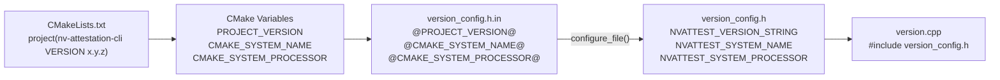
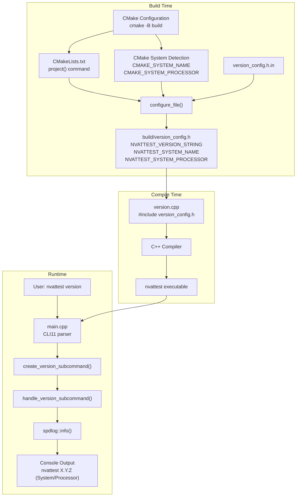
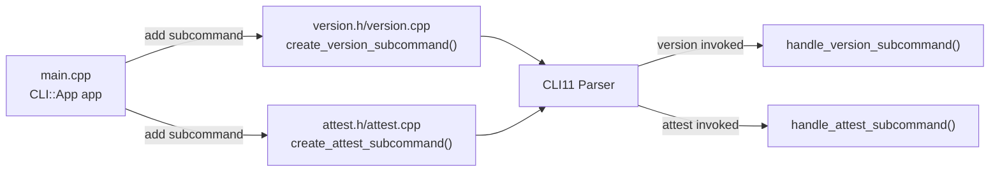

<!-- source: DeepWiki mcp.deepwiki.com · repo NVIDIA/attestation-sdk · page 8.1 Version Information · fetched 2026-10-26 -->

# Version Information

<details>
<summary>Relevant source files</summary>

The following files were used as context for generating this wiki page:

- [nv-attestation-cli/src/version.cpp](nv-attestation-cli/src/version.cpp)
- [nv-attestation-cli/src/version.h](nv-attestation-cli/src/version.h)
- [nv-attestation-cli/src/version_config.h.in](nv-attestation-cli/src/version_config.h.in)

</details>


## Purpose and Scope

This document describes the version information system in the NVIDIA Attestation SDK CLI tool. It covers the `version` subcommand implementation, build-time version configuration through CMake, and the version output format. For general CLI command structure and other subcommands, see [CLI Command Structure](#4.1).

The version system provides runtime visibility into the CLI tool's version number and build platform details. Version information is configured at build time through CMake template substitution and displayed via the `version` subcommand.

## Version Command Structure

The version subcommand is implemented through two primary functions in the `nvattest` namespace:

| Function | Purpose | Return Value |
|----------|---------|--------------|
| `create_version_subcommand()` | Registers the version subcommand with the CLI11 application | Pointer to CLI::App subcommand |
| `handle_version_subcommand()` | Executes version display logic | Exit code (0 for success) |

The subcommand is registered with a simple description: "Display version information" [nv-attestation-cli/src/version.cpp:25]().

### Command Invocation

Users invoke the version command using:

```bash
nvattest version
```

No arguments or options are accepted by this subcommand. When executed, `handle_version_subcommand()` logs the version information and returns successfully [nv-attestation-cli/src/version.cpp:28-31]().

**Sources:** [nv-attestation-cli/src/version.h:24-37](), [nv-attestation-cli/src/version.cpp:24-31]()

## Build-Time Version Configuration

Version information is configured at build time through a CMake template substitution system. The template file `version_config.h.in` defines three preprocessor macros that are populated during the CMake configuration phase.

### Version Macros

| Macro | Source CMake Variable | Description |
|-------|----------------------|-------------|
| `NVATTEST_VERSION_STRING` | `@PROJECT_VERSION@` | Semantic version string (e.g., "1.0.0") |
| `NVATTEST_SYSTEM_NAME` | `@CMAKE_SYSTEM_NAME@` | Operating system name (e.g., "Linux", "Windows") |
| `NVATTEST_SYSTEM_PROCESSOR` | `@CMAKE_SYSTEM_PROCESSOR@` | Target processor architecture (e.g., "x86_64", "aarch64") |

The template file [nv-attestation-cli/src/version_config.h.in:20-22]() uses CMake variable substitution syntax (`@VAR@`). During the CMake configuration phase, these variables are replaced with actual values, generating `version_config.h` in the build directory.

### CMake Configuration Flow



**Sources:** [nv-attestation-cli/src/version_config.h.in:1-23]()

## Version Output Format

The version information is displayed to the user through the `spdlog` logging framework. The output follows this format:

```
nvattest <VERSION> (<SYSTEM>/<PROCESSOR>)
```

### Format Components

- **VERSION**: The semantic version string defined at build time (e.g., "1.0.0")
- **SYSTEM**: The operating system name (e.g., "Linux", "Darwin", "Windows")
- **PROCESSOR**: The target CPU architecture (e.g., "x86_64", "aarch64", "arm64")

### Example Output

Typical version output appears as:

```
[INFO] nvattest 1.0.0 (Linux/x86_64)
[INFO] nvattest 1.0.0 (Darwin/arm64)
[INFO] nvattest 1.0.0 (Windows/AMD64)
```

The log level prefix `[INFO]` is added by `spdlog`. The actual version message is formatted using a template string with positional arguments [nv-attestation-cli/src/version.cpp:29]():

```cpp
SPDLOG_INFO("nvattest {} ({}/{})", NVATTEST_VERSION_STRING, 
            NVATTEST_SYSTEM_NAME, NVATTEST_SYSTEM_PROCESSOR);
```

**Sources:** [nv-attestation-cli/src/version.cpp:28-31]()

## Version Information Data Flow

The following diagram illustrates the complete flow of version information from build configuration to runtime output:



**Sources:** [nv-attestation-cli/src/version_config.h.in:1-23](), [nv-attestation-cli/src/version.cpp:18-33](), [nv-attestation-cli/src/version.h:24-37]()

## Implementation Details

### Namespace and Dependencies

The version functionality is implemented within the `nvattest` namespace. Key dependencies include:

- **CLI11**: Used for command-line parsing and subcommand registration
- **spdlog**: Provides logging functionality for version output
- **version_config.h**: Generated header containing version macros

### Function Signatures

```cpp
namespace nvattest {
    CLI::App* create_version_subcommand(CLI::App& app);
    int handle_version_subcommand();
}
```

The `create_version_subcommand()` function takes a reference to the parent `CLI::App` object and returns a pointer to the created subcommand [nv-attestation-cli/src/version.h:30]().

The `handle_version_subcommand()` function takes no parameters and returns an integer exit code, always returning 0 for success [nv-attestation-cli/src/version.h:37]().

### Integration with Main CLI



The version subcommand is registered alongside other subcommands (such as `attest`) during CLI initialization. The CLI11 framework handles routing the user's command to the appropriate handler function.

**Sources:** [nv-attestation-cli/src/version.h:1-40](), [nv-attestation-cli/src/version.cpp:1-34]()

## Summary

The version information system provides a straightforward mechanism for users to determine the CLI tool's version and build platform. It leverages CMake's template configuration system to embed version details at build time, which are then accessed through preprocessor macros and displayed via a dedicated CLI subcommand. This approach ensures version information remains accurate and synchronized with the build configuration without requiring manual updates to source files.

---

