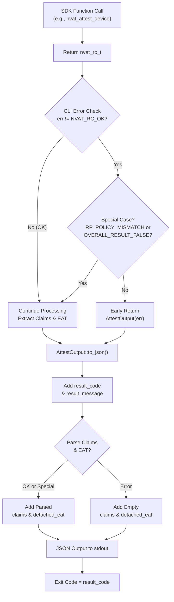
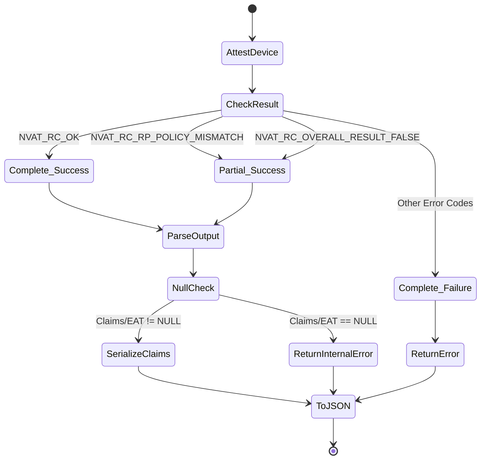
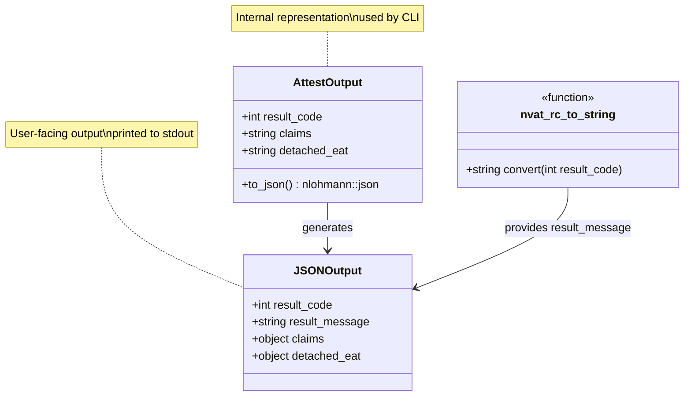

<!-- source: DeepWiki mcp.deepwiki.com · repo NVIDIA/attestation-sdk · page 8.2 Error Codes and Handling · fetched 2026-10-26 -->

# Error Codes and Handling

<details>
<summary>Relevant source files</summary>

The following files were used as context for generating this wiki page:

- [nv-attestation-cli/src/attest.cpp](nv-attestation-cli/src/attest.cpp)
- [nv-attestation-cli/tests/cli_tests.cpp](nv-attestation-cli/tests/cli_tests.cpp)

</details>


## Overview

This document provides comprehensive documentation of the error codes (result codes) used throughout the NVIDIA Attestation SDK and CLI, as well as the patterns for handling and propagating errors from the SDK to user-facing output. Understanding the error handling system is critical for both users interpreting CLI output and developers extending the SDK.

For information about the output format structure containing error information, see [CLI Output Format](#4.4). For details on how errors are used in specific attestation workflows, see [Device Attestation Flow](#5.1).

## Result Code Types

The SDK uses `nvat_rc_t` as the primary error type throughout the codebase. Result codes are returned by all SDK functions to indicate success or failure. The CLI wraps these result codes in structured JSON output.

### Core Result Codes

Based on the error handling patterns in the codebase, the following result codes are used:

| Result Code | Numeric Value | Description | Produces Claims |
|------------|---------------|-------------|-----------------|
| `NVAT_RC_OK` | 0 | Operation completed successfully | Yes |
| `NVAT_RC_RP_POLICY_MISMATCH` | Non-zero | Relying party policy evaluation failed | Yes |
| `NVAT_RC_OVERALL_RESULT_FALSE` | Non-zero | Attestation verification failed but completed | Yes |
| `NVAT_RC_BAD_ARGUMENT` | Non-zero | Invalid argument provided to SDK function | No |
| `NVAT_RC_INTERNAL_ERROR` | Non-zero | Internal SDK error occurred | No |

**Sources:**
- [nv-attestation-cli/src/attest.cpp:39]()
- [nv-attestation-cli/src/attest.cpp:125]()
- [nv-attestation-cli/src/attest.cpp:297-298]()
- [nv-attestation-cli/src/attest.cpp:303]()

### Result Code Characteristics

The result codes can be categorized into three classes:

1. **Success**: `NVAT_RC_OK` indicates complete success
2. **Partial Success**: `NVAT_RC_RP_POLICY_MISMATCH` and `NVAT_RC_OVERALL_RESULT_FALSE` indicate failures that still produce valid attestation claims and EAT tokens
3. **Complete Failure**: All other error codes indicate failures that prevent attestation completion

## Error Propagation Flow



**Diagram: Error Propagation from SDK to CLI Output**

The diagram above shows how errors flow from SDK function calls through the CLI to final output. Note the special handling branch for policy mismatch and overall result false cases.

**Sources:**
- [nv-attestation-cli/src/attest.cpp:161-334]()
- [nv-attestation-cli/src/attest.cpp:36-68]()

## Error Handling Patterns

### Pattern 1: Early Return on Error

The most common error handling pattern is immediate return upon detecting an error:

```cpp
nvat_rc_t err = nvat_sdk_function(...);
if (err != NVAT_RC_OK) {
    return AttestOutput(err);
}
```

This pattern is used throughout the `attest()` function for most SDK calls where errors are unrecoverable.

**Sources:**
- [nv-attestation-cli/src/attest.cpp:167-169]()
- [nv-attestation-cli/src/attest.cpp:186-188]()
- [nv-attestation-cli/src/attest.cpp:201-202]()

### Pattern 2: Conditional Error Checking

For operations that may produce partial results, the CLI uses conditional error checking:

```cpp
err = nvat_attest_device(*(ctx.get()), nonce_ptr, &detached_eat, &raw_claims);
if (err != NVAT_RC_OK && err != NVAT_RC_RP_POLICY_MISMATCH && err != NVAT_RC_OVERALL_RESULT_FALSE) {
    return AttestOutput(err);
}
```

This allows the attestation to continue processing claims even when policy evaluation fails.

**Sources:**
- [nv-attestation-cli/src/attest.cpp:296-299]()

### Pattern 3: Null Checks with Error Returns

After SDK calls that produce output parameters, the CLI validates that pointers are not null:

```cpp
if (raw_claims == nullptr) {
    SPDLOG_ERROR("Failed to get claims");
    return AttestOutput(NVAT_RC_INTERNAL_ERROR);
}

if (detached_eat == nullptr) {
    SPDLOG_ERROR("Failed to get detached EAT");
    return AttestOutput(NVAT_RC_INTERNAL_ERROR);
}
```

This defensive programming ensures that null pointers don't cause crashes downstream.

**Sources:**
- [nv-attestation-cli/src/attest.cpp:301-309]()

### Pattern 4: Resource Management with RAII

The CLI uses `nv_unique_ptr` wrappers to ensure automatic cleanup on error paths:

```cpp
nv_unique_ptr<nvat_attestation_ctx_t> ctx;
nvat_attestation_ctx_t raw_ctx = nullptr;
err = nvat_attestation_ctx_create(&raw_ctx);
if (err != NVAT_RC_OK) return AttestOutput(err);
ctx.reset(&raw_ctx);
```

This ensures SDK resources are properly freed even when errors occur.

**Sources:**
- [nv-attestation-cli/src/attest.cpp:198-202]()
- [nv-attestation-cli/src/attest.cpp:164-170]()

## Special Case Handling



**Diagram: State Machine for Error and Success Case Handling**

### Policy Mismatch (`NVAT_RC_RP_POLICY_MISMATCH`)

This result code indicates that the device attestation completed successfully, but the relying party policy evaluation determined the device does not meet the required criteria. Despite being a "failure" from a policy perspective, this case:

- Produces valid attestation claims
- Generates a detached EAT token
- Returns structured JSON output
- Uses a non-zero exit code

This allows the relying party to inspect the claims to understand why the policy failed.

**Sources:**
- [nv-attestation-cli/src/attest.cpp:39]()
- [nv-attestation-cli/src/attest.cpp:297]()

### Overall Result False (`NVAT_RC_OVERALL_RESULT_FALSE`)

This result code indicates that the attestation verification itself failed (e.g., measurements don't match reference values), but the process completed and produced diagnostic claims. Similar to policy mismatch, this case produces full output for debugging.

**Sources:**
- [nv-attestation-cli/src/attest.cpp:39]()
- [nv-attestation-cli/src/attest.cpp:297]()

### Bad Argument (`NVAT_RC_BAD_ARGUMENT`)

This error occurs when invalid parameters are provided, such as:

- Failure to open specified evidence files
- Invalid nonce format
- Malformed policy files

This error results in early termination without claims generation.

**Sources:**
- [nv-attestation-cli/src/attest.cpp:115-126]()
- [nv-attestation-cli/src/attest.cpp:283]()

## Output Format Structure



**Diagram: Error Information in Output Structures**

The `AttestOutput` class encapsulates error information and output data:

```cpp
AttestOutput::AttestOutput(const int result_code)
    : result_code(result_code), claims(""), detached_eat("") {}

AttestOutput::AttestOutput(const int result_code, const std::string& claims, const std::string& detached_eat)
    : result_code(result_code), claims(claims), detached_eat(detached_eat) {}
```

The `to_json()` method converts this to user-facing JSON:

```cpp
nlohmann::json attest_output = nlohmann::json::object();
attest_output["result_code"] = result_code;
attest_output["result_message"] = nvat_rc_to_string(result_code);
attest_output["claims"] = claims_json;
attest_output["detached_eat"] = detached_eat_json;
```

**Sources:**
- [nv-attestation-cli/src/attest.cpp:30-34]()
- [nv-attestation-cli/src/attest.cpp:62-67]()

## Exit Code Mapping

The CLI maps result codes directly to process exit codes:

```cpp
int handle_attest_subcommand(...) {
    AttestOutput attest_output = attest(...);
    nvat_sdk_shutdown();
    
    auto json = attest_output.to_json();
    std::cout << json.dump(4) << std::endl;
    return attest_output.result_code;  // Exit code = result_code
}
```

This means:
- Success (`NVAT_RC_OK` = 0) results in exit code 0
- All failures result in non-zero exit codes
- Shell scripts can use `$?` to check success/failure

**Sources:**
- [nv-attestation-cli/src/attest.cpp:339-357]()

## Error Handling in Tests

The test suite validates error handling by checking both exit codes and JSON result codes:

```cpp
int exit_code = 0;
std::string output = exec_and_capture_output(cmd, exit_code);
ASSERT_EQ(exit_code, 0) << "Command failed: " << cmd << "\nOutput:\n" << output;

nlohmann::json response;
ASSERT_NO_THROW(response = nlohmann::json::parse(json_str));
ASSERT_TRUE(response.contains("result_code"));
EXPECT_EQ(response["result_code"].get<int>(), 0);
```

Tests verify that:
1. Exit code matches expected result
2. JSON output contains `result_code` field
3. `result_code` matches expected value (typically 0 for success)

**Sources:**
- [nv-attestation-cli/tests/cli_tests.cpp:104-113]()
- [nv-attestation-cli/tests/cli_tests.cpp:217]()

## Result Message Generation

The SDK provides `nvat_rc_to_string()` function to convert result codes to human-readable messages. The CLI uses this in the JSON output:

```cpp
attest_output["result_message"] = nvat_rc_to_string(result_code);
```

This ensures consistent, localized error messages across the SDK and CLI.

**Sources:**
- [nv-attestation-cli/src/attest.cpp:64]()

## JSON Parsing Error Handling

The `to_json()` method includes defensive parsing for claims and detached EAT:

```cpp
if (result_code == NVAT_RC_OK || result_code == NVAT_RC_RP_POLICY_MISMATCH || result_code == NVAT_RC_OVERALL_RESULT_FALSE) {
    try {
        claims_json = nlohmann::json::parse(claims);
    } catch (const nlohmann::json::parse_error& e) {
        SPDLOG_ERROR("Failed to parse claims as JSON: {}. Claims: {}", e.what(), claims);
        claims_json = nlohmann::json::object();
    } catch (...) {
        SPDLOG_ERROR("Failed to parse claims as JSON. Claims: {}", claims);
        claims_json = nlohmann::json::object();
    }
    // Similar handling for detached_eat...
}
```

This ensures that JSON parsing errors during output generation don't crash the CLI. Instead, empty objects are returned with appropriate error logging.

**Sources:**
- [nv-attestation-cli/src/attest.cpp:39-60]()

## Summary Table

| Component | Error Representation | Propagation Method |
|-----------|---------------------|-------------------|
| SDK Functions | `nvat_rc_t` return value | Function return |
| CLI Internal | `AttestOutput` class | Object construction |
| CLI Output | JSON `result_code` field | JSON serialization |
| Process Exit | Integer exit code | `return` from `main` |
| Human Readable | JSON `result_message` field | `nvat_rc_to_string()` |

---

