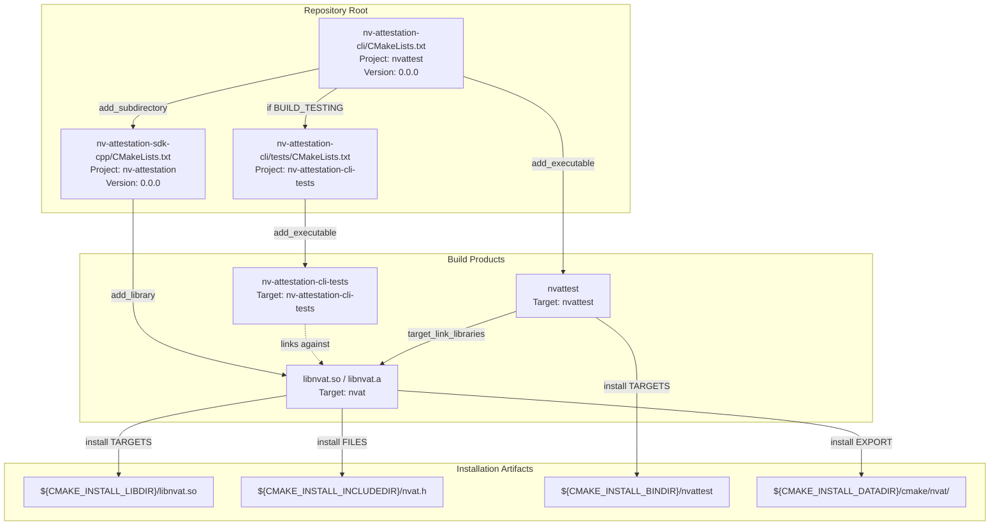
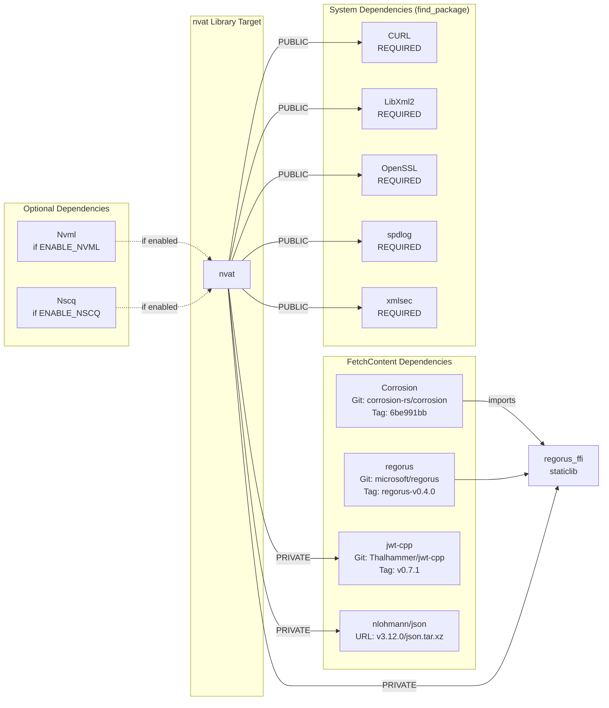
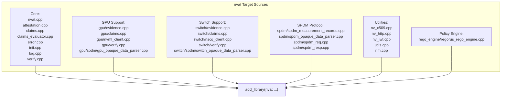
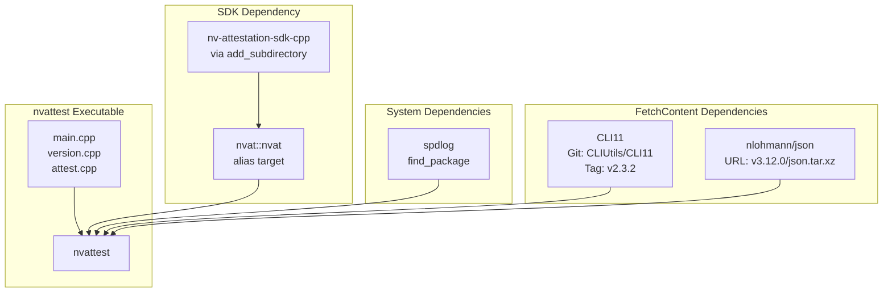
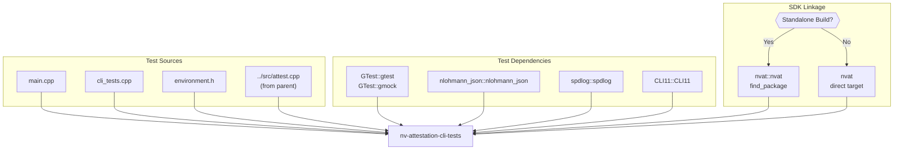
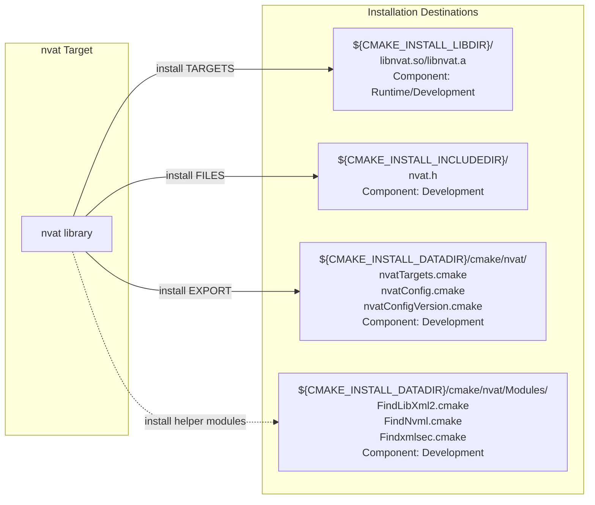
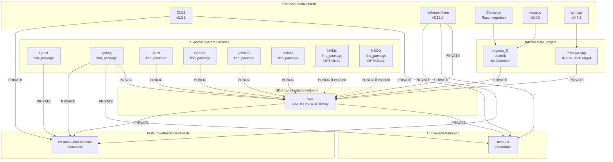

<!-- source: DeepWiki mcp.deepwiki.com · repo NVIDIA/attestation-sdk · page 8.3 Build System Reference · fetched 2026-10-26 -->

# Build System Reference

<details>
<summary>Relevant source files</summary>

The following files were used as context for generating this wiki page:

- [nv-attestation-cli/CMakeLists.txt](nv-attestation-cli/CMakeLists.txt)
- [nv-attestation-cli/tests/CMakeLists.txt](nv-attestation-cli/tests/CMakeLists.txt)
- [nv-attestation-sdk-cpp/CMakeLists.txt](nv-attestation-sdk-cpp/CMakeLists.txt)

</details>


## Purpose and Scope

This document provides comprehensive technical reference for the CMake-based build system used across the NVIDIA Attestation SDK repository. It documents all CMake options, build targets, dependency management, compiler configurations, and installation procedures for both the core SDK library (`nvat`) and the CLI tool (`nvattest`).

For instructions on building from source, see [Building from Source](#6.1). For testing infrastructure details, see [Testing Infrastructure](#6.3).

---

## Build System Overview

The repository uses a hierarchical CMake build system with two primary projects:



Sources: [nv-attestation-cli/CMakeLists.txt:2](), [nv-attestation-cli/CMakeLists.txt:44-47](), [nv-attestation-sdk-cpp/CMakeLists.txt:2](), [nv-attestation-cli/tests/CMakeLists.txt:2]()

---

## Core SDK Build Configuration

### CMake Project Definition

The core SDK is defined in [nv-attestation-sdk-cpp/CMakeLists.txt:1-2]():

| Property | Value |
|----------|-------|
| Minimum CMake Version | 3.11 |
| Project Name | `nv-attestation` |
| Project Version | 0.0.0 |
| C++ Standard | 14 (configurable via `CMAKE_CXX_STANDARD`) |
| Warning Treatment | Errors (`CMAKE_COMPILE_WARNING_AS_ERROR ON`) |

### Build Options

The SDK provides several CMake options to customize the build:

| Option | Type | Default | Description |
|--------|------|---------|-------------|
| `BUILD_SHARED_LIBS` | BOOL | ON | Build shared libraries instead of static libraries |
| `BUILD_EXAMPLES` | BOOL | OFF | Build executables in examples folder |
| `BUILD_TESTING` | BOOL | OFF | Build unit-tests and integration-tests |
| `ENABLE_NVML` | BOOL | OFF | Enable NVML support for GPU attestation |
| `ENABLE_NSCQ` | BOOL | OFF | Enable NSCQ support for Switch attestation |
| `SANITIZER` | STRING | OFF | Select sanitizer: thread, address, undefined, leak, or OFF |

Sources: [nv-attestation-sdk-cpp/CMakeLists.txt:12-17]()

### Dependency Management

The SDK uses both `FetchContent` for header-only/vendored dependencies and `find_package` for system dependencies:



Sources: [nv-attestation-sdk-cpp/CMakeLists.txt:25-89](), [nv-attestation-sdk-cpp/CMakeLists.txt:198-213]()

#### FetchContent Dependencies

**Corrosion** [nv-attestation-sdk-cpp/CMakeLists.txt:25-32](): Used to import Rust crates into the CMake build system.

**regorus** [nv-attestation-sdk-cpp/CMakeLists.txt:34-54](): Rego policy engine compiled as a static library (`regorus_ffi`) with `semver` feature enabled. Always built in Release mode.

**jwt-cpp** [nv-attestation-sdk-cpp/CMakeLists.txt:60-79](): JWT token handling library. Custom configuration disables picojson and examples. Wrapped in `own-jwt-cpp` interface target to prevent header installation.

**nlohmann/json** [nv-attestation-sdk-cpp/CMakeLists.txt:81-82](): JSON parsing library with `EXCLUDE_FROM_ALL` flag.

#### System Dependencies

All system dependencies are located via `find_package` [nv-attestation-sdk-cpp/CMakeLists.txt:85-89]():
- `CURL`: HTTP client operations
- `LibXml2`: XML parsing
- `OpenSSL`: Cryptography and SSL/TLS
- `spdlog`: Logging framework
- `xmlsec`: XML security (signatures, encryption)

#### Optional Device Support Libraries

**NVML (NVIDIA Management Library)** [nv-attestation-sdk-cpp/CMakeLists.txt:91-95]():
- Enabled via `-DENABLE_NVML=ON`
- Adds `ENABLE_NVML` preprocessor definition
- Uses custom `FindNvml.cmake` module

**NSCQ (NVSwitch Configuration and Query)** [nv-attestation-sdk-cpp/CMakeLists.txt:97-101]():
- Enabled via `-DENABLE_NSCQ=ON`
- Adds `ENABLE_NSCQ` preprocessor definition
- Uses custom `FindNscq.cmake` module (located at [nv-attestation-sdk-cpp/cmake/FindNscq.cmake]())

### Compiler Flags and Build Modes

#### Standard Compiler Flags

[nv-attestation-sdk-cpp/CMakeLists.txt:103-109]()

```cmake
add_compile_options(-Wall -Wextra -Wpedantic -pedantic)
add_compile_options(-Wno-unused -Wno-unused-parameter)
```

#### Debug and Sanitizer Configuration

When building in Debug mode or with sanitizers [nv-attestation-sdk-cpp/CMakeLists.txt:112-114]():

```cmake
add_compile_options(-g3 -O0 -fno-omit-frame-pointer)
```

Sanitizer support [nv-attestation-sdk-cpp/CMakeLists.txt:172-176]():

```cmake
# Usage: cmake -DSANITIZER=address ..
target_compile_options(nvat PRIVATE -fsanitize=${SANITIZER} -fno-sanitize-recover=all)
target_link_options(nvat PRIVATE -fsanitize=${SANITIZER} -fno-sanitize-recover=all)
```

Supported sanitizer values: `thread`, `address`, `undefined`, `leak`

#### Source Path Normalization

[nv-attestation-sdk-cpp/CMakeLists.txt:116-119]()

```cmake
# Makes __FILE__ relative to source directory for logging
add_compile_options(-ffile-prefix-map=${CMAKE_SOURCE_DIR}/src/=)
```

Sources: [nv-attestation-sdk-cpp/CMakeLists.txt:103-119](), [nv-attestation-sdk-cpp/CMakeLists.txt:172-176]()

### nvat Library Target

The core SDK library is defined as target `nvat` [nv-attestation-sdk-cpp/CMakeLists.txt:123-152]():



**Library Properties** [nv-attestation-sdk-cpp/CMakeLists.txt:154-158]():
- `VERSION`: 0.0.0
- `SOVERSION`: 0

**Include Directories** [nv-attestation-sdk-cpp/CMakeLists.txt:160-170]():

| Scope | Directories |
|-------|-------------|
| PUBLIC | `${CMAKE_CURRENT_BINARY_DIR}/include` (for generated nvat.h) |
| PUBLIC | `${Nvml_INCLUDE_DIR}` (if ENABLE_NVML) |
| PUBLIC | `${Nscq_INCLUDE_DIR}` (if ENABLE_NSCQ) |
| PRIVATE | `src` (source includes) |
| PRIVATE | `include` (private headers) |
| PRIVATE | `${regorus_SOURCE_DIR}/bindings/ffi` (regorus FFI headers) |

Sources: [nv-attestation-sdk-cpp/CMakeLists.txt:123-170]()

### Header Generation

The public header `nvat.h` is generated from a template [nv-attestation-sdk-cpp/CMakeLists.txt:121]():

```cmake
configure_file("include/nvat.h.in" "include/nvat.h")
```

This allows compile-time configuration (e.g., conditionally including NVML/NSCQ declarations based on build options).

Sources: [nv-attestation-sdk-cpp/CMakeLists.txt:121]()

---

## CLI Tool Build Configuration

### CMake Project Definition

The CLI tool is defined in [nv-attestation-cli/CMakeLists.txt:2]():

| Property | Value |
|----------|-------|
| Minimum CMake Version | 3.11 |
| Project Name | `nvattest` |
| Project Version | 0.0.0 |
| C++ Standard | 14 |

### Build Option

| Option | Type | Default | Description |
|--------|------|---------|-------------|
| `BUILD_TESTING` | BOOL | OFF | Build CLI tests |

Sources: [nv-attestation-cli/CMakeLists.txt:1-8]()

### CLI Dependencies



Sources: [nv-attestation-cli/CMakeLists.txt:18-60]()

#### SDK Integration

The CLI integrates the SDK as a subdirectory [nv-attestation-cli/CMakeLists.txt:44-50]():

```cmake
add_subdirectory(
    "${CMAKE_CURRENT_SOURCE_DIR}/../nv-attestation-sdk-cpp"  # Source directory
    "${CMAKE_CURRENT_BINARY_DIR}/nv-attestation-sdk-build"   # Binary directory
)

# Create namespaced alias for the nvat target
add_library(nvat::nvat ALIAS nvat)
```

This approach builds the SDK as part of the CLI build, creating an alias target `nvat::nvat` for consistent linkage.

### nvattest Executable Target

The CLI executable [nv-attestation-cli/CMakeLists.txt:27-57]():

```cmake
add_executable(nvattest
    src/main.cpp
    src/version.cpp
    src/attest.cpp
)

target_link_libraries(nvattest PRIVATE
    nvat::nvat
    nlohmann_json::nlohmann_json
    CLI11::CLI11
    spdlog::spdlog
)
```

### File Generation and Copying

**Version Header** [nv-attestation-cli/CMakeLists.txt:39-41]():

```cmake
configure_file(${CMAKE_CURRENT_SOURCE_DIR}/src/version_config.h.in
               ${CMAKE_CURRENT_BINARY_DIR}/version_config.h)
```

**Configuration File** [nv-attestation-cli/CMakeLists.txt:35-37]():

```cmake
configure_file(${CMAKE_CURRENT_SOURCE_DIR}/config.toml
               ${CMAKE_CURRENT_BINARY_DIR}/config.toml
               COPYONLY)
```

Sources: [nv-attestation-cli/CMakeLists.txt:27-60]()

---

## Test Build Configuration

### CLI Test Suite

The test suite is defined in [nv-attestation-cli/tests/CMakeLists.txt:2]():

| Property | Value |
|----------|-------|
| Minimum CMake Version | 3.11 |
| Project Name | `nv-attestation-cli-tests` |

### Test Options

| Option | Type | Default | Description |
|--------|------|---------|-------------|
| `SANITIZER` | STRING | OFF | Select sanitizer for test executable |

Sources: [nv-attestation-cli/tests/CMakeLists.txt:6]()

### Test Target Configuration



Sources: [nv-attestation-cli/tests/CMakeLists.txt:8-42]()

The test executable includes `attest.cpp` from the parent directory [nv-attestation-cli/tests/CMakeLists.txt:12]() to enable unit testing of the `handle_attest_subcommand` function.

### Conditional SDK Linking

The test suite handles two build scenarios [nv-attestation-cli/tests/CMakeLists.txt:35-42]():

**Standalone Build** (CMake invoked directly in tests directory):
```cmake
find_package(nvat REQUIRED)
target_link_libraries(nv-attestation-cli-tests PRIVATE nvat::nvat)
```

**Subdirectory Build** (CMake invoked from parent):
```cmake
target_link_libraries(nv-attestation-cli-tests PRIVATE nvat)
```

### Test Sanitizer Configuration

When `SANITIZER` option is set [nv-attestation-cli/tests/CMakeLists.txt:19-22]():

```cmake
target_compile_options(nv-attestation-cli-tests PRIVATE 
    -fsanitize=${SANITIZER} -fno-sanitize-recover=all)
target_link_options(nv-attestation-cli-tests PRIVATE 
    -fsanitize=${SANITIZER} -fno-sanitize-recover=all)
```

### Test Discovery

Tests are discovered via GoogleTest integration [nv-attestation-cli/tests/CMakeLists.txt:44-45]():

```cmake
include(GoogleTest)
gtest_discover_tests(nv-attestation-cli-tests PROPERTIES LABELS "cli")
```

This enables CTest to discover and run individual test cases.

Sources: [nv-attestation-cli/tests/CMakeLists.txt:1-45]()

---

## Build Modes and Compiler Configurations

### Debug Build Configuration

Debug flags are added in two scenarios [nv-attestation-sdk-cpp/CMakeLists.txt:112-114]():
1. When `CMAKE_BUILD_TYPE` is `Debug`
2. When any `SANITIZER` is enabled

```cmake
add_compile_options(-g3 -O0 -fno-omit-frame-pointer)
```

For the CLI tool [nv-attestation-cli/CMakeLists.txt:11]():
```cmake
set(CMAKE_CXX_FLAGS_DEBUG "${CMAKE_CXX_FLAGS_DEBUG} -g -O0")
```

### Sanitizer Support

The SDK and tests support runtime sanitizers for detecting bugs:

| Sanitizer | Purpose | Usage |
|-----------|---------|-------|
| `address` | Memory errors (buffer overflows, use-after-free) | `-DSANITIZER=address` |
| `thread` | Data races and thread issues | `-DSANITIZER=thread` |
| `undefined` | Undefined behavior | `-DSANITIZER=undefined` |
| `leak` | Memory leaks | `-DSANITIZER=leak` |

Example:
```bash
cmake -DSANITIZER=address -DCMAKE_BUILD_TYPE=Debug ..
```

Sources: [nv-attestation-sdk-cpp/CMakeLists.txt:112-114](), [nv-attestation-sdk-cpp/CMakeLists.txt:172-176](), [nv-attestation-cli/tests/CMakeLists.txt:19-22]()

---

## Installation System

### SDK Installation

The `nvat` library is installed with multiple components [nv-attestation-sdk-cpp/CMakeLists.txt:218-242]():



#### Installation Components

**Runtime Component**:
- Shared library (`libnvat.so`)
- Required at runtime for applications using the SDK

**Development Component**:
- Static library archive (if `BUILD_SHARED_LIBS=OFF`)
- Header file (`nvat.h`)
- CMake configuration files
- CMake Find modules for dependencies

#### CMake Package Files

**nvatTargets.cmake** [nv-attestation-sdk-cpp/CMakeLists.txt:237-242]():
- Exports the `nvat::nvat` imported target
- Contains library locations and interface properties

**nvatConfig.cmake** [nv-attestation-sdk-cpp/CMakeLists.txt:252-257]():
- Generated from `cmake/Config.cmake.in`
- Enables `find_package(nvat)` to work
- Sets up the module path for custom Find modules

**nvatConfigVersion.cmake** [nv-attestation-sdk-cpp/CMakeLists.txt:259-263]():
- Provides version compatibility checking
- Uses `SameMajorVersion` compatibility mode

Sources: [nv-attestation-sdk-cpp/CMakeLists.txt:218-270]()

### CLI Installation

The `nvattest` executable is installed to the system binary directory [nv-attestation-cli/CMakeLists.txt:68]():

```cmake
install(TARGETS nvattest DESTINATION ${CMAKE_INSTALL_BINDIR})
```

Default location: `/usr/local/bin/nvattest` (or system-specific equivalent)

Sources: [nv-attestation-cli/CMakeLists.txt:68]()

### CPack Integration

Both projects include CPack for package generation [nv-attestation-sdk-cpp/CMakeLists.txt:272](), [nv-attestation-cli/CMakeLists.txt:70]():

```cmake
include(CPack)
```

This enables creation of distribution packages (DEB, RPM, TGZ, etc.) using `cpack` command.

---

## Build Customization Reference

### Common Build Patterns

#### Minimal SDK Build (Library Only)
```bash
cmake -DBUILD_SHARED_LIBS=ON \
      -DENABLE_NVML=OFF \
      -DENABLE_NSCQ=OFF \
      -DBUILD_TESTING=OFF \
      -DBUILD_EXAMPLES=OFF \
      ..
```

#### Full GPU Support Build
```bash
cmake -DBUILD_SHARED_LIBS=ON \
      -DENABLE_NVML=ON \
      -DBUILD_TESTING=ON \
      ..
```

#### Development Build with Sanitizers
```bash
cmake -DCMAKE_BUILD_TYPE=Debug \
      -DSANITIZER=address \
      -DBUILD_TESTING=ON \
      -DBUILD_EXAMPLES=ON \
      ..
```

#### Static Library Build for Distribution
```bash
cmake -DBUILD_SHARED_LIBS=OFF \
      -DENABLE_NVML=ON \
      -DENABLE_NSCQ=ON \
      -DCMAKE_BUILD_TYPE=Release \
      ..
```

### CMake Module Path

The SDK extends the module path to include custom Find modules [nv-attestation-sdk-cpp/CMakeLists.txt:23]():

```cmake
list(APPEND CMAKE_MODULE_PATH "${CMAKE_CURRENT_SOURCE_DIR}/cmake")
```

Custom Find modules:
- `cmake/FindLibXml2.cmake`
- `cmake/FindNvml.cmake`
- `cmake/Findxmlsec.cmake`
- `cmake/FindNscq.cmake` (implied, not listed in install)

### Build Targets Summary

| Target | Type | Project | Condition |
|--------|------|---------|-----------|
| `nvat` | Library | nv-attestation-sdk-cpp | Always |
| `nvat::nvat` | Alias | nv-attestation-cli | Subdirectory build |
| `regorus_ffi` | Static Library | regorus (external) | Always |
| `own-jwt-cpp` | Interface | jwt-cpp wrapper | Always |
| `nvattest` | Executable | nv-attestation-cli | Always |
| `nv-attestation-cli-tests` | Executable | nv-attestation-cli-tests | `BUILD_TESTING=ON` |

### Test Execution

After building with tests enabled:

```bash
# Run all tests
ctest

# Run only CLI tests
ctest -L cli

# Run tests with verbose output
ctest -V

# Run specific test
./nv-attestation-cli-tests --gtest_filter=CliTests.AttestGpuLocal
```

Sources: [nv-attestation-sdk-cpp/CMakeLists.txt:23](), [nv-attestation-cli/tests/CMakeLists.txt:44-45]()

---

## Build System Architecture Diagram

The following diagram shows the complete dependency and target relationships:



Sources: [nv-attestation-sdk-cpp/CMakeLists.txt:25-213](), [nv-attestation-cli/CMakeLists.txt:18-57](), [nv-attestation-cli/tests/CMakeLists.txt:4-42]()

---

