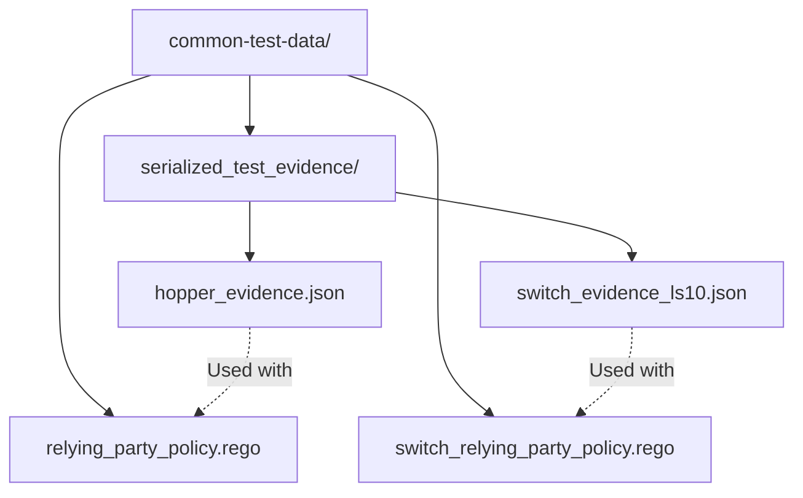
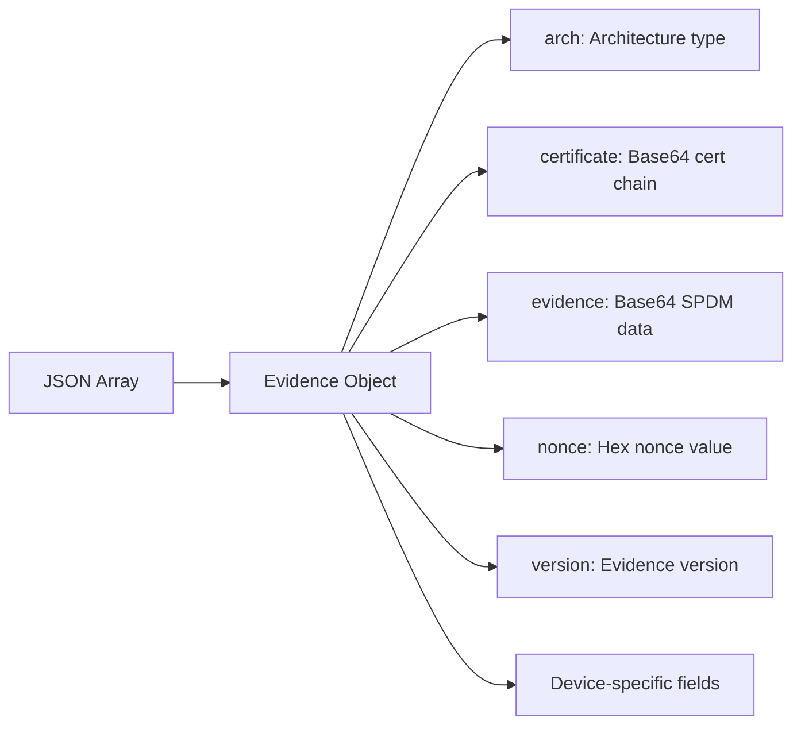
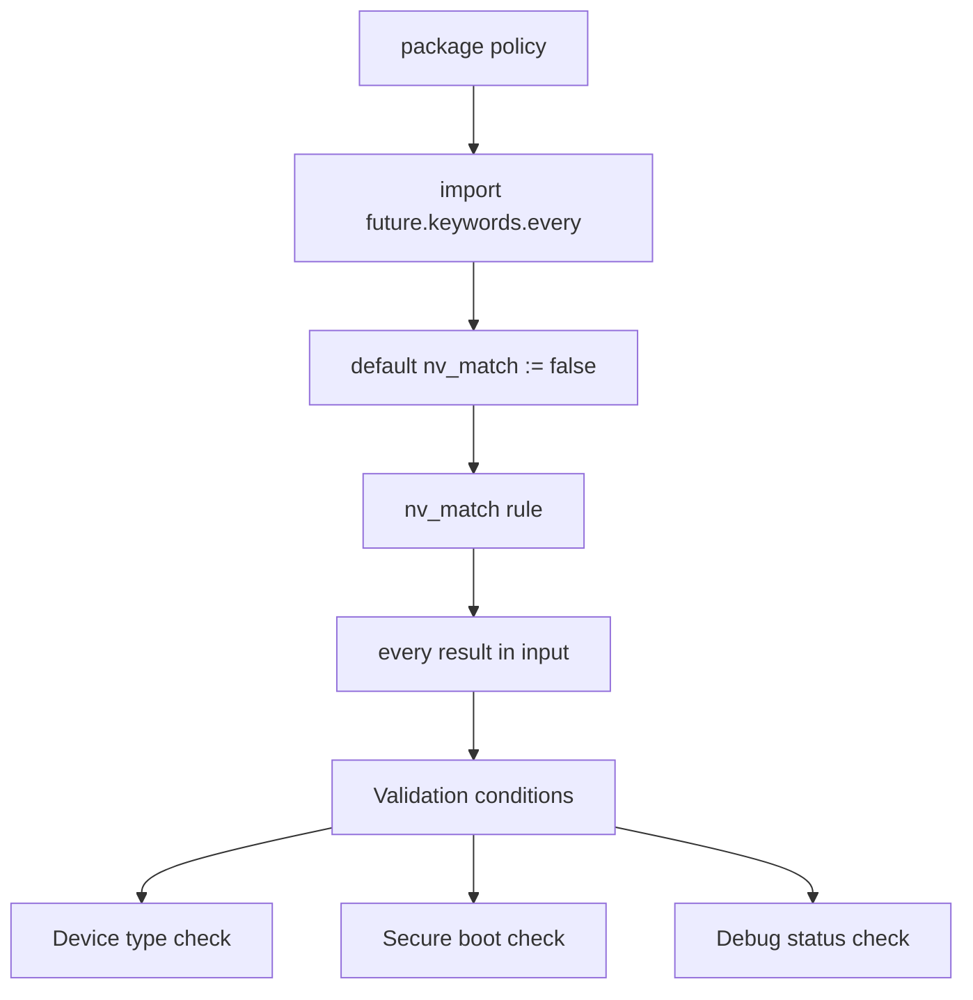
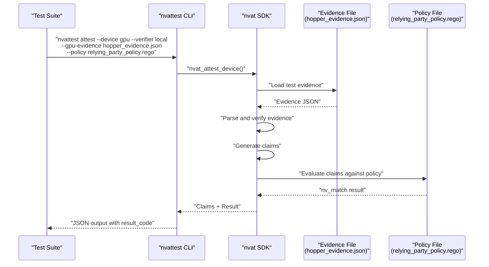
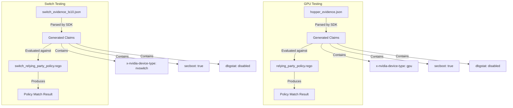
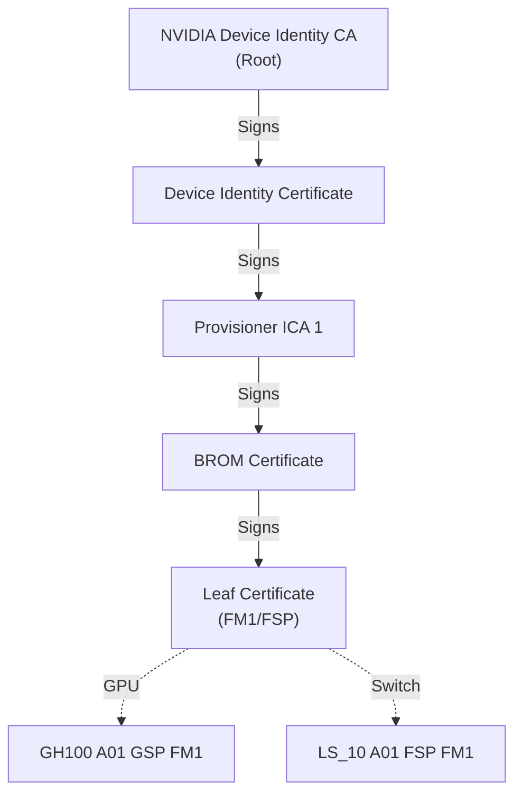

<!-- source: DeepWiki mcp.deepwiki.com · repo NVIDIA/attestation-sdk · page 8.4 Test Data Reference · fetched 2026-10-26 -->

# Test Data Reference

<details>
<summary>Relevant source files</summary>

The following files were used as context for generating this wiki page:

- [common-test-data/relying_party_policy.rego](common-test-data/relying_party_policy.rego)
- [common-test-data/serialized_test_evidence/hopper_evidence.json](common-test-data/serialized_test_evidence/hopper_evidence.json)
- [common-test-data/serialized_test_evidence/switch_evidence_ls10.json](common-test-data/serialized_test_evidence/switch_evidence_ls10.json)
- [common-test-data/switch_relying_party_policy.rego](common-test-data/switch_relying_party_policy.rego)

</details>


This document provides a comprehensive reference for the test data files and policies used in the attestation SDK testing infrastructure. These files enable offline testing without requiring physical hardware and serve as examples of evidence and policy structures.

For information about the testing infrastructure and how to run tests, see [Testing Infrastructure](#6.3). For details about evidence formats in production use, see [Evidence Format and Structure](#5.2). For policy evaluation concepts, see [Relying Party Policies](#5.3).

## Overview

The test data is organized in the `common-test-data` directory and consists of two primary categories:

1. **Serialized Test Evidence**: Pre-captured evidence from real GPU and Switch devices
2. **Test Policies**: Rego policies that define relying party validation requirements

These test data files allow the test suite to verify attestation functionality without requiring actual hardware, while also providing reference examples for evidence structure and policy authoring.

Sources: [common-test-data/serialized_test_evidence/hopper_evidence.json](), [common-test-data/serialized_test_evidence/switch_evidence_ls10.json](), [common-test-data/relying_party_policy.rego](), [common-test-data/switch_relying_party_policy.rego]()

## Directory Structure



**Test Data Organization**

Sources: [common-test-data/serialized_test_evidence/hopper_evidence.json](), [common-test-data/serialized_test_evidence/switch_evidence_ls10.json](), [common-test-data/relying_party_policy.rego](), [common-test-data/switch_relying_party_policy.rego]()

| File Path | Type | Purpose |
|-----------|------|---------|
| `common-test-data/serialized_test_evidence/hopper_evidence.json` | Evidence | Pre-captured GPU attestation evidence from HOPPER architecture |
| `common-test-data/serialized_test_evidence/switch_evidence_ls10.json` | Evidence | Pre-captured Switch attestation evidence from LS10 architecture |
| `common-test-data/relying_party_policy.rego` | Policy | Rego policy for validating GPU attestation results |
| `common-test-data/switch_relying_party_policy.rego` | Policy | Rego policy for validating Switch attestation results |

## Test Evidence Files

Test evidence files are JSON-serialized representations of attestation evidence collected from real devices. These files follow the same structure as live evidence but are stored statically for testing purposes.

### Evidence File Structure

Both GPU and Switch evidence files contain a JSON array with a single evidence object. The structure is:



**Evidence Object Structure**

Sources: [common-test-data/serialized_test_evidence/hopper_evidence.json:1-1](), [common-test-data/serialized_test_evidence/switch_evidence_ls10.json:1-1]()

### Common Evidence Fields

All evidence objects contain these mandatory fields:

| Field | Type | Description | Example |
|-------|------|-------------|---------|
| `arch` | String | Device architecture identifier | `"HOPPER"`, `"LS10"` |
| `certificate` | String | Base64-encoded X.509 certificate chain | Certificate chain from device to root CA |
| `evidence` | String | Base64-encoded SPDM measurement records | Contains PCR-like measurements and opaque data |
| `nonce` | String | Hex-encoded nonce used during evidence collection | `"931d8dd0add203ac..."` (64 hex chars) |
| `version` | String | Evidence format version | `"1.0"` |

Sources: [common-test-data/serialized_test_evidence/hopper_evidence.json:1-1](), [common-test-data/serialized_test_evidence/switch_evidence_ls10.json:1-1]()

### GPU Evidence (hopper_evidence.json)

The GPU evidence file contains attestation data from a HOPPER architecture GPU.

**GPU-Specific Fields**

| Field | Type | Description | Value in Test Data |
|-------|------|-------------|-------------------|
| `arch` | String | GPU architecture | `"HOPPER"` |
| `driver_version` | String | NVIDIA GPU driver version | `"550.90.07"` |
| `vbios_version` | String | Video BIOS version | `"96.00.9F.00.01"` |

**Certificate Chain Structure**

The `certificate` field contains a Base64-encoded PEM certificate chain with 5 certificates:

1. GPU FM1 Certificate (leaf)
2. GH100 A01 GSP BROM Certificate
3. GH100 Provisioner ICA 1
4. GH100 Identity Certificate
5. NVIDIA Device Identity CA (root)

**Evidence Data Structure**

The `evidence` field contains Base64-encoded SPDM measurement records including:
- DMTFSPDMmeasurementRecordData structures
- NVIDIA opaque data elements
- GPU-specific measurements (PCR-equivalent values)
- Configuration and attestation data

Sources: [common-test-data/serialized_test_evidence/hopper_evidence.json:1-1]()

### Switch Evidence (switch_evidence_ls10.json)

The Switch evidence file contains attestation data from an LS10 architecture NVSwitch.

**Switch-Specific Fields**

| Field | Type | Description | Value in Test Data |
|-------|------|-------------|-------------------|
| `arch` | String | Switch architecture | `"LS10"` |

**Certificate Chain Structure**

The `certificate` field contains a Base64-encoded PEM certificate chain with 5 certificates:

1. LS_10 A01 FSP FM1 Certificate (leaf)
2. LS_10 A01 FSP BROM Certificate
3. LS_10 Provisioner ICA 1
4. GH100 Identity Certificate (shared with GPU)
5. NVIDIA Device Identity CA (root)

**Evidence Data Structure**

The `evidence` field contains Base64-encoded SPDM measurement records similar to GPU but with Switch-specific measurements and opaque data elements.

Sources: [common-test-data/serialized_test_evidence/switch_evidence_ls10.json:1-1]()

## Test Policy Files

Test policy files are written in Rego (the policy language used by Open Policy Agent) and define the validation rules that relying parties use to accept or reject attestation results.

### Rego Policy Structure



**Common Rego Policy Pattern**

Sources: [common-test-data/relying_party_policy.rego:1-11](), [common-test-data/switch_relying_party_policy.rego:1-11]()

All test policies follow this structure:

| Component | Purpose |
|-----------|---------|
| `package policy` | Defines the policy namespace |
| `import future.keywords.every` | Enables the `every` keyword for iteration |
| `default nv_match := false` | Sets default result to false (deny by default) |
| `nv_match` rule | Main validation rule that returns true if all conditions pass |
| `every result in input` | Iterates over all claims in the input array |

### GPU Policy (relying_party_policy.rego)

The GPU policy validates attestation results for GPU devices.

```
package policy
import future.keywords.every

default nv_match := false
nv_match {
  every result in input {
    result["x-nvidia-device-type"] == "gpu"
    result.secboot
    result.dbgstat == "disabled"
  }
}
```

**GPU Policy Validation Rules**

| Rule | Field | Expected Value | Purpose |
|------|-------|---------------|---------|
| Device Type | `result["x-nvidia-device-type"]` | `"gpu"` | Ensures claim is from a GPU device |
| Secure Boot | `result.secboot` | `true` | Verifies secure boot is enabled |
| Debug Status | `result.dbgstat` | `"disabled"` | Ensures debug mode is disabled |

Sources: [common-test-data/relying_party_policy.rego:1-11]()

### Switch Policy (switch_relying_party_policy.rego)

The Switch policy validates attestation results for NVSwitch devices.

```
package policy
import future.keywords.every

default nv_match := false
nv_match {
  every result in input {
    result["x-nvidia-device-type"] == "nvswitch"
    result.secboot
    result.dbgstat == "disabled"
  }
}
```

**Switch Policy Validation Rules**

| Rule | Field | Expected Value | Purpose |
|------|-------|---------------|---------|
| Device Type | `result["x-nvidia-device-type"]` | `"nvswitch"` | Ensures claim is from a Switch device |
| Secure Boot | `result.secboot` | `true` | Verifies secure boot is enabled |
| Debug Status | `result.dbgstat` | `"disabled"` | Ensures debug mode is disabled |

Sources: [common-test-data/switch_relying_party_policy.rego:1-11]()

## Usage in Testing

The test data files are used together during testing to verify attestation workflows without requiring physical hardware.



**Test Data Usage Flow**

Sources: [common-test-data/serialized_test_evidence/hopper_evidence.json](), [common-test-data/relying_party_policy.rego]()

### Command-Line Usage

When using the CLI with test data files:

**GPU Testing**
```bash
nvattest attest \
  --device gpu \
  --verifier local \
  --gpu-evidence common-test-data/serialized_test_evidence/hopper_evidence.json \
  --policy common-test-data/relying_party_policy.rego
```

**Switch Testing**
```bash
nvattest attest \
  --device nvswitch \
  --verifier local \
  --switch-evidence common-test-data/serialized_test_evidence/switch_evidence_ls10.json \
  --policy common-test-data/switch_relying_party_policy.rego
```

### Test Data Relationships



**Test Data Usage Patterns**

Sources: [common-test-data/serialized_test_evidence/hopper_evidence.json](), [common-test-data/serialized_test_evidence/switch_evidence_ls10.json](), [common-test-data/relying_party_policy.rego](), [common-test-data/switch_relying_party_policy.rego]()

### Expected Claims from Test Data

When processing the test evidence files, the SDK generates claims that the policies evaluate:

**Claims Generated from hopper_evidence.json**

| Claim Field | Expected Value | Source |
|-------------|---------------|--------|
| `x-nvidia-device-type` | `"gpu"` | Derived from `arch: "HOPPER"` |
| `secboot` | `true` | Extracted from evidence measurements |
| `dbgstat` | `"disabled"` | Extracted from evidence measurements |
| `x-nvidia-driver-version` | `"550.90.07"` | From `driver_version` field |
| `x-nvidia-vbios-version` | `"96.00.9F.00.01"` | From `vbios_version` field |

**Claims Generated from switch_evidence_ls10.json**

| Claim Field | Expected Value | Source |
|-------------|---------------|--------|
| `x-nvidia-device-type` | `"nvswitch"` | Derived from `arch: "LS10"` |
| `secboot` | `true` | Extracted from evidence measurements |
| `dbgstat` | `"disabled"` | Extracted from evidence measurements |

Sources: [common-test-data/serialized_test_evidence/hopper_evidence.json:1-1](), [common-test-data/serialized_test_evidence/switch_evidence_ls10.json:1-1]()

## Nonce Usage

Both test evidence files use the same nonce value for consistency in testing:

```
Nonce: 931d8dd0add203ac3d8b4fbde75e115278eefcdceac5b87671a748f32364dfcb
```

This nonce is a 256-bit (32-byte) value encoded as a 64-character hexadecimal string. In production use, nonces should be freshly generated for each attestation to prevent replay attacks. The test data uses a fixed nonce for reproducibility.

Sources: [common-test-data/serialized_test_evidence/hopper_evidence.json:1-1](), [common-test-data/serialized_test_evidence/switch_evidence_ls10.json:1-1]()

## Certificate Chain Validation

Both evidence files contain complete certificate chains that are validated during testing:



**Certificate Chain Hierarchy**

The certificate chains in both test files follow NVIDIA's device certificate hierarchy, enabling validation of device identity and firmware authenticity.

Sources: [common-test-data/serialized_test_evidence/hopper_evidence.json:1-1](), [common-test-data/serialized_test_evidence/switch_evidence_ls10.json:1-1]()