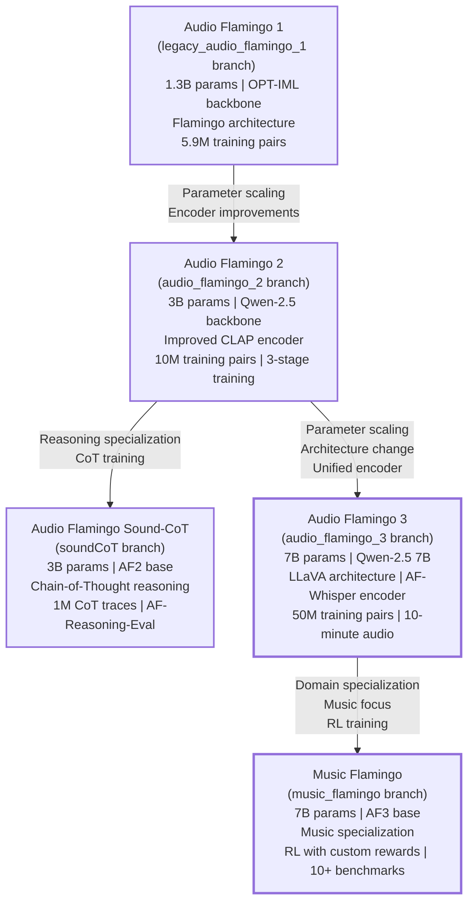
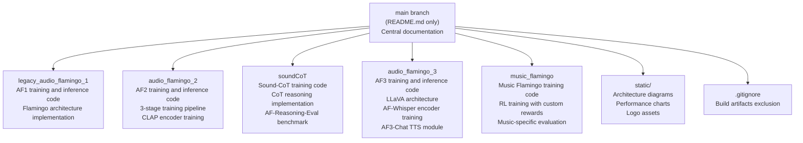
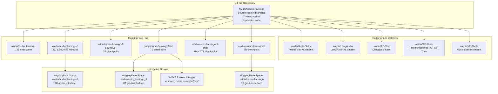
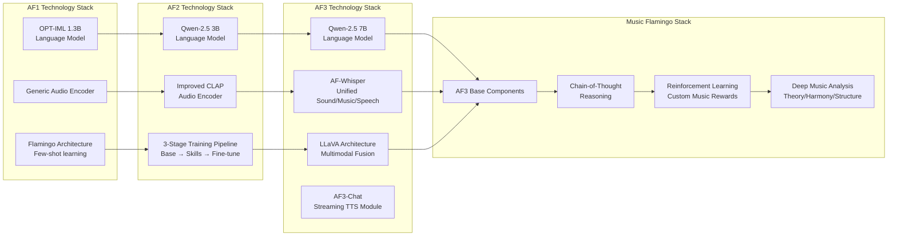

<!-- source: DeepWiki mcp.deepwiki.com · repo NVIDIA/audio-flamingo · page 1 Overview · fetched 2026-10-26 -->

# Overview

Relevant source files

The following files were used as context for generating this wiki page:

- [README.md](README.md)

## Purpose and Scope

This document provides a high-level introduction to the **Audio Flamingo** repository, a collection of Large Audio-Language Models (LALMs) developed by NVIDIA for advanced audio understanding tasks. The repository contains five distinct model variants spanning the evolution from 1.3B to 7B parameters, each with specialized capabilities for audio captioning, classification, question answering, and reasoning.

This overview covers:
- The five model variants in the Audio Flamingo series and their relationships
- Repository organization across GitHub branches
- Distribution channels through HuggingFace and demo platforms
- Core technologies and architectural foundations

For detailed information about individual models, see [Model Variants](#2). For technical architecture details, see [Technical Architecture](#3). For training data and methodologies, see [Training Data and Strategies](#4).

**Sources:** [README.md:1-18]()

---

## What is Audio Flamingo

Audio Flamingo is a series of open Large Audio-Language Models (LALMs) designed to understand and reason about audio inputs including sound, music, and speech. The series demonstrates progressive scaling in model parameters (1.3B → 3B → 7B), training data volume (5.9M → 10M → 50M pairs), and architectural sophistication across its five-year development timeline from 2024 to 2025.

The series consists of five model variants, each published in major academic venues:
- **Audio Flamingo 1**: 1.3B parameters, Flamingo architecture, ICML 2024
- **Audio Flamingo 2**: 3B parameters, improved CLAP encoder, ICML 2025
- **Audio Flamingo Sound-CoT**: 3B parameters, chain-of-thought reasoning, Technical Report 2025
- **Audio Flamingo 3**: 7B parameters, LLaVA architecture with AF-Whisper encoder, NeurIPS 2025 (Spotlight)
- **Music Flamingo**: 7B parameters, music specialization with reinforcement learning, arXiv 2025

All models support multiple audio understanding tasks including captioning, classification, question answering, and multi-turn dialogue. Advanced capabilities include few-shot learning, long-audio processing (up to 10 minutes), chain-of-thought reasoning, and domain-specific music understanding.

**Sources:** [README.md:13-18](), [README.md:42-49](), [README.md:107-109](), [README.md:148-150](), [README.md:172-173](), [README.md:204-205]()

---

## Model Variant Hierarchy

The following diagram shows the five model variants, their evolutionary relationships, and key distinguishing characteristics:

### Model Evolution and Specialization

This diagram illustrates the two primary development tracks:
1. **Main scaling path**: AF1 → AF2 → AF3 (parameter and data scaling)
2. **Specialization branches**: AF2 → Sound-CoT (reasoning), AF3 → Music Flamingo (domain expertise)

**Sources:** [README.md:192-205](), [README.md:153-173](), [README.md:128-150](), [README.md:69-109](), [README.md:20-65]()

---

## Repository Structure

The repository uses a multi-branch architecture where each model variant is maintained in a separate Git branch with its own training code, inference scripts, and documentation.

### Branch Organization

Each branch contains:
- Model-specific training scripts
- Inference and evaluation code
- Dataset preprocessing utilities
- Model checkpoint configurations
- Branch-specific documentation in `README.md`
- License files in `incl_licenses/` directory

**Sources:** [README.md:220-232](), [README.md:224-232]()

---

## Distribution Ecosystem

Audio Flamingo models are distributed through multiple channels to serve different user needs:

### Distribution Channels and Assets

**HuggingFace Model Checkpoints:**
- `nvidia/audio-flamingo`: 1.3B parameters
- `nvidia/audio-flamingo-2`: 3B, 1.5B, 0.5B variants
- `nvidia/audio-flamingo-2-SoundCoT`: 3B parameters with CoT
- `nvidia/audio-flamingo-3-hf`: 7B parameters
- `nvidia/audio-flamingo-3-chat`: 7B parameters + streaming TTS
- `nvidia/music-flamingo-hf`: 7B parameters music-specialized

**HuggingFace Dataset Collections:**
- `nvidia/AudioSkills`: Skill-specific training data (AudioSkills-XL for AF3)
- `nvidia/LongAudio`: Long-form audio understanding (LongAudio-XL for AF3)
- `nvidia/AF-Chat`: Multi-turn dialogue training data
- `nvidia/AF-Think`: Reasoning traces including AF-CoT-Train (1M traces)
- `nvidia/MF-Skills`: Music-specific training data

**Interactive Demos:**
- HuggingFace Spaces: `nvidia/audio-flamingo-2`, `nvidia/audio_flamingo_3`, `nvidia/music-flamingo`
- NVIDIA Research: `research.nvidia.com/labs/adlr/AF2/`, `research.nvidia.com/labs/adlr/AF3/`, `research.nvidia.com/labs/adlr/MF/`

**Sources:** [README.md:79-103](), [README.md:29-40](), [README.md:164-168](), [README.md:137-145](), [README.md:85-87](), [README.md:161-161](), [README.md:39-39]()

---

## Model Capabilities Matrix

The following table summarizes the capabilities across all Audio Flamingo variants:

| Capability | AF1 | AF2 | Sound-CoT | AF3 | Music Flamingo |
|------------|-----|-----|-----------|-----|----------------|
| **Parameters** | 1.3B | 3B | 3B | 7B | 7B |
| **LM Backbone** | OPT-IML | Qwen-2.5 | Qwen-2.5 | Qwen-2.5 | Qwen-2.5 |
| **Architecture** | Flamingo | Flamingo | Flamingo | LLaVA | LLaVA |
| **Audio Encoder** | Generic | Improved CLAP | Improved CLAP | AF-Whisper | AF-Whisper |
| **Training Pairs** | 5.9M | 10M | 10M + 1M CoT | 50M | 50M + Music |
| **Sound Understanding** | ✓ | ✓ | ✓ | ✓ | ✓ |
| **Music Understanding** | ✓ | ✓ | ✗ | ✓ | ✓✓ (Deep) |
| **Speech Understanding** | ✗ | ✗ | ✗ | ✓ | ✗ |
| **Audio Captioning** | ✓ | ✓ | ✓ | ✓ | ✓ |
| **Classification** | ✓ | ✓ | ✓ | ✓ | ✓ |
| **Question Answering** | ✓ | ✓ | ✓ | ✓ | ✓ |
| **Few-Shot Learning** | ✓✓ | ✗ | ✗ | ✗ | ✗ |
| **Multi-Turn Dialogue** | ✓ | ✓ | ✗ | ✓ | ✗ |
| **Max Audio Length** | Variable | 5 min | 5 min | 10 min | 10 min |
| **CoT Reasoning** | ✗ | ✗ | ✓✓ | ✗ | ✓ |
| **Streaming TTS** | ✗ | ✗ | ✗ | ✓ (AF3-Chat) | ✗ |
| **RL Training** | ✗ | ✗ | ✗ | ✗ | ✓ |
| **Branch** | `legacy_audio_flamingo_1` | `audio_flamingo_2` | `soundCoT` | `audio_flamingo_3` | `music_flamingo` |
| **Publication** | ICML 2024 | ICML 2025 | Tech Report 2025 | NeurIPS 2025 | arXiv 2025 |

**Key Distinctions:**
- **AF1**: Pioneering few-shot learning and dialogue capabilities with Flamingo architecture
- **AF2**: Scaled training data (10M pairs) with 3-stage training pipeline and long-audio support
- **Sound-CoT**: Specialized for chain-of-thought reasoning with 1M reasoning traces
- **AF3**: Complete modality coverage (sound/music/speech) with unified encoder and 10-minute support
- **Music Flamingo**: Deep music understanding with theory-aware analysis and RL-based training

**Sources:** [README.md:204-205](), [README.md:172-173](), [README.md:148-150](), [README.md:107-109](), [README.md:42-49]()

---

## Technology Stack Overview

### Core Component Evolution

**Key Technology Transitions:**
1. **Language Models**: OPT-IML 1.3B → Qwen-2.5 3B → Qwen-2.5 7B
2. **Audio Encoders**: Generic → Improved CLAP → Unified AF-Whisper
3. **Architectures**: Flamingo (few-shot focused) → LLaVA (multimodal fusion)
4. **Training Methods**: Standard supervised → 3-stage pipeline → CoT + RL

**Sources:** [README.md:204-205](), [README.md:172-173](), [README.md:107-109](), [README.md:42-47]()

---

## Licensing

The repository uses multiple licenses depending on the component:

- **Source Code**: MIT License for all code in this repository
- **Model Checkpoints**: NVIDIA OneWay Noncommercial License (non-commercial use only)
- **AF1 (OPT-IML-based)**: Subject to OPT-IML license restrictions
- **AF2/AF3/Sound-CoT/Music Flamingo (Qwen-2.5-based)**: Subject to Qwen RESEARCH LICENSE AGREEMENT (Copyright © Alibaba Cloud)

Additional restrictions and third-party licenses are documented in `README` files and `incl_licenses/` directories within each branch.

For accessing and using models, see [Getting Started](#6). For detailed licensing information, see [License and Attribution](#7).

**Sources:** [README.md:235-241]()

---

## Academic Publications

Each model variant has been published or submitted to major academic venues:

| Model | Venue | arXiv | Year |
|-------|-------|-------|------|
| Audio Flamingo 1 | ICML 2024 | [2402.01831](https://arxiv.org/abs/2402.01831) | 2024 |
| Audio Flamingo 2 | ICML 2025 | [2503.03983](https://arxiv.org/abs/2503.03983) | 2025 |
| Audio Flamingo Sound-CoT | Technical Report | [2508.11818](https://arxiv.org/abs/2508.11818) | 2025 |
| Audio Flamingo 3 | NeurIPS 2025 (Spotlight) | [2507.08128](https://arxiv.org/abs/2507.08128) | 2025 |
| Music Flamingo | arXiv | [2511.10289](https://arxiv.org/abs/2511.10289) | 2025 |

Complete citation information is available in [README.md:243-299]().

**Sources:** [README.md:15-18](), [README.md:195-199](), [README.md:157-160](), [README.md:131-133](), [README.md:72-75](), [README.md:23-26]()

---

