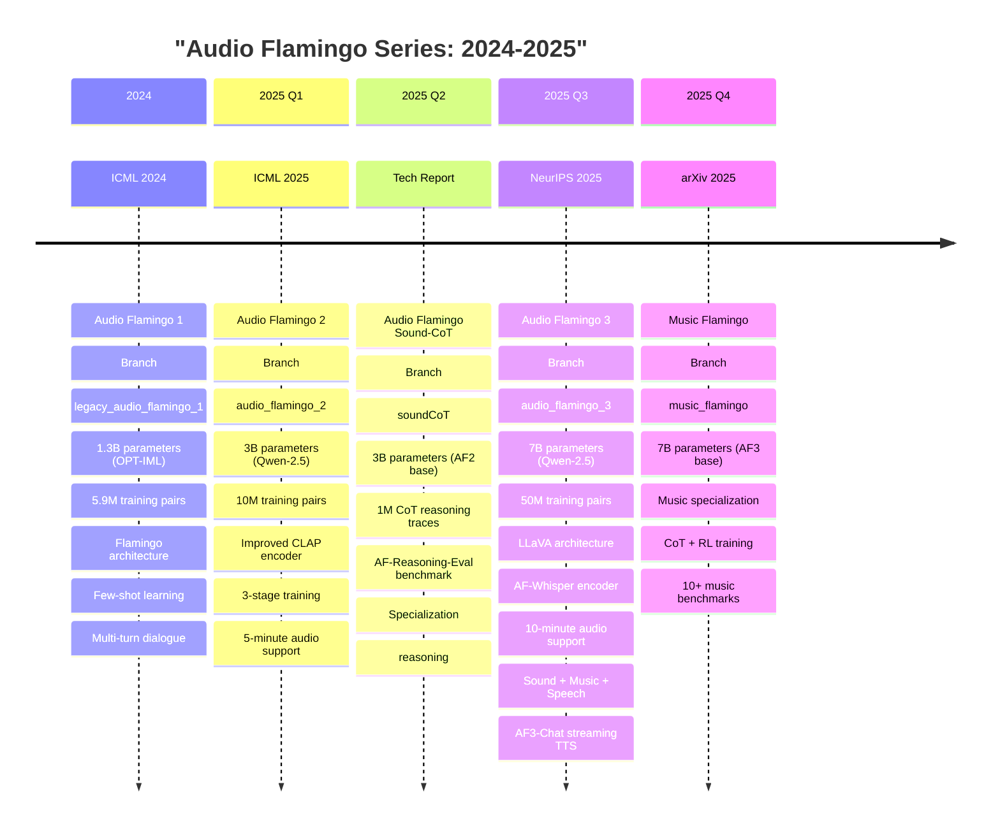
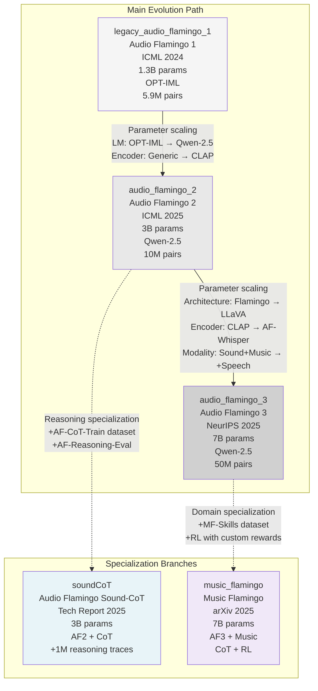
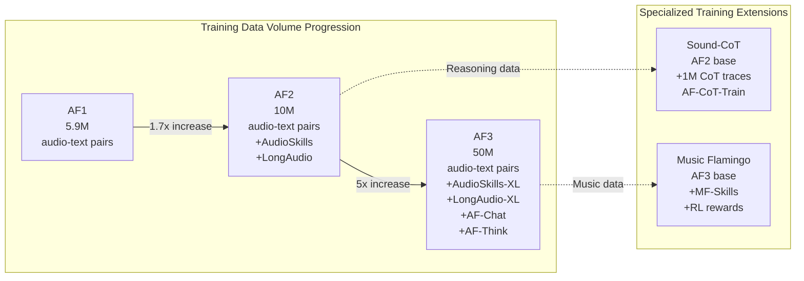
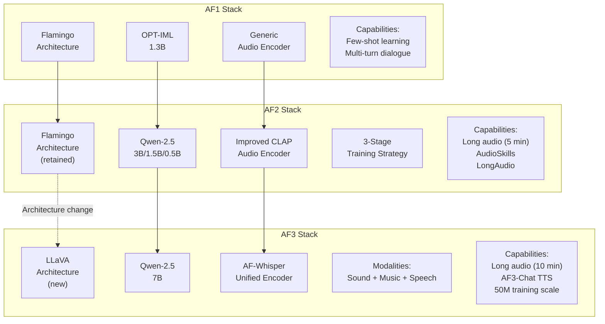
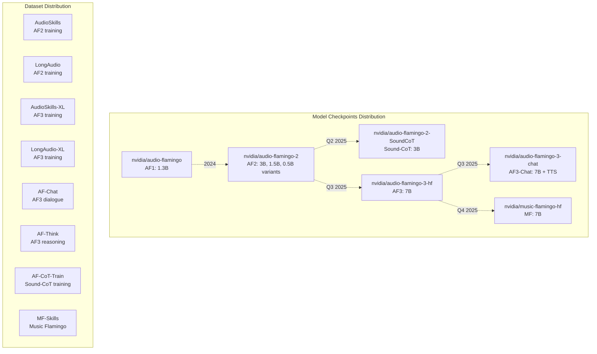
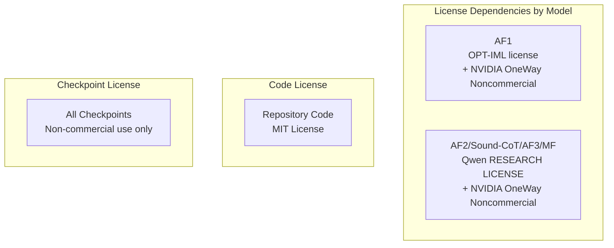

<!-- source: DeepWiki mcp.deepwiki.com · repo NVIDIA/audio-flamingo · page 1.1 Model Evolution Timeline · fetched 2026-10-26 -->

# Model Evolution Timeline

Relevant source files

The following files were used as context for generating this wiki page:

- [README.md](README.md)

## Purpose and Scope

This document chronicles the chronological development of the Audio Flamingo series from its inception in 2024 through 2025. It tracks the progression from Audio Flamingo 1 (AF1) through Audio Flamingo 2 (AF2), Sound-CoT, Audio Flamingo 3 (AF3), to Music Flamingo (MF), highlighting key scaling milestones in model parameters, training data volumes, architectural choices, and capability expansions. Each model variant corresponds to a dedicated branch in the repository, documented in detail in their respective sections ([2.1](#2.1), [2.2](#2.2), [2.3](#2.3), [2.4](#2.4), [2.5](#2.5)). For information about the repository's organizational structure and branch layout, see [Repository Structure](#1.2).

## Chronological Development Overview

Sources: [README.md:13-19](), [README.md:20-68](), [README.md:69-127](), [README.md:128-151](), [README.md:153-188](), [README.md:192-217]()

## Model Lineage and Branch Structure

Sources: [README.md:220-232](), [README.md:235-240]()

## Scaling Progression

### Parameter Count Evolution

| Model | Parameters | Language Model | Branch |
|-------|------------|----------------|---------|
| Audio Flamingo 1 | 1.3B | OPT-IML | `legacy_audio_flamingo_1` |
| Audio Flamingo 2 | 3B | Qwen-2.5 | `audio_flamingo_2` |
| Audio Flamingo 2 (variants) | 1.5B, 0.5B | Qwen-2.5 | `audio_flamingo_2` |
| Sound-CoT | 3B | Qwen-2.5 (AF2 base) | `soundCoT` |
| Audio Flamingo 3 | 7B | Qwen-2.5 | `audio_flamingo_3` |
| Music Flamingo | 7B | Qwen-2.5 (AF3 base) | `music_flamingo` |

The series demonstrates a clear scaling trend: 1.3B → 3B → 7B for the main evolution path, with additional 1.5B and 0.5B variants of AF2 providing intermediate-scale options.

Sources: [README.md:199](), [README.md:165-167](), [README.md:79-88](), [README.md:30-32]()

### Training Data Scaling

The training data volume increased dramatically: 5.9M pairs (AF1) → 10M pairs (AF2, 1.7x increase) → 50M pairs (AF3, 5x increase from AF2). Specialized datasets added reasoning traces (1M for Sound-CoT) and domain-specific music data (MF-Skills for Music Flamingo).

Sources: [README.md:204](), [README.md:172](), [README.md:107](), [README.md:150]()

## Architectural Evolution

### Foundation Architecture Transitions

**Key Architectural Transitions:**
- **AF1 → AF2**: Language model migration from OPT-IML to Qwen-2.5, encoder upgrade from generic to improved CLAP, introduction of 3-stage training strategy, while retaining Flamingo architecture
- **AF2 → AF3**: Major architecture shift from Flamingo to LLaVA, unified AF-Whisper encoder replacing CLAP, expansion from 2 modalities (sound, music) to 3 modalities (adding speech), 5x training data scaling

Sources: [README.md:204](), [README.md:172](), [README.md:107](), [README.md:216](), [README.md:186](), [README.md:125]()

## Audio Duration Capabilities

| Model | Maximum Audio Duration | Key Feature |
|-------|------------------------|-------------|
| Audio Flamingo 1 | ~3-4 minutes | Standard audio sequences |
| Audio Flamingo 2 | Up to 5 minutes | LongAudio dataset support |
| Audio Flamingo 3 | Up to 10 minutes | LongAudio-XL dataset support |
| Sound-CoT | Up to 5 minutes | Inherited from AF2 base |
| Music Flamingo | Up to 10 minutes | Full-length song reasoning |

The progression shows consistent improvement in handling longer audio sequences, with AF3 and MF reaching 10-minute capacity for analyzing full-length songs and extended soundscapes.

Sources: [README.md:109](), [README.md:172]()

## Specialization Branches

### Sound-CoT: Reasoning Specialization

Audio Flamingo Sound-CoT represents a lateral specialization from the AF2 baseline, focusing on chain-of-thought reasoning capabilities rather than parameter scaling.

**Key Developments:**
- Base: 3B parameter AF2 model from `audio_flamingo_2` branch
- Specialization: Chain-of-thought reasoning for sound understanding
- Training data: AF-CoT-Train dataset with approximately 1M reasoning traces
- Evaluation: Introduction of AF-Reasoning-Eval benchmark for reasoning assessment
- Performance: Comparable to 7B reasoning baselines despite smaller size

Branch: `soundCoT`

Sources: [README.md:128-151]()

### Music Flamingo: Domain Specialization

Music Flamingo extends AF3 with deep music understanding capabilities through domain specialization and advanced training techniques.

**Key Developments:**
- Base: 7B parameter AF3 model from `audio_flamingo_3` branch
- Domain: Deep music understanding (songs and instrumentals)
- Capabilities: Theory-aware captions, harmony/structure/timbre/lyrics/cultural analysis
- Training innovations: Chain-of-thought reasoning + reinforcement learning with custom rewards
- Performance: SOTA results on 10+ music benchmarks

Branch: `music_flamingo`

Sources: [README.md:20-66](), [README.md:42-48]()

## HuggingFace Distribution Timeline

**Distribution Pattern:** Each model release on HuggingFace Hub corresponds to the chronological development timeline, with datasets released alongside their associated models. The checkpoint naming convention uses `nvidia/` prefix followed by the model name and optional variant suffix.

Sources: [README.md:199](), [README.md:165-167](), [README.md:137-138](), [README.md:79-83](), [README.md:30-35](), [README.md:91-102](), [README.md:140-145]()

## Publication Venues and Academic Timeline

| Model | Venue | Paper ID | Release Type |
|-------|-------|----------|--------------|
| Audio Flamingo 1 | ICML 2024 | arXiv:2402.01831 | Conference (Accepted) |
| Audio Flamingo 2 | ICML 2025 | arXiv:2503.03983 | Conference (Accepted) |
| Sound-CoT | Technical Report | arXiv:2508.11818 | Technical Report |
| Audio Flamingo 3 | NeurIPS 2025 | arXiv:2507.08128 | Conference (Spotlight) |
| Music Flamingo | arXiv 2025 | arXiv:2511.10289 | Preprint |

**Publication Progression:** The series shows consistent academic presence with two ICML acceptances (2024, 2025), a NeurIPS Spotlight (2025), plus technical reports and preprints for specialized variants. The NeurIPS Spotlight designation indicates significant community recognition for AF3's contributions.

Sources: [README.md:15-18](), [README.md:195](), [README.md:157](), [README.md:131](), [README.md:72](), [README.md:23]()

## Interactive Demo Availability

| Model | Demo Platform | URL Pattern |
|-------|---------------|-------------|
| Audio Flamingo 1 | NVIDIA Research | audioflamingo.github.io |
| Audio Flamingo 2 | HuggingFace Spaces + NVIDIA | spaces/nvidia/audio-flamingo-2 |
| Audio Flamingo 3 | HuggingFace Spaces + NVIDIA | spaces/nvidia/audio_flamingo_3 |
| Music Flamingo | HuggingFace Spaces + NVIDIA | spaces/nvidia/music-flamingo |

**Demo Evolution:** Starting with AF1's custom demo site, the series transitioned to dual hosting on HuggingFace Spaces and NVIDIA research pages for AF2, AF3, and MF, providing broader accessibility and standardized interfaces.

Sources: [README.md:196](), [README.md:158-161](), [README.md:85-86](), [README.md:39](), [README.md:24](), [README.md:73]()

## Licensing Evolution

**Licensing Structure:** All model checkpoints are restricted to non-commercial use under the NVIDIA OneWay Noncommercial License. AF1 is additionally subject to OPT-IML licensing terms, while AF2, Sound-CoT, AF3, and Music Flamingo are subject to the Qwen RESEARCH LICENSE AGREEMENT (Copyright © Alibaba Cloud). Repository code uses MIT License.

Sources: [README.md:235-241]()

## Citation Guidance by Model

The repository provides specific BibTeX citations for each model variant, reflecting their distinct publication venues and authorship:

- **AF1**: `kong2024audio` (ICML 2024 proceedings)
- **AF2**: `ghosh2025audio` (ICML 2025 proceedings) 
- **Sound-CoT**: `kong2025audio` (arXiv preprint)
- **AF3**: `ghosh2025audio` (NeurIPS 2025 proceedings)
- **Music Flamingo**: `ghosh2025music` (arXiv preprint)

Sources: [README.md:243-299]()

---

