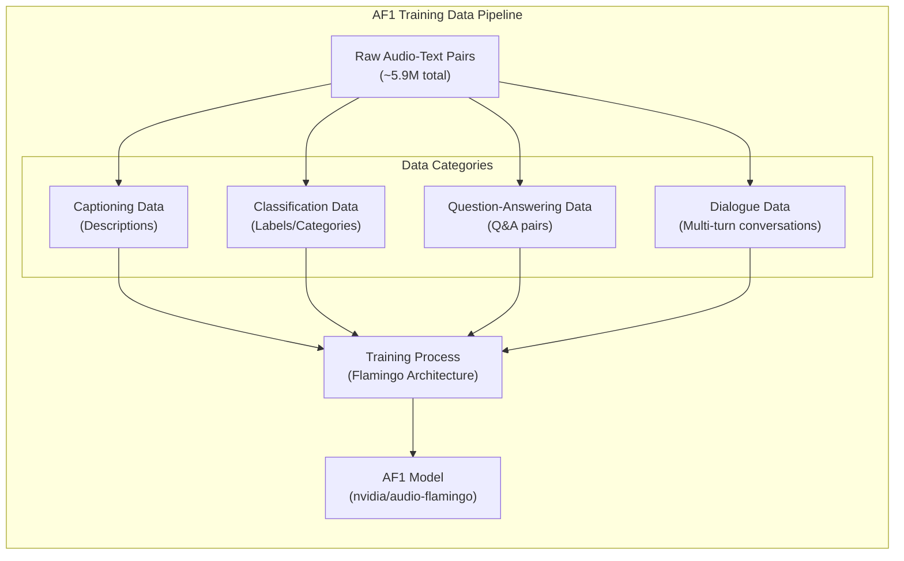
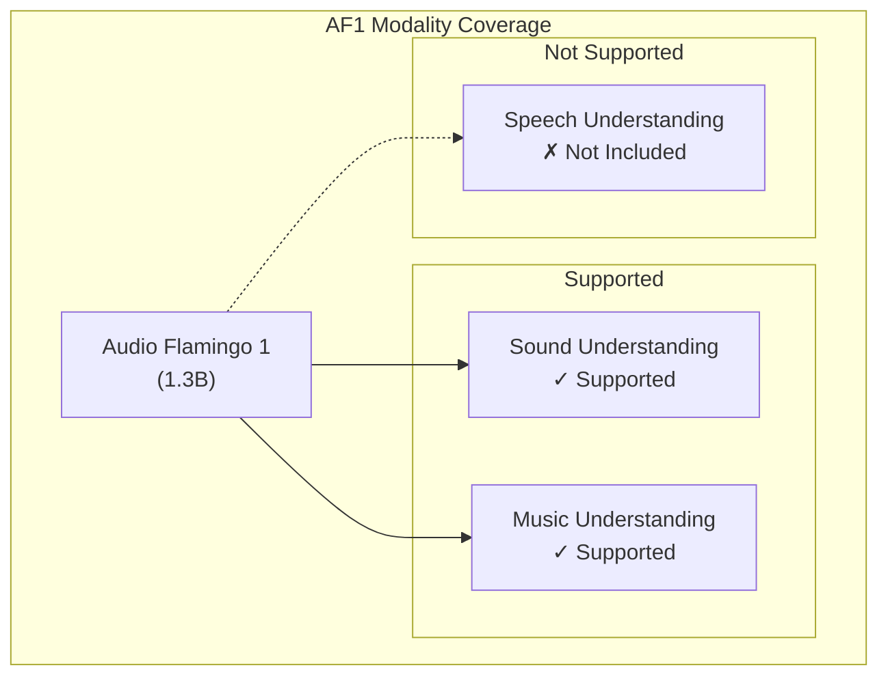
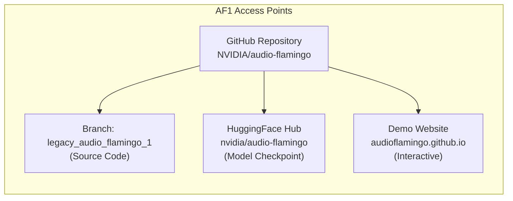

<!-- source: DeepWiki mcp.deepwiki.com · repo NVIDIA/audio-flamingo · page 2.1 Audio Flamingo 1 · fetched 2026-10-26 -->

# Audio Flamingo 1

<details>
<summary>Relevant source files</summary>

The following files were used as context for generating this wiki page:

- [README.md](README.md)
- [static/af1_radial.png](static/af1_radial.png)
- [static/af3_radial-1.png](static/af3_radial-1.png)

</details>


## Purpose and Scope

Audio Flamingo 1 (AF1) is the foundational model in the Audio Flamingo series, published at ICML 2024. This page documents AF1's architecture, training approach, capabilities, and deployment options. AF1 introduced the Flamingo-based architecture for audio understanding with few-shot learning and multi-turn dialogue capabilities, trained on approximately 5.9M audio-text pairs using a 1.3B parameter OPT-IML language model backbone.

For information about subsequent model iterations with improved performance and scale, see [Audio Flamingo 2](#2.2), [Audio Flamingo Sound-CoT](#2.3), [Audio Flamingo 3](#2.4), and [Music Flamingo](#2.5). For architectural comparisons across the series, see [Architectural Foundations](#3.1).

**Sources:** [README.md:192-217]()

---

## Model Overview

Audio Flamingo 1 represents the first Large Audio-Language Model (LALM) in the series, designed to handle general audio understanding tasks including sound and music comprehension. The model leverages the Flamingo architecture, originally developed for vision-language tasks, adapted for audio inputs.

### Key Specifications

| Specification | Value |
|--------------|-------|
| **Total Parameters** | 1.3 billion |
| **Language Model** | OPT-IML 1.3B |
| **Architecture** | Flamingo |
| **Training Pairs** | ~5.9 million audio-text pairs |
| **Modalities Supported** | Sound, Music |
| **Context Window** | Standard audio segments |
| **Key Features** | Few-shot learning, Multi-turn dialogue |
| **Publication** | ICML 2024 |
| **Paper** | arXiv:2402.01831 |

**Sources:** [README.md:15,204]()

---

## Architecture Components

### Flamingo Architecture Foundation

Audio Flamingo 1 adapts the Flamingo architecture for audio understanding. The Flamingo architecture was originally designed for vision-language models with strong few-shot learning capabilities. The key adaptation involves replacing visual encoders with audio encoders while maintaining the cross-attention mechanisms that enable few-shot in-context learning.

```mermaid
graph TB
    subgraph "Audio Flamingo 1 Architecture Stack"
        AudioInput["Audio Input<br/>(Sound/Music)"]
        
        subgraph "Audio Processing"
            AudioEncoder["Audio Encoder<br/>(Generic Audio Encoder)"]
            AudioFeatures["Audio Features<br/>(Embeddings)"]
        end
        
        subgraph "Flamingo Components"
            PerceiverResampler["Perceiver Resampler<br/>(Dimension Alignment)"]
            CrossAttention["Gated Cross-Attention<br/>(Few-shot Context)"]
        end
        
        subgraph "Language Processing"
            LM["OPT-IML 1.3B<br/>(Language Model Backbone)"]
            TextOutput["Generated Response<br/>(Captions/Answers)"]
        end
        
        AudioInput --> AudioEncoder
        AudioEncoder --> AudioFeatures
        AudioFeatures --> PerceiverResampler
        PerceiverResampler --> CrossAttention
        CrossAttention --> LM
        LM --> TextOutput
    end
    
    style AudioInput fill:#f9f9f9
    style TextOutput fill:#f9f9f9
    style LM fill:#e8f4f8
```



**Architecture: Audio Flamingo 1 Processing Pipeline**

The architecture consists of three primary stages:

1. **Audio Encoding**: Audio inputs are processed through a generic audio encoder to produce feature embeddings
2. **Cross-Modal Alignment**: The Perceiver Resampler and Gated Cross-Attention layers enable the language model to condition on audio features while supporting few-shot examples
3. **Language Generation**: The OPT-IML 1.3B language model generates textual responses based on the audio context

**Sources:** [README.md:204,216-217]()

### Language Model Backbone: OPT-IML

Audio Flamingo 1 uses OPT-IML (Open Pre-trained Transformer - Instruction Meta-Learning) as its language model backbone. OPT-IML is a 1.3B parameter instruction-tuned language model that provides strong natural language generation and instruction-following capabilities.

**Key characteristics of OPT-IML integration:**
- 1.3 billion parameters dedicated to language understanding and generation
- Pre-trained instruction-following capabilities enable better task adaptation
- Compatible with the Flamingo architecture's cross-attention mechanisms
- Licensed under the OPT-IML license (see [License and Attribution](#7))

**Sources:** [README.md:204,239]()

### Audio Encoder

Audio Flamingo 1 employs a generic audio encoder trained to process both sound and music inputs. Unlike later models in the series that use specialized encoders (CLAP in AF2, AF-Whisper in AF3), AF1's encoder provides general-purpose audio understanding.

**Encoder capabilities:**
- Processes variable-length audio inputs
- Generates dense audio feature representations
- Supports both sound events and musical content
- Does not include speech recognition capabilities (speech support added in AF3)

**Sources:** [README.md:204-205]()

---

## Training Data and Methodology

### Training Dataset Scale

Audio Flamingo 1 was trained on approximately 5.9 million audio-text pairs, making it the smallest training set in the Audio Flamingo series. This curated dataset covers diverse audio understanding tasks while maintaining manageable computational requirements.



**Diagram: AF1 Training Data Flow**

### Dialogue Training Data

A distinctive feature of Audio Flamingo 1 is its multi-turn dialogue capability, achieved through specialized dialogue training data. The model was trained using the Audio Dialogues dataset, which enables conversational interactions about audio content.

**Reference:** For details about the dialogue data methodology, see the Audio Dialogues paper (arXiv:2404.07616) cited in [README.md:204]().

**Sources:** [README.md:204-205]()

---

## Core Capabilities

### Few-Shot In-Context Learning

Audio Flamingo 1's primary distinguishing feature is its ability to perform few-shot in-context learning. This capability, inherited from the Flamingo architecture, allows the model to adapt to new tasks by providing a few demonstration examples without requiring fine-tuning.

**Few-shot learning characteristics:**
- Supports 0-shot, 1-shot, 2-shot, and higher-shot scenarios
- Learns from demonstration examples provided in the prompt
- Adapts to task variations through in-context examples
- Enables rapid task switching without model updates

**Example use case:**
```
Input: [Example 1 Audio] → "Birds chirping in a forest"
       [Example 2 Audio] → "Car engine starting"
       [Target Audio] → ?
Output: Model generates description based on example pattern
```

**Sources:** [README.md:204-205]()

### Multi-Turn Dialogue

Audio Flamingo 1 supports multi-turn dialogue interactions, enabling conversational audio understanding. This capability allows users to ask follow-up questions about audio content and maintain context across multiple exchanges.

**Dialogue capabilities:**
- Maintains conversation context across turns
- Handles clarification questions about audio content
- Supports both simple and complex conversational patterns
- Integrates audio understanding with conversational reasoning

**Sources:** [README.md:204]()

### Task Coverage

Audio Flamingo 1 achieves state-of-the-art results across three primary audio understanding task categories:

| Task Category | Description | Example Applications |
|--------------|-------------|---------------------|
| **Captioning** | Generate natural language descriptions of audio content | Audio event descriptions, music descriptions |
| **Classification** | Categorize audio into predefined classes | Sound event classification, genre classification |
| **Question Answering** | Answer questions about audio content | "What instrument is playing?", "What is the loudest sound?" |

**Sources:** [README.md:204-205]()

---

## Modality Support and Limitations

### Supported Modalities

Audio Flamingo 1 supports two of the three primary audio modalities:



**Diagram: Audio Flamingo 1 Modality Coverage**

**Supported:**
- **Sound Events**: Environmental sounds, acoustic events, sound effects
- **Music**: Musical content, instruments, genres, musical characteristics

**Not Supported:**
- **Speech**: Speech recognition and understanding were added in Audio Flamingo 3. For speech capabilities, see [Audio Flamingo 3](#2.4)

**Sources:** [README.md:107,204-205]()

---

## Performance and Benchmarks

### Benchmark Results

Audio Flamingo 1 achieved state-of-the-art performance on multiple benchmarks at the time of publication:

**Evaluation scenarios:**
- **Zero-shot**: No training examples provided, model relies on pre-training
- **Few-shot**: Limited examples (1-5) provided for in-context learning
- **In-distribution**: Evaluation on tasks similar to training distribution

The model demonstrated competitive performance across all three evaluation settings, particularly excelling in few-shot scenarios where the Flamingo architecture's in-context learning capabilities provided advantages.

**Visual performance summary:** The radial performance chart shown in [README.md:209-211]() illustrates AF1's comparative performance across multiple benchmark dimensions.

**Sources:** [README.md:204-205]()

---

## Accessing Audio Flamingo 1

### GitHub Branch

Audio Flamingo 1 source code is maintained in a dedicated branch:

**Branch:** `legacy_audio_flamingo_1`

The branch contains:
- Training scripts and configuration
- Inference code
- Model architecture implementation
- Evaluation utilities
- Documentation and assets



**Diagram: Audio Flamingo 1 Distribution Channels**

**Sources:** [README.md:197,220-232]()

### HuggingFace Model Checkpoint

The pre-trained Audio Flamingo 1 model is available on HuggingFace Hub:

**Model Repository:** `nvidia/audio-flamingo`
**Parameters:** 1.3B
**License:** Non-commercial use only (NVIDIA OneWay Noncommercial License + OPT-IML license restrictions)

The checkpoint can be loaded for:
- Inference on audio understanding tasks
- Few-shot learning experiments
- Fine-tuning on downstream tasks
- Research and evaluation

**Sources:** [README.md:199,238-240]()

### Interactive Demo

An interactive demonstration of Audio Flamingo 1 is available at:

**Demo URL:** audioflamingo.github.io

The demo provides:
- Web-based interface for testing the model
- Example audio inputs across different categories
- Real-time inference capabilities
- Visualization of model predictions

**Sources:** [README.md:196]()

---

## Comparison with Later Models

Audio Flamingo 1 serves as the foundation for the series but has been superseded by more capable models:

| Aspect | AF1 | AF2 | AF3 |
|--------|-----|-----|-----|
| **Parameters** | 1.3B | 3B | 7B |
| **Training Pairs** | 5.9M | 10M | 50M |
| **Architecture** | Flamingo | Flamingo | LLaVA |
| **Modalities** | Sound, Music | Sound, Music | Sound, Music, Speech |
| **Max Audio Length** | Standard | ~5 minutes | ~10 minutes |
| **Key Feature** | Few-shot learning | 3-stage training | Unified encoder |

For detailed information about subsequent models, see:
- [Audio Flamingo 2](#2.2) - Improved scale and training methodology
- [Audio Flamingo 3](#2.4) - Complete modality coverage and unified encoder
- [Model Evolution Timeline](#1.1) - Complete series overview

**Sources:** [README.md:14-18,107,172,204-205]()

---

## License and Citation

### License Information

Audio Flamingo 1 is subject to multiple license restrictions:

1. **Code License:** MIT License (for repository code)
2. **Model License:** NVIDIA OneWay Noncommercial License (non-commercial use only)
3. **OPT-IML License:** Subject to OPT-IML license terms (due to OPT-IML backbone)

See [License and Attribution](#7) for complete licensing details.

**Sources:** [README.md:235-240]()

### Citation

To cite Audio Flamingo 1 in research:

```bibtex
@inproceedings{kong2024audio,
  title={Audio Flamingo: A Novel Audio Language Model with Few-Shot Learning and Dialogue Abilities},
  author={Kong, Zhifeng and Goel, Arushi and Badlani, Rohan and Ping, Wei and Valle, Rafael and Catanzaro, Bryan},
  booktitle={International Conference on Machine Learning},
  pages={25125--25148},
  year={2024},
  organization={PMLR}
}
```

**Paper:** arXiv:2402.01831

**Sources:** [README.md:195,245-255]()

---

