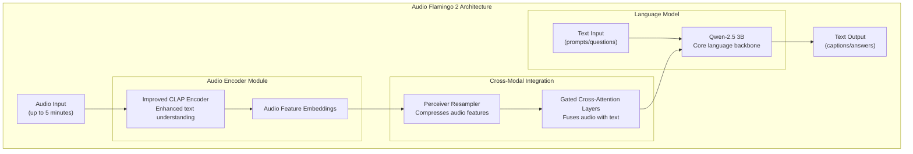
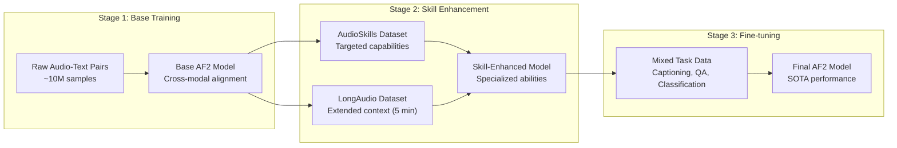
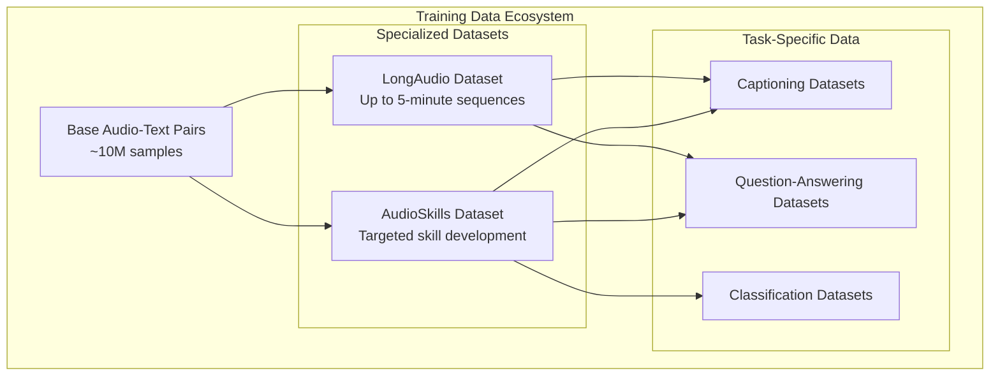
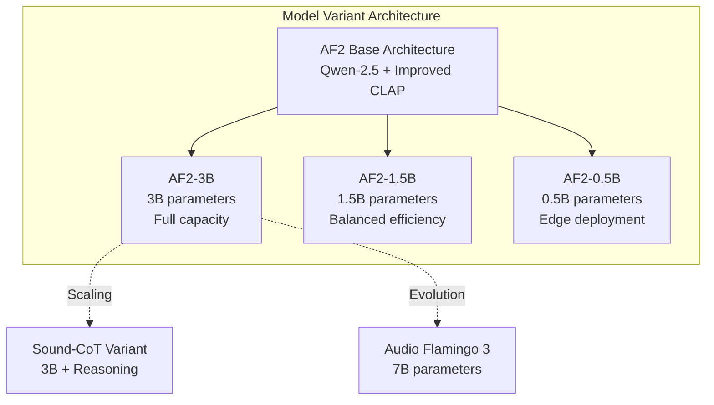
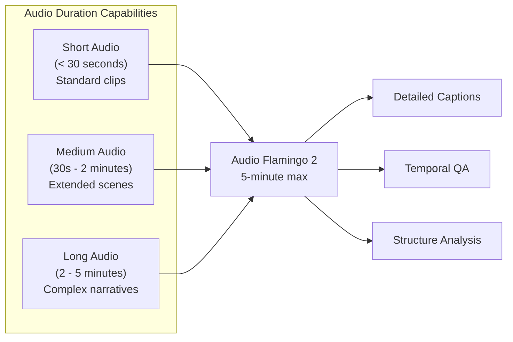
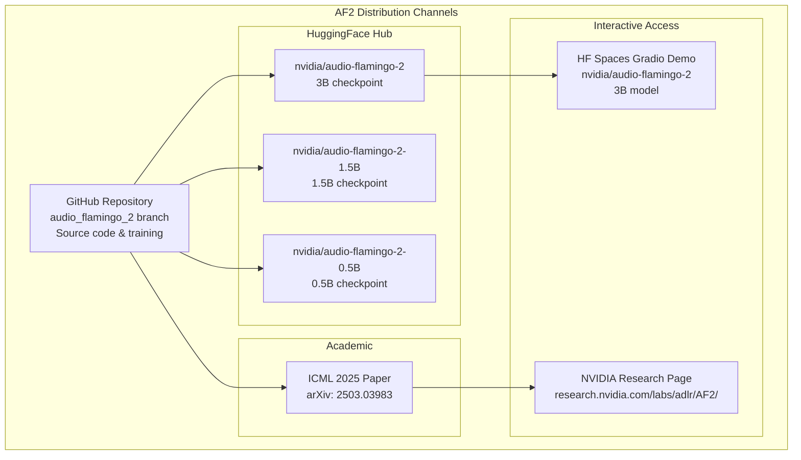
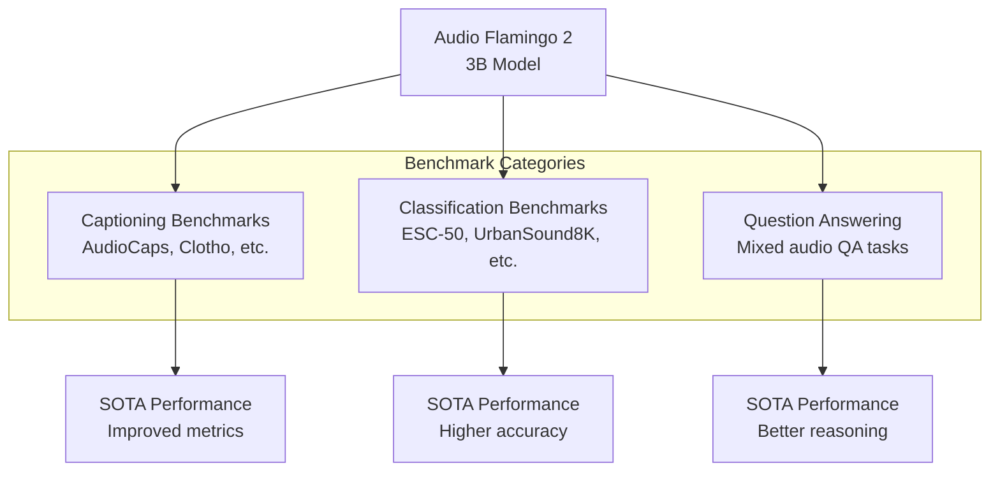
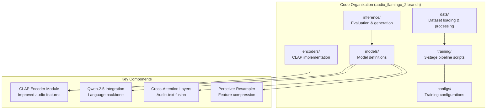

<!-- source: DeepWiki mcp.deepwiki.com · repo NVIDIA/audio-flamingo · page 2.2 Audio Flamingo 2 · fetched 2026-10-26 -->

# Audio Flamingo 2

<details>
<summary>Relevant source files</summary>

The following files were used as context for generating this wiki page:

- [README.md](README.md)

</details>


## Purpose and Scope

This page documents **Audio Flamingo 2 (AF2)**, a 3B parameter audio-language model that represents the second generation of the Audio Flamingo series. AF2 introduced significant architectural and training improvements over AF1, including a scaled language model backbone, an improved audio encoder, a systematic 3-stage training strategy, and expanded training data reaching 10M audio-text pairs.

For information about the original Audio Flamingo model (1.3B parameters), see [Audio Flamingo 1](#2.1). For the chain-of-thought reasoning variant based on AF2, see [Audio Flamingo Sound-CoT](#2.3). For the larger 7B parameter successor, see [Audio Flamingo 3](#2.4).

**Sources:** [README.md:153-188]()

---

## Overview

Audio Flamingo 2 is a large audio-language model (LALM) designed to understand and reason about audio content including sound events and music. The model scales the Audio Flamingo architecture from 1.3B to 3B parameters and introduces several technical innovations:

- **Language Model Backbone:** Qwen-2.5 3B, replacing OPT-IML used in AF1
- **Audio Encoder:** Re-trained CLAP with enhanced text understanding capabilities
- **Training Scale:** 10M audio-text pairs (up from 5.9M in AF1)
- **Training Strategy:** Systematic 3-stage pipeline for optimal performance
- **Long Audio Support:** Processes audio sequences up to 5 minutes in length
- **Model Variants:** Available in three sizes (3B, 1.5B, 0.5B) for different deployment scenarios

AF2 achieves state-of-the-art results on multiple benchmarks for audio captioning, classification, and question answering tasks.

**Sources:** [README.md:153-188]()

---

## Architecture Components

### High-Level Architecture



**Diagram: Audio Flamingo 2 High-Level Architecture**

The architecture follows a cross-modal fusion design where audio features from the CLAP encoder are integrated into the Qwen-2.5 language model through gated cross-attention mechanisms. The perceiver resampler reduces the dimensionality of audio features before fusion.

**Sources:** [README.md:153-188]()

---

### Language Model: Qwen-2.5 3B

Audio Flamingo 2 adopts **Qwen-2.5** as its language model backbone, a significant upgrade from the OPT-IML 1.3B used in AF1. The 3B parameter configuration provides:

- Enhanced language understanding and generation capabilities
- Better instruction-following abilities
- Improved reasoning performance
- Foundation for the 3-stage training strategy

The Qwen-2.5 backbone is subject to the Qwen RESEARCH LICENSE AGREEMENT and is the same language model used in AF3's 7B variant, providing architectural continuity across the series.

**Sources:** [README.md:153-173](), [README.md:236-241]()

---

### Audio Encoder: Improved CLAP

AF2 introduces a **re-trained CLAP (Contrastive Language-Audio Pre-training)** encoder with enhanced capabilities:

| Feature | Description |
|---------|-------------|
| **Training Objective** | Contrastive learning between audio and text embeddings |
| **Text Understanding** | Strengthened comprehension of textual descriptions and queries |
| **Audio Modalities** | Handles both sound events and music |
| **Feature Extraction** | Produces rich audio representations for cross-modal fusion |

The improved CLAP encoder addresses limitations in the original AF1 audio encoder, particularly in understanding complex text queries and producing discriminative audio features for fine-grained understanding tasks.

**Sources:** [README.md:172]()

---

## Training Strategy

### Three-Stage Training Pipeline

Audio Flamingo 2 employs a systematic **3-stage training strategy** that was carefully ablated to yield optimal results:



**Diagram: Three-Stage Training Pipeline for Audio Flamingo 2**

| Stage | Purpose | Data Focus | Training Objective |
|-------|---------|------------|-------------------|
| **Stage 1** | Cross-modal alignment | Large-scale audio-text pairs | Establish basic audio-text understanding |
| **Stage 2** | Skill enhancement | AudioSkills + LongAudio datasets | Develop specialized capabilities (long-form, specific tasks) |
| **Stage 3** | Task fine-tuning | Mixed benchmark tasks | Optimize for captioning, QA, classification |

This curriculum learning approach progressively builds model capabilities from foundational understanding to specialized skills to task-specific performance.

**Sources:** [README.md:172]()

---

### Training Data

Audio Flamingo 2 scales the training data to approximately **10M audio-text pairs**, representing a 70% increase over AF1's 5.9M pairs.



**Diagram: Audio Flamingo 2 Training Data Structure**

**Key Dataset Components:**

- **AudioSkills:** Curated dataset focusing on specific audio understanding skills across diverse sound and music domains
- **LongAudio:** Specialized dataset for training long-context understanding (up to 5 minutes)
- **Mixed Benchmarks:** Various captioning, classification, and QA datasets for comprehensive evaluation

The datasets used in AF2 training later evolved into AudioSkills-XL and LongAudio-XL for Audio Flamingo 3 (see [Core Dataset Collections](#4.2)).

**Sources:** [README.md:172]()

---

## Model Variants

Audio Flamingo 2 is available in **three parameter sizes** to accommodate different computational budgets and deployment scenarios:

| Model Variant | Parameters | HuggingFace Hub | Use Case |
|---------------|-----------|-----------------|----------|
| **AF2-3B** | 3.0B | `nvidia/audio-flamingo-2` | Full performance, research, production with adequate compute |
| **AF2-1.5B** | 1.5B | `nvidia/audio-flamingo-2-1.5B` | Balanced performance and efficiency |
| **AF2-0.5B** | 0.5B | `nvidia/audio-flamingo-2-0.5B` | Edge deployment, resource-constrained environments |



**Diagram: Audio Flamingo 2 Model Variants and Evolution**

All three variants share the same architectural design and training strategy, differing primarily in the size of the language model backbone. The 3B variant serves as the base for the Sound-CoT specialization (see [Audio Flamingo Sound-CoT](#2.3)).

**Sources:** [README.md:164-168]()

---

## Capabilities

### Core Task Performance

Audio Flamingo 2 achieves state-of-the-art performance across multiple audio understanding tasks:

| Task Category | Capabilities | Performance |
|---------------|-------------|-------------|
| **Audio Captioning** | Generates natural language descriptions of audio content | SOTA on captioning benchmarks |
| **Audio Classification** | Categorizes audio into semantic classes | SOTA on classification benchmarks |
| **Question Answering** | Answers questions about audio content | SOTA on QA benchmarks |
| **Long-Audio Understanding** | Processes and reasons about extended audio (up to 5 minutes) | Unique capability in 2025 |

**Sources:** [README.md:172]()

---

### Audio Duration Support



**Diagram: Audio Duration Processing in AF2**

The **5-minute audio support** represents a significant advance over previous audio-language models, enabling:
- Analysis of complete songs and music pieces
- Understanding of extended soundscapes
- Temporal reasoning across longer contexts
- Processing of multi-scene audio narratives

This capability was further extended to 10 minutes in Audio Flamingo 3 (see [Audio Flamingo 3](#2.4)).

**Sources:** [README.md:172]()

---

## Distribution and Access

### HuggingFace Hub Distribution



**Diagram: Audio Flamingo 2 Distribution Ecosystem**

**Access Points:**

| Resource | Location | Purpose |
|----------|----------|---------|
| **Source Code** | `github.com/NVIDIA/audio-flamingo` (branch: `audio_flamingo_2`) | Training and inference code |
| **3B Checkpoint** | `huggingface.co/nvidia/audio-flamingo-2` | Full model weights (v20250625) |
| **1.5B Checkpoint** | `huggingface.co/nvidia/audio-flamingo-2-1.5B` | Medium variant weights |
| **0.5B Checkpoint** | `huggingface.co/nvidia/audio-flamingo-2-0.5B` | Small variant weights |
| **Interactive Demo** | `huggingface.co/spaces/nvidia/audio-flamingo-2` | Web-based testing interface |
| **Research Page** | `research.nvidia.com/labs/adlr/AF2/` | Project documentation and examples |
| **Paper** | arXiv:2503.03983 | ICML 2025 publication |

**Sources:** [README.md:153-168]()

---

## Performance and Benchmarks

### SOTA Achievements

Audio Flamingo 2 achieves state-of-the-art results on multiple benchmarks as of its release:



**Diagram: AF2 Benchmark Performance Categories**

The model demonstrates particularly strong performance on:
- **Captioning tasks:** High-quality natural language descriptions of audio
- **Classification tasks:** Accurate categorization across diverse audio types
- **Question answering:** Robust reasoning about audio content
- **Mixed benchmarks:** Consistent performance across varied evaluation protocols

Detailed performance comparisons show improvements over Audio Flamingo 1 and competitive results against contemporary models like Qwen-Audio and other audio-language models circa 2025.

**Sources:** [README.md:172]()

---

### Comparison with Other Models

Audio Flamingo 2 positioned itself competitively in the LALM landscape:

| Aspect | AF2 Advantage |
|--------|---------------|
| **Parameter Efficiency** | 3B parameters competitive with larger models |
| **Long Audio** | 5-minute support (unique at time of release) |
| **Training Strategy** | Systematic 3-stage curriculum learning |
| **Multi-size Variants** | Flexible deployment (0.5B, 1.5B, 3B) |
| **Audio Encoder** | Improved CLAP with enhanced text understanding |

AF2 served as the foundation for two specialized variants:
- **Sound-CoT:** Adding chain-of-thought reasoning (see [Audio Flamingo Sound-CoT](#2.3))
- **AF3:** Scaling to 7B parameters with unified encoder (see [Audio Flamingo 3](#2.4))

**Sources:** [README.md:153-188]()

---

## Technical Implementation

### Model Architecture Code Structure

While the actual code resides in the `audio_flamingo_2` branch, the typical implementation structure for Audio Flamingo 2 follows this pattern:



**Diagram: Code Structure for Audio Flamingo 2 Implementation**

The implementation leverages:
- HuggingFace Transformers for the Qwen-2.5 backbone
- Custom CLAP encoder implementation with improved training
- PyTorch-based cross-attention mechanisms
- Multi-stage training orchestration scripts

**Sources:** [README.md:220-232]()

---

## Licensing

Audio Flamingo 2 is subject to multiple license agreements:

| Component | License |
|-----------|---------|
| **Code** | MIT License (repository code) |
| **Checkpoints** | NVIDIA OneWay Noncommercial License (non-commercial use only) |
| **Qwen-2.5 Backbone** | Qwen RESEARCH LICENSE AGREEMENT (Copyright © Alibaba Cloud) |

Users must comply with all applicable licenses when using Audio Flamingo 2 for research or development purposes. Commercial deployment requires appropriate licensing agreements.

**Sources:** [README.md:235-241]()

---

## Citation

To cite Audio Flamingo 2 in academic work:

```bibtex
@inproceedings{
  ghosh2025audio,
  title={Audio Flamingo 2: An Audio-Language Model with Long-Audio Understanding and Expert Reasoning Abilities},
  author={Ghosh, Sreyan and Kong, Zhifeng and Kumar, Sonal and Sakshi, S and Kim, Jaehyeon and Ping, Wei and Valle, Rafael and Manocha, Dinesh and Catanzaro, Bryan},
  booktitle={Forty-second International Conference on Machine Learning},
  year={2025},
  url={https://openreview.net/forum?id=xWu5qpDK6U}
}
```

**Sources:** [README.md:257-267]()

---

