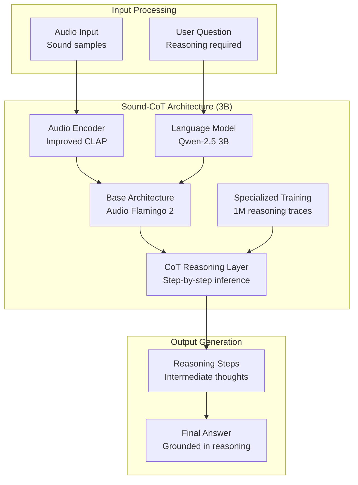
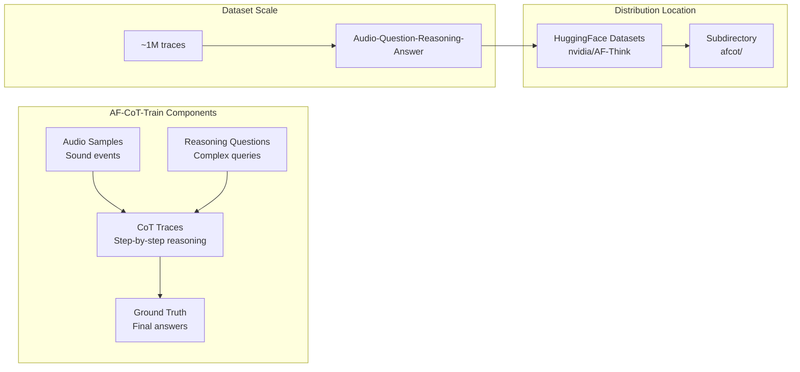
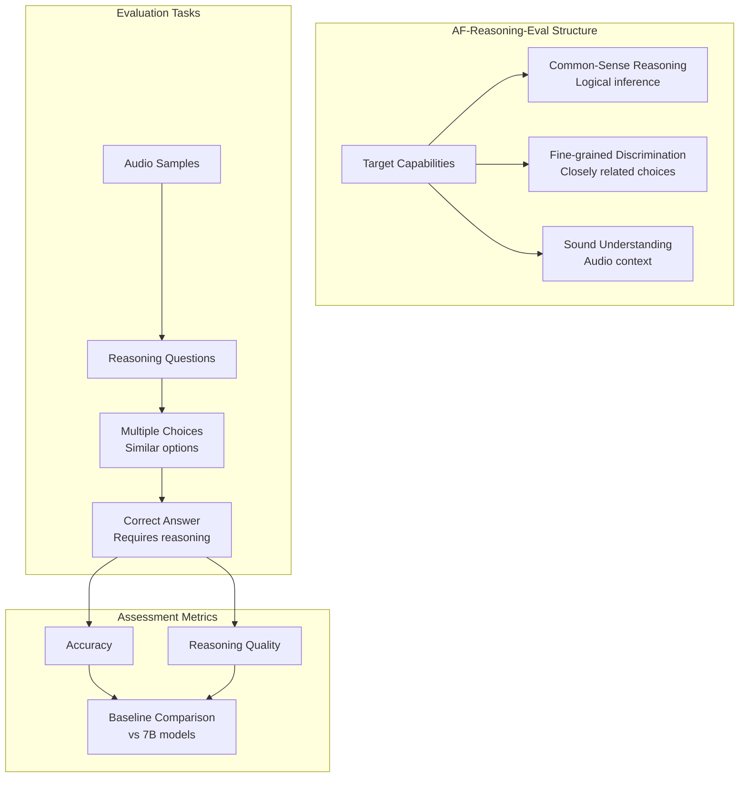
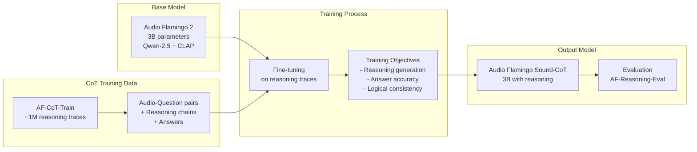
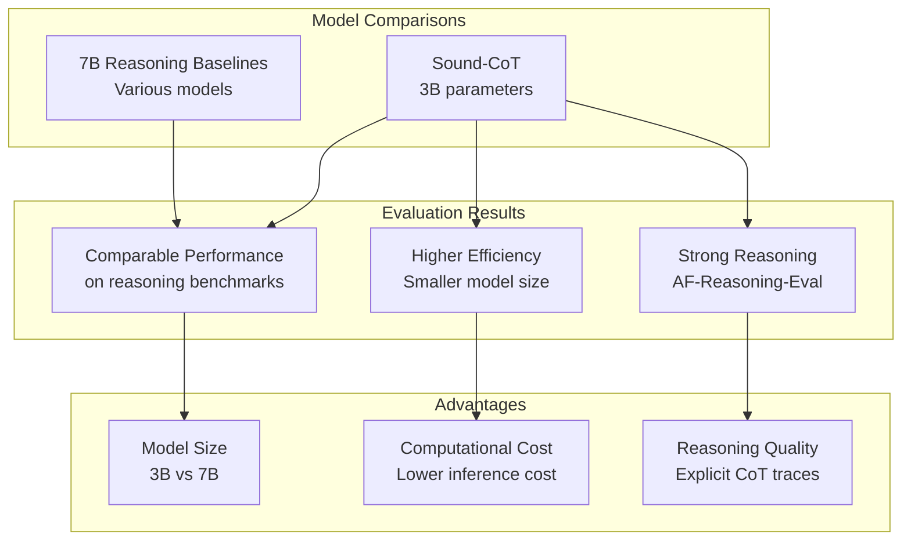
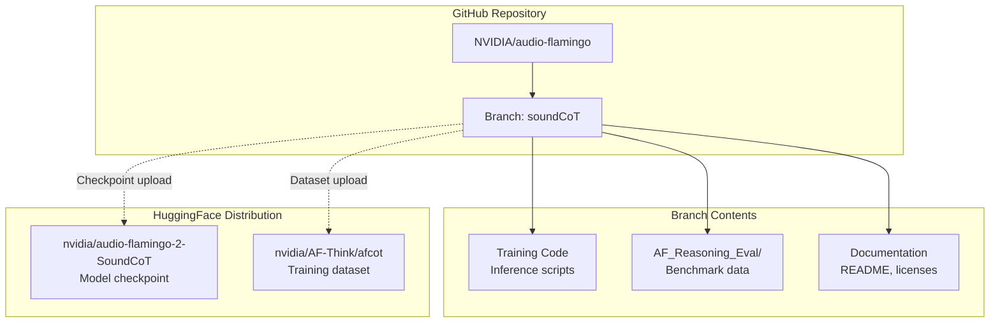

<!-- source: DeepWiki mcp.deepwiki.com · repo NVIDIA/audio-flamingo · page 2.3 Audio Flamingo Sound-CoT · fetched 2026-10-26 -->

# Audio Flamingo Sound-CoT

<details>
<summary>Relevant source files</summary>

The following files were used as context for generating this wiki page:

- [README.md](README.md)

</details>


## Purpose and Scope

This page documents **Audio Flamingo Sound-CoT**, a specialized variant of Audio Flamingo 2 designed to improve chain-of-thought (CoT) reasoning capabilities for sound understanding tasks. Sound-CoT is a 3B parameter model that demonstrates reasoning abilities comparable to larger 7B baseline models on reasoning benchmarks.

This page covers the Sound-CoT model architecture, its specialized training data (AF-CoT-Train), and the evaluation benchmark (AF-Reasoning-Eval) created to assess reasoning capabilities in audio understanding. For information about the base Audio Flamingo 2 model, see [2.2](#2.2). For broader reasoning capabilities in Audio Flamingo 3, see [2.4](#2.4).

**Sources:** [README.md:128-151]()

---

## Model Overview

Audio Flamingo Sound-CoT is a fine-tuned version of Audio Flamingo 2 that specializes in chain-of-thought reasoning for sound understanding tasks. The model maintains the 3B parameter count of its AF2 base while adding explicit reasoning capabilities through specialized training.

### Key Characteristics

| Property | Value |
|----------|-------|
| **Base Model** | Audio Flamingo 2 |
| **Parameters** | 3B |
| **Language Model** | Qwen-2.5 3B |
| **Audio Encoder** | Improved CLAP (inherited from AF2) |
| **Specialization** | Chain-of-thought reasoning |
| **Training Data** | ~1M CoT reasoning traces |
| **Release** | Technical Report (arXiv 2508.11818) |
| **Comparable Performance** | 7B reasoning baselines |

The model achieves performance comparable to 7B parameter reasoning baselines while maintaining the efficiency of a 3B parameter architecture, demonstrating that targeted training on reasoning traces can produce substantial improvements in logical reasoning capabilities.

**Sources:** [README.md:128-151]()

---

## Chain-of-Thought Reasoning Architecture

Audio Flamingo Sound-CoT extends the AF2 architecture with explicit chain-of-thought reasoning capabilities. The model is trained to generate intermediate reasoning steps before producing final answers, enabling it to handle more complex audio understanding tasks that require multi-step logical inference.

### Sound-CoT Model Stack



**Diagram: Sound-CoT Processing Pipeline**

The model processes audio inputs through the inherited CLAP encoder, combines them with textual questions through the Qwen-2.5 language model, and generates reasoning chains before producing final answers.

**Sources:** [README.md:128-151]()

---

## AF-CoT-Train Dataset

The AF-CoT-Train dataset is a specialized training dataset containing approximately 1 million chain-of-thought reasoning traces designed to improve audio understanding models' ability to perform step-by-step logical reasoning.

### Dataset Characteristics



**Diagram: AF-CoT-Train Dataset Structure**

### Dataset Purpose

The AF-CoT-Train dataset serves three primary functions:

1. **Reasoning Training**: Teaches the model to generate intermediate reasoning steps rather than jumping directly to conclusions
2. **Sound Understanding**: Focuses specifically on sound-related reasoning tasks, including sound identification, relationship analysis, and contextual inference
3. **Research Advancement**: Provides the research community with a large-scale resource for advancing audio understanding with reasoning capabilities

### Access and Location

The AF-CoT-Train dataset is publicly available through HuggingFace:

- **Repository**: `nvidia/AF-Think`
- **Subdirectory**: `afcot/`
- **Full Path**: `nvidia/AF-Think/tree/main/afcot`

**Sources:** [README.md:140-151]()

---

## AF-Reasoning-Eval Benchmark

AF-Reasoning-Eval is a specialized benchmark designed to evaluate sound reasoning capabilities in audio language models. It targets common-sense reasoning and the ability to discriminate among closely related choices in sound understanding tasks.

### Benchmark Design



**Diagram: AF-Reasoning-Eval Benchmark Framework**

### Key Features

| Feature | Description |
|---------|-------------|
| **Focus** | Sound reasoning with chain-of-thought |
| **Task Type** | Common-sense reasoning about audio |
| **Difficulty** | Discriminating among closely related choices |
| **Evaluation Axis** | Reasoning quality and accuracy |
| **Baseline Comparisons** | 7B parameter reasoning models |

### Benchmark Location

The AF-Reasoning-Eval benchmark is available in the Sound-CoT GitHub branch:

- **Repository**: `NVIDIA/audio-flamingo`
- **Branch**: `soundCoT`
- **Path**: `AF_Reasoning_Eval/`

**Sources:** [README.md:143-151]()

---

## Training Methodology

Audio Flamingo Sound-CoT employs a specialized training approach that builds upon the Audio Flamingo 2 base model. The training process focuses on fine-tuning for reasoning capabilities using the AF-CoT-Train dataset.

### Training Pipeline



**Diagram: Sound-CoT Training Pipeline**

### Training Characteristics

The training process maintains the efficient 3B parameter architecture while teaching the model to:

1. **Generate Intermediate Steps**: Produce explicit reasoning chains before final answers
2. **Maintain Audio Grounding**: Ensure reasoning steps are grounded in the audio content
3. **Discriminate Finely**: Distinguish between closely related answer choices through logical analysis

**Sources:** [README.md:148-151]()

---

## Performance and Comparisons

Audio Flamingo Sound-CoT achieves performance comparable to 7B parameter reasoning baseline models while maintaining a 3B parameter footprint. This demonstrates that specialized training on reasoning traces can produce substantial improvements in reasoning capabilities without requiring model scaling.

### Performance Characteristics



**Diagram: Sound-CoT Performance Profile**

### Key Performance Metrics

| Metric | Value |
|--------|-------|
| **Model Size** | 3B parameters |
| **Baseline Comparison** | Comparable to 7B reasoning models |
| **Reasoning Benchmark** | Strong performance on AF-Reasoning-Eval |
| **Efficiency Gain** | ~2.3× smaller than 7B baselines |
| **Training Data** | 1M specialized reasoning traces |

The model's performance demonstrates that targeted training on reasoning-specific data can achieve substantial capability improvements without proportional parameter scaling.

**Sources:** [README.md:148-151]()

---

## Accessing Sound-CoT

### Model Distribution

Audio Flamingo Sound-CoT is distributed through multiple channels for different use cases:

| Resource | Location | Purpose |
|----------|----------|---------|
| **Model Checkpoint** | `nvidia/audio-flamingo-2-SoundCoT` | HuggingFace Hub - 3B model weights |
| **Source Code** | `NVIDIA/audio-flamingo` (branch: `soundCoT`) | GitHub - Training and inference code |
| **Training Dataset** | `nvidia/AF-Think/tree/main/afcot` | HuggingFace Datasets - AF-CoT-Train |
| **Evaluation Benchmark** | `soundCoT/AF_Reasoning_Eval/` | GitHub branch - AF-Reasoning-Eval |
| **Paper** | arXiv:2508.11818 | Technical report |

### Repository Structure



**Diagram: Sound-CoT Distribution Channels**

**Sources:** [README.md:128-145]()

---

## Technical Specifications

### Model Configuration

Audio Flamingo Sound-CoT inherits the technical architecture from Audio Flamingo 2 with specialized reasoning training:

| Component | Specification |
|-----------|---------------|
| **Architecture** | Audio Flamingo 2 (Flamingo-based) |
| **Language Model** | Qwen-2.5 3B |
| **Audio Encoder** | Improved CLAP |
| **Total Parameters** | 3B |
| **Max Audio Length** | Up to 5 minutes (inherited from AF2) |
| **Reasoning Capability** | Chain-of-thought with explicit steps |
| **Training Corpus** | AF2 training data + 1M CoT traces |

### Supported Modalities

Following the AF2 base model, Sound-CoT supports:

- **Sound Understanding**: Environmental sounds, acoustic events
- **Music Understanding**: Musical content and structure  
- **Reasoning Tasks**: Multi-step logical inference over audio content

The model specifically excels at tasks requiring common-sense reasoning and fine-grained discrimination among similar audio concepts.

**Sources:** [README.md:128-151]()

---

## Citation and Attribution

When using Audio Flamingo Sound-CoT in research or applications, use the following citation:

```bibtex
@article{kong2025audio,
  title={Audio Flamingo Sound-CoT Technical Report: Improving Chain-of-Thought Reasoning in Sound Understanding},
  author={Kong, Zhifeng and Goel, Arushi and Santos, Joao Felipe and Ghosh, Sreyan and Valle, Rafael and Ping, Wei and Catanzaro, Bryan},
  journal={arXiv preprint arXiv:2508.11818},
  year={2025}
}
```

The model is subject to the Qwen RESEARCH LICENSE AGREEMENT as it builds upon Qwen-2.5. For non-commercial use guidelines, see [7](#7).

**Sources:** [README.md:281-289](), [README.md:235-241]()

---

