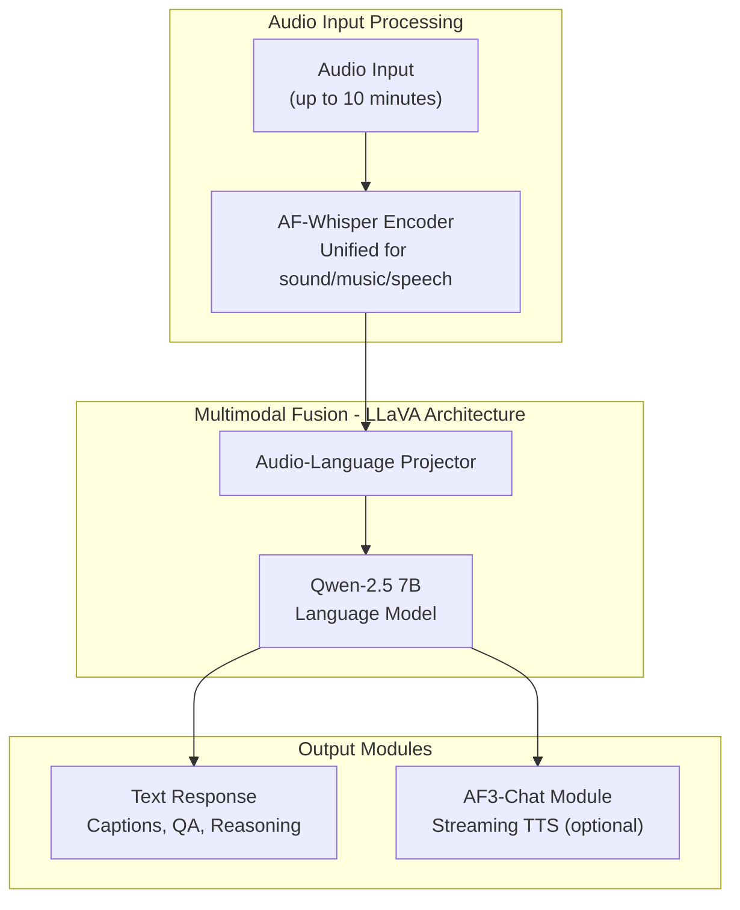
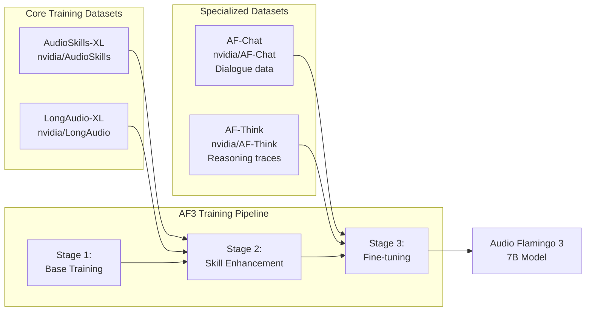
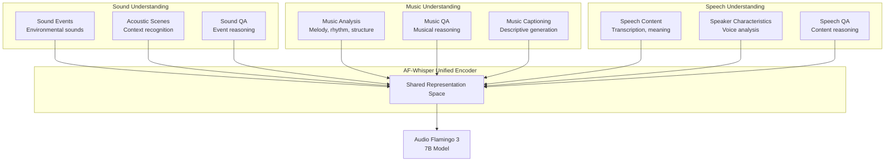
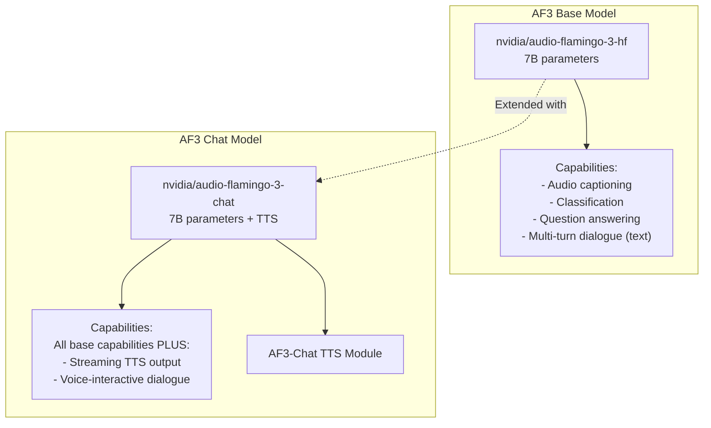
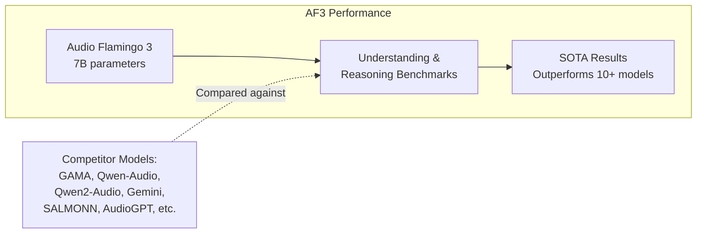
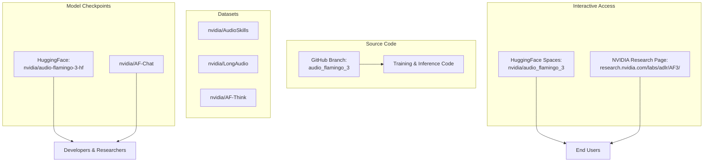

<!-- source: DeepWiki mcp.deepwiki.com · repo NVIDIA/audio-flamingo · page 2.4 Audio Flamingo 3 · fetched 2026-10-26 -->

# Audio Flamingo 3

<details>
<summary>Relevant source files</summary>

The following files were used as context for generating this wiki page:

- [README.md](README.md)
- [static/af1_radial.png](static/af1_radial.png)
- [static/af3_main_diagram-1.png](static/af3_main_diagram-1.png)
- [static/af3_radial-1.png](static/af3_radial-1.png)
- [static/af3_sota.png](static/af3_sota.png)

</details>


## Purpose and Scope

Audio Flamingo 3 (AF3) is a 7B-parameter Large Audio-Language Model (LALM) that represents the most capable model in the Audio Flamingo series. This page documents AF3's architecture, training methodology, capabilities, and deployment options. AF3 is the first model in the series to provide unified understanding across all three audio modalities: **sound**, **music**, and **speech**.

For information about earlier models in the series, see [Audio Flamingo 1](#2.1) and [Audio Flamingo 2](#2.2). For the specialized music understanding model built on AF3, see [Music Flamingo](#2.5). For reasoning capabilities, see [Audio Flamingo Sound-CoT](#2.3).

**Sources:** [README.md:69-127]()

---

## Model Architecture Overview

Audio Flamingo 3 is built on the LLaVA (Large Language and Vision Assistant) architecture, adapted for audio understanding. The model integrates three primary components: a unified audio encoder, a language model backbone, and specialized modules for enhanced capabilities.

### Core Components

| Component | Specification | Purpose |
|-----------|--------------|---------|
| **Language Model** | Qwen-2.5 7B | Text generation and reasoning |
| **Audio Encoder** | AF-Whisper (unified) | Audio feature extraction for sound, music, and speech |
| **Architecture Base** | LLaVA | Multimodal fusion framework |
| **Context Length** | Up to 10 minutes | Extended audio understanding |
| **Training Scale** | ~50M audio-text pairs | Large-scale pretraining |

### Architecture Diagram



**Sources:** [README.md:107-109](), [README.md:124-126]()

### AF-Whisper Encoder

The AF-Whisper encoder is a custom-trained audio encoder based on the Whisper architecture, but extended beyond speech recognition to handle general audio understanding. Unlike the original Whisper model which focuses on speech-to-text transcription, AF-Whisper is trained to extract semantic features from:

- **Sound events** (environmental sounds, acoustic scenes)
- **Music** (melody, rhythm, timbre, structure)
- **Speech** (content, speaker characteristics, prosody)

This unified approach eliminates the need for separate encoders for different audio modalities, improving efficiency and enabling cross-modal understanding.

**Sources:** [README.md:107]()

### LLaVA Architecture Integration

The LLaVA architecture provides the foundation for multimodal fusion in AF3. Key architectural elements include:

1. **Audio-Language Projector**: Maps audio encoder outputs to the language model's embedding space
2. **Cross-Modal Attention**: Enables the language model to attend to relevant audio features
3. **Unified Token Space**: Audio features and text tokens are processed in a shared representation space

This architectural choice represents a shift from the Flamingo architecture used in AF1, providing improved performance and scalability.

**Sources:** [README.md:107]()

---

## Training Data and Methodology

### Training Dataset Scale

Audio Flamingo 3 is trained on approximately **50 million audio-text pairs**, representing a 5× increase over AF2 (10M pairs) and an 8.5× increase over AF1 (5.9M pairs). This massive scale contributes significantly to AF3's improved performance and generalization capabilities.

### Dataset Collections



**Sources:** [README.md:91-103](), [README.md:172-173]()

### Training Dataset Details

| Dataset | HuggingFace Path | Content Focus | Key Features |
|---------|------------------|---------------|--------------|
| **AudioSkills-XL** | `nvidia/AudioSkills` | Diverse audio understanding skills | Captioning, classification, QA across multiple domains |
| **LongAudio-XL** | `nvidia/LongAudio` | Extended audio sequences | Audio up to 10 minutes, temporal reasoning |
| **AF-Chat** | `nvidia/AF-Chat` | Multi-turn dialogue | Conversational audio understanding, context tracking |
| **AF-Think** | `nvidia/AF-Think` | Chain-of-thought reasoning | Step-by-step reasoning, complex inference tasks |

The "-XL" suffix on AudioSkills and LongAudio indicates these are expanded versions of the datasets used in AF2, with increased scale and diversity.

**Sources:** [README.md:91-102]()

### Training Strategy

AF3 follows a multi-stage training approach inherited from AF2:

1. **Stage 1 - Base Training**: Large-scale pretraining on diverse audio-text pairs to establish foundational audio understanding
2. **Stage 2 - Skill Enhancement**: Focused training on AudioSkills-XL and LongAudio-XL to develop specific capabilities
3. **Stage 3 - Fine-tuning**: Specialized fine-tuning with AF-Chat and AF-Think for dialogue and reasoning abilities

**Sources:** [README.md:172-173]()

---

## Modality Coverage and Capabilities

### Three-Modality Support

Audio Flamingo 3 is the first model in the series to provide comprehensive coverage of all three audio modalities:



**Sources:** [README.md:107]()

### Extended Audio Context

AF3 supports audio inputs up to **10 minutes in duration**, doubling the 5-minute context length of AF2. This extended context enables:

- Analysis of full-length songs and musical compositions
- Understanding of long-form conversations and interviews
- Temporal reasoning over extended acoustic scenes
- Narrative comprehension in audio stories and podcasts

**Sources:** [README.md:109]()

### Core Task Capabilities

AF3 supports all standard audio understanding tasks:

| Task Type | Description | Example Use Cases |
|-----------|-------------|-------------------|
| **Audio Captioning** | Generate natural language descriptions of audio content | Accessibility, content indexing, metadata generation |
| **Classification** | Categorize audio into predefined classes | Event detection, genre classification, speaker identification |
| **Question Answering** | Answer questions about audio content | Information retrieval, content verification, reasoning |
| **Multi-turn Dialogue** | Engage in conversational interactions about audio | Interactive analysis, iterative refinement, exploratory understanding |

**Sources:** [README.md:107-109]()

---

## Model Variants

### Base Model: audio-flamingo-3-hf

The base AF3 model provides text-only outputs for audio understanding tasks. This variant is suitable for:

- Audio captioning and description generation
- Audio classification and tagging
- Question answering about audio content
- Multi-turn conversational audio understanding

**HuggingFace Path:** `nvidia/audio-flamingo-3-hf`

**Sources:** [README.md:79-81]()

### Chat Model: audio-flamingo-3-chat

The AF3-Chat variant extends the base model with streaming text-to-speech (TTS) capabilities, enabling voice-based interactions. This variant includes:

- All capabilities of the base model
- Streaming TTS output module
- Voice-interactive conversational abilities

**HuggingFace Path:** `nvidia/audio-flamingo-3-chat`

**Sources:** [README.md:82-84](), [README.md:109]()

### Model Variant Diagram



**Sources:** [README.md:79-87](), [README.md:109]()

---

## Performance and Benchmarks

### State-of-the-Art Comparisons

Audio Flamingo 3 achieves state-of-the-art (SOTA) performance across multiple audio understanding benchmarks, outperforming several contemporary models:

**Compared Models:**
- GAMA
- Audio Flamingo 1 and 2
- Qwen-Audio
- Qwen2-Audio
- Qwen2.5-Omni
- LTU, LTU-AS
- SALMONN
- AudioGPT
- Gemini Flash v2
- Gemini Pro v1.5



**Sources:** [README.md:107-108]()

### Performance Characteristics

AF3's performance advantages stem from:

1. **Scale**: 7B parameters and 50M training pairs
2. **Unified Encoder**: AF-Whisper handles all three modalities efficiently
3. **Architecture**: LLaVA-based design enables better multimodal fusion
4. **Extended Context**: 10-minute audio support enables temporal reasoning
5. **Diverse Training**: Specialized datasets for skills, long audio, dialogue, and reasoning

Visual performance comparison available in the repository at [static/af3_sota.png](), showing AF3's advantages across multiple benchmarks.

**Sources:** [README.md:107-109](), [README.md:115-121]()

---

## Accessing and Deploying AF3

### Distribution Channels



**Sources:** [README.md:69-103]()

### HuggingFace Hub

**Base Model Checkpoint:**
```
nvidia/audio-flamingo-3-hf
```

**Chat Model Checkpoint:**
```
nvidia/audio-flamingo-3-chat
```

These checkpoints can be loaded using standard HuggingFace transformers library workflows.

**Sources:** [README.md:79-84]()

### GitHub Repository

The source code for training and inference is available on the `audio_flamingo_3` branch:

```
https://github.com/NVIDIA/audio-flamingo/tree/audio_flamingo_3
```

This branch contains the complete implementation, including model architecture code, training scripts, and inference utilities.

**Sources:** [README.md:74-75](), [README.md:230-231]()

### Interactive Demos

**Gradio Demo (HuggingFace Spaces):**
```
nvidia/audio_flamingo_3
```

**NVIDIA Research Demo Page:**
```
https://research.nvidia.com/labs/adlr/AF3/
```

Both demo platforms provide hands-on experience with AF3's capabilities without requiring local setup.

**Sources:** [README.md:73](), [README.md:85-87]()

---

## Research Publication

Audio Flamingo 3 was published at **NeurIPS 2025** as a **Spotlight** paper:

**Title:** "Audio Flamingo 3: Advancing Audio Intelligence with Fully Open Large Audio Language Models"

**arXiv:** 2507.08128

**Authors:** Sreyan Ghosh, Arushi Goel, Jaehyeon Kim, Sonal Kumar, Zhifeng Kong, Sang-gil Lee, Chao-Han Huck Yang, Ramani Duraiswami, Dinesh Manocha, Rafael Valle, Bryan Catanzaro

**Citation:**
```bibtex
@inproceedings{
  ghosh2025audio,
  title={Audio Flamingo 3: Advancing Audio Intelligence with Fully Open Large Audio Language Models},
  author={Sreyan Ghosh and Arushi Goel and Jaehyeon Kim and Sonal Kumar and Zhifeng Kong and Sang-gil Lee and Chao-Han Huck Yang and Ramani Duraiswami and Dinesh Manocha and Rafael Valle and Bryan Catanzaro},
  booktitle={The Thirty-ninth Annual Conference on Neural Information Processing Systems},
  year={2025},
  url={https://openreview.net/forum?id=FjByDpDVIO}
}
```

**Sources:** [README.md:17](), [README.md:69-76](), [README.md:269-279]()

---

## Licensing

Audio Flamingo 3 models are subject to the following licensing terms:

- **Code:** MIT License
- **Model Checkpoints:** NVIDIA OneWay Noncommercial License (non-commercial use only)
- **Language Model:** Qwen RESEARCH LICENSE AGREEMENT (Qwen-2.5 is licensed by Alibaba Cloud)

Users must comply with all applicable licenses. See the `README` and `incl_licenses` files in the `audio_flamingo_3` branch for complete licensing information.

**Sources:** [README.md:235-241]()

---

## Relationship to Other Models

Audio Flamingo 3 serves as the foundation for **Music Flamingo** (see [Music Flamingo](#2.5)), which extends AF3 with specialized music understanding capabilities through additional training with chain-of-thought reasoning and reinforcement learning.

AF3 represents a significant architectural evolution from AF1 and AF2 (see [Model Evolution Timeline](#1.1)), introducing:
- Unified three-modality support (vs. sound+music only in AF1/AF2)
- Extended 10-minute context (vs. 5 minutes in AF2)
- 5× larger training dataset (50M vs. 10M pairs in AF2)
- LLaVA architecture (vs. Flamingo in AF1, multi-stage approach in AF2)

**Sources:** [README.md:42-43](), [README.md:107-109]()

---

