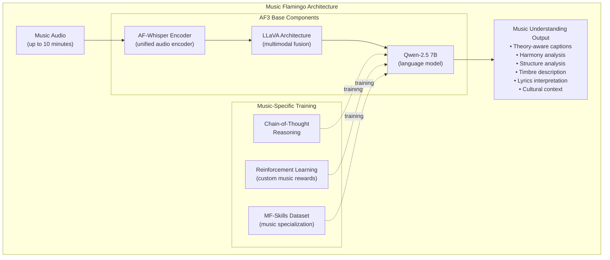
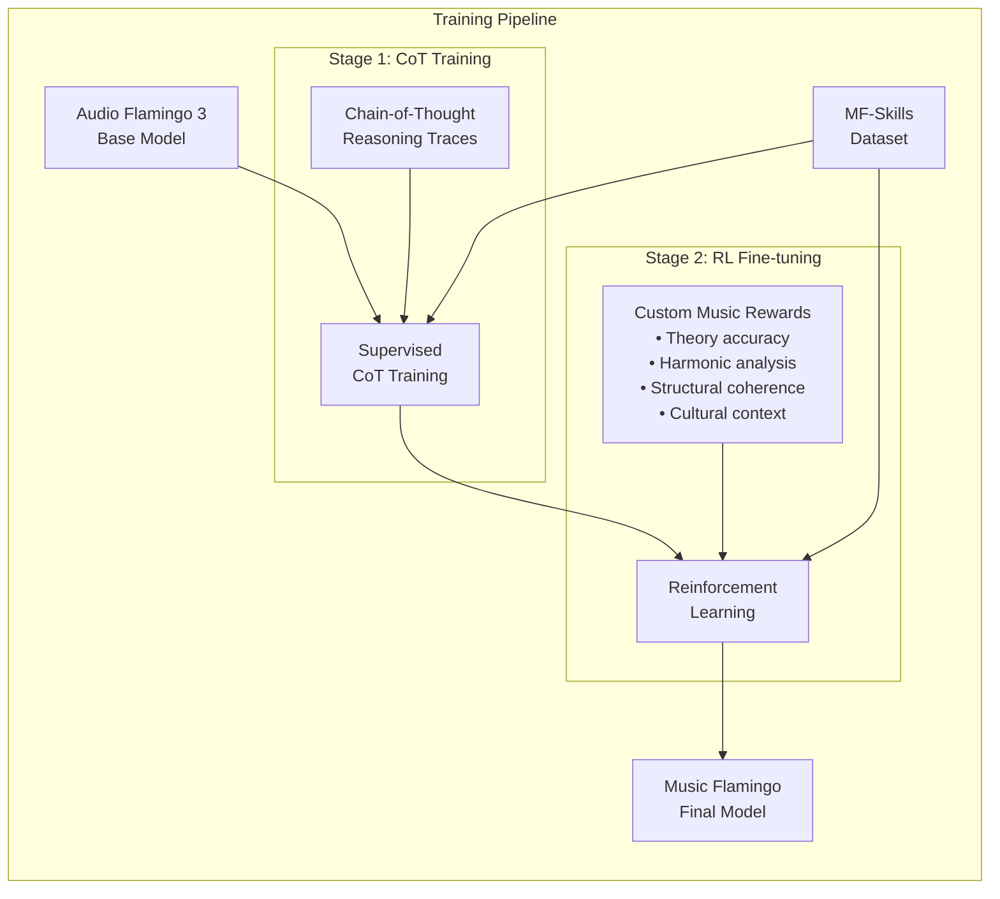
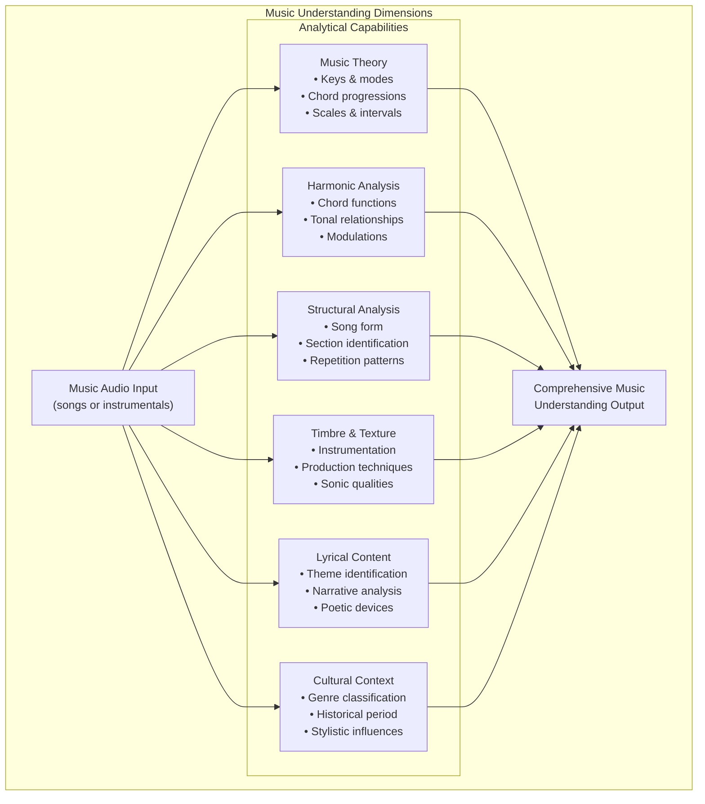
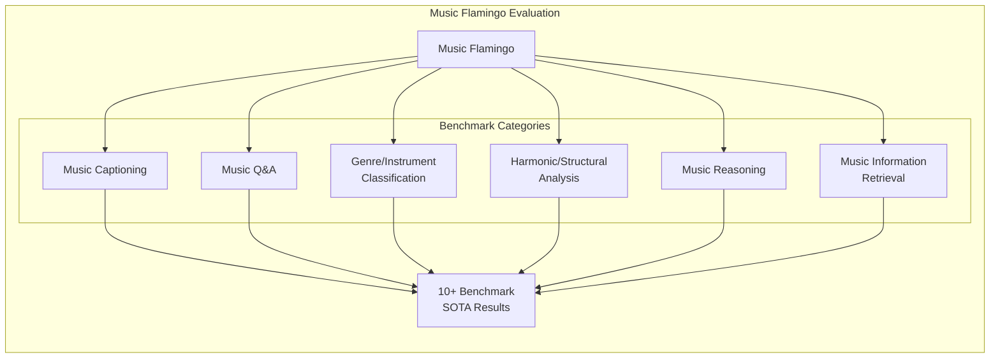
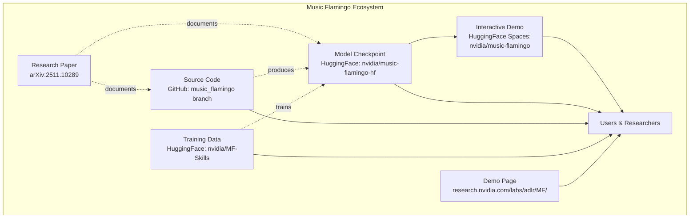
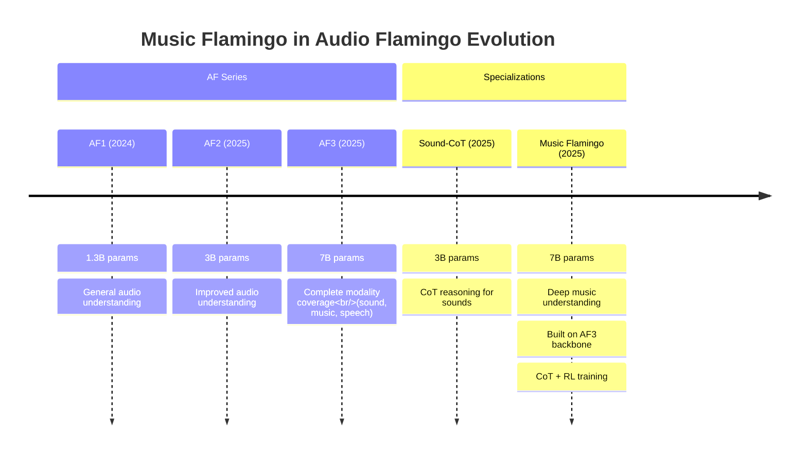

<!-- source: DeepWiki mcp.deepwiki.com · repo NVIDIA/audio-flamingo · page 2.5 Music Flamingo · fetched 2026-10-26 -->

# Music Flamingo

<details>
<summary>Relevant source files</summary>

The following files were used as context for generating this wiki page:

- [README.md](README.md)
- [static/MF-architecture.png](static/MF-architecture.png)
- [static/MF-benchmarks.png](static/MF-benchmarks.png)
- [static/MF-comparison.png](static/MF-comparison.png)
- [static/MF-donut_chart.png](static/MF-donut_chart.png)

</details>


## Purpose and Scope

This document describes **Music Flamingo (MF)**, a 7B-parameter Large Audio-Language Model specialized for deep music understanding. Music Flamingo builds upon the Audio Flamingo 3 backbone (see [Audio Flamingo 3](#2.4)) and extends it with music-specific capabilities, chain-of-thought reasoning, and reinforcement learning training. This page covers MF's architecture, training methodology, music analysis capabilities, datasets, and performance benchmarks.

For general audio understanding across sound, music, and speech, see [Audio Flamingo 3](#2.4). For chain-of-thought reasoning on sound understanding tasks, see [Audio Flamingo Sound-CoT](#2.3).

**Sources:** [README.md:20-66]()

---

## Model Overview

Music Flamingo is a fully open, state-of-the-art Large Audio-Language Model that specializes in music understanding. It represents a domain-specific evolution of the Audio Flamingo series, focusing exclusively on advancing music and song comprehension in foundational audio models.

### Key Characteristics

| Property | Value |
|----------|-------|
| **Parameters** | 7B |
| **Base Architecture** | Audio Flamingo 3 |
| **Language Model** | Qwen-2.5 7B |
| **Audio Encoder** | AF-Whisper (unified encoder) |
| **Training Approach** | Chain-of-Thought + Reinforcement Learning |
| **Audio Modality** | Music (songs and instrumentals) |
| **Max Audio Length** | 10 minutes (extended context) |
| **Release** | 2025 (arXiv) |

**Sources:** [README.md:20-49]()

---

## Architecture

Music Flamingo inherits the core architecture of Audio Flamingo 3 but specializes it for music understanding through additional training and custom reward mechanisms.



**Architecture Components:**

1. **AF-Whisper Encoder**: Inherits the unified audio encoder from AF3, pre-trained to handle sound, music, and speech, but now specialized for music-specific features
2. **LLaVA Multimodal Fusion**: Uses the same LLaVA-based architecture as AF3 for integrating audio representations with language
3. **Qwen-2.5 7B Language Model**: The same 7B parameter language backbone as AF3, fine-tuned with music-specific data
4. **Extended Context Support**: Maintains AF3's capability to process audio up to 10 minutes in length, enabling full-song analysis

**Sources:** [README.md:42-57](), [README.md:107-110]()

---

## Training Methodology

Music Flamingo employs a specialized training approach that combines chain-of-thought reasoning with reinforcement learning using custom rewards designed for music understanding tasks.



### Training Stages

**1. Chain-of-Thought Integration**

Music Flamingo incorporates chain-of-thought reasoning to enable step-by-step analysis of musical content. This allows the model to break down complex music understanding tasks into interpretable reasoning steps.

- Builds on the CoT methodology introduced in [Audio Flamingo Sound-CoT](#2.3)
- Adapted for music-specific reasoning patterns
- Enables explanatory analysis of harmonic progressions, structural elements, and compositional techniques

**2. Reinforcement Learning with Custom Rewards**

Unlike previous Audio Flamingo models that rely solely on supervised learning, Music Flamingo employs reinforcement learning with custom reward functions tailored to music understanding:

- **Theory Accuracy Rewards**: Rewards for correct identification of musical theory elements (keys, chords, scales)
- **Harmonic Analysis Rewards**: Rewards for accurate harmonic progression analysis
- **Structural Coherence Rewards**: Rewards for identifying song structure (verse, chorus, bridge, etc.)
- **Cultural Context Rewards**: Rewards for appropriate cultural and stylistic contextualization
- **Timbre Description Rewards**: Rewards for accurate instrumental and timbral descriptions

This RL approach enables the model to learn the nuanced preferences and quality standards specific to music analysis tasks.

**Sources:** [README.md:42-49]()

---

## Music Understanding Capabilities

Music Flamingo provides comprehensive music understanding across multiple analytical dimensions, going beyond basic audio captioning to deliver theory-aware, culturally-informed analysis.

### Core Capabilities

| Capability | Description |
|------------|-------------|
| **Theory-Aware Captions** | Generates descriptions incorporating music theory concepts (keys, modes, harmonic progressions) |
| **Harmony Analysis** | Identifies chord progressions, harmonic functions, and tonal relationships |
| **Structure Analysis** | Recognizes song form and structural elements (intro, verse, chorus, bridge, outro, etc.) |
| **Timbre Analysis** | Describes instrumental colors, textures, and production techniques |
| **Lyrics Interpretation** | Analyzes lyrical content when present in songs |
| **Cultural Context** | Provides cultural, stylistic, and historical context for musical works |
| **Question Answering** | Answers detailed questions about musical content |
| **Long-Form Analysis** | Processes and analyzes full-length songs (up to 10 minutes) |



### Deep Music Understanding

Music Flamingo's "deep music understanding" distinguishes it from general-purpose audio models by providing:

1. **Multi-dimensional Analysis**: Simultaneous analysis across theory, harmony, structure, timbre, lyrics, and cultural dimensions
2. **Step-by-Step Reasoning**: CoT-enabled explanatory analysis that shows reasoning process
3. **Multicultural Competence**: Understanding of diverse musical traditions and styles
4. **Full-Length Song Processing**: Ability to analyze complete songs in their entirety, capturing long-range dependencies and overall compositional arc

**Sources:** [README.md:42-49]()

---

## Training Data

### MF-Skills Dataset

Music Flamingo is trained using the **MF-Skills** dataset, a music-specific training collection designed to develop the model's specialized music understanding capabilities.

| Dataset Property | Details |
|------------------|---------|
| **Name** | MF-Skills |
| **Availability** | HuggingFace: `nvidia/MF-Skills` |
| **Purpose** | Music-specific skill development |
| **Content Focus** | Music understanding tasks across multiple dimensions |

The MF-Skills dataset complements the broader training data from Audio Flamingo 3 (AudioSkills-XL, LongAudio-XL) by adding music-specific annotations and task formulations that target:

- Music theory concepts
- Harmonic and structural analysis
- Timbre and production technique descriptions
- Lyrical content analysis
- Cultural and stylistic contextual information

**Sources:** [README.md:33-35]()

---

## Performance and Benchmarks

Music Flamingo demonstrates state-of-the-art performance on music understanding and reasoning tasks, setting new benchmarks across the field.

### Evaluation Coverage

Music Flamingo has been evaluated on **10+ public music benchmarks**, covering a comprehensive range of music understanding capabilities:

- Music captioning tasks
- Music question answering
- Genre classification
- Instrument recognition
- Music information retrieval
- Harmonic analysis tasks
- Structural segmentation
- Music reasoning tasks

The model's extensive evaluation demonstrates its versatility across different types of music understanding challenges and establishes it as a leading model for music-specific audio-language tasks.



**Sources:** [README.md:49](), [README.md:63-65]()

---

## Model Access and Usage

### Distribution Channels

Music Flamingo is available through multiple channels for research and development use:

| Channel | Resource | URL/Identifier |
|---------|----------|----------------|
| **Model Checkpoint** | HuggingFace Hub | `nvidia/music-flamingo-hf` |
| **Training Dataset** | HuggingFace Datasets | `nvidia/MF-Skills` |
| **Source Code** | GitHub Branch | `music_flamingo` |
| **Interactive Demo** | HuggingFace Spaces | `nvidia/music-flamingo` |
| **Research Page** | NVIDIA Research | `research.nvidia.com/labs/adlr/MF/` |
| **Paper** | arXiv | 2511.10289 |



### Getting Started

**Loading the Model:**

Users can access Music Flamingo through the HuggingFace Hub using the identifier `nvidia/music-flamingo-hf`. The model follows the same inference patterns as Audio Flamingo 3.

**Interactive Demo:**

The HuggingFace Spaces demo (`nvidia/music-flamingo`) provides a Gradio interface for immediate experimentation with Music Flamingo's capabilities without requiring local setup.

**Training Data:**

The MF-Skills dataset is available at `nvidia/MF-Skills` for researchers interested in music understanding dataset development or model fine-tuning.

**Source Code:**

The complete training and inference code is available on the `music_flamingo` branch of the NVIDIA/audio-flamingo repository.

**Sources:** [README.md:23-40](), [README.md:230-232]()

---

## Relationship to Audio Flamingo Series

Music Flamingo represents a domain-specialized branch in the Audio Flamingo evolutionary tree:



**Key Distinctions:**

- **AF3**: General-purpose audio understanding across sound, music, and speech with broad coverage
- **Music Flamingo**: Specialized depth in music understanding with theory-aware analysis
- **Sound-CoT**: Specialized for chain-of-thought reasoning on sound understanding
- **Music Flamingo**: Combines AF3's architecture + Sound-CoT's reasoning + music-specific RL training

Music Flamingo inherits AF3's:
- 7B parameter scale
- LLaVA architecture
- AF-Whisper unified encoder
- 10-minute audio support
- 50M training pair foundation

And extends it with:
- Music-specific training (MF-Skills dataset)
- Chain-of-thought reasoning for music
- Reinforcement learning with custom music rewards
- Specialized music understanding capabilities

**Sources:** [README.md:14-18](), [README.md:42-49](), [README.md:107-110]()

---

## Citation

When using Music Flamingo in research, please cite:

```
@article{ghosh2025music,
  title={Music Flamingo: Scaling Music Understanding in Audio Language Models},
  author={Ghosh, Sreyan and Goel, Arushi and Koroshinadze, Lasha and Lee, Sang-gil and Kong, Zhifeng and Santos, Joao Felipe and Duraiswami, Ramani and Manocha, Dinesh and Ping, Wei and Shoeybi, Mohammad and Catanzaro, Bryan},
  journal={arXiv preprint arXiv},
  year={2025}
}
```

**Sources:** [README.md:292-299]()

---

## Licensing

Music Flamingo follows the same licensing structure as other Audio Flamingo models:

- **Code**: MIT License
- **Model Checkpoints**: Non-commercial use only (NVIDIA OneWay Noncommercial License)
- **Language Model**: Qwen RESEARCH LICENSE AGREEMENT (Qwen-2.5 based models)

See the `README` and `incl_licenses` files in the `music_flamingo` branch for complete licensing details.

**Sources:** [README.md:235-241]()

---

