<!-- source: DeepWiki mcp.deepwiki.com · repo NVIDIA/audio-flamingo · page 3 Technical Architecture · fetched 2026-10-26 -->

# Technical Architecture

Relevant source files

The following files were used as context for generating this wiki page:

- [README.md](README.md)

This document provides a comprehensive technical overview of the architectures, components, and design decisions across the Audio Flamingo series. It covers the evolution from the Flamingo-based architecture (Audio Flamingo 1) to the LLaVA-based architecture (Audio Flamingo 3 and Music Flamingo), the progression of language model backbones and audio encoders, and the development of specialized components for reasoning and interaction.

For information about specific model variants and their capabilities, see [Model Variants](#2). For training methodologies and datasets, see [Training Data and Strategies](#4). For model usage and deployment, see [Getting Started](#6).

---

## Architectural Evolution Overview

The Audio Flamingo series demonstrates a systematic architectural evolution across five model variants, with each iteration introducing significant technical improvements in backbone models, audio encoders, and specialized components.

### Architecture Timeline and Scaling

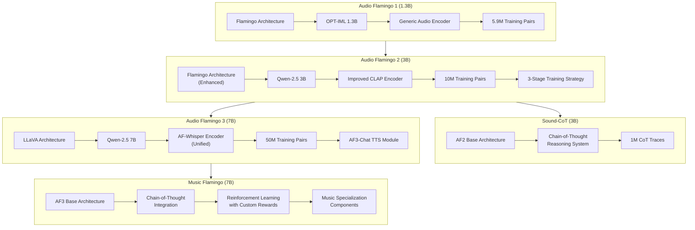

**Sources:** [README.md:14-18](), [README.md:107](), [README.md:172](), [README.md:239-240]()

### Key Architectural Transitions

The series exhibits three major architectural transitions:

| Aspect | Audio Flamingo 1 | Audio Flamingo 2 | Audio Flamingo 3 |
|--------|------------------|------------------|------------------|
| **Base Architecture** | Flamingo | Enhanced Flamingo | LLaVA |
| **Language Model** | OPT-IML 1.3B | Qwen-2.5 3B | Qwen-2.5 7B |
| **Audio Encoder** | Generic | Improved CLAP | AF-Whisper (unified) |
| **Audio Modalities** | Sound, Music | Sound, Music | Sound, Music, Speech |
| **Training Scale** | 5.9M pairs | 10M pairs | 50M pairs |
| **Max Audio Length** | Not specified | 5 minutes | 10 minutes |
| **Training Strategy** | Standard | 3-stage pipeline | Multi-stage with specialization |

**Sources:** [README.md:14-18](), [README.md:107](), [README.md:172](), [README.md:204]()

---

## Architectural Foundations

### Flamingo Architecture (AF1, AF2)

Audio Flamingo 1 and 2 are built on the Flamingo architecture, originally designed for vision-language tasks. This architecture emphasizes in-context learning and few-shot capabilities.

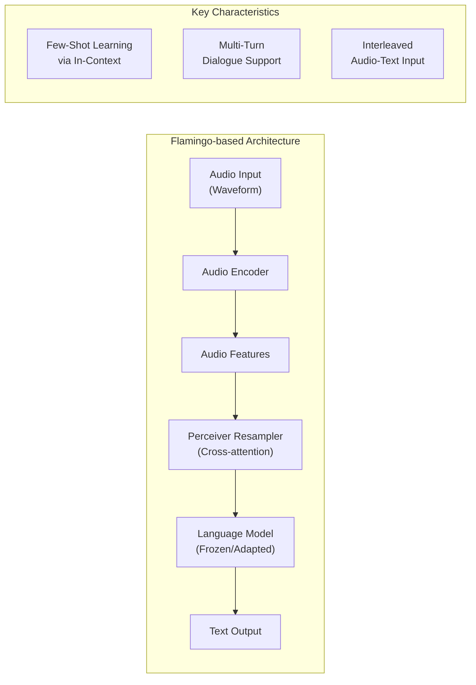

The Flamingo architecture provides:
- **Cross-attention mechanisms** between audio features and language model layers
- **Perceiver resampler** for efficient feature compression and alignment
- **In-context learning** through interleaved audio-text examples
- **Multi-turn dialogue** capabilities through conversational context management

**Sources:** [README.md:15](), [README.md:204]()

### LLaVA Architecture (AF3, Music Flamingo)

Audio Flamingo 3 and Music Flamingo transition to the LLaVA architecture, enabling more efficient multimodal fusion and better scaling properties.

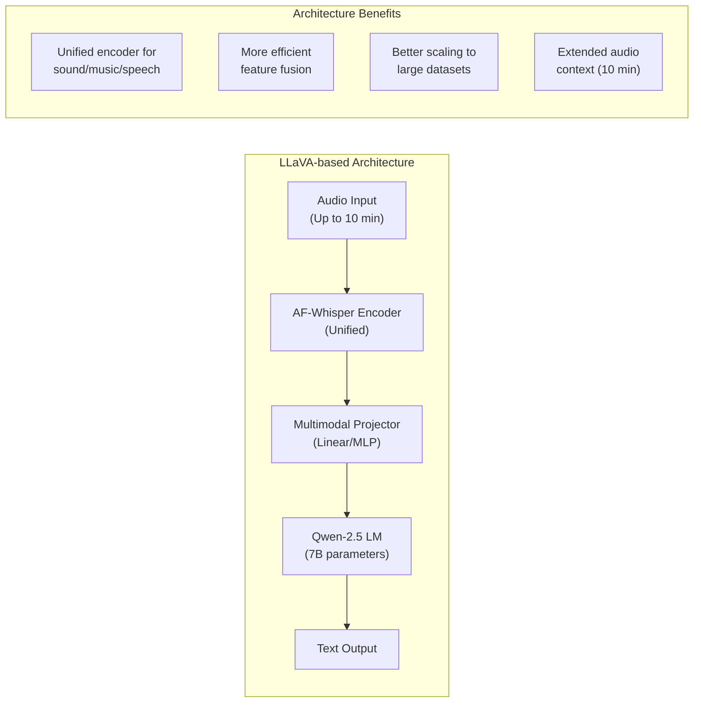

The LLaVA architecture offers:
- **Simplified projection** from audio to language model space via linear/MLP layers
- **Unified encoder** (AF-Whisper) handling all three audio modalities
- **Improved training efficiency** enabling scaling to 50M training pairs
- **Extended context** supporting up to 10 minutes of audio input

**Sources:** [README.md:107](), [README.md:109]()

### Architecture Comparison

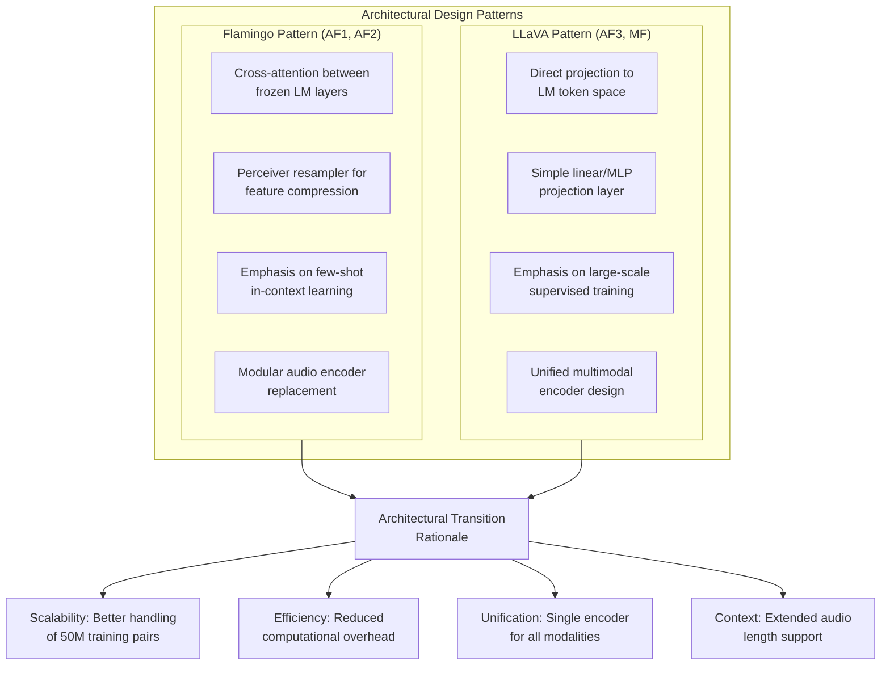

**Sources:** [README.md:107](), [README.md:204]()

---

## Language Model Backbones

### OPT-IML Foundation (AF1)

Audio Flamingo 1 uses OPT-IML as its language model backbone, providing foundational language understanding capabilities.

| Component | Specification |
|-----------|--------------|
| **Model Name** | OPT-IML |
| **Parameters** | 1.3B |
| **License** | OPT-IML License (see [License and Attribution](#7)) |
| **Key Features** | Instruction-following, multi-task capabilities |
| **Training Objective** | Instruction-tuned OPT model |

The OPT-IML backbone provides:
- Instruction-following capabilities for audio understanding tasks
- Multi-task performance across captioning, classification, and QA
- Foundation for few-shot learning through in-context examples
- Multi-turn dialogue support when combined with dialogue training data

**Sources:** [README.md:204](), [README.md:239]()

### Qwen-2.5 Foundation (AF2, AF3, Variants)

Audio Flamingo 2, Audio Flamingo 3, Sound-CoT, and Music Flamingo transition to the Qwen-2.5 series of language models.

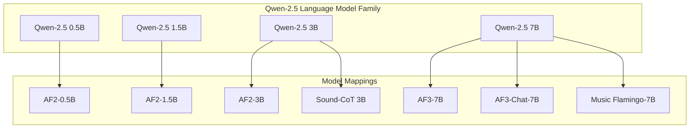

| Model Variant | LM Backbone | Parameters | Primary Use Case |
|---------------|-------------|------------|------------------|
| AF2-0.5B | Qwen-2.5 0.5B | 0.5B | Resource-constrained deployment |
| AF2-1.5B | Qwen-2.5 1.5B | 1.5B | Balanced performance/efficiency |
| AF2-3B | Qwen-2.5 3B | 3B | Full AF2 capabilities |
| Sound-CoT | Qwen-2.5 3B | 3B | Reasoning-focused tasks |
| AF3 | Qwen-2.5 7B | 7B | State-of-the-art performance |
| Music Flamingo | Qwen-2.5 7B | 7B | Music understanding specialization |

The Qwen-2.5 backbone provides:
- **Enhanced language understanding** compared to OPT-IML
- **Multi-size variants** (0.5B, 1.5B, 3B, 7B) for different deployment scenarios
- **Stronger instruction-following** capabilities
- **Better reasoning** foundations for chain-of-thought tasks
- **License**: Qwen RESEARCH LICENSE AGREEMENT (see [License and Attribution](#7))

**Sources:** [README.md:165-167](), [README.md:172](), [README.md:240]()

---

## Audio Encoders

### Generic Audio Encoder (AF1)

Audio Flamingo 1 uses a generic audio encoder without specific details disclosed in the main repository documentation. This encoder processes audio waveforms into feature representations compatible with the Flamingo architecture's cross-attention mechanisms.

**Sources:** [README.md:204]()

### Improved CLAP Encoder (AF2)

Audio Flamingo 2 introduces a re-trained CLAP (Contrastive Language-Audio Pretraining) encoder with enhanced text understanding capabilities.

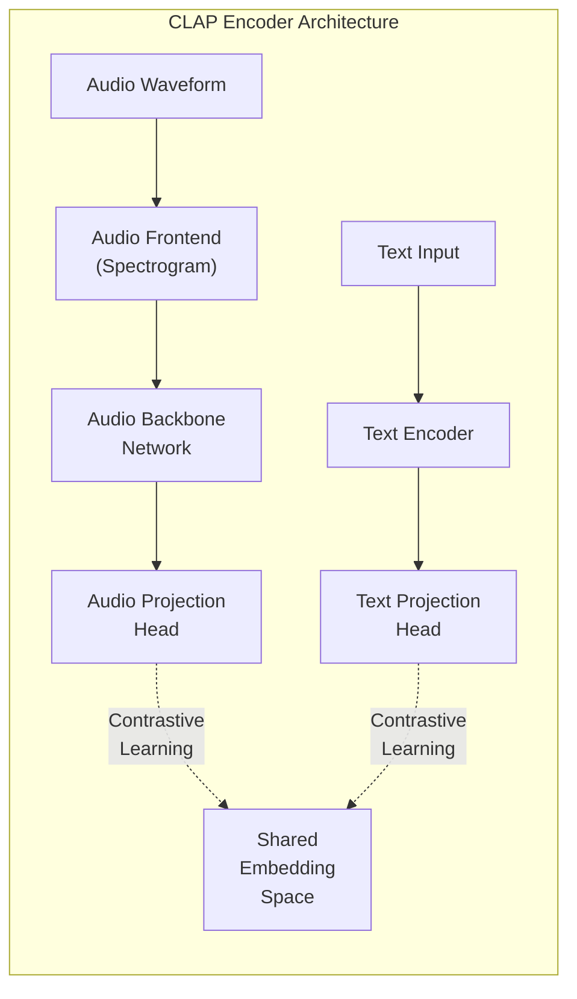

CLAP encoder improvements in AF2:
- **Re-trained from scratch** with stronger text understanding objectives
- **Enhanced audio-text alignment** through improved contrastive learning
- **Better zero-shot performance** on classification and retrieval tasks
- **Foundation for AudioSkills** dataset learning

**Sources:** [README.md:172]()

### AF-Whisper Unified Encoder (AF3, Music Flamingo)

Audio Flamingo 3 introduces AF-Whisper, a unified audio encoder based on Whisper architecture but trained to handle understanding tasks beyond speech recognition.

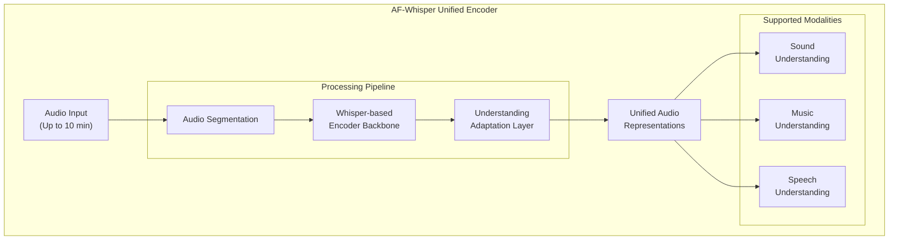

AF-Whisper key features:
- **Whisper-based foundation**: Leverages Whisper architecture trained on 680k hours of speech
- **Extended training**: Adapted for sound and music understanding beyond speech recognition
- **Unified representation**: Single encoder handles all three audio modalities
- **Long-audio support**: Processes up to 10 minutes of audio through segmentation
- **Efficient integration**: Direct projection into LLaVA architecture token space

Technical specifications:
- Base architecture derived from Whisper encoder
- Trained on 50M audio-text pairs covering sound, music, and speech
- Produces fixed-dimensional embeddings compatible with Qwen-2.5 token space
- Supports variable-length audio through chunking and temporal aggregation

**Sources:** [README.md:107](), [README.md:109]()

### Encoder Evolution Comparison

| Feature | Generic (AF1) | CLAP (AF2) | AF-Whisper (AF3) |
|---------|--------------|------------|------------------|
| **Modalities** | Sound, Music | Sound, Music | Sound, Music, Speech |
| **Training Focus** | General audio | Audio-text alignment | Unified understanding |
| **Text Understanding** | Limited | Improved | Integrated |
| **Max Audio Length** | Not specified | 5 minutes | 10 minutes |
| **Architecture** | Unspecified | Contrastive learning | Whisper-based |

**Sources:** [README.md:107](), [README.md:172](), [README.md:204]()

---

## Specialized Components

### AF3-Chat Streaming TTS Module

Audio Flamingo 3 includes AF3-Chat, a streaming text-to-speech module that enables voice output capabilities.

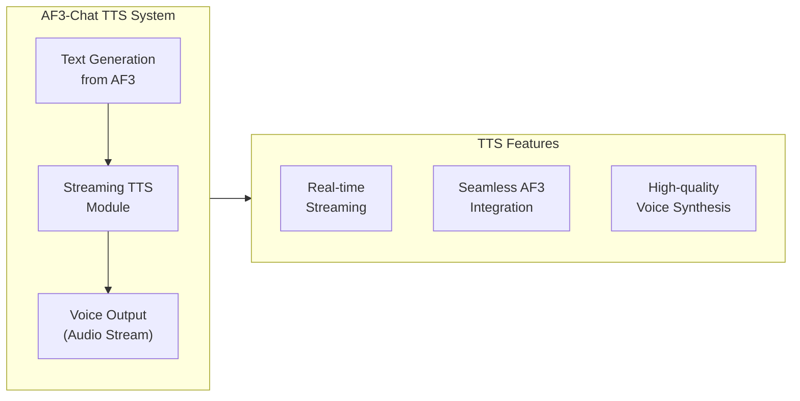

AF3-Chat capabilities:
- **Streaming synthesis**: Real-time voice generation as text is produced
- **Integrated deployment**: Available as AF3-Chat checkpoint variant
- **Multi-turn support**: Enables voice-based dialogue interactions
- **HuggingFace availability**: Deployed at `nvidia/audio-flamingo-3-chat`

**Sources:** [README.md:82-83](), [README.md:109]()

### Chain-of-Thought Reasoning System (Sound-CoT, Music Flamingo)

The chain-of-thought reasoning system enables step-by-step reasoning for complex audio understanding tasks.

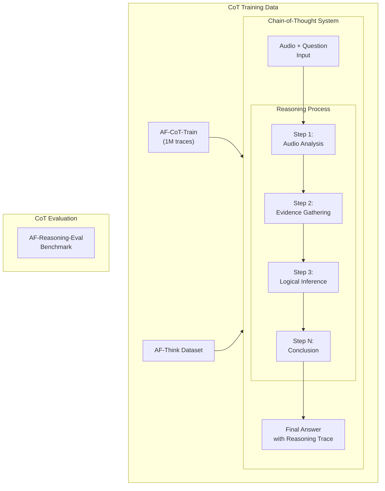

Chain-of-Thought implementation:
- **Training data**: 1M reasoning traces in AF-CoT-Train dataset
- **Sound-CoT model**: 3B parameter model based on AF2 architecture
- **Music Flamingo integration**: CoT reasoning for deep music analysis
- **Evaluation framework**: AF-Reasoning-Eval benchmark for reasoning assessment

CoT capabilities:
- **Common-sense reasoning**: Logical inference about sound sources and contexts
- **Discriminative reasoning**: Distinguishing between closely related audio concepts
- **Step-by-step explanation**: Transparent reasoning process for interpretability
- **Music theory reasoning**: Understanding harmony, structure, and cultural context

**Sources:** [README.md:46](), [README.md:148](), [README.md:150]()

### Reinforcement Learning with Custom Rewards (Music Flamingo)

Music Flamingo employs reinforcement learning with custom reward functions to improve music understanding quality.

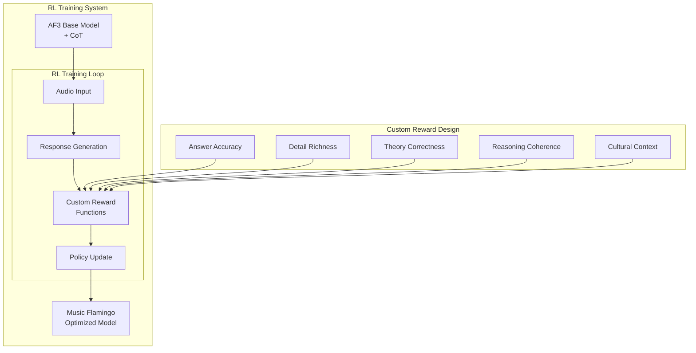

RL with custom rewards features:
- **Multi-aspect rewards**: Evaluation across accuracy, detail, theory, coherence, and cultural context
- **Music-specific objectives**: Rewards designed for music understanding quality
- **CoT integration**: Rewards applied to both answers and reasoning traces
- **Performance optimization**: Achieves SOTA on 10+ music benchmarks

Custom reward functions target:
- **Harmony analysis accuracy**: Correct identification of chords and progressions
- **Structural understanding**: Accurate description of song sections and form
- **Timbre description**: Precise characterization of instrumental qualities
- **Lyrical interpretation**: Meaningful analysis of song lyrics and themes
- **Cultural context**: Appropriate recognition of genre and cultural influences

**Sources:** [README.md:42-49]()

---

## Component Integration Architecture

### End-to-End Processing Pipeline

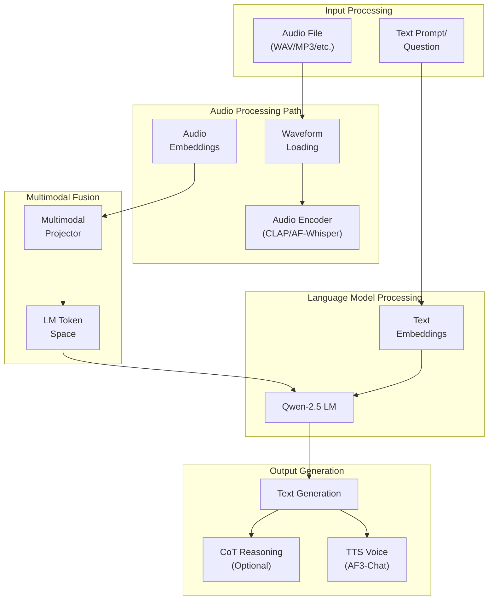

**Sources:** [README.md:107](), [README.md:172]()

### Model-Specific Component Stacks

```mermaid
graph LR
    subgraph AF1Stack["AF1 Component Stack"]
        AF1E["Generic<br/>Encoder"]
        AF1P["Perceiver<br/>Resampler"]
        AF1L["OPT-IML<br/>1.3B"]
        
        AF1E --> AF1P
        AF1P --> AF1L
    end
    
    subgraph AF2Stack["AF2 Component Stack"]
        AF2E["CLAP<br/>Encoder"]
        AF2P["Perceiver<br/>Resampler"]
        AF2L["Qwen-2.5<br/>3B"]
        AF2S["3-Stage<br/>Training"]
        
        AF2E --> AF2P
        AF2P --> AF2L
        AF2L --> AF2S
    end
    
    subgraph CoTStack["Sound-CoT Stack"]
        CoTE["CLAP<br/>Encoder"]
        CoTP["Perceiver<br/>Resampler"]
        CoTL["Qwen-2.5<br/>3B"]
        CoTR["CoT<br/>Reasoning"]
        
        CoTE --> CoTP
        CoTP --> CoTL
        CoTL --> CoTR
    end
    
    subgraph AF3Stack["AF3 Component Stack"]
        AF3E["AF-Whisper<br/>Encoder"]
        AF3Proj["Linear/MLP<br/>Projector"]
        AF3L["Qwen-2.5<br/>7B"]
        AF3T["AF3-Chat<br/>TTS"]
        
        AF3E --> AF3Proj
        AF3Proj --> AF3L
        AF3L --> AF3T
    end
    
    subgraph MFStack["Music Flamingo Stack"]
        MFE["AF-Whisper<br/>Encoder"]
        MFProj["Linear/MLP<br/>Projector"]
        MFL["Qwen-2.5<br/>7B"]
        MFCoT["CoT<br/>Integration"]
        MFRL["RL Custom<br/>Rewards"]
        
        MFE --> MFProj
        MFProj --> MFL
        MFL --> MFCoT
        MFCoT --> MFRL
    end
```

**Sources:** [README.md:14-18](), [README.md:42-49](), [README.md:107](), [README.md:172](), [README.md:204]()

---

## Architecture Summary

The Audio Flamingo series demonstrates systematic architectural evolution:

**Core Architecture Transition:**
- AF1/AF2: Flamingo architecture with cross-attention and perceiver resampler
- AF3/Music Flamingo: LLaVA architecture with direct projection and simplified fusion

**Language Model Progression:**
- AF1: OPT-IML 1.3B (instruction-tuned)
- AF2: Qwen-2.5 3B (with 0.5B, 1.5B variants)
- Sound-CoT: Qwen-2.5 3B (reasoning-optimized)
- AF3/Music Flamingo: Qwen-2.5 7B (state-of-the-art scale)

**Audio Encoder Evolution:**
- AF1: Generic audio encoder
- AF2: Improved CLAP with enhanced text understanding
- AF3/Music Flamingo: AF-Whisper unified encoder for sound/music/speech

**Specialized Components:**
- AF3-Chat: Streaming TTS for voice output
- Sound-CoT: Chain-of-thought reasoning system with 1M training traces
- Music Flamingo: Reinforcement learning with custom music-specific rewards

This architectural progression enables scaling from 5.9M to 50M training pairs, extending audio context from unspecified lengths to 10 minutes, and expanding from two modalities (sound, music) to three (adding speech), while maintaining full backward compatibility through the branch structure.

**Sources:** [README.md:14-18](), [README.md:42-49](), [README.md:107-109](), [README.md:172](), [README.md:204](), [README.md:239-240]()

---

