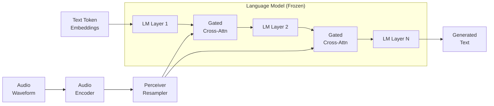
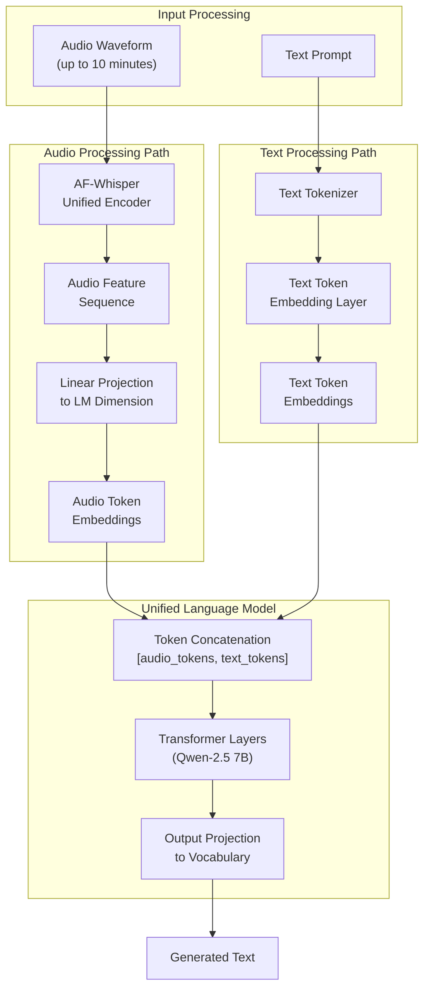
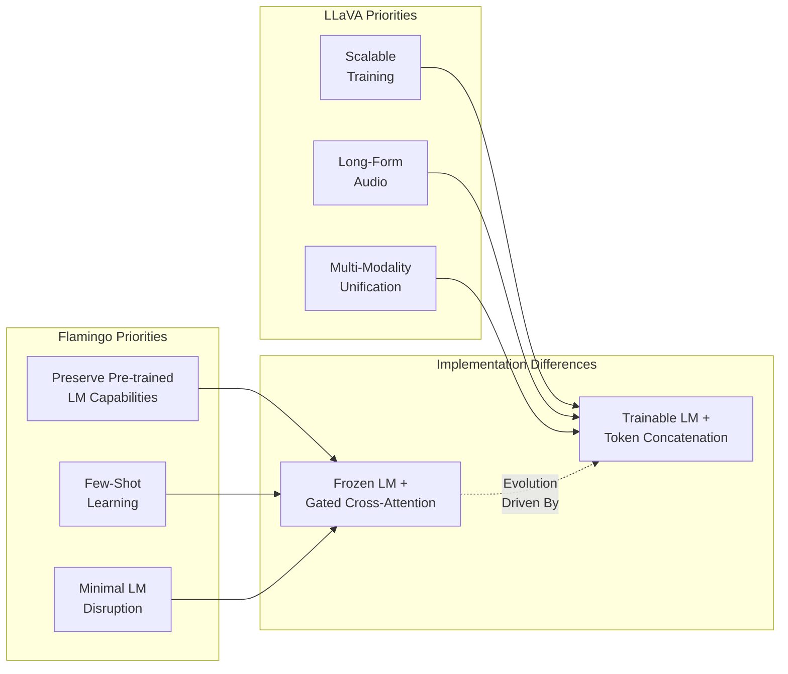
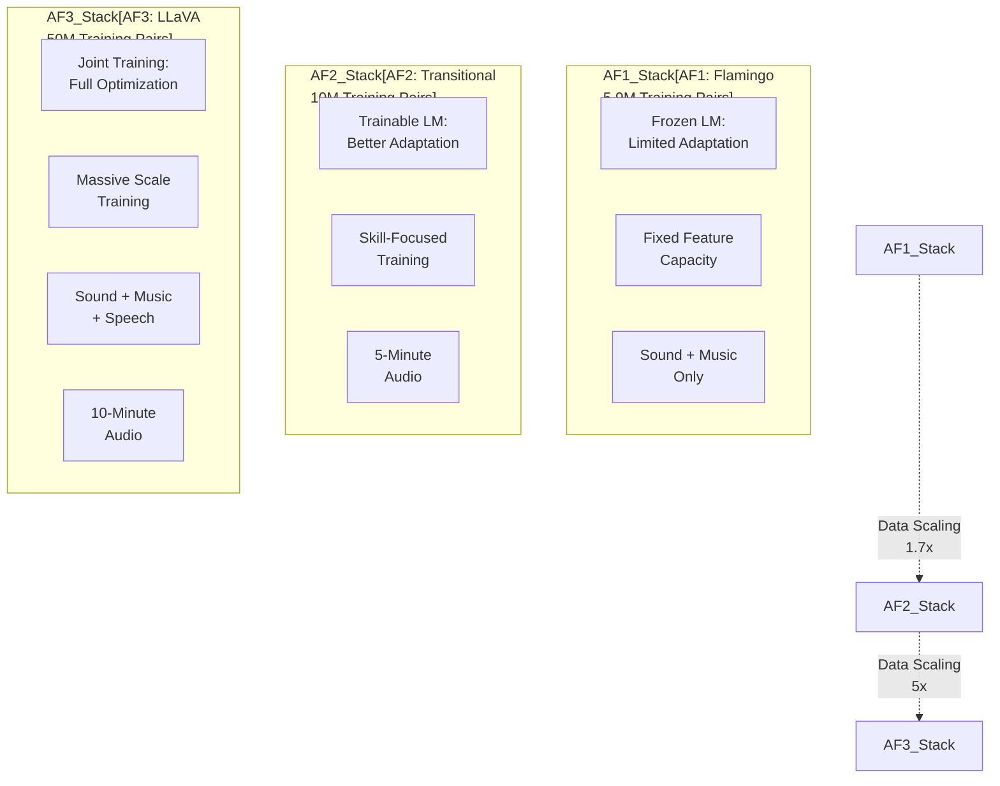
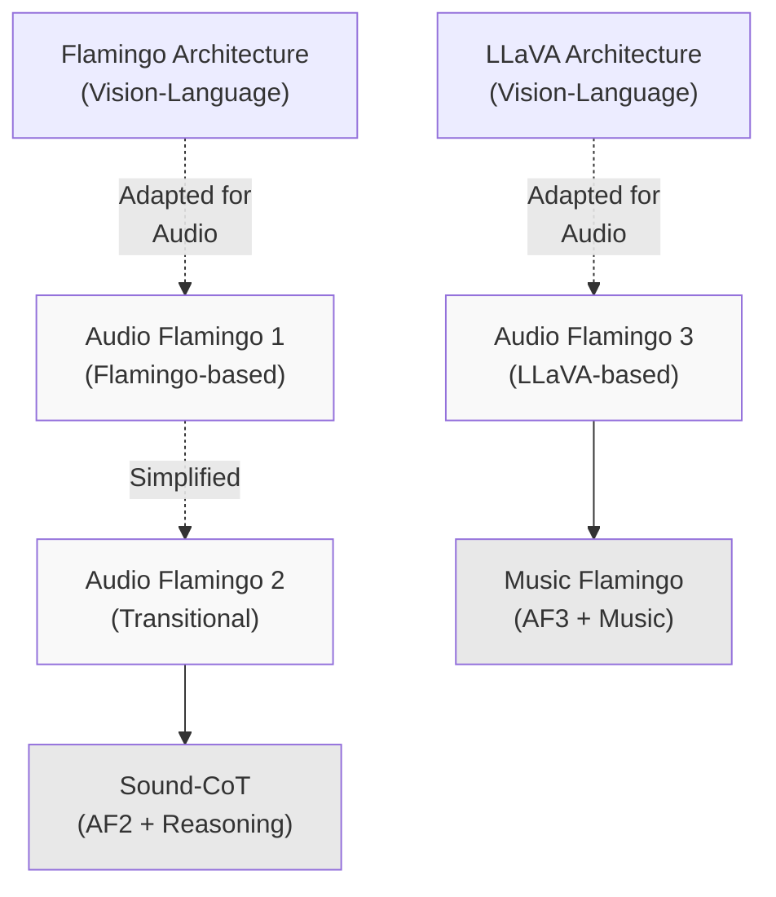

<!-- source: DeepWiki mcp.deepwiki.com · repo NVIDIA/audio-flamingo · page 3.1 Architectural Foundations · fetched 2026-10-26 -->

# Architectural Foundations

<details>
<summary>Relevant source files</summary>

The following files were used as context for generating this wiki page:

- [README.md](README.md)

</details>


## Purpose and Scope

This document describes the fundamental architectural paradigms underlying the Audio Flamingo model series, focusing on the evolution from Flamingo-based architecture (Audio Flamingo 1) to LLaVA-based architecture (Audio Flamingo 3 and Music Flamingo). The page explains the structural differences between these architectures, their design rationale, and implications for model capabilities.

For information about specific language model backbones (OPT-IML, Qwen-2.5), see [Language Model Backbones](#3.2). For details on audio encoder implementations, see [Audio Encoders](#3.3). For training methodologies that leverage these architectures, see [Training Methodologies](#4.4).

---

## Architectural Paradigms Overview

The Audio Flamingo series employs two distinct architectural paradigms across its model variants:

| Architecture | Models | Key Characteristics | Primary Use Case |
|--------------|--------|---------------------|------------------|
| **Flamingo** | Audio Flamingo 1 (AF1) | Perceiver Resampler, gated cross-attention, frozen LM | Few-shot learning, in-context learning |
| **LLaVA** | Audio Flamingo 3 (AF3), Music Flamingo (MF) | Linear projection, direct concatenation | General audio understanding, long-form audio |
| **Hybrid** | Audio Flamingo 2 (AF2), Sound-CoT | Transitional design with improved encoders | Intermediate scaling stage |

The architectural shift from Flamingo to LLaVA represents a fundamental change in how audio features are integrated with language models, trading sophisticated cross-attention mechanisms for simpler projection-based approaches that scale more effectively.

**Diagram: Architectural Paradigm Evolution**

```mermaid
graph TB
    subgraph "AF1_Paradigm[AF1: Flamingo Architecture]"
        AF1_Audio["Audio Input"]
        AF1_Encoder["Audio Encoder<br/>(Generic)"]
        AF1_Resampler["Perceiver Resampler<br/>(Cross-Attention)"]
        AF1_GatedXAttn["Gated Cross-Attention<br/>Layers"]
        AF1_LM["Frozen Language Model<br/>(OPT-IML 1.3B)"]
        AF1_Output["Text Output"]
    end
    
    AF1_Audio --> AF1_Encoder
    AF1_Encoder --> AF1_Resampler
    AF1_Resampler --> AF1_GatedXAttn
    AF1_GatedXAttn --> AF1_LM
    AF1_LM --> AF1_Output
    
    subgraph "AF2_Paradigm[AF2: Transitional Design]"
        AF2_Audio["Audio Input"]
        AF2_Encoder["Improved CLAP<br/>Encoder"]
        AF2_Adapter["Adapter Layer"]
        AF2_LM["Language Model<br/>(Qwen-2.5 3B)"]
        AF2_Output["Text Output"]
    end
    
    AF2_Audio --> AF2_Encoder
    AF2_Encoder --> AF2_Adapter
    AF2_Adapter --> AF2_LM
    AF2_LM --> AF2_Output
    
    subgraph "AF3_Paradigm[AF3: LLaVA Architecture]"
        AF3_Audio["Audio Input"]
        AF3_Encoder["AF-Whisper<br/>Unified Encoder"]
        AF3_Projector["Linear Projection<br/>Layer"]
        AF3_Concat["Token<br/>Concatenation"]
        AF3_LM["Language Model<br/>(Qwen-2.5 7B)"]
        AF3_Output["Text Output"]
        AF3_TextTokens["Text Token<br/>Embeddings"]
    end
    
    AF3_Audio --> AF3_Encoder
    AF3_Encoder --> AF3_Projector
    AF3_Projector --> AF3_Concat
    AF3_TextTokens --> AF3_Concat
    AF3_Concat --> AF3_LM
    AF3_LM --> AF3_Output
    
    AF1_Paradigm -.->|"Evolution"| AF2_Paradigm
    AF2_Paradigm -.->|"Architecture Shift"| AF3_Paradigm
```



**Sources:** [README.md:14-217]()

---

## Flamingo Architecture: Few-Shot Learning Foundation

Audio Flamingo 1 implements the Flamingo architecture, originally designed for vision-language models with strong few-shot learning capabilities. This architecture is characterized by its use of specialized components to integrate audio features into a frozen language model.

### Core Components

The Flamingo architecture in AF1 consists of:

1. **Audio Encoder**: Converts audio waveforms into dense feature representations
2. **Perceiver Resampler**: Reduces variable-length audio features to fixed-length representations using learnable queries and cross-attention
3. **Gated Cross-Attention Layers**: Integrates audio features into language model layers with gating mechanisms to control information flow
4. **Frozen Language Model**: Pre-trained OPT-IML 1.3B model kept frozen during training

### Architectural Flow



### Perceiver Resampler Mechanism

The Perceiver Resampler transforms variable-length audio features into a fixed number of learned representations:

- **Input**: Audio encoder outputs with variable temporal length
- **Learnable Queries**: Fixed set of query vectors (typically 64 or 128)
- **Cross-Attention**: Queries attend to all audio features
- **Output**: Fixed-length feature set regardless of audio duration

This design enables the model to handle audio of different lengths while maintaining consistent downstream processing.

### Gated Cross-Attention Integration

Gated cross-attention layers are inserted between frozen language model layers:

1. Audio features from Perceiver Resampler serve as keys and values
2. Language model hidden states serve as queries
3. Attention outputs are gated using a learned scalar parameter (tanh gate)
4. Gating starts near zero, gradually allowing audio information to influence text generation

This gating mechanism allows the model to preserve the pre-trained language model's capabilities while incorporating audio understanding.

### Architectural Advantages for Few-Shot Learning

The Flamingo architecture's design choices directly support few-shot learning:

- **Frozen LM**: Preserves pre-trained language understanding and reasoning
- **Modular Integration**: Audio features are added without disrupting text-only capabilities
- **In-Context Processing**: Gated cross-attention allows selective attention to audio based on context

**Sources:** [README.md:192-217]()

---

## Transition Period: Audio Flamingo 2 Design

Audio Flamingo 2 represents a transitional architecture between Flamingo and LLaVA paradigms. While maintaining some Flamingo-inspired design elements, AF2 introduces improvements that set the stage for the LLaVA-based AF3.

### Key Architectural Changes in AF2

1. **Enhanced Audio Encoder**: Improved CLAP (Contrastive Language-Audio Pre-training) encoder with stronger text understanding
2. **Adapter Layer Design**: Simplified integration mechanism compared to Flamingo's gated cross-attention
3. **Language Model Upgrade**: Transition from OPT-IML to Qwen-2.5 3B
4. **3-Stage Training**: Architectural flexibility to support multi-stage optimization

### Architectural Comparison Table

| Component | AF1 (Flamingo) | AF2 (Transitional) |
|-----------|----------------|-------------------|
| **Audio Encoder** | Generic encoder | Improved CLAP |
| **Feature Integration** | Perceiver Resampler + Gated Cross-Attention | Simplified adapter layer |
| **Language Model** | OPT-IML 1.3B (frozen) | Qwen-2.5 3B (trainable) |
| **Training Strategy** | Single-stage | 3-stage pipeline |
| **Audio Duration** | Variable | Up to 5 minutes |
| **Training Data** | 5.9M pairs | 10M pairs |

The simplified integration mechanism in AF2 reduces architectural complexity while maintaining strong performance, demonstrating that sophisticated cross-attention mechanisms may not be necessary for effective audio-language modeling at scale.

**Sources:** [README.md:153-187]()

---

## LLaVA Architecture: Scalable Audio Understanding

Audio Flamingo 3 and Music Flamingo adopt the LLaVA (Large Language and Vision Assistant) architecture, which represents a significant departure from the Flamingo paradigm. This architecture prioritizes simplicity, scalability, and direct feature concatenation over complex attention mechanisms.

### Core Architectural Principles

The LLaVA architecture in AF3 is built on three fundamental principles:

1. **Direct Feature Projection**: Linear transformation of audio features to language model dimension
2. **Token-Level Concatenation**: Audio features treated as additional input tokens
3. **Unified Training**: Both audio encoder and language model can be jointly optimized

### Architectural Components



### Linear Projection Layer

The linear projection layer serves as the bridge between audio and language modalities:

- **Input Dimension**: Audio encoder output dimension (from AF-Whisper)
- **Output Dimension**: Language model hidden dimension (Qwen-2.5 embedding size)
- **Trainable Parameters**: Single linear transformation matrix
- **Function**: Maps audio features to language model's semantic space

This is significantly simpler than Flamingo's Perceiver Resampler, which uses multiple attention layers.

### Token Concatenation Strategy

Audio tokens are concatenated with text tokens to form a unified input sequence:

```
Input Sequence: [audio_token_1, ..., audio_token_N, text_token_1, ..., text_token_M]
```

The language model processes this as a standard sequence, with audio tokens treated identically to text tokens during attention computation. This enables:

- **Long Audio Support**: Up to 10 minutes of audio represented as token sequences
- **Flexible Positioning**: Audio can appear at any position in the context
- **Multi-Audio Support**: Multiple audio clips can be included in a single context

### Unified AF-Whisper Encoder

AF3 introduces AF-Whisper, a unified audio encoder trained on sound, music, and speech:

- **Base Model**: Whisper encoder architecture
- **Training Data**: Diverse audio types beyond speech
- **Modality Coverage**: Sound events, music, speech
- **Feature Quality**: Unified representation space for all audio types

This contrasts with AF1/AF2's separate encoders for different audio modalities.

### Architectural Simplification Benefits

The LLaVA architecture offers several advantages over Flamingo:

1. **Training Efficiency**: Fewer specialized components to optimize
2. **Scalability**: Linear scaling with audio length (no resampling bottleneck)
3. **Flexibility**: Easy integration of multiple audio clips
4. **Transparency**: Direct attention patterns between audio and text tokens

**Sources:** [README.md:69-127]()

---

## Architectural Evolution Analysis

### Paradigm Shift Rationale

The transition from Flamingo to LLaVA architecture reflects evolving priorities in the Audio Flamingo series:

**Comparison: Architectural Design Choices**



### Feature Integration Mechanisms Compared

| Aspect | Flamingo (AF1) | LLaVA (AF3) |
|--------|----------------|-------------|
| **Integration Method** | Gated cross-attention between LM layers | Direct token concatenation before LM |
| **Audio Feature Processing** | Perceiver Resampler (cross-attention) | Linear projection layer |
| **LM Training Status** | Frozen during training | Jointly trained with encoder |
| **Audio Token Count** | Fixed (64-128 tokens) | Variable (proportional to duration) |
| **Computational Cost** | O(n) per LM layer | O(1) before LM |
| **Multi-Audio Support** | Complex (requires multiple resamplers) | Natural (concatenate more tokens) |
| **Long Audio Scaling** | Limited by resampler capacity | Scales linearly with context length |

### Training Data Scaling Impact

The architectural shift enabled dramatic scaling in training data and model capabilities:



### Capability Implications

The architectural differences directly impact model capabilities:

**AF1 (Flamingo) Strengths:**
- Strong few-shot learning due to frozen LM preserving language priors
- Robust multi-turn dialogue from preserved conversational abilities
- Efficient inference with frozen LM parameters

**AF1 (Flamingo) Limitations:**
- Fixed feature capacity limits long audio understanding
- Frozen LM cannot adapt deeply to audio-language patterns
- Complex integration mechanism increases implementation complexity

**AF3 (LLaVA) Strengths:**
- Scales naturally to long audio (10 minutes) through token concatenation
- Joint training enables deeper audio-language fusion
- Simple architecture facilitates rapid iteration and debugging
- Unified encoder handles all audio modalities consistently

**AF3 (LLaVA) Limitations:**
- Reduced emphasis on few-shot learning compared to AF1
- Requires larger training datasets to achieve strong performance
- Higher computational cost during training (unfrozen LM)

### Performance Outcomes

The architectural evolution correlates with performance improvements across benchmarks:

| Benchmark Type | AF1 (Flamingo) | AF3 (LLaVA) | Improvement Factor |
|----------------|----------------|-------------|--------------------|
| **Zero-Shot Captioning** | Strong | SOTA | Incremental |
| **Few-Shot Learning** | Excellent | Good | Decreased |
| **Long Audio QA** | Limited | SOTA | Dramatic |
| **Multi-Modality Coverage** | 2 modalities | 3 modalities | +50% |
| **Reasoning Benchmarks** | Baseline | SOTA | Significant |

**Sources:** [README.md:69-127](), [README.md:192-217]()

---

## Architecture Selection for Specialized Models

The architectural foundations established in AF1 and AF3 serve as bases for specialized variants:

### Sound-CoT Architecture

Sound-CoT builds on the AF2 transitional architecture:
- **Base**: AF2's simplified integration mechanism
- **Specialization**: Chain-of-thought reasoning training
- **Rationale**: AF2's architecture provides sufficient capacity for reasoning tasks without AF3's complexity

### Music Flamingo Architecture

Music Flamingo extends the AF3 LLaVA architecture:
- **Base**: AF3's 7B LLaVA-based design
- **Extensions**: Chain-of-thought + reinforcement learning
- **Rationale**: LLaVA's scalability and long-audio support are essential for full-song analysis

**Architecture Inheritance Diagram**



**Sources:** [README.md:128-151](), [README.md:20-66]()

---

## Summary

The Audio Flamingo series demonstrates a strategic architectural evolution from Flamingo to LLaVA paradigms:

1. **AF1 (Flamingo)**: Emphasized few-shot learning through frozen language models and sophisticated cross-attention integration mechanisms
2. **AF2 (Transitional)**: Simplified integration while scaling training data, preparing for architectural shift
3. **AF3+ (LLaVA)**: Prioritized scalability, long-audio support, and training efficiency through direct token concatenation

This evolution reflects a broader trend in multimodal AI: trading architectural complexity for simplicity that enables massive-scale training. The LLaVA architecture's success with 50M training pairs and 10-minute audio support validates this approach, while AF1's Flamingo-based design remains relevant for scenarios requiring strong few-shot learning capabilities.

The architectural foundations laid by AF1 and AF3 now serve as platforms for specialized models (Sound-CoT, Music Flamingo), demonstrating the flexibility of both paradigms for domain-specific applications.

**Sources:** [README.md:1-299]()

---

