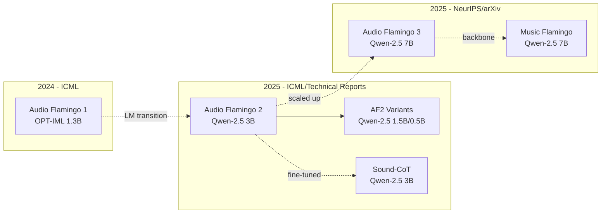
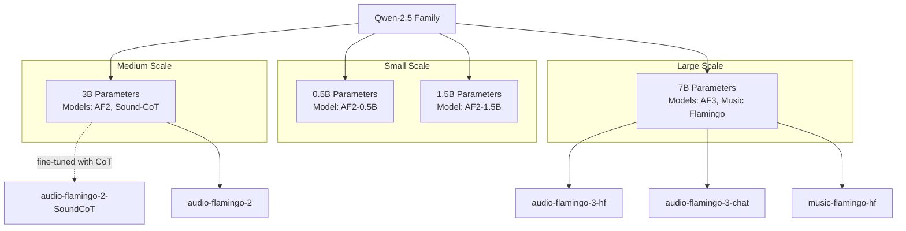
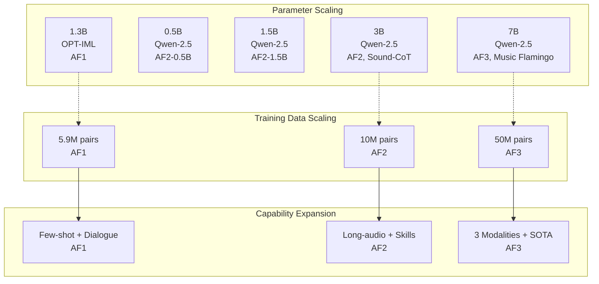
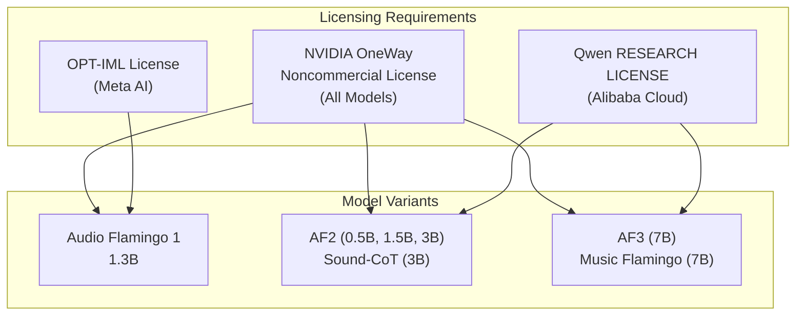

<!-- source: DeepWiki mcp.deepwiki.com · repo NVIDIA/audio-flamingo · page 3.2 Language Model Backbones · fetched 2026-10-26 -->

# Language Model Backbones

Relevant source files

The following files were used as context for generating this wiki page:

- [README.md](README.md)

## Purpose and Scope

This document details the language model backbones used across the Audio Flamingo series. It covers the two primary language model families (OPT-IML and Qwen-2.5), their parameter scaling from 1.3B to 7B, and the specific model variants that use each backbone. For information about the overall model architectures, see [Architectural Foundations](#3.1). For details about audio encoders paired with these language models, see [Audio Encoders](#3.3).

**Sources:** [README.md:1-299]()

---

## Language Model Family Overview

The Audio Flamingo series employs two distinct language model families across its evolution:

| Language Model | Parameters | Used In | License |
|----------------|------------|---------|---------|
| OPT-IML | 1.3B | Audio Flamingo 1 | OPT-IML License |
| Qwen-2.5 | 0.5B, 1.5B, 3B, 7B | Audio Flamingo 2, Sound-CoT, Audio Flamingo 3, Music Flamingo | Qwen RESEARCH LICENSE AGREEMENT |

The transition from OPT-IML (AF1) to Qwen-2.5 (AF2 onwards) represents a fundamental architectural shift that enabled improved performance, multi-stage training strategies, and better scaling properties.

**Sources:** [README.md:172-173](), [README.md:204](), [README.md:239-240]()

---

## Language Model Evolution Timeline

**Diagram: Language Model Backbone Evolution Across Audio Flamingo Series**

This diagram shows the progression from OPT-IML (1.3B) in the original Audio Flamingo to the Qwen-2.5 family (0.5B to 7B) in subsequent models. The transition to Qwen-2.5 enabled the development of multiple parameter variants and specialized models.

**Sources:** [README.md:15-18](), [README.md:204](), [README.md:172](), [README.md:148](), [README.md:107](), [README.md:42]()

---

## OPT-IML Backbone (Audio Flamingo 1)

### Architecture Characteristics

Audio Flamingo 1 is built on **OPT-IML** (Open Pre-trained Transformer - Instruction Meta-Learning), a 1.3B parameter language model. This backbone was selected for its instruction-following capabilities and compatibility with the Flamingo architecture's few-shot learning paradigm.

### Key Properties

- **Parameter Count:** 1.3B
- **Training Data:** 5.9M audio-text pairs
- **Capabilities:** Few-shot learning, multi-turn dialogue
- **Branch:** `legacy_audio_flamingo_1`

### Model Availability

The OPT-IML based Audio Flamingo 1 checkpoint is available at:
- HuggingFace: `nvidia/audio-flamingo`

### Licensing Restrictions

Audio Flamingo 1 is subject to the **OPT-IML license** in addition to NVIDIA's non-commercial license. Users must comply with both licensing terms when using this model variant.

**Sources:** [README.md:192-217](), [README.md:239](), [README.md:199]()

---

## Qwen-2.5 Backbone (Audio Flamingo 2, 3, and Variants)

### Architecture Characteristics

Starting with Audio Flamingo 2, the series transitioned to **Qwen-2.5**, a family of instruction-tuned language models from Alibaba Cloud. This transition enabled significant improvements in language understanding, multi-stage training strategies, and scaling to larger parameter counts.

### Parameter Variants

**Diagram: Qwen-2.5 Parameter Variants and Model Mapping**

This diagram maps the different Qwen-2.5 parameter sizes to specific Audio Flamingo model checkpoints available on HuggingFace. The 3B variant serves as the base for both AF2 and Sound-CoT, while the 7B variant powers both AF3 and Music Flamingo.

**Sources:** [README.md:165-167](), [README.md:137-139](), [README.md:79-83](), [README.md:30-31]()

---

## Model-Specific Language Model Configurations

### Audio Flamingo 2 (3B, 1.5B, 0.5B)

**Base Configuration:**
- Language Model: Qwen-2.5 3B
- Training Scale: ~10M audio-text pairs
- Training Strategy: 3-stage pipeline
- Branch: `audio_flamingo_2`

**Variant Configurations:**
- **AF2-3B:** Full-scale model with complete training
- **AF2-1.5B:** Medium-scale variant for efficiency
- **AF2-0.5B:** Compact variant for resource-constrained deployment

All variants use the same Qwen-2.5 architecture but with different parameter counts, enabling deployment across different computational budgets.

**Sources:** [README.md:153-187](), [README.md:165-167](), [README.md:172]()

---

### Sound-CoT (3B)

**Configuration:**
- Language Model: Qwen-2.5 3B (same as AF2)
- Base Model: Audio Flamingo 2
- Specialization: Chain-of-thought reasoning
- Training Data: +1M CoT reasoning traces (AF-CoT-Train)
- Branch: `soundCoT`

Sound-CoT uses the same 3B Qwen-2.5 backbone as Audio Flamingo 2 but is fine-tuned specifically for reasoning tasks. The language model is trained to generate step-by-step reasoning traces rather than direct answers.

**Sources:** [README.md:128-151](), [README.md:148]()

---

### Audio Flamingo 3 (7B)

**Configuration:**
- Language Model: Qwen-2.5 7B
- Training Scale: ~50M audio-text pairs
- Architecture: LLaVA-based
- Audio Support: Up to 10 minutes
- Branch: `audio_flamingo_3`

Audio Flamingo 3 represents a significant parameter scaling, moving from 3B to 7B. The larger language model enables:
- Handling all three audio modalities (sound, music, speech)
- Processing longer audio contexts
- Improved reasoning and understanding capabilities
- SOTA performance across multiple benchmarks

**Checkpoint Variants:**
- `nvidia/audio-flamingo-3-hf`: Standard model
- `nvidia/audio-flamingo-3-chat`: Version with streaming TTS module (AF3-Chat)

**Sources:** [README.md:69-127](), [README.md:107](), [README.md:79-83]()

---

### Music Flamingo (7B)

**Configuration:**
- Language Model: Qwen-2.5 7B (same as AF3)
- Base Model: Audio Flamingo 3 backbone
- Specialization: Deep music understanding
- Additional Training: Chain-of-thought + reinforcement learning
- Branch: `music_flamingo`

Music Flamingo builds on the same 7B Qwen-2.5 backbone as Audio Flamingo 3 but adds specialized training for music-specific understanding including harmony, structure, timbre, lyrics, and cultural context analysis.

**Sources:** [README.md:20-66](), [README.md:42](), [README.md:30]()

---

## Parameter Scaling Analysis

**Diagram: Language Model Parameter Scaling and Its Impact**

This diagram illustrates how parameter scaling correlates with training data expansion and capability growth across the series. The transition to larger language models enabled processing of more training data and development of more sophisticated capabilities.

**Sources:** [README.md:204](), [README.md:172](), [README.md:107]()

---

## Language Model to Model Variant Mapping

The following table provides a comprehensive mapping of language model backbones to specific Audio Flamingo model variants and their HuggingFace checkpoint locations:

| Language Model | Parameters | Model Variant | HuggingFace Checkpoint | Branch |
|----------------|------------|---------------|------------------------|--------|
| OPT-IML | 1.3B | Audio Flamingo 1 | `nvidia/audio-flamingo` | `legacy_audio_flamingo_1` |
| Qwen-2.5 | 0.5B | Audio Flamingo 2 | `nvidia/audio-flamingo-2-0.5B` | `audio_flamingo_2` |
| Qwen-2.5 | 1.5B | Audio Flamingo 2 | `nvidia/audio-flamingo-2-1.5B` | `audio_flamingo_2` |
| Qwen-2.5 | 3B | Audio Flamingo 2 | `nvidia/audio-flamingo-2` | `audio_flamingo_2` |
| Qwen-2.5 | 3B | Sound-CoT | `nvidia/audio-flamingo-2-SoundCoT` | `soundCoT` |
| Qwen-2.5 | 7B | Audio Flamingo 3 | `nvidia/audio-flamingo-3-hf` | `audio_flamingo_3` |
| Qwen-2.5 | 7B | Audio Flamingo 3 Chat | `nvidia/audio-flamingo-3-chat` | `audio_flamingo_3` |
| Qwen-2.5 | 7B | Music Flamingo | `nvidia/music-flamingo-hf` | `music_flamingo` |

**Sources:** [README.md:199](), [README.md:165-167](), [README.md:137-139](), [README.md:79-83](), [README.md:30]()

---

## Licensing Considerations

### OPT-IML License (Audio Flamingo 1)

Audio Flamingo 1 is subject to the **OPT-IML license** from Meta AI. Users must review and comply with this license when using the 1.3B model variant. This is in addition to NVIDIA's OneWay Noncommercial License that applies to all Audio Flamingo checkpoints.

### Qwen Research License (Audio Flamingo 2, 3, and Variants)

All models based on Qwen-2.5 (Audio Flamingo 2, Sound-CoT, Audio Flamingo 3, and Music Flamingo) are subject to the **Qwen RESEARCH LICENSE AGREEMENT** from Alibaba Cloud. Key points:

- Copyright: © Alibaba Cloud, All Rights Reserved
- Applies to: All 0.5B, 1.5B, 3B, and 7B variants
- Additional Requirements: NVIDIA OneWay Noncommercial License also applies

Users must ensure compliance with both the Qwen Research License and NVIDIA's license when deploying these models.

### License Summary by Model

**Diagram: License Requirements by Model Variant**

This diagram shows the licensing requirements for different model variants. All models require NVIDIA's license, while AF1 additionally requires the OPT-IML license and all Qwen-2.5 based models require the Qwen Research License.

**Sources:** [README.md:235-240]()

---

## Branch-Specific Language Model Information

Each model variant is maintained in a separate Git branch, containing branch-specific documentation about the language model configuration:

- **`legacy_audio_flamingo_1`**: OPT-IML 1.3B configuration and licensing
- **`audio_flamingo_2`**: Qwen-2.5 3B/1.5B/0.5B configurations
- **`soundCoT`**: Qwen-2.5 3B with CoT fine-tuning details
- **`audio_flamingo_3`**: Qwen-2.5 7B configuration and AF3-Chat variant
- **`music_flamingo`**: Qwen-2.5 7B with music specialization

Users should refer to the `README` and `incl_licenses` directories within each branch for detailed language model configuration and licensing information specific to that variant.

**Sources:** [README.md:220-233](), [README.md:238]()

---

