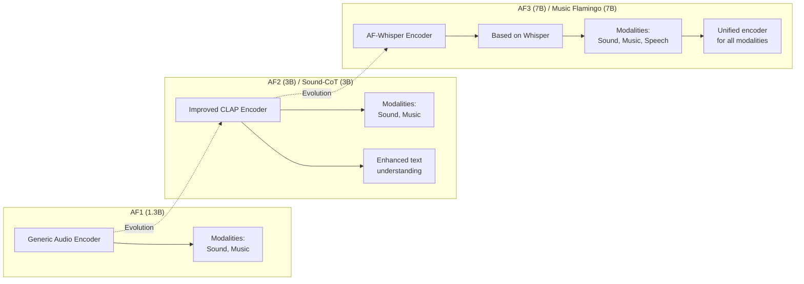
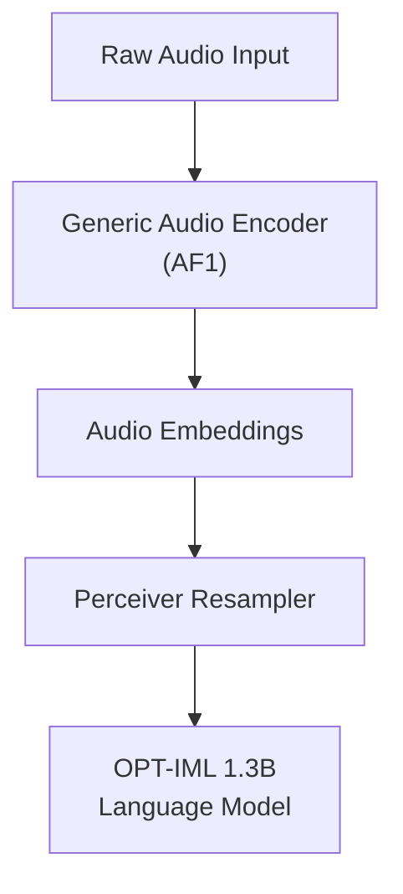
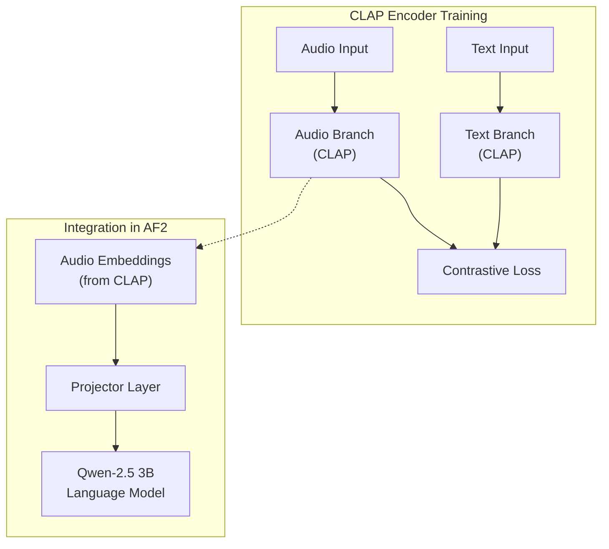
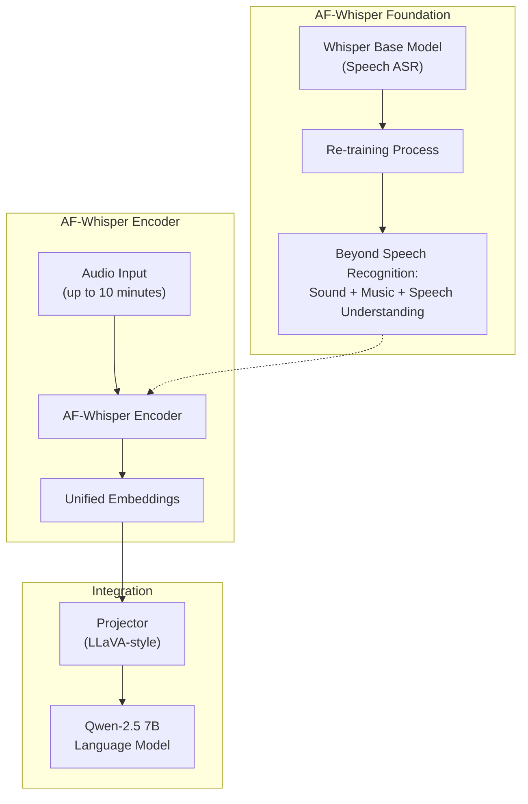
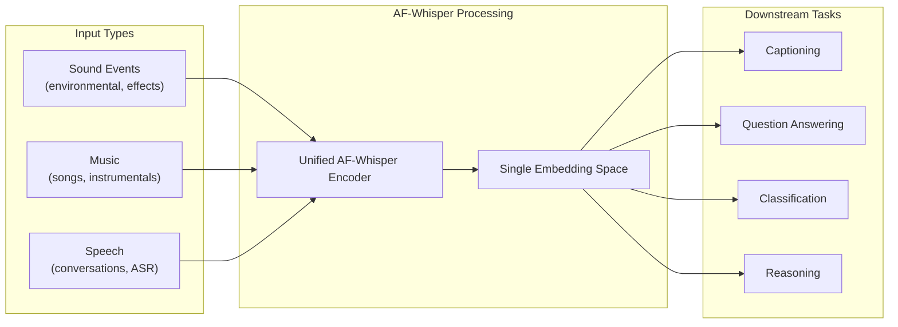
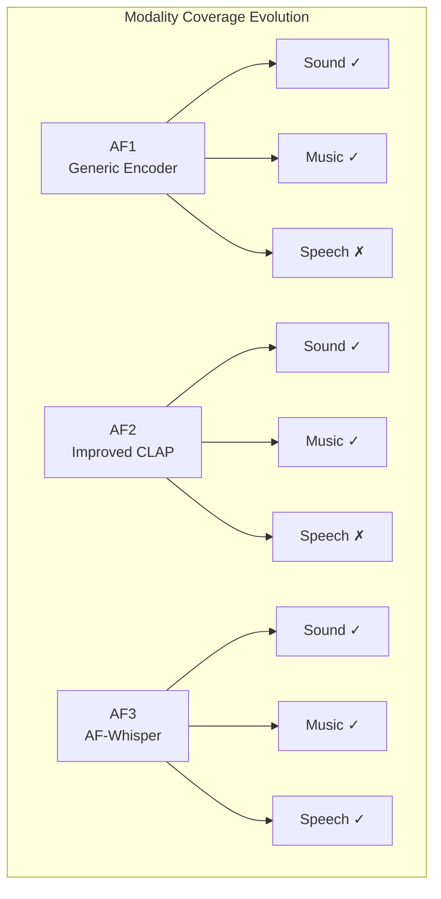
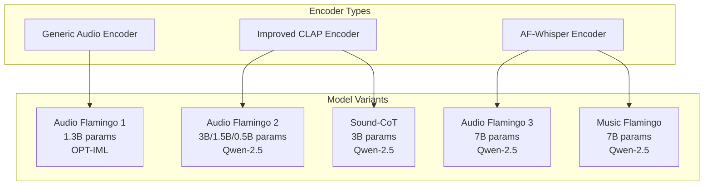
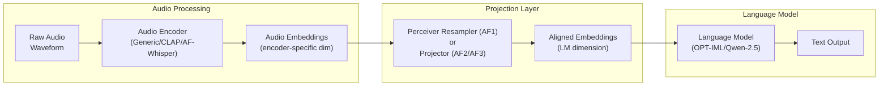

<!-- source: DeepWiki mcp.deepwiki.com · repo NVIDIA/audio-flamingo · page 3.3 Audio Encoders · fetched 2026-10-26 -->

# Audio Encoders

Relevant source files

The following files were used as context for generating this wiki page:

- [README.md](README.md)

This page documents the audio encoders used across the Audio Flamingo series, covering their evolution from generic encoders (AF1) to improved CLAP encoders (AF2) to the unified AF-Whisper encoder (AF3). For information about the complete model architectures, see [Architectural Foundations](#3.1). For details on language model components, see [Language Model Backbones](#3.2).

## Purpose and Scope

Audio encoders are the first stage of the Audio Flamingo pipeline, responsible for transforming raw audio waveforms into semantic embeddings that can be processed by the language model. The encoder design directly impacts which audio modalities (sound, music, speech) the model can understand and the quality of that understanding. This page covers the three distinct encoder architectures used across the five model variants.

## Encoder Evolution Overview

The Audio Flamingo series demonstrates progressive sophistication in audio encoding capabilities:

**Sources:** [README.md:1-299]()

The evolution reflects three key trends:
1. **Modality expansion**: From sound and music (AF1, AF2) to complete coverage including speech (AF3)
2. **Specialization**: From general-purpose encoders to domain-optimized architectures
3. **Unification**: From separate handling of modalities to a single unified encoder (AF3)

## Generic Audio Encoder (AF1)

Audio Flamingo 1 uses a generic audio encoder architecture based on the Flamingo vision-language model paradigm adapted for audio. The encoder processes audio waveforms and produces embeddings that feed into the 1.3B OPT-IML language model.

### Architecture Characteristics

**Key Properties:**
- **Modality Support**: Sound and music understanding
- **Architecture Basis**: Adapted from Flamingo's visual encoder design
- **Training Data**: Approximately 5.9M audio-text pairs
- **Integration**: Uses Perceiver Resampler to bridge audio and language representations
- **Limitations**: Does not handle speech-specific tasks beyond general audio understanding

**Sources:** [README.md:192-217]()

The generic encoder in AF1 established the baseline for audio understanding but lacked specialized optimizations for text-audio alignment or speech processing.

## Improved CLAP Encoder (AF2, Sound-CoT)

Audio Flamingo 2 introduces a re-trained CLAP (Contrastive Language-Audio Pre-training) encoder with enhanced text understanding capabilities. This encoder is also used in the Sound-CoT variant.

### Architecture and Training

**Key Improvements Over AF1:**

| Feature | AF1 Generic Encoder | AF2 Improved CLAP |
|---------|-------------------|-------------------|
| Text-Audio Alignment | Basic | **Stronger text understanding** |
| Training Objective | Standard | Contrastive learning |
| Training Data Scale | 5.9M pairs | 10M pairs |
| Modality Coverage | Sound, Music | Sound, Music |
| Specialization | General-purpose | Text-audio co-training |

**Sources:** [README.md:153-188]()

### Training Strategy

The improved CLAP encoder is trained as part of AF2's 3-stage training pipeline:
1. **Stage 1**: Base audio-text alignment
2. **Stage 2**: Skill enhancement using AudioSkills dataset
3. **Stage 3**: Fine-tuning for specific tasks

This encoder is used in:
- **Audio Flamingo 2** (3B, 1.5B, 0.5B variants)
- **Audio Flamingo Sound-CoT** (3B with chain-of-thought reasoning)

The improved text understanding enables better question answering and more accurate audio-text matching compared to AF1's generic encoder.

**Sources:** [README.md:153-188]()

## Unified AF-Whisper Encoder (AF3, Music Flamingo)

Audio Flamingo 3 introduces the AF-Whisper encoder, a unified architecture based on OpenAI's Whisper that handles all three audio modalities: sound, music, and speech.

### Architecture Design

**Sources:** [README.md:105-127]()

### Key Capabilities

**Modality Unification:**

**Technical Specifications:**

| Property | Value |
|----------|-------|
| Base Architecture | Whisper (OpenAI) |
| Training Objective | Multi-task audio understanding (not just ASR) |
| Modality Coverage | Sound, Music, Speech (complete) |
| Training Data Scale | ~50M audio-text pairs |
| Maximum Audio Length | 10 minutes |
| Used In | AF3 (7B), AF3-Chat, Music Flamingo (7B) |

**Sources:** [README.md:105-127]()

### Training Beyond Speech Recognition

The AF-Whisper encoder is explicitly trained to handle understanding tasks beyond Whisper's original speech recognition focus:

- **Sound Understanding**: Environmental sounds, sound effects, acoustic events
- **Music Understanding**: Musical analysis, genre classification, instrumentation
- **Speech Understanding**: Not just transcription, but semantic comprehension

This training enables AF3 to be the first model in the series with complete audio modality coverage.

**Sources:** [README.md:105-109]()

### Music Flamingo Specialization

Music Flamingo inherits the AF-Whisper encoder from AF3 but applies additional specialization through:
- **Music-specific training data** (MF-Skills dataset)
- **Chain-of-thought reasoning** for deep music analysis
- **Reinforcement learning** with custom rewards for music understanding

The unified encoder provides the foundation, while the training process specializes the model for music theory, harmony, structure, timbre, lyrics, and cultural context analysis.

**Sources:** [README.md:20-67]()

## Modality Support Comparison

The following table summarizes modality support across encoder types:

| Encoder Type | Models | Sound | Music | Speech | Notes |
|--------------|--------|-------|-------|--------|-------|
| Generic Audio Encoder | AF1 | ✓ | ✓ | ✗ | Basic understanding |
| Improved CLAP | AF2, Sound-CoT | ✓ | ✓ | ✗ | Enhanced text alignment |
| AF-Whisper | AF3, MF | ✓ | ✓ | ✓ | **Complete coverage, unified architecture** |

**Sources:** [README.md:1-299]()

## Encoder-to-Model Mapping

Each Audio Flamingo variant uses a specific encoder architecture:

**Code Locations:**

- **AF1 encoder implementation**: `legacy_audio_flamingo_1` branch
- **AF2/Sound-CoT CLAP encoder**: `audio_flamingo_2` and `soundCoT` branches
- **AF3/MF AF-Whisper encoder**: `audio_flamingo_3` and `music_flamingo` branches

**Sources:** [README.md:220-233]()

## Technical Integration with Language Models

Audio encoders integrate with language models through intermediate projection layers:

**Integration Patterns:**

| Model | Encoder | Projection | Language Model | Architecture Style |
|-------|---------|------------|----------------|-------------------|
| AF1 | Generic | Perceiver Resampler | OPT-IML 1.3B | Flamingo |
| AF2 | Improved CLAP | Projector | Qwen-2.5 3B | Modified Flamingo |
| Sound-CoT | Improved CLAP | Projector | Qwen-2.5 3B | Modified Flamingo |
| AF3 | AF-Whisper | LLaVA-style Projector | Qwen-2.5 7B | LLaVA |
| MF | AF-Whisper | LLaVA-style Projector | Qwen-2.5 7B | LLaVA |

The shift from Flamingo-style Perceiver Resampler (AF1) to LLaVA-style projection (AF3) reflects architectural evolution documented in [Architectural Foundations](#3.1).

**Sources:** [README.md:1-299]()

## Summary

The audio encoder evolution across the Audio Flamingo series demonstrates three key technical advancements:

1. **From Generic to Specialized**: Generic encoders → CLAP with enhanced text understanding → AF-Whisper with unified modality support
2. **Modality Expansion**: Two modalities (sound, music) → Three modalities (sound, music, speech)
3. **Scale Increase**: Training data scales from 5.9M → 10M → 50M pairs, with corresponding improvements in understanding quality

The AF-Whisper encoder in AF3 and Music Flamingo represents the current state-of-the-art, providing unified encoding for all audio modalities with support for up to 10 minutes of audio input.

**Sources:** [README.md:1-299]()

---

