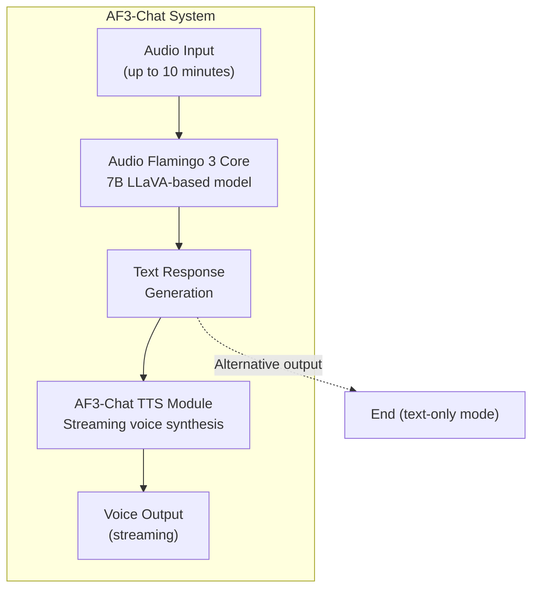
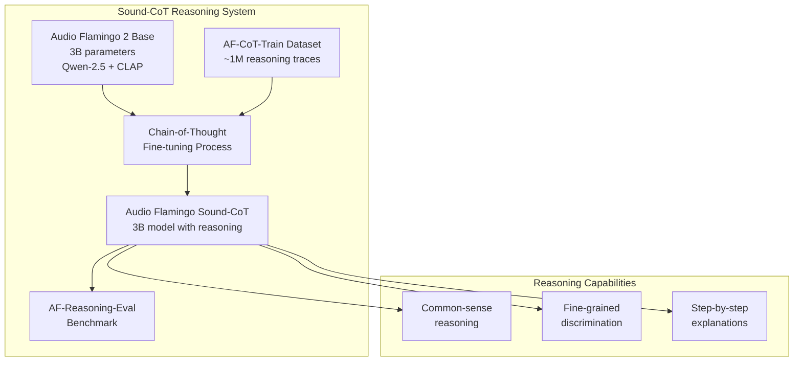
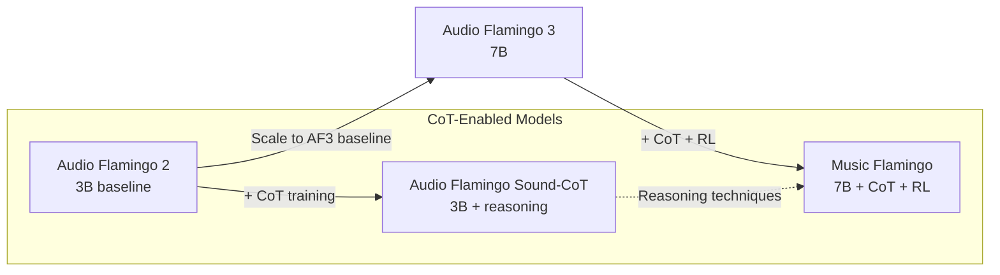
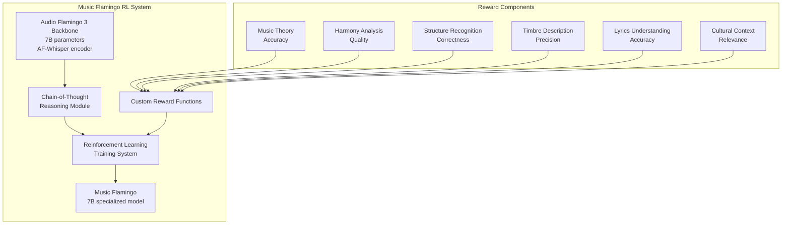
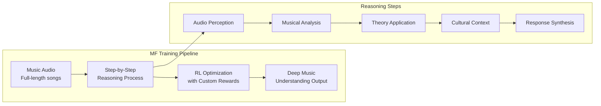

<!-- source: DeepWiki mcp.deepwiki.com · repo NVIDIA/audio-flamingo · page 3.4 Specialized Components · fetched 2026-10-26 -->

# Specialized Components

Relevant source files

The following files were used as context for generating this wiki page:

- [README.md](README.md)

## Purpose and Scope

This page documents specialized components that extend the core Audio Flamingo architecture beyond standard audio understanding tasks. These components represent advanced capabilities that differentiate specific model variants from the baseline architecture.

The three major specialized components covered are:
1. **AF3-Chat**: A streaming text-to-speech module that enables voice output in Audio Flamingo 3
2. **Chain-of-Thought Reasoning**: Systems that enable step-by-step reasoning in audio understanding tasks
3. **Reinforcement Learning with Custom Rewards**: Training methodology for Music Flamingo that combines reasoning with domain-specific reward functions

For information about core architectural components (language models, audio encoders), see [Language Model Backbones](#3.2) and [Audio Encoders](#3.3). For training methodologies in general, see [Training Methodologies](#4.4).

---

## AF3-Chat: Streaming TTS Module

### Overview

AF3-Chat is a streaming text-to-speech (TTS) component integrated with Audio Flamingo 3 that enables the model to output voice responses. This module extends the standard text-only output of audio-language models to support voice-based interaction, creating a complete audio input/output system.

**Sources:** [README.md:109]()

### Component Characteristics

| Property | Value |
|----------|-------|
| Base Model | Audio Flamingo 3 (7B parameters) |
| Capability | Streaming voice output |
| Architecture Integration | LLaVA-based with TTS extension |
| Distribution | Separate HuggingFace checkpoint |
| Checkpoint Location | `nvidia/audio-flamingo-3-chat` |

**Sources:** [README.md:82-84](), [README.md:109]()

### System Architecture

**Diagram: AF3-Chat voice output pipeline showing streaming TTS integration with Audio Flamingo 3 core**

**Sources:** [README.md:109]()

### Distribution and Access

The AF3-Chat module is distributed as a separate model checkpoint on HuggingFace Hub. This separation allows users to choose between:
- Standard Audio Flamingo 3 (`nvidia/audio-flamingo-3-hf`): Text output only
- AF3-Chat variant (`nvidia/audio-flamingo-3-chat`): Text + streaming voice output

**Sources:** [README.md:79-84]()

---

## Chain-of-Thought Reasoning Systems

### Overview

Chain-of-thought (CoT) reasoning capabilities enable Audio Flamingo models to perform step-by-step reasoning over audio inputs, producing detailed explanations of their understanding process. This specialized component was introduced in Audio Flamingo Sound-CoT and later incorporated into Music Flamingo.

**Sources:** [README.md:128-151]()

### Audio Flamingo Sound-CoT Architecture

**Diagram: Chain-of-thought reasoning system architecture in Audio Flamingo Sound-CoT**

**Sources:** [README.md:128-151]()

### Training Data and Evaluation

| Component | Details |
|-----------|---------|
| Training Dataset | AF-CoT-Train (part of AF-Think dataset) |
| Training Scale | ~1 million CoT reasoning traces |
| Base Model | Audio Flamingo 2 (3B parameters) |
| Evaluation Benchmark | AF-Reasoning-Eval |
| Performance | Comparable to 7B reasoning baselines |
| Dataset Location | `nvidia/AF-Think/tree/main/afcot` |

**Sources:** [README.md:140-150]()

### Reasoning Capabilities

The CoT reasoning system targets two primary capabilities:

1. **Common-sense Reasoning**: Understanding implicit relationships and context in audio signals
2. **Fine-grained Discrimination**: Ability to distinguish between closely related choices and explain the reasoning process

The AF-Reasoning-Eval benchmark specifically evaluates these capabilities by presenting tasks that require detailed reasoning chains rather than simple classification or captioning.

**Sources:** [README.md:150]()

### Model Variants with CoT

**Diagram: Evolution of chain-of-thought capabilities across Audio Flamingo variants**

**Sources:** [README.md:128-151](), [README.md:42-49]()

---

## Music Flamingo: RL with Custom Rewards

### Overview

Music Flamingo employs a specialized training methodology that combines chain-of-thought reasoning with reinforcement learning (RL) using custom reward functions. This approach enables deep music understanding capabilities including harmony analysis, structural understanding, timbre recognition, lyrics interpretation, and cultural context comprehension.

**Sources:** [README.md:42-49]()

### RL Training Architecture

**Diagram: Reinforcement learning architecture with custom rewards in Music Flamingo**

**Sources:** [README.md:42-49]()

### Training Methodology

Music Flamingo's training process represents a multi-stage approach:

1. **Base Model**: Start with Audio Flamingo 3 (7B) as the foundation
2. **CoT Integration**: Incorporate chain-of-thought reasoning capabilities
3. **RL Training**: Apply reinforcement learning with domain-specific rewards
4. **Music Specialization**: Fine-tune on music-specific skills dataset (MF-Skills)

**Sources:** [README.md:42-49]()

### Custom Reward Design

The custom reward functions are designed to optimize for specific aspects of music understanding:

| Reward Category | Target Capability |
|-----------------|-------------------|
| Music Theory | Theory-aware caption generation with correct terminology |
| Harmony Analysis | Accurate chord progression and harmonic relationship identification |
| Structure Recognition | Correct identification of musical form and section boundaries |
| Timbre Description | Precise instrument and sound texture characterization |
| Lyrics Understanding | Accurate lyric transcription and interpretation |
| Cultural Context | Appropriate cultural and historical contextualization |

These reward functions enable the model to optimize for deep music understanding beyond generic audio captioning.

**Sources:** [README.md:45-46]()

### Reasoning-Centric Training

**Diagram: Reasoning-centric training pipeline combining CoT and RL in Music Flamingo**

**Sources:** [README.md:46]()

### Performance and Evaluation

Music Flamingo's specialized training methodology achieves state-of-the-art performance on over 10 public music understanding and reasoning benchmarks. The combination of chain-of-thought reasoning with custom reward functions enables the model to:

- Generate theory-aware captions with technical accuracy
- Perform detailed harmonic analysis
- Recognize complex musical structures
- Analyze timbre and instrumental characteristics
- Interpret lyrics in musical context
- Provide cultural and historical context

**Sources:** [README.md:49](), [README.md:44-47]()

### Training Data and Checkpoints

| Resource | Details |
|----------|---------|
| Base Model | Audio Flamingo 3 (7B) |
| Specialized Dataset | MF-Skills (music-specific training data) |
| Model Checkpoint | `nvidia/music-flamingo-hf` |
| Dataset Location | `nvidia/MF-Skills` |
| Evaluation Benchmarks | 10+ public music understanding tasks |

**Sources:** [README.md:30-36](), [README.md:49]()

---

## Component Integration Across Models

### Specialized Components by Model Variant

```mermaid
graph TB
    subgraph "Audio Flamingo 1"
        AF1["AF1: 1.3B<br/>No specialized components"]
    end
    
    subgraph "Audio Flamingo 2"
        AF2["AF2: 3B<br/>No specialized components"]
    end
    
    subgraph "Sound-CoT"
        CoTBase["Base: AF2"]
        CoTComp["+ CoT Reasoning System"]
    end
    
    subgraph "Audio Flamingo 3"
        AF3["AF3: 7B"]
        AF3Chat["+ AF3-Chat TTS Module"]
    end
    
    subgraph "Music Flamingo"
        MFBase["Base: AF3"]
        MFCoT["+ CoT Reasoning"]
        MFRL["+ RL with Custom Rewards"]
    end
    
    CoTBase --> CoTComp
    AF3 --> AF3Chat
    MFBase --> MFCoT
    MFCoT --> MFRL
```

**Diagram: Distribution of specialized components across Audio Flamingo model variants**

**Sources:** [README.md:14-19](), [README.md:42-151]()

### Component Dependencies

| Component | Required Base | Training Data | Evaluation |
|-----------|---------------|---------------|------------|
| AF3-Chat TTS | Audio Flamingo 3 (7B) | AF-Chat dataset | User interaction demos |
| CoT Reasoning (Sound-CoT) | Audio Flamingo 2 (3B) | AF-CoT-Train (~1M traces) | AF-Reasoning-Eval |
| RL + Custom Rewards (MF) | Audio Flamingo 3 (7B) | MF-Skills + CoT data | 10+ music benchmarks |

**Sources:** [README.md:82-102](), [README.md:128-151](), [README.md:20-49]()

---

## Summary

The Audio Flamingo series incorporates three major specialized components that extend the baseline architecture:

1. **AF3-Chat**: Enables voice output through streaming TTS, creating a complete audio input/output system in Audio Flamingo 3
2. **Chain-of-Thought Reasoning**: Provides step-by-step reasoning capabilities, first introduced in Sound-CoT and later integrated into Music Flamingo
3. **Reinforcement Learning with Custom Rewards**: Enables domain-specific optimization for deep music understanding in Music Flamingo

These specialized components demonstrate the extensibility of the Audio Flamingo architecture, allowing for task-specific enhancements while maintaining the core audio understanding capabilities. Each component is designed to address specific use cases: AF3-Chat for interactive voice applications, CoT reasoning for complex audio understanding tasks requiring explanation, and RL training for domain specialization with precise quality control.

**Sources:** [README.md:1-299]()

---

