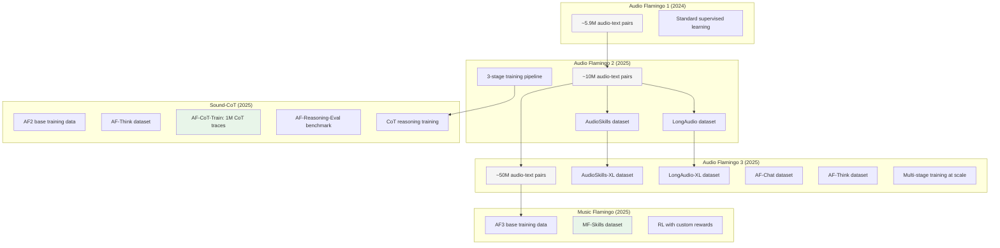
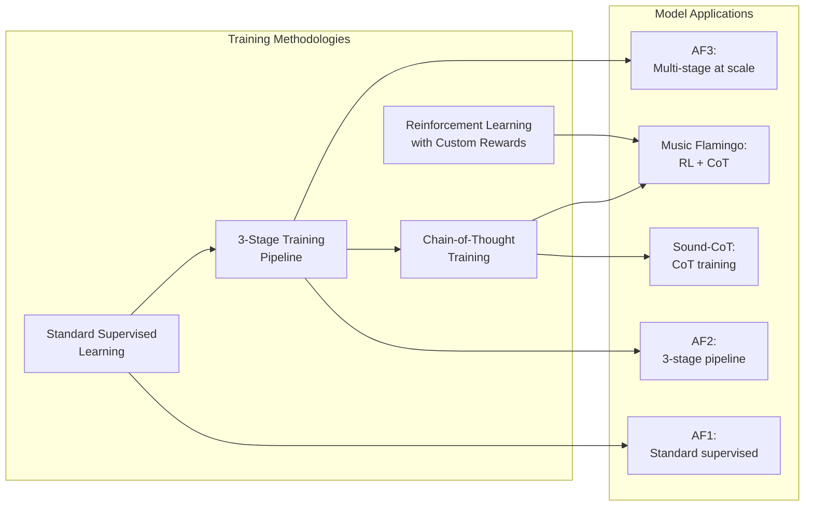
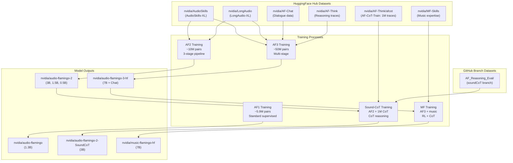

<!-- source: DeepWiki mcp.deepwiki.com · repo NVIDIA/audio-flamingo · page 4 Training Data and Strategies · fetched 2026-10-26 -->

# Training Data and Strategies

Relevant source files

The following files were used as context for generating this wiki page:

- [README.md](README.md)

This page documents the datasets and training methodologies used across the Audio Flamingo series, showing the progression from 5.9M to 50M training pairs and the introduction of multi-stage and specialized training approaches. For information about model architectures and components, see [Technical Architecture](#3). For details on resulting model capabilities, see [Capabilities and Applications](#5).

## Overview

The Audio Flamingo series demonstrates systematic scaling of training data and progressive sophistication of training strategies across five model variants. The training data evolution follows two key dimensions: **data volume scaling** (5.9M → 10M → 50M pairs) and **specialized dataset development** for targeted capabilities like long-audio understanding, chain-of-thought reasoning, and music expertise.

### Training Data Progression Across Models

Sources: [README.md:14-18](), [README.md:172](), [README.md:204](), [README.md:107]()

## Training Data Scale Evolution

The Audio Flamingo series shows exponential growth in training data volume, with each major version incorporating substantially more audio-text pairs. This scaling directly correlates with improvements in model performance and generalization capabilities.

| Model Variant | Training Data Volume | Key Datasets | Audio Duration Support |
|--------------|---------------------|--------------|----------------------|
| Audio Flamingo 1 | ~5.9M pairs | Curated audio-text pairs | Standard length |
| Audio Flamingo 2 | ~10M pairs | AudioSkills, LongAudio | Up to 5 minutes |
| Sound-CoT | AF2 + 1M CoT traces | AF-CoT-Train, AF-Reasoning-Eval | Up to 5 minutes |
| Audio Flamingo 3 | ~50M pairs | AudioSkills-XL, LongAudio-XL, AF-Chat, AF-Think | Up to 10 minutes |
| Music Flamingo | AF3 + music data | MF-Skills | Full-length songs |

Sources: [README.md:172](), [README.md:204](), [README.md:107](), [README.md:150]()

### AF1 Training Data (5.9M Pairs)

Audio Flamingo 1 was trained on approximately 5.9 million curated audio-text pairs covering general sound and music understanding tasks. The data focused on enabling few-shot learning and multi-turn dialogue capabilities using the Flamingo architecture.

Sources: [README.md:204]()

### AF2 Training Data (10M Pairs)

Audio Flamingo 2 scaled training data to approximately 10 million audio-text pairs with a strategic focus on two key areas: diverse audio understanding skills (AudioSkills) and long-form audio comprehension (LongAudio). This dataset composition enabled the model to understand audio up to 5 minutes in duration.

Sources: [README.md:172]()

### AF3 Training Data (50M Pairs)

Audio Flamingo 3 represents a significant scaling milestone with approximately 50 million audio-text pairs. The training data expanded to include speech-related tasks alongside sound and music, enabling unified three-modality audio understanding. The dataset includes extended versions of AudioSkills-XL and LongAudio-XL, plus specialized datasets for dialogue (AF-Chat) and reasoning (AF-Think), supporting audio up to 10 minutes in duration.

Sources: [README.md:107]()

## Core Dataset Collections

The Audio Flamingo series relies on several core dataset collections that are publicly available on HuggingFace Hub. These datasets provide targeted capabilities for skill-specific understanding and long-form audio processing.

### AudioSkills and AudioSkills-XL

The AudioSkills dataset collection focuses on developing diverse audio understanding skills across multiple task types. AudioSkills-XL represents the expanded version used in Audio Flamingo 3.

**HuggingFace Distribution:**
- `nvidia/AudioSkills` - AudioSkills-XL dataset for AF3

**Purpose:** Enable comprehensive audio understanding across captioning, classification, and question-answering tasks with focus on specific audio understanding skills.

Sources: [README.md:91-93]()

### LongAudio and LongAudio-XL

The LongAudio dataset collection specifically targets long-form audio understanding, progressing from 5-minute support in AF2 to 10-minute support in AF3.

**HuggingFace Distribution:**
- `nvidia/LongAudio` - LongAudio-XL dataset for AF3

**Purpose:** Train models to maintain coherent understanding and reasoning over extended audio sequences beyond typical short-form audio clips.

**Evolution:**
- LongAudio (AF2): Up to 5 minutes
- LongAudio-XL (AF3): Up to 10 minutes

Sources: [README.md:94-96]()

## Specialized Training Datasets

Beyond the core collections, the Audio Flamingo series incorporates specialized datasets targeting specific advanced capabilities like dialogue, reasoning, and music expertise.

### AF-Chat Dataset

The AF-Chat dataset provides dialogue data for training multi-turn conversational capabilities in audio understanding contexts.

**HuggingFace Distribution:**
- `nvidia/AF-Chat`

**Target Models:** Audio Flamingo 3

**Purpose:** Enable natural multi-turn dialogue interactions about audio content, supporting the AF3-Chat streaming TTS module.

Sources: [README.md:97-99]()

### AF-Think and AF-CoT-Train Datasets

The AF-Think dataset collection contains reasoning traces for enhancing chain-of-thought capabilities in audio understanding.

**HuggingFace Distribution:**
- `nvidia/AF-Think` - Contains AF-CoT-Train subdirectory
- `nvidia/AF-Think/tree/main/afcot` - 1M CoT reasoning traces

**Target Models:** Sound-CoT, Audio Flamingo 3

**Dataset Size:** Approximately 1 million chain-of-thought reasoning traces

**Purpose:** Train models to perform explicit step-by-step reasoning when analyzing audio content, improving common-sense reasoning and ability to discriminate among closely related choices.

Sources: [README.md:100-102](), [README.md:140-142](), [README.md:150]()

### AF-Reasoning-Eval Benchmark

AF-Reasoning-Eval is a sound reasoning benchmark specifically designed to evaluate chain-of-thought reasoning abilities.

**GitHub Location:** Available in the soundCoT branch
- `AF_Reasoning_Eval/` directory

**Purpose:** Benchmark dataset targeting common-sense reasoning and the ability to discriminate among closely related choices in audio understanding tasks.

**Associated Model:** Sound-CoT

Sources: [README.md:143-145](), [README.md:150]()

### MF-Skills Dataset

The MF-Skills dataset provides music-specific training data for deep music understanding capabilities.

**HuggingFace Distribution:**
- `nvidia/MF-Skills`

**Target Model:** Music Flamingo

**Purpose:** Enable specialized music understanding including theory-aware captions, harmony analysis, structure analysis, timbre understanding, lyrics comprehension, and cultural context recognition.

Sources: [README.md:33-35]()

## Training Methodologies

Training strategies evolved substantially across the Audio Flamingo series, progressing from standard supervised learning to sophisticated multi-stage pipelines and reinforcement learning approaches.

### Training Strategy Evolution

Sources: [README.md:172](), [README.md:148](), [README.md:46]()

### Standard Supervised Learning (AF1)

Audio Flamingo 1 employed standard supervised learning on the 5.9M audio-text pairs dataset. The training focused on enabling the Flamingo architecture to perform few-shot learning and multi-turn dialogue through exposure to diverse audio-text examples.

**Characteristics:**
- Single-stage training approach
- Focus on few-shot learning capabilities
- Multi-turn dialogue data integration
- OPT-IML 1.3B language model backbone

Sources: [README.md:204]()

### 3-Stage Training Pipeline (AF2)

Audio Flamingo 2 introduced a carefully ablated 3-stage training strategy that yielded optimal results compared to alternative training curricula.

**Training Stages:**
1. **Stage 1: Base Training** - Foundation training on core audio-text pairs
2. **Stage 2: Skill Enhancement** - Integration of AudioSkills and LongAudio datasets
3. **Stage 3: Fine-tuning** - Final refinement for optimal performance

**Improvements:**
- Better training curriculum management
- Progressive skill acquisition
- Improved convergence and generalization
- Qwen-2.5 3B language model backbone

Sources: [README.md:172]()

### Chain-of-Thought Training (Sound-CoT)

Sound-CoT builds on the AF2 3-stage training foundation with additional chain-of-thought reasoning training using the AF-CoT-Train dataset containing 1 million reasoning traces.

**Training Approach:**
- Base model: Audio Flamingo 2 (3B parameters)
- Additional training data: 1M CoT reasoning traces from AF-CoT-Train
- Focus: Explicit step-by-step reasoning for audio understanding
- Evaluation: AF-Reasoning-Eval benchmark for reasoning capabilities

**Results:**
The 3B finetuned Sound-CoT model achieves comparable performance to several 7B reasoning baselines on reasoning benchmarks, demonstrating the effectiveness of specialized reasoning data.

Sources: [README.md:148-150]()

### Multi-Stage Training at Scale (AF3)

Audio Flamingo 3 extends the multi-stage training approach to operate at significantly larger scale with 50M training pairs and incorporation of multiple specialized datasets.

**Dataset Integration:**
- AudioSkills-XL for diverse understanding skills
- LongAudio-XL for 10-minute audio support
- AF-Chat for dialogue capabilities
- AF-Think for reasoning enhancement
- Speech task data for three-modality coverage

**Scale Characteristics:**
- 5× data scaling from AF2 (10M → 50M pairs)
- Unified AF-Whisper encoder training for sound, music, and speech
- LLaVA architecture enabling improved multimodal fusion
- Qwen-2.5 7B language model backbone

Sources: [README.md:107-109]()

### Reinforcement Learning with Custom Rewards (Music Flamingo)

Music Flamingo employs a sophisticated training approach combining chain-of-thought reasoning with reinforcement learning using custom reward functions designed for music understanding.

**Training Components:**
- Base: Audio Flamingo 3 architecture and training
- Specialized data: MF-Skills dataset for music expertise
- Chain-of-thought: Reasoning-centric training approach
- Reinforcement learning: Custom rewards for step-by-step music reasoning

**Specialization Focus:**
- Deep music understanding (songs and instrumentals)
- Theory-aware captions and question answering
- Harmony, structure, timbre, lyrics, and cultural context analysis
- Long-form song reasoning over full-length audio

**Performance:**
Extensive evaluations demonstrate Music Flamingo's effectiveness, setting new benchmarks on over 10+ public music understanding and reasoning tasks.

Sources: [README.md:42-49]()

## Dataset-to-Model Mapping

The following diagram illustrates how specific datasets map to model variants, showing the data flow from HuggingFace Hub distributions through training to deployed models.

Sources: [README.md:91-103](), [README.md:140-145](), [README.md:165-167](), [README.md:79-87](), [README.md:30-32]()

## Data Accessibility

All major training datasets are distributed through HuggingFace Hub for reproducibility and research advancement. Model checkpoints trained on these datasets are available under the Qwen RESEARCH LICENSE AGREEMENT (AF2, AF3, Music Flamingo) or subject to OPT-IML license (AF1).

**Dataset Locations:**
- AudioSkills-XL: `nvidia/AudioSkills`
- LongAudio-XL: `nvidia/LongAudio`
- AF-Chat: `nvidia/AF-Chat`
- AF-Think: `nvidia/AF-Think`
- AF-CoT-Train: `nvidia/AF-Think/tree/main/afcot`
- MF-Skills: `nvidia/MF-Skills`
- AF-Reasoning-Eval: Available in soundCoT branch on GitHub

**Checkpoint Licenses:**
- AF1: Subject to OPT-IML license
- AF2/AF3/Sound-CoT/Music Flamingo: Qwen RESEARCH LICENSE AGREEMENT

Sources: [README.md:235-241]()

---

