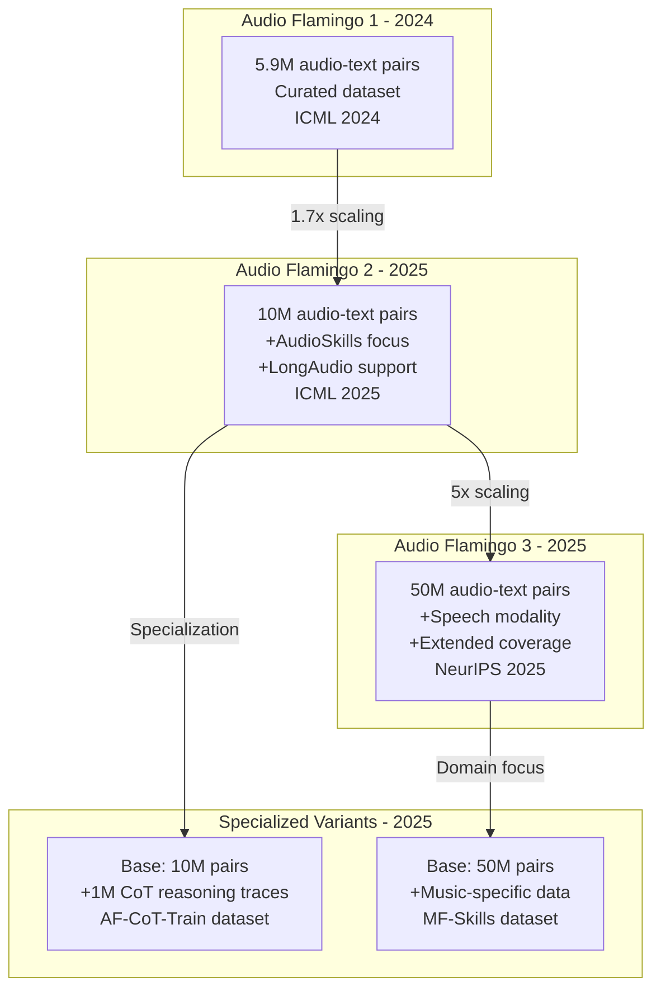
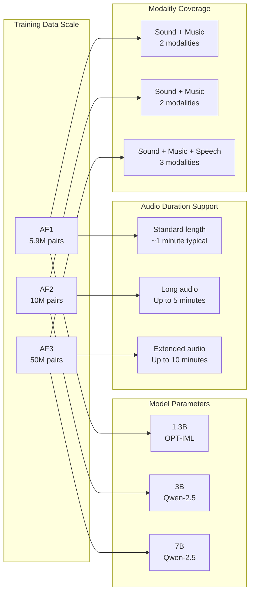
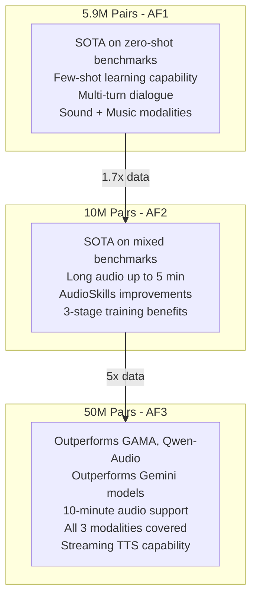

<!-- source: DeepWiki mcp.deepwiki.com · repo NVIDIA/audio-flamingo · page 4.1 Training Data Scale · fetched 2026-10-26 -->

# Training Data Scale

Relevant source files

The following files were used as context for generating this wiki page:

- [README.md](README.md)

## Purpose and Scope

This document explains the dramatic scaling of training data across the Audio Flamingo series, from AF1 (5.9M audio-text pairs) through AF2 (10M pairs) to AF3 (50M pairs). It covers the quantitative progression of training data, the rationale behind scaling decisions, and the impact of increased data scale on model capabilities and performance.

For information about specific dataset collections (AudioSkills, LongAudio, etc.), see [Core Dataset Collections](#4.2). For training methodologies and multi-stage training strategies, see [Training Methodologies](#4.4).

## Training Data Scale Progression

The Audio Flamingo series demonstrates aggressive scaling of training data, with each generation representing a significant increase in the volume of audio-text pairs used for training.

### Quantitative Overview

The following table summarizes the training data scale for each major model variant:

| Model | Training Pairs | Scale Factor | Year | Primary Focus |
|-------|---------------|--------------|------|---------------|
| Audio Flamingo 1 | ~5.9M | 1× (baseline) | 2024 | Few-shot learning, dialogue |
| Audio Flamingo 2 | ~10M | 1.7× | 2025 | Skills, long-audio |
| Audio Flamingo 3 | ~50M | 8.5× | 2025 | Multi-modality (sound/music/speech) |
| Sound-CoT | 10M + 1M CoT | - | 2025 | Reasoning traces |
| Music Flamingo | 50M + music data | - | 2025 | Music specialization |

**Sources:** [README.md:107](), [README.md:172](), [README.md:204](), [README.md:150]()

### Data Scale Evolution Diagram

**Sources:** [README.md:15-18](), [README.md:204](), [README.md:172](), [README.md:107]()

## Scaling Milestones

### Audio Flamingo 1: Foundation Scale (5.9M pairs)

Audio Flamingo 1 established the baseline training scale with approximately 5.9 million curated audio-text pairs. This dataset was designed to support few-shot learning and multi-turn dialogue capabilities.

**Key characteristics:**
- Curated approach emphasizing quality
- Focus on diverse audio understanding tasks
- Support for captioning, classification, and question answering
- Enables few-shot in-context learning

**Sources:** [README.md:204]()

### Audio Flamingo 2: Skill-Focused Scaling (10M pairs)

Audio Flamingo 2 increased the training data to approximately 10 million audio-text pairs, representing a 1.7× scale-up from AF1. This expansion was strategic rather than purely quantitative, with specific focus on skill development and long-audio understanding.

**Key characteristics:**
- ~10M audio-text pairs (1.7× increase)
- Introduction of AudioSkills dataset for targeted skill development
- Introduction of LongAudio dataset for extended audio understanding
- Support for audio up to 5 minutes in duration
- Three-stage training strategy to effectively utilize increased data

**Sources:** [README.md:172]()

### Audio Flamingo 3: Massive Multi-Modal Scaling (50M pairs)

Audio Flamingo 3 represents the most dramatic scaling jump, expanding to approximately 50 million audio-text pairs—a 5× increase over AF2 and 8.5× increase over AF1. This massive scale enabled comprehensive multi-modal coverage.

**Key characteristics:**
- ~50M audio-text pairs (5× increase from AF2)
- Inclusion of speech-related tasks alongside sound and music
- Complete coverage of all three audio modalities: sound, music, and speech
- Support for audio up to 10 minutes in duration
- AudioSkills-XL and LongAudio-XL expanded datasets

**Sources:** [README.md:107]()

## Scaling Impact Diagram

**Sources:** [README.md:107](), [README.md:172](), [README.md:204]()

## Specialized Data Augmentation

Beyond the base training pairs, specialized variants of Audio Flamingo incorporate additional targeted datasets:

### Sound-CoT Reasoning Data

Audio Flamingo Sound-CoT augments the AF2 base training (10M pairs) with approximately 1 million chain-of-thought reasoning traces from the AF-CoT-Train dataset. This represents a specialized data augmentation focused on reasoning capabilities rather than pure scale increase.

**Characteristics:**
- Base: 10M audio-text pairs from AF2
- Additional: ~1M CoT reasoning traces
- Purpose: Enhanced reasoning and step-by-step explanation abilities
- Dataset: AF-Think/AF-CoT-Train

**Sources:** [README.md:150]()

### Music Flamingo Specialized Data

Music Flamingo builds on the AF3 backbone (50M pairs) and incorporates additional music-specific training data through the MF-Skills dataset. This enables deep music understanding capabilities including harmony, structure, timbre, lyrics, and cultural context analysis.

**Characteristics:**
- Base: 50M audio-text pairs from AF3
- Additional: Music-specific data (MF-Skills)
- Purpose: Deep music understanding and theory-aware captioning
- Focus: Songs and instrumental music across cultures

**Sources:** [README.md:42-47]()

## Data-to-Performance Relationship

The scaling of training data across the Audio Flamingo series demonstrates a clear correlation between data volume and model capabilities:

### Performance Scaling Factors

**Sources:** [README.md:107](), [README.md:172](), [README.md:204]()

### Capability Emergence Through Scale

The dramatic increase in training data scale enabled several emergent capabilities:

| Capability | AF1 (5.9M) | AF2 (10M) | AF3 (50M) | Enabled by Scale |
|------------|------------|-----------|-----------|------------------|
| Few-shot learning | ✓ | ✓ | ✓ | Base capability |
| Long audio (5 min) | ✗ | ✓ | ✓ | 1.7× scaling |
| Long audio (10 min) | ✗ | ✗ | ✓ | 5× scaling |
| Speech modality | ✗ | ✗ | ✓ | 5× scaling + diversity |
| SOTA on mixed benchmarks | Partial | ✓ | ✓ | 1.7× scaling |
| Outperform Gemini models | ✗ | ✗ | ✓ | 5× scaling |

**Sources:** [README.md:107](), [README.md:172](), [README.md:204]()

## Dataset Distribution and Access

The training datasets for the Audio Flamingo series are distributed through HuggingFace Datasets:

### Available Dataset Collections

| Dataset | Model Association | Purpose | HuggingFace Location |
|---------|-------------------|---------|---------------------|
| AudioSkills | AF2 | Skill-focused training | nvidia/AudioSkills |
| AudioSkills-XL | AF3 | Extended skill training | nvidia/AudioSkills |
| LongAudio | AF2 | Long-audio understanding | nvidia/LongAudio |
| LongAudio-XL | AF3 | Extended long-audio | nvidia/LongAudio |
| AF-Chat | AF3 | Dialogue training | nvidia/AF-Chat |
| AF-Think | AF3 | Reasoning tasks | nvidia/AF-Think |
| AF-CoT-Train | Sound-CoT | CoT reasoning traces | nvidia/AF-Think (afcot) |
| MF-Skills | Music Flamingo | Music-specific training | nvidia/MF-Skills |

**Sources:** [README.md:91-102](), [README.md:140-141](), [README.md:33-35]()

## Scaling Philosophy

The progression from 5.9M to 50M training pairs reflects a deliberate scaling philosophy:

1. **Quality-first foundation (AF1)**: Initial curation of 5.9M high-quality pairs to establish baseline capabilities
2. **Strategic expansion (AF2)**: Targeted 1.7× increase focusing on specific skills (AudioSkills) and long-audio understanding
3. **Comprehensive coverage (AF3)**: Aggressive 5× scaling to enable complete modality coverage and emergent capabilities
4. **Specialization augmentation**: Additional focused datasets for reasoning (1M CoT traces) and music understanding

This approach demonstrates that effective scaling combines both quantitative increases in data volume and qualitative improvements in data composition and diversity.

**Sources:** [README.md:107](), [README.md:172](), [README.md:204]()

---

