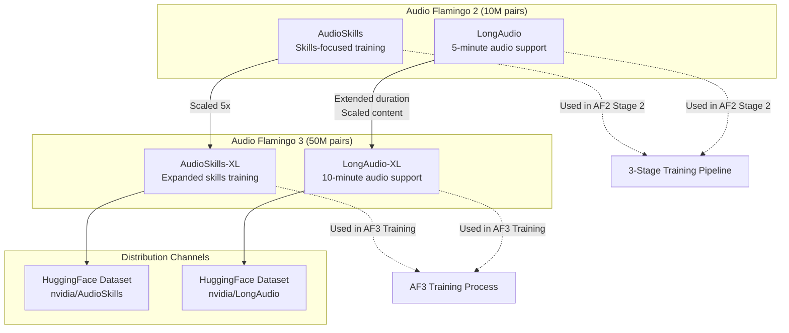
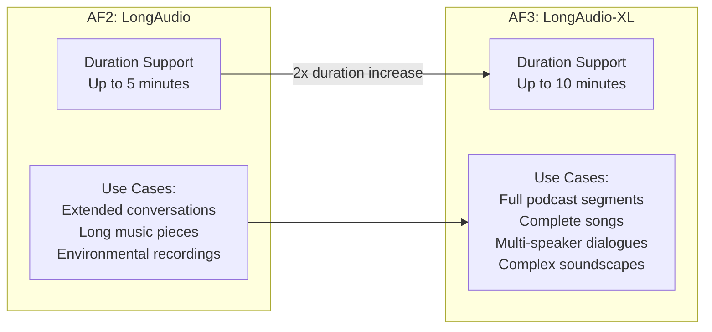
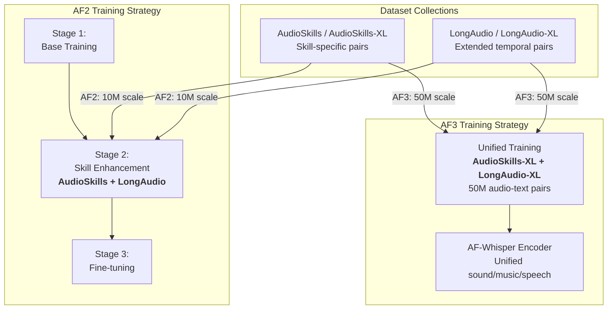
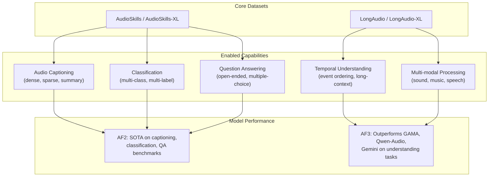

<!-- source: DeepWiki mcp.deepwiki.com · repo NVIDIA/audio-flamingo · page 4.2 Core Dataset Collections · fetched 2026-10-26 -->

# Core Dataset Collections

<details>
<summary>Relevant source files</summary>

The following files were used as context for generating this wiki page:

- [README.md](README.md)

</details>


This page documents the two core dataset collections used for training Audio Flamingo models: **AudioSkills** and **LongAudio**. These datasets form the foundation of general audio understanding capabilities across the Audio Flamingo series, with the "XL" variants representing scaled-up versions introduced in Audio Flamingo 3.

For information about specialized datasets used for specific capabilities (dialogue, reasoning, music), see [Specialized Training Datasets](#4.3). For details on overall training data scale progression, see [Training Data Scale](#4.1).

## Overview

The core dataset collections serve distinct but complementary purposes:

- **AudioSkills**: Focuses on diverse audio understanding skills including captioning, classification, and question answering across varied audio content
- **LongAudio**: Targets extended temporal understanding with longer audio samples requiring sustained context awareness

Both collections evolved from their original versions (AF2) to expanded "XL" variants (AF3), representing a 5x scaling in overall training data from 10M to 50M audio-text pairs.

Sources: [README.md:172-173](), [README.md:107-109]()

## Dataset Architecture



**Dataset Evolution and Integration**: This diagram shows the progression from AF2 to AF3 dataset collections and their integration into training pipelines.

Sources: [README.md:91-96](), [README.md:172-173](), [README.md:107]()

## AudioSkills Dataset Collection

### Purpose and Coverage

The AudioSkills dataset collection focuses on developing diverse audio understanding skills across multiple task types. It provides comprehensive coverage of:

| Skill Category | Task Types | Purpose |
|----------------|-----------|---------|
| **Captioning** | Dense, sparse, summary captions | Generate natural language descriptions of audio content |
| **Classification** | Multi-class, multi-label | Categorize audio by type, source, environment |
| **Question Answering** | Open-ended, multiple-choice | Answer specific queries about audio content |
| **Temporal Understanding** | Event ordering, timestamp queries | Comprehend temporal relationships in audio |

Sources: [README.md:172-173]()

### AudioSkills (AF2 Version)

The original AudioSkills dataset was introduced in Audio Flamingo 2 as part of the 10M audio-text pair training corpus. It emphasizes skill-specific training data to improve model performance across diverse understanding tasks.

**Key Characteristics:**
- Integrated into AF2's 3-stage training pipeline (Stage 2: skill enhancement)
- Balanced across captioning, classification, and QA tasks
- Supports audio samples up to 5 minutes in duration
- Focuses on general sound and music modalities

Sources: [README.md:172-173]()

### AudioSkills-XL (AF3 Version)

AudioSkills-XL represents a 5x scaling of the original dataset, expanding to support the 50M audio-text pair training corpus in Audio Flamingo 3.

**Key Enhancements:**
- Expanded coverage across all skill categories
- Addition of speech-related understanding tasks
- Support for 10-minute audio samples
- Increased diversity in audio sources and environments
- Integration with unified AF-Whisper encoder training

**HuggingFace Distribution:**
- Repository: `nvidia/AudioSkills`
- Contains the AudioSkills-XL dataset used for AF3 training
- Accessible through HuggingFace Datasets API

Sources: [README.md:91-96](), [README.md:107]()

## LongAudio Dataset Collection

### Purpose and Temporal Understanding

The LongAudio dataset collection specifically targets extended temporal understanding capabilities, enabling models to process and reason about longer audio sequences. This collection addresses challenges in:

- Sustained attention over extended durations
- Long-range temporal dependencies
- Context maintenance across audio segments
- Event relationships spanning multiple minutes

Sources: [README.md:172-173](), [README.md:109]()

### Duration Evolution



**Temporal Capacity Progression**: The evolution from 5-minute to 10-minute support enables processing of complete audio units rather than segmented clips.

Sources: [README.md:172-173](), [README.md:109]()

### LongAudio (AF2 Version)

Introduced in Audio Flamingo 2, the LongAudio dataset enables understanding of audio up to 5 minutes in length.

**Design Characteristics:**
- Focus on audio requiring sustained context
- Multi-event audio sequences
- Temporal question-answering pairs
- Integration with CLAP encoder's temporal processing

Sources: [README.md:172-173]()

### LongAudio-XL (AF3 Version)

LongAudio-XL doubles the temporal capacity to 10 minutes while expanding content diversity.

**Key Improvements:**
- Extended duration support (10 minutes)
- Richer temporal annotations
- More complex audio scenarios
- Integration with LLaVA architecture for improved long-context modeling
- Support for unified AF-Whisper encoder across sound, music, and speech

**HuggingFace Distribution:**
- Repository: `nvidia/LongAudio`
- Contains the LongAudio-XL dataset used for AF3 training
- Supports audio files up to 10 minutes

Sources: [README.md:94-96](), [README.md:109]()

## Dataset Integration in Training Pipeline



**Training Pipeline Integration**: Core datasets are integrated differently in AF2's multi-stage approach versus AF3's unified training strategy.

Sources: [README.md:172-173](), [README.md:107]()

## Accessing Core Datasets

### HuggingFace Hub

Both core dataset collections are publicly available through HuggingFace:

| Dataset | Repository | Version | Description |
|---------|-----------|---------|-------------|
| AudioSkills-XL | `nvidia/AudioSkills` | AF3 | Expanded skills-focused dataset with 50M-scale data |
| LongAudio-XL | `nvidia/LongAudio` | AF3 | Extended temporal understanding dataset with 10-minute support |

**Access Pattern:**
```
# Accessing through HuggingFace Datasets
from datasets import load_dataset

# Load AudioSkills-XL
audioskills = load_dataset("nvidia/AudioSkills")

# Load LongAudio-XL
longaudio = load_dataset("nvidia/LongAudio")
```

Sources: [README.md:91-96]()

### Dataset Characteristics Summary

| Characteristic | AudioSkills (AF2) | AudioSkills-XL (AF3) | LongAudio (AF2) | LongAudio-XL (AF3) |
|----------------|-------------------|----------------------|-----------------|---------------------|
| **Training Scale** | Part of 10M pairs | Part of 50M pairs | Part of 10M pairs | Part of 50M pairs |
| **Max Duration** | 5 minutes | 10 minutes | 5 minutes | 10 minutes |
| **Modalities** | Sound, Music | Sound, Music, Speech | Sound, Music | Sound, Music, Speech |
| **Task Focus** | Skills diversity | Skills diversity + scale | Temporal understanding | Extended temporal understanding |
| **Architecture** | CLAP + Qwen-2.5 | AF-Whisper + Qwen-2.5 | CLAP + Qwen-2.5 | AF-Whisper + Qwen-2.5 |

Sources: [README.md:107](), [README.md:172-173](), [README.md:109]()

## Relationship to Model Capabilities



**Dataset-to-Capability Mapping**: Core datasets directly enable specific model capabilities and contribute to benchmark performance.

Sources: [README.md:172-173](), [README.md:107]()

## Evolution Summary

The core dataset collections demonstrate clear progression paths:

**AudioSkills Evolution:**
1. AF2: Introduced skill-focused training within 10M pairs
2. AF3: Scaled to AudioSkills-XL within 50M pairs
3. Added speech modality coverage
4. Expanded skill diversity and complexity

**LongAudio Evolution:**
1. AF2: Enabled 5-minute audio understanding
2. AF3: Doubled capacity to 10-minute audio
3. Improved temporal reasoning capabilities
4. Enhanced multi-modality support

Both collections form the foundation for general audio understanding across the Audio Flamingo series, complemented by specialized datasets for dialogue [AF-Chat](#4.3), reasoning [AF-Think, AF-CoT-Train](#4.3), and music [MF-Skills](#4.3).

Sources: [README.md:91-103](), [README.md:172-173](), [README.md:107-109]()

---

