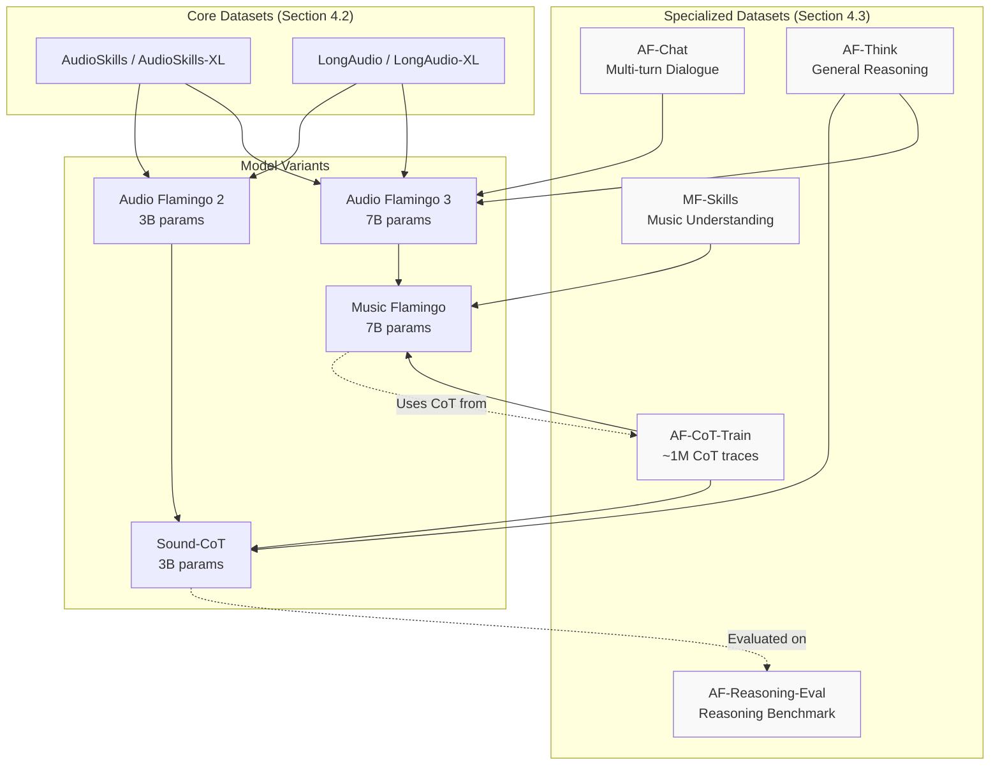
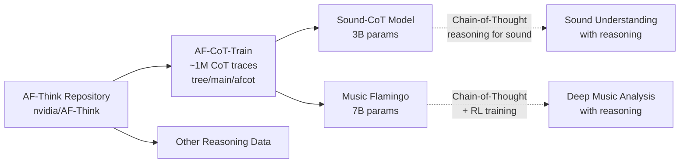
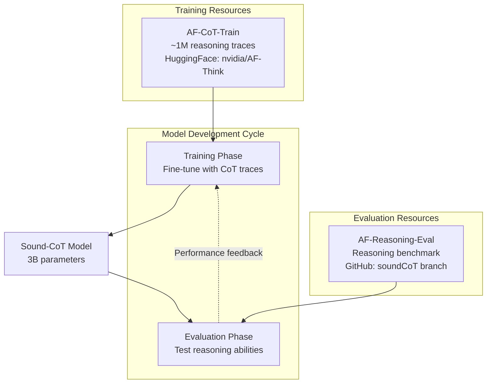
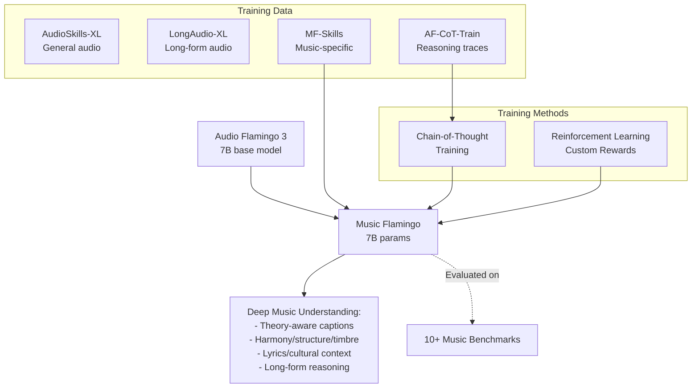
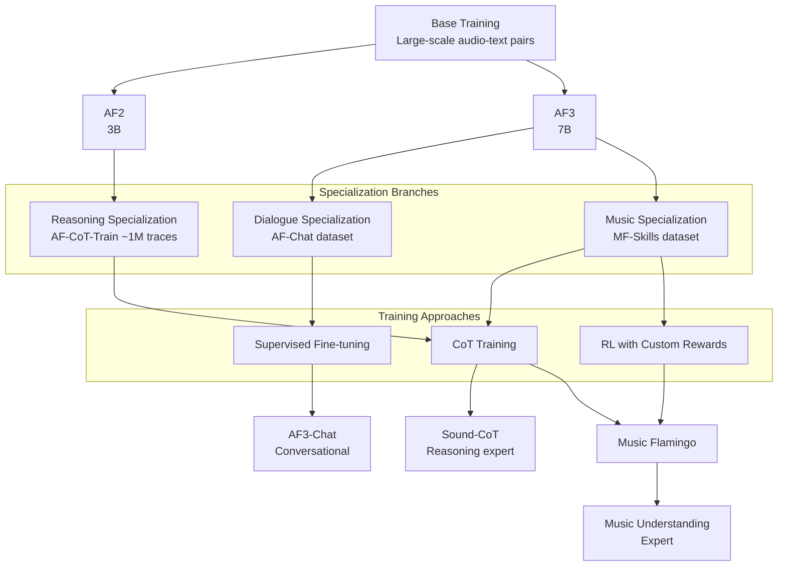

<!-- source: DeepWiki mcp.deepwiki.com · repo NVIDIA/audio-flamingo · page 4.3 Specialized Training Datasets · fetched 2026-10-26 -->

# Specialized Training Datasets

Relevant source files

The following files were used as context for generating this wiki page:

- [README.md](README.md)

This page documents the specialized training datasets developed for the Audio Flamingo series beyond the core AudioSkills and LongAudio collections. These datasets enable specific capabilities including multi-turn dialogue, chain-of-thought reasoning, and music understanding specialization. For information about the base training datasets (AudioSkills and LongAudio), see [Core Dataset Collections](#4.2). For information about how these datasets are used in training strategies, see [Training Methodologies](#4.4).

Sources: [README.md:1-299]()

---

## Dataset Overview

The Audio Flamingo series includes five specialized datasets that extend model capabilities beyond standard audio understanding:

| Dataset | Size | Purpose | Primary Models | HuggingFace Location |
|---------|------|---------|----------------|---------------------|
| **AF-Chat** | Not specified | Multi-turn dialogue training | Audio Flamingo 3 | `nvidia/AF-Chat` |
| **AF-Think** | Contains CoT data | General reasoning traces | Sound-CoT, Music Flamingo | `nvidia/AF-Think` |
| **AF-CoT-Train** | ~1M traces | Chain-of-thought reasoning training | Sound-CoT, Music Flamingo | `nvidia/AF-Think/tree/main/afcot` |
| **AF-Reasoning-Eval** | Benchmark | Sound reasoning evaluation | Sound-CoT | Branch: `soundCoT/AF_Reasoning_Eval` |
| **MF-Skills** | Not specified | Music-specific understanding | Music Flamingo | `nvidia/MF-Skills` |

Sources: [README.md:92-102](), [README.md:34](), [README.md:140-150]()

---

## Dataset Architecture and Model Integration

**Diagram: Specialized Dataset Integration into Model Training Pipeline**

This diagram shows how specialized datasets extend the core datasets for different model variants. Sound-CoT adds reasoning capabilities to AF2, AF3 adds dialogue capabilities, and Music Flamingo combines the AF3 backbone with music-specific data and CoT reasoning.

Sources: [README.md:106-109](), [README.md:148-150](), [README.md:42-47]()

---

## AF-Chat: Multi-Turn Dialogue Dataset

### Purpose

The `AF-Chat` dataset enables Audio Flamingo 3 to perform natural multi-turn conversational interactions about audio content. This dataset is part of the 3-stage training strategy for AF3 and contributes to the model's ability to maintain conversational context across multiple exchanges.

### Key Characteristics

- **Format**: Multi-turn dialogue pairs with audio context
- **Integration**: Used in Audio Flamingo 3 training pipeline
- **Capability Enabled**: Conversational audio understanding with streaming TTS output (AF3-Chat)
- **Distribution**: Available on HuggingFace at `nvidia/AF-Chat`

### Model Usage

Audio Flamingo 3 leverages this dataset to develop its streaming TTS module (AF3-Chat), which can output voice responses in conversational scenarios. The dialogue training enables the model to handle up to 10 minutes of audio input while maintaining coherent multi-turn interactions.

Sources: [README.md:97-99](), [README.md:107-109]()

---

## AF-Think and AF-CoT-Train: Reasoning Trace Datasets

### AF-Think Dataset

The `AF-Think` dataset is a general repository for reasoning-related training data, serving as the parent collection for chain-of-thought training materials.

**Distribution**: `nvidia/AF-Think` on HuggingFace

### AF-CoT-Train Dataset

Located within the AF-Think repository, `AF-CoT-Train` contains approximately **1 million chain-of-thought (CoT) reasoning traces** specifically designed to advance audio understanding through step-by-step reasoning.

**Distribution**: `nvidia/AF-Think/tree/main/afcot` on HuggingFace

### Dataset Structure

**Diagram: AF-Think Dataset Hierarchy and Model Training Flow**

Sources: [README.md:100-102](), [README.md:140-141](), [README.md:148-150]()

### Training Data Characteristics

The AF-CoT-Train dataset contains:

- **Scale**: Approximately 1 million reasoning traces
- **Content**: Step-by-step reasoning explanations for audio understanding tasks
- **Format**: Chain-of-thought demonstrations showing intermediate reasoning steps
- **Purpose**: Enable models to explicitly reason about audio content rather than providing direct answers

### Model Applications

#### Sound-CoT

The Sound-CoT model, based on Audio Flamingo 2's 3B architecture, is fine-tuned using AF-CoT-Train to achieve significant improvements in chain-of-thought reasoning abilities. The resulting model is comparable to several 7B reasoning baselines despite having only 3B parameters.

**Model Checkpoint**: `nvidia/audio-flamingo-2-SoundCoT` (3B parameters)

#### Music Flamingo

Music Flamingo incorporates CoT reasoning traces from AF-CoT-Train as part of its reasoning-centric training strategy. This is combined with reinforcement learning using custom rewards to enable deep music analysis with explicit reasoning steps.

Sources: [README.md:148-150](), [README.md:137-139](), [README.md:42-47]()

---

## AF-Reasoning-Eval: Reasoning Benchmark

### Purpose

`AF-Reasoning-Eval` is a sound reasoning benchmark designed to evaluate chain-of-thought reasoning capabilities in audio language models. It specifically targets common-sense reasoning and the ability to discriminate among closely related answer choices.

### Benchmark Characteristics

- **Focus**: Sound understanding with reasoning requirements
- **Evaluation Type**: Common-sense reasoning and fine-grained discrimination
- **Location**: Available in the `soundCoT` branch at `AF_Reasoning_Eval`
- **Primary Use**: Evaluating Sound-CoT model performance

### Access

The benchmark is distributed through the GitHub repository rather than HuggingFace:

**Repository Location**: `github.com/NVIDIA/audio-flamingo/tree/soundCoT/AF_Reasoning_Eval`

### Benchmark vs Training Data

**Diagram: Training Data vs Evaluation Benchmark in Sound-CoT Development**

Sources: [README.md:143-145](), [README.md:148-150]()

---

## MF-Skills: Music Understanding Dataset

### Purpose

The `MF-Skills` dataset provides music-specific training data that enables Music Flamingo to achieve deep music understanding capabilities beyond what the base Audio Flamingo 3 model provides.

### Dataset Characteristics

- **Domain**: Music and song understanding
- **Content Types**: 
  - Theory-aware music captions
  - Harmony analysis examples
  - Structure and form descriptions
  - Timbre and texture annotations
  - Lyrics and cultural context
- **Distribution**: `nvidia/MF-Skills` on HuggingFace

### Music Understanding Capabilities Enabled

Music Flamingo, trained with MF-Skills data, achieves deep music understanding across multiple dimensions:

1. **Theory-Aware Captions**: Music descriptions incorporating music theory concepts
2. **Harmonic Analysis**: Understanding chord progressions and harmonic structures
3. **Structural Analysis**: Recognition of song forms, sections, and compositional patterns
4. **Timbral Analysis**: Description of instrument tones and sound textures
5. **Lyrical Analysis**: Understanding song lyrics and their meaning
6. **Cultural Context**: Recognition of musical styles, genres, and cultural influences

### Training Integration

Music Flamingo combines MF-Skills with multiple training strategies:

**Diagram: Music Flamingo Training Pipeline with MF-Skills Dataset**

Sources: [README.md:33-35](), [README.md:42-49]()

---

## Dataset Usage Across Model Variants

### Dataset-Model Mapping

| Model | Core Data | Specialized Data | Training Focus |
|-------|-----------|------------------|----------------|
| **AF1** (1.3B) | 5.9M pairs | None | Few-shot learning, dialogue |
| **AF2** (3B) | 10M pairs (AudioSkills + LongAudio) | None | Skills + long audio |
| **Sound-CoT** (3B) | AF2 base | AF-Think + AF-CoT-Train (~1M traces) | Chain-of-thought reasoning |
| **AF3** (7B) | 50M pairs (AudioSkills-XL + LongAudio-XL) | AF-Chat + AF-Think | Dialogue + reasoning |
| **Music Flamingo** (7B) | AF3 base (50M pairs) | MF-Skills + AF-CoT-Train | Music understanding + CoT + RL |

### Specialization Strategy

**Diagram: Dataset Specialization Paths from Base Models**

Sources: [README.md:148-150](), [README.md:42-47](), [README.md:106-109](), [README.md:171-173](), [README.md:204]()

---

## Dataset Distribution and Access

### HuggingFace Hub Datasets

All datasets except AF-Reasoning-Eval are distributed through HuggingFace:

| Dataset | HuggingFace Path | Branch/Subdirectory |
|---------|------------------|---------------------|
| AF-Chat | `nvidia/AF-Chat` | Main |
| AF-Think | `nvidia/AF-Think` | Main |
| AF-CoT-Train | `nvidia/AF-Think` | `tree/main/afcot` |
| MF-Skills | `nvidia/MF-Skills` | Main |

### GitHub Repository Dataset

| Dataset | GitHub Path |
|---------|-------------|
| AF-Reasoning-Eval | `NVIDIA/audio-flamingo/tree/soundCoT/AF_Reasoning_Eval` |

### Dataset Reference Links

From the README, the following dataset links are provided:

- **AF-Chat**: Line 98
- **AF-Think**: Lines 100-101
- **AF-CoT-Train**: Line 141
- **MF-Skills**: Line 34
- **AF-Reasoning-Eval**: Line 144

Sources: [README.md:92-102](), [README.md:33-35](), [README.md:140-145]()

---

## Dataset Scale Comparison

### Training Data Scaling Across Models

The specialized datasets complement the dramatic scaling of core training data:

| Model Generation | Core Data Scale | Specialized Data | Total Capability Expansion |
|------------------|----------------|------------------|---------------------------|
| **AF1** | 5.9M pairs | None | Baseline |
| **AF2** | 10M pairs | None | +70% data |
| **Sound-CoT** | AF2 base | +1M reasoning traces | Reasoning capabilities |
| **AF3** | 50M pairs | Dialogue data | +400% from AF2 |
| **Music Flamingo** | AF3 base | Music data + CoT | Domain specialization |

### Reasoning Data Impact

The AF-CoT-Train dataset with ~1 million reasoning traces enables:

- **Sound-CoT**: 3B model comparable to 7B reasoning baselines
- **Music Flamingo**: Deep music analysis with explicit reasoning steps

This demonstrates that specialized reasoning data can compensate for smaller model size when the task requires explicit reasoning rather than just pattern recognition.

Sources: [README.md:148-150](), [README.md:204](), [README.md:171-173](), [README.md:106-109]()

---

## Summary

The specialized training datasets in the Audio Flamingo series enable three key capability expansions beyond general audio understanding:

1. **Dialogue Capabilities** (AF-Chat): Multi-turn conversational interactions with streaming TTS output in Audio Flamingo 3
2. **Reasoning Capabilities** (AF-Think/AF-CoT-Train): Chain-of-thought reasoning with ~1M traces, enabling Sound-CoT and Music Flamingo's reasoning abilities
3. **Music Specialization** (MF-Skills): Deep music understanding including theory, harmony, structure, timbre, lyrics, and cultural context

These datasets exemplify a strategy of building specialized capabilities on top of strong base models through targeted data curation and training approaches. The AF-Reasoning-Eval benchmark provides evaluation infrastructure specifically for reasoning capabilities, completing the training-evaluation cycle for reasoning-focused models.

Sources: [README.md:1-299]()

---

