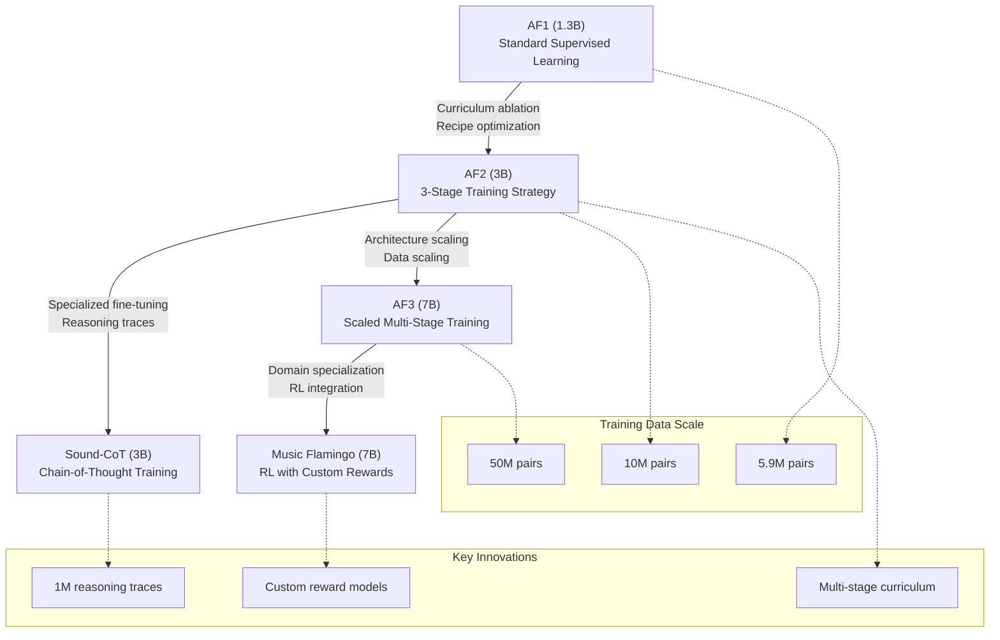
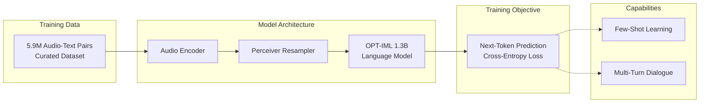
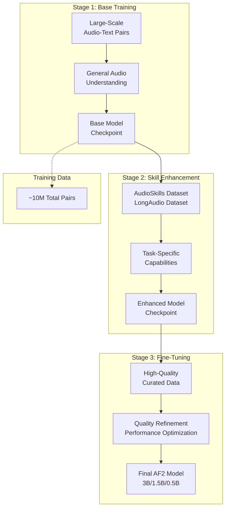
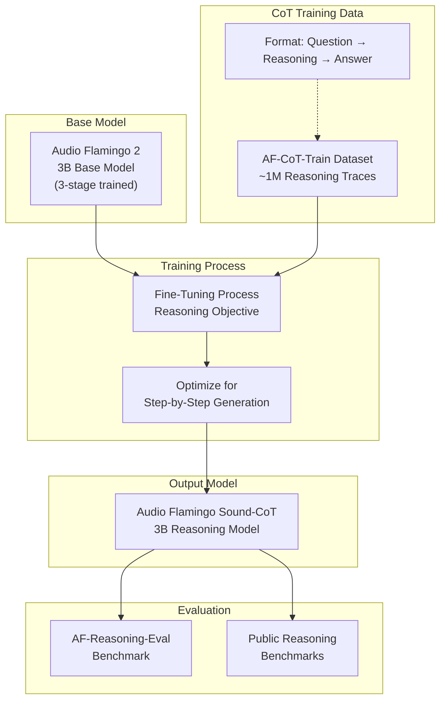
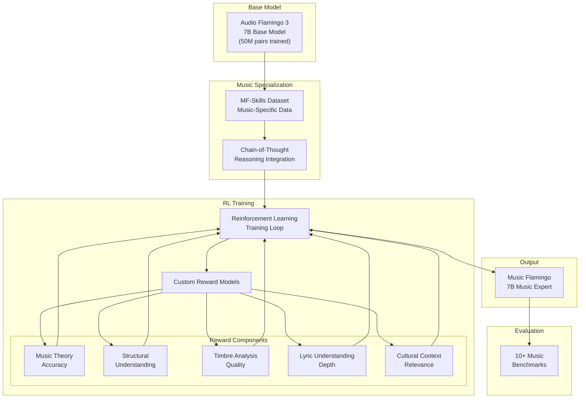
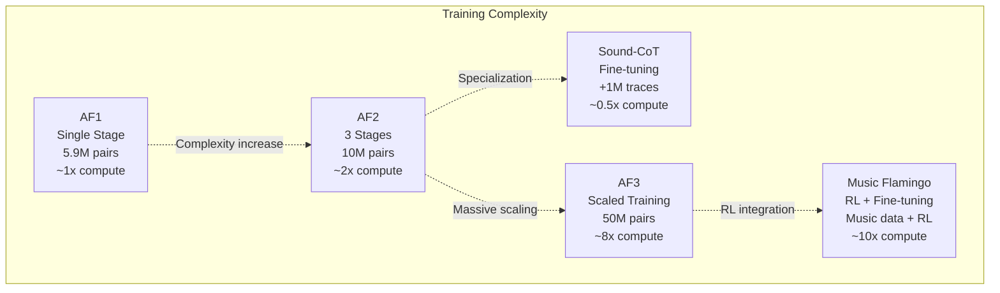
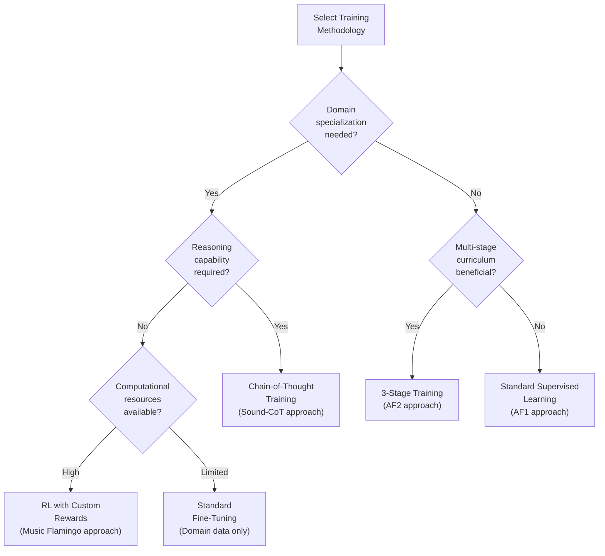

<!-- source: DeepWiki mcp.deepwiki.com · repo NVIDIA/audio-flamingo · page 4.4 Training Methodologies · fetched 2026-10-26 -->

# Training Methodologies

<details>
<summary>Relevant source files</summary>

The following files were used as context for generating this wiki page:

- [README.md](README.md)

</details>


This document describes the training strategies employed across the Audio Flamingo series, showing the evolution from standard supervised learning to sophisticated multi-stage and reinforcement learning approaches. Each model variant introduces novel training methodologies to address specific capabilities: long-audio understanding, chain-of-thought reasoning, and deep music comprehension.

For information about the datasets used in these training strategies, see [Core Dataset Collections](#4.2) and [Specialized Training Datasets](#4.3). For the scale of training data, see [Training Data Scale](#4.1).

## Training Methodology Evolution

The Audio Flamingo series demonstrates progressive sophistication in training methodologies, with each model variant introducing innovations to achieve specific capabilities.



**Sources:** [README.md:14-18](), [README.md:172-173](), [README.md:204]()

| Model | Training Approach | Key Innovation | Training Data | Duration Limit |
|-------|------------------|----------------|---------------|----------------|
| AF1 | Standard supervised learning | Few-shot learning capability | 5.9M pairs | Standard |
| AF2 | 3-stage training | Curriculum optimization | 10M pairs | 5 minutes |
| Sound-CoT | Fine-tuning with CoT traces | Reasoning capability | +1M CoT traces | Standard |
| AF3 | Scaled multi-stage | Massive data scaling | 50M pairs | 10 minutes |
| Music Flamingo | RL with custom rewards | Domain-specific reward modeling | Music-specific data | Full song length |

**Sources:** [README.md:14-18](), [README.md:42-49](), [README.md:107-109](), [README.md:148-150](), [README.md:172-173](), [README.md:204]()

## Standard Supervised Learning (AF1)

Audio Flamingo 1 employs standard supervised learning on audio-text pairs, establishing the baseline training approach for the series.

### Training Configuration



**Sources:** [README.md:192-218](), [README.md:204]()

### Key Characteristics

The AF1 training methodology focuses on establishing foundational audio-language understanding through:

- **Single-stage training:** Direct optimization on all 5.9M audio-text pairs without curriculum stages
- **Flamingo architecture:** Gated cross-attention layers frozen during training to preserve language model capabilities
- **In-context learning:** Training data formatted to enable few-shot learning at inference time
- **Dialogue support:** Integration of Audio Dialogues dataset for multi-turn conversation capabilities

The training objective uses standard next-token prediction with cross-entropy loss, optimizing the model to generate text conditioned on audio inputs.

**Sources:** [README.md:192-218](), [README.md:204]()

## 3-Stage Training Strategy (AF2)

Audio Flamingo 2 introduces a carefully ablated 3-stage training strategy that optimizes the curriculum for audio understanding capabilities.

### Training Pipeline



**Sources:** [README.md:153-188](), [README.md:172-173]()

### Stage-by-Stage Breakdown

**Stage 1: Base Training**
- Trains on the largest portion of the 10M audio-text pairs
- Establishes fundamental audio-language alignment
- Uses improved CLAP encoder for better text understanding
- Optimizes general captioning, classification, and QA capabilities

**Stage 2: Skill Enhancement**
- Focuses on AudioSkills dataset for specific understanding capabilities
- Incorporates LongAudio dataset for extended temporal understanding (up to 5 minutes)
- Targets capability gaps identified in Stage 1
- Strengthens performance on diverse audio understanding tasks

**Stage 3: Fine-Tuning**
- Refines model with high-quality curated examples
- Optimizes for benchmark performance
- Produces final model variants at 3B, 1.5B, and 0.5B parameter scales
- Balances quality and inference efficiency

**Sources:** [README.md:153-188](), [README.md:172-173]()

### Curriculum Ablation

The 3-stage strategy emerged from systematic ablation studies of training recipes and curriculums:

| Configuration | Approach | Result |
|---------------|----------|--------|
| Single-stage | All data mixed equally | Baseline performance |
| 2-stage | Base → Fine-tuning | Improved, but skill gaps |
| **3-stage** | Base → Skills → Fine-tuning | **Best performance** |
| 4-stage | Additional specialization stage | Diminishing returns |

The ablation studies revealed that intermediate skill-focused training (Stage 2) provides critical capability enhancement before final fine-tuning.

**Sources:** [README.md:172-173]()

## Chain-of-Thought Training (Sound-CoT)

Audio Flamingo Sound-CoT employs specialized training on reasoning traces to enable explicit chain-of-thought reasoning for sound understanding tasks.

### CoT Training Architecture



**Sources:** [README.md:128-151](), [README.md:148-150]()

### Reasoning Trace Format

The AF-CoT-Train dataset contains approximately 1M reasoning traces structured to guide the model through explicit reasoning steps:

```
Format:
Question: [Audio understanding question]
Reasoning: [Step 1] [Analysis of audio features]
          [Step 2] [Logical inference]
          [Step 3] [Connection to context]
Answer: [Final answer with justification]
```

This structured format trains the model to:
1. Decompose complex audio understanding questions
2. Generate intermediate reasoning steps
3. Provide justified answers with explicit logic

**Sources:** [README.md:148-150]()

### Training Characteristics

**Base Model Selection:**
- Starts from Audio Flamingo 2 (3B) after 3-stage training
- Leverages already-learned audio understanding capabilities
- Fine-tunes rather than training from scratch

**Training Objective:**
- Optimizes for generating explicit reasoning chains
- Targets common-sense reasoning about sounds
- Emphasizes discrimination among closely related choices

**Performance:**
- Comparable to several 7B reasoning baselines despite smaller size (3B)
- Demonstrates that specialized training can compete with larger models
- Strong performance on AF-Reasoning-Eval benchmark

**Sources:** [README.md:128-151](), [README.md:148-150]()

## Reinforcement Learning with Custom Rewards (Music Flamingo)

Music Flamingo employs advanced reinforcement learning with domain-specific custom reward models to achieve deep music understanding.

### RL Training Pipeline



**Sources:** [README.md:20-66](), [README.md:42-49]()

### Custom Reward Model Design

Music Flamingo's training employs multiple specialized reward models that evaluate different aspects of music understanding:

| Reward Component | Purpose | Evaluation Criteria |
|------------------|---------|---------------------|
| Music Theory | Validates theoretical accuracy | Chord progressions, key signatures, harmonic analysis |
| Structure | Assesses form understanding | Verse-chorus patterns, sections, transitions |
| Timbre | Evaluates sound quality analysis | Instrumentation, tone color, production techniques |
| Lyrics | Checks lyrical comprehension | Meaning, themes, wordplay, cultural references |
| Cultural Context | Verifies contextual awareness | Genre conventions, historical context, cultural significance |

Each reward model provides feedback signals that guide the RL training process toward deeper music comprehension.

**Sources:** [README.md:42-49]()

### Training Process

**Phase 1: Initialization**
- Begins with AF3 (7B) as base model
- Incorporates chain-of-thought reasoning capabilities
- Integrates MF-Skills music-specific dataset

**Phase 2: RL Training Loop**
1. Model generates music analysis responses
2. Custom reward models evaluate each dimension
3. Aggregate reward signal computed from components
4. Policy updated to maximize composite reward
5. Iterative refinement over multiple episodes

**Phase 3: Validation**
- Evaluated on 10+ public music understanding benchmarks
- Tests across diverse music analysis tasks
- Validates deep understanding across theory, structure, timbre, lyrics, and culture

**Reasoning Integration:**
- Combines chain-of-thought reasoning with RL
- Enables step-by-step reasoning for complex music analysis
- Supports long-form reasoning over full-length songs

**Sources:** [README.md:20-66](), [README.md:42-49]()

### Key Innovations

The Music Flamingo RL approach introduces several novel elements:

1. **Domain-Specific Rewards:** Custom reward models tailored to music understanding rather than general-purpose rewards
2. **Multi-Dimensional Optimization:** Balances multiple aspects of music comprehension simultaneously
3. **CoT + RL Integration:** Combines reasoning traces with RL to enable both explicit and optimized reasoning
4. **Full-Length Context:** Extends RL training to support full song analysis (extended context)
5. **Theory-Aware Learning:** Incorporates music theory knowledge directly into the reward structure

This sophisticated training methodology enables Music Flamingo to achieve state-of-the-art performance on specialized music understanding benchmarks while maintaining the general audio capabilities inherited from AF3.

**Sources:** [README.md:20-66](), [README.md:42-49]()

## Training Methodology Comparison

### Computational and Data Requirements



**Sources:** [README.md:14-18](), [README.md:107](), [README.md:148-150](), [README.md:172-173](), [README.md:204]()

### Training Approach Trade-offs

| Methodology | Advantages | Disadvantages | Best For |
|-------------|-----------|---------------|----------|
| Standard Supervised (AF1) | Simple, reproducible, stable | Limited capability optimization | General understanding, baseline |
| 3-Stage (AF2) | Curriculum learning, skill focus | More complex, requires ablation | Balanced performance across tasks |
| CoT Training (Sound-CoT) | Explicit reasoning, interpretable | Requires specialized data | Reasoning-heavy applications |
| RL with Custom Rewards (MF) | Domain optimization, SOTA performance | Computationally expensive, complex | Specialized domain expertise |

**Sources:** [README.md:42-49](), [README.md:148-150](), [README.md:172-173](), [README.md:204]()

### Methodology Selection Guide



**Sources:** [README.md:14-18](), [README.md:42-49](), [README.md:148-150](), [README.md:172-173](), [README.md:204]()

## Summary

The Audio Flamingo series demonstrates a clear evolution in training methodologies:

1. **AF1** establishes the baseline with standard supervised learning on 5.9M pairs
2. **AF2** introduces systematic 3-stage curriculum training optimized through ablation studies
3. **Sound-CoT** specializes through fine-tuning on 1M reasoning traces for explicit reasoning
4. **AF3** scales the multi-stage approach to 50M pairs for comprehensive audio understanding
5. **Music Flamingo** integrates reinforcement learning with custom domain-specific rewards for expert-level music comprehension

Each methodology builds upon previous innovations while introducing novel training paradigms tailored to specific capability requirements. The progression demonstrates increasing sophistication in training strategies, from simple supervised learning to complex multi-objective reinforcement learning with specialized reward models.

**Sources:** [README.md:14-18](), [README.md:42-49](), [README.md:107-109](), [README.md:148-150](), [README.md:172-173](), [README.md:204]()

---

