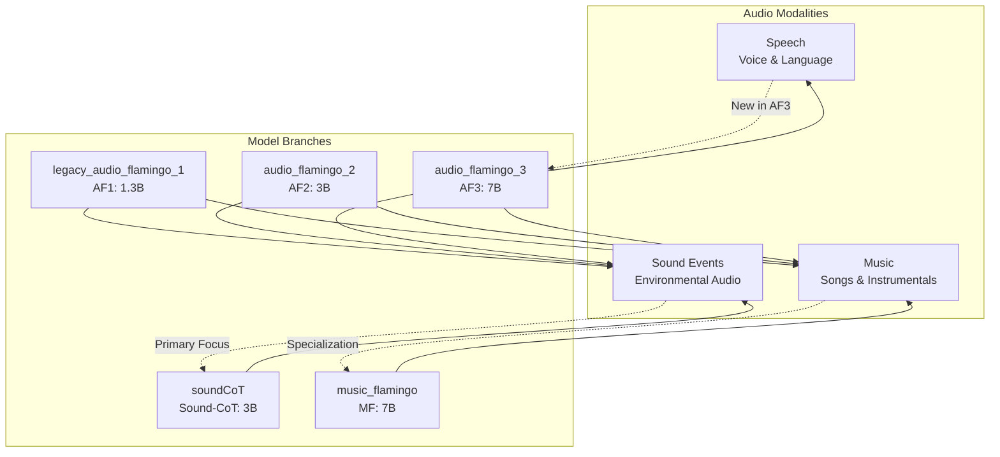
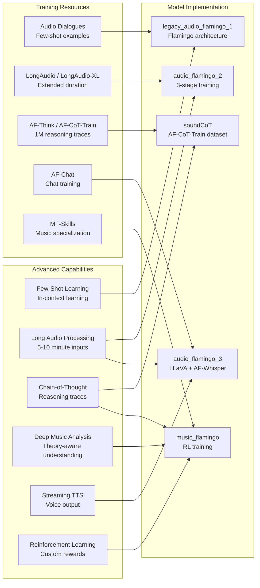
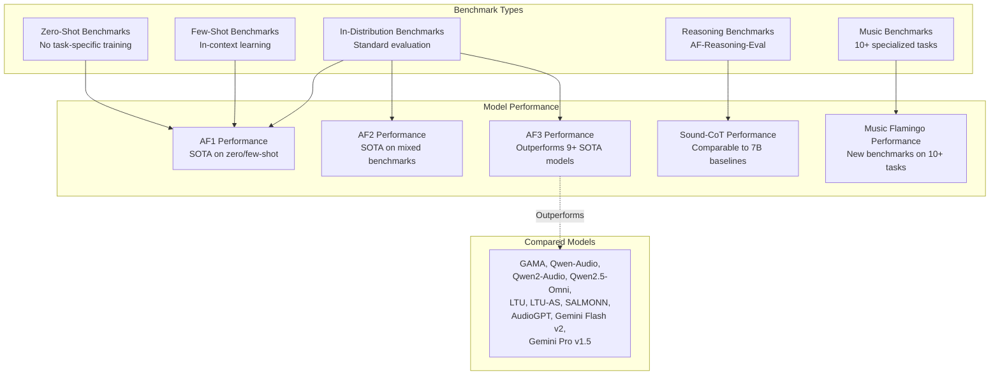

<!-- source: DeepWiki mcp.deepwiki.com · repo NVIDIA/audio-flamingo · page 5 Capabilities and Applications · fetched 2026-10-26 -->

# Capabilities and Applications

Relevant source files

The following files were used as context for generating this wiki page:

- [README.md](README.md)

This document provides a comprehensive overview of the capabilities and applications across the Audio Flamingo series. It details the audio modalities supported by each model variant, the core tasks they can perform, advanced features including long-audio processing and chain-of-thought reasoning, and performance benchmarks comparing these models against state-of-the-art alternatives.

For implementation details of specific model architectures, see [Technical Architecture](#3). For information about training data and methodologies, see [Training Data and Strategies](#4). For guidance on using these capabilities in practice, see [Getting Started](#6).

---

## Capability Overview

The Audio Flamingo series demonstrates progressive capability expansion across five model variants, each building upon or specializing from previous iterations. The capabilities span from basic audio understanding to advanced reasoning and domain-specific expertise.

### Capability Evolution Matrix

The following table summarizes the key capabilities across all Audio Flamingo variants:

| Capability | AF1 (1.3B) | AF2 (3B) | Sound-CoT (3B) | AF3 (7B) | Music Flamingo (7B) |
|------------|-----------|----------|----------------|----------|---------------------|
| **Sound Understanding** | ✓ | ✓ | ✓ | ✓ | ○ |
| **Music Understanding** | ✓ | ✓ | ○ | ✓ | ✓✓ |
| **Speech Understanding** | ○ | ○ | ○ | ✓ | ○ |
| **Audio Captioning** | ✓ | ✓ | ✓ | ✓ | ✓ |
| **Classification** | ✓ | ✓ | ○ | ✓ | ○ |
| **Question Answering** | ✓ | ✓ | ✓ | ✓ | ✓ |
| **Few-Shot Learning** | ✓✓ | ○ | ○ | ○ | ○ |
| **Multi-Turn Dialogue** | ✓✓ | ○ | ○ | ○ | ○ |
| **Long Audio (5+ min)** | ○ | ✓ (5 min) | ○ | ✓ (10 min) | ✓ (10 min) |
| **Chain-of-Thought** | ○ | ○ | ✓✓ | ○ | ✓ |
| **Deep Music Theory** | ○ | ○ | ○ | ○ | ✓✓ |
| **Streaming TTS** | ○ | ○ | ○ | ✓ | ○ |

Legend: ✓✓ = Primary strength, ✓ = Supported, ○ = Not supported/limited

**Sources:** [README.md:14-204]()

---

## Audio Modality Coverage

Audio Flamingo models support three distinct audio modalities: sound (environmental audio and sound events), music (songs and instrumental compositions), and speech (human voice and spoken language). The coverage of these modalities has evolved across the series.

### Modality Support Across Model Variants

### Modality-Specific Capabilities

**Sound Understanding:**
- Environmental sound event detection and description
- Acoustic scene recognition
- Sound source identification
- Supported by: AF1, AF2, Sound-CoT (specialized), AF3
- Branch references: [legacy_audio_flamingo_1](), [audio_flamingo_2](), [soundCoT](), [audio_flamingo_3]()

**Music Understanding:**
- Basic music understanding: AF1, AF2, AF3
- Advanced music analysis: Music Flamingo
  - Harmony analysis
  - Musical structure understanding
  - Timbre characteristics
  - Lyric interpretation
  - Cultural context analysis
- Supported by: AF1, AF2, AF3, Music Flamingo (specialized)
- Branch references: [legacy_audio_flamingo_1](), [audio_flamingo_2](), [audio_flamingo_3](), [music_flamingo]()

**Speech Understanding:**
- Speech recognition and transcription
- Spoken language understanding
- Voice-based question answering
- Only supported by: AF3
- Branch reference: [audio_flamingo_3]()
- Architecture component: AF-Whisper unified encoder

### Audio Duration Limits

| Model | Maximum Audio Duration | Primary Use Case |
|-------|----------------------|------------------|
| AF1 | Standard segments | Short-form audio understanding |
| AF2 | Up to 5 minutes | Long-form audio, extended tracks |
| Sound-CoT | Standard segments | Reasoning-focused tasks |
| AF3 | Up to 10 minutes | Extended audio, full songs, podcasts |
| Music Flamingo | Up to 10 minutes | Full-length songs, extended analysis |

**Sources:** [README.md:107-109](), [README.md:172](), [README.md:42-47]()

---

## Core Task Capabilities

All Audio Flamingo models support fundamental audio understanding tasks, though with varying levels of sophistication and specialization.

### Core Tasks Architecture

```mermaid
graph TB
    subgraph "Core Tasks"
        Captioning["Audio Captioning<br/>Generate descriptions"]
        Classification["Classification<br/>Categorize audio"]
        QA["Question Answering<br/>Answer audio queries"]
        Dialogue["Multi-Turn Dialogue<br/>Conversational interaction"]
    end
    
    subgraph "Model Support"
        AF1_Tasks["AF1 Models<br/>All core tasks + dialogue"]
        AF2_Tasks["AF2 Models<br/>Captioning, classification, QA"]
        CoT_Tasks["Sound-CoT Models<br/>Captioning, QA with reasoning"]
        AF3_Tasks["AF3 Models<br/>Captioning, classification, QA"]
        MF_Tasks["Music Flamingo Models<br/>Specialized music captioning, QA"]
    end
    
    subgraph "Training Datasets"
        AudioSkills["AudioSkills / AudioSkills-XL<br/>Task-specific training"]
        LongAudio["LongAudio / LongAudio-XL<br/>Extended duration audio"]
        AF_Chat["AF-Chat<br/>Dialogue training"]
        MF_Skills["MF-Skills<br/>Music-specific tasks"]
    end
    
    Captioning --> AF1_Tasks
    Classification --> AF1_Tasks
    QA --> AF1_Tasks
    Dialogue --> AF1_Tasks
    
    Captioning --> AF2_Tasks
    Classification --> AF2_Tasks
    QA --> AF2_Tasks
    
    Captioning --> CoT_Tasks
    QA --> CoT_Tasks
    
    Captioning --> AF3_Tasks
    Classification --> AF3_Tasks
    QA --> AF3_Tasks
    
    Captioning --> MF_Tasks
    QA --> MF_Tasks
    
    AudioSkills --> AF2_Tasks
    AudioSkills --> AF3_Tasks
    LongAudio --> AF2_Tasks
    LongAudio --> AF3_Tasks
    AF_Chat --> AF1_Tasks
    MF_Skills --> MF_Tasks
```

### Audio Captioning

Audio captioning generates natural language descriptions of audio content, including events, scenes, music characteristics, and speech content.

**Capabilities by Model:**
- **AF1:** General audio captioning with few-shot learning support
- **AF2:** Enhanced captioning with improved text understanding via better CLAP encoder
- **Sound-CoT:** Reasoning-enhanced captions with step-by-step explanation
- **AF3:** Unified captioning across sound, music, and speech modalities
- **Music Flamingo:** Theory-aware music captions including harmony, structure, timbre, lyrics, and cultural context

**Training Resources:**
- HuggingFace Dataset: `nvidia/AudioSkills` (AF2, AF3)
- HuggingFace Dataset: `nvidia/AudioSkills-XL` (AF3)
- HuggingFace Dataset: `nvidia/MF-Skills` (Music Flamingo)

### Classification

Classification tasks categorize audio into predefined classes, such as sound event types, music genres, or acoustic scenes.

**Supported Models:**
- AF1: Zero-shot and few-shot classification
- AF2: Improved classification accuracy
- AF3: Multi-modal classification (sound, music, speech)

**Not Primarily Focused:**
- Sound-CoT: Limited classification focus, emphasizes reasoning
- Music Flamingo: Limited classification focus, emphasizes deep understanding

### Question Answering

Question answering enables models to respond to natural language queries about audio content.

**Capabilities by Model:**
- **AF1:** Basic QA with few-shot learning and multi-turn dialogue
- **AF2:** Improved QA over longer audio segments
- **Sound-CoT:** Reasoning-based QA with chain-of-thought explanations
- **AF3:** Advanced QA across all audio modalities
- **Music Flamingo:** Deep music-specific QA covering theory, structure, and cultural aspects

**Evaluation Benchmarks:**
- AF-Reasoning-Eval: Sound reasoning benchmark (Sound-CoT)
- 10+ music benchmarks: Music understanding tasks (Music Flamingo)

### Multi-Turn Dialogue

Multi-turn dialogue enables conversational interaction with sustained context across multiple exchanges.

**Primary Model:**
- **AF1:** Built-in multi-turn dialogue capabilities
- Training data: Audio Dialogues dataset (referenced in README)

**Secondary Support:**
- **AF3-Chat:** Streaming TTS module enables voice-based conversation
- Training dataset: `nvidia/AF-Chat`

**Sources:** [README.md:204](), [README.md:172](), [README.md:148-150](), [README.md:42-47](), [README.md:97-102]()

---

## Advanced Features

Beyond core tasks, Audio Flamingo models incorporate advanced capabilities that enable specialized applications and enhanced performance.

### Advanced Feature Mapping

### Few-Shot Learning

Few-shot learning enables models to adapt to new tasks with minimal examples by leveraging in-context learning capabilities.

**Primary Model: Audio Flamingo 1**
- Architecture: Flamingo-based with cross-attention mechanisms
- Training: 5.9M audio-text pairs
- Capabilities: Zero-shot, few-shot, and in-distribution performance
- Branch: [legacy_audio_flamingo_1]()
- Checkpoint: `nvidia/audio-flamingo` (1.3B)

**Architecture Foundation:**
- Based on Flamingo architecture enabling in-context learning
- Cross-attention mechanisms between audio and language modalities
- Supports multiple audio-text pairs as context

### Long Audio Processing

Long audio processing enables understanding of extended audio segments beyond typical short clips.

**Audio Flamingo 2:**
- Maximum duration: Up to 5 minutes
- Training dataset: `nvidia/LongAudio`
- Enhanced understanding over extended audio sequences
- Branch: [audio_flamingo_2]()

**Audio Flamingo 3:**
- Maximum duration: Up to 10 minutes
- Training dataset: `nvidia/LongAudio-XL`
- Unified encoder (AF-Whisper) handles extended inputs
- Branch: [audio_flamingo_3]()
- Applications: Full songs, podcasts, extended sound events

**Music Flamingo:**
- Maximum duration: Up to 10 minutes (full-length songs)
- Specialized for multicultural audio with extended context
- Branch: [music_flamingo]()
- Applications: Complete song analysis, long-form reasoning

### Chain-of-Thought Reasoning

Chain-of-thought (CoT) reasoning generates step-by-step explanations for audio understanding tasks, improving interpretability and performance on reasoning benchmarks.

**Audio Flamingo Sound-CoT:**
- Base model: AF2 (3B parameters)
- Training data: AF-CoT-Train with 1M reasoning traces
- HuggingFace Dataset: `nvidia/AF-Think/afcot`
- Evaluation: AF-Reasoning-Eval benchmark
- Performance: Comparable to 7B reasoning baselines
- Branch: [soundCoT]()
- Checkpoint: `nvidia/audio-flamingo-2-SoundCoT` (3B)

**Music Flamingo:**
- CoT integration: Reasoning-centric training
- Combined with reinforcement learning for enhanced reasoning
- Applications: Theory-aware music analysis with explanations
- Branch: [music_flamingo]()

**AF-Reasoning-Eval Benchmark:**
- Target: Common-sense reasoning on sound understanding
- Capability: Discrimination among closely related choices
- Available in: [soundCoT/AF_Reasoning_Eval]()

### Deep Music Understanding

Deep music understanding encompasses advanced music analysis capabilities beyond basic recognition.

**Music Flamingo Capabilities:**
- Theory-aware captions
- Harmony analysis
- Musical structure understanding
- Timbre characteristics description
- Lyric interpretation
- Cultural context analysis
- Both songs and instrumental music

**Training Approach:**
- Base: AF3 backbone (7B parameters)
- Enhancement: Chain-of-thought reasoning
- Method: Reinforcement learning with custom rewards
- Data: `nvidia/MF-Skills` dataset
- Branch: [music_flamingo]()

**Applications:**
- Music education and analysis
- Content recommendation
- Music information retrieval
- Cross-cultural music understanding

### Streaming TTS Module

The AF3-Chat module provides streaming text-to-speech capabilities for voice-based interaction.

**Audio Flamingo 3 Chat:**
- Component: Streaming TTS module
- Integration: Built into AF3 architecture
- Training data: `nvidia/AF-Chat` dataset
- Checkpoint: `nvidia/audio-flamingo-3-chat`
- Branch: [audio_flamingo_3]()

**Capabilities:**
- Real-time voice synthesis
- Conversational audio output
- Integration with audio understanding pipeline

### Reinforcement Learning Training

Reinforcement learning with custom rewards enables optimization for specific quality metrics in generated outputs.

**Music Flamingo Implementation:**
- Training method: RL with custom rewards
- Optimization target: Step-by-step reasoning quality
- Combined with: Chain-of-thought training
- Branch: [music_flamingo]()

**Benefits:**
- Improved reasoning coherence
- Better alignment with music theory
- Enhanced explanation quality

**Sources:** [README.md:204](), [README.md:172](), [README.md:148-150](), [README.md:107-109](), [README.md:42-49](), [README.md:97-102]()

---

## Performance and Benchmarks

The Audio Flamingo series has achieved state-of-the-art results across numerous benchmarks, with each model variant excelling in its specialized domain.

### Benchmark Categories

### Audio Flamingo 1 Benchmark Results

**Performance Highlights:**
- SOTA results on zero-shot benchmarks
- SOTA results on few-shot benchmarks
- SOTA results on in-distribution benchmarks
- Tasks: Captioning, classification, question answering

**Key Characteristics:**
- 1.3B parameters
- Flamingo architecture
- Few-shot learning specialization
- Branch: [legacy_audio_flamingo_1]()

### Audio Flamingo 2 Benchmark Results

**Performance Highlights:**
- SOTA results on several individual audio understanding benchmarks
- SOTA results on mixed audio understanding benchmarks
- Improved performance across captioning, classification, and QA
- Enhanced long-audio understanding (up to 5 minutes)

**Key Improvements Over AF1:**
- Better CLAP encoder for text understanding
- 10M training pairs (vs. 5.9M)
- 3-stage training strategy
- Available in multiple sizes: 3B, 1.5B, 0.5B
- Branch: [audio_flamingo_2]()
- Checkpoints: `nvidia/audio-flamingo-2`, `nvidia/audio-flamingo-2-1.5B`, `nvidia/audio-flamingo-2-0.5B`

### Sound-CoT Benchmark Results

**Performance Highlights:**
- Significant improvements on chain-of-thought reasoning
- 3B model comparable to several 7B reasoning baselines
- Strong performance on AF-Reasoning-Eval benchmark

**AF-Reasoning-Eval Benchmark:**
- Focus: Common-sense reasoning on sound understanding
- Capability tested: Discrimination among closely related choices
- Dataset: AF-CoT-Train (1M reasoning traces)
- Branch: [soundCoT]()
- Dataset location: [soundCoT/AF_Reasoning_Eval]()

**Training Data:**
- HuggingFace Dataset: `nvidia/AF-Think/afcot`
- Contains approximately 1M CoT reasoning traces
- Checkpoint: `nvidia/audio-flamingo-2-SoundCoT` (3B)

### Audio Flamingo 3 Benchmark Results

**Performance Highlights:**
- Outperforms prior SOTA models on understanding benchmarks
- Outperforms prior SOTA models on reasoning benchmarks
- Three-modality support (sound, music, speech)
- Handles up to 10 minutes of audio input

**Compared Against:**
- GAMA
- Audio Flamingo (AF1)
- Audio Flamingo 2 (AF2)
- Qwen-Audio
- Qwen2-Audio
- Qwen2.5-Omni
- LTU
- LTU-AS
- SALMONN
- AudioGPT
- Gemini Flash v2
- Gemini Pro v1.5

**Technical Specifications:**
- 7B parameters (Qwen-2.5 backbone)
- LLaVA architecture
- Unified AF-Whisper encoder
- 50M training pairs
- Branch: [audio_flamingo_3]()
- Checkpoints: `nvidia/audio-flamingo-3-hf`, `nvidia/audio-flamingo-3-chat`

**Training Datasets:**
- `nvidia/AudioSkills-XL`
- `nvidia/LongAudio-XL`
- `nvidia/AF-Chat`
- `nvidia/AF-Think`

### Music Flamingo Benchmark Results

**Performance Highlights:**
- State-of-the-art on 10+ public music understanding benchmarks
- State-of-the-art on music reasoning tasks
- New benchmarks set for music-specific understanding

**Specialized Capabilities:**
- Deep music understanding across songs and instrumentals
- Theory-aware captions and question answering
- Analysis of harmony, structure, timbre, lyrics, cultural context
- Long-form song reasoning over full-length, multicultural audio

**Technical Specifications:**
- Built on AF3 backbone (7B parameters)
- Chain-of-thought integration
- Reinforcement learning with custom rewards
- Extended context for full-length audio
- Branch: [music_flamingo]()
- Checkpoint: `nvidia/music-flamingo-hf`

**Training Dataset:**
- `nvidia/MF-Skills` (music-specific training data)

### Performance Summary Table

| Model | Parameters | Training Data | Key Benchmark Results |
|-------|-----------|--------------|----------------------|
| AF1 | 1.3B | 5.9M pairs | SOTA on zero-shot, few-shot, in-distribution |
| AF2 | 3B/1.5B/0.5B | 10M pairs | SOTA on mixed benchmarks, improved long-audio |
| Sound-CoT | 3B | 10M + 1M CoT | Comparable to 7B reasoning baselines |
| AF3 | 7B | 50M pairs | Outperforms 9+ SOTA models |
| Music Flamingo | 7B | AF3 + MF-Skills | New benchmarks on 10+ music tasks |

### Interactive Demonstrations

Users can explore model capabilities through interactive demos:

**AF2 Demo:**
- Platform: HuggingFace Spaces
- URL: `nvidia/audio-flamingo-2`
- Model size: 3B

**AF3 Demo:**
- Platform: HuggingFace Spaces
- URL: `nvidia/audio_flamingo_3`
- Model size: 7B
- Demo page: research.nvidia.com/labs/adlr/AF3/

**Music Flamingo Demo:**
- Platform: HuggingFace Spaces
- URL: `nvidia/music-flamingo`
- Model size: 7B
- Demo page: research.nvidia.com/labs/adlr/MF/

**Sources:** [README.md:204](), [README.md:172](), [README.md:148-150](), [README.md:107](), [README.md:42-49](), [README.md:39](), [README.md:86](), [README.md:161]()

---

## Application Domains

The capabilities documented above enable Audio Flamingo models to serve various application domains:

### Application Domain Matrix

| Application Domain | Recommended Model | Key Capabilities Used |
|-------------------|-------------------|----------------------|
| **General Audio Understanding** | AF3 | Multi-modality, classification, captioning |
| **Few-Shot Audio Classification** | AF1 | Few-shot learning, in-context learning |
| **Conversational Audio AI** | AF1, AF3-Chat | Multi-turn dialogue, streaming TTS |
| **Long-Form Audio Analysis** | AF2, AF3, Music Flamingo | Long audio processing (5-10 min) |
| **Audio Reasoning Tasks** | Sound-CoT | Chain-of-thought, AF-Reasoning-Eval |
| **Music Information Retrieval** | Music Flamingo | Deep music analysis, theory awareness |
| **Music Education** | Music Flamingo | Harmony, structure, cultural context |
| **Podcast Analysis** | AF3 | Speech understanding, long audio, QA |
| **Sound Event Detection** | AF1, AF2, AF3 | Sound understanding, classification |
| **Music Recommendation** | Music Flamingo | Deep music understanding, cultural context |
| **Accessibility Applications** | AF3 | Audio captioning, speech understanding |

**Sources:** [README.md:1-299]()

---

