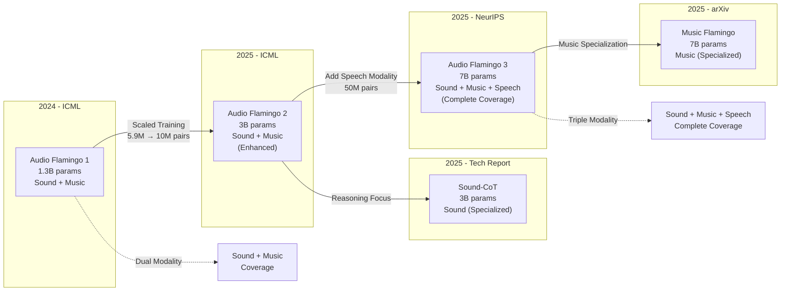
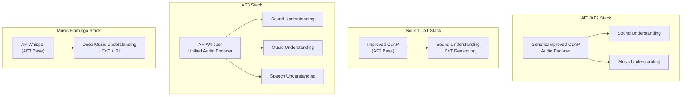
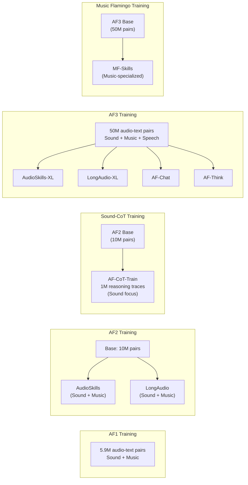
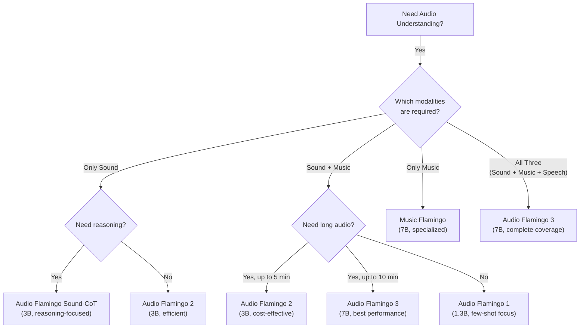
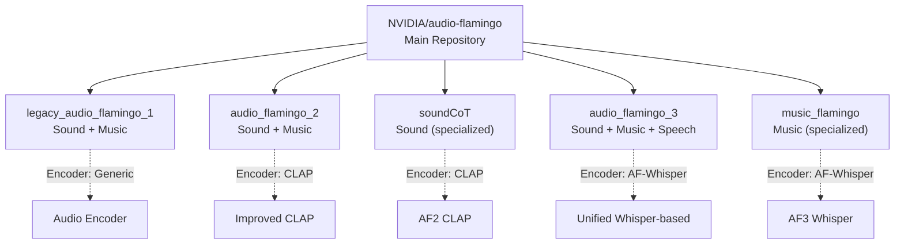

<!-- source: DeepWiki mcp.deepwiki.com · repo NVIDIA/audio-flamingo · page 5.1 Audio Modality Coverage · fetched 2026-10-26 -->

# Audio Modality Coverage

Relevant source files

The following files were used as context for generating this wiki page:

- [README.md](README.md)

## Purpose and Scope

This document explains which Audio Flamingo models support which audio modalities and how modality coverage evolved across the series. The three primary audio modalities are **sound** (environmental and general audio), **music** (musical content including songs and instrumentals), and **speech** (spoken language). Understanding modality coverage is critical for selecting the appropriate model variant for specific applications.

For information about the specific tasks each model can perform within these modalities, see [Core Task Capabilities](#5.2). For details on specialized features like long-audio processing and reasoning, see [Advanced Features](#5.3).

---

## Modality Definitions

The Audio Flamingo series categorizes audio into three distinct modalities:

| Modality | Description | Example Content |
|----------|-------------|-----------------|
| **Sound** | Environmental audio, general sounds, non-speech/non-music acoustic events | Dog barking, car horn, water flowing, thunder, footsteps |
| **Music** | Musical content including instrumental compositions and songs | Piano melodies, orchestral pieces, songs with vocals, genre-specific compositions |
| **Speech** | Spoken language content requiring transcription and understanding | Conversations, lectures, interviews, audiobooks, voice commands |

Each modality requires specialized encoder training and dataset curation to achieve robust understanding capabilities.

**Sources:** [README.md:107-107](), [README.md:42-47]()

---

## Model-by-Model Modality Support

### Overview Table

| Model | Sound | Music | Speech | Base Parameters | Architecture |
|-------|-------|-------|--------|-----------------|--------------|
| Audio Flamingo 1 | ✓ | ✓ | ✗ | 1.3B | Flamingo |
| Audio Flamingo 2 | ✓ | ✓ | ✗ | 3B | Flamingo |
| Audio Flamingo Sound-CoT | ✓ | Partial | ✗ | 3B | Flamingo (AF2-based) |
| Audio Flamingo 3 | ✓ | ✓ | ✓ | 7B | LLaVA |
| Music Flamingo | Partial | ✓ | Partial | 7B | LLaVA (AF3-based) |

**Key Observations:**
- AF1 and AF2 provide dual-modality coverage (sound + music)
- Sound-CoT specializes in sound understanding with reduced music capability
- AF3 is the first model with complete three-modality coverage
- Music Flamingo inherits AF3's capabilities but specializes deeply in music

**Sources:** [README.md:14-18](), [README.md:107-107](), [README.md:148-150](), [README.md:42-47]()

---

## Modality Evolution Timeline

**Diagram: Audio Flamingo Modality Evolution**

The modality coverage expanded in two key phases:
1. **Phase 1 (AF1, AF2)**: Established dual-modality foundation for sound and music understanding
2. **Phase 2 (AF3)**: Achieved complete audio modality coverage by adding speech capabilities
3. **Specialization Branches**: Sound-CoT (sound reasoning) and Music Flamingo (deep music understanding)

**Sources:** [README.md:14-18](), [README.md:107-107](), [README.md:172-172]()

---

## Technical Components Enabling Modality Support

### Audio Encoder Architecture by Model

**Diagram: Encoder Architectures and Modality Mapping**

### Encoder Specifications

| Model | Encoder Type | Base Architecture | Modality Training | Special Features |
|-------|--------------|-------------------|-------------------|------------------|
| AF1 | Generic Audio Encoder | Custom | Sound + Music pairs | Few-shot learning focus |
| AF2 | Improved CLAP | CLAP with enhanced text understanding | Sound + Music pairs (10M) | 3-stage training pipeline |
| Sound-CoT | Improved CLAP | AF2 encoder (frozen/finetuned) | Sound + CoT reasoning traces (1M) | Reasoning-centric |
| AF3 | AF-Whisper | Whisper-based unified encoder | Sound + Music + Speech (50M) | Unified cross-modality encoder |
| Music Flamingo | AF-Whisper | AF3 encoder (inherited) | Music-specialized data | RL-enhanced music understanding |

**Sources:** [README.md:107-107](), [README.md:171-172](), [README.md:148-150]()

---

## Dataset Coverage by Modality

### Training Data Scale and Composition

**Diagram: Dataset Evolution and Modality-Specific Data**

### Dataset Modality Breakdown

| Dataset | Primary Modality | Size/Scale | Model Usage | HuggingFace Location |
|---------|------------------|------------|-------------|---------------------|
| Base Training Data (AF1) | Sound + Music | 5.9M pairs | AF1 | Not publicly released |
| Base Training Data (AF2) | Sound + Music | 10M pairs | AF2, Sound-CoT | Not fully released |
| AudioSkills | Sound + Music | Subset of 10M | AF2 | `nvidia/AudioSkills` |
| LongAudio | Sound + Music | Subset of 10M | AF2 | `nvidia/LongAudio` |
| AF-CoT-Train | Sound (Reasoning) | 1M traces | Sound-CoT | `nvidia/AF-Think` (afcot subdirectory) |
| Base Training Data (AF3) | Sound + Music + Speech | 50M pairs | AF3, Music Flamingo | Not fully released |
| AudioSkills-XL | Sound + Music + Speech | Subset of 50M | AF3 | `nvidia/AudioSkills` |
| LongAudio-XL | Sound + Music + Speech | Subset of 50M | AF3 | `nvidia/LongAudio` |
| AF-Chat | Sound + Music + Speech | Part of 50M | AF3 | `nvidia/AF-Chat` |
| AF-Think | Sound + Music + Speech | Part of 50M | AF3 | `nvidia/AF-Think` |
| MF-Skills | Music (Specialized) | Music subset | Music Flamingo | `nvidia/MF-Skills` |

**Sources:** [README.md:91-102](), [README.md:140-141](), [README.md:33-35](), [README.md:171-172](), [README.md:204-204]()

---

## Modality-Specific Capabilities

### Sound Modality

**Supported Models:** AF1, AF2, Sound-CoT, AF3, Music Flamingo (limited)

**Key Capabilities:**
- Environmental sound recognition and classification
- Acoustic event detection and description
- General audio captioning
- Sound reasoning (Sound-CoT specialization)

**Representative Tasks:**
- Identifying animal sounds, mechanical sounds, natural phenomena
- Describing acoustic scenes (e.g., "kitchen environment with running water")
- Reasoning about sound causality and relationships

**Sources:** [README.md:148-150](), [README.md:204-204]()

---

### Music Modality

**Supported Models:** AF1, AF2, AF3, Music Flamingo (specialized)

**Key Capabilities:**
- Musical genre classification
- Instrument identification
- Song structure analysis (Music Flamingo)
- Music theory understanding (Music Flamingo)
- Cultural context analysis (Music Flamingo)

**Music Flamingo Enhancements:**
- **Theory-aware captions**: Harmony, timbre, rhythm analysis
- **Deep structural understanding**: Verse-chorus detection, arrangement analysis
- **Lyrics analysis**: When present in songs
- **Cultural context**: Genre origins, stylistic influences

**Representative Tasks:**
- "Describe the musical instruments in this recording"
- "Analyze the harmonic progression" (Music Flamingo)
- "Identify the song structure and key changes" (Music Flamingo)

**Sources:** [README.md:42-47](), [README.md:204-204]()

---

### Speech Modality

**Supported Models:** AF3 only (complete support), Music Flamingo (inherited, limited use)

**Key Capabilities:**
- Speech transcription and understanding
- Speaker-related analysis
- Conversational content comprehension
- Integration with sound and music for comprehensive audio understanding

**Breakthrough in AF3:**
Audio Flamingo 3 is the first model in the series to integrate speech understanding, achieved through the unified AF-Whisper encoder that extends Whisper's speech recognition capabilities to general audio understanding. This creates a truly unified audio-language model capable of handling any audio content type.

**Representative Tasks:**
- "Transcribe the spoken content"
- "What is the speaker discussing?"
- "Describe the acoustic environment including speech and background sounds"

**Sources:** [README.md:107-109]()

---

## Modality Selection Guide

### Decision Matrix for Model Selection

**Diagram: Model Selection Based on Modality Requirements**

### Recommendations by Use Case

| Use Case | Recommended Model | Rationale |
|----------|-------------------|-----------|
| Environmental sound analysis | Sound-CoT | Specialized reasoning for sound understanding |
| General audio understanding (sound + music) | Audio Flamingo 2 | Cost-effective dual-modality support |
| Music-specific applications | Music Flamingo | Deep music theory and cultural understanding |
| Speech + audio analysis | Audio Flamingo 3 | Only model with complete three-modality support |
| Long-form audio (>5 minutes) | Audio Flamingo 3 or Music Flamingo | Extended context support up to 10 minutes |
| Few-shot learning scenarios | Audio Flamingo 1 | Designed for in-context learning |
| Resource-constrained deployment | Audio Flamingo 2 (0.5B/1.5B variants) | Smaller model sizes available |

**Sources:** [README.md:107-109](), [README.md:172-172](), [README.md:42-47](), [README.md:148-150]()

---

## Identifying Modality Support in the Codebase

### Branch Organization

Each model variant maintains modality-specific code in separate GitHub branches:

**Diagram: Repository Branch Structure and Encoder Types**

### Model Checkpoints and Modality Support

HuggingFace Hub locations for each model variant with modality indicators:

| Model | HuggingFace Path | Supported Modalities |
|-------|------------------|---------------------|
| AF1 | `nvidia/audio-flamingo` | Sound, Music |
| AF2 (3B) | `nvidia/audio-flamingo-2` | Sound, Music |
| AF2 (1.5B) | `nvidia/audio-flamingo-2-1.5B` | Sound, Music |
| AF2 (0.5B) | `nvidia/audio-flamingo-2-0.5B` | Sound, Music |
| Sound-CoT | `nvidia/audio-flamingo-2-SoundCoT` | Sound (primary) |
| AF3 | `nvidia/audio-flamingo-3-hf` | Sound, Music, Speech |
| AF3-Chat | `nvidia/audio-flamingo-3-chat` | Sound, Music, Speech |
| Music Flamingo | `nvidia/music-flamingo-hf` | Music (primary), Sound, Speech |

**Sources:** [README.md:79-87](), [README.md:137-139](), [README.md:165-167](), [README.md:199-199](), [README.md:30-35]()

---

## Technical Implementation Notes

### Unified vs. Specialized Encoders

**AF1/AF2 Approach (Dual-Modality):**
- Separate or improved CLAP encoders trained on sound and music data
- No explicit speech handling capabilities
- Optimized for sound event classification and music understanding

**AF3 Approach (Tri-Modality):**
- Unified AF-Whisper encoder based on OpenAI Whisper architecture
- Single encoder handles all three modalities through comprehensive training on 50M audio-text pairs
- Extends Whisper's speech recognition foundation to general audio understanding

**Specialized Model Approaches:**
- **Sound-CoT**: Inherits AF2's CLAP encoder, adds reasoning-specific training
- **Music Flamingo**: Inherits AF3's unified encoder, adds music-specific reinforcement learning with custom rewards

**Sources:** [README.md:107-107](), [README.md:171-172]()

---

## Modality Coverage Summary

The Audio Flamingo series demonstrates progressive expansion of modality coverage:

1. **Foundation (AF1, AF2)**: Established robust dual-modality support for sound and music understanding with 5.9M-10M training pairs
2. **Specialization (Sound-CoT)**: Deepened sound understanding through 1M reasoning traces, introducing chain-of-thought capabilities
3. **Complete Coverage (AF3)**: First model to unify all three audio modalities (sound, music, speech) through AF-Whisper encoder and 50M training pairs
4. **Domain Expertise (Music Flamingo)**: Achieved deep music understanding through specialized training with reinforcement learning

Audio Flamingo 3 represents the milestone of complete audio modality coverage, making it the recommended choice for applications requiring comprehensive audio understanding across all three domains.

**Sources:** [README.md:14-18](), [README.md:107-109](), [README.md:42-47]()

---

