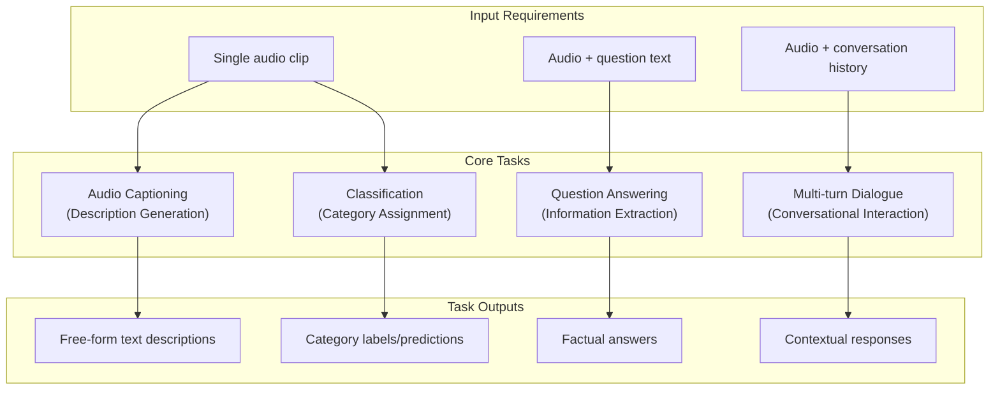
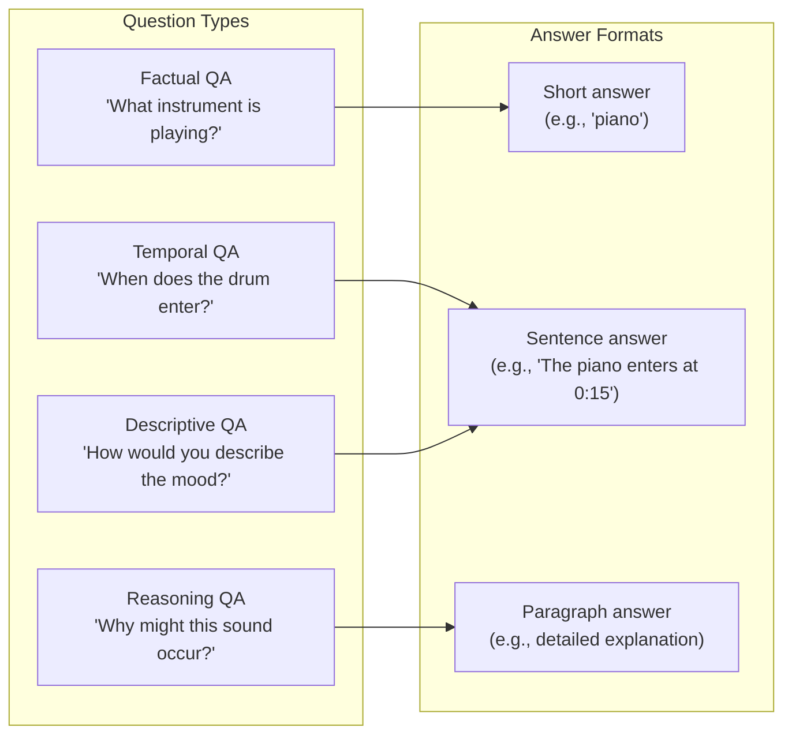
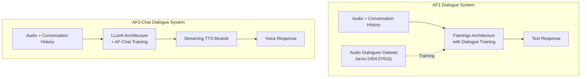

<!-- source: DeepWiki mcp.deepwiki.com · repo NVIDIA/audio-flamingo · page 5.2 Core Task Capabilities · fetched 2026-10-26 -->

# Core Task Capabilities

<details>
<summary>Relevant source files</summary>

The following files were used as context for generating this wiki page:

- [README.md](README.md)

</details>


This page documents the fundamental tasks supported across the Audio Flamingo model series. These core capabilities form the foundation of audio understanding and include audio captioning, classification, question answering, and multi-turn dialogue. For information about which audio modalities (sound, music, speech) each model handles, see [Audio Modality Coverage](#5.1). For specialized capabilities like few-shot learning, long-audio processing, and chain-of-thought reasoning, see [Advanced Features](#5.3).

---

## Overview of Core Tasks

All Audio Flamingo models are designed to support multiple fundamental audio understanding tasks. These tasks represent the primary ways users interact with the models to extract information from audio inputs.

**Sources:** [README.md:14-18](), [README.md:204-205](), [README.md:172-173]()

---

## Task Taxonomy and Model Support

The following diagram illustrates the core task types and their relationships within the Audio Flamingo ecosystem:



**Sources:** [README.md:204-205](), [README.md:172-173](), [README.md:107-109]()

---

## Model-Task Support Matrix

The table below shows which core tasks are supported by each Audio Flamingo variant:

| Model | Captioning | Classification | Question Answering | Multi-turn Dialogue | Notes |
|-------|------------|----------------|-------------------|---------------------|-------|
| **Audio Flamingo 1** (1.3B) | ✓ | ✓ | ✓ | ✓ | Explicit dialogue training with Audio Dialogues dataset |
| **Audio Flamingo 2** (3B) | ✓ | ✓ | ✓ | Limited | Focus on captioning, classification, QA benchmarks |
| **Sound-CoT** (3B) | ✓ | ✓ | ✓ | Limited | Enhanced with chain-of-thought reasoning traces |
| **Audio Flamingo 3** (7B) | ✓ | ✓ | ✓ | ✓ | Includes AF3-Chat for voice-based dialogue |
| **Music Flamingo** (7B) | ✓ (Theory-aware) | ✓ | ✓ | Limited | Specialized music-domain captions and QA |

**Sources:** [README.md:14-18](), [README.md:204-205](), [README.md:172-173](), [README.md:107-109](), [README.md:42-47]()

---

## Audio Captioning

Audio captioning generates free-form textual descriptions of audio content. This task requires the model to identify salient audio events, characteristics, and relationships, then produce coherent natural language descriptions.

### Supported Models

All five Audio Flamingo variants support audio captioning:

- **AF1**: General-purpose captions for sound and music
- **AF2**: Enhanced captioning quality through larger training data (10M pairs)
- **Sound-CoT**: Standard captions with optional reasoning explanations
- **AF3**: High-quality captions across sound, music, and speech (50M training pairs)
- **Music Flamingo**: Theory-aware music captions including harmony, structure, timbre, lyrics, and cultural context

### Caption Types

Different models produce different caption styles:

| Caption Type | Description | Models |
|--------------|-------------|--------|
| **Descriptive** | Factual description of audio events | All models |
| **Theory-aware** | Music-specific technical descriptions (e.g., "major key", "4/4 time") | Music Flamingo |
| **Reasoning-enhanced** | Captions with intermediate reasoning steps | Sound-CoT, Music Flamingo |
| **Long-form** | Extended descriptions for lengthy audio | AF2, AF3, Music Flamingo |

**Sources:** [README.md:42-47](), [README.md:172-173](), [README.md:148-150]()

---

## Classification

Classification tasks assign audio inputs to predefined categories. This includes genre classification, instrument recognition, acoustic scene classification, and sound event detection.

### Task Characteristics

- **Input:** Audio clip + set of possible categories (explicit or implicit)
- **Output:** Category label(s) with optional confidence scores
- **Evaluation:** Typically measured using accuracy, F1 score, or mean average precision

### Model Capabilities

| Model | Classification Strength | Training Approach |
|-------|------------------------|-------------------|
| **AF1** | SOTA on few-shot and zero-shot benchmarks | Few-shot learning emphasis |
| **AF2** | SOTA on in-distribution benchmarks | AudioSkills dataset with skill-specific training |
| **Sound-CoT** | Similar to AF2 with reasoning support | AF2 base + CoT fine-tuning |
| **AF3** | SOTA across multiple benchmarks | 50M training pairs with diverse categories |
| **Music Flamingo** | Specialized music genre/instrument classification | Music-domain RL training |

**Sources:** [README.md:204-205](), [README.md:172-173](), [README.md:107-109]()

---

## Question Answering

Question answering (QA) tasks require the model to extract specific information from audio content based on natural language questions. This capability enables interactive information retrieval from audio.

### QA Types

The Audio Flamingo series supports multiple QA paradigms:



### Model-Specific QA Capabilities

- **AF1**: Zero-shot and few-shot QA with in-context learning
- **AF2**: Enhanced QA accuracy through AudioSkills training
- **Sound-CoT**: QA with explicit reasoning traces (AF-Reasoning-Eval benchmark)
- **AF3**: QA across all three audio modalities with 10-minute audio support
- **Music Flamingo**: Deep music understanding QA (harmony, structure, cultural context)

**Sources:** [README.md:204-205](), [README.md:148-150](), [README.md:42-47]()

---

## Multi-turn Dialogue

Multi-turn dialogue enables conversational interaction where the model maintains context across multiple exchanges about the same audio content.

### Dialogue Capabilities by Model



### Dialogue Features

| Feature | AF1 | AF2 | Sound-CoT | AF3 | Music Flamingo |
|---------|-----|-----|-----------|-----|----------------|
| Multi-turn context | ✓ | Limited | Limited | ✓ | Limited |
| Dialogue-specific training | ✓ | - | - | ✓ (AF-Chat) | - |
| Voice output | - | - | - | ✓ (AF3-Chat) | - |
| Conversation memory | ✓ | - | - | ✓ | - |

**Audio Flamingo 1** pioneered dialogue capabilities in audio language models through explicit training on dialogue data (see Audio Dialogues paper). **Audio Flamingo 3** extends this with the AF3-Chat module, which adds streaming text-to-speech output for voice-based interaction.

**Sources:** [README.md:204-205](), [README.md:107-109](), [README.md:97-99]()

---

## Branch-to-Capability Mapping

The following diagram maps repository branches to their core task implementations:

```mermaid
graph TB
    subgraph "Repository Branch Structure"
        Branch_AF1["legacy_audio_flamingo_1"]
        Branch_AF2["audio_flamingo_2"]
        Branch_CoT["soundCoT"]
        Branch_AF3["audio_flamingo_3"]
        Branch_MF["music_flamingo"]
    end
    
    subgraph "Task Implementation Modules"
        Cap_Impl["Captioning Module"]
        Class_Impl["Classification Module"]
        QA_Impl["QA Module"]
        Dial_Impl["Dialogue Module"]
        CoT_Impl["CoT Reasoning Module"]
        TTS_Impl["AF3-Chat TTS Module"]
    end
    
    subgraph "Training Data"
        Base_Data["5.9M-50M Base Pairs"]
        Dialogue_Data["Audio Dialogues"]
        Skills_Data["AudioSkills/AudioSkills-XL"]
        CoT_Data["AF-CoT-Train (1M traces)"]
        Chat_Data["AF-Chat"]
        Music_Data["MF-Skills"]
    end
    
    Branch_AF1 --> Cap_Impl
    Branch_AF1 --> Class_Impl
    Branch_AF1 --> QA_Impl
    Branch_AF1 --> Dial_Impl
    
    Branch_AF2 --> Cap_Impl
    Branch_AF2 --> Class_Impl
    Branch_AF2 --> QA_Impl
    
    Branch_CoT --> Cap_Impl
    Branch_CoT --> Class_Impl
    Branch_CoT --> QA_Impl
    Branch_CoT --> CoT_Impl
    
    Branch_AF3 --> Cap_Impl
    Branch_AF3 --> Class_Impl
    Branch_AF3 --> QA_Impl
    Branch_AF3 --> Dial_Impl
    Branch_AF3 --> TTS_Impl
    
    Branch_MF --> Cap_Impl
    Branch_MF --> Class_Impl
    Branch_MF --> QA_Impl
    Branch_MF --> CoT_Impl
    
    Base_Data -.-> Cap_Impl
    Base_Data -.-> Class_Impl
    Base_Data -.-> QA_Impl
    
    Dialogue_Data -.-> Dial_Impl
    Skills_Data -.-> Cap_Impl
    Skills_Data -.-> Class_Impl
    CoT_Data -.-> CoT_Impl
    Chat_Data -.-> TTS_Impl
    Music_Data -.-> Cap_Impl
```



**Sources:** [README.md:220-232](), [README.md:14-18]()

---

## Task Benchmarking and Evaluation

Each core task is evaluated on specific benchmark datasets:

### Captioning Benchmarks
- Evaluated using metrics like CIDEr, BLEU, METEOR, ROUGE-L
- Datasets vary by model (specific benchmarks documented in individual papers)

### Classification Benchmarks
- Accuracy, F1 score, mean average precision
- Zero-shot, few-shot, and in-distribution settings
- AF1 emphasizes few-shot performance
- AF2 and AF3 emphasize in-distribution SOTA

### Question Answering Benchmarks
- Exact match accuracy, F1 score
- AF-Reasoning-Eval specifically targets Sound-CoT
- Music Flamingo evaluated on 10+ music-specific QA benchmarks

### Dialogue Benchmarks
- Conversational coherence and accuracy
- Context maintenance across turns
- Audio Dialogues dataset used for AF1 training

**Sources:** [README.md:204-205](), [README.md:172-173](), [README.md:107-109](), [README.md:148-150](), [README.md:42-49]()

---

## Usage Patterns

Each core task follows specific usage patterns when interacting with the models:

### Captioning Usage
```
Input: Audio file
Output: "A piano plays a melodic phrase in C major with soft dynamics."
```

### Classification Usage
```
Input: Audio file + Optional categories
Output: "Genre: Classical, Instrument: Piano"
```

### Question Answering Usage
```
Input: Audio file + "What instrument is playing?"
Output: "A piano is the primary instrument in this audio."
```

### Dialogue Usage
```
Turn 1:
Input: Audio file + "Describe this audio."
Output: "This is a classical piano piece."

Turn 2:
Input: "What key is it in?"
Output: "The piece is in C major."
```

For practical implementation details and model loading instructions, see [Model Usage and Inference](#6.3). For performance metrics on these tasks, see [Performance and Benchmarks](#5.4).

**Sources:** [README.md:1-299]()

---

