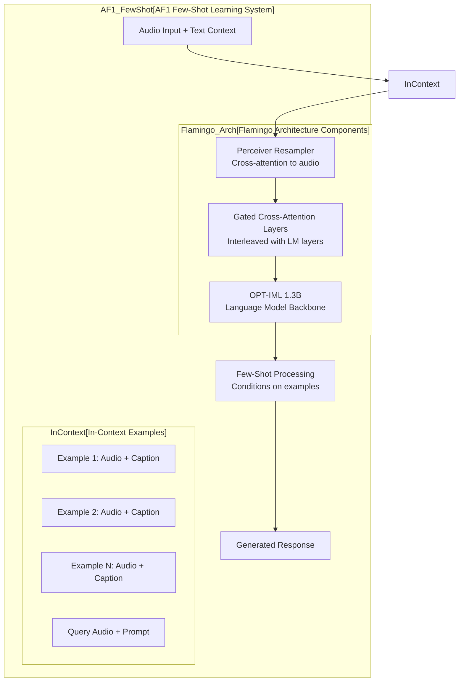
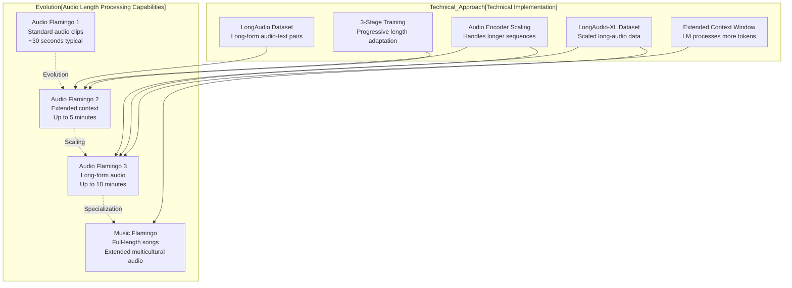
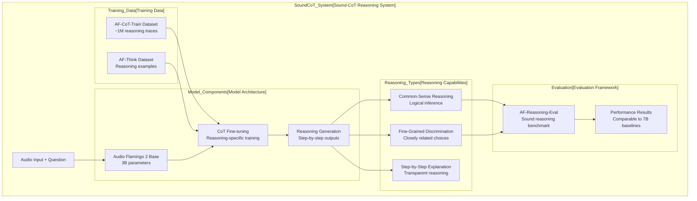
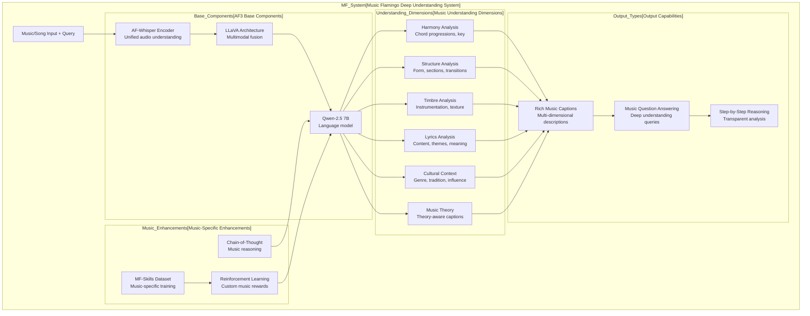
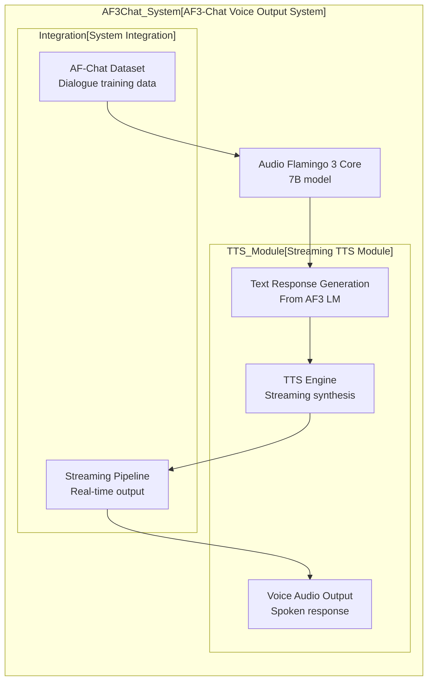
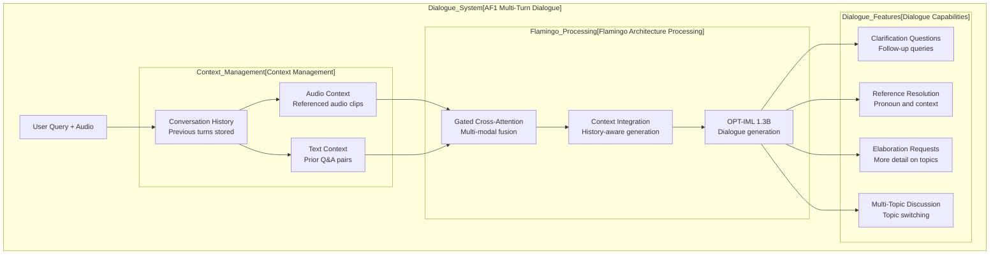
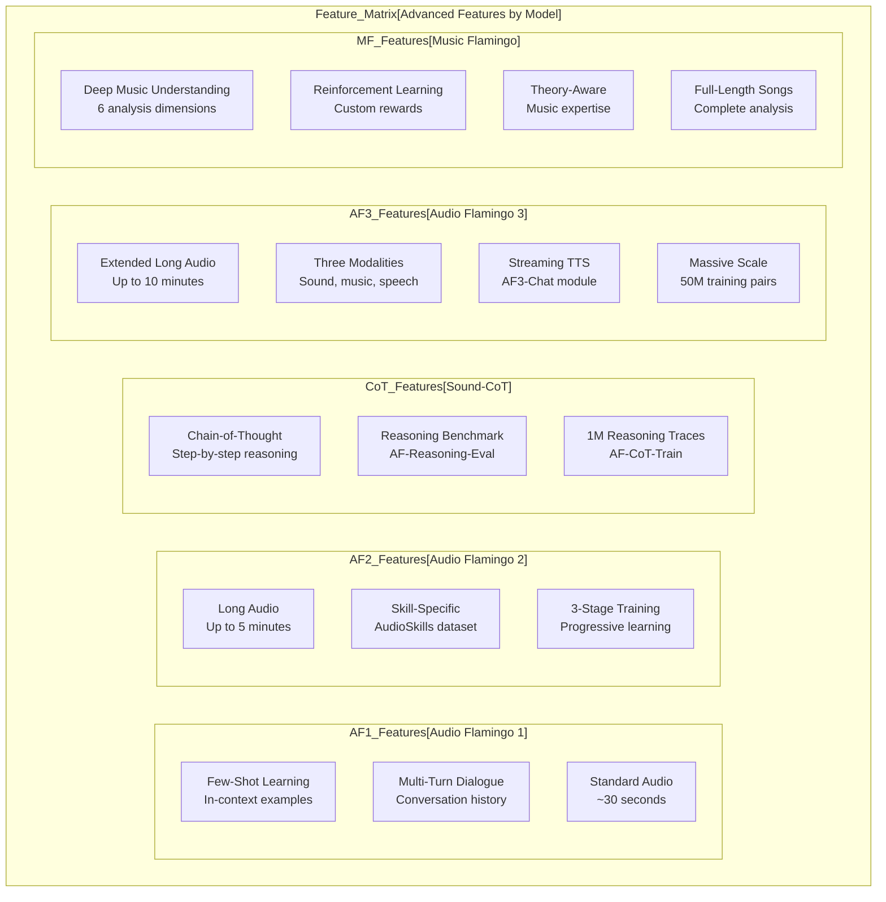

<!-- source: DeepWiki mcp.deepwiki.com · repo NVIDIA/audio-flamingo · page 5.3 Advanced Features · fetched 2026-10-26 -->

# Advanced Features

<details>
<summary>Relevant source files</summary>

The following files were used as context for generating this wiki page:

- [README.md](README.md)

</details>


## Purpose and Scope

This document details the advanced capabilities implemented across the Audio Flamingo series that extend beyond core audio understanding tasks. These features represent specialized capabilities developed to address specific audio-language modeling challenges: few-shot learning, extended-context audio processing, step-by-step reasoning, domain-specific music analysis, voice synthesis, and conversational interaction.

For information about the basic audio understanding capabilities (captioning, classification, QA), see [Core Task Capabilities](#5.2). For performance metrics and benchmark results for these advanced features, see [Performance and Benchmarks](#5.4). For architecture details of the models implementing these features, see [Technical Architecture](#3).

---

## Few-Shot Learning

**Few-Shot Learning Architecture**



**Diagram: Audio Flamingo 1 Few-Shot Learning Architecture**

Audio Flamingo 1 implements few-shot learning through the Flamingo architecture, which uses gated cross-attention layers to condition language model outputs on audio inputs. The system accepts multiple audio-text example pairs as context before processing a query audio.

**Key Implementation Details:**

| Component | Description | Implementation |
|-----------|-------------|----------------|
| Architecture Base | Flamingo | Cross-attention mechanism for audio conditioning |
| Language Model | OPT-IML 1.3B | 1.3 billion parameter autoregressive LM |
| Audio Integration | Perceiver Resampler | Compresses audio features to fixed number of tokens |
| Conditioning Mechanism | Gated Cross-Attention | Interleaved between LM layers for audio-text fusion |
| Context Window | Variable | Supports multiple in-context examples |
| Training Data | 5.9M audio-text pairs | See [README.md:204]() |

**Few-Shot Capabilities:**

- **Zero-shot inference**: Direct audio understanding without task-specific training
- **One-shot learning**: Single example conditions model behavior
- **Few-shot learning**: Multiple examples (typically 2-8) improve task adaptation
- **Task transfer**: Examples guide model to perform novel tasks not seen during training

The few-shot approach is particularly effective for:
- Novel audio captioning styles
- Domain-specific classification tasks
- Unusual audio event types
- Specialized question-answering formats

**Sources:** [README.md:192-217]()

---

## Long-Audio Processing

**Long-Audio Processing Evolution**



**Diagram: Long-Audio Processing Evolution Across Models**

**Audio Flamingo 2: 5-Minute Audio Support**

AF2 introduces extended audio understanding through the LongAudio dataset and architectural improvements:

| Aspect | Implementation |
|--------|----------------|
| Maximum Duration | 5 minutes |
| Training Data | LongAudio dataset (part of 10M training pairs) |
| Architecture | Improved CLAP encoder with extended sequence handling |
| Training Strategy | 3-stage training with progressive length adaptation |
| Language Model | Qwen-2.5 3B with extended context window |

**Audio Flamingo 3: 10-Minute Audio Support**

AF3 doubles the context length through enhanced architecture and scaled training:

| Aspect | Implementation |
|--------|----------------|
| Maximum Duration | 10 minutes |
| Training Data | LongAudio-XL dataset (part of 50M training pairs) |
| Architecture | AF-Whisper unified encoder + LLaVA architecture |
| Audio Encoder | AF-Whisper trained to handle extended sequences |
| Language Model | Qwen-2.5 7B with larger context capacity |
| Dataset | [nvidia/LongAudio on HuggingFace]() |

**Music Flamingo: Full-Length Song Processing**

Music Flamingo leverages AF3's long-audio capabilities for complete song analysis:

- **Full-length songs**: Processes entire tracks without truncation
- **Multicultural audio**: Extended context for diverse musical traditions
- **Structural analysis**: Understands song structure across complete duration
- **Lyrics integration**: Analyzes lyrics in context of full musical composition

**Technical Challenges Addressed:**

1. **Memory efficiency**: Encoding 10-minute audio without memory overflow
2. **Temporal coherence**: Maintaining understanding across long time spans
3. **Training efficiency**: Processing long sequences during training
4. **Attention mechanisms**: Handling extended audio token sequences

**Sources:** [README.md:106-109](), [README.md:172](), [README.md:42-47]()

---

## Chain-of-Thought Reasoning

**Chain-of-Thought Reasoning System**



**Diagram: Audio Flamingo Sound-CoT Reasoning Architecture**

Audio Flamingo Sound-CoT specializes in chain-of-thought reasoning for sound understanding. Built as a fine-tuned variant of Audio Flamingo 2, it generates intermediate reasoning steps before producing final answers.

**Training Data Components:**

| Dataset | Description | Size | Purpose |
|---------|-------------|------|---------|
| AF-CoT-Train | CoT reasoning traces | ~1M traces | Training reasoning patterns |
| AF-Think | Reasoning examples | Subset of AF-CoT-Train | Step-by-step demonstrations |
| Base AF2 Data | Standard audio-text pairs | 10M pairs | Foundation understanding |

**Reasoning Capabilities:**

1. **Common-Sense Reasoning**
   - Logical inference from audio cues
   - World knowledge integration
   - Contextual understanding
   - Causal relationship identification

2. **Fine-Grained Discrimination**
   - Distinguishing closely related sounds
   - Subtle acoustic difference detection
   - Multi-factor decision making
   - Comparative analysis

3. **Transparent Reasoning**
   - Explicit reasoning steps in output
   - Interpretable decision process
   - Step-by-step explanation generation
   - Reasoning trace validation

**AF-Reasoning-Eval Benchmark:**

The AF-Reasoning-Eval benchmark specifically targets sound reasoning abilities:

- **Focus**: Common-sense reasoning in audio domain
- **Challenge**: Discrimination among closely related choices
- **Format**: Multiple-choice questions with reasoning evaluation
- **Access**: [Available in soundCoT branch]()

**Performance Characteristics:**

| Metric | Sound-CoT 3B Performance |
|--------|-------------------------|
| Baseline Comparison | Comparable to 7B reasoning models |
| Reasoning Quality | Significant improvement over AF2 base |
| AF-Reasoning-Eval | SOTA on reasoning benchmark |
| Inference Speed | Slower due to reasoning trace generation |

**Example Reasoning Pattern:**

```
Question: What is the source of this sound?
Audio: [beeping sound]

Reasoning Output:
1. The sound is repetitive with regular intervals
2. It has a high-pitched electronic tone
3. The pattern suggests an alarm or notification
4. The consistent frequency indicates a manufactured source
5. This is characteristic of electronic device alerts

Answer: Electronic alarm or notification device
```

**Sources:** [README.md:128-151]()

---

## Deep Music Understanding

**Music Flamingo Architecture**



**Diagram: Music Flamingo Deep Understanding Architecture**

Music Flamingo specializes the AF3 architecture for comprehensive music understanding, combining chain-of-thought reasoning with reinforcement learning and custom music-specific rewards.

**Architecture Foundation:**

| Component | Description | Source Model |
|-----------|-------------|--------------|
| Base Architecture | AF3 7B architecture | Audio Flamingo 3 |
| Audio Encoder | AF-Whisper unified encoder | Handles music modality |
| Language Model | Qwen-2.5 7B | Extended for music domain |
| Multimodal Fusion | LLaVA architecture | Audio-text integration |

**Music-Specific Training:**

1. **MF-Skills Dataset**
   - Music-specific training data
   - Available on HuggingFace: [nvidia/MF-Skills]()
   - Covers multiple music understanding dimensions

2. **Chain-of-Thought Integration**
   - Inherits CoT reasoning from Sound-CoT
   - Applied to music analysis tasks
   - Step-by-step music understanding

3. **Reinforcement Learning**
   - Custom reward functions for music understanding
   - Multi-dimensional reward signals
   - Optimizes for music-specific quality metrics

**Six Dimensions of Music Understanding:**

**1. Harmony Analysis**
- Chord progression identification
- Key and modality detection
- Harmonic rhythm analysis
- Tonal relationships

**2. Structure Analysis**
- Song form identification (verse, chorus, bridge)
- Section boundaries and transitions
- Repetition and variation patterns
- Overall structural organization

**3. Timbre Analysis**
- Instrumentation identification
- Sonic texture description
- Production techniques
- Sound quality characteristics

**4. Lyrics Analysis**
- Lyrical content understanding
- Theme and message extraction
- Narrative structure
- Poetic devices

**5. Cultural Context**
- Genre classification and characteristics
- Musical tradition identification
- Cultural influences and references
- Historical context

**6. Music Theory**
- Theory-aware descriptions
- Technical terminology usage
- Formal music concepts
- Academic analysis

**Performance on Music Benchmarks:**

Music Flamingo achieves state-of-the-art results on 10+ music understanding benchmarks:

| Benchmark Category | Coverage |
|-------------------|----------|
| Music Captioning | Theory-aware rich descriptions |
| Music QA | Deep understanding queries |
| Genre Classification | Cultural context integration |
| Instrument Recognition | Timbre analysis |
| Structure Analysis | Form and section identification |
| Music Reasoning | Step-by-step explanations |

**Example Multi-Dimensional Analysis:**

```
Input: [Full-length jazz song]

Music Flamingo Output:
Harmony: Modal jazz in D Dorian, featuring extended ii-V progressions
Structure: 32-bar AABA form with improvised solos over changes
Timbre: Small jazz combo - saxophone, piano, upright bass, drums
Lyrics: [Instrumental]
Cultural: Post-bop jazz tradition, influenced by Miles Davis modal style
Theory: Uses quartal harmony and modal interchange, typical of 1960s jazz
```

**Technical Implementation:**

- **Long-form processing**: Handles full-length songs (extends AF3 10-minute capability)
- **Multicultural support**: Trained on diverse musical traditions
- **Reinforcement learning rewards**: Custom metrics for each understanding dimension
- **Chain-of-thought reasoning**: Transparent step-by-step music analysis

**Sources:** [README.md:20-66]()

---

## Streaming TTS and Voice Output

**AF3-Chat Streaming TTS System**



**Diagram: AF3-Chat Streaming TTS Architecture**

Audio Flamingo 3-Chat extends AF3 with streaming text-to-speech capabilities, enabling voice-based conversational interaction.

**System Components:**

| Component | Description | Implementation |
|-----------|-------------|----------------|
| Base Model | Audio Flamingo 3 7B | Audio understanding and text generation |
| TTS Module | Streaming TTS engine | Converts text responses to speech |
| Training Data | AF-Chat dataset | Dialogue-specific training |
| Output Format | Streaming audio | Real-time voice synthesis |
| Model Checkpoint | nvidia/audio-flamingo-3-chat | Available on HuggingFace |

**Key Capabilities:**

1. **Streaming Output**
   - Real-time text-to-speech conversion
   - Low-latency voice response
   - Continuous audio stream generation

2. **Conversational Voice**
   - Natural speech synthesis
   - Appropriate prosody for dialogue
   - Context-aware speech generation

3. **Integration with AF3**
   - Seamless connection to AF3 core
   - Preserves audio understanding capabilities
   - Extends to voice-based interaction

**AF-Chat Training Dataset:**

- **Purpose**: Dialogue-specific training for conversational abilities
- **Access**: Available at [nvidia/AF-Chat on HuggingFace]()
- **Format**: Audio-text dialogue pairs
- **Use**: Fine-tunes AF3 for conversational patterns

**Use Cases:**

- **Voice assistants**: Audio-to-voice dialogue systems
- **Accessibility**: Screen reader integration for audio content
- **Interactive applications**: Voice-based audio exploration
- **Educational tools**: Spoken explanations of audio content

**Technical Considerations:**

- **Latency**: Streaming minimizes delay between text generation and speech output
- **Quality**: TTS engine quality affects user experience
- **Resource requirements**: Additional compute for TTS processing
- **Integration**: Requires both AF3 and TTS components

**Sources:** [README.md:109](), [README.md:82-83](), [README.md:97-102]()

---

## Multi-Turn Dialogue

**Multi-Turn Dialogue System (AF1)**



**Diagram: Audio Flamingo 1 Multi-Turn Dialogue System**

Audio Flamingo 1 implements multi-turn dialogue capabilities through the Flamingo architecture's context management and the OPT-IML language model's conversational abilities.

**Dialogue Capabilities:**

| Feature | Description | Implementation |
|---------|-------------|----------------|
| Conversation History | Maintains context across turns | Flamingo architecture context window |
| Audio Reference | References previously discussed audio | Cross-attention to multiple audio inputs |
| Clarification | Handles follow-up questions | OPT-IML dialogue training |
| Context Resolution | Resolves pronouns and references | Language model context understanding |
| Topic Continuity | Maintains coherent multi-turn conversation | Conversation history integration |

**Training Foundation:**

Audio Flamingo 1's dialogue abilities are enhanced through Audio Dialogues training data:

- **Source**: Audio Dialogues dataset (related work)
- **Paper**: [Audio Dialogues paper (arXiv:2404.07616)]()
- **Content**: Multi-turn audio-grounded conversations
- **Training**: Dialogue-specific fine-tuning of AF1

**Dialogue Patterns Supported:**

1. **Sequential Questioning**
   ```
   User: What sound is this? [audio]
   AF1: This is a dog barking.
   User: What breed might it be?
   AF1: Based on the pitch and tone, likely a small breed.
   ```

2. **Clarification Requests**
   ```
   User: Describe this audio. [audio]
   AF1: It's an outdoor scene with wind and birds.
   User: What kind of birds?
   AF1: The chirping pattern suggests songbirds, possibly sparrows.
   ```

3. **Reference Resolution**
   ```
   User: Listen to these two sounds. [audio1] [audio2]
   AF1: The first is a car engine, the second is a motorcycle.
   User: Which one is louder?
   AF1: The motorcycle (the second sound) is louder.
   ```

4. **Topic Elaboration**
   ```
   User: What's happening in this audio? [audio]
   AF1: Someone is cooking in a kitchen.
   User: Tell me more about the cooking sounds.
   AF1: I hear sizzling (frying), knife chopping, and water running.
   ```

**Architecture Support:**

The Flamingo architecture's design specifically enables dialogue through:

- **Perceiver resampler**: Maintains multiple audio representations in context
- **Gated cross-attention**: Integrates audio context across dialogue turns
- **Autoregressive generation**: Natural language dialogue flow
- **OPT-IML backbone**: Pre-trained on instruction-following and dialogue

**Limitations:**

- **Context window**: Limited by model's maximum context length
- **Audio retention**: Multiple long audio clips consume context capacity
- **Coherence**: May lose context over very long conversations
- **Latency**: Each turn requires full model inference

**Sources:** [README.md:204]()

---

## Feature Comparison Matrix

**Advanced Features Across Audio Flamingo Series**



**Diagram: Advanced Features Distribution Across Models**

**Comprehensive Feature Matrix:**

| Feature | AF1 | AF2 | Sound-CoT | AF3 | Music Flamingo |
|---------|-----|-----|-----------|-----|----------------|
| **Few-Shot Learning** | ✓ Primary | ○ Limited | ○ Limited | ○ Limited | ○ Limited |
| **Multi-Turn Dialogue** | ✓ Core | ○ Basic | ○ Basic | ✓ Enhanced | ✓ Enhanced |
| **Long Audio (5 min)** | ✗ | ✓ | ✓ Inherited | ✓ Extended | ✓ Extended |
| **Long Audio (10 min)** | ✗ | ✗ | ✗ | ✓ | ✓ |
| **Chain-of-Thought** | ✗ | ✗ | ✓ Primary | ○ Limited | ✓ Enhanced |
| **Streaming TTS** | ✗ | ✗ | ✗ | ✓ AF3-Chat | ✓ Inherited |
| **3-Stage Training** | ✗ | ✓ Primary | ✓ Inherited | ✓ Inherited | ✓ Enhanced |
| **Music Deep Analysis** | ✗ | ✗ | ✗ | ○ Basic | ✓ Primary |
| **Reinforcement Learning** | ✗ | ✗ | ✗ | ✗ | ✓ |
| **Theory-Aware Captions** | ✗ | ✗ | ✗ | ✗ | ✓ |
| **Reasoning Benchmark** | ✗ | ✗ | ✓ AF-Reasoning-Eval | ○ General | ○ Music-specific |
| **Full-Length Songs** | ✗ | ✗ | ✗ | ○ Possible | ✓ Optimized |

Legend: ✓ = Fully supported, ○ = Partially supported, ✗ = Not supported

**Feature Selection Guide:**

**Choose AF1 for:**
- Few-shot learning tasks requiring in-context examples
- Interactive dialogue applications
- Rapid adaptation to new audio types with minimal examples
- Lightweight deployment (1.3B parameters)

**Choose AF2 for:**
- Long audio understanding up to 5 minutes
- Skill-specific audio tasks (AudioSkills dataset)
- Efficient training with 3-stage curriculum
- Mid-size deployment (3B, 1.5B, 0.5B variants)

**Choose Sound-CoT for:**
- Transparent reasoning in sound understanding
- Tasks requiring step-by-step explanations
- Common-sense reasoning evaluation
- Fine-grained sound discrimination

**Choose AF3 for:**
- Three-modality support (sound, music, speech)
- Extended audio up to 10 minutes
- Voice output requirements (AF3-Chat)
- State-of-the-art general audio understanding
- Largest training scale (50M pairs)

**Choose Music Flamingo for:**
- Deep music and song analysis
- Theory-aware music descriptions
- Full-length song understanding
- Multi-dimensional music reasoning (harmony, structure, timbre, lyrics, cultural context)
- Music-specific benchmarks

**Technical Trade-offs:**

| Consideration | AF1 | AF2 | Sound-CoT | AF3 | Music Flamingo |
|--------------|-----|-----|-----------|-----|----------------|
| Parameter Count | 1.3B | 3B | 3B | 7B | 7B |
| Training Data | 5.9M | 10M | 10M + 1M CoT | 50M | 50M + Music |
| Inference Speed | Fast | Medium | Slow (CoT) | Medium | Slow (CoT+RL) |
| Memory Usage | Low | Medium | Medium | High | High |
| Specialization | Few-shot + Dialogue | Long audio + Skills | Reasoning | General SOTA | Music domain |

**Sources:** [README.md:1-299]()

---

## Advanced Feature Integration

**Cross-Feature Synergies**

Multiple advanced features can be combined for enhanced capabilities:

**AF3 + TTS (AF3-Chat):**
- Voice-based audio understanding system
- Input: audio → Output: spoken response
- Applications: accessibility, voice assistants

**Long Audio + Chain-of-Thought (Music Flamingo):**
- Step-by-step reasoning over full-length songs
- Detailed structural analysis with explanations
- Transparent music understanding process

**Long Audio + Multi-Modal (AF3):**
- Extended audio across sound, music, and speech
- Unified understanding of diverse 10-minute audio
- Cross-modal reasoning capabilities

**Chain-of-Thought + Reinforcement Learning (Music Flamingo):**
- Optimized reasoning quality through RL rewards
- Multi-dimensional analysis with custom metrics
- Enhanced reasoning transparency and accuracy

**Implementation Considerations:**

When implementing advanced features, consider:

1. **Computational requirements**: Advanced features increase inference cost
2. **Memory constraints**: Long audio and dialogue history consume memory
3. **Latency requirements**: CoT reasoning adds generation time
4. **Use case alignment**: Match features to application needs
5. **Model selection**: Choose smallest model that meets requirements

**Sources:** [README.md:1-299]()

---

