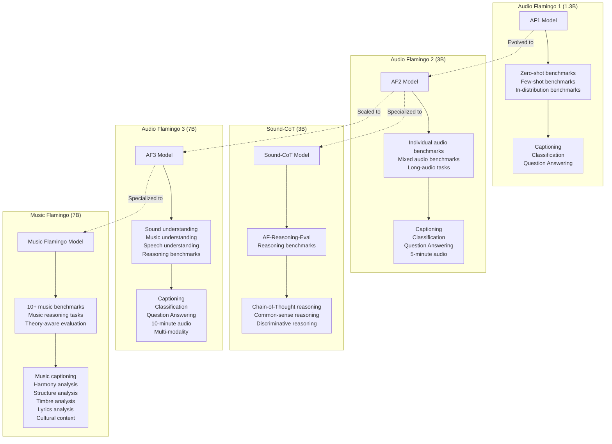
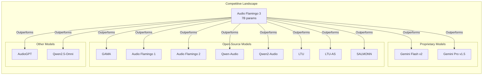
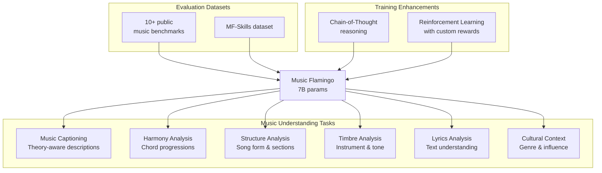
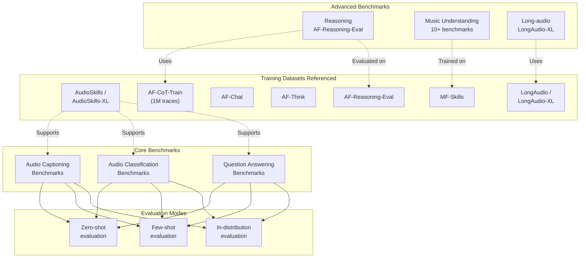
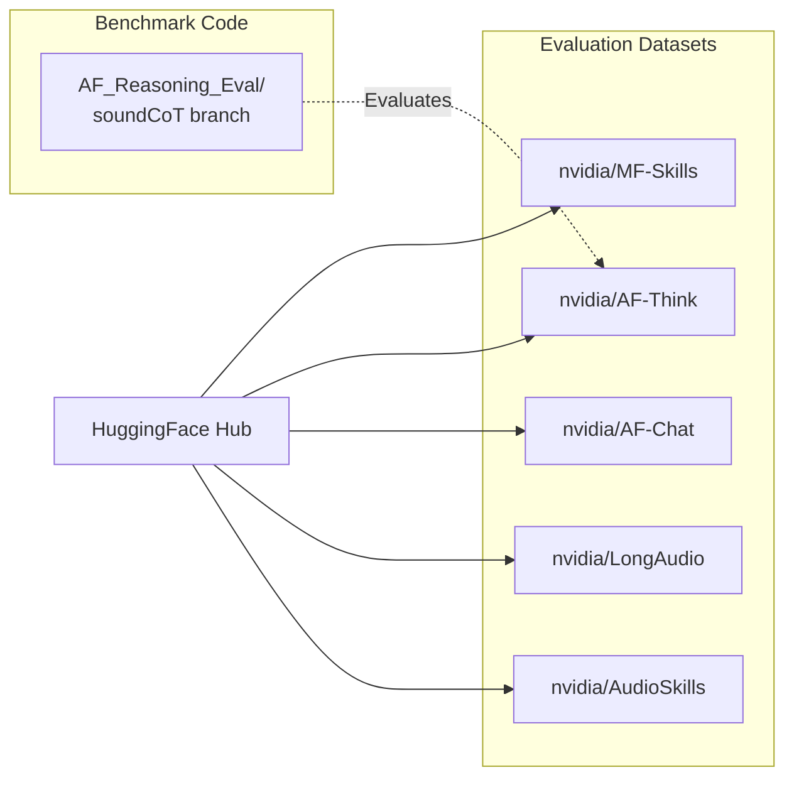

<!-- source: DeepWiki mcp.deepwiki.com · repo NVIDIA/audio-flamingo · page 5.4 Performance and Benchmarks · fetched 2026-10-26 -->

# Performance and Benchmarks

Relevant source files

The following files were used as context for generating this wiki page:

- [README.md](README.md)
- [static/MF-architecture.png](static/MF-architecture.png)
- [static/MF-benchmarks.png](static/MF-benchmarks.png)
- [static/MF-comparison.png](static/MF-comparison.png)
- [static/MF-donut_chart.png](static/MF-donut_chart.png)

This page documents the performance results and benchmark evaluations across the Audio Flamingo series. It provides state-of-the-art (SOTA) comparisons, benchmark descriptions, and performance metrics for each model variant. For information about the models' capabilities and supported tasks, see [Core Task Capabilities](#5.2) and [Advanced Features](#5.3). For details about training data used to achieve these results, see [Training Data and Strategies](#4).

---

## Overview

The Audio Flamingo series has been evaluated on progressively more challenging benchmarks, demonstrating continuous improvements in audio understanding and reasoning capabilities. Each model variant targets specific benchmark categories:

- **Audio Flamingo 1 (1.3B)**: Zero-shot, few-shot, and in-distribution benchmarks for captioning, classification, and question answering
- **Audio Flamingo 2 (3B)**: Individual and mixed audio understanding benchmarks with improved performance on captioning, classification, and question answering
- **Sound-CoT (3B)**: Specialized reasoning benchmarks via AF-Reasoning-Eval, comparable to 7B reasoning baselines
- **Audio Flamingo 3 (7B)**: Comprehensive evaluation across sound, music, and speech understanding benchmarks
- **Music Flamingo (7B)**: 10+ public music understanding and reasoning benchmarks

Sources: [README.md:107-108](), [README.md:148-150](), [README.md:172](), [README.md:204](), [README.md:49]()

---

## Model Performance Evolution

**Diagram: Performance Evolution Across Model Variants**

Sources: [README.md:14-18](), [README.md:204](), [README.md:172](), [README.md:148-150](), [README.md:107-108](), [README.md:49]()

---

## Audio Flamingo 1 Performance

Audio Flamingo 1 established the baseline performance for the series, achieving SOTA results on several benchmarks despite its 1.3B parameter size. The model was evaluated on:

### Benchmark Categories
- **Zero-shot benchmarks**: Evaluation without any task-specific examples
- **Few-shot benchmarks**: Evaluation with in-context learning using few examples
- **In-distribution benchmarks**: Evaluation on datasets similar to training distribution

### Core Tasks
- Audio captioning
- Audio classification  
- Question answering

### Key Results
AF1 achieved SOTA performance across multiple zero-shot, few-shot, and in-distribution evaluation scenarios, demonstrating strong generalization from its 5.9M training pairs.

**Performance Visualization**: The model's performance is represented in a radial chart showing comparative results across different benchmark categories.

Sources: [README.md:204](), [README.md:192-217]()

---

## Audio Flamingo 2 Performance

Audio Flamingo 2 significantly improved upon AF1 through scaling to 3B parameters and training on 10M audio-text pairs with the AudioSkills and LongAudio datasets.

### Benchmark Performance

Audio Flamingo 2 achieves SOTA results on:
- Individual audio understanding benchmarks
- Mixed audio understanding benchmarks  
- Long-audio understanding tasks (up to 5 minutes)

### Task Coverage
- Audio captioning with improved accuracy
- Audio classification across diverse categories
- Question answering with better reasoning

### Performance Improvements
The 3-stage training strategy and improved CLAP encoder contributed to substantial gains over AF1. The model also introduced three size variants (3B, 1.5B, 0.5B) to provide flexibility in deployment scenarios.

**Performance Visualizations**:
- Radar chart: Multi-dimensional performance comparison
- Results table: Detailed benchmark scores

Sources: [README.md:172](), [README.md:153-187](), [README.md:165-167]()

---

## Audio Flamingo Sound-CoT Performance

Sound-CoT specializes in chain-of-thought reasoning for sound understanding tasks, representing a significant advancement in reasoning capabilities.

### AF-Reasoning-Eval Benchmark

Sound-CoT introduces **AF-Reasoning-Eval**, a novel sound reasoning benchmark that targets:
- Common-sense reasoning about audio
- Ability to discriminate among closely related choices
- Step-by-step reasoning processes

### Training Data
The model is trained on **AF-CoT-Train** dataset containing approximately 1M chain-of-thought reasoning traces.

### Comparative Performance

| Model Type | Parameters | Performance Level |
|------------|-----------|-------------------|
| Sound-CoT | 3B | Comparable to 7B reasoning baselines |
| Standard 3B models | 3B | Lower reasoning performance |
| 7B reasoning baselines | 7B | Comparable to Sound-CoT |

The 3B Sound-CoT model achieves performance comparable to several 7B reasoning baselines on reasoning benchmarks, demonstrating the effectiveness of specialized CoT training.

Sources: [README.md:148-150](), [README.md:128-151](), [README.md:140-145]()

---

## Audio Flamingo 3 Performance

Audio Flamingo 3 represents the flagship model with comprehensive evaluation across all audio modalities and SOTA comparisons against leading models.

### SOTA Comparisons

AF3 outperforms the following prior SOTA models on understanding and reasoning benchmarks:

**Competitive Models:**
- GAMA
- Audio Flamingo (AF1)
- Audio Flamingo 2 (AF2)
- Qwen-Audio
- Qwen2-Audio
- Qwen2.5-Omni
- LTU
- LTU-AS
- SALMONN
- AudioGPT
- Gemini Flash v2
- Gemini Pro v1.5

**Diagram: Audio Flamingo 3 Competitive Performance**

### Benchmark Coverage

AF3 is evaluated across three audio modalities:
- **Sound understanding**: Environmental sounds, acoustic events
- **Music understanding**: Musical analysis and description
- **Speech understanding**: Speech-related tasks beyond recognition

### Capabilities Evaluated
- Audio captioning
- Audio classification
- Question answering
- Long-audio processing (up to 10 minutes)
- Multi-modal understanding

### Key Performance Metrics

**Training Scale**: 50M audio-text pairs (10x increase from AF1)

**Performance Visualizations**:
- Radial chart: Multi-dimensional capability comparison
- SOTA comparison table: Head-to-head results against competitive models

Sources: [README.md:107-108](), [README.md:69-126](), [README.md:79-87]()

---

## Music Flamingo Performance

Music Flamingo sets new benchmarks in specialized music understanding, building on the AF3 backbone with domain-specific enhancements.

### Benchmark Suite

Music Flamingo is evaluated on **10+ public music understanding and reasoning benchmarks**, covering:

**Diagram: Music Flamingo Evaluation Framework**

### Training Methodology

Music Flamingo employs specialized training approaches:
- **Chain-of-Thought reasoning**: Step-by-step music analysis
- **Reinforcement Learning**: Custom reward functions for music understanding quality
- **MF-Skills dataset**: Domain-specific music training data

### Performance Characteristics

- **Deep music understanding**: Beyond surface-level descriptions to theory-aware analysis
- **Long-form reasoning**: Full-length song analysis with extended context
- **Multicultural coverage**: Diverse musical traditions and styles

### Benchmark Results

Extensive evaluations confirm Music Flamingo's effectiveness, setting new state-of-the-art results on over 10 public music understanding and reasoning tasks, as demonstrated in the comparative benchmark charts.

**Performance Visualizations**:
- Comparison chart: Performance against other music understanding models
- Benchmark results: Scores across 10+ music evaluation tasks
- Capability distribution: Donut chart showing evaluation coverage

Sources: [README.md:49](), [README.md:20-65](), [README.md:33-35]()

---

## Benchmark Categories and Evaluation Datasets

**Diagram: Benchmark Categories and Associated Datasets**

### Benchmark Dataset Details

| Dataset | Purpose | Size | Model Usage |
|---------|---------|------|-------------|
| AudioSkills / AudioSkills-XL | Core audio understanding skills | 10M / 50M pairs | AF2, AF3 |
| LongAudio / LongAudio-XL | Long-form audio understanding | N/A | AF2 (5 min), AF3 (10 min) |
| AF-Chat | Dialogue capabilities | N/A | AF3 |
| AF-Think | Reasoning traces | N/A | AF3, Sound-CoT |
| AF-CoT-Train | Chain-of-thought training | ~1M traces | Sound-CoT |
| AF-Reasoning-Eval | Reasoning benchmark | N/A | Sound-CoT evaluation |
| MF-Skills | Music understanding | N/A | Music Flamingo |

Sources: [README.md:91-102](), [README.md:140-145](), [README.md:33-35]()

---

## Performance Metrics Summary

### Parameter Scaling vs Performance

| Model | Parameters | Training Data | Key Performance Highlights |
|-------|-----------|---------------|---------------------------|
| AF1 | 1.3B | 5.9M pairs | SOTA on zero-shot, few-shot, in-distribution benchmarks |
| AF2 | 3B (+ 1.5B, 0.5B) | 10M pairs | SOTA on individual and mixed audio benchmarks |
| Sound-CoT | 3B | 10M + 1M CoT traces | Comparable to 7B reasoning baselines |
| AF3 | 7B | 50M pairs | Outperforms 11+ competitive models including Gemini |
| Music Flamingo | 7B | 50M + music data | New benchmarks on 10+ music understanding tasks |

### Modality Coverage by Model

| Model | Sound | Music | Speech | Reasoning | Long Audio |
|-------|-------|-------|--------|-----------|-----------|
| AF1 | ✓ | ✓ | ✗ | Limited | ✗ |
| AF2 | ✓ | ✓ | ✗ | Limited | ✓ (5 min) |
| Sound-CoT | ✓ | Limited | ✗ | ✓✓ | ✓ (5 min) |
| AF3 | ✓ | ✓ | ✓ | ✓ | ✓ (10 min) |
| Music Flamingo | Limited | ✓✓✓ | ✗ | ✓✓ | ✓ (10 min) |

Sources: [README.md:14-18](), [README.md:107](), [README.md:172](), [README.md:204]()

---

## Benchmark Access and Evaluation

### Public Benchmarks

The Audio Flamingo series is evaluated on various public benchmarks including:
- Standard audio captioning datasets
- Audio classification benchmarks
- Audio question answering datasets
- Public music understanding benchmarks (10+ for Music Flamingo)

### Proprietary Benchmarks

- **AF-Reasoning-Eval**: Sound reasoning benchmark introduced with Sound-CoT, available in the repository at `AF_Reasoning_Eval` directory on the soundCoT branch

### Dataset Availability

Evaluation datasets are available on HuggingFace:
- `nvidia/AudioSkills` - AudioSkills-XL dataset
- `nvidia/LongAudio` - LongAudio-XL dataset
- `nvidia/AF-Chat` - Dialogue dataset
- `nvidia/AF-Think` - Reasoning dataset with AF-CoT-Train subset
- `nvidia/MF-Skills` - Music understanding dataset

**Diagram: Benchmark and Dataset Distribution**

Sources: [README.md:91-102](), [README.md:140-145](), [README.md:143-145]()

---

## Performance Comparison Methodology

### Evaluation Protocol

The Audio Flamingo series employs consistent evaluation protocols:
1. **Zero-shot evaluation**: Models tested without task-specific examples
2. **Few-shot evaluation**: Models provided with in-context learning examples
3. **In-distribution evaluation**: Performance on similar domains to training data

### Competitive Baselines

Performance is compared against:
- **Previous Audio Flamingo versions**: To demonstrate progressive improvements
- **Open-source audio models**: GAMA, Qwen-Audio variants, LTU variants, SALMONN
- **Proprietary models**: Gemini Flash v2, Gemini Pro v1.5
- **General audio-language models**: AudioGPT, Qwen2.5-Omni

### Metrics

Evaluation typically includes:
- Accuracy scores for classification tasks
- BLEU/ROUGE/METEOR scores for captioning tasks
- Exact match and F1 scores for question answering
- Custom metrics for reasoning evaluation (AF-Reasoning-Eval)
- Music-specific metrics for Music Flamingo benchmarks

Sources: [README.md:107-108](), [README.md:204](), [README.md:172]()

---

## Benchmark Visualization References

Performance results are visualized through static assets in the repository:

| Model | Visualization Files | Content |
|-------|-------------------|---------|
| AF1 | `static/af1_radial.png` | Radial performance chart |
| AF2 | `static/af2_radar.png`, `static/af2_table2.png` | Radar chart and results table |
| AF3 | `static/af3_radial-1.png`, `static/af3_sota.png` | Radial chart and SOTA comparison |
| Music Flamingo | `static/MF-comparison.png`, `static/MF-benchmarks.png`, `static/MF-donut_chart.png` | Comparison, benchmarks, and capability distribution |

Sources: [README.md:115-121](), [README.md:177-183](), [README.md:210](), [README.md:51-65]()

---

