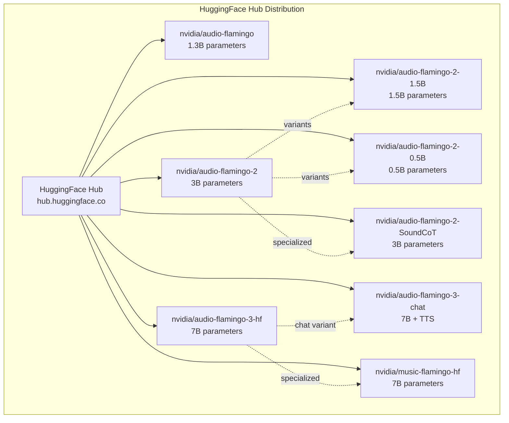
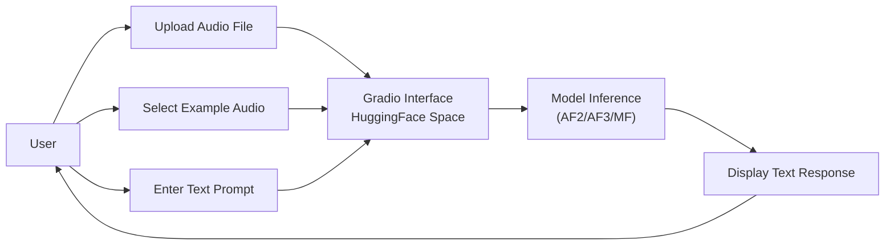
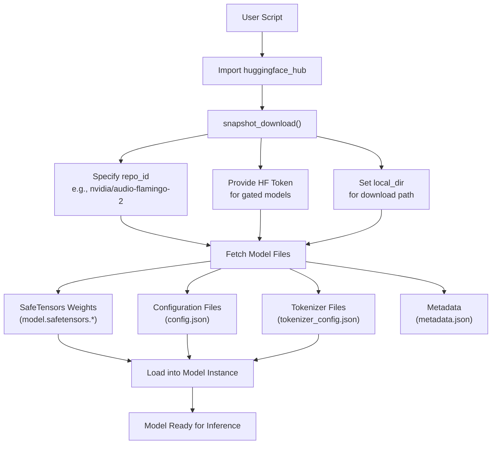
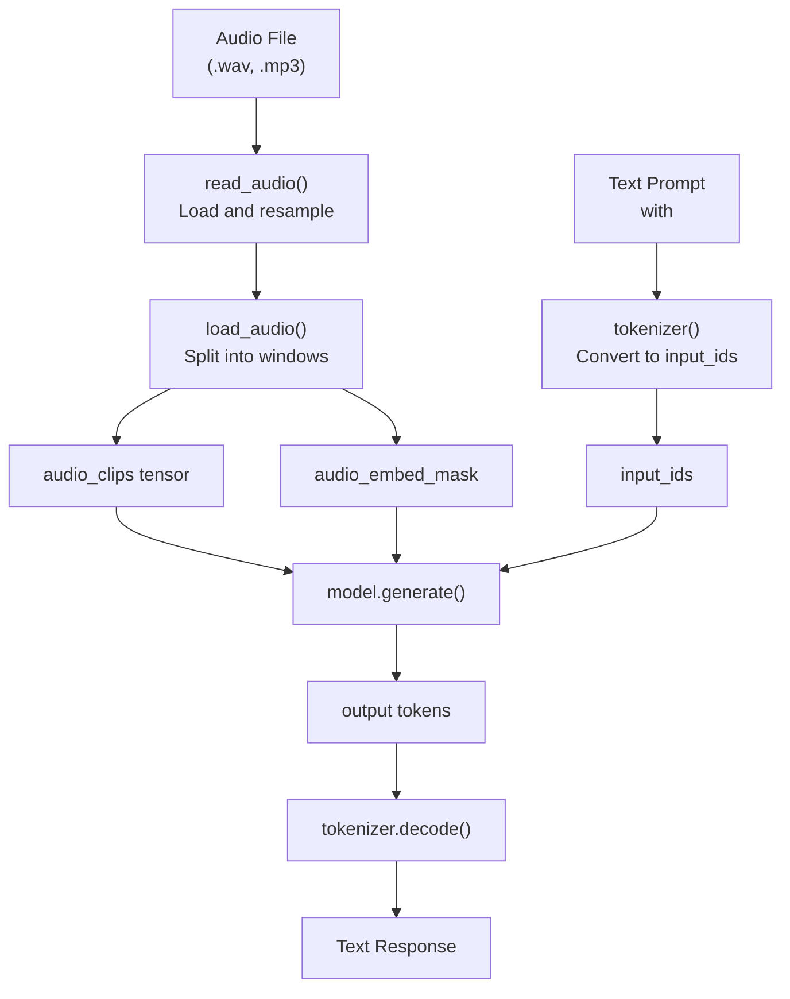
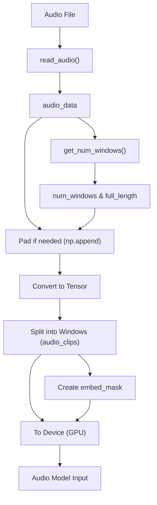
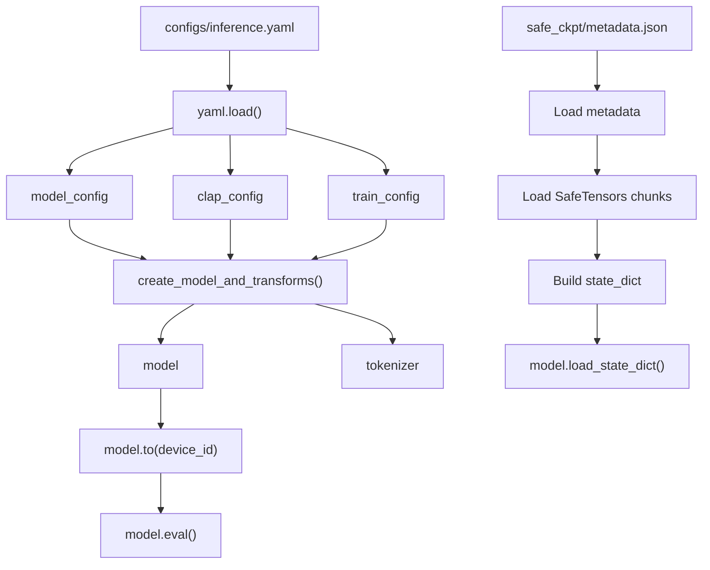
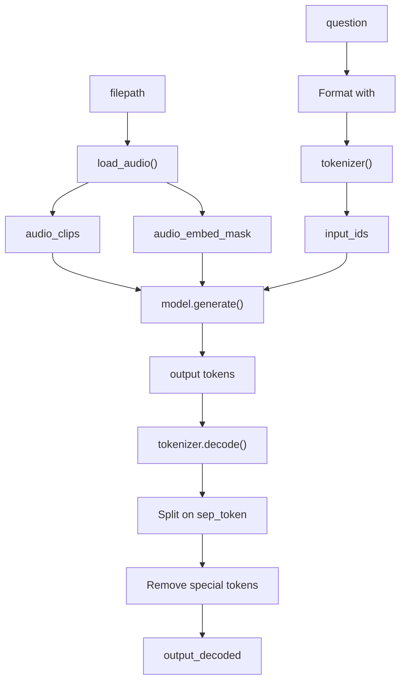
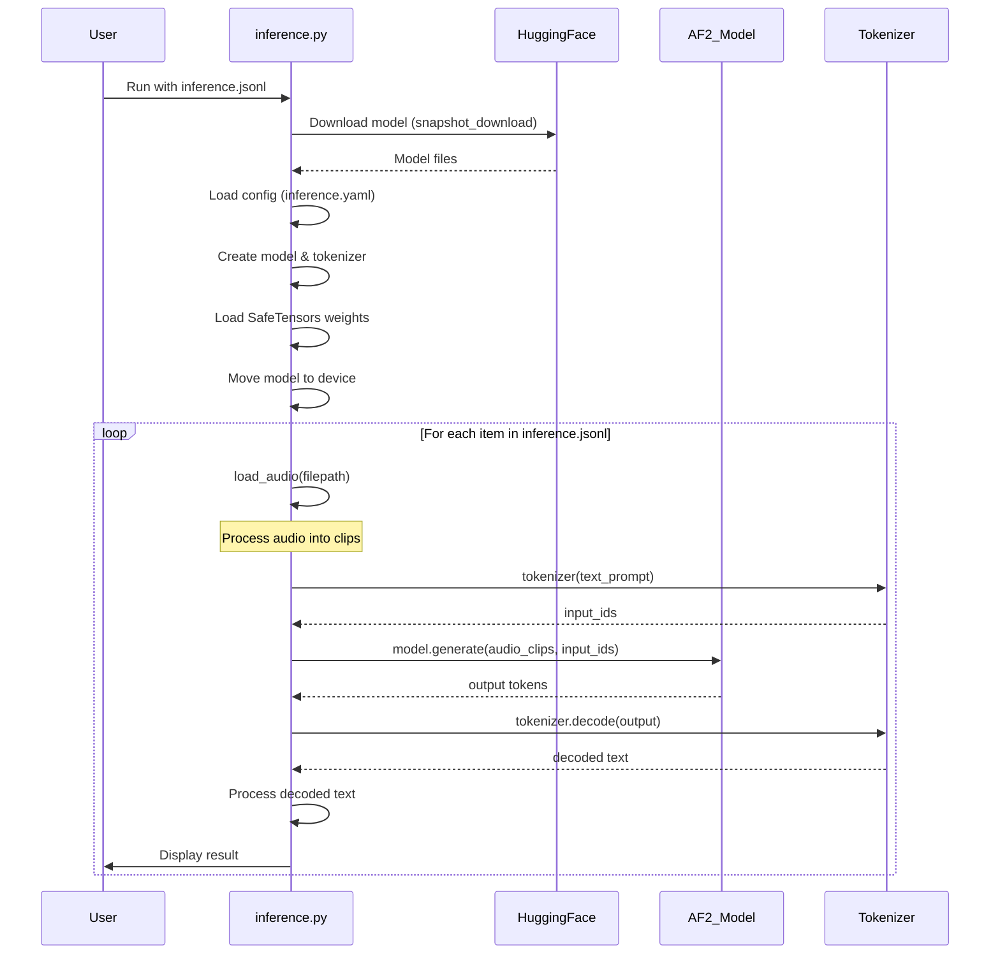

<!-- source: DeepWiki mcp.deepwiki.com · repo NVIDIA/audio-flamingo · page 6 Getting Started · fetched 2026-10-26 -->

# Getting Started

<details>
<summary>Relevant source files</summary>

The following files were used as context for generating this wiki page:

- [README.md](README.md)

</details>


This page provides practical guidance for accessing and using Audio Flamingo models. The Audio Flamingo series is distributed through multiple channels to accommodate different use cases: HuggingFace Hub for pre-trained model checkpoints, GitHub branches for source code and training scripts, and interactive demo platforms for hands-on exploration.

All five model variants (Audio Flamingo 1, Audio Flamingo 2, Sound-CoT, Audio Flamingo 3, and Music Flamingo) are available through these distribution channels with varying levels of accessibility depending on the intended use case.

Sources:
- [README.md:1-233]()

## Accessing Models

### HuggingFace Hub Checkpoints

All Audio Flamingo model variants are available as pre-trained checkpoints on HuggingFace Hub for direct download and inference. The checkpoints are distributed under non-commercial licenses and include model weights, configuration files, and necessary metadata.

**Model Distribution Diagram**



**Available Model Checkpoints**

| Model Variant | Parameters | HuggingFace Repository | Language Model Backbone |
|---------------|------------|------------------------|-------------------------|
| Audio Flamingo 1 | 1.3B | nvidia/audio-flamingo | OPT-IML-1.3B |
| Audio Flamingo 2 | 3B | nvidia/audio-flamingo-2 | Qwen-2.5-3B |
| Audio Flamingo 2 | 1.5B | nvidia/audio-flamingo-2-1.5B | Qwen-2.5-1.5B |
| Audio Flamingo 2 | 0.5B | nvidia/audio-flamingo-2-0.5B | Qwen-2.5-0.5B |
| Sound-CoT | 3B | nvidia/audio-flamingo-2-SoundCoT | Qwen-2.5-3B |
| Audio Flamingo 3 | 7B | nvidia/audio-flamingo-3-hf | Qwen-2.5-7B |
| Audio Flamingo 3 Chat | 7B | nvidia/audio-flamingo-3-chat | Qwen-2.5-7B |
| Music Flamingo | 7B | nvidia/music-flamingo-hf | Qwen-2.5-7B |

Sources:
- [README.md:15-199]()

### GitHub Source Code Branches

The repository maintains separate branches for each model variant, containing training code, inference scripts, and model-specific implementations. Each branch is self-contained with its own documentation and dependencies.

**Branch Structure**

| Model Variant | Branch Name | Primary Contents |
|---------------|-------------|------------------|
| Audio Flamingo 1 | `legacy_audio_flamingo_1` | Flamingo architecture implementation, training scripts |
| Audio Flamingo 2 | `audio_flamingo_2` | 3-stage training pipeline, improved CLAP encoder |
| Sound-CoT | `soundCoT` | Chain-of-thought training code, AF-Reasoning-Eval benchmark |
| Audio Flamingo 3 | `audio_flamingo_3` | LLaVA architecture, AF-Whisper encoder, AF3-Chat module |
| Music Flamingo | `music_flamingo` | Music specialization code, RL training with custom rewards |

To access a specific branch:
```bash
git clone -b <branch_name> https://github.com/NVIDIA/audio-flamingo.git
```

Sources:
- [README.md:220-232]()

### Model Size Variants

Audio Flamingo 2 is available in three parameter sizes to accommodate different computational constraints:

- **3B (Standard)**: Full-capability model with optimal performance-efficiency tradeoff
- **1.5B (Medium)**: Reduced parameter count while maintaining strong performance
- **0.5B (Small)**: Lightweight variant for resource-constrained environments

All three variants share the same architecture and training methodology, differing only in the underlying Qwen-2.5 language model size. Smaller models provide faster inference with minimal accuracy degradation on many tasks.

Sources:
- [README.md:164-168]()

## Interactive Demos

### HuggingFace Spaces

Interactive demonstrations are available on HuggingFace Spaces, providing web-based interfaces for experimenting with Audio Flamingo models without requiring local setup or GPU access.

**Available Demos**

| Model | HuggingFace Space | Features |
|-------|-------------------|----------|
| Audio Flamingo 2 (3B) | nvidia/audio-flamingo-2 | Audio captioning, QA, 5-minute audio support |
| Audio Flamingo 3 (7B) | nvidia/audio_flamingo_3 | Sound/music/speech understanding, 10-minute audio |
| Music Flamingo (7B) | nvidia/music-flamingo | Specialized music analysis, theory-aware captions |

These demos provide:
- Direct file upload for audio files (.wav, .mp3)
- Pre-loaded example audio clips
- Customizable text prompts for different tasks
- Real-time inference results



Sources:
- [README.md:38-40, 85-87, 161]()

### NVIDIA Research Pages

Dedicated research pages hosted on research.nvidia.com provide comprehensive demonstrations, additional examples, and detailed model information.

**Research Page Access**

| Model | URL | Additional Resources |
|-------|-----|---------------------|
| Audio Flamingo 1 | audioflamingo.github.io | Paper, examples, technical details |
| Audio Flamingo 2 | research.nvidia.com/labs/adlr/AF2/ | Extended demos, comparisons |
| Audio Flamingo 3 | research.nvidia.com/labs/adlr/AF3/ | Full audio modality demos, AF3-Chat |
| Music Flamingo | research.nvidia.com/labs/adlr/MF/ | Music-specific examples, benchmarks |

These pages typically include:
- Interactive audio players with model outputs
- Side-by-side comparisons with baseline models
- Detailed performance metrics and benchmarks
- Links to papers and supplementary materials

Sources:
- [README.md:24, 73, 158, 196]()

## Model Usage and Inference

### Setup Requirements

To use Audio Flamingo models locally, ensure the following prerequisites are met:

**System Requirements**
- GPU with sufficient VRAM (recommended: 16GB+ for 3B models, 24GB+ for 7B models)
- CUDA-compatible environment for GPU acceleration
- Python 3.8 or higher

**Software Dependencies**
- PyTorch
- HuggingFace Transformers
- Audio processing libraries (librosa, soundfile)
- SafeTensors for checkpoint loading

Each model branch contains a `requirements.txt` or similar dependency specification file.

Sources:
- [README.md:220-232]()

### Loading Model Checkpoints

Models can be loaded from HuggingFace Hub using the `huggingface_hub` library. The download process fetches model weights, configuration files, and tokenizer data.

**Checkpoint Loading Process**



**Example: Downloading Model from HuggingFace**

The typical pattern for downloading a model checkpoint:

```python
from huggingface_hub import snapshot_download

# Download Audio Flamingo 2 (3B)
snapshot_download(
    repo_id="nvidia/audio-flamingo-2",
    local_dir="./models/af2",
    token="YOUR_HF_TOKEN"  # Required for gated models
)

# Download Audio Flamingo 3 (7B)
snapshot_download(
    repo_id="nvidia/audio-flamingo-3-hf",
    local_dir="./models/af3",
    token="YOUR_HF_TOKEN"
)
```

Model initialization typically involves:
1. Loading configuration from YAML or JSON files
2. Creating model architecture using `create_model_and_transforms()`
3. Loading pretrained weights from SafeTensors format
4. Moving model to appropriate device (GPU/CPU)
5. Setting model to evaluation mode

Sources:
- [README.md:164-168]()

### Running Inference

The inference process follows a standard pipeline across all Audio Flamingo variants, with minor variations for specialized models.

**General Inference Pipeline**



**Key Functions in Inference Pipeline**

- `read_audio()`: Loads audio files, handles MP3/WAV formats, resamples to 16kHz
- `get_num_windows()`: Calculates windowing parameters based on audio duration
- `load_audio()`: Splits audio into overlapping windows, creates attention masks
- `model.generate()`: Performs autoregressive generation given audio and text inputs
- `tokenizer.decode()`: Converts output token IDs back to readable text

**Inference Configuration Parameters**

Generation behavior can be customized through `inference_kwargs`:

| Parameter | Purpose | Typical Values |
|-----------|---------|----------------|
| `do_sample` | Enable sampling vs greedy decoding | True/False |
| `temperature` | Control randomness (0.0 = deterministic) | 0.0-1.0 |
| `top_k` | Limit sampling to top-k tokens | 30-50 |
| `top_p` | Nucleus sampling probability threshold | 0.9-0.95 |
| `num_return_sequences` | Number of responses to generate | 1 |

Sources:
- [README.md:220-232]()

### Example Usage

**Basic Inference Script Structure**

A typical inference workflow involves:

1. **Prepare Input Data**: Create JSONL file with audio paths and prompts
   ```json
   {"path": "audio/dog_bark.wav", "prompt": "What animal sounds do you hear?"}
   {"path": "music/piano.mp3", "prompt": "Describe the musical instruments playing."}
   ```

2. **Configure Model**: Set model path, device, and generation parameters
   ```python
   config = {
       "model_path": "./models/af2",
       "device": "cuda:0",
       "inference_kwargs": {
           "do_sample": True,
           "top_k": 30,
           "top_p": 0.95
       }
   }
   ```

3. **Run Inference Loop**: Process each audio-prompt pair
   ```python
   for item in input_data:
       audio_clips, mask = load_audio(item["path"])
       input_ids = tokenizer(item["prompt"])
       output = model.generate(audio_clips, mask, input_ids, **inference_kwargs)
       response = tokenizer.decode(output)
   ```

**Example Output**

Input audio: Recording of a dog barking  
Prompt: "What animal do you hear in this recording?"  

Response: "I hear a dog barking in this recording. The barking sounds like it's from a medium to large-sized dog, and the dog appears to be barking repeatedly with some pauses in between. The barking has a typical canine quality to it, with a deep, resonant tone that's characteristic of a dog's bark."

**Model-Specific Considerations**

- **Audio Flamingo 2**: Supports audio up to 5 minutes, optimized for general understanding
- **Sound-CoT**: Includes chain-of-thought reasoning in responses
- **Audio Flamingo 3**: Handles all three modalities (sound, music, speech), up to 10 minutes
- **Music Flamingo**: Provides theory-aware music analysis with detailed harmonic descriptions

Sources:
- [README.md:15-217]()

## Required Files

The key files for inference are:

| File | Purpose |
|------|---------|
| `inference_HF_pretrained/inference.py` | Main inference script |
| `inference_HF_pretrained/configs/inference.yaml` | Model and inference configuration |
| `inference_HF_pretrained/inference.jsonl` | Input file with audio paths and prompts |

Sources:
- [inference_HF_pretrained/README.md:3-15]()

## Detailed Audio Processing Pipeline

Audio processing is a critical component that prepares audio inputs for the model:



The audio processing includes these key functions:

1. `read_audio()` - Loads and processes audio files:
   - Handles both MP3 (using AudioSegment) and WAV (using SoundFile)
   - Resamples to 16kHz if needed
   - Normalizes audio data to [-1.0, 1.0] range

2. `get_num_windows()` - Calculates windowing parameters:
   - Determines number of windows based on audio length
   - Sets full length needed for processing

3. `load_audio()` - Prepares audio for model input:
   - Splits audio into overlapping windows
   - Creates embedding mask for attention mechanism
   - Converts to appropriate tensor format

Sources:
- [inference_HF_pretrained/inference.py:30-134]()

## Model Initialization and Loading

The model initialization process:



Sources:
- [inference_HF_pretrained/inference.py:185-219]()

## Generation Parameters

You can customize the text generation behavior by modifying the `inference_kwargs` dictionary in the inference script:

```python
inference_kwargs = {
    "do_sample": True,  # Use sampling (vs greedy decoding)
    "top_k": 30,        # Limit to top 30 tokens
    "top_p": 0.95,      # Nucleus sampling probability threshold
    "num_return_sequences": 1  # Number of responses to generate
}
```

Note that the research paper uses temperature=0.0 for benchmarking purposes, but sampling with temperature>0 often produces more varied and interesting outputs.

Sources:
- [inference_HF_pretrained/inference.py:232-237]()
- [inference_HF_pretrained/README.md:9]()

## Switching Model Sizes

To use a different model size:

1. Change the `repo_id` in the inference script:
   ```python
   # For 0.5B model (smallest)
   snapshot_download(repo_id="nvidia/audio-flamingo-2-0.5B", local_dir="./", token="YOUR_HF_TOKEN")
   
   # For 1.5B model (medium)
   snapshot_download(repo_id="nvidia/audio-flamingo-2-1.5B", local_dir="./", token="YOUR_HF_TOKEN")
   ```

2. Update the language model path in the config file:
   ```yaml
   # For 0.5B model
   lm_path: Qwen/Qwen2.5-0.5B
   
   # For 1.5B model
   lm_path: Qwen/Qwen2.5-1.5B
   ```

Sources:
- [inference_HF_pretrained/README.md:7-9]()

## Prediction Function Workflow

The `predict()` function orchestrates the entire inference process:



Sources:
- [inference_HF_pretrained/inference.py:136-174]()

## Example Usage and Output

Here's a complete inference example:

1. Input in `inference.jsonl`:
```json
{"path": "samples/dog_barking.wav", "prompt": "What animal do you hear in this recording?"}
```

2. Run inference:
```bash
python inference.py --input inference.jsonl
```

3. Output:
```
Prompt: What animal do you hear in this recording?
Audio Flamingo 2: I hear a dog barking in this recording. The barking sounds like it's from a medium to large-sized dog, and the dog appears to be barking repeatedly with some pauses in between. The barking has a typical canine quality to it, with a deep, resonant tone that's characteristic of a dog's bark.
```

Sources:
- [inference_HF_pretrained/inference.py:171-172]()

## Full Process Sequence Diagram

The complete execution sequence when running the inference script:



Sources:
- [inference_HF_pretrained/inference.py:177-240]()

## License Information

The inference code is provided under the MIT license, but the checkpoints themselves are subject to different licensing terms:

- The checkpoints are for non-commercial use only (NVIDIA OneWay Noncommercial License)
- They are also subject to the Qwen Research license and other terms related to the training data

For full license details, please refer to the repository documentation.

Sources:
- [inference_HF_pretrained/README.md:17-21]()

---

