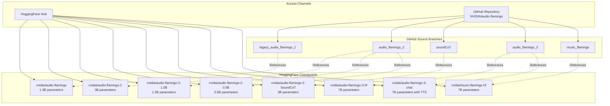
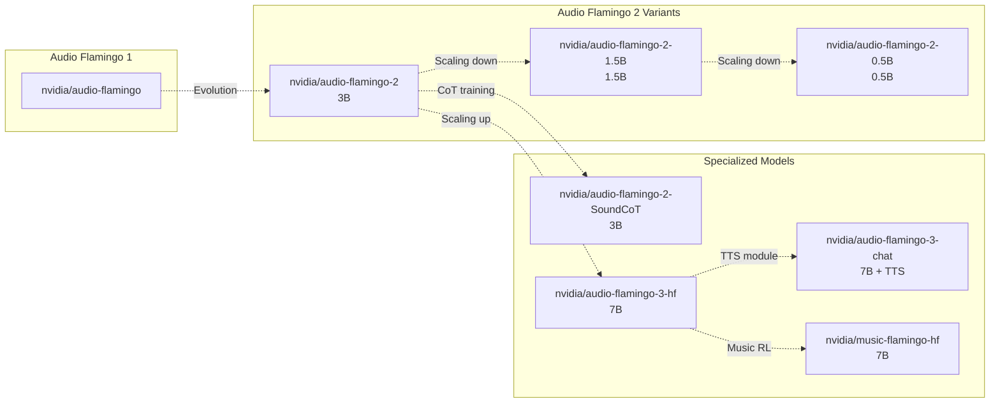
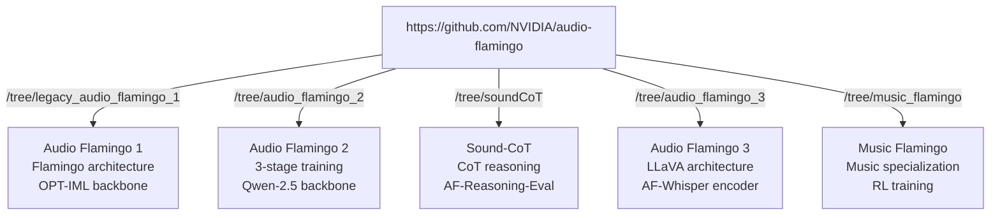
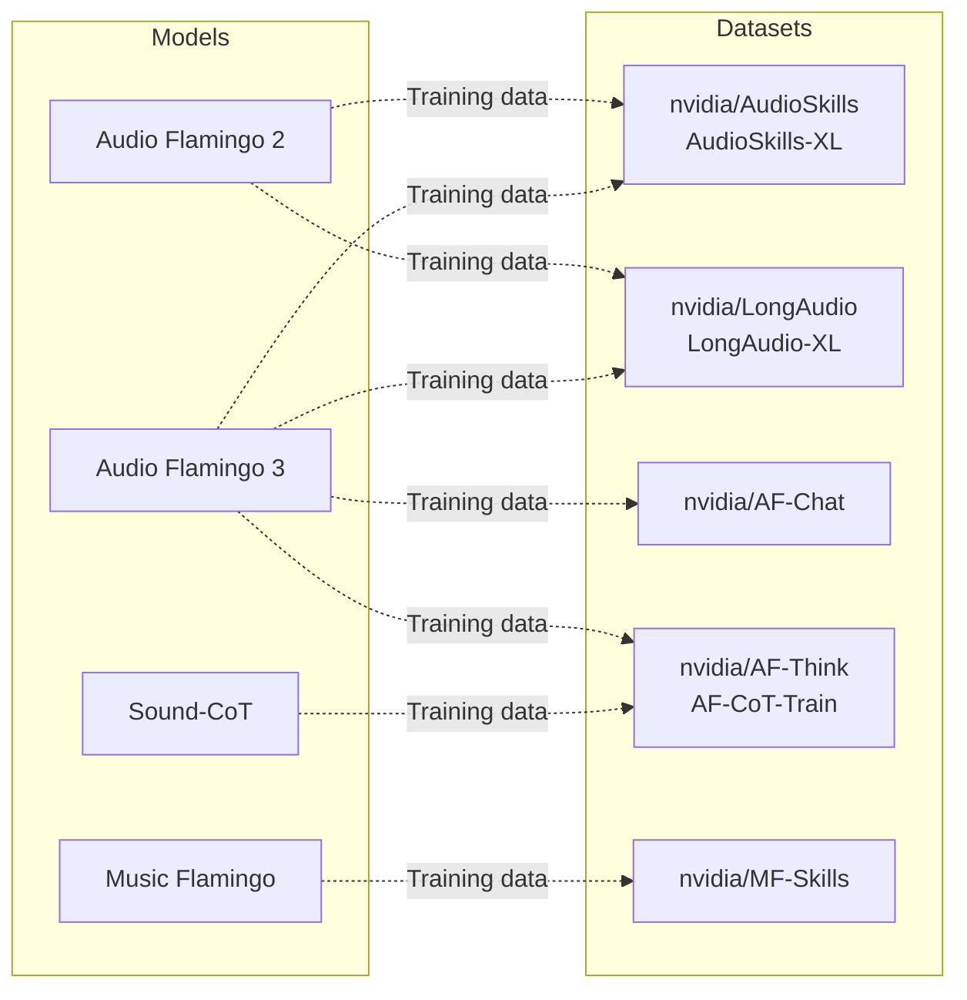

<!-- source: DeepWiki mcp.deepwiki.com · repo NVIDIA/audio-flamingo · page 6.1 Accessing Models · fetched 2026-10-26 -->

# Accessing Models

Relevant source files

The following files were used as context for generating this wiki page:

- [README.md](README.md)

This page documents how to access Audio Flamingo model checkpoints and source code through HuggingFace Hub and GitHub branches. It covers all five model variants with their respective parameter sizes and provides guidance on selecting the appropriate access method for different use cases.

For information about model usage and inference procedures, see [Model Usage and Inference](#6.3). For details about interactive demonstrations, see [Interactive Demos](#6.2).

## Overview

Audio Flamingo models are distributed through two primary channels: **HuggingFace Hub** for pre-trained model checkpoints and **GitHub branches** for source code, training scripts, and inference implementations. Each of the five model variants is hosted independently with distinct repository identifiers.

Sources: [README.md:1-233]()

## Distribution Architecture

The following diagram illustrates the complete distribution ecosystem for accessing Audio Flamingo models:

Sources: [README.md:1-233]()

## HuggingFace Hub Checkpoints

All Audio Flamingo model checkpoints are hosted on HuggingFace Hub under the `nvidia` organization. These checkpoints are ready for direct inference and fine-tuning without requiring training infrastructure.

### Complete Checkpoint Listing

| Model Variant | HuggingFace Repository | Parameters | Specialization |
|---------------|------------------------|------------|----------------|
| Audio Flamingo 1 | `nvidia/audio-flamingo` | 1.3B | Few-shot learning, dialogue |
| Audio Flamingo 2 | `nvidia/audio-flamingo-2` | 3B | Long-audio, expert reasoning |
| Audio Flamingo 2 | `nvidia/audio-flamingo-2-1.5B` | 1.5B | Efficient variant |
| Audio Flamingo 2 | `nvidia/audio-flamingo-2-0.5B` | 0.5B | Lightweight variant |
| Sound-CoT | `nvidia/audio-flamingo-2-SoundCoT` | 3B | Chain-of-thought reasoning |
| Audio Flamingo 3 | `nvidia/audio-flamingo-3-hf` | 7B | Sound, music, speech |
| Audio Flamingo 3 Chat | `nvidia/audio-flamingo-3-chat` | 7B | With streaming TTS |
| Music Flamingo | `nvidia/music-flamingo-hf` | 7B | Music understanding |

Sources: [README.md:15-18](), [README.md:165-167](), [README.md:79-84](), [README.md:30-32](), [README.md:137-138](), [README.md:199]()

### Access Pattern by Model Variant

Sources: [README.md:15-18](), [README.md:165-167](), [README.md:137-138]()

### Checkpoint Versioning

Audio Flamingo 2 checkpoints include version identifiers in their HuggingFace repository badges:

- `nvidia/audio-flamingo-2`: Version `v20250625`
- `nvidia/audio-flamingo-2-1.5B`: Version `v20250625`
- `nvidia/audio-flamingo-2-0.5B`: Version `v20250625`

This versioning scheme indicates the checkpoint release date and may be updated for future model improvements.

Sources: [README.md:165-167]()

## GitHub Branch Structure

Source code for each model variant is maintained in separate GitHub branches within the `NVIDIA/audio-flamingo` repository. Each branch contains complete implementations for training, inference, evaluation, and model-specific utilities.

### Branch Naming Convention

| Model Variant | Branch Name | Code Structure |
|---------------|-------------|----------------|
| Audio Flamingo 1 | `legacy_audio_flamingo_1` | Training and inference for Flamingo architecture |
| Audio Flamingo 2 | `audio_flamingo_2` | 3-stage training pipeline |
| Sound-CoT | `soundCoT` | CoT reasoning implementation |
| Audio Flamingo 3 | `audio_flamingo_3` | LLaVA architecture, AF-Whisper encoder |
| Music Flamingo | `music_flamingo` | RL training with custom rewards |

Sources: [README.md:220-232]()

### Branch Access URLs

Sources: [README.md:220-232]()

### Branch Content Organization

Each branch follows this general structure (specific paths may vary):

- Training scripts and configuration files
- Model architecture definitions
- Inference utilities and example code
- Evaluation benchmarks and scripts
- Dataset loading and preprocessing code
- Checkpoint conversion tools (for HuggingFace compatibility)
- Branch-specific `README.md` with detailed usage instructions
- `incl_licenses` directory containing dependency licenses

Sources: [README.md:220-232](), [README.md:238]()

## Model Size Variants

Audio Flamingo 2 is available in three parameter sizes to accommodate different computational budgets and deployment scenarios:

### Parameter Scale Comparison

| Variant | Parameters | Use Case | HuggingFace Repository |
|---------|------------|----------|------------------------|
| Full | 3B | Maximum performance, research | `nvidia/audio-flamingo-2` |
| Medium | 1.5B | Balanced performance/efficiency | `nvidia/audio-flamingo-2-1.5B` |
| Small | 0.5B | Edge deployment, low-resource | `nvidia/audio-flamingo-2-0.5B` |

All three variants share:
- Same training methodology (3-stage pipeline)
- Same Qwen-2.5 architecture family
- Same audio encoder (improved CLAP)
- Same training datasets (AudioSkills, LongAudio)

The smaller variants achieve reduced parameter counts through architectural scaling (fewer layers, reduced hidden dimensions) while maintaining the core model design.

Sources: [README.md:165-167](), [README.md:171-172]()

## Access Method Selection Guide

The following table provides guidance on which access method to use based on your intended use case:

| Use Case | Recommended Access | Resource |
|----------|-------------------|----------|
| Inference with pre-trained models | HuggingFace Hub checkpoints | Model repositories under `nvidia/*` |
| Fine-tuning on custom data | HuggingFace Hub checkpoints + Branch code | Checkpoints + training scripts from branches |
| Reproducing published results | GitHub branches | Full training pipeline in respective branches |
| Understanding model architecture | GitHub branches | Architecture definitions and documentation |
| Developing new features | GitHub branches | Complete source code for modification |
| Quick experimentation | HuggingFace Hub checkpoints | Direct loading via transformers library |
| Production deployment | HuggingFace Hub checkpoints | Optimized checkpoint format |

Sources: [README.md:1-233]()

## License Considerations

Access to models requires compliance with specific licenses depending on the model variant:

### Checkpoint Licenses

- All checkpoints on HuggingFace Hub: **NVIDIA OneWay Noncommercial License** (non-commercial use only)
- Additional restrictions documented in branch-specific `README` and `incl_licenses` directories

### Backbone Model Licenses

- **Audio Flamingo 1**: Subject to OPT-IML license
- **Audio Flamingo 2, 3, Sound-CoT, Music Flamingo**: Subject to Qwen RESEARCH LICENSE AGREEMENT (Copyright © Alibaba Cloud)

### Source Code License

- Repository code: **MIT License**

Users must review all applicable licenses before downloading or using any model checkpoints. License files are included in both HuggingFace repositories and GitHub branches.

Sources: [README.md:235-240]()

## Cross-Reference: Related Resources

Each model variant includes associated datasets also available on HuggingFace:

For detailed information about these datasets, see [Core Dataset Collections](#4.2) and [Specialized Training Datasets](#4.3).

Sources: [README.md:91-102](), [README.md:140-142](), [README.md:33-35]()

---

