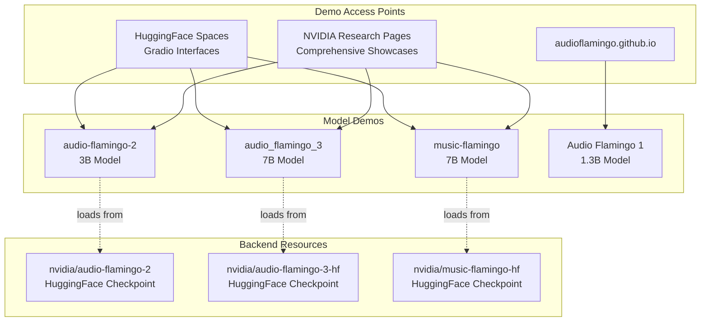
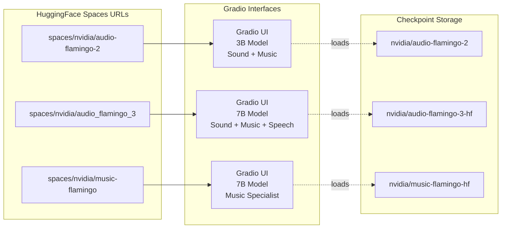
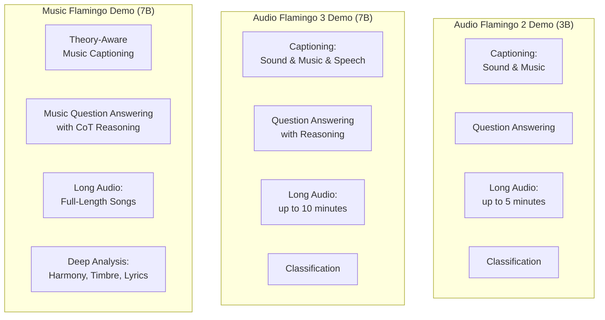
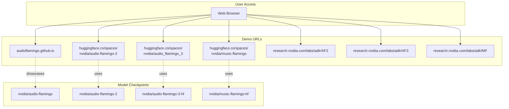

<!-- source: DeepWiki mcp.deepwiki.com · repo NVIDIA/audio-flamingo · page 6.2 Interactive Demos · fetched 2026-10-26 -->

# Interactive Demos

Relevant source files

The following files were used as context for generating this wiki page:

- [README.md](README.md)

This page documents the interactive demonstration platforms available for hands-on experience with Audio Flamingo models. It covers the two primary demo channels (HuggingFace Spaces and NVIDIA research pages), which models have live demos, and how to access them. For information about accessing model checkpoints and source code, see [Accessing Models](#6.1). For practical inference usage patterns, see [Model Usage and Inference](#6.3).

## Overview

The Audio Flamingo series provides interactive demonstrations through two primary channels: HuggingFace Spaces for Gradio-based web interfaces, and NVIDIA research pages for comprehensive model showcases. Not all model variants have live demos—interactive demonstrations are available for Audio Flamingo 1, Audio Flamingo 2, Audio Flamingo 3, and Music Flamingo. Audio Flamingo Sound-CoT does not have a dedicated interactive demo space.

**Available Demo Platforms by Model:**

| Model Variant | HuggingFace Spaces | NVIDIA Research Page | Model Size |
|--------------|-------------------|---------------------|------------|
| Audio Flamingo 1 | ❌ | ✅ `audioflamingo.github.io` | 1.3B |
| Audio Flamingo 2 | ✅ `nvidia/audio-flamingo-2` | ✅ `research.nvidia.com/labs/adlr/AF2/` | 3B |
| Sound-CoT | ❌ | ❌ | 3B |
| Audio Flamingo 3 | ✅ `nvidia/audio_flamingo_3` | ✅ `research.nvidia.com/labs/adlr/AF3/` | 7B |
| Music Flamingo | ✅ `nvidia/music-flamingo` | ✅ `research.nvidia.com/labs/adlr/MF/` | 7B |

Sources: [README.md:1-299]()

## Demo Ecosystem Architecture

**Demo Ecosystem Architecture**

This diagram shows the dual-channel demo distribution strategy. HuggingFace Spaces hosts Gradio-based interactive interfaces for AF2, AF3, and Music Flamingo, while NVIDIA research pages provide comprehensive showcases for the same models plus AF1. Each Gradio demo loads model checkpoints directly from HuggingFace Hub.

Sources: [README.md:20-200]()

## HuggingFace Spaces Demos

HuggingFace Spaces hosts Gradio-based web interfaces for three Audio Flamingo models, providing direct browser-based interaction without requiring local installation or GPU resources.

### Audio Flamingo 2 Demo

**Access:** `https://huggingface.co/spaces/nvidia/audio-flamingo-2`

The Audio Flamingo 2 demo runs the 3B parameter model and supports:
- Audio captioning for sound and music
- Question answering about audio content
- Classification tasks
- Long-audio understanding up to 5 minutes

**Model Backend:** Loads from `nvidia/audio-flamingo-2` checkpoint on HuggingFace Hub.

Sources: [README.md:161-161]()

### Audio Flamingo 3 Demo

**Access:** `https://huggingface.co/spaces/nvidia/audio_flamingo_3`

The Audio Flamingo 3 demo runs the 7B parameter model and supports:
- Unified understanding across sound, music, and speech modalities
- Audio captioning with enhanced detail
- Question answering with reasoning capabilities
- Long-audio processing up to 10 minutes

**Model Backend:** Loads from `nvidia/audio-flamingo-3-hf` checkpoint on HuggingFace Hub.

Sources: [README.md:85-87]()

### Music Flamingo Demo

**Access:** `https://huggingface.co/spaces/nvidia/music-flamingo`

The Music Flamingo demo runs the 7B parameter model specialized for music understanding and supports:
- Theory-aware music captioning (harmony, structure, timbre)
- Lyrics analysis and cultural context understanding
- Chain-of-thought reasoning about musical content
- Long-form song reasoning over full-length audio

**Model Backend:** Loads from `nvidia/music-flamingo-hf` checkpoint on HuggingFace Hub.

Sources: [README.md:39-39]()

**HuggingFace Spaces Demo Infrastructure**

This diagram maps the specific HuggingFace Spaces URLs to their Gradio interfaces and backend checkpoint sources. Each demo runs in an isolated Gradio environment and loads pre-trained weights from the corresponding HuggingFace model repository.

Sources: [README.md:39-39](), [README.md:85-87](), [README.md:161-161]()

## NVIDIA Research Pages

NVIDIA hosts dedicated research pages for Audio Flamingo models, providing comprehensive demonstrations with additional context, examples, and documentation beyond the Gradio interfaces.

### Research Page URLs

| Model | Research Page URL | Documentation |
|-------|------------------|---------------|
| Audio Flamingo 1 | `https://audioflamingo.github.io/` | ICML 2024 paper showcase |
| Audio Flamingo 2 | `https://research.nvidia.com/labs/adlr/AF2/` | ICML 2025 paper showcase |
| Audio Flamingo 3 | `https://research.nvidia.com/labs/adlr/AF3/` | NeurIPS 2025 paper showcase |
| Music Flamingo | `https://research.nvidia.com/labs/adlr/MF/` | arXiv paper showcase |

These research pages typically include:
- Interactive demo interfaces (may embed HuggingFace Spaces or provide custom implementations)
- Detailed model descriptions and architectural diagrams
- Performance benchmarks and comparison charts
- Example audio inputs with generated outputs
- Links to papers, code branches, and checkpoints

Sources: [README.md:24-24](), [README.md:73-73](), [README.md:158-158](), [README.md:196-196]()

## Demo Capabilities Comparison

**Capability Coverage Across Demo Platforms**

This diagram illustrates the feature differences between the three active Gradio demos. Audio Flamingo 3 extends AF2 with speech understanding and longer audio support. Music Flamingo specializes AF3 for deep music understanding with theory-aware outputs and chain-of-thought reasoning.

Sources: [README.md:42-49](), [README.md:105-109](), [README.md:171-172]()

## Accessing Demos

### Direct Browser Access

All demos can be accessed directly through web browsers without authentication or local setup:

1. **HuggingFace Spaces**: Navigate to the spaces URL and use the Gradio interface immediately
2. **NVIDIA Research Pages**: Visit the research page URL for embedded demos or custom interfaces

### Requirements

- Modern web browser (Chrome, Firefox, Safari, Edge)
- Internet connection
- No GPU or special hardware required (inference runs on HuggingFace servers for Spaces demos)
- Audio file upload capability or microphone access for audio input

### Usage Limitations

HuggingFace Spaces demos may have:
- Queue wait times during high traffic
- Input audio duration limits (5-10 minutes depending on model)
- Rate limiting for repeated requests
- Temporary unavailability during maintenance

Sources: [README.md:85-87](), [README.md:161-161](), [README.md:39-39]()

## Demo URL Reference Table

For quick reference, here is a complete listing of all demo URLs with their associated model checkpoints and documentation:

| Component | URL/Path | Type |
|-----------|----------|------|
| **AF1 Demo** | `https://audioflamingo.github.io/` | Research Page |
| **AF1 Checkpoint** | `nvidia/audio-flamingo` | HuggingFace Model |
| **AF2 Demo (HF)** | `https://huggingface.co/spaces/nvidia/audio-flamingo-2` | Gradio Space |
| **AF2 Demo (NVIDIA)** | `https://research.nvidia.com/labs/adlr/AF2/` | Research Page |
| **AF2 Checkpoint** | `nvidia/audio-flamingo-2` | HuggingFace Model |
| **AF3 Demo (HF)** | `https://huggingface.co/spaces/nvidia/audio_flamingo_3` | Gradio Space |
| **AF3 Demo (NVIDIA)** | `https://research.nvidia.com/labs/adlr/AF3/` | Research Page |
| **AF3 Checkpoint** | `nvidia/audio-flamingo-3-hf` | HuggingFace Model |
| **MF Demo (HF)** | `https://huggingface.co/spaces/nvidia/music-flamingo` | Gradio Space |
| **MF Demo (NVIDIA)** | `https://research.nvidia.com/labs/adlr/MF/` | Research Page |
| **MF Checkpoint** | `nvidia/music-flamingo-hf` | HuggingFace Model |

**Complete Demo Access Map**

This diagram provides a comprehensive view of all demo access points, showing how browser access flows to either HuggingFace Spaces or NVIDIA research pages, and which model checkpoints each demo utilizes.

Sources: [README.md:1-299]()

---

