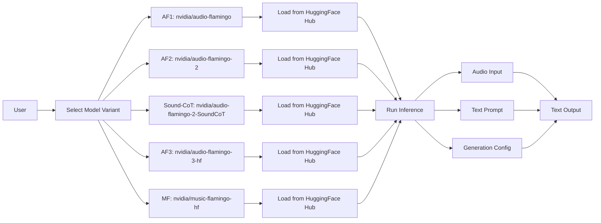
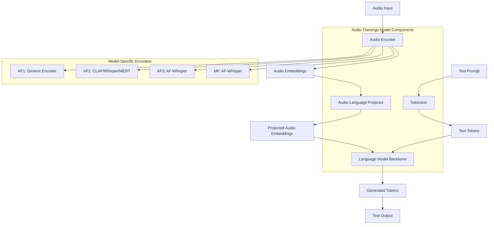
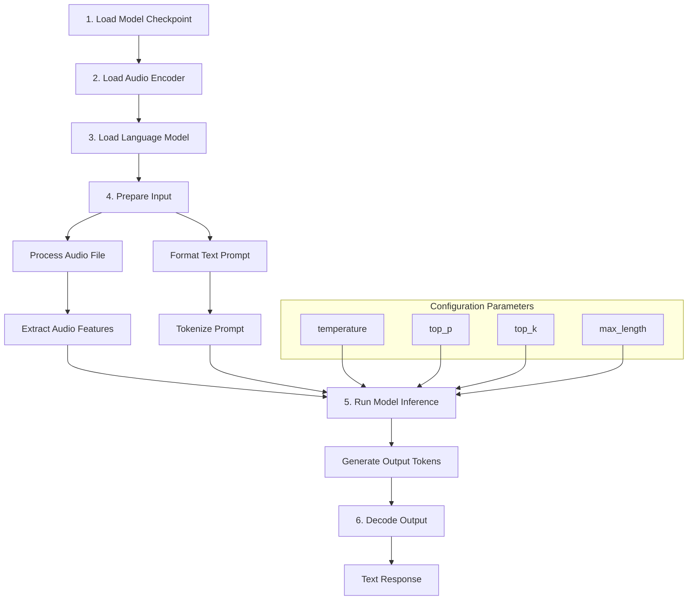
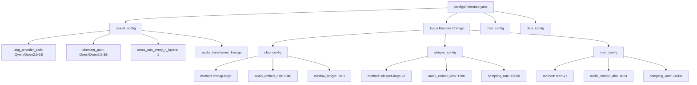
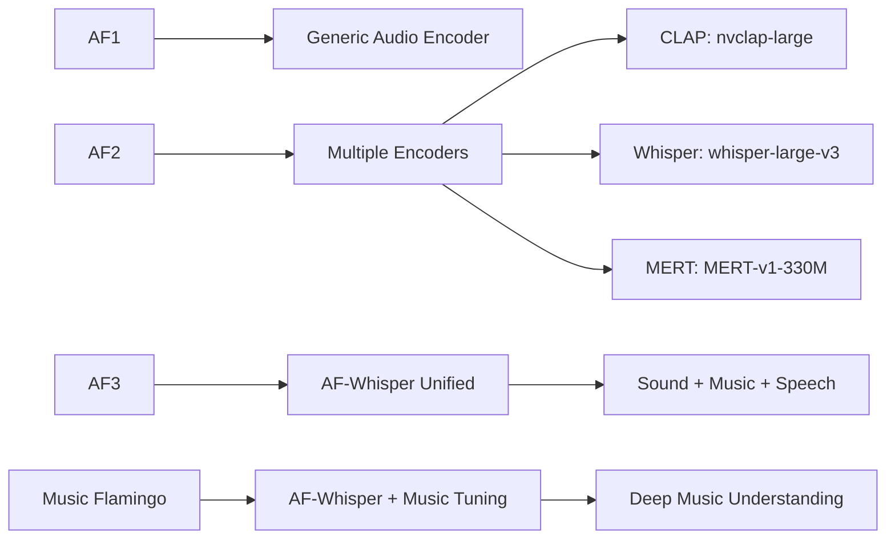
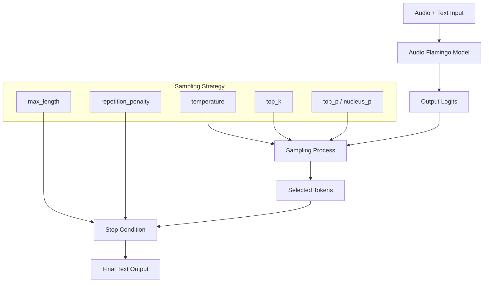

<!-- source: DeepWiki mcp.deepwiki.com · repo NVIDIA/audio-flamingo · page 6.3 Model Usage and Inference · fetched 2026-10-26 -->

# Model Usage and Inference

<details>
<summary>Relevant source files</summary>

The following files were used as context for generating this wiki page:

- [README.md](README.md)

</details>


This page provides practical guidance for running inference with Audio Flamingo models. It covers loading model checkpoints from HuggingFace Hub, basic inference patterns, and configuration options. Each model variant has its own branch-specific implementation details, which are documented in their respective branches (see page 1.2 for repository structure).

## Overview of Model Usage

Audio Flamingo models are available as pretrained checkpoints on HuggingFace Hub. Each model variant has its own repository and usage pattern:

**Model Usage Flow**



Sources: [README.md:14-19](), [README.md:69-104](), [README.md:153-168](), [README.md:192-200]()

## Loading Models from HuggingFace Hub

All Audio Flamingo models are hosted on HuggingFace Hub and can be loaded using standard HuggingFace APIs. The general pattern involves specifying the model repository ID and loading the appropriate components.

**Available Model Repositories**

| Model Variant | Repository ID | Parameters | Key Features |
|---------------|---------------|------------|--------------|
| Audio Flamingo 1 | `nvidia/audio-flamingo` | 1.3B | Few-shot learning, dialogue |
| Audio Flamingo 2 | `nvidia/audio-flamingo-2` | 3B | Long audio, 3-stage training |
| Audio Flamingo 2 | `nvidia/audio-flamingo-2-1.5B` | 1.5B | Medium-size variant |
| Audio Flamingo 2 | `nvidia/audio-flamingo-2-0.5B` | 0.5B | Lightweight variant |
| Sound-CoT | `nvidia/audio-flamingo-2-SoundCoT` | 3B | Chain-of-thought reasoning |
| Audio Flamingo 3 | `nvidia/audio-flamingo-3-hf` | 7B | Unified encoder, 10-min audio |
| Audio Flamingo 3 Chat | `nvidia/audio-flamingo-3-chat` | 7B | Streaming TTS support |
| Music Flamingo | `nvidia/music-flamingo-hf` | 7B | Music specialization |

**Model Components Architecture**



Sources: [README.md:14-19](), [README.md:69-109](), [README.md:153-173]()

## Basic Inference Workflow

The inference workflow for Audio Flamingo models follows a common pattern across variants, with model-specific implementations in their respective branches.

**General Inference Pipeline**



**Branch-Specific Code Structure**

Each model variant has its own implementation in a dedicated branch:

- **AF1**: `legacy_audio_flamingo_1` branch - Flamingo architecture implementation
- **AF2**: `audio_flamingo_2` branch - 3-stage trained model with CLAP/Whisper/MERT support
- **Sound-CoT**: `soundCoT` branch - Chain-of-thought reasoning variant
- **AF3**: `audio_flamingo_3` branch - LLaVA architecture with AF-Whisper
- **Music Flamingo**: `music_flamingo` branch - Music-specialized variant

Sources: [README.md:220-232]()

## Model-Specific Usage Patterns

### Audio Flamingo 2 Configuration

Audio Flamingo 2 provides detailed configuration options through YAML files. The inference configuration is managed through `configs/inference.yaml` in the `audio_flamingo_2` branch.

**Audio Flamingo 2 Model Sizes**

| Model Size | Repository ID | Language Model Backbone |
|------------|---------------|------------------------|
| 0.5B | `nvidia/audio-flamingo-2-0.5B` | `Qwen/Qwen2.5-0.5B` |
| 1.5B | `nvidia/audio-flamingo-2-1.5B` | `Qwen/Qwen2.5-1.5B` |
| 3B | `nvidia/audio-flamingo-2` | `Qwen/Qwen2.5-3B` |

**AF2 Model Configuration Structure**



Sources: [README.md:153-173]()

### Audio Flamingo 3 Usage

Audio Flamingo 3 uses the LLaVA architecture with the unified AF-Whisper encoder. It supports audio inputs up to 10 minutes and handles all three audio modalities (sound, music, speech).

**AF3 Key Features**

- **Unified Encoder**: AF-Whisper handles sound, music, and speech in a single model
- **Extended Context**: Supports up to 10 minutes of audio input
- **LLaVA Architecture**: More efficient multimodal fusion than Flamingo
- **Chat Variant**: AF3-Chat includes streaming TTS capabilities

Sources: [README.md:69-109]()

### Music Flamingo Usage

Music Flamingo is built on the AF3 backbone with specialized training for music understanding. It incorporates chain-of-thought reasoning and reinforcement learning with custom rewards.

**Music Flamingo Specializations**

- Deep music analysis (harmony, structure, timbre, lyrics, cultural context)
- Chain-of-thought reasoning for complex music queries
- Optimized for full-length song understanding
- Trained on MF-Skills dataset for music-specific tasks

Sources: [README.md:20-66]()

## Audio Processing and Configuration

Different Audio Flamingo variants use different audio encoders, each with specific configuration parameters. Audio Flamingo 2 provides the most flexible configuration system with support for multiple encoder types.

**Audio Encoder Evolution**



### Audio Flamingo 2 Audio Processing

Audio Flamingo 2 supports three audio encoder options: CLAP, Whisper, and MERT. Each encoder has distinct characteristics for different use cases.

**Audio Encoder Comparison**

| Encoder | Embedding Dim | Sampling Rate | Best For | Max Audio Length |
|---------|---------------|---------------|----------|------------------|
| CLAP (nvclap-large) | 2048 | N/A | General audio understanding | ~1.5 min (configurable) |
| Whisper (whisper-large-v3) | 1280 | 16000 Hz | Speech-heavy content | Configurable |
| MERT (mert-v1) | 1024 | 24000 Hz | Music understanding | Configurable |

**Audio Processing Parameters**

Common parameters across audio encoders:

| Parameter | Description | Typical Values | Impact |
|-----------|-------------|----------------|--------|
| `window_length` | Duration of audio segment in seconds | 10.0, 30.0 | Controls granularity of audio processing |
| `window_overlap` | Overlap between consecutive segments | 0.0, 1.0 | Smooths transitions for long audio |
| `max_num_window` | Maximum number of segments per audio | 1, 9, 15 | Determines max audio duration |
| `max_num_fewshot` | Number of few-shot examples | 1 | Enables in-context learning |
| `audio_embed_dim` | Dimension of audio embeddings | 1024, 1280, 2048 | Affects model capacity |
| `sampling_rate` | Audio sampling rate in Hz | 16000, 24000 | Audio quality and compatibility |

**Calculating Maximum Audio Duration**

The maximum audio duration supported depends on the encoder configuration:

```
max_audio_duration = window_length × max_num_window - window_overlap × (max_num_window - 1)
```

Example for CLAP default settings:
- `window_length = 10.0` seconds
- `max_num_window = 9`
- `window_overlap = 0.0` seconds
- Maximum duration: 10.0 × 9 = 90 seconds (~1.5 minutes)

Sources: [README.md:153-173]()

## Generation Configuration and Sampling

Text generation in Audio Flamingo models is controlled by sampling parameters that affect the quality and diversity of outputs. These parameters are typically set during inference.

**Generation Parameter Flow**



**Key Generation Parameters**

| Parameter | Description | Typical Values | Use Case |
|-----------|-------------|----------------|----------|
| `temperature` | Controls randomness in sampling | 0.0-1.0 | 0.0 for deterministic, 0.7-0.9 for creative |
| `top_k` | Limits to top K most likely tokens | 10-100 | Reduces unlikely outputs |
| `top_p` (nucleus) | Cumulative probability threshold | 0.8-0.95 | Balances diversity and quality |
| `max_length` | Maximum output tokens | 128-512 | Controls response length |
| `repetition_penalty` | Discourages repeated tokens | 1.0-1.2 | Prevents repetitive outputs |

**Generation Strategy Examples**

- **Deterministic (benchmarking)**: `temperature=0.0`, produces consistent outputs
- **Balanced**: `temperature=0.7, top_p=0.9, top_k=50`, good for general use
- **Creative**: `temperature=0.9, top_p=0.95`, more diverse but less predictable
- **Conservative**: `temperature=0.5, top_p=0.85, top_k=30`, more focused outputs

Sources: [README.md:153-173]()

## Complete Configuration Example

Below is a complete configuration example for running inference with the 1.5B model:

1. Update `repo_id` in `inference.py`:
   ```python
   repo_id = "nvidia/audio-flamingo-2-1.5B"
   ```

2. Update language model path in `configs/inference.yaml`:
   ```yaml
   model_config:
     cache_dir: .cache
     lang_encoder_path: Qwen/Qwen2.5-1.5B
     tokenizer_path: Qwen/Qwen2.5-1.5B
     # other parameters remain the same
   ```

3. Customize audio processing parameters if needed:
   ```yaml
   clap_config:  
     method: nvclap-large
     # Increase window length for longer audio segments
     window_length: 15.0
     # Add slight overlap between segments
     window_overlap: 1.0
     # Increase for longer audio files (up to ~2.5 minutes)
     max_num_window: 15
   ```

4. Modify sampling parameters in `inference.py`:
   ```python
   # For more creative outputs
   outputs = pipe(prompt, temperature=0.7, top_p=0.9, top_k=50, max_length=512)
   ```

Sources: [inference_HF_pretrained/README.md:7-15](), [inference_HF_pretrained/configs/inference.yaml:45-91]()

## Additional Configuration Notes

1. **Audio File Processing**: The configuration allows for processing audio files of various lengths:
   - CLAP with default settings can process ~1.5 minutes of audio
   - To process longer audio (up to 5 minutes), adjust `max_num_window` accordingly

2. **Model Performance Tradeoffs**:
   - Smaller models (0.5B) are faster but may have lower quality
   - Larger models (3B) provide better quality at the cost of slower inference and higher memory usage

3. **Few-Shot Learning**: The `max_num_fewshot` parameter controls how many examples the model can use for in-context learning.

Sources: [inference_HF_pretrained/configs/inference.yaml:45-76]()

---

