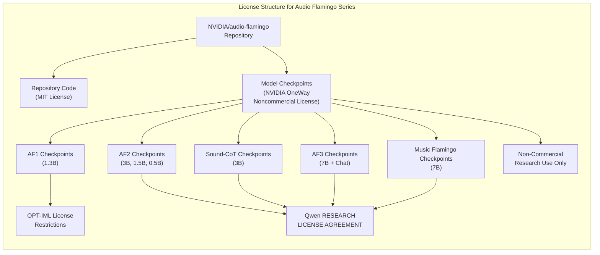
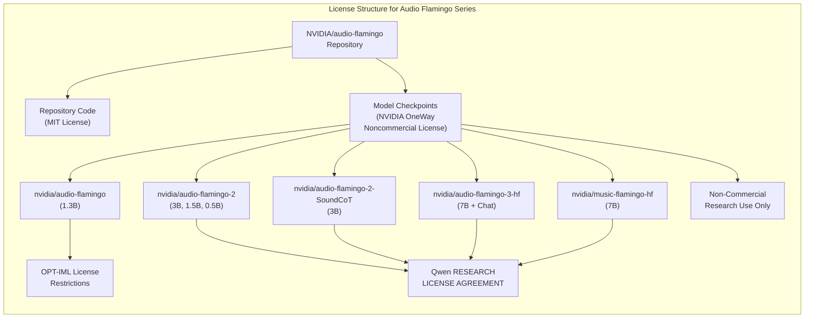
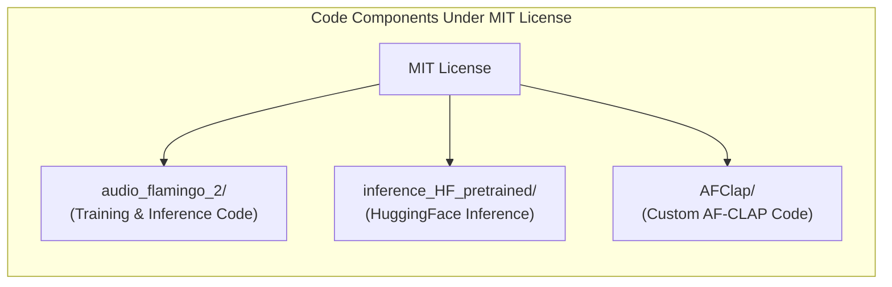
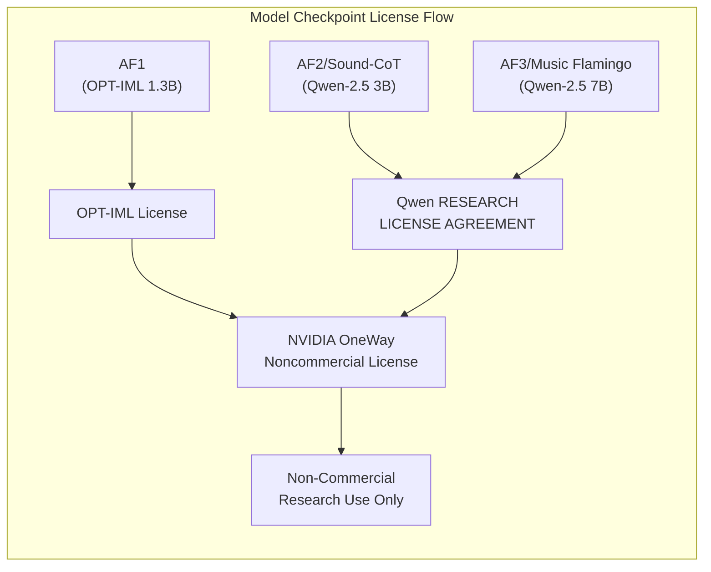
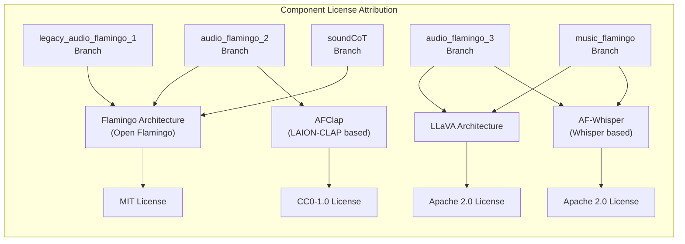
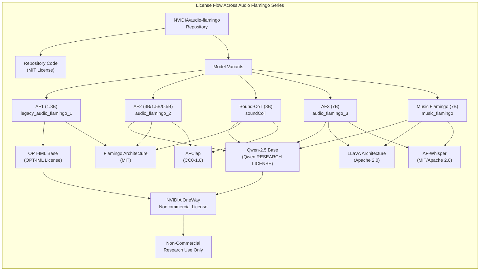
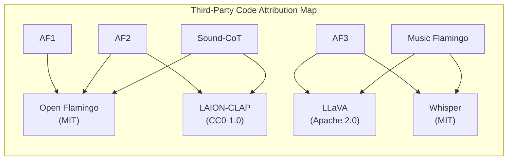

<!-- source: DeepWiki mcp.deepwiki.com · repo NVIDIA/audio-flamingo · page 7 License and Attribution · fetched 2026-10-26 -->

# License and Attribution

<details>
<summary>Relevant source files</summary>

The following files were used as context for generating this wiki page:

- [README.md](README.md)

</details>


This document provides comprehensive information about licensing terms, attribution requirements, and legal considerations for the Audio Flamingo series repository and its five model variants. Understanding these licensing terms is critical for proper usage and compliance when working with this codebase.

## Overview of Licensing Structure

The Audio Flamingo repository has a multi-layered licensing structure where different components and model variants are governed by different licenses:


Sources: [README.md:235-240]()
</thinking>

## Repository Code License

The source code in the Audio Flamingo repository is released under the MIT License across all branches, which is permissive and allows for both commercial and non-commercial use, modification, and distribution with minimal restrictions.

### MIT License Coverage Across Branches

The MIT License applies to code in all five model branches:

| Branch | Code Path | License |
|--------|-----------|---------|
| `legacy_audio_flamingo_1` | Training and inference code | MIT License |
| `audio_flamingo_2` | Training and inference code, AFClap components | MIT License |
| `soundCoT` | Training and inference code | MIT License |
| `audio_flamingo_3` | Training and inference code | MIT License |
| `music_flamingo` | Training and inference code | MIT License |

Sources: [README.md:237]()
</old_str>
<new_str>
# License and Attribution

This document provides comprehensive information about licensing terms, attribution requirements, and legal considerations for the Audio Flamingo series repository and its five model variants. Understanding these licensing terms is critical for proper usage and compliance when working with this codebase.

## Overview of Licensing Structure

The Audio Flamingo repository has a multi-layered licensing structure where different components and model variants are governed by different licenses:


Sources: [README.md:235-240]()

## Repository Code License

The source code in the Audio Flamingo repository is released under the MIT License across all branches, which is permissive and allows for both commercial and non-commercial use, modification, and distribution with minimal restrictions.

### MIT License Coverage Across Branches

The MIT License applies to code in all five model branches:

| Branch | Code Components | License |
|--------|-----------------|---------|
| `legacy_audio_flamingo_1` | Training and inference code for AF1 | MIT License |
| `audio_flamingo_2` | Training and inference code, `AFClap` components | MIT License |
| `soundCoT` | Training and inference code for Sound-CoT | MIT License |
| `audio_flamingo_3` | Training and inference code, AF-Whisper components | MIT License |
| `music_flamingo` | Training and inference code, music-specific modules | MIT License |

Sources: [README.md:237]()

## Repository Code License

The source code in the Audio Flamingo 2 repository is released under the MIT License, which is permissive and allows for both commercial and non-commercial use, modification, and distribution with minimal restrictions.

### MIT License Scope

The MIT License applies to:

- All code in the `audio_flamingo_2/` directory
- All code in the `inference_HF_pretrained/` directory
- Custom code in the `AFClap/` directory


Sources: [README.md:79-80]()

## Model Checkpoint Licenses

The pre-trained model checkpoints have stricter licensing terms than the repository code. All checkpoints are subject to the NVIDIA OneWay Noncommercial License and additional restrictions based on their underlying language model:

### License Breakdown by Model Variant

| Model | HuggingFace Checkpoint | Base Language Model | Additional License | Restrictions |
|-------|----------------------|--------------------|--------------------|--------------|
| Audio Flamingo 1 | `nvidia/audio-flamingo` | OPT-IML (1.3B) | OPT-IML License | Non-commercial use only |
| Audio Flamingo 2 | `nvidia/audio-flamingo-2` | Qwen-2.5 (3B) | Qwen RESEARCH LICENSE AGREEMENT | Research purposes only |
| Audio Flamingo 2 (1.5B) | `nvidia/audio-flamingo-2-1.5B` | Qwen-2.5 (1.5B) | Qwen RESEARCH LICENSE AGREEMENT | Research purposes only |
| Audio Flamingo 2 (0.5B) | `nvidia/audio-flamingo-2-0.5B` | Qwen-2.5 (0.5B) | Qwen RESEARCH LICENSE AGREEMENT | Research purposes only |
| Sound-CoT | `nvidia/audio-flamingo-2-SoundCoT` | Qwen-2.5 (3B) | Qwen RESEARCH LICENSE AGREEMENT | Research purposes only |
| Audio Flamingo 3 | `nvidia/audio-flamingo-3-hf` | Qwen-2.5 (7B) | Qwen RESEARCH LICENSE AGREEMENT | Research purposes only |
| Audio Flamingo 3 Chat | `nvidia/audio-flamingo-3-chat` | Qwen-2.5 (7B) | Qwen RESEARCH LICENSE AGREEMENT | Research purposes only |
| Music Flamingo | `nvidia/music-flamingo-hf` | Qwen-2.5 (7B) | Qwen RESEARCH LICENSE AGREEMENT | Research purposes only |



Users must adhere to the most restrictive terms when using the model checkpoints, which effectively limits their use to non-commercial research purposes only. Each branch's `README` and `incl_licenses` directory contains specific licensing information for that model variant.

Sources: [README.md:238-240]()

## Component-Specific Licenses

The repository incorporates code from several external projects across different branches, each with its own license:

### Architectural Foundation Licenses

Different model variants are built on different architectural foundations:

| Model Variant | Architecture Base | Original Project | License |
|---------------|------------------|------------------|---------|
| Audio Flamingo 1 | Flamingo | Open Flamingo, flamingo-pytorch, flamingo-mini | MIT License |
| Audio Flamingo 2, Sound-CoT | Flamingo | Open Flamingo, flamingo-pytorch, flamingo-mini | MIT License |
| Audio Flamingo 3, Music Flamingo | LLaVA | LLaVA | Apache 2.0 License |



### Audio Encoder Licenses

- **LAION-CLAP**: The `AFClap` directory in the `audio_flamingo_2` and `soundCoT` branches contains code adapted from LAION-AI/CLAP, released under CC0-1.0 license (Creative Commons Zero v1.0 Universal)
- **AF-Whisper**: The `audio_flamingo_3` and `music_flamingo` branches use an encoder based on OpenAI Whisper, which is released under the MIT License

Sources: [README.md:238-240]()

## Usage Guidelines

Based on the licensing structure, here are the key guidelines for using the Audio Flamingo series:

### Permitted Usage by Component

| Component | Permitted Use | Restrictions |
|-----------|--------------|--------------|
| Repository Code (all branches) | Commercial and non-commercial | Must retain copyright and license notices (MIT) |
| AF1 Model Checkpoints | Research only | Non-commercial, subject to OPT-IML license |
| AF2/Sound-CoT/AF3/MF Checkpoints | Research only | Non-commercial, subject to Qwen RESEARCH LICENSE |
| AFClap Code | All uses | None (CC0-1.0) |
| AF-Whisper Code | All uses | Must retain copyright notices (MIT/Apache 2.0) |

### Key Restrictions

1. **Repository Code**:
   - Can be used, modified, and distributed under the terms of the MIT License
   - Requires retention of the copyright and license notices

2. **Model Checkpoints (All Variants)**:
   - Can be used for non-commercial research purposes only
   - Cannot be used in commercial products or services
   - AF1: Subject to OPT-IML license restrictions
   - AF2/Sound-CoT/AF3/Music Flamingo: Subject to Qwen RESEARCH LICENSE AGREEMENT from Alibaba Cloud (Copyright © Alibaba Cloud. All Rights Reserved)

3. **Additional Considerations**:
   - Check individual branch `README` files for variant-specific licensing details
   - Training datasets have their own licenses (see page 4.2 and 4.3)
   - Generated training data may be subject to additional terms (e.g., OpenAI Terms of Use where applicable)

Sources: [README.md:237-240]()

## Citations and Attribution

When using any Audio Flamingo model in academic or research work, proper attribution should be provided by citing the relevant paper(s):

### Audio Flamingo (AF1)

```bibtex
@inproceedings{kong2024audio,
  title={Audio Flamingo: A Novel Audio Language Model with Few-Shot Learning and Dialogue Abilities},
  author={Kong, Zhifeng and Goel, Arushi and Badlani, Rohan and Ping, Wei and Valle, Rafael and Catanzaro, Bryan},
  booktitle={International Conference on Machine Learning},
  pages={25125--25148},
  year={2024},
  organization={PMLR}
}
```

### Audio Flamingo 2 (AF2)

```bibtex
@inproceedings{
  ghosh2025audio,
  title={Audio Flamingo 2: An Audio-Language Model with Long-Audio Understanding and Expert Reasoning Abilities},
  author={Ghosh, Sreyan and Kong, Zhifeng and Kumar, Sonal and Sakshi, S and Kim, Jaehyeon and Ping, Wei and Valle, Rafael and Manocha, Dinesh and Catanzaro, Bryan},
  booktitle={Forty-second International Conference on Machine Learning},
  year={2025},
  url={https://openreview.net/forum?id=xWu5qpDK6U}
}
```

### Audio Flamingo Sound-CoT

```bibtex
@article{kong2025audio,
  title={Audio Flamingo Sound-CoT Technical Report: Improving Chain-of-Thought Reasoning in Sound Understanding},
  author={Kong, Zhifeng and Goel, Arushi and Santos, Joao Felipe and Ghosh, Sreyan and Valle, Rafael and Ping, Wei and Catanzaro, Bryan},
  journal={arXiv preprint arXiv:2508.11818},
  year={2025}
}
```

### Audio Flamingo 3 (AF3)

```bibtex
@inproceedings{
  ghosh2025audio,
  title={Audio Flamingo 3: Advancing Audio Intelligence with Fully Open Large Audio Language Models},
  author={Sreyan Ghosh and Arushi Goel and Jaehyeon Kim and Sonal Kumar and Zhifeng Kong and Sang-gil Lee and Chao-Han Huck Yang and Ramani Duraiswami and Dinesh Manocha and Rafael Valle and Bryan Catanzaro},
  booktitle={The Thirty-ninth Annual Conference on Neural Information Processing Systems},
  year={2025},
  url={https://openreview.net/forum?id=FjByDpDVIO}
}
```

### Music Flamingo (MF)

```bibtex
@article{ghosh2025music,
  title={Music Flamingo: Scaling Music Understanding in Audio Language Models},
  author={Ghosh, Sreyan and Goel, Arushi and Koroshinadze, Lasha and Lee, Sang-gil and Kong, Zhifeng and Santos, Joao Felipe and Duraiswami, Ramani and Manocha, Dinesh and Ping, Wei and Shoeybi, Mohammad and Catanzaro, Bryan},
  journal={arXiv preprint arXiv},
  year={2025}
}
```

Sources: [README.md:243-299]()

## License Flow Across Model Variants

The following diagram illustrates how licenses flow through the Audio Flamingo series architecture across all model variants:



Sources: [README.md:220-240]()

## Third-Party Dependencies and Acknowledgements

The Audio Flamingo series is built upon various third-party components that should be acknowledged in derivative work:

### Language Model Dependencies

| Model Variant | Base Language Model | Provider | License | Acknowledgement |
|---------------|--------------------|---------|---------|--------------------|
| Audio Flamingo 1 | OPT-IML (1.3B) | Meta AI | OPT-IML License | Required |
| Audio Flamingo 2 | Qwen-2.5 (3B/1.5B/0.5B) | Alibaba Cloud | Qwen RESEARCH LICENSE | Required |
| Sound-CoT | Qwen-2.5 (3B) | Alibaba Cloud | Qwen RESEARCH LICENSE | Required |
| Audio Flamingo 3 | Qwen-2.5 (7B) | Alibaba Cloud | Qwen RESEARCH LICENSE | Required |
| Music Flamingo | Qwen-2.5 (7B) | Alibaba Cloud | Qwen RESEARCH LICENSE | Required |

### Architectural Dependencies

| Component | Model Variants | Original Project | License | Acknowledgement |
|-----------|---------------|------------------|---------|-----------------|
| Flamingo Architecture | AF1, AF2, Sound-CoT | Open Flamingo, flamingo-pytorch, flamingo-mini | MIT | Required |
| LLaVA Architecture | AF3, Music Flamingo | LLaVA | Apache 2.0 | Required |
| LAION-CLAP | AF2, Sound-CoT | LAION-AI/CLAP | CC0-1.0 | Recommended |
| Whisper | AF3, Music Flamingo | OpenAI Whisper | MIT | Required |

### Code Attribution Dependencies



Sources: [README.md:239-240]()

## Summary of Rights and Restrictions

This table summarizes what users can and cannot do with different components across all Audio Flamingo variants:

| Activity | Repository Code (All Branches) | Model Checkpoints (All Variants) | AFClap/AF-Whisper Components |
|----------|-------------------------------|----------------------------------|------------------------------|
| Use for research | ✓ Allowed | ✓ Allowed | ✓ Allowed |
| Use commercially | ✓ Allowed | ✗ Not allowed | ✓ Allowed |
| Modify | ✓ Allowed | ✗ Not allowed | ✓ Allowed |
| Distribute | ✓ Allowed (with attribution) | ✗ Not allowed | ✓ Allowed |
| Use in products/services | ✓ Allowed | ✗ Not allowed | ✓ Allowed |

### Variant-Specific Restrictions

All model checkpoints are subject to:
1. **NVIDIA OneWay Noncommercial License** - applies to all variants
2. **OPT-IML License** - additionally applies to Audio Flamingo 1
3. **Qwen RESEARCH LICENSE AGREEMENT** - additionally applies to AF2, Sound-CoT, AF3, and Music Flamingo

Users must comply with the most restrictive terms applicable to their use case.

Sources: [README.md:237-240]()

## Additional Legal Considerations

When using Audio Flamingo 2, especially when fine-tuning on additional data, users should be aware of potential licensing restrictions on those datasets. The original training datasets used for Audio Flamingo 2 each have their own licenses, ranging from permissive to restricted for non-commercial/research use only.

Users should ensure that their usage complies with all applicable dataset licenses, particularly for any public or commercial applications.

Sources: [modelcard.md:78-148]()