# Page: Overview

# Overview

<details>
<summary>Relevant source files</summary>

The following files were used as context for generating this wiki page:

- [README.md](README.md)

</details>


## Purpose and Scope

This document provides a high-level introduction to the **Audio Flamingo** repository, a collection of Large Audio-Language Models (LALMs) developed by NVIDIA for advanced audio understanding tasks. The repository contains five distinct model variants spanning the evolution from 1.3B to 7B parameters, each with specialized capabilities for audio captioning, classification, question answering, and reasoning.

This overview covers:
- The five model variants in the Audio Flamingo series and their relationships
- Repository organization across GitHub branches
- Distribution channels through HuggingFace and demo platforms
- Core technologies and architectural foundations

For detailed information about individual models, see [Model Variants](#2). For technical architecture details, see [Technical Architecture](#3). For training data and methodologies, see [Training Data and Strategies](#4).

**Sources:** [README.md:1-18]()

---

## What is Audio Flamingo

Audio Flamingo is a series of open Large Audio-Language Models (LALMs) designed to understand and reason about audio inputs including sound, music, and speech. The series demonstrates progressive scaling in model parameters (1.3B → 3B → 7B), training data volume (5.9M → 10M → 50M pairs), and architectural sophistication across its five-year development timeline from 2024 to 2025.

The series consists of five model variants, each published in major academic venues:
- **Audio Flamingo 1**: 1.3B parameters, Flamingo architecture, ICML 2024
- **Audio Flamingo 2**: 3B parameters, improved CLAP encoder, ICML 2025
- **Audio Flamingo Sound-CoT**: 3B parameters, chain-of-thought reasoning, Technical Report 2025
- **Audio Flamingo 3**: 7B parameters, LLaVA architecture with AF-Whisper encoder, NeurIPS 2025 (Spotlight)
- **Music Flamingo**: 7B parameters, music specialization with reinforcement learning, arXiv 2025

All models support multiple audio understanding tasks including captioning, classification, question answering, and multi-turn dialogue. Advanced capabilities include few-shot learning, long-audio processing (up to 10 minutes), chain-of-thought reasoning, and domain-specific music understanding.

**Sources:** [README.md:13-18](), [README.md:42-49](), [README.md:107-109](), [README.md:148-150](), [README.md:172-173](), [README.md:204-205]()

---

## Model Variant Hierarchy

The following diagram shows the five model variants, their evolutionary relationships, and key distinguishing characteristics:

### Model Evolution and Specialization

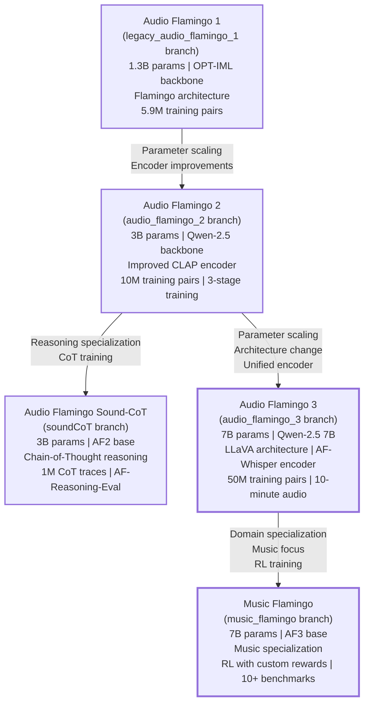

This diagram illustrates the two primary development tracks:
1. **Main scaling path**: AF1 → AF2 → AF3 (parameter and data scaling)
2. **Specialization branches**: AF2 → Sound-CoT (reasoning), AF3 → Music Flamingo (domain expertise)

**Sources:** [README.md:192-205](), [README.md:153-173](), [README.md:128-150](), [README.md:69-109](), [README.md:20-65]()

---

## Repository Structure

The repository uses a multi-branch architecture where each model variant is maintained in a separate Git branch with its own training code, inference scripts, and documentation.

### Branch Organization

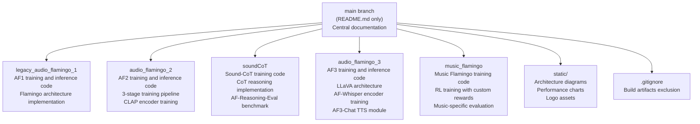

Each branch contains:
- Model-specific training scripts
- Inference and evaluation code
- Dataset preprocessing utilities
- Model checkpoint configurations
- Branch-specific documentation in `README.md`
- License files in `incl_licenses/` directory

**Sources:** [README.md:220-232](), [README.md:224-232]()

---

## Distribution Ecosystem

Audio Flamingo models are distributed through multiple channels to serve different user needs:

### Distribution Channels and Assets

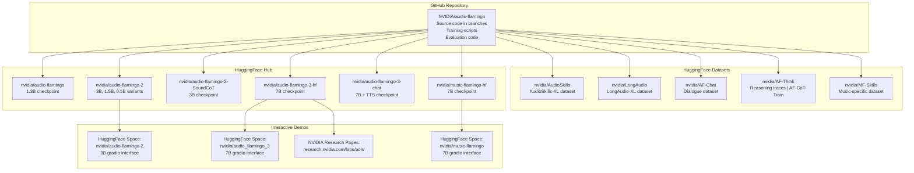

**HuggingFace Model Checkpoints:**
- `nvidia/audio-flamingo`: 1.3B parameters
- `nvidia/audio-flamingo-2`: 3B, 1.5B, 0.5B variants
- `nvidia/audio-flamingo-2-SoundCoT`: 3B parameters with CoT
- `nvidia/audio-flamingo-3-hf`: 7B parameters
- `nvidia/audio-flamingo-3-chat`: 7B parameters + streaming TTS
- `nvidia/music-flamingo-hf`: 7B parameters music-specialized

**HuggingFace Dataset Collections:**
- `nvidia/AudioSkills`: Skill-specific training data (AudioSkills-XL for AF3)
- `nvidia/LongAudio`: Long-form audio understanding (LongAudio-XL for AF3)
- `nvidia/AF-Chat`: Multi-turn dialogue training data
- `nvidia/AF-Think`: Reasoning traces including AF-CoT-Train (1M traces)
- `nvidia/MF-Skills`: Music-specific training data

**Interactive Demos:**
- HuggingFace Spaces: `nvidia/audio-flamingo-2`, `nvidia/audio_flamingo_3`, `nvidia/music-flamingo`
- NVIDIA Research: `research.nvidia.com/labs/adlr/AF2/`, `research.nvidia.com/labs/adlr/AF3/`, `research.nvidia.com/labs/adlr/MF/`

**Sources:** [README.md:79-103](), [README.md:29-40](), [README.md:164-168](), [README.md:137-145](), [README.md:85-87](), [README.md:161-161](), [README.md:39-39]()

---

## Model Capabilities Matrix

The following table summarizes the capabilities across all Audio Flamingo variants:

| Capability | AF1 | AF2 | Sound-CoT | AF3 | Music Flamingo |
|------------|-----|-----|-----------|-----|----------------|
| **Parameters** | 1.3B | 3B | 3B | 7B | 7B |
| **LM Backbone** | OPT-IML | Qwen-2.5 | Qwen-2.5 | Qwen-2.5 | Qwen-2.5 |
| **Architecture** | Flamingo | Flamingo | Flamingo | LLaVA | LLaVA |
| **Audio Encoder** | Generic | Improved CLAP | Improved CLAP | AF-Whisper | AF-Whisper |
| **Training Pairs** | 5.9M | 10M | 10M + 1M CoT | 50M | 50M + Music |
| **Sound Understanding** | ✓ | ✓ | ✓ | ✓ | ✓ |
| **Music Understanding** | ✓ | ✓ | ✗ | ✓ | ✓✓ (Deep) |
| **Speech Understanding** | ✗ | ✗ | ✗ | ✓ | ✗ |
| **Audio Captioning** | ✓ | ✓ | ✓ | ✓ | ✓ |
| **Classification** | ✓ | ✓ | ✓ | ✓ | ✓ |
| **Question Answering** | ✓ | ✓ | ✓ | ✓ | ✓ |
| **Few-Shot Learning** | ✓✓ | ✗ | ✗ | ✗ | ✗ |
| **Multi-Turn Dialogue** | ✓ | ✓ | ✗ | ✓ | ✗ |
| **Max Audio Length** | Variable | 5 min | 5 min | 10 min | 10 min |
| **CoT Reasoning** | ✗ | ✗ | ✓✓ | ✗ | ✓ |
| **Streaming TTS** | ✗ | ✗ | ✗ | ✓ (AF3-Chat) | ✗ |
| **RL Training** | ✗ | ✗ | ✗ | ✗ | ✓ |
| **Branch** | `legacy_audio_flamingo_1` | `audio_flamingo_2` | `soundCoT` | `audio_flamingo_3` | `music_flamingo` |
| **Publication** | ICML 2024 | ICML 2025 | Tech Report 2025 | NeurIPS 2025 | arXiv 2025 |

**Key Distinctions:**
- **AF1**: Pioneering few-shot learning and dialogue capabilities with Flamingo architecture
- **AF2**: Scaled training data (10M pairs) with 3-stage training pipeline and long-audio support
- **Sound-CoT**: Specialized for chain-of-thought reasoning with 1M reasoning traces
- **AF3**: Complete modality coverage (sound/music/speech) with unified encoder and 10-minute support
- **Music Flamingo**: Deep music understanding with theory-aware analysis and RL-based training

**Sources:** [README.md:204-205](), [README.md:172-173](), [README.md:148-150](), [README.md:107-109](), [README.md:42-49]()

---

## Technology Stack Overview

### Core Component Evolution

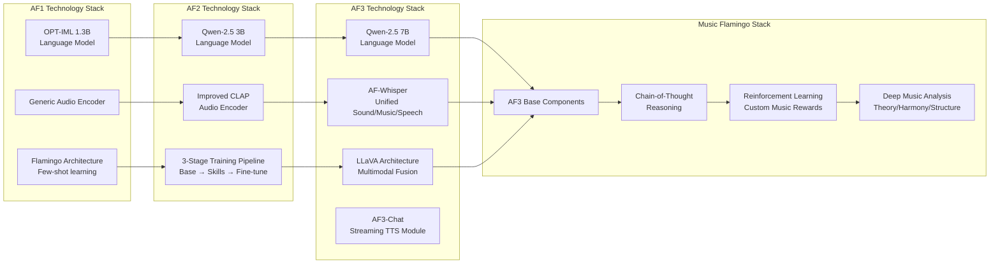

**Key Technology Transitions:**
1. **Language Models**: OPT-IML 1.3B → Qwen-2.5 3B → Qwen-2.5 7B
2. **Audio Encoders**: Generic → Improved CLAP → Unified AF-Whisper
3. **Architectures**: Flamingo (few-shot focused) → LLaVA (multimodal fusion)
4. **Training Methods**: Standard supervised → 3-stage pipeline → CoT + RL

**Sources:** [README.md:204-205](), [README.md:172-173](), [README.md:107-109](), [README.md:42-47]()

---

## Licensing

The repository uses multiple licenses depending on the component:

- **Source Code**: MIT License for all code in this repository
- **Model Checkpoints**: NVIDIA OneWay Noncommercial License (non-commercial use only)
- **AF1 (OPT-IML-based)**: Subject to OPT-IML license restrictions
- **AF2/AF3/Sound-CoT/Music Flamingo (Qwen-2.5-based)**: Subject to Qwen RESEARCH LICENSE AGREEMENT (Copyright © Alibaba Cloud)

Additional restrictions and third-party licenses are documented in `README` files and `incl_licenses/` directories within each branch.

For accessing and using models, see [Getting Started](#6). For detailed licensing information, see [License and Attribution](#7).

**Sources:** [README.md:235-241]()

---

## Academic Publications

Each model variant has been published or submitted to major academic venues:

| Model | Venue | arXiv | Year |
|-------|-------|-------|------|
| Audio Flamingo 1 | ICML 2024 | [2402.01831](https://arxiv.org/abs/2402.01831) | 2024 |
| Audio Flamingo 2 | ICML 2025 | [2503.03983](https://arxiv.org/abs/2503.03983) | 2025 |
| Audio Flamingo Sound-CoT | Technical Report | [2508.11818](https://arxiv.org/abs/2508.11818) | 2025 |
| Audio Flamingo 3 | NeurIPS 2025 (Spotlight) | [2507.08128](https://arxiv.org/abs/2507.08128) | 2025 |
| Music Flamingo | arXiv | [2511.10289](https://arxiv.org/abs/2511.10289) | 2025 |

Complete citation information is available in [README.md:243-299]().

**Sources:** [README.md:15-18](), [README.md:195-199](), [README.md:157-160](), [README.md:131-133](), [README.md:72-75](), [README.md:23-26]()

---

# Page: Model Evolution Timeline

# Model Evolution Timeline

<details>
<summary>Relevant source files</summary>

The following files were used as context for generating this wiki page:

- [README.md](README.md)

</details>


## Purpose and Scope

This document chronicles the chronological development of the Audio Flamingo series from its inception in 2024 through 2025. It tracks the progression from Audio Flamingo 1 (AF1) through Audio Flamingo 2 (AF2), Sound-CoT, Audio Flamingo 3 (AF3), to Music Flamingo (MF), highlighting key scaling milestones in model parameters, training data volumes, architectural choices, and capability expansions. Each model variant corresponds to a dedicated branch in the repository, documented in detail in their respective sections ([2.1](#2.1), [2.2](#2.2), [2.3](#2.3), [2.4](#2.4), [2.5](#2.5)). For information about the repository's organizational structure and branch layout, see [Repository Structure](#1.2).

## Chronological Development Overview

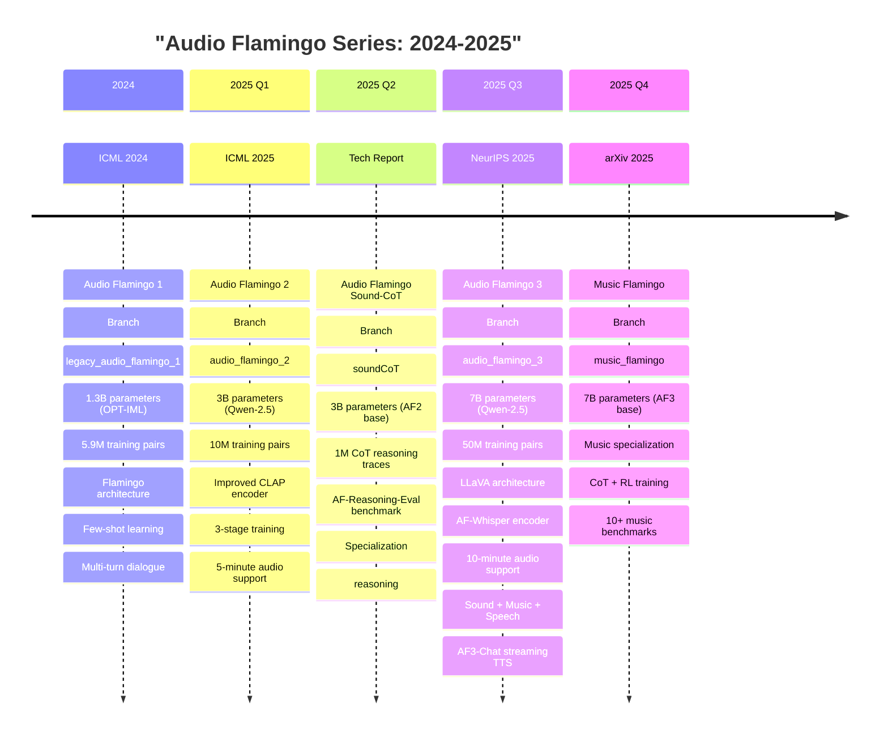

Sources: [README.md:13-19](), [README.md:20-68](), [README.md:69-127](), [README.md:128-151](), [README.md:153-188](), [README.md:192-217]()

## Model Lineage and Branch Structure

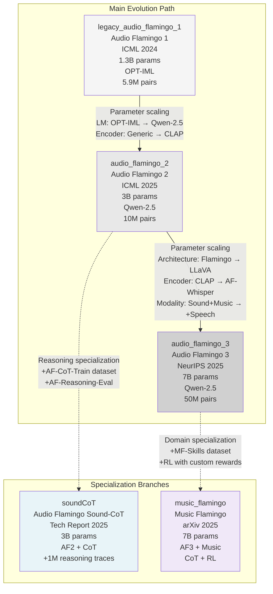

Sources: [README.md:220-232](), [README.md:235-240]()

## Scaling Progression

### Parameter Count Evolution

| Model | Parameters | Language Model | Branch |
|-------|------------|----------------|---------|
| Audio Flamingo 1 | 1.3B | OPT-IML | `legacy_audio_flamingo_1` |
| Audio Flamingo 2 | 3B | Qwen-2.5 | `audio_flamingo_2` |
| Audio Flamingo 2 (variants) | 1.5B, 0.5B | Qwen-2.5 | `audio_flamingo_2` |
| Sound-CoT | 3B | Qwen-2.5 (AF2 base) | `soundCoT` |
| Audio Flamingo 3 | 7B | Qwen-2.5 | `audio_flamingo_3` |
| Music Flamingo | 7B | Qwen-2.5 (AF3 base) | `music_flamingo` |

The series demonstrates a clear scaling trend: 1.3B → 3B → 7B for the main evolution path, with additional 1.5B and 0.5B variants of AF2 providing intermediate-scale options.

Sources: [README.md:199](), [README.md:165-167](), [README.md:79-88](), [README.md:30-32]()

### Training Data Scaling

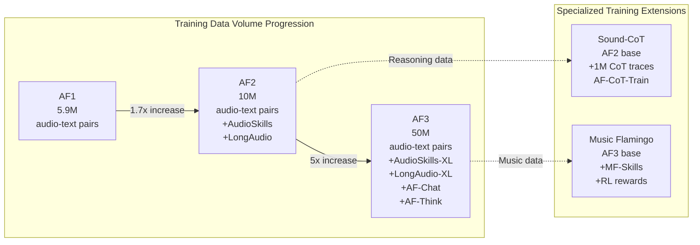

The training data volume increased dramatically: 5.9M pairs (AF1) → 10M pairs (AF2, 1.7x increase) → 50M pairs (AF3, 5x increase from AF2). Specialized datasets added reasoning traces (1M for Sound-CoT) and domain-specific music data (MF-Skills for Music Flamingo).

Sources: [README.md:204](), [README.md:172](), [README.md:107](), [README.md:150]()

## Architectural Evolution

### Foundation Architecture Transitions

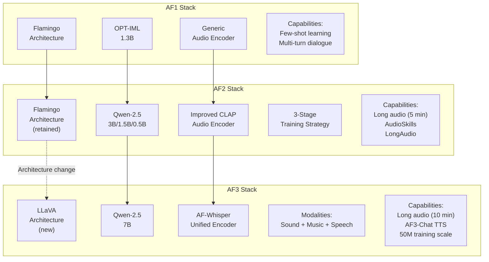

**Key Architectural Transitions:**
- **AF1 → AF2**: Language model migration from OPT-IML to Qwen-2.5, encoder upgrade from generic to improved CLAP, introduction of 3-stage training strategy, while retaining Flamingo architecture
- **AF2 → AF3**: Major architecture shift from Flamingo to LLaVA, unified AF-Whisper encoder replacing CLAP, expansion from 2 modalities (sound, music) to 3 modalities (adding speech), 5x training data scaling

Sources: [README.md:204](), [README.md:172](), [README.md:107](), [README.md:216](), [README.md:186](), [README.md:125]()

## Audio Duration Capabilities

| Model | Maximum Audio Duration | Key Feature |
|-------|------------------------|-------------|
| Audio Flamingo 1 | ~3-4 minutes | Standard audio sequences |
| Audio Flamingo 2 | Up to 5 minutes | LongAudio dataset support |
| Audio Flamingo 3 | Up to 10 minutes | LongAudio-XL dataset support |
| Sound-CoT | Up to 5 minutes | Inherited from AF2 base |
| Music Flamingo | Up to 10 minutes | Full-length song reasoning |

The progression shows consistent improvement in handling longer audio sequences, with AF3 and MF reaching 10-minute capacity for analyzing full-length songs and extended soundscapes.

Sources: [README.md:109](), [README.md:172]()

## Specialization Branches

### Sound-CoT: Reasoning Specialization

Audio Flamingo Sound-CoT represents a lateral specialization from the AF2 baseline, focusing on chain-of-thought reasoning capabilities rather than parameter scaling.

**Key Developments:**
- Base: 3B parameter AF2 model from `audio_flamingo_2` branch
- Specialization: Chain-of-thought reasoning for sound understanding
- Training data: AF-CoT-Train dataset with approximately 1M reasoning traces
- Evaluation: Introduction of AF-Reasoning-Eval benchmark for reasoning assessment
- Performance: Comparable to 7B reasoning baselines despite smaller size

Branch: `soundCoT`

Sources: [README.md:128-151]()

### Music Flamingo: Domain Specialization

Music Flamingo extends AF3 with deep music understanding capabilities through domain specialization and advanced training techniques.

**Key Developments:**
- Base: 7B parameter AF3 model from `audio_flamingo_3` branch
- Domain: Deep music understanding (songs and instrumentals)
- Capabilities: Theory-aware captions, harmony/structure/timbre/lyrics/cultural analysis
- Training innovations: Chain-of-thought reasoning + reinforcement learning with custom rewards
- Performance: SOTA results on 10+ music benchmarks

Branch: `music_flamingo`

Sources: [README.md:20-66](), [README.md:42-48]()

## HuggingFace Distribution Timeline

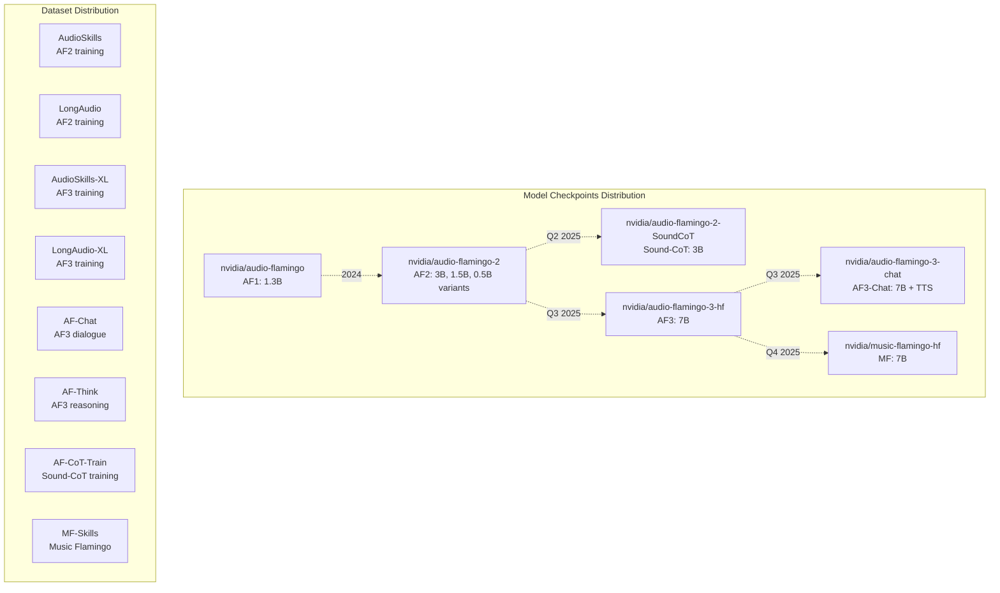

**Distribution Pattern:** Each model release on HuggingFace Hub corresponds to the chronological development timeline, with datasets released alongside their associated models. The checkpoint naming convention uses `nvidia/` prefix followed by the model name and optional variant suffix.

Sources: [README.md:199](), [README.md:165-167](), [README.md:137-138](), [README.md:79-83](), [README.md:30-35](), [README.md:91-102](), [README.md:140-145]()

## Publication Venues and Academic Timeline

| Model | Venue | Paper ID | Release Type |
|-------|-------|----------|--------------|
| Audio Flamingo 1 | ICML 2024 | arXiv:2402.01831 | Conference (Accepted) |
| Audio Flamingo 2 | ICML 2025 | arXiv:2503.03983 | Conference (Accepted) |
| Sound-CoT | Technical Report | arXiv:2508.11818 | Technical Report |
| Audio Flamingo 3 | NeurIPS 2025 | arXiv:2507.08128 | Conference (Spotlight) |
| Music Flamingo | arXiv 2025 | arXiv:2511.10289 | Preprint |

**Publication Progression:** The series shows consistent academic presence with two ICML acceptances (2024, 2025), a NeurIPS Spotlight (2025), plus technical reports and preprints for specialized variants. The NeurIPS Spotlight designation indicates significant community recognition for AF3's contributions.

Sources: [README.md:15-18](), [README.md:195](), [README.md:157](), [README.md:131](), [README.md:72](), [README.md:23]()

## Interactive Demo Availability

| Model | Demo Platform | URL Pattern |
|-------|---------------|-------------|
| Audio Flamingo 1 | NVIDIA Research | audioflamingo.github.io |
| Audio Flamingo 2 | HuggingFace Spaces + NVIDIA | spaces/nvidia/audio-flamingo-2 |
| Audio Flamingo 3 | HuggingFace Spaces + NVIDIA | spaces/nvidia/audio_flamingo_3 |
| Music Flamingo | HuggingFace Spaces + NVIDIA | spaces/nvidia/music-flamingo |

**Demo Evolution:** Starting with AF1's custom demo site, the series transitioned to dual hosting on HuggingFace Spaces and NVIDIA research pages for AF2, AF3, and MF, providing broader accessibility and standardized interfaces.

Sources: [README.md:196](), [README.md:158-161](), [README.md:85-86](), [README.md:39](), [README.md:24](), [README.md:73]()

## Licensing Evolution

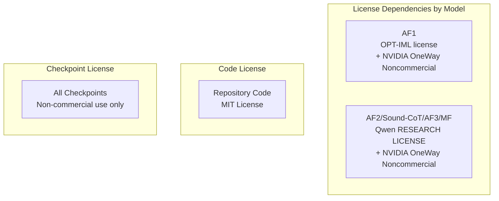

**Licensing Structure:** All model checkpoints are restricted to non-commercial use under the NVIDIA OneWay Noncommercial License. AF1 is additionally subject to OPT-IML licensing terms, while AF2, Sound-CoT, AF3, and Music Flamingo are subject to the Qwen RESEARCH LICENSE AGREEMENT (Copyright © Alibaba Cloud). Repository code uses MIT License.

Sources: [README.md:235-241]()

## Citation Guidance by Model

The repository provides specific BibTeX citations for each model variant, reflecting their distinct publication venues and authorship:

- **AF1**: `kong2024audio` (ICML 2024 proceedings)
- **AF2**: `ghosh2025audio` (ICML 2025 proceedings) 
- **Sound-CoT**: `kong2025audio` (arXiv preprint)
- **AF3**: `ghosh2025audio` (NeurIPS 2025 proceedings)
- **Music Flamingo**: `ghosh2025music` (arXiv preprint)

Sources: [README.md:243-299]()

---

# Page: Repository Structure

# Repository Structure

<details>
<summary>Relevant source files</summary>

The following files were used as context for generating this wiki page:

- [.gitignore](.gitignore)
- [README.md](README.md)

</details>


This document describes the physical organization of the NVIDIA/audio-flamingo GitHub repository, including its branch-based architecture, file organization, and relationship to external distribution channels. For information about accessing models and datasets, see [Accessing Models](#6.1). For details on specific model architectures and capabilities, see [Model Variants](#2).

## Overview

The audio-flamingo repository uses a **branch-based organization strategy** where each model variant maintains its complete codebase in an isolated branch. The main branch serves as a central hub containing documentation, visual assets, and links to all variant branches, but does not contain training or inference code itself.

This structure enables:
- Independent development and versioning of each model variant
- Complete isolation of dependencies and code for each model
- Centralized documentation and asset management
- Clear evolutionary relationships between model versions

Sources: [README.md:1-232]()

## Branch-Based Architecture

### Branch Organization

The repository contains five distinct model variant branches, each hosting complete training and inference code for its respective model:

| Branch Name | Model Variant | Parameters | Primary Purpose |
|------------|---------------|------------|-----------------|
| `legacy_audio_flamingo_1` | Audio Flamingo 1 | 1.3B | Original Flamingo-based model with few-shot learning |
| `audio_flamingo_2` | Audio Flamingo 2 | 3B, 1.5B, 0.5B | Improved CLAP encoder with 3-stage training |
| `soundCoT` | Audio Flamingo Sound-CoT | 3B | Chain-of-thought reasoning specialization |
| `audio_flamingo_3` | Audio Flamingo 3 | 7B | LLaVA-based architecture with unified encoder |
| `music_flamingo` | Music Flamingo | 7B | Music understanding specialization with RL training |

Each branch is self-contained and includes:
- Model architecture implementation
- Training scripts and configurations
- Inference code and utilities
- Branch-specific README documentation
- License files (`incl_licenses` directories)
- Dataset loading and preprocessing code

Sources: [README.md:220-232]()

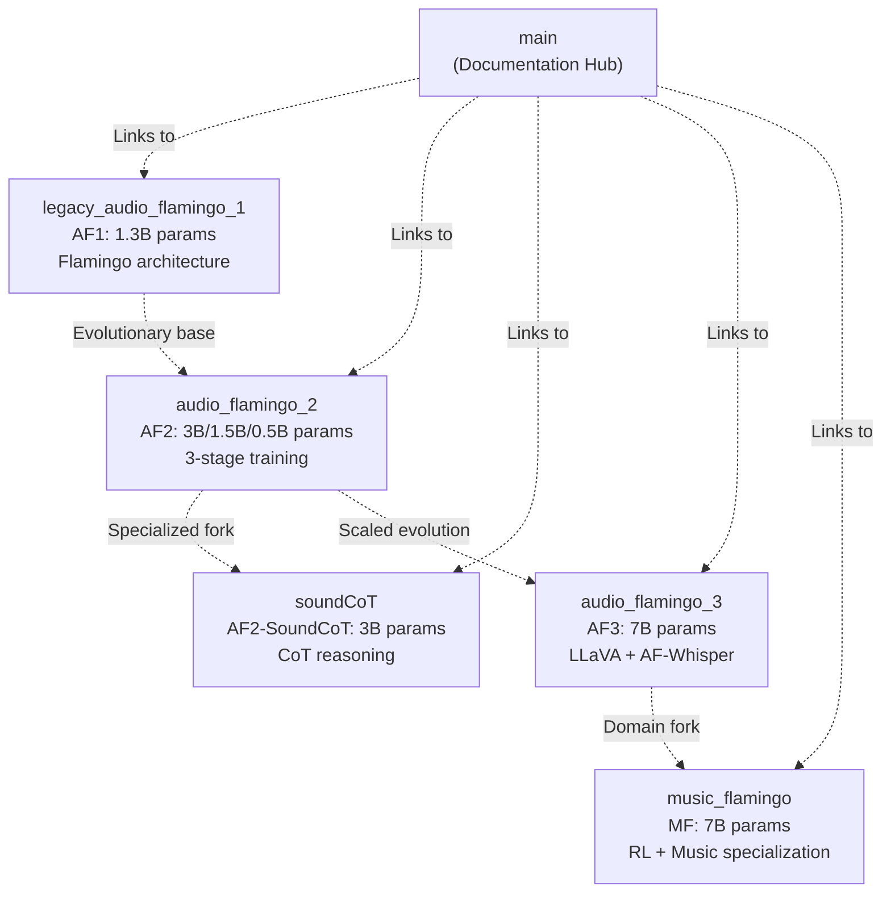

**Repository Branch Structure**: Each model variant occupies an isolated branch with complete implementation code. The main branch serves as a documentation hub linking to all variants.

Sources: [README.md:220-232](), [README.md:14-18]()

### Branch Access Pattern

Users access specific model code by checking out the corresponding branch:

```
git checkout legacy_audio_flamingo_1  # Access AF1 code
git checkout audio_flamingo_2         # Access AF2 code
git checkout soundCoT                 # Access Sound-CoT code
git checkout audio_flamingo_3         # Access AF3 code
git checkout music_flamingo           # Access Music Flamingo code
```

The main branch provides navigation through badge links in the README that direct users to appropriate branches for different models.

Sources: [README.md:224-232]()

## Main Branch Contents

The main branch contains centralized documentation and assets but no model implementation code. Its structure consists of:

### Documentation Files

**README.md** [README.md:1-299]() - Central documentation file containing:
- Model series overview and descriptions
- Links to academic papers (arXiv, conference publications)
- Badge links to model-specific branches
- Badge links to HuggingFace model checkpoints and datasets
- Badge links to interactive demos (HuggingFace Spaces, NVIDIA research pages)
- License information and attribution requirements
- Citation BibTeX entries for all model variants

### Static Assets Directory

**static/** directory contains visual documentation assets:
- `logo-no-bg.png` - Audio Flamingo logo [README.md:4]()
- `af1_radial.png` - AF1 performance radar chart [README.md:210]()
- `af3_radial-1.png` - AF3 performance radar chart [README.md:116]()
- `af3_sota.png` - AF3 state-of-the-art comparison [README.md:120]()
- `af3_main_diagram-1.png` - AF3 architecture diagram [README.md:125]()
- `MF-comparison.png` - Music Flamingo comparison [README.md:52]()
- `MF-architecture.png` - Music Flamingo architecture [README.md:56]()
- `MF-donut_chart.png` - Music Flamingo capability distribution [README.md:60]()
- `MF-benchmarks.png` - Music Flamingo benchmark results [README.md:64]()

These assets are displayed in the main README to provide visual representations of model capabilities and architectures.

Sources: [README.md:4](), [README.md:52-217]()

### Configuration Files

**.gitignore** [.gitignore:1-4]() - Defines patterns for files excluded from version control:
- `__pycache__/` - Python bytecode cache directories
- `.DS_Store` - macOS metadata files
- `core.*` - Core dump files
- `.cache/` - General cache directories

This file is minimal, reflecting that most code artifacts reside in individual branches rather than the main branch.

Sources: [.gitignore:1-4]()

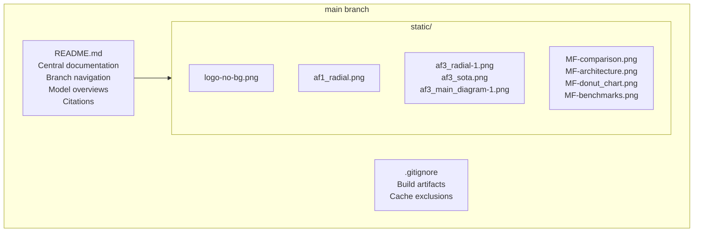

**Main Branch File Organization**: The main branch contains documentation (README.md), visual assets (static/), and basic configuration (.gitignore).

Sources: [README.md:1-299](), [.gitignore:1-4]()

## Relationship to External Distribution

The GitHub repository serves as the **source code distribution channel**, while model weights and datasets are distributed separately through HuggingFace Hub. This separation maintains clean repository organization by keeping large binary files (model checkpoints) outside version control.

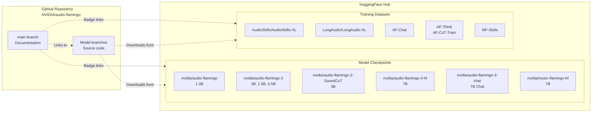

**Distribution Architecture**: GitHub hosts source code in branches; HuggingFace Hub hosts model checkpoints and training datasets. The main README provides badge links connecting users to both resources.

Sources: [README.md:30-36](), [README.md:78-103](), [README.md:137-145](), [README.md:165-167](), [README.md:199]()

### HuggingFace Model Repositories

Model checkpoints are distributed through separate HuggingFace repositories:

| HuggingFace Repository | Model Variant | Source Branch |
|------------------------|---------------|---------------|
| `nvidia/audio-flamingo` | AF1 (1.3B) | `legacy_audio_flamingo_1` |
| `nvidia/audio-flamingo-2` | AF2 (3B) | `audio_flamingo_2` |
| `nvidia/audio-flamingo-2-1.5B` | AF2 (1.5B) | `audio_flamingo_2` |
| `nvidia/audio-flamingo-2-0.5B` | AF2 (0.5B) | `audio_flamingo_2` |
| `nvidia/audio-flamingo-2-SoundCoT` | Sound-CoT (3B) | `soundCoT` |
| `nvidia/audio-flamingo-3-hf` | AF3 (7B) | `audio_flamingo_3` |
| `nvidia/audio-flamingo-3-chat` | AF3-Chat (7B) | `audio_flamingo_3` |
| `nvidia/music-flamingo-hf` | Music Flamingo (7B) | `music_flamingo` |

Sources: [README.md:30-36](), [README.md:78-88](), [README.md:137-139](), [README.md:165-167](), [README.md:199]()

### HuggingFace Dataset Repositories

Training datasets are distributed through separate HuggingFace dataset repositories:

| HuggingFace Dataset | Purpose | Used By |
|---------------------|---------|---------|
| `nvidia/AudioSkills` / `AudioSkills-XL` | Skill-specific audio understanding | AF2, AF3 |
| `nvidia/LongAudio` / `LongAudio-XL` | Long-form audio (5-10 minutes) | AF2, AF3 |
| `nvidia/AF-Chat` | Multi-turn dialogue data | AF3 |
| `nvidia/AF-Think` | Reasoning traces (1M) | Sound-CoT |
| `nvidia/MF-Skills` | Music-specific training data | Music Flamingo |

The datasets referenced in [README.md:91-102]() and [README.md:33-35]() are linked via badges but stored independently from the code repository.

Sources: [README.md:91-102](), [README.md:33-35](), [README.md:140-142]()

## Branch Isolation and Development

Each model variant branch operates independently with its own:

1. **Dependency Management**: Separate `requirements.txt` or environment specifications
2. **Training Scripts**: Variant-specific training pipelines
3. **Model Architecture**: Independent implementation of model components
4. **Licensing**: Branch-specific `incl_licenses` directories and README license sections
5. **Documentation**: Branch-specific README with model details

This isolation enables:
- Parallel development of different model variants
- Different dependency versions per branch (e.g., different PyTorch versions)
- Independent release cycles for each model
- Clear attribution and licensing per variant

Users working with a specific model clone the repository and checkout only the relevant branch, avoiding conflicts or confusion between different model implementations.

Sources: [README.md:220-232](), [README.md:235-240]()

## Navigation Pattern

The main branch README serves as the **entry point and navigation hub** for all model variants. It provides:

1. **Model Overview Sections**: Dedicated sections for each model (lines 20-217 in README.md)
2. **Branch Links**: GitHub badges linking to specific branches [README.md:224-232]()
3. **Checkpoint Links**: HuggingFace badges linking to model weights [README.md:30-36](), [README.md:78-88](), etc.
4. **Dataset Links**: HuggingFace badges linking to training data [README.md:91-102]()
5. **Demo Links**: Links to interactive demos on HuggingFace Spaces and NVIDIA research pages [README.md:39](), [README.md:85-87]()
6. **Paper Links**: arXiv badges linking to academic publications [README.md:23](), [README.md:72](), [README.md:131](), [README.md:157](), [README.md:195]()

This centralized navigation allows users to quickly locate the specific resources they need without navigating complex directory structures.

Sources: [README.md:20-232]()

## Summary

The audio-flamingo repository employs a **branch-based isolation strategy** where:

- **Main branch** contains only documentation, visual assets, and configuration files
- **Five model variant branches** contain complete, self-contained codebases for training and inference
- **GitHub** serves as the source code distribution channel
- **HuggingFace Hub** serves as the model checkpoint and dataset distribution channel
- **Badge links** in the main README connect users to branches, checkpoints, datasets, demos, and papers

This architecture enables independent development cycles, clear versioning, and simplified access to specific model implementations while maintaining centralized documentation and navigation.

Sources: [README.md:1-299](), [.gitignore:1-4]()

---

# Page: Model Variants

# Model Variants

<details>
<summary>Relevant source files</summary>

The following files were used as context for generating this wiki page:

- [README.md](README.md)

</details>


This page provides a structured overview of the five distinct models in the Audio Flamingo series, their evolutionary relationships, technical characteristics, and guidance on when to use each variant. For detailed architectural information, see [Technical Architecture](#3). For training data and methodologies, see [Training Data and Strategies](#4).

## Series Overview

The Audio Flamingo series consists of five related but distinct Large Audio-Language Models (LALMs), each representing progressively advanced capabilities in audio understanding. The repository maintains separate branches for each variant, enabling independent development and specialized applications.

**Model Evolution and Relationships Diagram**

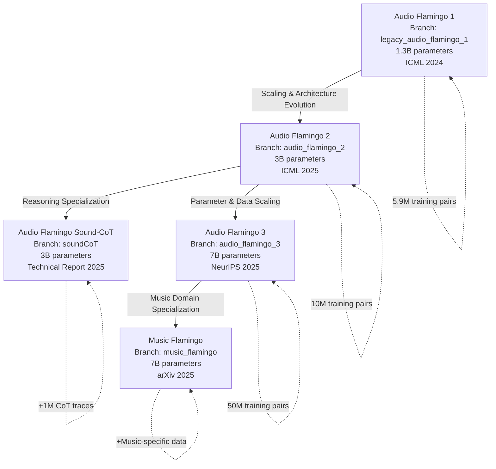

Sources: [README.md:14-19](), [README.md:192-217](), [README.md:153-188](), [README.md:128-151](), [README.md:69-127](), [README.md:20-66]()

## Model Comparison Matrix

The following table provides a comprehensive comparison of the five model variants across key dimensions:

| Model | Parameters | Architecture | Language Model | Audio Encoder | Training Data | Audio Length | Modalities | Key Capabilities |
|-------|------------|--------------|----------------|---------------|---------------|--------------|------------|------------------|
| **AF1** | 1.3B | Flamingo | OPT-IML 1.3B | Generic | 5.9M pairs | Standard | Sound, Music | Few-shot learning, Multi-turn dialogue |
| **AF2** | 3B | Flamingo | Qwen-2.5 3B | Improved CLAP | 10M pairs | Up to 5 min | Sound, Music | Expert reasoning, Long-audio, 3-stage training |
| **Sound-CoT** | 3B | Flamingo | Qwen-2.5 3B | Improved CLAP | 10M + 1M CoT | Up to 5 min | Sound | Chain-of-thought reasoning |
| **AF3** | 7B | LLaVA | Qwen-2.5 7B | AF-Whisper | 50M pairs | Up to 10 min | Sound, Music, Speech | Unified encoder, Streaming TTS, SOTA performance |
| **Music Flamingo** | 7B | LLaVA | Qwen-2.5 7B | AF-Whisper | AF3 + Music | Up to 10 min | Music (primary) | Deep music understanding, RL training, Theory-aware |

Sources: [README.md:192-217](), [README.md:153-188](), [README.md:128-151](), [README.md:69-127](), [README.md:20-66]()

**HuggingFace Model Checkpoints Mapping**

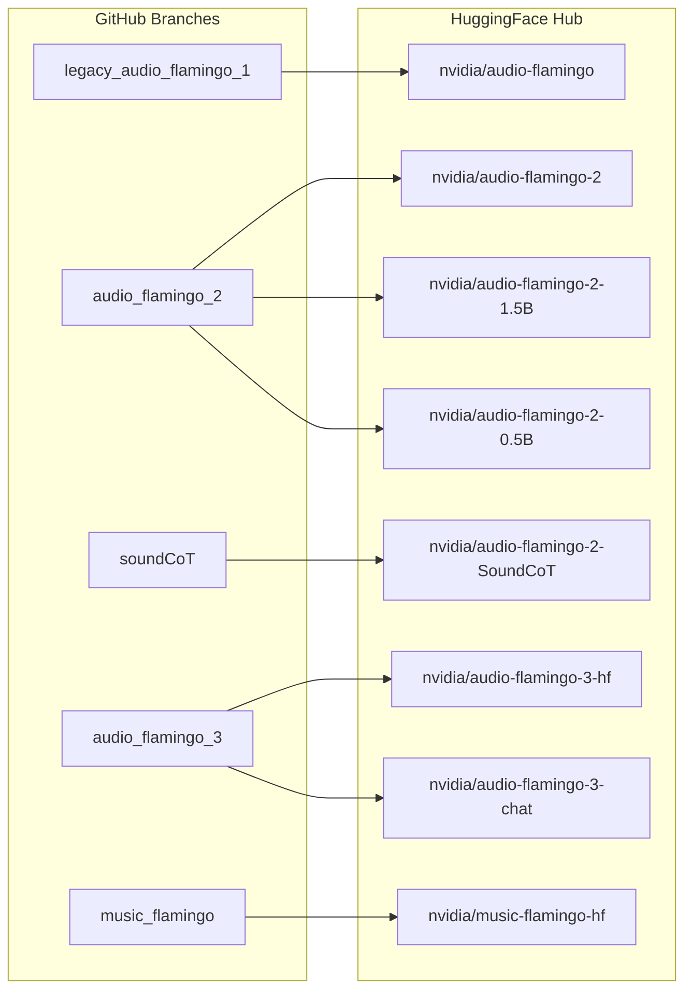

Sources: [README.md:199](), [README.md:165-167](), [README.md:137-138](), [README.md:79-84](), [README.md:30-31]()

## Parameter Scaling and Training Data Evolution

The series demonstrates progressive scaling in both model size and training data volume:

| Model | Parameters | Training Pairs | Data Scaling Factor | Architectural Generation |
|-------|------------|----------------|---------------------|-------------------------|
| AF1 | 1.3B | 5.9M | 1x (baseline) | Gen 1 (Flamingo) |
| AF2 | 3B | 10M | 1.7x | Gen 1 (Flamingo) |
| Sound-CoT | 3B | 10M + 1M CoT | 1.9x | Gen 1 (Flamingo) |
| AF3 | 7B | 50M | 8.5x | Gen 2 (LLaVA) |
| Music Flamingo | 7B | 50M + Music | 8.5x+ | Gen 2 (LLaVA) |

Sources: [README.md:204](), [README.md:172](), [README.md:150](), [README.md:107](), [README.md:42-47]()

## When to Use Each Variant

**Selection Guidance Diagram**

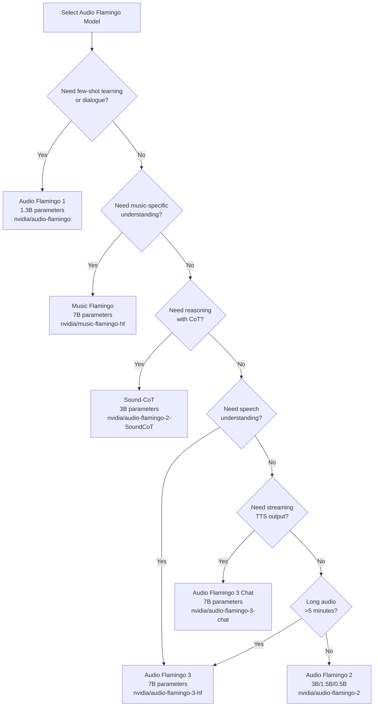

Sources: [README.md:192-217](), [README.md:153-188](), [README.md:128-151](), [README.md:69-127](), [README.md:20-66]()

### Use Case Recommendations

**Audio Flamingo 1** is recommended when:
- Few-shot learning capabilities are required (in-context learning)
- Multi-turn dialogue interaction is needed
- Working with established Flamingo architecture patterns
- Limited computational resources (1.3B parameters)

**Audio Flamingo 2** is recommended when:
- General audio understanding across sound and music is needed
- Long-audio processing up to 5 minutes is required
- Multiple model sizes are desired (3B, 1.5B, 0.5B variants available)
- Expert-level audio reasoning is required
- Balanced performance and efficiency are priorities

**Audio Flamingo Sound-CoT** is recommended when:
- Chain-of-thought reasoning on sound understanding tasks is critical
- Step-by-step reasoning traces are needed
- Evaluation on AF-Reasoning-Eval benchmark is planned
- Specialization in sound (not music or speech) is acceptable

**Audio Flamingo 3** is recommended when:
- Complete audio modality coverage is needed (sound, music, speech)
- Longest audio support is required (up to 10 minutes)
- State-of-the-art performance is critical
- Streaming TTS output is needed (AF3-Chat variant)
- Unified AF-Whisper encoder capabilities are desired

**Music Flamingo** is recommended when:
- Deep music understanding is the primary focus
- Theory-aware music captions are needed
- Analysis of harmony, structure, timbre, lyrics, and cultural context is required
- Chain-of-thought reasoning on music tasks is beneficial
- Specialized music benchmarks are being targeted

Sources: [README.md:192-217](), [README.md:153-188](), [README.md:128-151](), [README.md:69-127](), [README.md:20-66]()

## Model Access by Branch

Each model variant is maintained in a separate Git branch with independent code, training scripts, and documentation. The table below maps the development branches to their corresponding resources:

**Branch and Resource Mapping**

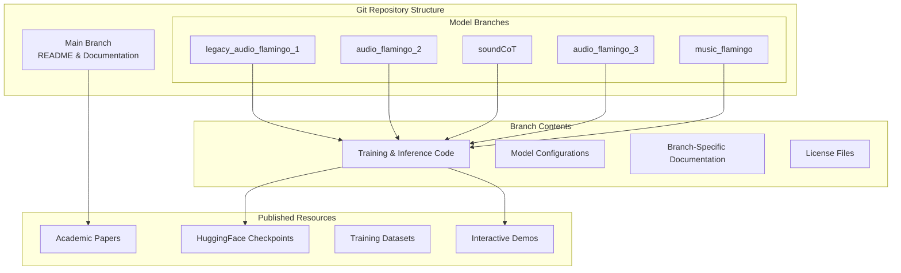

Sources: [README.md:220-233]()

| Model Variant | GitHub Branch | HuggingFace Checkpoints | Demo Page | Paper |
|---------------|---------------|-------------------------|-----------|-------|
| AF1 | `legacy_audio_flamingo_1` | `nvidia/audio-flamingo` | [audioflamingo.github.io](https://audioflamingo.github.io/) | [arXiv:2402.01831](https://arxiv.org/abs/2402.01831) |
| AF2 | `audio_flamingo_2` | `nvidia/audio-flamingo-2`<br/>`nvidia/audio-flamingo-2-1.5B`<br/>`nvidia/audio-flamingo-2-0.5B` | [research.nvidia.com/AF2](https://research.nvidia.com/labs/adlr/AF2/) | [arXiv:2503.03983](https://arxiv.org/abs/2503.03983) |
| Sound-CoT | `soundCoT` | `nvidia/audio-flamingo-2-SoundCoT` | N/A | [arXiv:2508.11818](https://arxiv.org/abs/2508.11818) |
| AF3 | `audio_flamingo_3` | `nvidia/audio-flamingo-3-hf`<br/>`nvidia/audio-flamingo-3-chat` | [research.nvidia.com/AF3](https://research.nvidia.com/labs/adlr/AF3/) | [arXiv:2507.08128](https://arxiv.org/abs/2507.08128) |
| Music Flamingo | `music_flamingo` | `nvidia/music-flamingo-hf` | [research.nvidia.com/MF](https://research.nvidia.com/labs/adlr/MF/) | [arXiv:2511.10289](https://arxiv.org/abs/2511.10289) |

Sources: [README.md:192-233]()

## Modality Coverage Across Variants

Different model variants support different combinations of audio modalities (sound, music, speech):

**Modality Support Matrix**

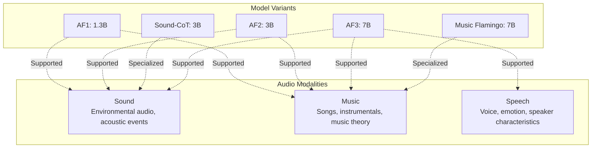

| Model | Sound | Music | Speech | Notes |
|-------|-------|-------|--------|-------|
| AF1 | ✓ | ✓ | ✗ | General sound and music understanding |
| AF2 | ✓ | ✓ | ✗ | Enhanced with AudioSkills and LongAudio |
| Sound-CoT | ✓ | ✗ | ✗ | Specialized for sound reasoning |
| AF3 | ✓ | ✓ | ✓ | Complete coverage with unified AF-Whisper |
| Music Flamingo | △ | ✓ | ✗ | Music-specialized with deep understanding |

△ = Limited support, ✓ = Full support, ✗ = Not supported

Sources: [README.md:107](), [README.md:172](), [README.md:148](), [README.md:42-47]()

## Model Access and Usage

The Audio Flamingo 2 models are hosted on HuggingFace with both model checkpoints and interactive demos available.

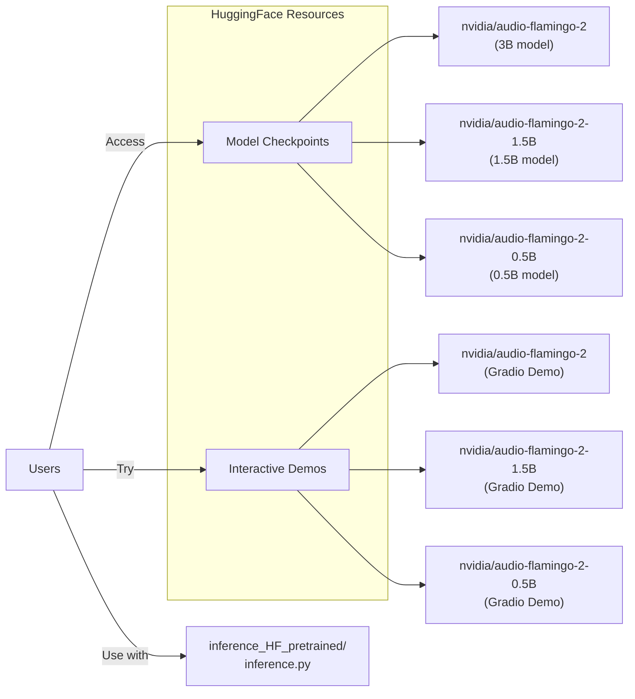

Sources: [README.md:20-29](), [README.md:63-73]()

## Licensing Information

The Audio Flamingo 2 models are provided for non-commercial research purposes only and are subject to multiple license agreements:

- NVIDIA OneWay Noncommercial License
- Qwen Research License (as models are based on Qwen2.5)
- Terms of Use for data generated by OpenAI
- Original licenses for each training dataset

For complete licensing details, see [License and Attribution](#1.3).

Sources: [README.md:78-84](), [modelcard.md:20-22]()

---

# Page: Audio Flamingo 1

# Audio Flamingo 1

<details>
<summary>Relevant source files</summary>

The following files were used as context for generating this wiki page:

- [README.md](README.md)
- [static/af1_radial.png](static/af1_radial.png)
- [static/af3_radial-1.png](static/af3_radial-1.png)

</details>


## Purpose and Scope

Audio Flamingo 1 (AF1) is the foundational model in the Audio Flamingo series, published at ICML 2024. This page documents AF1's architecture, training approach, capabilities, and deployment options. AF1 introduced the Flamingo-based architecture for audio understanding with few-shot learning and multi-turn dialogue capabilities, trained on approximately 5.9M audio-text pairs using a 1.3B parameter OPT-IML language model backbone.

For information about subsequent model iterations with improved performance and scale, see [Audio Flamingo 2](#2.2), [Audio Flamingo Sound-CoT](#2.3), [Audio Flamingo 3](#2.4), and [Music Flamingo](#2.5). For architectural comparisons across the series, see [Architectural Foundations](#3.1).

**Sources:** [README.md:192-217]()

---

## Model Overview

Audio Flamingo 1 represents the first Large Audio-Language Model (LALM) in the series, designed to handle general audio understanding tasks including sound and music comprehension. The model leverages the Flamingo architecture, originally developed for vision-language tasks, adapted for audio inputs.

### Key Specifications

| Specification | Value |
|--------------|-------|
| **Total Parameters** | 1.3 billion |
| **Language Model** | OPT-IML 1.3B |
| **Architecture** | Flamingo |
| **Training Pairs** | ~5.9 million audio-text pairs |
| **Modalities Supported** | Sound, Music |
| **Context Window** | Standard audio segments |
| **Key Features** | Few-shot learning, Multi-turn dialogue |
| **Publication** | ICML 2024 |
| **Paper** | arXiv:2402.01831 |

**Sources:** [README.md:15,204]()

---

## Architecture Components

### Flamingo Architecture Foundation

Audio Flamingo 1 adapts the Flamingo architecture for audio understanding. The Flamingo architecture was originally designed for vision-language models with strong few-shot learning capabilities. The key adaptation involves replacing visual encoders with audio encoders while maintaining the cross-attention mechanisms that enable few-shot in-context learning.

```mermaid
graph TB
    subgraph "Audio Flamingo 1 Architecture Stack"
        AudioInput["Audio Input<br/>(Sound/Music)"]
        
        subgraph "Audio Processing"
            AudioEncoder["Audio Encoder<br/>(Generic Audio Encoder)"]
            AudioFeatures["Audio Features<br/>(Embeddings)"]
        end
        
        subgraph "Flamingo Components"
            PerceiverResampler["Perceiver Resampler<br/>(Dimension Alignment)"]
            CrossAttention["Gated Cross-Attention<br/>(Few-shot Context)"]
        end
        
        subgraph "Language Processing"
            LM["OPT-IML 1.3B<br/>(Language Model Backbone)"]
            TextOutput["Generated Response<br/>(Captions/Answers)"]
        end
        
        AudioInput --> AudioEncoder
        AudioEncoder --> AudioFeatures
        AudioFeatures --> PerceiverResampler
        PerceiverResampler --> CrossAttention
        CrossAttention --> LM
        LM --> TextOutput
    end
    
    style AudioInput fill:#f9f9f9
    style TextOutput fill:#f9f9f9
    style LM fill:#e8f4f8
```

**Architecture: Audio Flamingo 1 Processing Pipeline**

The architecture consists of three primary stages:

1. **Audio Encoding**: Audio inputs are processed through a generic audio encoder to produce feature embeddings
2. **Cross-Modal Alignment**: The Perceiver Resampler and Gated Cross-Attention layers enable the language model to condition on audio features while supporting few-shot examples
3. **Language Generation**: The OPT-IML 1.3B language model generates textual responses based on the audio context

**Sources:** [README.md:204,216-217]()

### Language Model Backbone: OPT-IML

Audio Flamingo 1 uses OPT-IML (Open Pre-trained Transformer - Instruction Meta-Learning) as its language model backbone. OPT-IML is a 1.3B parameter instruction-tuned language model that provides strong natural language generation and instruction-following capabilities.

**Key characteristics of OPT-IML integration:**
- 1.3 billion parameters dedicated to language understanding and generation
- Pre-trained instruction-following capabilities enable better task adaptation
- Compatible with the Flamingo architecture's cross-attention mechanisms
- Licensed under the OPT-IML license (see [License and Attribution](#7))

**Sources:** [README.md:204,239]()

### Audio Encoder

Audio Flamingo 1 employs a generic audio encoder trained to process both sound and music inputs. Unlike later models in the series that use specialized encoders (CLAP in AF2, AF-Whisper in AF3), AF1's encoder provides general-purpose audio understanding.

**Encoder capabilities:**
- Processes variable-length audio inputs
- Generates dense audio feature representations
- Supports both sound events and musical content
- Does not include speech recognition capabilities (speech support added in AF3)

**Sources:** [README.md:204-205]()

---

## Training Data and Methodology

### Training Dataset Scale

Audio Flamingo 1 was trained on approximately 5.9 million audio-text pairs, making it the smallest training set in the Audio Flamingo series. This curated dataset covers diverse audio understanding tasks while maintaining manageable computational requirements.

```mermaid
graph LR
    subgraph "AF1 Training Data Pipeline"
        RawData["Raw Audio-Text Pairs<br/>(~5.9M total)"]
        
        subgraph "Data Categories"
            Captioning["Captioning Data<br/>(Descriptions)"]
            Classification["Classification Data<br/>(Labels/Categories)"]
            QA["Question-Answering Data<br/>(Q&A pairs)"]
            Dialogue["Dialogue Data<br/>(Multi-turn conversations)"]
        end
        
        Training["Training Process<br/>(Flamingo Architecture)"]
        Model["AF1 Model<br/>(nvidia/audio-flamingo)"]
        
        RawData --> Captioning
        RawData --> Classification
        RawData --> QA
        RawData --> Dialogue
        
        Captioning --> Training
        Classification --> Training
        QA --> Training
        Dialogue --> Training
        
        Training --> Model
    end
```

**Diagram: AF1 Training Data Flow**

### Dialogue Training Data

A distinctive feature of Audio Flamingo 1 is its multi-turn dialogue capability, achieved through specialized dialogue training data. The model was trained using the Audio Dialogues dataset, which enables conversational interactions about audio content.

**Reference:** For details about the dialogue data methodology, see the Audio Dialogues paper (arXiv:2404.07616) cited in [README.md:204]().

**Sources:** [README.md:204-205]()

---

## Core Capabilities

### Few-Shot In-Context Learning

Audio Flamingo 1's primary distinguishing feature is its ability to perform few-shot in-context learning. This capability, inherited from the Flamingo architecture, allows the model to adapt to new tasks by providing a few demonstration examples without requiring fine-tuning.

**Few-shot learning characteristics:**
- Supports 0-shot, 1-shot, 2-shot, and higher-shot scenarios
- Learns from demonstration examples provided in the prompt
- Adapts to task variations through in-context examples
- Enables rapid task switching without model updates

**Example use case:**
```
Input: [Example 1 Audio] → "Birds chirping in a forest"
       [Example 2 Audio] → "Car engine starting"
       [Target Audio] → ?
Output: Model generates description based on example pattern
```

**Sources:** [README.md:204-205]()

### Multi-Turn Dialogue

Audio Flamingo 1 supports multi-turn dialogue interactions, enabling conversational audio understanding. This capability allows users to ask follow-up questions about audio content and maintain context across multiple exchanges.

**Dialogue capabilities:**
- Maintains conversation context across turns
- Handles clarification questions about audio content
- Supports both simple and complex conversational patterns
- Integrates audio understanding with conversational reasoning

**Sources:** [README.md:204]()

### Task Coverage

Audio Flamingo 1 achieves state-of-the-art results across three primary audio understanding task categories:

| Task Category | Description | Example Applications |
|--------------|-------------|---------------------|
| **Captioning** | Generate natural language descriptions of audio content | Audio event descriptions, music descriptions |
| **Classification** | Categorize audio into predefined classes | Sound event classification, genre classification |
| **Question Answering** | Answer questions about audio content | "What instrument is playing?", "What is the loudest sound?" |

**Sources:** [README.md:204-205]()

---

## Modality Support and Limitations

### Supported Modalities

Audio Flamingo 1 supports two of the three primary audio modalities:

```mermaid
graph TB
    subgraph "AF1 Modality Coverage"
        AF1["Audio Flamingo 1<br/>(1.3B)"]
        
        subgraph "Supported"
            Sound["Sound Understanding<br/>✓ Supported"]
            Music["Music Understanding<br/>✓ Supported"]
        end
        
        subgraph "Not Supported"
            Speech["Speech Understanding<br/>✗ Not Included"]
        end
        
        AF1 --> Sound
        AF1 --> Music
        AF1 -.-> Speech
    end
```

**Diagram: Audio Flamingo 1 Modality Coverage**

**Supported:**
- **Sound Events**: Environmental sounds, acoustic events, sound effects
- **Music**: Musical content, instruments, genres, musical characteristics

**Not Supported:**
- **Speech**: Speech recognition and understanding were added in Audio Flamingo 3. For speech capabilities, see [Audio Flamingo 3](#2.4)

**Sources:** [README.md:107,204-205]()

---

## Performance and Benchmarks

### Benchmark Results

Audio Flamingo 1 achieved state-of-the-art performance on multiple benchmarks at the time of publication:

**Evaluation scenarios:**
- **Zero-shot**: No training examples provided, model relies on pre-training
- **Few-shot**: Limited examples (1-5) provided for in-context learning
- **In-distribution**: Evaluation on tasks similar to training distribution

The model demonstrated competitive performance across all three evaluation settings, particularly excelling in few-shot scenarios where the Flamingo architecture's in-context learning capabilities provided advantages.

**Visual performance summary:** The radial performance chart shown in [README.md:209-211]() illustrates AF1's comparative performance across multiple benchmark dimensions.

**Sources:** [README.md:204-205]()

---

## Accessing Audio Flamingo 1

### GitHub Branch

Audio Flamingo 1 source code is maintained in a dedicated branch:

**Branch:** `legacy_audio_flamingo_1`

The branch contains:
- Training scripts and configuration
- Inference code
- Model architecture implementation
- Evaluation utilities
- Documentation and assets

```mermaid
graph LR
    subgraph "AF1 Access Points"
        GitHub["GitHub Repository<br/>NVIDIA/audio-flamingo"]
        Branch["Branch: legacy_audio_flamingo_1<br/>(Source Code)"]
        HF["HuggingFace Hub<br/>nvidia/audio-flamingo<br/>(Model Checkpoint)"]
        Demo["Demo Website<br/>audioflamingo.github.io<br/>(Interactive)"]
        
        GitHub --> Branch
        GitHub --> HF
        GitHub --> Demo
    end
```

**Diagram: Audio Flamingo 1 Distribution Channels**

**Sources:** [README.md:197,220-232]()

### HuggingFace Model Checkpoint

The pre-trained Audio Flamingo 1 model is available on HuggingFace Hub:

**Model Repository:** `nvidia/audio-flamingo`
**Parameters:** 1.3B
**License:** Non-commercial use only (NVIDIA OneWay Noncommercial License + OPT-IML license restrictions)

The checkpoint can be loaded for:
- Inference on audio understanding tasks
- Few-shot learning experiments
- Fine-tuning on downstream tasks
- Research and evaluation

**Sources:** [README.md:199,238-240]()

### Interactive Demo

An interactive demonstration of Audio Flamingo 1 is available at:

**Demo URL:** audioflamingo.github.io

The demo provides:
- Web-based interface for testing the model
- Example audio inputs across different categories
- Real-time inference capabilities
- Visualization of model predictions

**Sources:** [README.md:196]()

---

## Comparison with Later Models

Audio Flamingo 1 serves as the foundation for the series but has been superseded by more capable models:

| Aspect | AF1 | AF2 | AF3 |
|--------|-----|-----|-----|
| **Parameters** | 1.3B | 3B | 7B |
| **Training Pairs** | 5.9M | 10M | 50M |
| **Architecture** | Flamingo | Flamingo | LLaVA |
| **Modalities** | Sound, Music | Sound, Music | Sound, Music, Speech |
| **Max Audio Length** | Standard | ~5 minutes | ~10 minutes |
| **Key Feature** | Few-shot learning | 3-stage training | Unified encoder |

For detailed information about subsequent models, see:
- [Audio Flamingo 2](#2.2) - Improved scale and training methodology
- [Audio Flamingo 3](#2.4) - Complete modality coverage and unified encoder
- [Model Evolution Timeline](#1.1) - Complete series overview

**Sources:** [README.md:14-18,107,172,204-205]()

---

## License and Citation

### License Information

Audio Flamingo 1 is subject to multiple license restrictions:

1. **Code License:** MIT License (for repository code)
2. **Model License:** NVIDIA OneWay Noncommercial License (non-commercial use only)
3. **OPT-IML License:** Subject to OPT-IML license terms (due to OPT-IML backbone)

See [License and Attribution](#7) for complete licensing details.

**Sources:** [README.md:235-240]()

### Citation

To cite Audio Flamingo 1 in research:

```bibtex
@inproceedings{kong2024audio,
  title={Audio Flamingo: A Novel Audio Language Model with Few-Shot Learning and Dialogue Abilities},
  author={Kong, Zhifeng and Goel, Arushi and Badlani, Rohan and Ping, Wei and Valle, Rafael and Catanzaro, Bryan},
  booktitle={International Conference on Machine Learning},
  pages={25125--25148},
  year={2024},
  organization={PMLR}
}
```

**Paper:** arXiv:2402.01831

**Sources:** [README.md:195,245-255]()

---

# Page: Audio Flamingo 2

# Audio Flamingo 2

<details>
<summary>Relevant source files</summary>

The following files were used as context for generating this wiki page:

- [README.md](README.md)

</details>


## Purpose and Scope

This page documents **Audio Flamingo 2 (AF2)**, a 3B parameter audio-language model that represents the second generation of the Audio Flamingo series. AF2 introduced significant architectural and training improvements over AF1, including a scaled language model backbone, an improved audio encoder, a systematic 3-stage training strategy, and expanded training data reaching 10M audio-text pairs.

For information about the original Audio Flamingo model (1.3B parameters), see [Audio Flamingo 1](#2.1). For the chain-of-thought reasoning variant based on AF2, see [Audio Flamingo Sound-CoT](#2.3). For the larger 7B parameter successor, see [Audio Flamingo 3](#2.4).

**Sources:** [README.md:153-188]()

---

## Overview

Audio Flamingo 2 is a large audio-language model (LALM) designed to understand and reason about audio content including sound events and music. The model scales the Audio Flamingo architecture from 1.3B to 3B parameters and introduces several technical innovations:

- **Language Model Backbone:** Qwen-2.5 3B, replacing OPT-IML used in AF1
- **Audio Encoder:** Re-trained CLAP with enhanced text understanding capabilities
- **Training Scale:** 10M audio-text pairs (up from 5.9M in AF1)
- **Training Strategy:** Systematic 3-stage pipeline for optimal performance
- **Long Audio Support:** Processes audio sequences up to 5 minutes in length
- **Model Variants:** Available in three sizes (3B, 1.5B, 0.5B) for different deployment scenarios

AF2 achieves state-of-the-art results on multiple benchmarks for audio captioning, classification, and question answering tasks.

**Sources:** [README.md:153-188]()

---

## Architecture Components

### High-Level Architecture

```mermaid
graph TB
    subgraph "Audio Flamingo 2 Architecture"
        AudioInput["Audio Input<br/>(up to 5 minutes)"]
        
        subgraph "Audio Encoder Module"
            CLAP["Improved CLAP Encoder<br/>Enhanced text understanding"]
            AudioFeatures["Audio Feature Embeddings"]
        end
        
        subgraph "Cross-Modal Integration"
            PerceiverResampler["Perceiver Resampler<br/>Compresses audio features"]
            CrossAttention["Gated Cross-Attention Layers<br/>Fuses audio with text"]
        end
        
        subgraph "Language Model"
            Qwen25["Qwen-2.5 3B<br/>Core language backbone"]
            TextInput["Text Input<br/>(prompts/questions)"]
        end
        
        Output["Text Output<br/>(captions/answers)"]
    end
    
    AudioInput --> CLAP
    CLAP --> AudioFeatures
    AudioFeatures --> PerceiverResampler
    PerceiverResampler --> CrossAttention
    TextInput --> Qwen25
    CrossAttention --> Qwen25
    Qwen25 --> Output
```

**Diagram: Audio Flamingo 2 High-Level Architecture**

The architecture follows a cross-modal fusion design where audio features from the CLAP encoder are integrated into the Qwen-2.5 language model through gated cross-attention mechanisms. The perceiver resampler reduces the dimensionality of audio features before fusion.

**Sources:** [README.md:153-188]()

---

### Language Model: Qwen-2.5 3B

Audio Flamingo 2 adopts **Qwen-2.5** as its language model backbone, a significant upgrade from the OPT-IML 1.3B used in AF1. The 3B parameter configuration provides:

- Enhanced language understanding and generation capabilities
- Better instruction-following abilities
- Improved reasoning performance
- Foundation for the 3-stage training strategy

The Qwen-2.5 backbone is subject to the Qwen RESEARCH LICENSE AGREEMENT and is the same language model used in AF3's 7B variant, providing architectural continuity across the series.

**Sources:** [README.md:153-173](), [README.md:236-241]()

---

### Audio Encoder: Improved CLAP

AF2 introduces a **re-trained CLAP (Contrastive Language-Audio Pre-training)** encoder with enhanced capabilities:

| Feature | Description |
|---------|-------------|
| **Training Objective** | Contrastive learning between audio and text embeddings |
| **Text Understanding** | Strengthened comprehension of textual descriptions and queries |
| **Audio Modalities** | Handles both sound events and music |
| **Feature Extraction** | Produces rich audio representations for cross-modal fusion |

The improved CLAP encoder addresses limitations in the original AF1 audio encoder, particularly in understanding complex text queries and producing discriminative audio features for fine-grained understanding tasks.

**Sources:** [README.md:172]()

---

## Training Strategy

### Three-Stage Training Pipeline

Audio Flamingo 2 employs a systematic **3-stage training strategy** that was carefully ablated to yield optimal results:

```mermaid
graph LR
    subgraph "Stage 1: Base Training"
        RawData["Raw Audio-Text Pairs<br/>~10M samples"]
        BaseModel["Base AF2 Model<br/>Cross-modal alignment"]
    end
    
    subgraph "Stage 2: Skill Enhancement"
        AudioSkills["AudioSkills Dataset<br/>Targeted capabilities"]
        LongAudio["LongAudio Dataset<br/>Extended context (5 min)"]
        SkillModel["Skill-Enhanced Model<br/>Specialized abilities"]
    end
    
    subgraph "Stage 3: Fine-tuning"
        MixedTasks["Mixed Task Data<br/>Captioning, QA, Classification"]
        FinalModel["Final AF2 Model<br/>SOTA performance"]
    end
    
    RawData --> BaseModel
    BaseModel --> AudioSkills
    BaseModel --> LongAudio
    AudioSkills --> SkillModel
    LongAudio --> SkillModel
    SkillModel --> MixedTasks
    MixedTasks --> FinalModel
```

**Diagram: Three-Stage Training Pipeline for Audio Flamingo 2**

| Stage | Purpose | Data Focus | Training Objective |
|-------|---------|------------|-------------------|
| **Stage 1** | Cross-modal alignment | Large-scale audio-text pairs | Establish basic audio-text understanding |
| **Stage 2** | Skill enhancement | AudioSkills + LongAudio datasets | Develop specialized capabilities (long-form, specific tasks) |
| **Stage 3** | Task fine-tuning | Mixed benchmark tasks | Optimize for captioning, QA, classification |

This curriculum learning approach progressively builds model capabilities from foundational understanding to specialized skills to task-specific performance.

**Sources:** [README.md:172]()

---

### Training Data

Audio Flamingo 2 scales the training data to approximately **10M audio-text pairs**, representing a 70% increase over AF1's 5.9M pairs.

```mermaid
graph TB
    subgraph "Training Data Ecosystem"
        RawPairs["Base Audio-Text Pairs<br/>~10M samples"]
        
        subgraph "Specialized Datasets"
            AudioSkills["AudioSkills Dataset<br/>Targeted skill development"]
            LongAudio["LongAudio Dataset<br/>Up to 5-minute sequences"]
        end
        
        subgraph "Task-Specific Data"
            Captioning["Captioning Datasets"]
            QA["Question-Answering Datasets"]
            Classification["Classification Datasets"]
        end
    end
    
    RawPairs --> AudioSkills
    RawPairs --> LongAudio
    AudioSkills --> Captioning
    AudioSkills --> QA
    AudioSkills --> Classification
    LongAudio --> Captioning
    LongAudio --> QA
```

**Diagram: Audio Flamingo 2 Training Data Structure**

**Key Dataset Components:**

- **AudioSkills:** Curated dataset focusing on specific audio understanding skills across diverse sound and music domains
- **LongAudio:** Specialized dataset for training long-context understanding (up to 5 minutes)
- **Mixed Benchmarks:** Various captioning, classification, and QA datasets for comprehensive evaluation

The datasets used in AF2 training later evolved into AudioSkills-XL and LongAudio-XL for Audio Flamingo 3 (see [Core Dataset Collections](#4.2)).

**Sources:** [README.md:172]()

---

## Model Variants

Audio Flamingo 2 is available in **three parameter sizes** to accommodate different computational budgets and deployment scenarios:

| Model Variant | Parameters | HuggingFace Hub | Use Case |
|---------------|-----------|-----------------|----------|
| **AF2-3B** | 3.0B | `nvidia/audio-flamingo-2` | Full performance, research, production with adequate compute |
| **AF2-1.5B** | 1.5B | `nvidia/audio-flamingo-2-1.5B` | Balanced performance and efficiency |
| **AF2-0.5B** | 0.5B | `nvidia/audio-flamingo-2-0.5B` | Edge deployment, resource-constrained environments |

```mermaid
graph TB
    subgraph "Model Variant Architecture"
        Base["AF2 Base Architecture<br/>Qwen-2.5 + Improved CLAP"]
        
        Variant3B["AF2-3B<br/>3B parameters<br/>Full capacity"]
        Variant15B["AF2-1.5B<br/>1.5B parameters<br/>Balanced efficiency"]
        Variant05B["AF2-0.5B<br/>0.5B parameters<br/>Edge deployment"]
    end
    
    Base --> Variant3B
    Base --> Variant15B
    Base --> Variant05B
    
    Variant3B -.->|"Scaling"| SoundCoT["Sound-CoT Variant<br/>3B + Reasoning"]
    Variant3B -.->|"Evolution"| AF3["Audio Flamingo 3<br/>7B parameters"]
```

**Diagram: Audio Flamingo 2 Model Variants and Evolution**

All three variants share the same architectural design and training strategy, differing primarily in the size of the language model backbone. The 3B variant serves as the base for the Sound-CoT specialization (see [Audio Flamingo Sound-CoT](#2.3)).

**Sources:** [README.md:164-168]()

---

## Capabilities

### Core Task Performance

Audio Flamingo 2 achieves state-of-the-art performance across multiple audio understanding tasks:

| Task Category | Capabilities | Performance |
|---------------|-------------|-------------|
| **Audio Captioning** | Generates natural language descriptions of audio content | SOTA on captioning benchmarks |
| **Audio Classification** | Categorizes audio into semantic classes | SOTA on classification benchmarks |
| **Question Answering** | Answers questions about audio content | SOTA on QA benchmarks |
| **Long-Audio Understanding** | Processes and reasons about extended audio (up to 5 minutes) | Unique capability in 2025 |

**Sources:** [README.md:172]()

---

### Audio Duration Support

```mermaid
graph LR
    subgraph "Audio Duration Capabilities"
        Short["Short Audio<br/>(< 30 seconds)<br/>Standard clips"]
        Medium["Medium Audio<br/>(30s - 2 minutes)<br/>Extended scenes"]
        Long["Long Audio<br/>(2 - 5 minutes)<br/>Complex narratives"]
    end
    
    AF2["Audio Flamingo 2<br/>5-minute max"]
    
    Short --> AF2
    Medium --> AF2
    Long --> AF2
    
    AF2 --> Captioning["Detailed Captions"]
    AF2 --> QA["Temporal QA"]
    AF2 --> Structure["Structure Analysis"]
```

**Diagram: Audio Duration Processing in AF2**

The **5-minute audio support** represents a significant advance over previous audio-language models, enabling:
- Analysis of complete songs and music pieces
- Understanding of extended soundscapes
- Temporal reasoning across longer contexts
- Processing of multi-scene audio narratives

This capability was further extended to 10 minutes in Audio Flamingo 3 (see [Audio Flamingo 3](#2.4)).

**Sources:** [README.md:172]()

---

## Distribution and Access

### HuggingFace Hub Distribution

```mermaid
graph TB
    subgraph "AF2 Distribution Channels"
        GitHub["GitHub Repository<br/>audio_flamingo_2 branch<br/>Source code & training"]
        
        subgraph "HuggingFace Hub"
            HF3B["nvidia/audio-flamingo-2<br/>3B checkpoint"]
            HF15B["nvidia/audio-flamingo-2-1.5B<br/>1.5B checkpoint"]
            HF05B["nvidia/audio-flamingo-2-0.5B<br/>0.5B checkpoint"]
        end
        
        subgraph "Interactive Access"
            Demo["HF Spaces Gradio Demo<br/>nvidia/audio-flamingo-2<br/>3B model"]
            Website["NVIDIA Research Page<br/>research.nvidia.com/labs/adlr/AF2/"]
        end
        
        subgraph "Academic"
            Paper["ICML 2025 Paper<br/>arXiv: 2503.03983"]
        end
    end
    
    GitHub --> HF3B
    GitHub --> HF15B
    GitHub --> HF05B
    GitHub --> Paper
    
    HF3B --> Demo
    Paper --> Website
```

**Diagram: Audio Flamingo 2 Distribution Ecosystem**

**Access Points:**

| Resource | Location | Purpose |
|----------|----------|---------|
| **Source Code** | `github.com/NVIDIA/audio-flamingo` (branch: `audio_flamingo_2`) | Training and inference code |
| **3B Checkpoint** | `huggingface.co/nvidia/audio-flamingo-2` | Full model weights (v20250625) |
| **1.5B Checkpoint** | `huggingface.co/nvidia/audio-flamingo-2-1.5B` | Medium variant weights |
| **0.5B Checkpoint** | `huggingface.co/nvidia/audio-flamingo-2-0.5B` | Small variant weights |
| **Interactive Demo** | `huggingface.co/spaces/nvidia/audio-flamingo-2` | Web-based testing interface |
| **Research Page** | `research.nvidia.com/labs/adlr/AF2/` | Project documentation and examples |
| **Paper** | arXiv:2503.03983 | ICML 2025 publication |

**Sources:** [README.md:153-168]()

---

## Performance and Benchmarks

### SOTA Achievements

Audio Flamingo 2 achieves state-of-the-art results on multiple benchmarks as of its release:

```mermaid
graph TB
    subgraph "Benchmark Categories"
        Captioning["Captioning Benchmarks<br/>AudioCaps, Clotho, etc."]
        Classification["Classification Benchmarks<br/>ESC-50, UrbanSound8K, etc."]
        QA["Question Answering<br/>Mixed audio QA tasks"]
    end
    
    AF2["Audio Flamingo 2<br/>3B Model"]
    
    AF2 --> Captioning
    AF2 --> Classification
    AF2 --> QA
    
    Captioning --> SOTA1["SOTA Performance<br/>Improved metrics"]
    Classification --> SOTA2["SOTA Performance<br/>Higher accuracy"]
    QA --> SOTA3["SOTA Performance<br/>Better reasoning"]
```

**Diagram: AF2 Benchmark Performance Categories**

The model demonstrates particularly strong performance on:
- **Captioning tasks:** High-quality natural language descriptions of audio
- **Classification tasks:** Accurate categorization across diverse audio types
- **Question answering:** Robust reasoning about audio content
- **Mixed benchmarks:** Consistent performance across varied evaluation protocols

Detailed performance comparisons show improvements over Audio Flamingo 1 and competitive results against contemporary models like Qwen-Audio and other audio-language models circa 2025.

**Sources:** [README.md:172]()

---

### Comparison with Other Models

Audio Flamingo 2 positioned itself competitively in the LALM landscape:

| Aspect | AF2 Advantage |
|--------|---------------|
| **Parameter Efficiency** | 3B parameters competitive with larger models |
| **Long Audio** | 5-minute support (unique at time of release) |
| **Training Strategy** | Systematic 3-stage curriculum learning |
| **Multi-size Variants** | Flexible deployment (0.5B, 1.5B, 3B) |
| **Audio Encoder** | Improved CLAP with enhanced text understanding |

AF2 served as the foundation for two specialized variants:
- **Sound-CoT:** Adding chain-of-thought reasoning (see [Audio Flamingo Sound-CoT](#2.3))
- **AF3:** Scaling to 7B parameters with unified encoder (see [Audio Flamingo 3](#2.4))

**Sources:** [README.md:153-188]()

---

## Technical Implementation

### Model Architecture Code Structure

While the actual code resides in the `audio_flamingo_2` branch, the typical implementation structure for Audio Flamingo 2 follows this pattern:

```mermaid
graph TB
    subgraph "Code Organization (audio_flamingo_2 branch)"
        Models["models/<br/>Model definitions"]
        Encoders["encoders/<br/>CLAP implementation"]
        Training["training/<br/>3-stage pipeline scripts"]
        Data["data/<br/>Dataset loading & processing"]
        Inference["inference/<br/>Evaluation & generation"]
        Config["configs/<br/>Training configurations"]
    end
    
    subgraph "Key Components"
        CLAPModule["CLAP Encoder Module<br/>Improved audio features"]
        QwenModel["Qwen-2.5 Integration<br/>Language backbone"]
        CrossAttn["Cross-Attention Layers<br/>Audio-text fusion"]
        Resampler["Perceiver Resampler<br/>Feature compression"]
    end
    
    Models --> CLAPModule
    Models --> QwenModel
    Models --> CrossAttn
    Models --> Resampler
    
    Encoders --> CLAPModule
    Training --> Config
    Data --> Training
    Inference --> Models
```

**Diagram: Code Structure for Audio Flamingo 2 Implementation**

The implementation leverages:
- HuggingFace Transformers for the Qwen-2.5 backbone
- Custom CLAP encoder implementation with improved training
- PyTorch-based cross-attention mechanisms
- Multi-stage training orchestration scripts

**Sources:** [README.md:220-232]()

---

## Licensing

Audio Flamingo 2 is subject to multiple license agreements:

| Component | License |
|-----------|---------|
| **Code** | MIT License (repository code) |
| **Checkpoints** | NVIDIA OneWay Noncommercial License (non-commercial use only) |
| **Qwen-2.5 Backbone** | Qwen RESEARCH LICENSE AGREEMENT (Copyright © Alibaba Cloud) |

Users must comply with all applicable licenses when using Audio Flamingo 2 for research or development purposes. Commercial deployment requires appropriate licensing agreements.

**Sources:** [README.md:235-241]()

---

## Citation

To cite Audio Flamingo 2 in academic work:

```bibtex
@inproceedings{
  ghosh2025audio,
  title={Audio Flamingo 2: An Audio-Language Model with Long-Audio Understanding and Expert Reasoning Abilities},
  author={Ghosh, Sreyan and Kong, Zhifeng and Kumar, Sonal and Sakshi, S and Kim, Jaehyeon and Ping, Wei and Valle, Rafael and Manocha, Dinesh and Catanzaro, Bryan},
  booktitle={Forty-second International Conference on Machine Learning},
  year={2025},
  url={https://openreview.net/forum?id=xWu5qpDK6U}
}
```

**Sources:** [README.md:257-267]()

---

# Page: Audio Flamingo Sound-CoT

# Audio Flamingo Sound-CoT

<details>
<summary>Relevant source files</summary>

The following files were used as context for generating this wiki page:

- [README.md](README.md)

</details>


## Purpose and Scope

This page documents **Audio Flamingo Sound-CoT**, a specialized variant of Audio Flamingo 2 designed to improve chain-of-thought (CoT) reasoning capabilities for sound understanding tasks. Sound-CoT is a 3B parameter model that demonstrates reasoning abilities comparable to larger 7B baseline models on reasoning benchmarks.

This page covers the Sound-CoT model architecture, its specialized training data (AF-CoT-Train), and the evaluation benchmark (AF-Reasoning-Eval) created to assess reasoning capabilities in audio understanding. For information about the base Audio Flamingo 2 model, see [2.2](#2.2). For broader reasoning capabilities in Audio Flamingo 3, see [2.4](#2.4).

**Sources:** [README.md:128-151]()

---

## Model Overview

Audio Flamingo Sound-CoT is a fine-tuned version of Audio Flamingo 2 that specializes in chain-of-thought reasoning for sound understanding tasks. The model maintains the 3B parameter count of its AF2 base while adding explicit reasoning capabilities through specialized training.

### Key Characteristics

| Property | Value |
|----------|-------|
| **Base Model** | Audio Flamingo 2 |
| **Parameters** | 3B |
| **Language Model** | Qwen-2.5 3B |
| **Audio Encoder** | Improved CLAP (inherited from AF2) |
| **Specialization** | Chain-of-thought reasoning |
| **Training Data** | ~1M CoT reasoning traces |
| **Release** | Technical Report (arXiv 2508.11818) |
| **Comparable Performance** | 7B reasoning baselines |

The model achieves performance comparable to 7B parameter reasoning baselines while maintaining the efficiency of a 3B parameter architecture, demonstrating that targeted training on reasoning traces can produce substantial improvements in logical reasoning capabilities.

**Sources:** [README.md:128-151]()

---

## Chain-of-Thought Reasoning Architecture

Audio Flamingo Sound-CoT extends the AF2 architecture with explicit chain-of-thought reasoning capabilities. The model is trained to generate intermediate reasoning steps before producing final answers, enabling it to handle more complex audio understanding tasks that require multi-step logical inference.

### Sound-CoT Model Stack

```mermaid
graph TB
    subgraph "Sound-CoT Architecture (3B)"
        LM["Language Model<br/>Qwen-2.5 3B"]
        Encoder["Audio Encoder<br/>Improved CLAP"]
        Base["Base Architecture<br/>Audio Flamingo 2"]
        CoT["CoT Reasoning Layer<br/>Step-by-step inference"]
        Training["Specialized Training<br/>1M reasoning traces"]
    end
    
    subgraph "Input Processing"
        Audio["Audio Input<br/>Sound samples"]
        Question["User Question<br/>Reasoning required"]
    end
    
    subgraph "Output Generation"
        Reasoning["Reasoning Steps<br/>Intermediate thoughts"]
        Answer["Final Answer<br/>Grounded in reasoning"]
    end
    
    Audio --> Encoder
    Question --> LM
    Encoder --> Base
    LM --> Base
    Base --> CoT
    Training --> CoT
    CoT --> Reasoning
    Reasoning --> Answer
```

**Diagram: Sound-CoT Processing Pipeline**

The model processes audio inputs through the inherited CLAP encoder, combines them with textual questions through the Qwen-2.5 language model, and generates reasoning chains before producing final answers.

**Sources:** [README.md:128-151]()

---

## AF-CoT-Train Dataset

The AF-CoT-Train dataset is a specialized training dataset containing approximately 1 million chain-of-thought reasoning traces designed to improve audio understanding models' ability to perform step-by-step logical reasoning.

### Dataset Characteristics

```mermaid
graph LR
    subgraph "AF-CoT-Train Components"
        Audio["Audio Samples<br/>Sound events"]
        Question["Reasoning Questions<br/>Complex queries"]
        Chain["CoT Traces<br/>Step-by-step reasoning"]
        Answer["Ground Truth<br/>Final answers"]
    end
    
    subgraph "Dataset Scale"
        Size["~1M traces"]
        Format["Audio-Question-Reasoning-Answer"]
    end
    
    subgraph "Distribution Location"
        HF["HuggingFace Datasets<br/>nvidia/AF-Think"]
        Path["Subdirectory<br/>afcot/"]
    end
    
    Audio --> Chain
    Question --> Chain
    Chain --> Answer
    Size --> Format
    Format --> HF
    HF --> Path
```

**Diagram: AF-CoT-Train Dataset Structure**

### Dataset Purpose

The AF-CoT-Train dataset serves three primary functions:

1. **Reasoning Training**: Teaches the model to generate intermediate reasoning steps rather than jumping directly to conclusions
2. **Sound Understanding**: Focuses specifically on sound-related reasoning tasks, including sound identification, relationship analysis, and contextual inference
3. **Research Advancement**: Provides the research community with a large-scale resource for advancing audio understanding with reasoning capabilities

### Access and Location

The AF-CoT-Train dataset is publicly available through HuggingFace:

- **Repository**: `nvidia/AF-Think`
- **Subdirectory**: `afcot/`
- **Full Path**: `nvidia/AF-Think/tree/main/afcot`

**Sources:** [README.md:140-151]()

---

## AF-Reasoning-Eval Benchmark

AF-Reasoning-Eval is a specialized benchmark designed to evaluate sound reasoning capabilities in audio language models. It targets common-sense reasoning and the ability to discriminate among closely related choices in sound understanding tasks.

### Benchmark Design

```mermaid
graph TB
    subgraph "AF-Reasoning-Eval Structure"
        Target["Target Capabilities"]
        CommonSense["Common-Sense Reasoning<br/>Logical inference"]
        Discrimination["Fine-grained Discrimination<br/>Closely related choices"]
        Sound["Sound Understanding<br/>Audio context"]
    end
    
    subgraph "Evaluation Tasks"
        Audio["Audio Samples"]
        Questions["Reasoning Questions"]
        Options["Multiple Choices<br/>Similar options"]
        Correct["Correct Answer<br/>Requires reasoning"]
    end
    
    subgraph "Assessment Metrics"
        Accuracy["Accuracy"]
        Reasoning["Reasoning Quality"]
        Comparison["Baseline Comparison<br/>vs 7B models"]
    end
    
    Target --> CommonSense
    Target --> Discrimination
    Target --> Sound
    
    Audio --> Questions
    Questions --> Options
    Options --> Correct
    
    Correct --> Accuracy
    Correct --> Reasoning
    Accuracy --> Comparison
    Reasoning --> Comparison
```

**Diagram: AF-Reasoning-Eval Benchmark Framework**

### Key Features

| Feature | Description |
|---------|-------------|
| **Focus** | Sound reasoning with chain-of-thought |
| **Task Type** | Common-sense reasoning about audio |
| **Difficulty** | Discriminating among closely related choices |
| **Evaluation Axis** | Reasoning quality and accuracy |
| **Baseline Comparisons** | 7B parameter reasoning models |

### Benchmark Location

The AF-Reasoning-Eval benchmark is available in the Sound-CoT GitHub branch:

- **Repository**: `NVIDIA/audio-flamingo`
- **Branch**: `soundCoT`
- **Path**: `AF_Reasoning_Eval/`

**Sources:** [README.md:143-151]()

---

## Training Methodology

Audio Flamingo Sound-CoT employs a specialized training approach that builds upon the Audio Flamingo 2 base model. The training process focuses on fine-tuning for reasoning capabilities using the AF-CoT-Train dataset.

### Training Pipeline

```mermaid
graph LR
    subgraph "Base Model"
        AF2["Audio Flamingo 2<br/>3B parameters<br/>Qwen-2.5 + CLAP"]
    end
    
    subgraph "CoT Training Data"
        CoTData["AF-CoT-Train<br/>~1M reasoning traces"]
        Traces["Audio-Question pairs<br/>+ Reasoning chains<br/>+ Answers"]
    end
    
    subgraph "Training Process"
        FineTune["Fine-tuning<br/>on reasoning traces"]
        Objectives["Training Objectives<br/>- Reasoning generation<br/>- Answer accuracy<br/>- Logical consistency"]
    end
    
    subgraph "Output Model"
        SoundCoT["Audio Flamingo Sound-CoT<br/>3B with reasoning"]
        Eval["Evaluation<br/>AF-Reasoning-Eval"]
    end
    
    AF2 --> FineTune
    CoTData --> Traces
    Traces --> FineTune
    FineTune --> Objectives
    Objectives --> SoundCoT
    SoundCoT --> Eval
```

**Diagram: Sound-CoT Training Pipeline**

### Training Characteristics

The training process maintains the efficient 3B parameter architecture while teaching the model to:

1. **Generate Intermediate Steps**: Produce explicit reasoning chains before final answers
2. **Maintain Audio Grounding**: Ensure reasoning steps are grounded in the audio content
3. **Discriminate Finely**: Distinguish between closely related answer choices through logical analysis

**Sources:** [README.md:148-151]()

---

## Performance and Comparisons

Audio Flamingo Sound-CoT achieves performance comparable to 7B parameter reasoning baseline models while maintaining a 3B parameter footprint. This demonstrates that specialized training on reasoning traces can produce substantial improvements in reasoning capabilities without requiring model scaling.

### Performance Characteristics

```mermaid
graph TB
    subgraph "Model Comparisons"
        SoundCoT["Sound-CoT<br/>3B parameters"]
        Baseline7B["7B Reasoning Baselines<br/>Various models"]
    end
    
    subgraph "Evaluation Results"
        Comparable["Comparable Performance<br/>on reasoning benchmarks"]
        Efficiency["Higher Efficiency<br/>Smaller model size"]
        Reasoning["Strong Reasoning<br/>AF-Reasoning-Eval"]
    end
    
    subgraph "Advantages"
        Size["Model Size<br/>3B vs 7B"]
        Cost["Computational Cost<br/>Lower inference cost"]
        Quality["Reasoning Quality<br/>Explicit CoT traces"]
    end
    
    SoundCoT --> Comparable
    Baseline7B --> Comparable
    SoundCoT --> Efficiency
    SoundCoT --> Reasoning
    
    Comparable --> Size
    Efficiency --> Cost
    Reasoning --> Quality
```

**Diagram: Sound-CoT Performance Profile**

### Key Performance Metrics

| Metric | Value |
|--------|-------|
| **Model Size** | 3B parameters |
| **Baseline Comparison** | Comparable to 7B reasoning models |
| **Reasoning Benchmark** | Strong performance on AF-Reasoning-Eval |
| **Efficiency Gain** | ~2.3× smaller than 7B baselines |
| **Training Data** | 1M specialized reasoning traces |

The model's performance demonstrates that targeted training on reasoning-specific data can achieve substantial capability improvements without proportional parameter scaling.

**Sources:** [README.md:148-151]()

---

## Accessing Sound-CoT

### Model Distribution

Audio Flamingo Sound-CoT is distributed through multiple channels for different use cases:

| Resource | Location | Purpose |
|----------|----------|---------|
| **Model Checkpoint** | `nvidia/audio-flamingo-2-SoundCoT` | HuggingFace Hub - 3B model weights |
| **Source Code** | `NVIDIA/audio-flamingo` (branch: `soundCoT`) | GitHub - Training and inference code |
| **Training Dataset** | `nvidia/AF-Think/tree/main/afcot` | HuggingFace Datasets - AF-CoT-Train |
| **Evaluation Benchmark** | `soundCoT/AF_Reasoning_Eval/` | GitHub branch - AF-Reasoning-Eval |
| **Paper** | arXiv:2508.11818 | Technical report |

### Repository Structure

```mermaid
graph TB
    subgraph "GitHub Repository"
        MainRepo["NVIDIA/audio-flamingo"]
        SoundCoTBranch["Branch: soundCoT"]
    end
    
    subgraph "Branch Contents"
        Code["Training Code<br/>Inference scripts"]
        EvalDir["AF_Reasoning_Eval/<br/>Benchmark data"]
        Docs["Documentation<br/>README, licenses"]
    end
    
    subgraph "HuggingFace Distribution"
        ModelHub["nvidia/audio-flamingo-2-SoundCoT<br/>Model checkpoint"]
        DataHub["nvidia/AF-Think/afcot<br/>Training dataset"]
    end
    
    MainRepo --> SoundCoTBranch
    SoundCoTBranch --> Code
    SoundCoTBranch --> EvalDir
    SoundCoTBranch --> Docs
    
    SoundCoTBranch -.->|"Checkpoint upload"| ModelHub
    SoundCoTBranch -.->|"Dataset upload"| DataHub
```

**Diagram: Sound-CoT Distribution Channels**

**Sources:** [README.md:128-145]()

---

## Technical Specifications

### Model Configuration

Audio Flamingo Sound-CoT inherits the technical architecture from Audio Flamingo 2 with specialized reasoning training:

| Component | Specification |
|-----------|---------------|
| **Architecture** | Audio Flamingo 2 (Flamingo-based) |
| **Language Model** | Qwen-2.5 3B |
| **Audio Encoder** | Improved CLAP |
| **Total Parameters** | 3B |
| **Max Audio Length** | Up to 5 minutes (inherited from AF2) |
| **Reasoning Capability** | Chain-of-thought with explicit steps |
| **Training Corpus** | AF2 training data + 1M CoT traces |

### Supported Modalities

Following the AF2 base model, Sound-CoT supports:

- **Sound Understanding**: Environmental sounds, acoustic events
- **Music Understanding**: Musical content and structure  
- **Reasoning Tasks**: Multi-step logical inference over audio content

The model specifically excels at tasks requiring common-sense reasoning and fine-grained discrimination among similar audio concepts.

**Sources:** [README.md:128-151]()

---

## Citation and Attribution

When using Audio Flamingo Sound-CoT in research or applications, use the following citation:

```bibtex
@article{kong2025audio,
  title={Audio Flamingo Sound-CoT Technical Report: Improving Chain-of-Thought Reasoning in Sound Understanding},
  author={Kong, Zhifeng and Goel, Arushi and Santos, Joao Felipe and Ghosh, Sreyan and Valle, Rafael and Ping, Wei and Catanzaro, Bryan},
  journal={arXiv preprint arXiv:2508.11818},
  year={2025}
}
```

The model is subject to the Qwen RESEARCH LICENSE AGREEMENT as it builds upon Qwen-2.5. For non-commercial use guidelines, see [7](#7).

**Sources:** [README.md:281-289](), [README.md:235-241]()

---

# Page: Audio Flamingo 3

# Audio Flamingo 3

<details>
<summary>Relevant source files</summary>

The following files were used as context for generating this wiki page:

- [README.md](README.md)
- [static/af1_radial.png](static/af1_radial.png)
- [static/af3_main_diagram-1.png](static/af3_main_diagram-1.png)
- [static/af3_radial-1.png](static/af3_radial-1.png)
- [static/af3_sota.png](static/af3_sota.png)

</details>


## Purpose and Scope

Audio Flamingo 3 (AF3) is a 7B-parameter Large Audio-Language Model (LALM) that represents the most capable model in the Audio Flamingo series. This page documents AF3's architecture, training methodology, capabilities, and deployment options. AF3 is the first model in the series to provide unified understanding across all three audio modalities: **sound**, **music**, and **speech**.

For information about earlier models in the series, see [Audio Flamingo 1](#2.1) and [Audio Flamingo 2](#2.2). For the specialized music understanding model built on AF3, see [Music Flamingo](#2.5). For reasoning capabilities, see [Audio Flamingo Sound-CoT](#2.3).

**Sources:** [README.md:69-127]()

---

## Model Architecture Overview

Audio Flamingo 3 is built on the LLaVA (Large Language and Vision Assistant) architecture, adapted for audio understanding. The model integrates three primary components: a unified audio encoder, a language model backbone, and specialized modules for enhanced capabilities.

### Core Components

| Component | Specification | Purpose |
|-----------|--------------|---------|
| **Language Model** | Qwen-2.5 7B | Text generation and reasoning |
| **Audio Encoder** | AF-Whisper (unified) | Audio feature extraction for sound, music, and speech |
| **Architecture Base** | LLaVA | Multimodal fusion framework |
| **Context Length** | Up to 10 minutes | Extended audio understanding |
| **Training Scale** | ~50M audio-text pairs | Large-scale pretraining |

### Architecture Diagram

```mermaid
graph TB
    subgraph "Audio Input Processing"
        AudioInput["Audio Input<br/>(up to 10 minutes)"]
        AFWhisper["AF-Whisper Encoder<br/>Unified for sound/music/speech"]
    end
    
    subgraph "Multimodal Fusion - LLaVA Architecture"
        Projector["Audio-Language Projector"]
        QwenLM["Qwen-2.5 7B<br/>Language Model"]
    end
    
    subgraph "Output Modules"
        TextOutput["Text Response<br/>Captions, QA, Reasoning"]
        AF3Chat["AF3-Chat Module<br/>Streaming TTS (optional)"]
    end
    
    AudioInput --> AFWhisper
    AFWhisper --> Projector
    Projector --> QwenLM
    QwenLM --> TextOutput
    QwenLM --> AF3Chat
```

**Sources:** [README.md:107-109](), [README.md:124-126]()

### AF-Whisper Encoder

The AF-Whisper encoder is a custom-trained audio encoder based on the Whisper architecture, but extended beyond speech recognition to handle general audio understanding. Unlike the original Whisper model which focuses on speech-to-text transcription, AF-Whisper is trained to extract semantic features from:

- **Sound events** (environmental sounds, acoustic scenes)
- **Music** (melody, rhythm, timbre, structure)
- **Speech** (content, speaker characteristics, prosody)

This unified approach eliminates the need for separate encoders for different audio modalities, improving efficiency and enabling cross-modal understanding.

**Sources:** [README.md:107]()

### LLaVA Architecture Integration

The LLaVA architecture provides the foundation for multimodal fusion in AF3. Key architectural elements include:

1. **Audio-Language Projector**: Maps audio encoder outputs to the language model's embedding space
2. **Cross-Modal Attention**: Enables the language model to attend to relevant audio features
3. **Unified Token Space**: Audio features and text tokens are processed in a shared representation space

This architectural choice represents a shift from the Flamingo architecture used in AF1, providing improved performance and scalability.

**Sources:** [README.md:107]()

---

## Training Data and Methodology

### Training Dataset Scale

Audio Flamingo 3 is trained on approximately **50 million audio-text pairs**, representing a 5× increase over AF2 (10M pairs) and an 8.5× increase over AF1 (5.9M pairs). This massive scale contributes significantly to AF3's improved performance and generalization capabilities.

### Dataset Collections

```mermaid
graph LR
    subgraph "Core Training Datasets"
        AudioSkills["AudioSkills-XL<br/>nvidia/AudioSkills"]
        LongAudio["LongAudio-XL<br/>nvidia/LongAudio"]
    end
    
    subgraph "Specialized Datasets"
        AFChat["AF-Chat<br/>nvidia/AF-Chat<br/>Dialogue data"]
        AFThink["AF-Think<br/>nvidia/AF-Think<br/>Reasoning traces"]
    end
    
    subgraph "AF3 Training Pipeline"
        Stage1["Stage 1:<br/>Base Training"]
        Stage2["Stage 2:<br/>Skill Enhancement"]
        Stage3["Stage 3:<br/>Fine-tuning"]
    end
    
    AudioSkills --> Stage2
    LongAudio --> Stage2
    AFChat --> Stage3
    AFThink --> Stage3
    Stage1 --> Stage2
    Stage2 --> Stage3
    Stage3 --> AF3Model["Audio Flamingo 3<br/>7B Model"]
```

**Sources:** [README.md:91-103](), [README.md:172-173]()

### Training Dataset Details

| Dataset | HuggingFace Path | Content Focus | Key Features |
|---------|------------------|---------------|--------------|
| **AudioSkills-XL** | `nvidia/AudioSkills` | Diverse audio understanding skills | Captioning, classification, QA across multiple domains |
| **LongAudio-XL** | `nvidia/LongAudio` | Extended audio sequences | Audio up to 10 minutes, temporal reasoning |
| **AF-Chat** | `nvidia/AF-Chat` | Multi-turn dialogue | Conversational audio understanding, context tracking |
| **AF-Think** | `nvidia/AF-Think` | Chain-of-thought reasoning | Step-by-step reasoning, complex inference tasks |

The "-XL" suffix on AudioSkills and LongAudio indicates these are expanded versions of the datasets used in AF2, with increased scale and diversity.

**Sources:** [README.md:91-102]()

### Training Strategy

AF3 follows a multi-stage training approach inherited from AF2:

1. **Stage 1 - Base Training**: Large-scale pretraining on diverse audio-text pairs to establish foundational audio understanding
2. **Stage 2 - Skill Enhancement**: Focused training on AudioSkills-XL and LongAudio-XL to develop specific capabilities
3. **Stage 3 - Fine-tuning**: Specialized fine-tuning with AF-Chat and AF-Think for dialogue and reasoning abilities

**Sources:** [README.md:172-173]()

---

## Modality Coverage and Capabilities

### Three-Modality Support

Audio Flamingo 3 is the first model in the series to provide comprehensive coverage of all three audio modalities:

```mermaid
graph TB
    subgraph "Sound Understanding"
        SoundEvents["Sound Events<br/>Environmental sounds"]
        AcousticScenes["Acoustic Scenes<br/>Context recognition"]
        SoundQA["Sound QA<br/>Event reasoning"]
    end
    
    subgraph "Music Understanding"
        MusicAnalysis["Music Analysis<br/>Melody, rhythm, structure"]
        MusicQA["Music QA<br/>Musical reasoning"]
        MusicCaptions["Music Captioning<br/>Descriptive generation"]
    end
    
    subgraph "Speech Understanding"
        SpeechContent["Speech Content<br/>Transcription, meaning"]
        SpeakerChar["Speaker Characteristics<br/>Voice analysis"]
        SpeechQA["Speech QA<br/>Content reasoning"]
    end
    
    subgraph "AF-Whisper Unified Encoder"
        UnifiedRep["Shared Representation Space"]
    end
    
    SoundEvents --> UnifiedRep
    AcousticScenes --> UnifiedRep
    SoundQA --> UnifiedRep
    MusicAnalysis --> UnifiedRep
    MusicQA --> UnifiedRep
    MusicCaptions --> UnifiedRep
    SpeechContent --> UnifiedRep
    SpeakerChar --> UnifiedRep
    SpeechQA --> UnifiedRep
    
    UnifiedRep --> AF3["Audio Flamingo 3<br/>7B Model"]
```

**Sources:** [README.md:107]()

### Extended Audio Context

AF3 supports audio inputs up to **10 minutes in duration**, doubling the 5-minute context length of AF2. This extended context enables:

- Analysis of full-length songs and musical compositions
- Understanding of long-form conversations and interviews
- Temporal reasoning over extended acoustic scenes
- Narrative comprehension in audio stories and podcasts

**Sources:** [README.md:109]()

### Core Task Capabilities

AF3 supports all standard audio understanding tasks:

| Task Type | Description | Example Use Cases |
|-----------|-------------|-------------------|
| **Audio Captioning** | Generate natural language descriptions of audio content | Accessibility, content indexing, metadata generation |
| **Classification** | Categorize audio into predefined classes | Event detection, genre classification, speaker identification |
| **Question Answering** | Answer questions about audio content | Information retrieval, content verification, reasoning |
| **Multi-turn Dialogue** | Engage in conversational interactions about audio | Interactive analysis, iterative refinement, exploratory understanding |

**Sources:** [README.md:107-109]()

---

## Model Variants

### Base Model: audio-flamingo-3-hf

The base AF3 model provides text-only outputs for audio understanding tasks. This variant is suitable for:

- Audio captioning and description generation
- Audio classification and tagging
- Question answering about audio content
- Multi-turn conversational audio understanding

**HuggingFace Path:** `nvidia/audio-flamingo-3-hf`

**Sources:** [README.md:79-81]()

### Chat Model: audio-flamingo-3-chat

The AF3-Chat variant extends the base model with streaming text-to-speech (TTS) capabilities, enabling voice-based interactions. This variant includes:

- All capabilities of the base model
- Streaming TTS output module
- Voice-interactive conversational abilities

**HuggingFace Path:** `nvidia/audio-flamingo-3-chat`

**Sources:** [README.md:82-84](), [README.md:109]()

### Model Variant Diagram

```mermaid
graph TB
    subgraph "AF3 Base Model"
        BaseModel["nvidia/audio-flamingo-3-hf<br/>7B parameters"]
        BaseCapabilities["Capabilities:<br/>- Audio captioning<br/>- Classification<br/>- Question answering<br/>- Multi-turn dialogue (text)"]
    end
    
    subgraph "AF3 Chat Model"
        ChatModel["nvidia/audio-flamingo-3-chat<br/>7B parameters + TTS"]
        ChatCapabilities["Capabilities:<br/>All base capabilities PLUS:<br/>- Streaming TTS output<br/>- Voice-interactive dialogue"]
        TTSModule["AF3-Chat TTS Module"]
    end
    
    BaseModel --> BaseCapabilities
    ChatModel --> ChatCapabilities
    ChatModel --> TTSModule
    
    BaseModel -.->|"Extended with"| ChatModel
```

**Sources:** [README.md:79-87](), [README.md:109]()

---

## Performance and Benchmarks

### State-of-the-Art Comparisons

Audio Flamingo 3 achieves state-of-the-art (SOTA) performance across multiple audio understanding benchmarks, outperforming several contemporary models:

**Compared Models:**
- GAMA
- Audio Flamingo 1 and 2
- Qwen-Audio
- Qwen2-Audio
- Qwen2.5-Omni
- LTU, LTU-AS
- SALMONN
- AudioGPT
- Gemini Flash v2
- Gemini Pro v1.5

```mermaid
graph LR
    subgraph "AF3 Performance"
        AF3["Audio Flamingo 3<br/>7B parameters"]
        Benchmarks["Understanding &<br/>Reasoning Benchmarks"]
        SOTA["SOTA Results<br/>Outperforms 10+ models"]
    end
    
    CompetitorModels["Competitor Models:<br/>GAMA, Qwen-Audio,<br/>Qwen2-Audio, Gemini,<br/>SALMONN, AudioGPT, etc."]
    
    AF3 --> Benchmarks
    Benchmarks --> SOTA
    CompetitorModels -.->|"Compared against"| Benchmarks
```

**Sources:** [README.md:107-108]()

### Performance Characteristics

AF3's performance advantages stem from:

1. **Scale**: 7B parameters and 50M training pairs
2. **Unified Encoder**: AF-Whisper handles all three modalities efficiently
3. **Architecture**: LLaVA-based design enables better multimodal fusion
4. **Extended Context**: 10-minute audio support enables temporal reasoning
5. **Diverse Training**: Specialized datasets for skills, long audio, dialogue, and reasoning

Visual performance comparison available in the repository at [static/af3_sota.png](), showing AF3's advantages across multiple benchmarks.

**Sources:** [README.md:107-109](), [README.md:115-121]()

---

## Accessing and Deploying AF3

### Distribution Channels

```mermaid
graph TB
    subgraph "Source Code"
        GitHubBranch["GitHub Branch:<br/>audio_flamingo_3"]
        SourceCode["Training & Inference Code"]
    end
    
    subgraph "Model Checkpoints"
        HFBase["HuggingFace:<br/>nvidia/audio-flamingo-3-hf"]
        HFChat["HuggingFace:<br/>nvidia/audio-flamingo-3-chat"]
    end
    
    subgraph "Datasets"
        HFAudioSkills["nvidia/AudioSkills"]
        HFLongAudio["nvidia/LongAudio"]
        HFChat["nvidia/AF-Chat"]
        HFThink["nvidia/AF-Think"]
    end
    
    subgraph "Interactive Access"
        GradioDemo["HuggingFace Spaces:<br/>nvidia/audio_flamingo_3"]
        ResearchPage["NVIDIA Research Page:<br/>research.nvidia.com/labs/adlr/AF3/"]
    end
    
    GitHubBranch --> SourceCode
    HFBase --> Users["Developers & Researchers"]
    HFChat --> Users
    GradioDemo --> EndUsers["End Users"]
    ResearchPage --> EndUsers
```

**Sources:** [README.md:69-103]()

### HuggingFace Hub

**Base Model Checkpoint:**
```
nvidia/audio-flamingo-3-hf
```

**Chat Model Checkpoint:**
```
nvidia/audio-flamingo-3-chat
```

These checkpoints can be loaded using standard HuggingFace transformers library workflows.

**Sources:** [README.md:79-84]()

### GitHub Repository

The source code for training and inference is available on the `audio_flamingo_3` branch:

```
https://github.com/NVIDIA/audio-flamingo/tree/audio_flamingo_3
```

This branch contains the complete implementation, including model architecture code, training scripts, and inference utilities.

**Sources:** [README.md:74-75](), [README.md:230-231]()

### Interactive Demos

**Gradio Demo (HuggingFace Spaces):**
```
nvidia/audio_flamingo_3
```

**NVIDIA Research Demo Page:**
```
https://research.nvidia.com/labs/adlr/AF3/
```

Both demo platforms provide hands-on experience with AF3's capabilities without requiring local setup.

**Sources:** [README.md:73](), [README.md:85-87]()

---

## Research Publication

Audio Flamingo 3 was published at **NeurIPS 2025** as a **Spotlight** paper:

**Title:** "Audio Flamingo 3: Advancing Audio Intelligence with Fully Open Large Audio Language Models"

**arXiv:** 2507.08128

**Authors:** Sreyan Ghosh, Arushi Goel, Jaehyeon Kim, Sonal Kumar, Zhifeng Kong, Sang-gil Lee, Chao-Han Huck Yang, Ramani Duraiswami, Dinesh Manocha, Rafael Valle, Bryan Catanzaro

**Citation:**
```bibtex
@inproceedings{
  ghosh2025audio,
  title={Audio Flamingo 3: Advancing Audio Intelligence with Fully Open Large Audio Language Models},
  author={Sreyan Ghosh and Arushi Goel and Jaehyeon Kim and Sonal Kumar and Zhifeng Kong and Sang-gil Lee and Chao-Han Huck Yang and Ramani Duraiswami and Dinesh Manocha and Rafael Valle and Bryan Catanzaro},
  booktitle={The Thirty-ninth Annual Conference on Neural Information Processing Systems},
  year={2025},
  url={https://openreview.net/forum?id=FjByDpDVIO}
}
```

**Sources:** [README.md:17](), [README.md:69-76](), [README.md:269-279]()

---

## Licensing

Audio Flamingo 3 models are subject to the following licensing terms:

- **Code:** MIT License
- **Model Checkpoints:** NVIDIA OneWay Noncommercial License (non-commercial use only)
- **Language Model:** Qwen RESEARCH LICENSE AGREEMENT (Qwen-2.5 is licensed by Alibaba Cloud)

Users must comply with all applicable licenses. See the `README` and `incl_licenses` files in the `audio_flamingo_3` branch for complete licensing information.

**Sources:** [README.md:235-241]()

---

## Relationship to Other Models

Audio Flamingo 3 serves as the foundation for **Music Flamingo** (see [Music Flamingo](#2.5)), which extends AF3 with specialized music understanding capabilities through additional training with chain-of-thought reasoning and reinforcement learning.

AF3 represents a significant architectural evolution from AF1 and AF2 (see [Model Evolution Timeline](#1.1)), introducing:
- Unified three-modality support (vs. sound+music only in AF1/AF2)
- Extended 10-minute context (vs. 5 minutes in AF2)
- 5× larger training dataset (50M vs. 10M pairs in AF2)
- LLaVA architecture (vs. Flamingo in AF1, multi-stage approach in AF2)

**Sources:** [README.md:42-43](), [README.md:107-109]()

---

# Page: Music Flamingo

# Music Flamingo

<details>
<summary>Relevant source files</summary>

The following files were used as context for generating this wiki page:

- [README.md](README.md)
- [static/MF-architecture.png](static/MF-architecture.png)
- [static/MF-benchmarks.png](static/MF-benchmarks.png)
- [static/MF-comparison.png](static/MF-comparison.png)
- [static/MF-donut_chart.png](static/MF-donut_chart.png)

</details>


## Purpose and Scope

This document describes **Music Flamingo (MF)**, a 7B-parameter Large Audio-Language Model specialized for deep music understanding. Music Flamingo builds upon the Audio Flamingo 3 backbone (see [Audio Flamingo 3](#2.4)) and extends it with music-specific capabilities, chain-of-thought reasoning, and reinforcement learning training. This page covers MF's architecture, training methodology, music analysis capabilities, datasets, and performance benchmarks.

For general audio understanding across sound, music, and speech, see [Audio Flamingo 3](#2.4). For chain-of-thought reasoning on sound understanding tasks, see [Audio Flamingo Sound-CoT](#2.3).

**Sources:** [README.md:20-66]()

---

## Model Overview

Music Flamingo is a fully open, state-of-the-art Large Audio-Language Model that specializes in music understanding. It represents a domain-specific evolution of the Audio Flamingo series, focusing exclusively on advancing music and song comprehension in foundational audio models.

### Key Characteristics

| Property | Value |
|----------|-------|
| **Parameters** | 7B |
| **Base Architecture** | Audio Flamingo 3 |
| **Language Model** | Qwen-2.5 7B |
| **Audio Encoder** | AF-Whisper (unified encoder) |
| **Training Approach** | Chain-of-Thought + Reinforcement Learning |
| **Audio Modality** | Music (songs and instrumentals) |
| **Max Audio Length** | 10 minutes (extended context) |
| **Release** | 2025 (arXiv) |

**Sources:** [README.md:20-49]()

---

## Architecture

Music Flamingo inherits the core architecture of Audio Flamingo 3 but specializes it for music understanding through additional training and custom reward mechanisms.

```mermaid
graph TB
    subgraph "Music Flamingo Architecture"
        Input["Music Audio<br/>(up to 10 minutes)"]
        
        subgraph "AF3 Base Components"
            Encoder["AF-Whisper Encoder<br/>(unified audio encoder)"]
            LLaVA["LLaVA Architecture<br/>(multimodal fusion)"]
            LLM["Qwen-2.5 7B<br/>(language model)"]
        end
        
        subgraph "Music-Specific Training"
            CoT["Chain-of-Thought<br/>Reasoning"]
            RL["Reinforcement Learning<br/>(custom music rewards)"]
            MFSkills["MF-Skills Dataset<br/>(music specialization)"]
        end
        
        Output["Music Understanding Output<br/>• Theory-aware captions<br/>• Harmony analysis<br/>• Structure analysis<br/>• Timbre description<br/>• Lyrics interpretation<br/>• Cultural context"]
    end
    
    Input --> Encoder
    Encoder --> LLaVA
    LLaVA --> LLM
    
    CoT -.training.-> LLM
    RL -.training.-> LLM
    MFSkills -.training.-> LLM
    
    LLM --> Output
```

**Architecture Components:**

1. **AF-Whisper Encoder**: Inherits the unified audio encoder from AF3, pre-trained to handle sound, music, and speech, but now specialized for music-specific features
2. **LLaVA Multimodal Fusion**: Uses the same LLaVA-based architecture as AF3 for integrating audio representations with language
3. **Qwen-2.5 7B Language Model**: The same 7B parameter language backbone as AF3, fine-tuned with music-specific data
4. **Extended Context Support**: Maintains AF3's capability to process audio up to 10 minutes in length, enabling full-song analysis

**Sources:** [README.md:42-57](), [README.md:107-110]()

---

## Training Methodology

Music Flamingo employs a specialized training approach that combines chain-of-thought reasoning with reinforcement learning using custom rewards designed for music understanding tasks.

```mermaid
graph LR
    subgraph "Training Pipeline"
        AF3["Audio Flamingo 3<br/>Base Model"]
        
        subgraph "Stage 1: CoT Training"
            CoTData["Chain-of-Thought<br/>Reasoning Traces"]
            CoTTrain["Supervised<br/>CoT Training"]
        end
        
        subgraph "Stage 2: RL Fine-tuning"
            CustomRewards["Custom Music Rewards<br/>• Theory accuracy<br/>• Harmonic analysis<br/>• Structural coherence<br/>• Cultural context"]
            RLTrain["Reinforcement<br/>Learning"]
        end
        
        MFSkills["MF-Skills<br/>Dataset"]
        
        MF["Music Flamingo<br/>Final Model"]
    end
    
    AF3 --> CoTTrain
    CoTData --> CoTTrain
    MFSkills --> CoTTrain
    
    CoTTrain --> RLTrain
    CustomRewards --> RLTrain
    MFSkills --> RLTrain
    
    RLTrain --> MF
```

### Training Stages

**1. Chain-of-Thought Integration**

Music Flamingo incorporates chain-of-thought reasoning to enable step-by-step analysis of musical content. This allows the model to break down complex music understanding tasks into interpretable reasoning steps.

- Builds on the CoT methodology introduced in [Audio Flamingo Sound-CoT](#2.3)
- Adapted for music-specific reasoning patterns
- Enables explanatory analysis of harmonic progressions, structural elements, and compositional techniques

**2. Reinforcement Learning with Custom Rewards**

Unlike previous Audio Flamingo models that rely solely on supervised learning, Music Flamingo employs reinforcement learning with custom reward functions tailored to music understanding:

- **Theory Accuracy Rewards**: Rewards for correct identification of musical theory elements (keys, chords, scales)
- **Harmonic Analysis Rewards**: Rewards for accurate harmonic progression analysis
- **Structural Coherence Rewards**: Rewards for identifying song structure (verse, chorus, bridge, etc.)
- **Cultural Context Rewards**: Rewards for appropriate cultural and stylistic contextualization
- **Timbre Description Rewards**: Rewards for accurate instrumental and timbral descriptions

This RL approach enables the model to learn the nuanced preferences and quality standards specific to music analysis tasks.

**Sources:** [README.md:42-49]()

---

## Music Understanding Capabilities

Music Flamingo provides comprehensive music understanding across multiple analytical dimensions, going beyond basic audio captioning to deliver theory-aware, culturally-informed analysis.

### Core Capabilities

| Capability | Description |
|------------|-------------|
| **Theory-Aware Captions** | Generates descriptions incorporating music theory concepts (keys, modes, harmonic progressions) |
| **Harmony Analysis** | Identifies chord progressions, harmonic functions, and tonal relationships |
| **Structure Analysis** | Recognizes song form and structural elements (intro, verse, chorus, bridge, outro, etc.) |
| **Timbre Analysis** | Describes instrumental colors, textures, and production techniques |
| **Lyrics Interpretation** | Analyzes lyrical content when present in songs |
| **Cultural Context** | Provides cultural, stylistic, and historical context for musical works |
| **Question Answering** | Answers detailed questions about musical content |
| **Long-Form Analysis** | Processes and analyzes full-length songs (up to 10 minutes) |

```mermaid
graph TB
    subgraph "Music Understanding Dimensions"
        Audio["Music Audio Input<br/>(songs or instrumentals)"]
        
        subgraph "Analytical Capabilities"
            Theory["Music Theory<br/>• Keys & modes<br/>• Chord progressions<br/>• Scales & intervals"]
            
            Harmony["Harmonic Analysis<br/>• Chord functions<br/>• Tonal relationships<br/>• Modulations"]
            
            Structure["Structural Analysis<br/>• Song form<br/>• Section identification<br/>• Repetition patterns"]
            
            Timbre["Timbre & Texture<br/>• Instrumentation<br/>• Production techniques<br/>• Sonic qualities"]
            
            Lyrics["Lyrical Content<br/>• Theme identification<br/>• Narrative analysis<br/>• Poetic devices"]
            
            Culture["Cultural Context<br/>• Genre classification<br/>• Historical period<br/>• Stylistic influences"]
        end
        
        Output["Comprehensive Music<br/>Understanding Output"]
    end
    
    Audio --> Theory
    Audio --> Harmony
    Audio --> Structure
    Audio --> Timbre
    Audio --> Lyrics
    Audio --> Culture
    
    Theory --> Output
    Harmony --> Output
    Structure --> Output
    Timbre --> Output
    Lyrics --> Output
    Culture --> Output
```

### Deep Music Understanding

Music Flamingo's "deep music understanding" distinguishes it from general-purpose audio models by providing:

1. **Multi-dimensional Analysis**: Simultaneous analysis across theory, harmony, structure, timbre, lyrics, and cultural dimensions
2. **Step-by-Step Reasoning**: CoT-enabled explanatory analysis that shows reasoning process
3. **Multicultural Competence**: Understanding of diverse musical traditions and styles
4. **Full-Length Song Processing**: Ability to analyze complete songs in their entirety, capturing long-range dependencies and overall compositional arc

**Sources:** [README.md:42-49]()

---

## Training Data

### MF-Skills Dataset

Music Flamingo is trained using the **MF-Skills** dataset, a music-specific training collection designed to develop the model's specialized music understanding capabilities.

| Dataset Property | Details |
|------------------|---------|
| **Name** | MF-Skills |
| **Availability** | HuggingFace: `nvidia/MF-Skills` |
| **Purpose** | Music-specific skill development |
| **Content Focus** | Music understanding tasks across multiple dimensions |

The MF-Skills dataset complements the broader training data from Audio Flamingo 3 (AudioSkills-XL, LongAudio-XL) by adding music-specific annotations and task formulations that target:

- Music theory concepts
- Harmonic and structural analysis
- Timbre and production technique descriptions
- Lyrical content analysis
- Cultural and stylistic contextual information

**Sources:** [README.md:33-35]()

---

## Performance and Benchmarks

Music Flamingo demonstrates state-of-the-art performance on music understanding and reasoning tasks, setting new benchmarks across the field.

### Evaluation Coverage

Music Flamingo has been evaluated on **10+ public music benchmarks**, covering a comprehensive range of music understanding capabilities:

- Music captioning tasks
- Music question answering
- Genre classification
- Instrument recognition
- Music information retrieval
- Harmonic analysis tasks
- Structural segmentation
- Music reasoning tasks

The model's extensive evaluation demonstrates its versatility across different types of music understanding challenges and establishes it as a leading model for music-specific audio-language tasks.

```mermaid
graph LR
    subgraph "Music Flamingo Evaluation"
        MF["Music Flamingo"]
        
        subgraph "Benchmark Categories"
            Captioning["Music Captioning"]
            QA["Music Q&A"]
            Classification["Genre/Instrument<br/>Classification"]
            Analysis["Harmonic/Structural<br/>Analysis"]
            Reasoning["Music Reasoning"]
            MIR["Music Information<br/>Retrieval"]
        end
        
        Results["10+ Benchmark<br/>SOTA Results"]
    end
    
    MF --> Captioning
    MF --> QA
    MF --> Classification
    MF --> Analysis
    MF --> Reasoning
    MF --> MIR
    
    Captioning --> Results
    QA --> Results
    Classification --> Results
    Analysis --> Results
    Reasoning --> Results
    MIR --> Results
```

**Sources:** [README.md:49](), [README.md:63-65]()

---

## Model Access and Usage

### Distribution Channels

Music Flamingo is available through multiple channels for research and development use:

| Channel | Resource | URL/Identifier |
|---------|----------|----------------|
| **Model Checkpoint** | HuggingFace Hub | `nvidia/music-flamingo-hf` |
| **Training Dataset** | HuggingFace Datasets | `nvidia/MF-Skills` |
| **Source Code** | GitHub Branch | `music_flamingo` |
| **Interactive Demo** | HuggingFace Spaces | `nvidia/music-flamingo` |
| **Research Page** | NVIDIA Research | `research.nvidia.com/labs/adlr/MF/` |
| **Paper** | arXiv | 2511.10289 |

```mermaid
graph TB
    subgraph "Music Flamingo Ecosystem"
        Research["Research Paper<br/>arXiv:2511.10289"]
        
        Code["Source Code<br/>GitHub: music_flamingo branch"]
        
        Model["Model Checkpoint<br/>HuggingFace: nvidia/music-flamingo-hf"]
        
        Data["Training Data<br/>HuggingFace: nvidia/MF-Skills"]
        
        Demo["Interactive Demo<br/>HuggingFace Spaces:<br/>nvidia/music-flamingo"]
        
        Web["Demo Page<br/>research.nvidia.com/labs/adlr/MF/"]
        
        User["Users & Researchers"]
    end
    
    Research -.documents.-> Code
    Research -.documents.-> Model
    
    Code -.produces.-> Model
    Data -.trains.-> Model
    
    Model --> Demo
    Demo --> User
    Model --> User
    Code --> User
    Data --> User
    Web --> User
```

### Getting Started

**Loading the Model:**

Users can access Music Flamingo through the HuggingFace Hub using the identifier `nvidia/music-flamingo-hf`. The model follows the same inference patterns as Audio Flamingo 3.

**Interactive Demo:**

The HuggingFace Spaces demo (`nvidia/music-flamingo`) provides a Gradio interface for immediate experimentation with Music Flamingo's capabilities without requiring local setup.

**Training Data:**

The MF-Skills dataset is available at `nvidia/MF-Skills` for researchers interested in music understanding dataset development or model fine-tuning.

**Source Code:**

The complete training and inference code is available on the `music_flamingo` branch of the NVIDIA/audio-flamingo repository.

**Sources:** [README.md:23-40](), [README.md:230-232]()

---

## Relationship to Audio Flamingo Series

Music Flamingo represents a domain-specialized branch in the Audio Flamingo evolutionary tree:

```mermaid
timeline
    title Music Flamingo in Audio Flamingo Evolution
    section AF Series
        AF1 (2024) : 1.3B params
                   : General audio understanding
        AF2 (2025) : 3B params
                   : Improved audio understanding
        AF3 (2025) : 7B params
                   : Complete modality coverage<br/>(sound, music, speech)
    section Specializations
        Sound-CoT (2025) : 3B params
                         : CoT reasoning for sounds
        Music Flamingo (2025) : 7B params
                              : Deep music understanding
                              : Built on AF3 backbone
                              : CoT + RL training
```

**Key Distinctions:**

- **AF3**: General-purpose audio understanding across sound, music, and speech with broad coverage
- **Music Flamingo**: Specialized depth in music understanding with theory-aware analysis
- **Sound-CoT**: Specialized for chain-of-thought reasoning on sound understanding
- **Music Flamingo**: Combines AF3's architecture + Sound-CoT's reasoning + music-specific RL training

Music Flamingo inherits AF3's:
- 7B parameter scale
- LLaVA architecture
- AF-Whisper unified encoder
- 10-minute audio support
- 50M training pair foundation

And extends it with:
- Music-specific training (MF-Skills dataset)
- Chain-of-thought reasoning for music
- Reinforcement learning with custom music rewards
- Specialized music understanding capabilities

**Sources:** [README.md:14-18](), [README.md:42-49](), [README.md:107-110]()

---

## Citation

When using Music Flamingo in research, please cite:

```
@article{ghosh2025music,
  title={Music Flamingo: Scaling Music Understanding in Audio Language Models},
  author={Ghosh, Sreyan and Goel, Arushi and Koroshinadze, Lasha and Lee, Sang-gil and Kong, Zhifeng and Santos, Joao Felipe and Duraiswami, Ramani and Manocha, Dinesh and Ping, Wei and Shoeybi, Mohammad and Catanzaro, Bryan},
  journal={arXiv preprint arXiv},
  year={2025}
}
```

**Sources:** [README.md:292-299]()

---

## Licensing

Music Flamingo follows the same licensing structure as other Audio Flamingo models:

- **Code**: MIT License
- **Model Checkpoints**: Non-commercial use only (NVIDIA OneWay Noncommercial License)
- **Language Model**: Qwen RESEARCH LICENSE AGREEMENT (Qwen-2.5 based models)

See the `README` and `incl_licenses` files in the `music_flamingo` branch for complete licensing details.

**Sources:** [README.md:235-241]()

---

# Page: Technical Architecture

# Technical Architecture

<details>
<summary>Relevant source files</summary>

The following files were used as context for generating this wiki page:

- [README.md](README.md)

</details>


This document provides a comprehensive technical overview of the architectures, components, and design decisions across the Audio Flamingo series. It covers the evolution from the Flamingo-based architecture (Audio Flamingo 1) to the LLaVA-based architecture (Audio Flamingo 3 and Music Flamingo), the progression of language model backbones and audio encoders, and the development of specialized components for reasoning and interaction.

For information about specific model variants and their capabilities, see [Model Variants](#2). For training methodologies and datasets, see [Training Data and Strategies](#4). For model usage and deployment, see [Getting Started](#6).

---

## Architectural Evolution Overview

The Audio Flamingo series demonstrates a systematic architectural evolution across five model variants, with each iteration introducing significant technical improvements in backbone models, audio encoders, and specialized components.

### Architecture Timeline and Scaling

```mermaid
graph TB
    subgraph AF1["Audio Flamingo 1 (1.3B)"]
        AF1_Arch["Flamingo Architecture"]
        AF1_LM["OPT-IML 1.3B"]
        AF1_Enc["Generic Audio Encoder"]
        AF1_Data["5.9M Training Pairs"]
    end
    
    subgraph AF2["Audio Flamingo 2 (3B)"]
        AF2_Arch["Flamingo Architecture<br/>(Enhanced)"]
        AF2_LM["Qwen-2.5 3B"]
        AF2_Enc["Improved CLAP Encoder"]
        AF2_Data["10M Training Pairs"]
        AF2_Stage["3-Stage Training Strategy"]
    end
    
    subgraph CoT["Sound-CoT (3B)"]
        CoT_Base["AF2 Base Architecture"]
        CoT_Reasoning["Chain-of-Thought<br/>Reasoning System"]
        CoT_Data["1M CoT Traces"]
    end
    
    subgraph AF3["Audio Flamingo 3 (7B)"]
        AF3_Arch["LLaVA Architecture"]
        AF3_LM["Qwen-2.5 7B"]
        AF3_Enc["AF-Whisper Encoder<br/>(Unified)"]
        AF3_Data["50M Training Pairs"]
        AF3_TTS["AF3-Chat TTS Module"]
    end
    
    subgraph MF["Music Flamingo (7B)"]
        MF_Base["AF3 Base Architecture"]
        MF_CoT["Chain-of-Thought<br/>Integration"]
        MF_RL["Reinforcement Learning<br/>with Custom Rewards"]
        MF_Music["Music Specialization<br/>Components"]
    end
    
    AF1 --> AF2
    AF2 --> CoT
    AF2 --> AF3
    AF3 --> MF
    
    AF1_Arch --> AF1_LM
    AF1_LM --> AF1_Enc
    AF1_Enc --> AF1_Data
    
    AF2_Arch --> AF2_LM
    AF2_LM --> AF2_Enc
    AF2_Enc --> AF2_Data
    AF2_Data --> AF2_Stage
    
    CoT_Base --> CoT_Reasoning
    CoT_Reasoning --> CoT_Data
    
    AF3_Arch --> AF3_LM
    AF3_LM --> AF3_Enc
    AF3_Enc --> AF3_Data
    AF3_Data --> AF3_TTS
    
    MF_Base --> MF_CoT
    MF_CoT --> MF_RL
    MF_RL --> MF_Music
```

**Sources:** [README.md:14-18](), [README.md:107](), [README.md:172](), [README.md:239-240]()

### Key Architectural Transitions

The series exhibits three major architectural transitions:

| Aspect | Audio Flamingo 1 | Audio Flamingo 2 | Audio Flamingo 3 |
|--------|------------------|------------------|------------------|
| **Base Architecture** | Flamingo | Enhanced Flamingo | LLaVA |
| **Language Model** | OPT-IML 1.3B | Qwen-2.5 3B | Qwen-2.5 7B |
| **Audio Encoder** | Generic | Improved CLAP | AF-Whisper (unified) |
| **Audio Modalities** | Sound, Music | Sound, Music | Sound, Music, Speech |
| **Training Scale** | 5.9M pairs | 10M pairs | 50M pairs |
| **Max Audio Length** | Not specified | 5 minutes | 10 minutes |
| **Training Strategy** | Standard | 3-stage pipeline | Multi-stage with specialization |

**Sources:** [README.md:14-18](), [README.md:107](), [README.md:172](), [README.md:204]()

---

## Architectural Foundations

### Flamingo Architecture (AF1, AF2)

Audio Flamingo 1 and 2 are built on the Flamingo architecture, originally designed for vision-language tasks. This architecture emphasizes in-context learning and few-shot capabilities.

```mermaid
graph LR
    subgraph "Flamingo-based Architecture"
        Audio["Audio Input<br/>(Waveform)"]
        Encoder["Audio Encoder"]
        Features["Audio Features"]
        Perceiver["Perceiver Resampler<br/>(Cross-attention)"]
        LM["Language Model<br/>(Frozen/Adapted)"]
        Output["Text Output"]
        
        Audio --> Encoder
        Encoder --> Features
        Features --> Perceiver
        Perceiver --> LM
        LM --> Output
    end
    
    subgraph "Key Characteristics"
        FSL["Few-Shot Learning<br/>via In-Context"]
        Dialogue["Multi-Turn<br/>Dialogue Support"]
        Interleaved["Interleaved<br/>Audio-Text Input"]
    end
```

The Flamingo architecture provides:
- **Cross-attention mechanisms** between audio features and language model layers
- **Perceiver resampler** for efficient feature compression and alignment
- **In-context learning** through interleaved audio-text examples
- **Multi-turn dialogue** capabilities through conversational context management

**Sources:** [README.md:15](), [README.md:204]()

### LLaVA Architecture (AF3, Music Flamingo)

Audio Flamingo 3 and Music Flamingo transition to the LLaVA architecture, enabling more efficient multimodal fusion and better scaling properties.

```mermaid
graph LR
    subgraph "LLaVA-based Architecture"
        AudioIn["Audio Input<br/>(Up to 10 min)"]
        AFWhisper["AF-Whisper Encoder<br/>(Unified)"]
        Projector["Multimodal Projector<br/>(Linear/MLP)"]
        QwenLM["Qwen-2.5 LM<br/>(7B parameters)"]
        TextOut["Text Output"]
        
        AudioIn --> AFWhisper
        AFWhisper --> Projector
        Projector --> QwenLM
        QwenLM --> TextOut
    end
    
    subgraph "Architecture Benefits"
        Unified["Unified encoder for<br/>sound/music/speech"]
        Efficient["More efficient<br/>feature fusion"]
        Scalable["Better scaling to<br/>large datasets"]
        LongAudio["Extended audio<br/>context (10 min)"]
    end
```

The LLaVA architecture offers:
- **Simplified projection** from audio to language model space via linear/MLP layers
- **Unified encoder** (AF-Whisper) handling all three audio modalities
- **Improved training efficiency** enabling scaling to 50M training pairs
- **Extended context** supporting up to 10 minutes of audio input

**Sources:** [README.md:107](), [README.md:109]()

### Architecture Comparison

```mermaid
graph TB
    subgraph Comparison["Architectural Design Patterns"]
        
        subgraph Flamingo["Flamingo Pattern (AF1, AF2)"]
            F1["Cross-attention between<br/>frozen LM layers"]
            F2["Perceiver resampler for<br/>feature compression"]
            F3["Emphasis on few-shot<br/>in-context learning"]
            F4["Modular audio encoder<br/>replacement"]
        end
        
        subgraph LLaVA["LLaVA Pattern (AF3, MF)"]
            L1["Direct projection to<br/>LM token space"]
            L2["Simple linear/MLP<br/>projection layer"]
            L3["Emphasis on large-scale<br/>supervised training"]
            L4["Unified multimodal<br/>encoder design"]
        end
        
    end
    
    Transition["Architectural Transition<br/>Rationale"]
    R1["Scalability: Better handling<br/>of 50M training pairs"]
    R2["Efficiency: Reduced<br/>computational overhead"]
    R3["Unification: Single encoder<br/>for all modalities"]
    R4["Context: Extended audio<br/>length support"]
    
    Flamingo --> Transition
    LLaVA --> Transition
    Transition --> R1
    Transition --> R2
    Transition --> R3
    Transition --> R4
```

**Sources:** [README.md:107](), [README.md:204]()

---

## Language Model Backbones

### OPT-IML Foundation (AF1)

Audio Flamingo 1 uses OPT-IML as its language model backbone, providing foundational language understanding capabilities.

| Component | Specification |
|-----------|--------------|
| **Model Name** | OPT-IML |
| **Parameters** | 1.3B |
| **License** | OPT-IML License (see [License and Attribution](#7)) |
| **Key Features** | Instruction-following, multi-task capabilities |
| **Training Objective** | Instruction-tuned OPT model |

The OPT-IML backbone provides:
- Instruction-following capabilities for audio understanding tasks
- Multi-task performance across captioning, classification, and QA
- Foundation for few-shot learning through in-context examples
- Multi-turn dialogue support when combined with dialogue training data

**Sources:** [README.md:204](), [README.md:239]()

### Qwen-2.5 Foundation (AF2, AF3, Variants)

Audio Flamingo 2, Audio Flamingo 3, Sound-CoT, and Music Flamingo transition to the Qwen-2.5 series of language models.

```mermaid
graph TB
    subgraph Qwen["Qwen-2.5 Language Model Family"]
        Q05["Qwen-2.5 0.5B"]
        Q15["Qwen-2.5 1.5B"]
        Q3["Qwen-2.5 3B"]
        Q7["Qwen-2.5 7B"]
    end
    
    subgraph Models["Model Mappings"]
        AF2_05["AF2-0.5B"]
        AF2_15["AF2-1.5B"]
        AF2_3["AF2-3B"]
        CoT["Sound-CoT 3B"]
        AF3_Main["AF3-7B"]
        AF3_Chat["AF3-Chat-7B"]
        MF_Main["Music Flamingo-7B"]
    end
    
    Q05 --> AF2_05
    Q15 --> AF2_15
    Q3 --> AF2_3
    Q3 --> CoT
    Q7 --> AF3_Main
    Q7 --> AF3_Chat
    Q7 --> MF_Main
```

| Model Variant | LM Backbone | Parameters | Primary Use Case |
|---------------|-------------|------------|------------------|
| AF2-0.5B | Qwen-2.5 0.5B | 0.5B | Resource-constrained deployment |
| AF2-1.5B | Qwen-2.5 1.5B | 1.5B | Balanced performance/efficiency |
| AF2-3B | Qwen-2.5 3B | 3B | Full AF2 capabilities |
| Sound-CoT | Qwen-2.5 3B | 3B | Reasoning-focused tasks |
| AF3 | Qwen-2.5 7B | 7B | State-of-the-art performance |
| Music Flamingo | Qwen-2.5 7B | 7B | Music understanding specialization |

The Qwen-2.5 backbone provides:
- **Enhanced language understanding** compared to OPT-IML
- **Multi-size variants** (0.5B, 1.5B, 3B, 7B) for different deployment scenarios
- **Stronger instruction-following** capabilities
- **Better reasoning** foundations for chain-of-thought tasks
- **License**: Qwen RESEARCH LICENSE AGREEMENT (see [License and Attribution](#7))

**Sources:** [README.md:165-167](), [README.md:172](), [README.md:240]()

---

## Audio Encoders

### Generic Audio Encoder (AF1)

Audio Flamingo 1 uses a generic audio encoder without specific details disclosed in the main repository documentation. This encoder processes audio waveforms into feature representations compatible with the Flamingo architecture's cross-attention mechanisms.

**Sources:** [README.md:204]()

### Improved CLAP Encoder (AF2)

Audio Flamingo 2 introduces a re-trained CLAP (Contrastive Language-Audio Pretraining) encoder with enhanced text understanding capabilities.

```mermaid
graph LR
    subgraph CLAP["CLAP Encoder Architecture"]
        AudioInput["Audio Waveform"]
        AudioFrontend["Audio Frontend<br/>(Spectrogram)"]
        AudioBackbone["Audio Backbone<br/>Network"]
        AudioProj["Audio Projection<br/>Head"]
        TextInput["Text Input"]
        TextEncoder["Text Encoder"]
        TextProj["Text Projection<br/>Head"]
        
        AudioInput --> AudioFrontend
        AudioFrontend --> AudioBackbone
        AudioBackbone --> AudioProj
        
        TextInput --> TextEncoder
        TextEncoder --> TextProj
        
        AudioProj -.->|"Contrastive<br/>Learning"| SharedSpace["Shared<br/>Embedding<br/>Space"]
        TextProj -.->|"Contrastive<br/>Learning"| SharedSpace
    end
```

CLAP encoder improvements in AF2:
- **Re-trained from scratch** with stronger text understanding objectives
- **Enhanced audio-text alignment** through improved contrastive learning
- **Better zero-shot performance** on classification and retrieval tasks
- **Foundation for AudioSkills** dataset learning

**Sources:** [README.md:172]()

### AF-Whisper Unified Encoder (AF3, Music Flamingo)

Audio Flamingo 3 introduces AF-Whisper, a unified audio encoder based on Whisper architecture but trained to handle understanding tasks beyond speech recognition.

```mermaid
graph TB
    subgraph AFWhisper["AF-Whisper Unified Encoder"]
        Input["Audio Input<br/>(Up to 10 min)"]
        
        subgraph Processing["Processing Pipeline"]
            Segment["Audio Segmentation"]
            Whisper["Whisper-based<br/>Encoder Backbone"]
            Adaptation["Understanding<br/>Adaptation Layer"]
        end
        
        subgraph Modalities["Supported Modalities"]
            Sound["Sound<br/>Understanding"]
            Music["Music<br/>Understanding"]
            Speech["Speech<br/>Understanding"]
        end
        
        Output["Unified Audio<br/>Representations"]
        
        Input --> Segment
        Segment --> Whisper
        Whisper --> Adaptation
        Adaptation --> Output
        
        Output --> Sound
        Output --> Music
        Output --> Speech
    end
```

AF-Whisper key features:
- **Whisper-based foundation**: Leverages Whisper architecture trained on 680k hours of speech
- **Extended training**: Adapted for sound and music understanding beyond speech recognition
- **Unified representation**: Single encoder handles all three audio modalities
- **Long-audio support**: Processes up to 10 minutes of audio through segmentation
- **Efficient integration**: Direct projection into LLaVA architecture token space

Technical specifications:
- Base architecture derived from Whisper encoder
- Trained on 50M audio-text pairs covering sound, music, and speech
- Produces fixed-dimensional embeddings compatible with Qwen-2.5 token space
- Supports variable-length audio through chunking and temporal aggregation

**Sources:** [README.md:107](), [README.md:109]()

### Encoder Evolution Comparison

| Feature | Generic (AF1) | CLAP (AF2) | AF-Whisper (AF3) |
|---------|--------------|------------|------------------|
| **Modalities** | Sound, Music | Sound, Music | Sound, Music, Speech |
| **Training Focus** | General audio | Audio-text alignment | Unified understanding |
| **Text Understanding** | Limited | Improved | Integrated |
| **Max Audio Length** | Not specified | 5 minutes | 10 minutes |
| **Architecture** | Unspecified | Contrastive learning | Whisper-based |

**Sources:** [README.md:107](), [README.md:172](), [README.md:204]()

---

## Specialized Components

### AF3-Chat Streaming TTS Module

Audio Flamingo 3 includes AF3-Chat, a streaming text-to-speech module that enables voice output capabilities.

```mermaid
graph LR
    subgraph AF3Chat["AF3-Chat TTS System"]
        TextGen["Text Generation<br/>from AF3"]
        TTSModule["Streaming TTS<br/>Module"]
        AudioOut["Voice Output<br/>(Audio Stream)"]
        
        TextGen --> TTSModule
        TTSModule --> AudioOut
    end
    
    subgraph Features["TTS Features"]
        Streaming["Real-time<br/>Streaming"]
        Integration["Seamless AF3<br/>Integration"]
        Quality["High-quality<br/>Voice Synthesis"]
    end
    
    AF3Chat --> Features
```

AF3-Chat capabilities:
- **Streaming synthesis**: Real-time voice generation as text is produced
- **Integrated deployment**: Available as AF3-Chat checkpoint variant
- **Multi-turn support**: Enables voice-based dialogue interactions
- **HuggingFace availability**: Deployed at `nvidia/audio-flamingo-3-chat`

**Sources:** [README.md:82-83](), [README.md:109]()

### Chain-of-Thought Reasoning System (Sound-CoT, Music Flamingo)

The chain-of-thought reasoning system enables step-by-step reasoning for complex audio understanding tasks.

```mermaid
graph TB
    subgraph CoTSystem["Chain-of-Thought System"]
        AudioQ["Audio + Question<br/>Input"]
        
        subgraph Reasoning["Reasoning Process"]
            Step1["Step 1:<br/>Audio Analysis"]
            Step2["Step 2:<br/>Evidence Gathering"]
            Step3["Step 3:<br/>Logical Inference"]
            StepN["Step N:<br/>Conclusion"]
        end
        
        FinalAnswer["Final Answer<br/>with Reasoning Trace"]
        
        AudioQ --> Step1
        Step1 --> Step2
        Step2 --> Step3
        Step3 --> StepN
        StepN --> FinalAnswer
    end
    
    subgraph Training["CoT Training Data"]
        AFCoTTrain["AF-CoT-Train<br/>(1M traces)"]
        AFThink["AF-Think Dataset"]
        
        AFCoTTrain --> CoTSystem
        AFThink --> CoTSystem
    end
    
    subgraph Evaluation["CoT Evaluation"]
        AFReasoningEval["AF-Reasoning-Eval<br/>Benchmark"]
    end
```

Chain-of-Thought implementation:
- **Training data**: 1M reasoning traces in AF-CoT-Train dataset
- **Sound-CoT model**: 3B parameter model based on AF2 architecture
- **Music Flamingo integration**: CoT reasoning for deep music analysis
- **Evaluation framework**: AF-Reasoning-Eval benchmark for reasoning assessment

CoT capabilities:
- **Common-sense reasoning**: Logical inference about sound sources and contexts
- **Discriminative reasoning**: Distinguishing between closely related audio concepts
- **Step-by-step explanation**: Transparent reasoning process for interpretability
- **Music theory reasoning**: Understanding harmony, structure, and cultural context

**Sources:** [README.md:46](), [README.md:148](), [README.md:150]()

### Reinforcement Learning with Custom Rewards (Music Flamingo)

Music Flamingo employs reinforcement learning with custom reward functions to improve music understanding quality.

```mermaid
graph TB
    subgraph RLSystem["RL Training System"]
        BaseModel["AF3 Base Model<br/>+ CoT"]
        
        subgraph RLLoop["RL Training Loop"]
            AudioInput["Audio Input"]
            Generation["Response Generation"]
            Rewards["Custom Reward<br/>Functions"]
            PolicyUpdate["Policy Update"]
        end
        
        MFModel["Music Flamingo<br/>Optimized Model"]
        
        BaseModel --> AudioInput
        AudioInput --> Generation
        Generation --> Rewards
        Rewards --> PolicyUpdate
        PolicyUpdate --> MFModel
    end
    
    subgraph RewardComponents["Custom Reward Design"]
        Accuracy["Answer Accuracy"]
        Detail["Detail Richness"]
        Theory["Theory Correctness"]
        Coherence["Reasoning Coherence"]
        Cultural["Cultural Context"]
        
        Accuracy --> Rewards
        Detail --> Rewards
        Theory --> Rewards
        Coherence --> Rewards
        Cultural --> Rewards
    end
```

RL with custom rewards features:
- **Multi-aspect rewards**: Evaluation across accuracy, detail, theory, coherence, and cultural context
- **Music-specific objectives**: Rewards designed for music understanding quality
- **CoT integration**: Rewards applied to both answers and reasoning traces
- **Performance optimization**: Achieves SOTA on 10+ music benchmarks

Custom reward functions target:
- **Harmony analysis accuracy**: Correct identification of chords and progressions
- **Structural understanding**: Accurate description of song sections and form
- **Timbre description**: Precise characterization of instrumental qualities
- **Lyrical interpretation**: Meaningful analysis of song lyrics and themes
- **Cultural context**: Appropriate recognition of genre and cultural influences

**Sources:** [README.md:42-49]()

---

## Component Integration Architecture

### End-to-End Processing Pipeline

```mermaid
graph TB
    subgraph Input["Input Processing"]
        AudioFile["Audio File<br/>(WAV/MP3/etc.)"]
        TextPrompt["Text Prompt/<br/>Question"]
    end
    
    subgraph AudioPath["Audio Processing Path"]
        Waveform["Waveform<br/>Loading"]
        Encoder["Audio Encoder<br/>(CLAP/AF-Whisper)"]
        AudioEmbed["Audio<br/>Embeddings"]
    end
    
    subgraph Fusion["Multimodal Fusion"]
        Projector["Multimodal<br/>Projector"]
        TokenSpace["LM Token<br/>Space"]
        
        AudioEmbed --> Projector
        Projector --> TokenSpace
    end
    
    subgraph LMProcessing["Language Model Processing"]
        TextEmbed["Text<br/>Embeddings"]
        QwenLM["Qwen-2.5 LM"]
        
        TextPrompt --> TextEmbed
        TokenSpace --> QwenLM
        TextEmbed --> QwenLM
    end
    
    subgraph Output["Output Generation"]
        TextGen["Text Generation"]
        CoTReasoning["CoT Reasoning<br/>(Optional)"]
        TTSOutput["TTS Voice<br/>(AF3-Chat)"]
        
        QwenLM --> TextGen
        TextGen --> CoTReasoning
        TextGen --> TTSOutput
    end
    
    AudioFile --> Waveform
    Waveform --> Encoder
```

**Sources:** [README.md:107](), [README.md:172]()

### Model-Specific Component Stacks

```mermaid
graph LR
    subgraph AF1Stack["AF1 Component Stack"]
        AF1E["Generic<br/>Encoder"]
        AF1P["Perceiver<br/>Resampler"]
        AF1L["OPT-IML<br/>1.3B"]
        
        AF1E --> AF1P
        AF1P --> AF1L
    end
    
    subgraph AF2Stack["AF2 Component Stack"]
        AF2E["CLAP<br/>Encoder"]
        AF2P["Perceiver<br/>Resampler"]
        AF2L["Qwen-2.5<br/>3B"]
        AF2S["3-Stage<br/>Training"]
        
        AF2E --> AF2P
        AF2P --> AF2L
        AF2L --> AF2S
    end
    
    subgraph CoTStack["Sound-CoT Stack"]
        CoTE["CLAP<br/>Encoder"]
        CoTP["Perceiver<br/>Resampler"]
        CoTL["Qwen-2.5<br/>3B"]
        CoTR["CoT<br/>Reasoning"]
        
        CoTE --> CoTP
        CoTP --> CoTL
        CoTL --> CoTR
    end
    
    subgraph AF3Stack["AF3 Component Stack"]
        AF3E["AF-Whisper<br/>Encoder"]
        AF3Proj["Linear/MLP<br/>Projector"]
        AF3L["Qwen-2.5<br/>7B"]
        AF3T["AF3-Chat<br/>TTS"]
        
        AF3E --> AF3Proj
        AF3Proj --> AF3L
        AF3L --> AF3T
    end
    
    subgraph MFStack["Music Flamingo Stack"]
        MFE["AF-Whisper<br/>Encoder"]
        MFProj["Linear/MLP<br/>Projector"]
        MFL["Qwen-2.5<br/>7B"]
        MFCoT["CoT<br/>Integration"]
        MFRL["RL Custom<br/>Rewards"]
        
        MFE --> MFProj
        MFProj --> MFL
        MFL --> MFCoT
        MFCoT --> MFRL
    end
```

**Sources:** [README.md:14-18](), [README.md:42-49](), [README.md:107](), [README.md:172](), [README.md:204]()

---

## Architecture Summary

The Audio Flamingo series demonstrates systematic architectural evolution:

**Core Architecture Transition:**
- AF1/AF2: Flamingo architecture with cross-attention and perceiver resampler
- AF3/Music Flamingo: LLaVA architecture with direct projection and simplified fusion

**Language Model Progression:**
- AF1: OPT-IML 1.3B (instruction-tuned)
- AF2: Qwen-2.5 3B (with 0.5B, 1.5B variants)
- Sound-CoT: Qwen-2.5 3B (reasoning-optimized)
- AF3/Music Flamingo: Qwen-2.5 7B (state-of-the-art scale)

**Audio Encoder Evolution:**
- AF1: Generic audio encoder
- AF2: Improved CLAP with enhanced text understanding
- AF3/Music Flamingo: AF-Whisper unified encoder for sound/music/speech

**Specialized Components:**
- AF3-Chat: Streaming TTS for voice output
- Sound-CoT: Chain-of-thought reasoning system with 1M training traces
- Music Flamingo: Reinforcement learning with custom music-specific rewards

This architectural progression enables scaling from 5.9M to 50M training pairs, extending audio context from unspecified lengths to 10 minutes, and expanding from two modalities (sound, music) to three (adding speech), while maintaining full backward compatibility through the branch structure.

**Sources:** [README.md:14-18](), [README.md:42-49](), [README.md:107-109](), [README.md:172](), [README.md:204](), [README.md:239-240]()

---

# Page: Architectural Foundations

# Architectural Foundations

<details>
<summary>Relevant source files</summary>

The following files were used as context for generating this wiki page:

- [README.md](README.md)

</details>


## Purpose and Scope

This document describes the fundamental architectural paradigms underlying the Audio Flamingo model series, focusing on the evolution from Flamingo-based architecture (Audio Flamingo 1) to LLaVA-based architecture (Audio Flamingo 3 and Music Flamingo). The page explains the structural differences between these architectures, their design rationale, and implications for model capabilities.

For information about specific language model backbones (OPT-IML, Qwen-2.5), see [Language Model Backbones](#3.2). For details on audio encoder implementations, see [Audio Encoders](#3.3). For training methodologies that leverage these architectures, see [Training Methodologies](#4.4).

---

## Architectural Paradigms Overview

The Audio Flamingo series employs two distinct architectural paradigms across its model variants:

| Architecture | Models | Key Characteristics | Primary Use Case |
|--------------|--------|---------------------|------------------|
| **Flamingo** | Audio Flamingo 1 (AF1) | Perceiver Resampler, gated cross-attention, frozen LM | Few-shot learning, in-context learning |
| **LLaVA** | Audio Flamingo 3 (AF3), Music Flamingo (MF) | Linear projection, direct concatenation | General audio understanding, long-form audio |
| **Hybrid** | Audio Flamingo 2 (AF2), Sound-CoT | Transitional design with improved encoders | Intermediate scaling stage |

The architectural shift from Flamingo to LLaVA represents a fundamental change in how audio features are integrated with language models, trading sophisticated cross-attention mechanisms for simpler projection-based approaches that scale more effectively.

**Diagram: Architectural Paradigm Evolution**

```mermaid
graph TB
    subgraph "AF1_Paradigm[AF1: Flamingo Architecture]"
        AF1_Audio["Audio Input"]
        AF1_Encoder["Audio Encoder<br/>(Generic)"]
        AF1_Resampler["Perceiver Resampler<br/>(Cross-Attention)"]
        AF1_GatedXAttn["Gated Cross-Attention<br/>Layers"]
        AF1_LM["Frozen Language Model<br/>(OPT-IML 1.3B)"]
        AF1_Output["Text Output"]
    end
    
    AF1_Audio --> AF1_Encoder
    AF1_Encoder --> AF1_Resampler
    AF1_Resampler --> AF1_GatedXAttn
    AF1_GatedXAttn --> AF1_LM
    AF1_LM --> AF1_Output
    
    subgraph "AF2_Paradigm[AF2: Transitional Design]"
        AF2_Audio["Audio Input"]
        AF2_Encoder["Improved CLAP<br/>Encoder"]
        AF2_Adapter["Adapter Layer"]
        AF2_LM["Language Model<br/>(Qwen-2.5 3B)"]
        AF2_Output["Text Output"]
    end
    
    AF2_Audio --> AF2_Encoder
    AF2_Encoder --> AF2_Adapter
    AF2_Adapter --> AF2_LM
    AF2_LM --> AF2_Output
    
    subgraph "AF3_Paradigm[AF3: LLaVA Architecture]"
        AF3_Audio["Audio Input"]
        AF3_Encoder["AF-Whisper<br/>Unified Encoder"]
        AF3_Projector["Linear Projection<br/>Layer"]
        AF3_Concat["Token<br/>Concatenation"]
        AF3_LM["Language Model<br/>(Qwen-2.5 7B)"]
        AF3_Output["Text Output"]
        AF3_TextTokens["Text Token<br/>Embeddings"]
    end
    
    AF3_Audio --> AF3_Encoder
    AF3_Encoder --> AF3_Projector
    AF3_Projector --> AF3_Concat
    AF3_TextTokens --> AF3_Concat
    AF3_Concat --> AF3_LM
    AF3_LM --> AF3_Output
    
    AF1_Paradigm -.->|"Evolution"| AF2_Paradigm
    AF2_Paradigm -.->|"Architecture Shift"| AF3_Paradigm
```

**Sources:** [README.md:14-217]()

---

## Flamingo Architecture: Few-Shot Learning Foundation

Audio Flamingo 1 implements the Flamingo architecture, originally designed for vision-language models with strong few-shot learning capabilities. This architecture is characterized by its use of specialized components to integrate audio features into a frozen language model.

### Core Components

The Flamingo architecture in AF1 consists of:

1. **Audio Encoder**: Converts audio waveforms into dense feature representations
2. **Perceiver Resampler**: Reduces variable-length audio features to fixed-length representations using learnable queries and cross-attention
3. **Gated Cross-Attention Layers**: Integrates audio features into language model layers with gating mechanisms to control information flow
4. **Frozen Language Model**: Pre-trained OPT-IML 1.3B model kept frozen during training

### Architectural Flow

```mermaid
flowchart LR
    AudioInput["Audio<br/>Waveform"]
    AudioEncoder["Audio<br/>Encoder"]
    PerceiverResampler["Perceiver<br/>Resampler"]
    
    subgraph "Language Model (Frozen)"
        direction TB
        LMLayer1["LM Layer 1"]
        GatedXAttn1["Gated<br/>Cross-Attn"]
        LMLayer2["LM Layer 2"]
        GatedXAttn2["Gated<br/>Cross-Attn"]
        LMLayerN["LM Layer N"]
        
        LMLayer1 --> GatedXAttn1
        GatedXAttn1 --> LMLayer2
        LMLayer2 --> GatedXAttn2
        GatedXAttn2 --> LMLayerN
    end
    
    TextTokens["Text Token<br/>Embeddings"]
    Output["Generated<br/>Text"]
    
    AudioInput --> AudioEncoder
    AudioEncoder --> PerceiverResampler
    PerceiverResampler --> GatedXAttn1
    PerceiverResampler --> GatedXAttn2
    TextTokens --> LMLayer1
    LMLayerN --> Output
```

### Perceiver Resampler Mechanism

The Perceiver Resampler transforms variable-length audio features into a fixed number of learned representations:

- **Input**: Audio encoder outputs with variable temporal length
- **Learnable Queries**: Fixed set of query vectors (typically 64 or 128)
- **Cross-Attention**: Queries attend to all audio features
- **Output**: Fixed-length feature set regardless of audio duration

This design enables the model to handle audio of different lengths while maintaining consistent downstream processing.

### Gated Cross-Attention Integration

Gated cross-attention layers are inserted between frozen language model layers:

1. Audio features from Perceiver Resampler serve as keys and values
2. Language model hidden states serve as queries
3. Attention outputs are gated using a learned scalar parameter (tanh gate)
4. Gating starts near zero, gradually allowing audio information to influence text generation

This gating mechanism allows the model to preserve the pre-trained language model's capabilities while incorporating audio understanding.

### Architectural Advantages for Few-Shot Learning

The Flamingo architecture's design choices directly support few-shot learning:

- **Frozen LM**: Preserves pre-trained language understanding and reasoning
- **Modular Integration**: Audio features are added without disrupting text-only capabilities
- **In-Context Processing**: Gated cross-attention allows selective attention to audio based on context

**Sources:** [README.md:192-217]()

---

## Transition Period: Audio Flamingo 2 Design

Audio Flamingo 2 represents a transitional architecture between Flamingo and LLaVA paradigms. While maintaining some Flamingo-inspired design elements, AF2 introduces improvements that set the stage for the LLaVA-based AF3.

### Key Architectural Changes in AF2

1. **Enhanced Audio Encoder**: Improved CLAP (Contrastive Language-Audio Pre-training) encoder with stronger text understanding
2. **Adapter Layer Design**: Simplified integration mechanism compared to Flamingo's gated cross-attention
3. **Language Model Upgrade**: Transition from OPT-IML to Qwen-2.5 3B
4. **3-Stage Training**: Architectural flexibility to support multi-stage optimization

### Architectural Comparison Table

| Component | AF1 (Flamingo) | AF2 (Transitional) |
|-----------|----------------|-------------------|
| **Audio Encoder** | Generic encoder | Improved CLAP |
| **Feature Integration** | Perceiver Resampler + Gated Cross-Attention | Simplified adapter layer |
| **Language Model** | OPT-IML 1.3B (frozen) | Qwen-2.5 3B (trainable) |
| **Training Strategy** | Single-stage | 3-stage pipeline |
| **Audio Duration** | Variable | Up to 5 minutes |
| **Training Data** | 5.9M pairs | 10M pairs |

The simplified integration mechanism in AF2 reduces architectural complexity while maintaining strong performance, demonstrating that sophisticated cross-attention mechanisms may not be necessary for effective audio-language modeling at scale.

**Sources:** [README.md:153-187]()

---

## LLaVA Architecture: Scalable Audio Understanding

Audio Flamingo 3 and Music Flamingo adopt the LLaVA (Large Language and Vision Assistant) architecture, which represents a significant departure from the Flamingo paradigm. This architecture prioritizes simplicity, scalability, and direct feature concatenation over complex attention mechanisms.

### Core Architectural Principles

The LLaVA architecture in AF3 is built on three fundamental principles:

1. **Direct Feature Projection**: Linear transformation of audio features to language model dimension
2. **Token-Level Concatenation**: Audio features treated as additional input tokens
3. **Unified Training**: Both audio encoder and language model can be jointly optimized

### Architectural Components

```mermaid
graph TB
    subgraph "Input Processing"
        AudioWaveform["Audio Waveform<br/>(up to 10 minutes)"]
        TextPrompt["Text Prompt"]
    end
    
    subgraph "Audio Processing Path"
        AFWhisper["AF-Whisper<br/>Unified Encoder"]
        AudioFeatures["Audio Feature<br/>Sequence"]
        LinearProjector["Linear Projection<br/>to LM Dimension"]
        AudioTokens["Audio Token<br/>Embeddings"]
    end
    
    subgraph "Text Processing Path"
        Tokenizer["Text Tokenizer"]
        TextEmbedding["Text Token<br/>Embedding Layer"]
        TextTokens["Text Token<br/>Embeddings"]
    end
    
    subgraph "Unified Language Model"
        direction TB
        Concatenate["Token Concatenation<br/>[audio_tokens, text_tokens]"]
        TransformerLayers["Transformer Layers<br/>(Qwen-2.5 7B)"]
        OutputProjection["Output Projection<br/>to Vocabulary"]
    end
    
    GeneratedText["Generated Text"]
    
    AudioWaveform --> AFWhisper
    AFWhisper --> AudioFeatures
    AudioFeatures --> LinearProjector
    LinearProjector --> AudioTokens
    
    TextPrompt --> Tokenizer
    Tokenizer --> TextEmbedding
    TextEmbedding --> TextTokens
    
    AudioTokens --> Concatenate
    TextTokens --> Concatenate
    Concatenate --> TransformerLayers
    TransformerLayers --> OutputProjection
    OutputProjection --> GeneratedText
```

### Linear Projection Layer

The linear projection layer serves as the bridge between audio and language modalities:

- **Input Dimension**: Audio encoder output dimension (from AF-Whisper)
- **Output Dimension**: Language model hidden dimension (Qwen-2.5 embedding size)
- **Trainable Parameters**: Single linear transformation matrix
- **Function**: Maps audio features to language model's semantic space

This is significantly simpler than Flamingo's Perceiver Resampler, which uses multiple attention layers.

### Token Concatenation Strategy

Audio tokens are concatenated with text tokens to form a unified input sequence:

```
Input Sequence: [audio_token_1, ..., audio_token_N, text_token_1, ..., text_token_M]
```

The language model processes this as a standard sequence, with audio tokens treated identically to text tokens during attention computation. This enables:

- **Long Audio Support**: Up to 10 minutes of audio represented as token sequences
- **Flexible Positioning**: Audio can appear at any position in the context
- **Multi-Audio Support**: Multiple audio clips can be included in a single context

### Unified AF-Whisper Encoder

AF3 introduces AF-Whisper, a unified audio encoder trained on sound, music, and speech:

- **Base Model**: Whisper encoder architecture
- **Training Data**: Diverse audio types beyond speech
- **Modality Coverage**: Sound events, music, speech
- **Feature Quality**: Unified representation space for all audio types

This contrasts with AF1/AF2's separate encoders for different audio modalities.

### Architectural Simplification Benefits

The LLaVA architecture offers several advantages over Flamingo:

1. **Training Efficiency**: Fewer specialized components to optimize
2. **Scalability**: Linear scaling with audio length (no resampling bottleneck)
3. **Flexibility**: Easy integration of multiple audio clips
4. **Transparency**: Direct attention patterns between audio and text tokens

**Sources:** [README.md:69-127]()

---

## Architectural Evolution Analysis

### Paradigm Shift Rationale

The transition from Flamingo to LLaVA architecture reflects evolving priorities in the Audio Flamingo series:

**Comparison: Architectural Design Choices**

```mermaid
graph LR
    subgraph "Flamingo Priorities"
        F1["Preserve Pre-trained<br/>LM Capabilities"]
        F2["Few-Shot<br/>Learning"]
        F3["Minimal LM<br/>Disruption"]
    end
    
    subgraph "LLaVA Priorities"
        L1["Scalable<br/>Training"]
        L2["Long-Form<br/>Audio"]
        L3["Multi-Modality<br/>Unification"]
    end
    
    subgraph "Implementation Differences"
        Flamingo_Impl["Frozen LM +<br/>Gated Cross-Attention"]
        LLaVA_Impl["Trainable LM +<br/>Token Concatenation"]
    end
    
    F1 --> Flamingo_Impl
    F2 --> Flamingo_Impl
    F3 --> Flamingo_Impl
    
    L1 --> LLaVA_Impl
    L2 --> LLaVA_Impl
    L3 --> LLaVA_Impl
    
    Flamingo_Impl -.->|"Evolution<br/>Driven By"| LLaVA_Impl
```

### Feature Integration Mechanisms Compared

| Aspect | Flamingo (AF1) | LLaVA (AF3) |
|--------|----------------|-------------|
| **Integration Method** | Gated cross-attention between LM layers | Direct token concatenation before LM |
| **Audio Feature Processing** | Perceiver Resampler (cross-attention) | Linear projection layer |
| **LM Training Status** | Frozen during training | Jointly trained with encoder |
| **Audio Token Count** | Fixed (64-128 tokens) | Variable (proportional to duration) |
| **Computational Cost** | O(n) per LM layer | O(1) before LM |
| **Multi-Audio Support** | Complex (requires multiple resamplers) | Natural (concatenate more tokens) |
| **Long Audio Scaling** | Limited by resampler capacity | Scales linearly with context length |

### Training Data Scaling Impact

The architectural shift enabled dramatic scaling in training data and model capabilities:

```mermaid
graph TB
    subgraph "AF1_Stack[AF1: Flamingo<br/>5.9M Training Pairs]"
        AF1_Frozen["Frozen LM:<br/>Limited Adaptation"]
        AF1_Capacity["Fixed Feature<br/>Capacity"]
        AF1_Scope["Sound + Music<br/>Only"]
    end
    
    subgraph "AF2_Stack[AF2: Transitional<br/>10M Training Pairs]"
        AF2_Trainable["Trainable LM:<br/>Better Adaptation"]
        AF2_Skills["Skill-Focused<br/>Training"]
        AF2_Long["5-Minute<br/>Audio"]
    end
    
    subgraph "AF3_Stack[AF3: LLaVA<br/>50M Training Pairs]"
        AF3_Joint["Joint Training:<br/>Full Optimization"]
        AF3_Scale["Massive Scale<br/>Training"]
        AF3_Complete["Sound + Music<br/>+ Speech"]
        AF3_Extended["10-Minute<br/>Audio"]
    end
    
    AF1_Stack -.->|"Data Scaling<br/>1.7x"| AF2_Stack
    AF2_Stack -.->|"Data Scaling<br/>5x"| AF3_Stack
```

### Capability Implications

The architectural differences directly impact model capabilities:

**AF1 (Flamingo) Strengths:**
- Strong few-shot learning due to frozen LM preserving language priors
- Robust multi-turn dialogue from preserved conversational abilities
- Efficient inference with frozen LM parameters

**AF1 (Flamingo) Limitations:**
- Fixed feature capacity limits long audio understanding
- Frozen LM cannot adapt deeply to audio-language patterns
- Complex integration mechanism increases implementation complexity

**AF3 (LLaVA) Strengths:**
- Scales naturally to long audio (10 minutes) through token concatenation
- Joint training enables deeper audio-language fusion
- Simple architecture facilitates rapid iteration and debugging
- Unified encoder handles all audio modalities consistently

**AF3 (LLaVA) Limitations:**
- Reduced emphasis on few-shot learning compared to AF1
- Requires larger training datasets to achieve strong performance
- Higher computational cost during training (unfrozen LM)

### Performance Outcomes

The architectural evolution correlates with performance improvements across benchmarks:

| Benchmark Type | AF1 (Flamingo) | AF3 (LLaVA) | Improvement Factor |
|----------------|----------------|-------------|--------------------|
| **Zero-Shot Captioning** | Strong | SOTA | Incremental |
| **Few-Shot Learning** | Excellent | Good | Decreased |
| **Long Audio QA** | Limited | SOTA | Dramatic |
| **Multi-Modality Coverage** | 2 modalities | 3 modalities | +50% |
| **Reasoning Benchmarks** | Baseline | SOTA | Significant |

**Sources:** [README.md:69-127](), [README.md:192-217]()

---

## Architecture Selection for Specialized Models

The architectural foundations established in AF1 and AF3 serve as bases for specialized variants:

### Sound-CoT Architecture

Sound-CoT builds on the AF2 transitional architecture:
- **Base**: AF2's simplified integration mechanism
- **Specialization**: Chain-of-thought reasoning training
- **Rationale**: AF2's architecture provides sufficient capacity for reasoning tasks without AF3's complexity

### Music Flamingo Architecture

Music Flamingo extends the AF3 LLaVA architecture:
- **Base**: AF3's 7B LLaVA-based design
- **Extensions**: Chain-of-thought + reinforcement learning
- **Rationale**: LLaVA's scalability and long-audio support are essential for full-song analysis

**Architecture Inheritance Diagram**

```mermaid
graph TB
    Flamingo["Flamingo Architecture<br/>(Vision-Language)"]
    LLaVA["LLaVA Architecture<br/>(Vision-Language)"]
    
    AF1["Audio Flamingo 1<br/>(Flamingo-based)"]
    AF2["Audio Flamingo 2<br/>(Transitional)"]
    AF3["Audio Flamingo 3<br/>(LLaVA-based)"]
    
    SoundCoT["Sound-CoT<br/>(AF2 + Reasoning)"]
    MusicFlamingo["Music Flamingo<br/>(AF3 + Music)"]
    
    Flamingo -.->|"Adapted for<br/>Audio"| AF1
    AF1 -.->|"Simplified"| AF2
    LLaVA -.->|"Adapted for<br/>Audio"| AF3
    
    AF2 --> SoundCoT
    AF3 --> MusicFlamingo
    
    style AF1 fill:#f9f9f9
    style AF2 fill:#f9f9f9
    style AF3 fill:#f9f9f9
    style SoundCoT fill:#e8e8e8
    style MusicFlamingo fill:#e8e8e8
```

**Sources:** [README.md:128-151](), [README.md:20-66]()

---

## Summary

The Audio Flamingo series demonstrates a strategic architectural evolution from Flamingo to LLaVA paradigms:

1. **AF1 (Flamingo)**: Emphasized few-shot learning through frozen language models and sophisticated cross-attention integration mechanisms
2. **AF2 (Transitional)**: Simplified integration while scaling training data, preparing for architectural shift
3. **AF3+ (LLaVA)**: Prioritized scalability, long-audio support, and training efficiency through direct token concatenation

This evolution reflects a broader trend in multimodal AI: trading architectural complexity for simplicity that enables massive-scale training. The LLaVA architecture's success with 50M training pairs and 10-minute audio support validates this approach, while AF1's Flamingo-based design remains relevant for scenarios requiring strong few-shot learning capabilities.

The architectural foundations laid by AF1 and AF3 now serve as platforms for specialized models (Sound-CoT, Music Flamingo), demonstrating the flexibility of both paradigms for domain-specific applications.

**Sources:** [README.md:1-299]()

---

# Page: Language Model Backbones

# Language Model Backbones

<details>
<summary>Relevant source files</summary>

The following files were used as context for generating this wiki page:

- [README.md](README.md)

</details>


## Purpose and Scope

This document details the language model backbones used across the Audio Flamingo series. It covers the two primary language model families (OPT-IML and Qwen-2.5), their parameter scaling from 1.3B to 7B, and the specific model variants that use each backbone. For information about the overall model architectures, see [Architectural Foundations](#3.1). For details about audio encoders paired with these language models, see [Audio Encoders](#3.3).

**Sources:** [README.md:1-299]()

---

## Language Model Family Overview

The Audio Flamingo series employs two distinct language model families across its evolution:

| Language Model | Parameters | Used In | License |
|----------------|------------|---------|---------|
| OPT-IML | 1.3B | Audio Flamingo 1 | OPT-IML License |
| Qwen-2.5 | 0.5B, 1.5B, 3B, 7B | Audio Flamingo 2, Sound-CoT, Audio Flamingo 3, Music Flamingo | Qwen RESEARCH LICENSE AGREEMENT |

The transition from OPT-IML (AF1) to Qwen-2.5 (AF2 onwards) represents a fundamental architectural shift that enabled improved performance, multi-stage training strategies, and better scaling properties.

**Sources:** [README.md:172-173](), [README.md:204](), [README.md:239-240]()

---

## Language Model Evolution Timeline

```mermaid
graph LR
    subgraph "2024 - ICML"
        AF1["Audio Flamingo 1<br/>OPT-IML 1.3B"]
    end
    
    subgraph "2025 - ICML/Technical Reports"
        AF2["Audio Flamingo 2<br/>Qwen-2.5 3B"]
        AF2_variants["AF2 Variants<br/>Qwen-2.5 1.5B/0.5B"]
        SoundCoT["Sound-CoT<br/>Qwen-2.5 3B"]
    end
    
    subgraph "2025 - NeurIPS/arXiv"
        AF3["Audio Flamingo 3<br/>Qwen-2.5 7B"]
        MF["Music Flamingo<br/>Qwen-2.5 7B"]
    end
    
    AF1 -.->|"LM transition"| AF2
    AF2 --> AF2_variants
    AF2 -.->|"fine-tuned"| SoundCoT
    AF2 -.->|"scaled up"| AF3
    AF3 -.->|"backbone"| MF
```

**Diagram: Language Model Backbone Evolution Across Audio Flamingo Series**

This diagram shows the progression from OPT-IML (1.3B) in the original Audio Flamingo to the Qwen-2.5 family (0.5B to 7B) in subsequent models. The transition to Qwen-2.5 enabled the development of multiple parameter variants and specialized models.

**Sources:** [README.md:15-18](), [README.md:204](), [README.md:172](), [README.md:148](), [README.md:107](), [README.md:42]()

---

## OPT-IML Backbone (Audio Flamingo 1)

### Architecture Characteristics

Audio Flamingo 1 is built on **OPT-IML** (Open Pre-trained Transformer - Instruction Meta-Learning), a 1.3B parameter language model. This backbone was selected for its instruction-following capabilities and compatibility with the Flamingo architecture's few-shot learning paradigm.

### Key Properties

- **Parameter Count:** 1.3B
- **Training Data:** 5.9M audio-text pairs
- **Capabilities:** Few-shot learning, multi-turn dialogue
- **Branch:** `legacy_audio_flamingo_1`

### Model Availability

The OPT-IML based Audio Flamingo 1 checkpoint is available at:
- HuggingFace: `nvidia/audio-flamingo`

### Licensing Restrictions

Audio Flamingo 1 is subject to the **OPT-IML license** in addition to NVIDIA's non-commercial license. Users must comply with both licensing terms when using this model variant.

**Sources:** [README.md:192-217](), [README.md:239](), [README.md:199]()

---

## Qwen-2.5 Backbone (Audio Flamingo 2, 3, and Variants)

### Architecture Characteristics

Starting with Audio Flamingo 2, the series transitioned to **Qwen-2.5**, a family of instruction-tuned language models from Alibaba Cloud. This transition enabled significant improvements in language understanding, multi-stage training strategies, and scaling to larger parameter counts.

### Parameter Variants

```mermaid
graph TB
    Qwen["Qwen-2.5 Family"]
    
    subgraph "Small Scale"
        Q05B["0.5B Parameters<br/>Model: AF2-0.5B"]
        Q15B["1.5B Parameters<br/>Model: AF2-1.5B"]
    end
    
    subgraph "Medium Scale"
        Q3B["3B Parameters<br/>Models: AF2, Sound-CoT"]
    end
    
    subgraph "Large Scale"
        Q7B["7B Parameters<br/>Models: AF3, Music Flamingo"]
    end
    
    Qwen --> Q05B
    Qwen --> Q15B
    Qwen --> Q3B
    Qwen --> Q7B
    
    Q3B -.->|"fine-tuned with CoT"| SoundCoT["audio-flamingo-2-SoundCoT"]
    Q3B --> AF2["audio-flamingo-2"]
    Q7B --> AF3["audio-flamingo-3-hf"]
    Q7B --> AF3Chat["audio-flamingo-3-chat"]
    Q7B --> MF["music-flamingo-hf"]
```

**Diagram: Qwen-2.5 Parameter Variants and Model Mapping**

This diagram maps the different Qwen-2.5 parameter sizes to specific Audio Flamingo model checkpoints available on HuggingFace. The 3B variant serves as the base for both AF2 and Sound-CoT, while the 7B variant powers both AF3 and Music Flamingo.

**Sources:** [README.md:165-167](), [README.md:137-139](), [README.md:79-83](), [README.md:30-31]()

---

## Model-Specific Language Model Configurations

### Audio Flamingo 2 (3B, 1.5B, 0.5B)

**Base Configuration:**
- Language Model: Qwen-2.5 3B
- Training Scale: ~10M audio-text pairs
- Training Strategy: 3-stage pipeline
- Branch: `audio_flamingo_2`

**Variant Configurations:**
- **AF2-3B:** Full-scale model with complete training
- **AF2-1.5B:** Medium-scale variant for efficiency
- **AF2-0.5B:** Compact variant for resource-constrained deployment

All variants use the same Qwen-2.5 architecture but with different parameter counts, enabling deployment across different computational budgets.

**Sources:** [README.md:153-187](), [README.md:165-167](), [README.md:172]()

---

### Sound-CoT (3B)

**Configuration:**
- Language Model: Qwen-2.5 3B (same as AF2)
- Base Model: Audio Flamingo 2
- Specialization: Chain-of-thought reasoning
- Training Data: +1M CoT reasoning traces (AF-CoT-Train)
- Branch: `soundCoT`

Sound-CoT uses the same 3B Qwen-2.5 backbone as Audio Flamingo 2 but is fine-tuned specifically for reasoning tasks. The language model is trained to generate step-by-step reasoning traces rather than direct answers.

**Sources:** [README.md:128-151](), [README.md:148]()

---

### Audio Flamingo 3 (7B)

**Configuration:**
- Language Model: Qwen-2.5 7B
- Training Scale: ~50M audio-text pairs
- Architecture: LLaVA-based
- Audio Support: Up to 10 minutes
- Branch: `audio_flamingo_3`

Audio Flamingo 3 represents a significant parameter scaling, moving from 3B to 7B. The larger language model enables:
- Handling all three audio modalities (sound, music, speech)
- Processing longer audio contexts
- Improved reasoning and understanding capabilities
- SOTA performance across multiple benchmarks

**Checkpoint Variants:**
- `nvidia/audio-flamingo-3-hf`: Standard model
- `nvidia/audio-flamingo-3-chat`: Version with streaming TTS module (AF3-Chat)

**Sources:** [README.md:69-127](), [README.md:107](), [README.md:79-83]()

---

### Music Flamingo (7B)

**Configuration:**
- Language Model: Qwen-2.5 7B (same as AF3)
- Base Model: Audio Flamingo 3 backbone
- Specialization: Deep music understanding
- Additional Training: Chain-of-thought + reinforcement learning
- Branch: `music_flamingo`

Music Flamingo builds on the same 7B Qwen-2.5 backbone as Audio Flamingo 3 but adds specialized training for music-specific understanding including harmony, structure, timbre, lyrics, and cultural context analysis.

**Sources:** [README.md:20-66](), [README.md:42](), [README.md:30]()

---

## Parameter Scaling Analysis

```mermaid
graph TD
    subgraph "Parameter Scaling"
        P13B["1.3B<br/>OPT-IML<br/>AF1"]
        P05B["0.5B<br/>Qwen-2.5<br/>AF2-0.5B"]
        P15B["1.5B<br/>Qwen-2.5<br/>AF2-1.5B"]
        P3B["3B<br/>Qwen-2.5<br/>AF2, Sound-CoT"]
        P7B["7B<br/>Qwen-2.5<br/>AF3, Music Flamingo"]
    end
    
    subgraph "Training Data Scaling"
        D59M["5.9M pairs<br/>AF1"]
        D10M["10M pairs<br/>AF2"]
        D50M["50M pairs<br/>AF3"]
    end
    
    subgraph "Capability Expansion"
        C1["Few-shot + Dialogue<br/>AF1"]
        C2["Long-audio + Skills<br/>AF2"]
        C3["3 Modalities + SOTA<br/>AF3"]
    end
    
    P13B -.-> D59M
    P3B -.-> D10M
    P7B -.-> D50M
    
    D59M --> C1
    D10M --> C2
    D50M --> C3
```

**Diagram: Language Model Parameter Scaling and Its Impact**

This diagram illustrates how parameter scaling correlates with training data expansion and capability growth across the series. The transition to larger language models enabled processing of more training data and development of more sophisticated capabilities.

**Sources:** [README.md:204](), [README.md:172](), [README.md:107]()

---

## Language Model to Model Variant Mapping

The following table provides a comprehensive mapping of language model backbones to specific Audio Flamingo model variants and their HuggingFace checkpoint locations:

| Language Model | Parameters | Model Variant | HuggingFace Checkpoint | Branch |
|----------------|------------|---------------|------------------------|--------|
| OPT-IML | 1.3B | Audio Flamingo 1 | `nvidia/audio-flamingo` | `legacy_audio_flamingo_1` |
| Qwen-2.5 | 0.5B | Audio Flamingo 2 | `nvidia/audio-flamingo-2-0.5B` | `audio_flamingo_2` |
| Qwen-2.5 | 1.5B | Audio Flamingo 2 | `nvidia/audio-flamingo-2-1.5B` | `audio_flamingo_2` |
| Qwen-2.5 | 3B | Audio Flamingo 2 | `nvidia/audio-flamingo-2` | `audio_flamingo_2` |
| Qwen-2.5 | 3B | Sound-CoT | `nvidia/audio-flamingo-2-SoundCoT` | `soundCoT` |
| Qwen-2.5 | 7B | Audio Flamingo 3 | `nvidia/audio-flamingo-3-hf` | `audio_flamingo_3` |
| Qwen-2.5 | 7B | Audio Flamingo 3 Chat | `nvidia/audio-flamingo-3-chat` | `audio_flamingo_3` |
| Qwen-2.5 | 7B | Music Flamingo | `nvidia/music-flamingo-hf` | `music_flamingo` |

**Sources:** [README.md:199](), [README.md:165-167](), [README.md:137-139](), [README.md:79-83](), [README.md:30]()

---

## Licensing Considerations

### OPT-IML License (Audio Flamingo 1)

Audio Flamingo 1 is subject to the **OPT-IML license** from Meta AI. Users must review and comply with this license when using the 1.3B model variant. This is in addition to NVIDIA's OneWay Noncommercial License that applies to all Audio Flamingo checkpoints.

### Qwen Research License (Audio Flamingo 2, 3, and Variants)

All models based on Qwen-2.5 (Audio Flamingo 2, Sound-CoT, Audio Flamingo 3, and Music Flamingo) are subject to the **Qwen RESEARCH LICENSE AGREEMENT** from Alibaba Cloud. Key points:

- Copyright: © Alibaba Cloud, All Rights Reserved
- Applies to: All 0.5B, 1.5B, 3B, and 7B variants
- Additional Requirements: NVIDIA OneWay Noncommercial License also applies

Users must ensure compliance with both the Qwen Research License and NVIDIA's license when deploying these models.

### License Summary by Model

```mermaid
graph TB
    subgraph "Licensing Requirements"
        NVIDIA["NVIDIA OneWay<br/>Noncommercial License<br/>(All Models)"]
        
        OPT["OPT-IML License<br/>(Meta AI)"]
        Qwen["Qwen RESEARCH LICENSE<br/>(Alibaba Cloud)"]
    end
    
    subgraph "Model Variants"
        AF1["Audio Flamingo 1<br/>1.3B"]
        AF2Group["AF2 (0.5B, 1.5B, 3B)<br/>Sound-CoT (3B)"]
        AF3Group["AF3 (7B)<br/>Music Flamingo (7B)"]
    end
    
    NVIDIA --> AF1
    NVIDIA --> AF2Group
    NVIDIA --> AF3Group
    
    OPT --> AF1
    Qwen --> AF2Group
    Qwen --> AF3Group
```

**Diagram: License Requirements by Model Variant**

This diagram shows the licensing requirements for different model variants. All models require NVIDIA's license, while AF1 additionally requires the OPT-IML license and all Qwen-2.5 based models require the Qwen Research License.

**Sources:** [README.md:235-240]()

---

## Branch-Specific Language Model Information

Each model variant is maintained in a separate Git branch, containing branch-specific documentation about the language model configuration:

- **`legacy_audio_flamingo_1`**: OPT-IML 1.3B configuration and licensing
- **`audio_flamingo_2`**: Qwen-2.5 3B/1.5B/0.5B configurations
- **`soundCoT`**: Qwen-2.5 3B with CoT fine-tuning details
- **`audio_flamingo_3`**: Qwen-2.5 7B configuration and AF3-Chat variant
- **`music_flamingo`**: Qwen-2.5 7B with music specialization

Users should refer to the `README` and `incl_licenses` directories within each branch for detailed language model configuration and licensing information specific to that variant.

**Sources:** [README.md:220-233](), [README.md:238]()

---

# Page: Audio Encoders

# Audio Encoders

<details>
<summary>Relevant source files</summary>

The following files were used as context for generating this wiki page:

- [README.md](README.md)

</details>


This page documents the audio encoders used across the Audio Flamingo series, covering their evolution from generic encoders (AF1) to improved CLAP encoders (AF2) to the unified AF-Whisper encoder (AF3). For information about the complete model architectures, see [Architectural Foundations](#3.1). For details on language model components, see [Language Model Backbones](#3.2).

## Purpose and Scope

Audio encoders are the first stage of the Audio Flamingo pipeline, responsible for transforming raw audio waveforms into semantic embeddings that can be processed by the language model. The encoder design directly impacts which audio modalities (sound, music, speech) the model can understand and the quality of that understanding. This page covers the three distinct encoder architectures used across the five model variants.

## Encoder Evolution Overview

The Audio Flamingo series demonstrates progressive sophistication in audio encoding capabilities:

```mermaid
graph LR
    subgraph "AF1 (1.3B)"
        AF1_Enc["Generic Audio Encoder"]
        AF1_Mod["Modalities:<br/>Sound, Music"]
    end
    
    subgraph "AF2 (3B) / Sound-CoT (3B)"
        AF2_Enc["Improved CLAP Encoder"]
        AF2_Mod["Modalities:<br/>Sound, Music"]
        AF2_Text["Enhanced text<br/>understanding"]
    end
    
    subgraph "AF3 (7B) / Music Flamingo (7B)"
        AF3_Enc["AF-Whisper Encoder"]
        AF3_Base["Based on Whisper"]
        AF3_Mod["Modalities:<br/>Sound, Music, Speech"]
        AF3_Unified["Unified encoder<br/>for all modalities"]
    end
    
    AF1_Enc --> AF1_Mod
    
    AF2_Enc --> AF2_Mod
    AF2_Enc --> AF2_Text
    
    AF3_Enc --> AF3_Base
    AF3_Base --> AF3_Mod
    AF3_Mod --> AF3_Unified
    
    AF1_Enc -.->|"Evolution"| AF2_Enc
    AF2_Enc -.->|"Evolution"| AF3_Enc
```

**Sources:** [README.md:1-299]()

The evolution reflects three key trends:
1. **Modality expansion**: From sound and music (AF1, AF2) to complete coverage including speech (AF3)
2. **Specialization**: From general-purpose encoders to domain-optimized architectures
3. **Unification**: From separate handling of modalities to a single unified encoder (AF3)

## Generic Audio Encoder (AF1)

Audio Flamingo 1 uses a generic audio encoder architecture based on the Flamingo vision-language model paradigm adapted for audio. The encoder processes audio waveforms and produces embeddings that feed into the 1.3B OPT-IML language model.

### Architecture Characteristics

```mermaid
graph TB
    Audio["Raw Audio Input"]
    Encoder["Generic Audio Encoder<br/>(AF1)"]
    Embed["Audio Embeddings"]
    Perceiver["Perceiver Resampler"]
    LM["OPT-IML 1.3B<br/>Language Model"]
    
    Audio --> Encoder
    Encoder --> Embed
    Embed --> Perceiver
    Perceiver --> LM
```

**Key Properties:**
- **Modality Support**: Sound and music understanding
- **Architecture Basis**: Adapted from Flamingo's visual encoder design
- **Training Data**: Approximately 5.9M audio-text pairs
- **Integration**: Uses Perceiver Resampler to bridge audio and language representations
- **Limitations**: Does not handle speech-specific tasks beyond general audio understanding

**Sources:** [README.md:192-217]()

The generic encoder in AF1 established the baseline for audio understanding but lacked specialized optimizations for text-audio alignment or speech processing.

## Improved CLAP Encoder (AF2, Sound-CoT)

Audio Flamingo 2 introduces a re-trained CLAP (Contrastive Language-Audio Pre-training) encoder with enhanced text understanding capabilities. This encoder is also used in the Sound-CoT variant.

### Architecture and Training

```mermaid
graph TB
    subgraph "CLAP Encoder Training"
        AudioIn["Audio Input"]
        TextIn["Text Input"]
        AudioEnc["Audio Branch<br/>(CLAP)"]
        TextEnc["Text Branch<br/>(CLAP)"]
        Contrastive["Contrastive Loss"]
        
        AudioIn --> AudioEnc
        TextIn --> TextEnc
        AudioEnc --> Contrastive
        TextEnc --> Contrastive
    end
    
    subgraph "Integration in AF2"
        Embed["Audio Embeddings<br/>(from CLAP)"]
        Projector["Projector Layer"]
        LM["Qwen-2.5 3B<br/>Language Model"]
        
        Embed --> Projector
        Projector --> LM
    end
    
    AudioEnc -.-> Embed
```

**Key Improvements Over AF1:**

| Feature | AF1 Generic Encoder | AF2 Improved CLAP |
|---------|-------------------|-------------------|
| Text-Audio Alignment | Basic | **Stronger text understanding** |
| Training Objective | Standard | Contrastive learning |
| Training Data Scale | 5.9M pairs | 10M pairs |
| Modality Coverage | Sound, Music | Sound, Music |
| Specialization | General-purpose | Text-audio co-training |

**Sources:** [README.md:153-188]()

### Training Strategy

The improved CLAP encoder is trained as part of AF2's 3-stage training pipeline:
1. **Stage 1**: Base audio-text alignment
2. **Stage 2**: Skill enhancement using AudioSkills dataset
3. **Stage 3**: Fine-tuning for specific tasks

This encoder is used in:
- **Audio Flamingo 2** (3B, 1.5B, 0.5B variants)
- **Audio Flamingo Sound-CoT** (3B with chain-of-thought reasoning)

The improved text understanding enables better question answering and more accurate audio-text matching compared to AF1's generic encoder.

**Sources:** [README.md:153-188]()

## Unified AF-Whisper Encoder (AF3, Music Flamingo)

Audio Flamingo 3 introduces the AF-Whisper encoder, a unified architecture based on OpenAI's Whisper that handles all three audio modalities: sound, music, and speech.

### Architecture Design

```mermaid
graph TB
    subgraph "AF-Whisper Foundation"
        Whisper["Whisper Base Model<br/>(Speech ASR)"]
        Retrain["Re-training Process"]
        Understanding["Beyond Speech Recognition:<br/>Sound + Music + Speech Understanding"]
        
        Whisper --> Retrain
        Retrain --> Understanding
    end
    
    subgraph "AF-Whisper Encoder"
        AudioInput["Audio Input<br/>(up to 10 minutes)"]
        AFWhisper["AF-Whisper Encoder"]
        Embeddings["Unified Embeddings"]
        
        AudioInput --> AFWhisper
        AFWhisper --> Embeddings
    end
    
    subgraph "Integration"
        Projector["Projector<br/>(LLaVA-style)"]
        Qwen["Qwen-2.5 7B<br/>Language Model"]
        
        Embeddings --> Projector
        Projector --> Qwen
    end
    
    Understanding -.-> AFWhisper
```

**Sources:** [README.md:105-127]()

### Key Capabilities

**Modality Unification:**

```mermaid
graph LR
    subgraph "Input Types"
        Sound["Sound Events<br/>(environmental, effects)"]
        Music["Music<br/>(songs, instrumentals)"]
        Speech["Speech<br/>(conversations, ASR)"]
    end
    
    subgraph "AF-Whisper Processing"
        Unified["Unified AF-Whisper Encoder"]
        Embed["Single Embedding Space"]
    end
    
    subgraph "Downstream Tasks"
        Caption["Captioning"]
        QA["Question Answering"]
        Class["Classification"]
        Reason["Reasoning"]
    end
    
    Sound --> Unified
    Music --> Unified
    Speech --> Unified
    
    Unified --> Embed
    
    Embed --> Caption
    Embed --> QA
    Embed --> Class
    Embed --> Reason
```

**Technical Specifications:**

| Property | Value |
|----------|-------|
| Base Architecture | Whisper (OpenAI) |
| Training Objective | Multi-task audio understanding (not just ASR) |
| Modality Coverage | Sound, Music, Speech (complete) |
| Training Data Scale | ~50M audio-text pairs |
| Maximum Audio Length | 10 minutes |
| Used In | AF3 (7B), AF3-Chat, Music Flamingo (7B) |

**Sources:** [README.md:105-127]()

### Training Beyond Speech Recognition

The AF-Whisper encoder is explicitly trained to handle understanding tasks beyond Whisper's original speech recognition focus:

- **Sound Understanding**: Environmental sounds, sound effects, acoustic events
- **Music Understanding**: Musical analysis, genre classification, instrumentation
- **Speech Understanding**: Not just transcription, but semantic comprehension

This training enables AF3 to be the first model in the series with complete audio modality coverage.

**Sources:** [README.md:105-109]()

### Music Flamingo Specialization

Music Flamingo inherits the AF-Whisper encoder from AF3 but applies additional specialization through:
- **Music-specific training data** (MF-Skills dataset)
- **Chain-of-thought reasoning** for deep music analysis
- **Reinforcement learning** with custom rewards for music understanding

The unified encoder provides the foundation, while the training process specializes the model for music theory, harmony, structure, timbre, lyrics, and cultural context analysis.

**Sources:** [README.md:20-67]()

## Modality Support Comparison

The following table summarizes modality support across encoder types:

| Encoder Type | Models | Sound | Music | Speech | Notes |
|--------------|--------|-------|-------|--------|-------|
| Generic Audio Encoder | AF1 | ✓ | ✓ | ✗ | Basic understanding |
| Improved CLAP | AF2, Sound-CoT | ✓ | ✓ | ✗ | Enhanced text alignment |
| AF-Whisper | AF3, MF | ✓ | ✓ | ✓ | **Complete coverage, unified architecture** |

```mermaid
graph TB
    subgraph "Modality Coverage Evolution"
        AF1["AF1<br/>Generic Encoder"]
        AF2["AF2<br/>Improved CLAP"]
        AF3["AF3<br/>AF-Whisper"]
        
        AF1_S["Sound ✓"]
        AF1_M["Music ✓"]
        AF1_Sp["Speech ✗"]
        
        AF2_S["Sound ✓"]
        AF2_M["Music ✓"]
        AF2_Sp["Speech ✗"]
        
        AF3_S["Sound ✓"]
        AF3_M["Music ✓"]
        AF3_Sp["Speech ✓"]
        
        AF1 --> AF1_S
        AF1 --> AF1_M
        AF1 --> AF1_Sp
        
        AF2 --> AF2_S
        AF2 --> AF2_M
        AF2 --> AF2_Sp
        
        AF3 --> AF3_S
        AF3 --> AF3_M
        AF3 --> AF3_Sp
    end
```

**Sources:** [README.md:1-299]()

## Encoder-to-Model Mapping

Each Audio Flamingo variant uses a specific encoder architecture:

```mermaid
graph TB
    subgraph "Encoder Types"
        Generic["Generic Audio Encoder"]
        CLAP["Improved CLAP Encoder"]
        Whisper["AF-Whisper Encoder"]
    end
    
    subgraph "Model Variants"
        AF1["Audio Flamingo 1<br/>1.3B params<br/>OPT-IML"]
        AF2["Audio Flamingo 2<br/>3B/1.5B/0.5B params<br/>Qwen-2.5"]
        CoT["Sound-CoT<br/>3B params<br/>Qwen-2.5"]
        AF3["Audio Flamingo 3<br/>7B params<br/>Qwen-2.5"]
        MF["Music Flamingo<br/>7B params<br/>Qwen-2.5"]
    end
    
    Generic --> AF1
    CLAP --> AF2
    CLAP --> CoT
    Whisper --> AF3
    Whisper --> MF
```

**Code Locations:**

- **AF1 encoder implementation**: `legacy_audio_flamingo_1` branch
- **AF2/Sound-CoT CLAP encoder**: `audio_flamingo_2` and `soundCoT` branches
- **AF3/MF AF-Whisper encoder**: `audio_flamingo_3` and `music_flamingo` branches

**Sources:** [README.md:220-233]()

## Technical Integration with Language Models

Audio encoders integrate with language models through intermediate projection layers:

```mermaid
graph LR
    subgraph "Audio Processing"
        Audio["Raw Audio<br/>Waveform"]
        Encoder["Audio Encoder<br/>(Generic/CLAP/AF-Whisper)"]
        AudioEmbed["Audio Embeddings<br/>(encoder-specific dim)"]
    end
    
    subgraph "Projection Layer"
        Perceiver["Perceiver Resampler (AF1)<br/>or<br/>Projector (AF2/AF3)"]
        Aligned["Aligned Embeddings<br/>(LM dimension)"]
    end
    
    subgraph "Language Model"
        LM["Language Model<br/>(OPT-IML/Qwen-2.5)"]
        Output["Text Output"]
    end
    
    Audio --> Encoder
    Encoder --> AudioEmbed
    AudioEmbed --> Perceiver
    Perceiver --> Aligned
    Aligned --> LM
    LM --> Output
```

**Integration Patterns:**

| Model | Encoder | Projection | Language Model | Architecture Style |
|-------|---------|------------|----------------|-------------------|
| AF1 | Generic | Perceiver Resampler | OPT-IML 1.3B | Flamingo |
| AF2 | Improved CLAP | Projector | Qwen-2.5 3B | Modified Flamingo |
| Sound-CoT | Improved CLAP | Projector | Qwen-2.5 3B | Modified Flamingo |
| AF3 | AF-Whisper | LLaVA-style Projector | Qwen-2.5 7B | LLaVA |
| MF | AF-Whisper | LLaVA-style Projector | Qwen-2.5 7B | LLaVA |

The shift from Flamingo-style Perceiver Resampler (AF1) to LLaVA-style projection (AF3) reflects architectural evolution documented in [Architectural Foundations](#3.1).

**Sources:** [README.md:1-299]()

## Summary

The audio encoder evolution across the Audio Flamingo series demonstrates three key technical advancements:

1. **From Generic to Specialized**: Generic encoders → CLAP with enhanced text understanding → AF-Whisper with unified modality support
2. **Modality Expansion**: Two modalities (sound, music) → Three modalities (sound, music, speech)
3. **Scale Increase**: Training data scales from 5.9M → 10M → 50M pairs, with corresponding improvements in understanding quality

The AF-Whisper encoder in AF3 and Music Flamingo represents the current state-of-the-art, providing unified encoding for all audio modalities with support for up to 10 minutes of audio input.

**Sources:** [README.md:1-299]()

---

# Page: Specialized Components

# Specialized Components

<details>
<summary>Relevant source files</summary>

The following files were used as context for generating this wiki page:

- [README.md](README.md)

</details>


## Purpose and Scope

This page documents specialized components that extend the core Audio Flamingo architecture beyond standard audio understanding tasks. These components represent advanced capabilities that differentiate specific model variants from the baseline architecture.

The three major specialized components covered are:
1. **AF3-Chat**: A streaming text-to-speech module that enables voice output in Audio Flamingo 3
2. **Chain-of-Thought Reasoning**: Systems that enable step-by-step reasoning in audio understanding tasks
3. **Reinforcement Learning with Custom Rewards**: Training methodology for Music Flamingo that combines reasoning with domain-specific reward functions

For information about core architectural components (language models, audio encoders), see [Language Model Backbones](#3.2) and [Audio Encoders](#3.3). For training methodologies in general, see [Training Methodologies](#4.4).

---

## AF3-Chat: Streaming TTS Module

### Overview

AF3-Chat is a streaming text-to-speech (TTS) component integrated with Audio Flamingo 3 that enables the model to output voice responses. This module extends the standard text-only output of audio-language models to support voice-based interaction, creating a complete audio input/output system.

**Sources:** [README.md:109]()

### Component Characteristics

| Property | Value |
|----------|-------|
| Base Model | Audio Flamingo 3 (7B parameters) |
| Capability | Streaming voice output |
| Architecture Integration | LLaVA-based with TTS extension |
| Distribution | Separate HuggingFace checkpoint |
| Checkpoint Location | `nvidia/audio-flamingo-3-chat` |

**Sources:** [README.md:82-84](), [README.md:109]()

### System Architecture

```mermaid
graph TB
    subgraph "AF3-Chat System"
        Input["Audio Input<br/>(up to 10 minutes)"]
        AF3Core["Audio Flamingo 3 Core<br/>7B LLaVA-based model"]
        TextOutput["Text Response<br/>Generation"]
        TTSModule["AF3-Chat TTS Module<br/>Streaming voice synthesis"]
        VoiceOutput["Voice Output<br/>(streaming)"]
    end
    
    Input --> AF3Core
    AF3Core --> TextOutput
    TextOutput --> TTSModule
    TTSModule --> VoiceOutput
    
    TextOutput -.->|"Alternative output"|End["End (text-only mode)"]
```

**Diagram: AF3-Chat voice output pipeline showing streaming TTS integration with Audio Flamingo 3 core**

**Sources:** [README.md:109]()

### Distribution and Access

The AF3-Chat module is distributed as a separate model checkpoint on HuggingFace Hub. This separation allows users to choose between:
- Standard Audio Flamingo 3 (`nvidia/audio-flamingo-3-hf`): Text output only
- AF3-Chat variant (`nvidia/audio-flamingo-3-chat`): Text + streaming voice output

**Sources:** [README.md:79-84]()

---

## Chain-of-Thought Reasoning Systems

### Overview

Chain-of-thought (CoT) reasoning capabilities enable Audio Flamingo models to perform step-by-step reasoning over audio inputs, producing detailed explanations of their understanding process. This specialized component was introduced in Audio Flamingo Sound-CoT and later incorporated into Music Flamingo.

**Sources:** [README.md:128-151]()

### Audio Flamingo Sound-CoT Architecture

```mermaid
graph TB
    subgraph "Sound-CoT Reasoning System"
        BaseAF2["Audio Flamingo 2 Base<br/>3B parameters<br/>Qwen-2.5 + CLAP"]
        CoTTrain["AF-CoT-Train Dataset<br/>~1M reasoning traces"]
        FineTune["Chain-of-Thought<br/>Fine-tuning Process"]
        SoundCoT["Audio Flamingo Sound-CoT<br/>3B model with reasoning"]
        ReasonEval["AF-Reasoning-Eval<br/>Benchmark"]
    end
    
    subgraph "Reasoning Capabilities"
        CommonSense["Common-sense<br/>reasoning"]
        Discrimination["Fine-grained<br/>discrimination"]
        StepByStep["Step-by-step<br/>explanations"]
    end
    
    BaseAF2 --> FineTune
    CoTTrain --> FineTune
    FineTune --> SoundCoT
    SoundCoT --> ReasonEval
    
    SoundCoT --> CommonSense
    SoundCoT --> Discrimination
    SoundCoT --> StepByStep
```

**Diagram: Chain-of-thought reasoning system architecture in Audio Flamingo Sound-CoT**

**Sources:** [README.md:128-151]()

### Training Data and Evaluation

| Component | Details |
|-----------|---------|
| Training Dataset | AF-CoT-Train (part of AF-Think dataset) |
| Training Scale | ~1 million CoT reasoning traces |
| Base Model | Audio Flamingo 2 (3B parameters) |
| Evaluation Benchmark | AF-Reasoning-Eval |
| Performance | Comparable to 7B reasoning baselines |
| Dataset Location | `nvidia/AF-Think/tree/main/afcot` |

**Sources:** [README.md:140-150]()

### Reasoning Capabilities

The CoT reasoning system targets two primary capabilities:

1. **Common-sense Reasoning**: Understanding implicit relationships and context in audio signals
2. **Fine-grained Discrimination**: Ability to distinguish between closely related choices and explain the reasoning process

The AF-Reasoning-Eval benchmark specifically evaluates these capabilities by presenting tasks that require detailed reasoning chains rather than simple classification or captioning.

**Sources:** [README.md:150]()

### Model Variants with CoT

```mermaid
graph LR
    subgraph "CoT-Enabled Models"
        AF2Base["Audio Flamingo 2<br/>3B baseline"]
        SoundCoT["Audio Flamingo Sound-CoT<br/>3B + reasoning"]
        MF["Music Flamingo<br/>7B + CoT + RL"]
    end
    
    AF2Base -->|"+ CoT training"| SoundCoT
    AF2Base -->|"Scale to AF3 baseline"| AF3["Audio Flamingo 3<br/>7B"]
    AF3 -->|"+ CoT + RL"| MF
    
    SoundCoT -.->|"Reasoning techniques"| MF
```

**Diagram: Evolution of chain-of-thought capabilities across Audio Flamingo variants**

**Sources:** [README.md:128-151](), [README.md:42-49]()

---

## Music Flamingo: RL with Custom Rewards

### Overview

Music Flamingo employs a specialized training methodology that combines chain-of-thought reasoning with reinforcement learning (RL) using custom reward functions. This approach enables deep music understanding capabilities including harmony analysis, structural understanding, timbre recognition, lyrics interpretation, and cultural context comprehension.

**Sources:** [README.md:42-49]()

### RL Training Architecture

```mermaid
graph TB
    subgraph "Music Flamingo RL System"
        AF3Base["Audio Flamingo 3 Backbone<br/>7B parameters<br/>AF-Whisper encoder"]
        CoTCapability["Chain-of-Thought<br/>Reasoning Module"]
        RLSystem["Reinforcement Learning<br/>Training System"]
        CustomRewards["Custom Reward Functions"]
        MFModel["Music Flamingo<br/>7B specialized model"]
    end
    
    subgraph "Reward Components"
        TheoryReward["Music Theory<br/>Accuracy"]
        HarmonyReward["Harmony Analysis<br/>Quality"]
        StructureReward["Structure Recognition<br/>Correctness"]
        TimbreReward["Timbre Description<br/>Precision"]
        LyricsReward["Lyrics Understanding<br/>Accuracy"]
        CulturalReward["Cultural Context<br/>Relevance"]
    end
    
    AF3Base --> CoTCapability
    CoTCapability --> RLSystem
    CustomRewards --> RLSystem
    RLSystem --> MFModel
    
    TheoryReward --> CustomRewards
    HarmonyReward --> CustomRewards
    StructureReward --> CustomRewards
    TimbreReward --> CustomRewards
    LyricsReward --> CustomRewards
    CulturalReward --> CustomRewards
```

**Diagram: Reinforcement learning architecture with custom rewards in Music Flamingo**

**Sources:** [README.md:42-49]()

### Training Methodology

Music Flamingo's training process represents a multi-stage approach:

1. **Base Model**: Start with Audio Flamingo 3 (7B) as the foundation
2. **CoT Integration**: Incorporate chain-of-thought reasoning capabilities
3. **RL Training**: Apply reinforcement learning with domain-specific rewards
4. **Music Specialization**: Fine-tune on music-specific skills dataset (MF-Skills)

**Sources:** [README.md:42-49]()

### Custom Reward Design

The custom reward functions are designed to optimize for specific aspects of music understanding:

| Reward Category | Target Capability |
|-----------------|-------------------|
| Music Theory | Theory-aware caption generation with correct terminology |
| Harmony Analysis | Accurate chord progression and harmonic relationship identification |
| Structure Recognition | Correct identification of musical form and section boundaries |
| Timbre Description | Precise instrument and sound texture characterization |
| Lyrics Understanding | Accurate lyric transcription and interpretation |
| Cultural Context | Appropriate cultural and historical contextualization |

These reward functions enable the model to optimize for deep music understanding beyond generic audio captioning.

**Sources:** [README.md:45-46]()

### Reasoning-Centric Training

```mermaid
graph LR
    subgraph "MF Training Pipeline"
        Input["Music Audio<br/>Full-length songs"]
        CoTReasoning["Step-by-Step<br/>Reasoning Process"]
        RLOptimization["RL Optimization<br/>with Custom Rewards"]
        Output["Deep Music<br/>Understanding Output"]
    end
    
    subgraph "Reasoning Steps"
        Perception["Audio Perception"]
        Analysis["Musical Analysis"]
        Theory["Theory Application"]
        Context["Cultural Context"]
        Synthesis["Response Synthesis"]
    end
    
    Input --> CoTReasoning
    CoTReasoning --> RLOptimization
    RLOptimization --> Output
    
    CoTReasoning --> Perception
    Perception --> Analysis
    Analysis --> Theory
    Theory --> Context
    Context --> Synthesis
```

**Diagram: Reasoning-centric training pipeline combining CoT and RL in Music Flamingo**

**Sources:** [README.md:46]()

### Performance and Evaluation

Music Flamingo's specialized training methodology achieves state-of-the-art performance on over 10 public music understanding and reasoning benchmarks. The combination of chain-of-thought reasoning with custom reward functions enables the model to:

- Generate theory-aware captions with technical accuracy
- Perform detailed harmonic analysis
- Recognize complex musical structures
- Analyze timbre and instrumental characteristics
- Interpret lyrics in musical context
- Provide cultural and historical context

**Sources:** [README.md:49](), [README.md:44-47]()

### Training Data and Checkpoints

| Resource | Details |
|----------|---------|
| Base Model | Audio Flamingo 3 (7B) |
| Specialized Dataset | MF-Skills (music-specific training data) |
| Model Checkpoint | `nvidia/music-flamingo-hf` |
| Dataset Location | `nvidia/MF-Skills` |
| Evaluation Benchmarks | 10+ public music understanding tasks |

**Sources:** [README.md:30-36](), [README.md:49]()

---

## Component Integration Across Models

### Specialized Components by Model Variant

```mermaid
graph TB
    subgraph "Audio Flamingo 1"
        AF1["AF1: 1.3B<br/>No specialized components"]
    end
    
    subgraph "Audio Flamingo 2"
        AF2["AF2: 3B<br/>No specialized components"]
    end
    
    subgraph "Sound-CoT"
        CoTBase["Base: AF2"]
        CoTComp["+ CoT Reasoning System"]
    end
    
    subgraph "Audio Flamingo 3"
        AF3["AF3: 7B"]
        AF3Chat["+ AF3-Chat TTS Module"]
    end
    
    subgraph "Music Flamingo"
        MFBase["Base: AF3"]
        MFCoT["+ CoT Reasoning"]
        MFRL["+ RL with Custom Rewards"]
    end
    
    CoTBase --> CoTComp
    AF3 --> AF3Chat
    MFBase --> MFCoT
    MFCoT --> MFRL
```

**Diagram: Distribution of specialized components across Audio Flamingo model variants**

**Sources:** [README.md:14-19](), [README.md:42-151]()

### Component Dependencies

| Component | Required Base | Training Data | Evaluation |
|-----------|---------------|---------------|------------|
| AF3-Chat TTS | Audio Flamingo 3 (7B) | AF-Chat dataset | User interaction demos |
| CoT Reasoning (Sound-CoT) | Audio Flamingo 2 (3B) | AF-CoT-Train (~1M traces) | AF-Reasoning-Eval |
| RL + Custom Rewards (MF) | Audio Flamingo 3 (7B) | MF-Skills + CoT data | 10+ music benchmarks |

**Sources:** [README.md:82-102](), [README.md:128-151](), [README.md:20-49]()

---

## Summary

The Audio Flamingo series incorporates three major specialized components that extend the baseline architecture:

1. **AF3-Chat**: Enables voice output through streaming TTS, creating a complete audio input/output system in Audio Flamingo 3
2. **Chain-of-Thought Reasoning**: Provides step-by-step reasoning capabilities, first introduced in Sound-CoT and later integrated into Music Flamingo
3. **Reinforcement Learning with Custom Rewards**: Enables domain-specific optimization for deep music understanding in Music Flamingo

These specialized components demonstrate the extensibility of the Audio Flamingo architecture, allowing for task-specific enhancements while maintaining the core audio understanding capabilities. Each component is designed to address specific use cases: AF3-Chat for interactive voice applications, CoT reasoning for complex audio understanding tasks requiring explanation, and RL training for domain specialization with precise quality control.

**Sources:** [README.md:1-299]()

---

# Page: Training Data and Strategies

# Training Data and Strategies

<details>
<summary>Relevant source files</summary>

The following files were used as context for generating this wiki page:

- [README.md](README.md)

</details>


This page documents the datasets and training methodologies used across the Audio Flamingo series, showing the progression from 5.9M to 50M training pairs and the introduction of multi-stage and specialized training approaches. For information about model architectures and components, see [Technical Architecture](#3). For details on resulting model capabilities, see [Capabilities and Applications](#5).

## Overview

The Audio Flamingo series demonstrates systematic scaling of training data and progressive sophistication of training strategies across five model variants. The training data evolution follows two key dimensions: **data volume scaling** (5.9M → 10M → 50M pairs) and **specialized dataset development** for targeted capabilities like long-audio understanding, chain-of-thought reasoning, and music expertise.

### Training Data Progression Across Models

```mermaid
graph TB
    subgraph AF1["Audio Flamingo 1 (2024)"]
        AF1_Data["~5.9M audio-text pairs"]
        AF1_Method["Standard supervised learning"]
    end
    
    subgraph AF2["Audio Flamingo 2 (2025)"]
        AF2_Data["~10M audio-text pairs"]
        AF2_Skills["AudioSkills dataset"]
        AF2_Long["LongAudio dataset"]
        AF2_Method["3-stage training pipeline"]
    end
    
    subgraph CoT["Sound-CoT (2025)"]
        CoT_Base["AF2 base training data"]
        CoT_Think["AF-Think dataset"]
        CoT_Train["AF-CoT-Train: 1M CoT traces"]
        CoT_Eval["AF-Reasoning-Eval benchmark"]
        CoT_Method["CoT reasoning training"]
    end
    
    subgraph AF3["Audio Flamingo 3 (2025)"]
        AF3_Data["~50M audio-text pairs"]
        AF3_Skills["AudioSkills-XL dataset"]
        AF3_Long["LongAudio-XL dataset"]
        AF3_Chat["AF-Chat dataset"]
        AF3_Think["AF-Think dataset"]
        AF3_Method["Multi-stage training at scale"]
    end
    
    subgraph MF["Music Flamingo (2025)"]
        MF_Base["AF3 base training data"]
        MF_Skills["MF-Skills dataset"]
        MF_Method["RL with custom rewards"]
    end
    
    AF1_Data --> AF2_Data
    AF2_Data --> AF2_Skills
    AF2_Data --> AF2_Long
    AF2_Method --> CoT_Method
    
    AF2_Data --> AF3_Data
    AF2_Skills --> AF3_Skills
    AF2_Long --> AF3_Long
    
    AF3_Data --> MF_Base
    
    style AF1_Data fill:#f5f5f5
    style AF2_Data fill:#f5f5f5
    style AF3_Data fill:#f5f5f5
    style CoT_Train fill:#e8f5e9
    style MF_Skills fill:#e8f5e9
```

Sources: [README.md:14-18](), [README.md:172](), [README.md:204](), [README.md:107]()

## Training Data Scale Evolution

The Audio Flamingo series shows exponential growth in training data volume, with each major version incorporating substantially more audio-text pairs. This scaling directly correlates with improvements in model performance and generalization capabilities.

| Model Variant | Training Data Volume | Key Datasets | Audio Duration Support |
|--------------|---------------------|--------------|----------------------|
| Audio Flamingo 1 | ~5.9M pairs | Curated audio-text pairs | Standard length |
| Audio Flamingo 2 | ~10M pairs | AudioSkills, LongAudio | Up to 5 minutes |
| Sound-CoT | AF2 + 1M CoT traces | AF-CoT-Train, AF-Reasoning-Eval | Up to 5 minutes |
| Audio Flamingo 3 | ~50M pairs | AudioSkills-XL, LongAudio-XL, AF-Chat, AF-Think | Up to 10 minutes |
| Music Flamingo | AF3 + music data | MF-Skills | Full-length songs |

Sources: [README.md:172](), [README.md:204](), [README.md:107](), [README.md:150]()

### AF1 Training Data (5.9M Pairs)

Audio Flamingo 1 was trained on approximately 5.9 million curated audio-text pairs covering general sound and music understanding tasks. The data focused on enabling few-shot learning and multi-turn dialogue capabilities using the Flamingo architecture.

Sources: [README.md:204]()

### AF2 Training Data (10M Pairs)

Audio Flamingo 2 scaled training data to approximately 10 million audio-text pairs with a strategic focus on two key areas: diverse audio understanding skills (AudioSkills) and long-form audio comprehension (LongAudio). This dataset composition enabled the model to understand audio up to 5 minutes in duration.

Sources: [README.md:172]()

### AF3 Training Data (50M Pairs)

Audio Flamingo 3 represents a significant scaling milestone with approximately 50 million audio-text pairs. The training data expanded to include speech-related tasks alongside sound and music, enabling unified three-modality audio understanding. The dataset includes extended versions of AudioSkills-XL and LongAudio-XL, plus specialized datasets for dialogue (AF-Chat) and reasoning (AF-Think), supporting audio up to 10 minutes in duration.

Sources: [README.md:107]()

## Core Dataset Collections

The Audio Flamingo series relies on several core dataset collections that are publicly available on HuggingFace Hub. These datasets provide targeted capabilities for skill-specific understanding and long-form audio processing.

### AudioSkills and AudioSkills-XL

The AudioSkills dataset collection focuses on developing diverse audio understanding skills across multiple task types. AudioSkills-XL represents the expanded version used in Audio Flamingo 3.

**HuggingFace Distribution:**
- `nvidia/AudioSkills` - AudioSkills-XL dataset for AF3

**Purpose:** Enable comprehensive audio understanding across captioning, classification, and question-answering tasks with focus on specific audio understanding skills.

Sources: [README.md:91-93]()

### LongAudio and LongAudio-XL

The LongAudio dataset collection specifically targets long-form audio understanding, progressing from 5-minute support in AF2 to 10-minute support in AF3.

**HuggingFace Distribution:**
- `nvidia/LongAudio` - LongAudio-XL dataset for AF3

**Purpose:** Train models to maintain coherent understanding and reasoning over extended audio sequences beyond typical short-form audio clips.

**Evolution:**
- LongAudio (AF2): Up to 5 minutes
- LongAudio-XL (AF3): Up to 10 minutes

Sources: [README.md:94-96]()

## Specialized Training Datasets

Beyond the core collections, the Audio Flamingo series incorporates specialized datasets targeting specific advanced capabilities like dialogue, reasoning, and music expertise.

### AF-Chat Dataset

The AF-Chat dataset provides dialogue data for training multi-turn conversational capabilities in audio understanding contexts.

**HuggingFace Distribution:**
- `nvidia/AF-Chat`

**Target Models:** Audio Flamingo 3

**Purpose:** Enable natural multi-turn dialogue interactions about audio content, supporting the AF3-Chat streaming TTS module.

Sources: [README.md:97-99]()

### AF-Think and AF-CoT-Train Datasets

The AF-Think dataset collection contains reasoning traces for enhancing chain-of-thought capabilities in audio understanding.

**HuggingFace Distribution:**
- `nvidia/AF-Think` - Contains AF-CoT-Train subdirectory
- `nvidia/AF-Think/tree/main/afcot` - 1M CoT reasoning traces

**Target Models:** Sound-CoT, Audio Flamingo 3

**Dataset Size:** Approximately 1 million chain-of-thought reasoning traces

**Purpose:** Train models to perform explicit step-by-step reasoning when analyzing audio content, improving common-sense reasoning and ability to discriminate among closely related choices.

Sources: [README.md:100-102](), [README.md:140-142](), [README.md:150]()

### AF-Reasoning-Eval Benchmark

AF-Reasoning-Eval is a sound reasoning benchmark specifically designed to evaluate chain-of-thought reasoning abilities.

**GitHub Location:** Available in the soundCoT branch
- `AF_Reasoning_Eval/` directory

**Purpose:** Benchmark dataset targeting common-sense reasoning and the ability to discriminate among closely related choices in audio understanding tasks.

**Associated Model:** Sound-CoT

Sources: [README.md:143-145](), [README.md:150]()

### MF-Skills Dataset

The MF-Skills dataset provides music-specific training data for deep music understanding capabilities.

**HuggingFace Distribution:**
- `nvidia/MF-Skills`

**Target Model:** Music Flamingo

**Purpose:** Enable specialized music understanding including theory-aware captions, harmony analysis, structure analysis, timbre understanding, lyrics comprehension, and cultural context recognition.

Sources: [README.md:33-35]()

## Training Methodologies

Training strategies evolved substantially across the Audio Flamingo series, progressing from standard supervised learning to sophisticated multi-stage pipelines and reinforcement learning approaches.

### Training Strategy Evolution

```mermaid
graph LR
    subgraph Methods["Training Methodologies"]
        Supervised["Standard Supervised<br/>Learning"]
        ThreeStage["3-Stage Training<br/>Pipeline"]
        CoTTrain["Chain-of-Thought<br/>Training"]
        RLTrain["Reinforcement Learning<br/>with Custom Rewards"]
    end
    
    subgraph Models["Model Applications"]
        AF1_Model["AF1:<br/>Standard supervised"]
        AF2_Model["AF2:<br/>3-stage pipeline"]
        CoT_Model["Sound-CoT:<br/>CoT training"]
        AF3_Model["AF3:<br/>Multi-stage at scale"]
        MF_Model["Music Flamingo:<br/>RL + CoT"]
    end
    
    Supervised --> AF1_Model
    Supervised --> ThreeStage
    ThreeStage --> AF2_Model
    ThreeStage --> CoTTrain
    ThreeStage --> AF3_Model
    CoTTrain --> CoT_Model
    CoTTrain --> MF_Model
    RLTrain --> MF_Model
```

Sources: [README.md:172](), [README.md:148](), [README.md:46]()

### Standard Supervised Learning (AF1)

Audio Flamingo 1 employed standard supervised learning on the 5.9M audio-text pairs dataset. The training focused on enabling the Flamingo architecture to perform few-shot learning and multi-turn dialogue through exposure to diverse audio-text examples.

**Characteristics:**
- Single-stage training approach
- Focus on few-shot learning capabilities
- Multi-turn dialogue data integration
- OPT-IML 1.3B language model backbone

Sources: [README.md:204]()

### 3-Stage Training Pipeline (AF2)

Audio Flamingo 2 introduced a carefully ablated 3-stage training strategy that yielded optimal results compared to alternative training curricula.

**Training Stages:**
1. **Stage 1: Base Training** - Foundation training on core audio-text pairs
2. **Stage 2: Skill Enhancement** - Integration of AudioSkills and LongAudio datasets
3. **Stage 3: Fine-tuning** - Final refinement for optimal performance

**Improvements:**
- Better training curriculum management
- Progressive skill acquisition
- Improved convergence and generalization
- Qwen-2.5 3B language model backbone

Sources: [README.md:172]()

### Chain-of-Thought Training (Sound-CoT)

Sound-CoT builds on the AF2 3-stage training foundation with additional chain-of-thought reasoning training using the AF-CoT-Train dataset containing 1 million reasoning traces.

**Training Approach:**
- Base model: Audio Flamingo 2 (3B parameters)
- Additional training data: 1M CoT reasoning traces from AF-CoT-Train
- Focus: Explicit step-by-step reasoning for audio understanding
- Evaluation: AF-Reasoning-Eval benchmark for reasoning capabilities

**Results:**
The 3B finetuned Sound-CoT model achieves comparable performance to several 7B reasoning baselines on reasoning benchmarks, demonstrating the effectiveness of specialized reasoning data.

Sources: [README.md:148-150]()

### Multi-Stage Training at Scale (AF3)

Audio Flamingo 3 extends the multi-stage training approach to operate at significantly larger scale with 50M training pairs and incorporation of multiple specialized datasets.

**Dataset Integration:**
- AudioSkills-XL for diverse understanding skills
- LongAudio-XL for 10-minute audio support
- AF-Chat for dialogue capabilities
- AF-Think for reasoning enhancement
- Speech task data for three-modality coverage

**Scale Characteristics:**
- 5× data scaling from AF2 (10M → 50M pairs)
- Unified AF-Whisper encoder training for sound, music, and speech
- LLaVA architecture enabling improved multimodal fusion
- Qwen-2.5 7B language model backbone

Sources: [README.md:107-109]()

### Reinforcement Learning with Custom Rewards (Music Flamingo)

Music Flamingo employs a sophisticated training approach combining chain-of-thought reasoning with reinforcement learning using custom reward functions designed for music understanding.

**Training Components:**
- Base: Audio Flamingo 3 architecture and training
- Specialized data: MF-Skills dataset for music expertise
- Chain-of-thought: Reasoning-centric training approach
- Reinforcement learning: Custom rewards for step-by-step music reasoning

**Specialization Focus:**
- Deep music understanding (songs and instrumentals)
- Theory-aware captions and question answering
- Harmony, structure, timbre, lyrics, and cultural context analysis
- Long-form song reasoning over full-length audio

**Performance:**
Extensive evaluations demonstrate Music Flamingo's effectiveness, setting new benchmarks on over 10+ public music understanding and reasoning tasks.

Sources: [README.md:42-49]()

## Dataset-to-Model Mapping

The following diagram illustrates how specific datasets map to model variants, showing the data flow from HuggingFace Hub distributions through training to deployed models.

```mermaid
graph TB
    subgraph HF["HuggingFace Hub Datasets"]
        DS_AudioSkills["nvidia/AudioSkills<br/>(AudioSkills-XL)"]
        DS_LongAudio["nvidia/LongAudio<br/>(LongAudio-XL)"]
        DS_Chat["nvidia/AF-Chat<br/>(Dialogue data)"]
        DS_Think["nvidia/AF-Think<br/>(Reasoning traces)"]
        DS_CoT["nvidia/AF-Think/afcot<br/>(AF-CoT-Train: 1M traces)"]
        DS_MF["nvidia/MF-Skills<br/>(Music expertise)"]
    end
    
    subgraph GitHub["GitHub Branch Datasets"]
        DS_Eval["AF_Reasoning_Eval/<br/>(soundCoT branch)"]
    end
    
    subgraph Training["Training Processes"]
        Train_AF1["AF1 Training<br/>~5.9M pairs<br/>Standard supervised"]
        Train_AF2["AF2 Training<br/>~10M pairs<br/>3-stage pipeline"]
        Train_CoT["Sound-CoT Training<br/>AF2 + 1M CoT<br/>CoT reasoning"]
        Train_AF3["AF3 Training<br/>~50M pairs<br/>Multi-stage"]
        Train_MF["MF Training<br/>AF3 + music<br/>RL + CoT"]
    end
    
    subgraph Models["Model Outputs"]
        Model_AF1["nvidia/audio-flamingo<br/>(1.3B)"]
        Model_AF2["nvidia/audio-flamingo-2<br/>(3B, 1.5B, 0.5B)"]
        Model_CoT["nvidia/audio-flamingo-2-SoundCoT<br/>(3B)"]
        Model_AF3["nvidia/audio-flamingo-3-hf<br/>(7B + Chat)"]
        Model_MF["nvidia/music-flamingo-hf<br/>(7B)"]
    end
    
    DS_AudioSkills --> Train_AF2
    DS_LongAudio --> Train_AF2
    Train_AF2 --> Model_AF2
    
    Model_AF2 --> Train_CoT
    DS_CoT --> Train_CoT
    DS_Eval --> Train_CoT
    Train_CoT --> Model_CoT
    
    DS_AudioSkills --> Train_AF3
    DS_LongAudio --> Train_AF3
    DS_Chat --> Train_AF3
    DS_Think --> Train_AF3
    Train_AF3 --> Model_AF3
    
    Model_AF3 --> Train_MF
    DS_MF --> Train_MF
    Train_MF --> Model_MF
    
    Train_AF1 --> Model_AF1
```

Sources: [README.md:91-103](), [README.md:140-145](), [README.md:165-167](), [README.md:79-87](), [README.md:30-32]()

## Data Accessibility

All major training datasets are distributed through HuggingFace Hub for reproducibility and research advancement. Model checkpoints trained on these datasets are available under the Qwen RESEARCH LICENSE AGREEMENT (AF2, AF3, Music Flamingo) or subject to OPT-IML license (AF1).

**Dataset Locations:**
- AudioSkills-XL: `nvidia/AudioSkills`
- LongAudio-XL: `nvidia/LongAudio`
- AF-Chat: `nvidia/AF-Chat`
- AF-Think: `nvidia/AF-Think`
- AF-CoT-Train: `nvidia/AF-Think/tree/main/afcot`
- MF-Skills: `nvidia/MF-Skills`
- AF-Reasoning-Eval: Available in soundCoT branch on GitHub

**Checkpoint Licenses:**
- AF1: Subject to OPT-IML license
- AF2/AF3/Sound-CoT/Music Flamingo: Qwen RESEARCH LICENSE AGREEMENT

Sources: [README.md:235-241]()

---

# Page: Training Data Scale

# Training Data Scale

<details>
<summary>Relevant source files</summary>

The following files were used as context for generating this wiki page:

- [README.md](README.md)

</details>


## Purpose and Scope

This document explains the dramatic scaling of training data across the Audio Flamingo series, from AF1 (5.9M audio-text pairs) through AF2 (10M pairs) to AF3 (50M pairs). It covers the quantitative progression of training data, the rationale behind scaling decisions, and the impact of increased data scale on model capabilities and performance.

For information about specific dataset collections (AudioSkills, LongAudio, etc.), see [Core Dataset Collections](#4.2). For training methodologies and multi-stage training strategies, see [Training Methodologies](#4.4).

## Training Data Scale Progression

The Audio Flamingo series demonstrates aggressive scaling of training data, with each generation representing a significant increase in the volume of audio-text pairs used for training.

### Quantitative Overview

The following table summarizes the training data scale for each major model variant:

| Model | Training Pairs | Scale Factor | Year | Primary Focus |
|-------|---------------|--------------|------|---------------|
| Audio Flamingo 1 | ~5.9M | 1× (baseline) | 2024 | Few-shot learning, dialogue |
| Audio Flamingo 2 | ~10M | 1.7× | 2025 | Skills, long-audio |
| Audio Flamingo 3 | ~50M | 8.5× | 2025 | Multi-modality (sound/music/speech) |
| Sound-CoT | 10M + 1M CoT | - | 2025 | Reasoning traces |
| Music Flamingo | 50M + music data | - | 2025 | Music specialization |

**Sources:** [README.md:107](), [README.md:172](), [README.md:204](), [README.md:150]()

### Data Scale Evolution Diagram

```mermaid
graph TD
    subgraph "Audio Flamingo 1 - 2024"
        AF1_Data["5.9M audio-text pairs<br/>Curated dataset<br/>ICML 2024"]
    end
    
    subgraph "Audio Flamingo 2 - 2025"
        AF2_Data["10M audio-text pairs<br/>+AudioSkills focus<br/>+LongAudio support<br/>ICML 2025"]
    end
    
    subgraph "Audio Flamingo 3 - 2025"
        AF3_Data["50M audio-text pairs<br/>+Speech modality<br/>+Extended coverage<br/>NeurIPS 2025"]
    end
    
    subgraph "Specialized Variants - 2025"
        CoT_Data["Base: 10M pairs<br/>+1M CoT reasoning traces<br/>AF-CoT-Train dataset"]
        MF_Data["Base: 50M pairs<br/>+Music-specific data<br/>MF-Skills dataset"]
    end
    
    AF1_Data -->|"1.7x scaling"| AF2_Data
    AF2_Data -->|"5x scaling"| AF3_Data
    AF2_Data -->|"Specialization"| CoT_Data
    AF3_Data -->|"Domain focus"| MF_Data
```

**Sources:** [README.md:15-18](), [README.md:204](), [README.md:172](), [README.md:107]()

## Scaling Milestones

### Audio Flamingo 1: Foundation Scale (5.9M pairs)

Audio Flamingo 1 established the baseline training scale with approximately 5.9 million curated audio-text pairs. This dataset was designed to support few-shot learning and multi-turn dialogue capabilities.

**Key characteristics:**
- Curated approach emphasizing quality
- Focus on diverse audio understanding tasks
- Support for captioning, classification, and question answering
- Enables few-shot in-context learning

**Sources:** [README.md:204]()

### Audio Flamingo 2: Skill-Focused Scaling (10M pairs)

Audio Flamingo 2 increased the training data to approximately 10 million audio-text pairs, representing a 1.7× scale-up from AF1. This expansion was strategic rather than purely quantitative, with specific focus on skill development and long-audio understanding.

**Key characteristics:**
- ~10M audio-text pairs (1.7× increase)
- Introduction of AudioSkills dataset for targeted skill development
- Introduction of LongAudio dataset for extended audio understanding
- Support for audio up to 5 minutes in duration
- Three-stage training strategy to effectively utilize increased data

**Sources:** [README.md:172]()

### Audio Flamingo 3: Massive Multi-Modal Scaling (50M pairs)

Audio Flamingo 3 represents the most dramatic scaling jump, expanding to approximately 50 million audio-text pairs—a 5× increase over AF2 and 8.5× increase over AF1. This massive scale enabled comprehensive multi-modal coverage.

**Key characteristics:**
- ~50M audio-text pairs (5× increase from AF2)
- Inclusion of speech-related tasks alongside sound and music
- Complete coverage of all three audio modalities: sound, music, and speech
- Support for audio up to 10 minutes in duration
- AudioSkills-XL and LongAudio-XL expanded datasets

**Sources:** [README.md:107]()

## Scaling Impact Diagram

```mermaid
graph LR
    subgraph "Training Data Scale"
        Scale1["AF1<br/>5.9M pairs"]
        Scale2["AF2<br/>10M pairs"]
        Scale3["AF3<br/>50M pairs"]
    end
    
    subgraph "Model Parameters"
        Params1["1.3B<br/>OPT-IML"]
        Params2["3B<br/>Qwen-2.5"]
        Params3["7B<br/>Qwen-2.5"]
    end
    
    subgraph "Audio Duration Support"
        Dur1["Standard length<br/>~1 minute typical"]
        Dur2["Long audio<br/>Up to 5 minutes"]
        Dur3["Extended audio<br/>Up to 10 minutes"]
    end
    
    subgraph "Modality Coverage"
        Mod1["Sound + Music<br/>2 modalities"]
        Mod2["Sound + Music<br/>2 modalities"]
        Mod3["Sound + Music + Speech<br/>3 modalities"]
    end
    
    Scale1 --> Params1
    Scale2 --> Params2
    Scale3 --> Params3
    
    Scale1 --> Dur1
    Scale2 --> Dur2
    Scale3 --> Dur3
    
    Scale1 --> Mod1
    Scale2 --> Mod2
    Scale3 --> Mod3
```

**Sources:** [README.md:107](), [README.md:172](), [README.md:204]()

## Specialized Data Augmentation

Beyond the base training pairs, specialized variants of Audio Flamingo incorporate additional targeted datasets:

### Sound-CoT Reasoning Data

Audio Flamingo Sound-CoT augments the AF2 base training (10M pairs) with approximately 1 million chain-of-thought reasoning traces from the AF-CoT-Train dataset. This represents a specialized data augmentation focused on reasoning capabilities rather than pure scale increase.

**Characteristics:**
- Base: 10M audio-text pairs from AF2
- Additional: ~1M CoT reasoning traces
- Purpose: Enhanced reasoning and step-by-step explanation abilities
- Dataset: AF-Think/AF-CoT-Train

**Sources:** [README.md:150]()

### Music Flamingo Specialized Data

Music Flamingo builds on the AF3 backbone (50M pairs) and incorporates additional music-specific training data through the MF-Skills dataset. This enables deep music understanding capabilities including harmony, structure, timbre, lyrics, and cultural context analysis.

**Characteristics:**
- Base: 50M audio-text pairs from AF3
- Additional: Music-specific data (MF-Skills)
- Purpose: Deep music understanding and theory-aware captioning
- Focus: Songs and instrumental music across cultures

**Sources:** [README.md:42-47]()

## Data-to-Performance Relationship

The scaling of training data across the Audio Flamingo series demonstrates a clear correlation between data volume and model capabilities:

### Performance Scaling Factors

```mermaid
graph TB
    subgraph "5.9M Pairs - AF1"
        AF1_Perf["SOTA on zero-shot benchmarks<br/>Few-shot learning capability<br/>Multi-turn dialogue<br/>Sound + Music modalities"]
    end
    
    subgraph "10M Pairs - AF2"
        AF2_Perf["SOTA on mixed benchmarks<br/>Long audio up to 5 min<br/>AudioSkills improvements<br/>3-stage training benefits"]
    end
    
    subgraph "50M Pairs - AF3"
        AF3_Perf["Outperforms GAMA, Qwen-Audio<br/>Outperforms Gemini models<br/>10-minute audio support<br/>All 3 modalities covered<br/>Streaming TTS capability"]
    end
    
    AF1_Perf -->|"1.7x data"| AF2_Perf
    AF2_Perf -->|"5x data"| AF3_Perf
```

**Sources:** [README.md:107](), [README.md:172](), [README.md:204]()

### Capability Emergence Through Scale

The dramatic increase in training data scale enabled several emergent capabilities:

| Capability | AF1 (5.9M) | AF2 (10M) | AF3 (50M) | Enabled by Scale |
|------------|------------|-----------|-----------|------------------|
| Few-shot learning | ✓ | ✓ | ✓ | Base capability |
| Long audio (5 min) | ✗ | ✓ | ✓ | 1.7× scaling |
| Long audio (10 min) | ✗ | ✗ | ✓ | 5× scaling |
| Speech modality | ✗ | ✗ | ✓ | 5× scaling + diversity |
| SOTA on mixed benchmarks | Partial | ✓ | ✓ | 1.7× scaling |
| Outperform Gemini models | ✗ | ✗ | ✓ | 5× scaling |

**Sources:** [README.md:107](), [README.md:172](), [README.md:204]()

## Dataset Distribution and Access

The training datasets for the Audio Flamingo series are distributed through HuggingFace Datasets:

### Available Dataset Collections

| Dataset | Model Association | Purpose | HuggingFace Location |
|---------|-------------------|---------|---------------------|
| AudioSkills | AF2 | Skill-focused training | nvidia/AudioSkills |
| AudioSkills-XL | AF3 | Extended skill training | nvidia/AudioSkills |
| LongAudio | AF2 | Long-audio understanding | nvidia/LongAudio |
| LongAudio-XL | AF3 | Extended long-audio | nvidia/LongAudio |
| AF-Chat | AF3 | Dialogue training | nvidia/AF-Chat |
| AF-Think | AF3 | Reasoning tasks | nvidia/AF-Think |
| AF-CoT-Train | Sound-CoT | CoT reasoning traces | nvidia/AF-Think (afcot) |
| MF-Skills | Music Flamingo | Music-specific training | nvidia/MF-Skills |

**Sources:** [README.md:91-102](), [README.md:140-141](), [README.md:33-35]()

## Scaling Philosophy

The progression from 5.9M to 50M training pairs reflects a deliberate scaling philosophy:

1. **Quality-first foundation (AF1)**: Initial curation of 5.9M high-quality pairs to establish baseline capabilities
2. **Strategic expansion (AF2)**: Targeted 1.7× increase focusing on specific skills (AudioSkills) and long-audio understanding
3. **Comprehensive coverage (AF3)**: Aggressive 5× scaling to enable complete modality coverage and emergent capabilities
4. **Specialization augmentation**: Additional focused datasets for reasoning (1M CoT traces) and music understanding

This approach demonstrates that effective scaling combines both quantitative increases in data volume and qualitative improvements in data composition and diversity.

**Sources:** [README.md:107](), [README.md:172](), [README.md:204]()

---

# Page: Core Dataset Collections

# Core Dataset Collections

<details>
<summary>Relevant source files</summary>

The following files were used as context for generating this wiki page:

- [README.md](README.md)

</details>


This page documents the two core dataset collections used for training Audio Flamingo models: **AudioSkills** and **LongAudio**. These datasets form the foundation of general audio understanding capabilities across the Audio Flamingo series, with the "XL" variants representing scaled-up versions introduced in Audio Flamingo 3.

For information about specialized datasets used for specific capabilities (dialogue, reasoning, music), see [Specialized Training Datasets](#4.3). For details on overall training data scale progression, see [Training Data Scale](#4.1).

## Overview

The core dataset collections serve distinct but complementary purposes:

- **AudioSkills**: Focuses on diverse audio understanding skills including captioning, classification, and question answering across varied audio content
- **LongAudio**: Targets extended temporal understanding with longer audio samples requiring sustained context awareness

Both collections evolved from their original versions (AF2) to expanded "XL" variants (AF3), representing a 5x scaling in overall training data from 10M to 50M audio-text pairs.

Sources: [README.md:172-173](), [README.md:107-109]()

## Dataset Architecture

```mermaid
graph TB
    subgraph "Audio Flamingo 2 (10M pairs)"
        AF2_AudioSkills["AudioSkills<br/>Skills-focused training"]
        AF2_LongAudio["LongAudio<br/>5-minute audio support"]
    end
    
    subgraph "Audio Flamingo 3 (50M pairs)"
        AF3_AudioSkills["AudioSkills-XL<br/>Expanded skills training"]
        AF3_LongAudio["LongAudio-XL<br/>10-minute audio support"]
    end
    
    subgraph "Distribution Channels"
        HF_AudioSkills["HuggingFace Dataset<br/>nvidia/AudioSkills"]
        HF_LongAudio["HuggingFace Dataset<br/>nvidia/LongAudio"]
    end
    
    AF2_AudioSkills -->|"Scaled 5x"| AF3_AudioSkills
    AF2_LongAudio -->|"Extended duration<br/>Scaled content"| AF3_LongAudio
    
    AF3_AudioSkills --> HF_AudioSkills
    AF3_LongAudio --> HF_LongAudio
    
    AF2_AudioSkills -.->|"Used in AF2 Stage 2"| Training1["3-Stage Training Pipeline"]
    AF2_LongAudio -.->|"Used in AF2 Stage 2"| Training1
    
    AF3_AudioSkills -.->|"Used in AF3 Training"| Training2["AF3 Training Process"]
    AF3_LongAudio -.->|"Used in AF3 Training"| Training2
```

**Dataset Evolution and Integration**: This diagram shows the progression from AF2 to AF3 dataset collections and their integration into training pipelines.

Sources: [README.md:91-96](), [README.md:172-173](), [README.md:107]()

## AudioSkills Dataset Collection

### Purpose and Coverage

The AudioSkills dataset collection focuses on developing diverse audio understanding skills across multiple task types. It provides comprehensive coverage of:

| Skill Category | Task Types | Purpose |
|----------------|-----------|---------|
| **Captioning** | Dense, sparse, summary captions | Generate natural language descriptions of audio content |
| **Classification** | Multi-class, multi-label | Categorize audio by type, source, environment |
| **Question Answering** | Open-ended, multiple-choice | Answer specific queries about audio content |
| **Temporal Understanding** | Event ordering, timestamp queries | Comprehend temporal relationships in audio |

Sources: [README.md:172-173]()

### AudioSkills (AF2 Version)

The original AudioSkills dataset was introduced in Audio Flamingo 2 as part of the 10M audio-text pair training corpus. It emphasizes skill-specific training data to improve model performance across diverse understanding tasks.

**Key Characteristics:**
- Integrated into AF2's 3-stage training pipeline (Stage 2: skill enhancement)
- Balanced across captioning, classification, and QA tasks
- Supports audio samples up to 5 minutes in duration
- Focuses on general sound and music modalities

Sources: [README.md:172-173]()

### AudioSkills-XL (AF3 Version)

AudioSkills-XL represents a 5x scaling of the original dataset, expanding to support the 50M audio-text pair training corpus in Audio Flamingo 3.

**Key Enhancements:**
- Expanded coverage across all skill categories
- Addition of speech-related understanding tasks
- Support for 10-minute audio samples
- Increased diversity in audio sources and environments
- Integration with unified AF-Whisper encoder training

**HuggingFace Distribution:**
- Repository: `nvidia/AudioSkills`
- Contains the AudioSkills-XL dataset used for AF3 training
- Accessible through HuggingFace Datasets API

Sources: [README.md:91-96](), [README.md:107]()

## LongAudio Dataset Collection

### Purpose and Temporal Understanding

The LongAudio dataset collection specifically targets extended temporal understanding capabilities, enabling models to process and reason about longer audio sequences. This collection addresses challenges in:

- Sustained attention over extended durations
- Long-range temporal dependencies
- Context maintenance across audio segments
- Event relationships spanning multiple minutes

Sources: [README.md:172-173](), [README.md:109]()

### Duration Evolution

```mermaid
graph LR
    subgraph "AF2: LongAudio"
        LA_AF2["Duration Support<br/>Up to 5 minutes"]
        LA_AF2_Use["Use Cases:<br/>Extended conversations<br/>Long music pieces<br/>Environmental recordings"]
    end
    
    subgraph "AF3: LongAudio-XL"
        LA_AF3["Duration Support<br/>Up to 10 minutes"]
        LA_AF3_Use["Use Cases:<br/>Full podcast segments<br/>Complete songs<br/>Multi-speaker dialogues<br/>Complex soundscapes"]
    end
    
    LA_AF2 -->|"2x duration increase"| LA_AF3
    LA_AF2_Use --> LA_AF3_Use
```

**Temporal Capacity Progression**: The evolution from 5-minute to 10-minute support enables processing of complete audio units rather than segmented clips.

Sources: [README.md:172-173](), [README.md:109]()

### LongAudio (AF2 Version)

Introduced in Audio Flamingo 2, the LongAudio dataset enables understanding of audio up to 5 minutes in length.

**Design Characteristics:**
- Focus on audio requiring sustained context
- Multi-event audio sequences
- Temporal question-answering pairs
- Integration with CLAP encoder's temporal processing

Sources: [README.md:172-173]()

### LongAudio-XL (AF3 Version)

LongAudio-XL doubles the temporal capacity to 10 minutes while expanding content diversity.

**Key Improvements:**
- Extended duration support (10 minutes)
- Richer temporal annotations
- More complex audio scenarios
- Integration with LLaVA architecture for improved long-context modeling
- Support for unified AF-Whisper encoder across sound, music, and speech

**HuggingFace Distribution:**
- Repository: `nvidia/LongAudio`
- Contains the LongAudio-XL dataset used for AF3 training
- Supports audio files up to 10 minutes

Sources: [README.md:94-96](), [README.md:109]()

## Dataset Integration in Training Pipeline

```mermaid
graph TB
    subgraph "AF2 Training Strategy"
        S1_AF2["Stage 1:<br/>Base Training"]
        S2_AF2["Stage 2:<br/>Skill Enhancement<br/><b>AudioSkills + LongAudio</b>"]
        S3_AF2["Stage 3:<br/>Fine-tuning"]
        
        S1_AF2 --> S2_AF2
        S2_AF2 --> S3_AF2
    end
    
    subgraph "AF3 Training Strategy"
        AF3_Train["Unified Training<br/><b>AudioSkills-XL + LongAudio-XL</b><br/>50M audio-text pairs"]
        AF3_Encoder["AF-Whisper Encoder<br/>Unified sound/music/speech"]
        
        AF3_Train --> AF3_Encoder
    end
    
    subgraph "Dataset Collections"
        AudioSkills_Data["AudioSkills / AudioSkills-XL<br/>Skill-specific pairs"]
        LongAudio_Data["LongAudio / LongAudio-XL<br/>Extended temporal pairs"]
    end
    
    AudioSkills_Data -->|"AF2: 10M scale"| S2_AF2
    LongAudio_Data -->|"AF2: 10M scale"| S2_AF2
    
    AudioSkills_Data -->|"AF3: 50M scale"| AF3_Train
    LongAudio_Data -->|"AF3: 50M scale"| AF3_Train
```

**Training Pipeline Integration**: Core datasets are integrated differently in AF2's multi-stage approach versus AF3's unified training strategy.

Sources: [README.md:172-173](), [README.md:107]()

## Accessing Core Datasets

### HuggingFace Hub

Both core dataset collections are publicly available through HuggingFace:

| Dataset | Repository | Version | Description |
|---------|-----------|---------|-------------|
| AudioSkills-XL | `nvidia/AudioSkills` | AF3 | Expanded skills-focused dataset with 50M-scale data |
| LongAudio-XL | `nvidia/LongAudio` | AF3 | Extended temporal understanding dataset with 10-minute support |

**Access Pattern:**
```
# Accessing through HuggingFace Datasets
from datasets import load_dataset

# Load AudioSkills-XL
audioskills = load_dataset("nvidia/AudioSkills")

# Load LongAudio-XL
longaudio = load_dataset("nvidia/LongAudio")
```

Sources: [README.md:91-96]()

### Dataset Characteristics Summary

| Characteristic | AudioSkills (AF2) | AudioSkills-XL (AF3) | LongAudio (AF2) | LongAudio-XL (AF3) |
|----------------|-------------------|----------------------|-----------------|---------------------|
| **Training Scale** | Part of 10M pairs | Part of 50M pairs | Part of 10M pairs | Part of 50M pairs |
| **Max Duration** | 5 minutes | 10 minutes | 5 minutes | 10 minutes |
| **Modalities** | Sound, Music | Sound, Music, Speech | Sound, Music | Sound, Music, Speech |
| **Task Focus** | Skills diversity | Skills diversity + scale | Temporal understanding | Extended temporal understanding |
| **Architecture** | CLAP + Qwen-2.5 | AF-Whisper + Qwen-2.5 | CLAP + Qwen-2.5 | AF-Whisper + Qwen-2.5 |

Sources: [README.md:107](), [README.md:172-173](), [README.md:109]()

## Relationship to Model Capabilities

```mermaid
graph TB
    subgraph "Core Datasets"
        AudioSkills["AudioSkills / AudioSkills-XL"]
        LongAudio["LongAudio / LongAudio-XL"]
    end
    
    subgraph "Enabled Capabilities"
        Cap1["Audio Captioning<br/>(dense, sparse, summary)"]
        Cap2["Classification<br/>(multi-class, multi-label)"]
        Cap3["Question Answering<br/>(open-ended, multiple-choice)"]
        Cap4["Temporal Understanding<br/>(event ordering, long-context)"]
        Cap5["Multi-modal Processing<br/>(sound, music, speech)"]
    end
    
    subgraph "Model Performance"
        Perf1["AF2: SOTA on captioning,<br/>classification, QA benchmarks"]
        Perf2["AF3: Outperforms GAMA, Qwen-Audio,<br/>Gemini on understanding tasks"]
    end
    
    AudioSkills --> Cap1
    AudioSkills --> Cap2
    AudioSkills --> Cap3
    
    LongAudio --> Cap4
    LongAudio --> Cap5
    
    Cap1 --> Perf1
    Cap2 --> Perf1
    Cap3 --> Perf1
    Cap4 --> Perf2
    Cap5 --> Perf2
```

**Dataset-to-Capability Mapping**: Core datasets directly enable specific model capabilities and contribute to benchmark performance.

Sources: [README.md:172-173](), [README.md:107]()

## Evolution Summary

The core dataset collections demonstrate clear progression paths:

**AudioSkills Evolution:**
1. AF2: Introduced skill-focused training within 10M pairs
2. AF3: Scaled to AudioSkills-XL within 50M pairs
3. Added speech modality coverage
4. Expanded skill diversity and complexity

**LongAudio Evolution:**
1. AF2: Enabled 5-minute audio understanding
2. AF3: Doubled capacity to 10-minute audio
3. Improved temporal reasoning capabilities
4. Enhanced multi-modality support

Both collections form the foundation for general audio understanding across the Audio Flamingo series, complemented by specialized datasets for dialogue [AF-Chat](#4.3), reasoning [AF-Think, AF-CoT-Train](#4.3), and music [MF-Skills](#4.3).

Sources: [README.md:91-103](), [README.md:172-173](), [README.md:107-109]()

---

# Page: Specialized Training Datasets

# Specialized Training Datasets

<details>
<summary>Relevant source files</summary>

The following files were used as context for generating this wiki page:

- [README.md](README.md)

</details>


This page documents the specialized training datasets developed for the Audio Flamingo series beyond the core AudioSkills and LongAudio collections. These datasets enable specific capabilities including multi-turn dialogue, chain-of-thought reasoning, and music understanding specialization. For information about the base training datasets (AudioSkills and LongAudio), see [Core Dataset Collections](#4.2). For information about how these datasets are used in training strategies, see [Training Methodologies](#4.4).

Sources: [README.md:1-299]()

---

## Dataset Overview

The Audio Flamingo series includes five specialized datasets that extend model capabilities beyond standard audio understanding:

| Dataset | Size | Purpose | Primary Models | HuggingFace Location |
|---------|------|---------|----------------|---------------------|
| **AF-Chat** | Not specified | Multi-turn dialogue training | Audio Flamingo 3 | `nvidia/AF-Chat` |
| **AF-Think** | Contains CoT data | General reasoning traces | Sound-CoT, Music Flamingo | `nvidia/AF-Think` |
| **AF-CoT-Train** | ~1M traces | Chain-of-thought reasoning training | Sound-CoT, Music Flamingo | `nvidia/AF-Think/tree/main/afcot` |
| **AF-Reasoning-Eval** | Benchmark | Sound reasoning evaluation | Sound-CoT | Branch: `soundCoT/AF_Reasoning_Eval` |
| **MF-Skills** | Not specified | Music-specific understanding | Music Flamingo | `nvidia/MF-Skills` |

Sources: [README.md:92-102](), [README.md:34](), [README.md:140-150]()

---

## Dataset Architecture and Model Integration

```mermaid
graph TB
    subgraph "Core Datasets (Section 4.2)"
        AudioSkills["AudioSkills / AudioSkills-XL"]
        LongAudio["LongAudio / LongAudio-XL"]
    end
    
    subgraph "Specialized Datasets (Section 4.3)"
        AFChat["AF-Chat<br/>Multi-turn Dialogue"]
        AFThink["AF-Think<br/>General Reasoning"]
        AFCoTTrain["AF-CoT-Train<br/>~1M CoT traces"]
        MFSkills["MF-Skills<br/>Music Understanding"]
        AFReasoningEval["AF-Reasoning-Eval<br/>Reasoning Benchmark"]
    end
    
    subgraph "Model Variants"
        AF2["Audio Flamingo 2<br/>3B params"]
        SoundCoT["Sound-CoT<br/>3B params"]
        AF3["Audio Flamingo 3<br/>7B params"]
        MusicFlamingo["Music Flamingo<br/>7B params"]
    end
    
    AudioSkills --> AF2
    LongAudio --> AF2
    
    AF2 --> SoundCoT
    AFThink --> SoundCoT
    AFCoTTrain --> SoundCoT
    
    AudioSkills --> AF3
    LongAudio --> AF3
    AFChat --> AF3
    AFThink --> AF3
    
    AF3 --> MusicFlamingo
    MFSkills --> MusicFlamingo
    AFCoTTrain --> MusicFlamingo
    
    SoundCoT -.->|"Evaluated on"| AFReasoningEval
    MusicFlamingo -.->|"Uses CoT from"| AFCoTTrain
    
    style AFChat fill:#f9f9f9
    style AFThink fill:#f9f9f9
    style AFCoTTrain fill:#f9f9f9
    style MFSkills fill:#f9f9f9
    style AFReasoningEval fill:#f9f9f9
```

**Diagram: Specialized Dataset Integration into Model Training Pipeline**

This diagram shows how specialized datasets extend the core datasets for different model variants. Sound-CoT adds reasoning capabilities to AF2, AF3 adds dialogue capabilities, and Music Flamingo combines the AF3 backbone with music-specific data and CoT reasoning.

Sources: [README.md:106-109](), [README.md:148-150](), [README.md:42-47]()

---

## AF-Chat: Multi-Turn Dialogue Dataset

### Purpose

The `AF-Chat` dataset enables Audio Flamingo 3 to perform natural multi-turn conversational interactions about audio content. This dataset is part of the 3-stage training strategy for AF3 and contributes to the model's ability to maintain conversational context across multiple exchanges.

### Key Characteristics

- **Format**: Multi-turn dialogue pairs with audio context
- **Integration**: Used in Audio Flamingo 3 training pipeline
- **Capability Enabled**: Conversational audio understanding with streaming TTS output (AF3-Chat)
- **Distribution**: Available on HuggingFace at `nvidia/AF-Chat`

### Model Usage

Audio Flamingo 3 leverages this dataset to develop its streaming TTS module (AF3-Chat), which can output voice responses in conversational scenarios. The dialogue training enables the model to handle up to 10 minutes of audio input while maintaining coherent multi-turn interactions.

Sources: [README.md:97-99](), [README.md:107-109]()

---

## AF-Think and AF-CoT-Train: Reasoning Trace Datasets

### AF-Think Dataset

The `AF-Think` dataset is a general repository for reasoning-related training data, serving as the parent collection for chain-of-thought training materials.

**Distribution**: `nvidia/AF-Think` on HuggingFace

### AF-CoT-Train Dataset

Located within the AF-Think repository, `AF-CoT-Train` contains approximately **1 million chain-of-thought (CoT) reasoning traces** specifically designed to advance audio understanding through step-by-step reasoning.

**Distribution**: `nvidia/AF-Think/tree/main/afcot` on HuggingFace

### Dataset Structure

```mermaid
graph LR
    AFThink["AF-Think Repository<br/>nvidia/AF-Think"]
    AFCoTTrain["AF-CoT-Train<br/>~1M CoT traces<br/>tree/main/afcot"]
    OtherData["Other Reasoning Data"]
    
    AFThink --> AFCoTTrain
    AFThink --> OtherData
    
    AFCoTTrain --> SoundCoT["Sound-CoT Model<br/>3B params"]
    AFCoTTrain --> MF["Music Flamingo<br/>7B params"]
    
    SoundCoT -.->|"Chain-of-Thought<br/>reasoning for sound"| SoundTasks["Sound Understanding<br/>with reasoning"]
    MF -.->|"Chain-of-Thought<br/>+ RL training"| MusicTasks["Deep Music Analysis<br/>with reasoning"]
```

**Diagram: AF-Think Dataset Hierarchy and Model Training Flow**

Sources: [README.md:100-102](), [README.md:140-141](), [README.md:148-150]()

### Training Data Characteristics

The AF-CoT-Train dataset contains:

- **Scale**: Approximately 1 million reasoning traces
- **Content**: Step-by-step reasoning explanations for audio understanding tasks
- **Format**: Chain-of-thought demonstrations showing intermediate reasoning steps
- **Purpose**: Enable models to explicitly reason about audio content rather than providing direct answers

### Model Applications

#### Sound-CoT

The Sound-CoT model, based on Audio Flamingo 2's 3B architecture, is fine-tuned using AF-CoT-Train to achieve significant improvements in chain-of-thought reasoning abilities. The resulting model is comparable to several 7B reasoning baselines despite having only 3B parameters.

**Model Checkpoint**: `nvidia/audio-flamingo-2-SoundCoT` (3B parameters)

#### Music Flamingo

Music Flamingo incorporates CoT reasoning traces from AF-CoT-Train as part of its reasoning-centric training strategy. This is combined with reinforcement learning using custom rewards to enable deep music analysis with explicit reasoning steps.

Sources: [README.md:148-150](), [README.md:137-139](), [README.md:42-47]()

---

## AF-Reasoning-Eval: Reasoning Benchmark

### Purpose

`AF-Reasoning-Eval` is a sound reasoning benchmark designed to evaluate chain-of-thought reasoning capabilities in audio language models. It specifically targets common-sense reasoning and the ability to discriminate among closely related answer choices.

### Benchmark Characteristics

- **Focus**: Sound understanding with reasoning requirements
- **Evaluation Type**: Common-sense reasoning and fine-grained discrimination
- **Location**: Available in the `soundCoT` branch at `AF_Reasoning_Eval`
- **Primary Use**: Evaluating Sound-CoT model performance

### Access

The benchmark is distributed through the GitHub repository rather than HuggingFace:

**Repository Location**: `github.com/NVIDIA/audio-flamingo/tree/soundCoT/AF_Reasoning_Eval`

### Benchmark vs Training Data

```mermaid
graph TB
    subgraph "Training Resources"
        AFCoTTrain["AF-CoT-Train<br/>~1M reasoning traces<br/>HuggingFace: nvidia/AF-Think"]
    end
    
    subgraph "Evaluation Resources"
        AFReasoningEval["AF-Reasoning-Eval<br/>Reasoning benchmark<br/>GitHub: soundCoT branch"]
    end
    
    subgraph "Model Development Cycle"
        Training["Training Phase<br/>Fine-tune with CoT traces"]
        Evaluation["Evaluation Phase<br/>Test reasoning abilities"]
    end
    
    AFCoTTrain --> Training
    Training --> SoundCoTModel["Sound-CoT Model<br/>3B parameters"]
    SoundCoTModel --> Evaluation
    AFReasoningEval --> Evaluation
    Evaluation -.->|"Performance feedback"| Training
```

**Diagram: Training Data vs Evaluation Benchmark in Sound-CoT Development**

Sources: [README.md:143-145](), [README.md:148-150]()

---

## MF-Skills: Music Understanding Dataset

### Purpose

The `MF-Skills` dataset provides music-specific training data that enables Music Flamingo to achieve deep music understanding capabilities beyond what the base Audio Flamingo 3 model provides.

### Dataset Characteristics

- **Domain**: Music and song understanding
- **Content Types**: 
  - Theory-aware music captions
  - Harmony analysis examples
  - Structure and form descriptions
  - Timbre and texture annotations
  - Lyrics and cultural context
- **Distribution**: `nvidia/MF-Skills` on HuggingFace

### Music Understanding Capabilities Enabled

Music Flamingo, trained with MF-Skills data, achieves deep music understanding across multiple dimensions:

1. **Theory-Aware Captions**: Music descriptions incorporating music theory concepts
2. **Harmonic Analysis**: Understanding chord progressions and harmonic structures
3. **Structural Analysis**: Recognition of song forms, sections, and compositional patterns
4. **Timbral Analysis**: Description of instrument tones and sound textures
5. **Lyrical Analysis**: Understanding song lyrics and their meaning
6. **Cultural Context**: Recognition of musical styles, genres, and cultural influences

### Training Integration

Music Flamingo combines MF-Skills with multiple training strategies:

```mermaid
graph TB
    AF3Base["Audio Flamingo 3<br/>7B base model"]
    
    subgraph "Training Data"
        AudioSkillsXL["AudioSkills-XL<br/>General audio"]
        LongAudioXL["LongAudio-XL<br/>Long-form audio"]
        MFSkills["MF-Skills<br/>Music-specific"]
        AFCoTTrain["AF-CoT-Train<br/>Reasoning traces"]
    end
    
    subgraph "Training Methods"
        CoTTraining["Chain-of-Thought<br/>Training"]
        RLTraining["Reinforcement Learning<br/>Custom Rewards"]
    end
    
    AF3Base --> MusicFlamingo["Music Flamingo<br/>7B params"]
    MFSkills --> MusicFlamingo
    AFCoTTrain --> CoTTraining
    CoTTraining --> MusicFlamingo
    RLTraining --> MusicFlamingo
    
    MusicFlamingo --> Capabilities["Deep Music Understanding:<br/>- Theory-aware captions<br/>- Harmony/structure/timbre<br/>- Lyrics/cultural context<br/>- Long-form reasoning"]
    
    MusicFlamingo -.->|"Evaluated on"| Benchmarks["10+ Music Benchmarks"]
```

**Diagram: Music Flamingo Training Pipeline with MF-Skills Dataset**

Sources: [README.md:33-35](), [README.md:42-49]()

---

## Dataset Usage Across Model Variants

### Dataset-Model Mapping

| Model | Core Data | Specialized Data | Training Focus |
|-------|-----------|------------------|----------------|
| **AF1** (1.3B) | 5.9M pairs | None | Few-shot learning, dialogue |
| **AF2** (3B) | 10M pairs (AudioSkills + LongAudio) | None | Skills + long audio |
| **Sound-CoT** (3B) | AF2 base | AF-Think + AF-CoT-Train (~1M traces) | Chain-of-thought reasoning |
| **AF3** (7B) | 50M pairs (AudioSkills-XL + LongAudio-XL) | AF-Chat + AF-Think | Dialogue + reasoning |
| **Music Flamingo** (7B) | AF3 base (50M pairs) | MF-Skills + AF-CoT-Train | Music understanding + CoT + RL |

### Specialization Strategy

```mermaid
graph TB
    BaseTraining["Base Training<br/>Large-scale audio-text pairs"]
    
    subgraph "Specialization Branches"
        DialogueSpec["Dialogue Specialization<br/>AF-Chat dataset"]
        ReasoningSpec["Reasoning Specialization<br/>AF-CoT-Train ~1M traces"]
        MusicSpec["Music Specialization<br/>MF-Skills dataset"]
    end
    
    subgraph "Training Approaches"
        Supervised["Supervised Fine-tuning"]
        CoTApproach["CoT Training"]
        RLApproach["RL with Custom Rewards"]
    end
    
    BaseTraining --> AF2["AF2<br/>3B"]
    BaseTraining --> AF3["AF3<br/>7B"]
    
    AF2 --> ReasoningSpec
    ReasoningSpec --> CoTApproach
    CoTApproach --> SoundCoT["Sound-CoT<br/>Reasoning expert"]
    
    AF3 --> DialogueSpec
    DialogueSpec --> Supervised
    Supervised --> AF3Chat["AF3-Chat<br/>Conversational"]
    
    AF3 --> MusicSpec
    MusicSpec --> CoTApproach
    MusicSpec --> RLApproach
    CoTApproach --> MF["Music Flamingo"]
    RLApproach --> MF
    MF --> MusicExpert["Music Understanding<br/>Expert"]
```

**Diagram: Dataset Specialization Paths from Base Models**

Sources: [README.md:148-150](), [README.md:42-47](), [README.md:106-109](), [README.md:171-173](), [README.md:204]()

---

## Dataset Distribution and Access

### HuggingFace Hub Datasets

All datasets except AF-Reasoning-Eval are distributed through HuggingFace:

| Dataset | HuggingFace Path | Branch/Subdirectory |
|---------|------------------|---------------------|
| AF-Chat | `nvidia/AF-Chat` | Main |
| AF-Think | `nvidia/AF-Think` | Main |
| AF-CoT-Train | `nvidia/AF-Think` | `tree/main/afcot` |
| MF-Skills | `nvidia/MF-Skills` | Main |

### GitHub Repository Dataset

| Dataset | GitHub Path |
|---------|-------------|
| AF-Reasoning-Eval | `NVIDIA/audio-flamingo/tree/soundCoT/AF_Reasoning_Eval` |

### Dataset Reference Links

From the README, the following dataset links are provided:

- **AF-Chat**: Line 98
- **AF-Think**: Lines 100-101
- **AF-CoT-Train**: Line 141
- **MF-Skills**: Line 34
- **AF-Reasoning-Eval**: Line 144

Sources: [README.md:92-102](), [README.md:33-35](), [README.md:140-145]()

---

## Dataset Scale Comparison

### Training Data Scaling Across Models

The specialized datasets complement the dramatic scaling of core training data:

| Model Generation | Core Data Scale | Specialized Data | Total Capability Expansion |
|------------------|----------------|------------------|---------------------------|
| **AF1** | 5.9M pairs | None | Baseline |
| **AF2** | 10M pairs | None | +70% data |
| **Sound-CoT** | AF2 base | +1M reasoning traces | Reasoning capabilities |
| **AF3** | 50M pairs | Dialogue data | +400% from AF2 |
| **Music Flamingo** | AF3 base | Music data + CoT | Domain specialization |

### Reasoning Data Impact

The AF-CoT-Train dataset with ~1 million reasoning traces enables:

- **Sound-CoT**: 3B model comparable to 7B reasoning baselines
- **Music Flamingo**: Deep music analysis with explicit reasoning steps

This demonstrates that specialized reasoning data can compensate for smaller model size when the task requires explicit reasoning rather than just pattern recognition.

Sources: [README.md:148-150](), [README.md:204](), [README.md:171-173](), [README.md:106-109]()

---

## Summary

The specialized training datasets in the Audio Flamingo series enable three key capability expansions beyond general audio understanding:

1. **Dialogue Capabilities** (AF-Chat): Multi-turn conversational interactions with streaming TTS output in Audio Flamingo 3
2. **Reasoning Capabilities** (AF-Think/AF-CoT-Train): Chain-of-thought reasoning with ~1M traces, enabling Sound-CoT and Music Flamingo's reasoning abilities
3. **Music Specialization** (MF-Skills): Deep music understanding including theory, harmony, structure, timbre, lyrics, and cultural context

These datasets exemplify a strategy of building specialized capabilities on top of strong base models through targeted data curation and training approaches. The AF-Reasoning-Eval benchmark provides evaluation infrastructure specifically for reasoning capabilities, completing the training-evaluation cycle for reasoning-focused models.

Sources: [README.md:1-299]()

---

# Page: Training Methodologies

# Training Methodologies

<details>
<summary>Relevant source files</summary>

The following files were used as context for generating this wiki page:

- [README.md](README.md)

</details>


This document describes the training strategies employed across the Audio Flamingo series, showing the evolution from standard supervised learning to sophisticated multi-stage and reinforcement learning approaches. Each model variant introduces novel training methodologies to address specific capabilities: long-audio understanding, chain-of-thought reasoning, and deep music comprehension.

For information about the datasets used in these training strategies, see [Core Dataset Collections](#4.2) and [Specialized Training Datasets](#4.3). For the scale of training data, see [Training Data Scale](#4.1).

## Training Methodology Evolution

The Audio Flamingo series demonstrates progressive sophistication in training methodologies, with each model variant introducing innovations to achieve specific capabilities.

```mermaid
graph TB
    AF1["AF1 (1.3B)<br/>Standard Supervised Learning"]
    AF2["AF2 (3B)<br/>3-Stage Training Strategy"]
    CoT["Sound-CoT (3B)<br/>Chain-of-Thought Training"]
    AF3["AF3 (7B)<br/>Scaled Multi-Stage Training"]
    MF["Music Flamingo (7B)<br/>RL with Custom Rewards"]
    
    AF1 -->|"Curriculum ablation<br/>Recipe optimization"| AF2
    AF2 -->|"Specialized fine-tuning<br/>Reasoning traces"| CoT
    AF2 -->|"Architecture scaling<br/>Data scaling"| AF3
    AF3 -->|"Domain specialization<br/>RL integration"| MF
    
    subgraph "Training Data Scale"
        D1["5.9M pairs"]
        D2["10M pairs"]
        D3["50M pairs"]
    end
    
    AF1 -.-> D1
    AF2 -.-> D2
    AF3 -.-> D3
    
    subgraph "Key Innovations"
        I1["Multi-stage curriculum"]
        I2["1M reasoning traces"]
        I3["Custom reward models"]
    end
    
    AF2 -.-> I1
    CoT -.-> I2
    MF -.-> I3
```

**Sources:** [README.md:14-18](), [README.md:172-173](), [README.md:204]()

| Model | Training Approach | Key Innovation | Training Data | Duration Limit |
|-------|------------------|----------------|---------------|----------------|
| AF1 | Standard supervised learning | Few-shot learning capability | 5.9M pairs | Standard |
| AF2 | 3-stage training | Curriculum optimization | 10M pairs | 5 minutes |
| Sound-CoT | Fine-tuning with CoT traces | Reasoning capability | +1M CoT traces | Standard |
| AF3 | Scaled multi-stage | Massive data scaling | 50M pairs | 10 minutes |
| Music Flamingo | RL with custom rewards | Domain-specific reward modeling | Music-specific data | Full song length |

**Sources:** [README.md:14-18](), [README.md:42-49](), [README.md:107-109](), [README.md:148-150](), [README.md:172-173](), [README.md:204]()

## Standard Supervised Learning (AF1)

Audio Flamingo 1 employs standard supervised learning on audio-text pairs, establishing the baseline training approach for the series.

### Training Configuration

```mermaid
graph LR
    subgraph "Training Data"
        AudioTextPairs["5.9M Audio-Text Pairs<br/>Curated Dataset"]
    end
    
    subgraph "Model Architecture"
        Encoder["Audio Encoder"]
        Perceiver["Perceiver Resampler"]
        LM["OPT-IML 1.3B<br/>Language Model"]
    end
    
    subgraph "Training Objective"
        NextToken["Next-Token Prediction<br/>Cross-Entropy Loss"]
    end
    
    AudioTextPairs --> Encoder
    Encoder --> Perceiver
    Perceiver --> LM
    LM --> NextToken
    
    subgraph "Capabilities"
        FewShot["Few-Shot Learning"]
        Dialogue["Multi-Turn Dialogue"]
    end
    
    NextToken -.-> FewShot
    NextToken -.-> Dialogue
```

**Sources:** [README.md:192-218](), [README.md:204]()

### Key Characteristics

The AF1 training methodology focuses on establishing foundational audio-language understanding through:

- **Single-stage training:** Direct optimization on all 5.9M audio-text pairs without curriculum stages
- **Flamingo architecture:** Gated cross-attention layers frozen during training to preserve language model capabilities
- **In-context learning:** Training data formatted to enable few-shot learning at inference time
- **Dialogue support:** Integration of Audio Dialogues dataset for multi-turn conversation capabilities

The training objective uses standard next-token prediction with cross-entropy loss, optimizing the model to generate text conditioned on audio inputs.

**Sources:** [README.md:192-218](), [README.md:204]()

## 3-Stage Training Strategy (AF2)

Audio Flamingo 2 introduces a carefully ablated 3-stage training strategy that optimizes the curriculum for audio understanding capabilities.

### Training Pipeline

```mermaid
graph TB
    subgraph "Stage 1: Base Training"
        Stage1Input["Large-Scale<br/>Audio-Text Pairs"]
        Stage1Process["General Audio<br/>Understanding"]
        Stage1Output["Base Model<br/>Checkpoint"]
    end
    
    subgraph "Stage 2: Skill Enhancement"
        Stage2Input["AudioSkills Dataset<br/>LongAudio Dataset"]
        Stage2Process["Task-Specific<br/>Capabilities"]
        Stage2Output["Enhanced Model<br/>Checkpoint"]
    end
    
    subgraph "Stage 3: Fine-Tuning"
        Stage3Input["High-Quality<br/>Curated Data"]
        Stage3Process["Quality Refinement<br/>Performance Optimization"]
        Stage3Output["Final AF2 Model<br/>3B/1.5B/0.5B"]
    end
    
    Stage1Input --> Stage1Process
    Stage1Process --> Stage1Output
    Stage1Output --> Stage2Input
    Stage2Input --> Stage2Process
    Stage2Process --> Stage2Output
    Stage2Output --> Stage3Input
    Stage3Input --> Stage3Process
    Stage3Process --> Stage3Output
    
    subgraph "Training Data"
        Total["~10M Total Pairs"]
    end
    
    Stage1Output -.-> Total
```

**Sources:** [README.md:153-188](), [README.md:172-173]()

### Stage-by-Stage Breakdown

**Stage 1: Base Training**
- Trains on the largest portion of the 10M audio-text pairs
- Establishes fundamental audio-language alignment
- Uses improved CLAP encoder for better text understanding
- Optimizes general captioning, classification, and QA capabilities

**Stage 2: Skill Enhancement**
- Focuses on AudioSkills dataset for specific understanding capabilities
- Incorporates LongAudio dataset for extended temporal understanding (up to 5 minutes)
- Targets capability gaps identified in Stage 1
- Strengthens performance on diverse audio understanding tasks

**Stage 3: Fine-Tuning**
- Refines model with high-quality curated examples
- Optimizes for benchmark performance
- Produces final model variants at 3B, 1.5B, and 0.5B parameter scales
- Balances quality and inference efficiency

**Sources:** [README.md:153-188](), [README.md:172-173]()

### Curriculum Ablation

The 3-stage strategy emerged from systematic ablation studies of training recipes and curriculums:

| Configuration | Approach | Result |
|---------------|----------|--------|
| Single-stage | All data mixed equally | Baseline performance |
| 2-stage | Base → Fine-tuning | Improved, but skill gaps |
| **3-stage** | Base → Skills → Fine-tuning | **Best performance** |
| 4-stage | Additional specialization stage | Diminishing returns |

The ablation studies revealed that intermediate skill-focused training (Stage 2) provides critical capability enhancement before final fine-tuning.

**Sources:** [README.md:172-173]()

## Chain-of-Thought Training (Sound-CoT)

Audio Flamingo Sound-CoT employs specialized training on reasoning traces to enable explicit chain-of-thought reasoning for sound understanding tasks.

### CoT Training Architecture

```mermaid
graph TB
    subgraph "Base Model"
        AF2Base["Audio Flamingo 2<br/>3B Base Model<br/>(3-stage trained)"]
    end
    
    subgraph "CoT Training Data"
        AFCoTTrain["AF-CoT-Train Dataset<br/>~1M Reasoning Traces"]
        TraceFormat["Format: Question → Reasoning → Answer"]
    end
    
    subgraph "Training Process"
        FineTune["Fine-Tuning Process<br/>Reasoning Objective"]
        OptimizeCoT["Optimize for<br/>Step-by-Step Generation"]
    end
    
    subgraph "Output Model"
        SoundCoT["Audio Flamingo Sound-CoT<br/>3B Reasoning Model"]
    end
    
    subgraph "Evaluation"
        AFReasoningEval["AF-Reasoning-Eval<br/>Benchmark"]
        PublicBench["Public Reasoning<br/>Benchmarks"]
    end
    
    AF2Base --> FineTune
    AFCoTTrain --> FineTune
    TraceFormat -.-> AFCoTTrain
    FineTune --> OptimizeCoT
    OptimizeCoT --> SoundCoT
    SoundCoT --> AFReasoningEval
    SoundCoT --> PublicBench
```

**Sources:** [README.md:128-151](), [README.md:148-150]()

### Reasoning Trace Format

The AF-CoT-Train dataset contains approximately 1M reasoning traces structured to guide the model through explicit reasoning steps:

```
Format:
Question: [Audio understanding question]
Reasoning: [Step 1] [Analysis of audio features]
          [Step 2] [Logical inference]
          [Step 3] [Connection to context]
Answer: [Final answer with justification]
```

This structured format trains the model to:
1. Decompose complex audio understanding questions
2. Generate intermediate reasoning steps
3. Provide justified answers with explicit logic

**Sources:** [README.md:148-150]()

### Training Characteristics

**Base Model Selection:**
- Starts from Audio Flamingo 2 (3B) after 3-stage training
- Leverages already-learned audio understanding capabilities
- Fine-tunes rather than training from scratch

**Training Objective:**
- Optimizes for generating explicit reasoning chains
- Targets common-sense reasoning about sounds
- Emphasizes discrimination among closely related choices

**Performance:**
- Comparable to several 7B reasoning baselines despite smaller size (3B)
- Demonstrates that specialized training can compete with larger models
- Strong performance on AF-Reasoning-Eval benchmark

**Sources:** [README.md:128-151](), [README.md:148-150]()

## Reinforcement Learning with Custom Rewards (Music Flamingo)

Music Flamingo employs advanced reinforcement learning with domain-specific custom reward models to achieve deep music understanding.

### RL Training Pipeline

```mermaid
graph TB
    subgraph "Base Model"
        AF3Base["Audio Flamingo 3<br/>7B Base Model<br/>(50M pairs trained)"]
    end
    
    subgraph "Music Specialization"
        MFSkills["MF-Skills Dataset<br/>Music-Specific Data"]
        CoTIntegration["Chain-of-Thought<br/>Reasoning Integration"]
    end
    
    subgraph "RL Training"
        RLProcess["Reinforcement Learning<br/>Training Loop"]
        CustomRewards["Custom Reward Models"]
        
        subgraph "Reward Components"
            TheoryReward["Music Theory<br/>Accuracy"]
            StructureReward["Structural<br/>Understanding"]
            TimbreReward["Timbre Analysis<br/>Quality"]
            LyricsReward["Lyric Understanding<br/>Depth"]
            CulturalReward["Cultural Context<br/>Relevance"]
        end
    end
    
    subgraph "Output"
        MusicFlamingo["Music Flamingo<br/>7B Music Expert"]
    end
    
    subgraph "Evaluation"
        MusicBenchmarks["10+ Music<br/>Benchmarks"]
    end
    
    AF3Base --> MFSkills
    MFSkills --> CoTIntegration
    CoTIntegration --> RLProcess
    RLProcess --> CustomRewards
    
    CustomRewards --> TheoryReward
    CustomRewards --> StructureReward
    CustomRewards --> TimbreReward
    CustomRewards --> LyricsReward
    CustomRewards --> CulturalReward
    
    TheoryReward --> RLProcess
    StructureReward --> RLProcess
    TimbreReward --> RLProcess
    LyricsReward --> RLProcess
    CulturalReward --> RLProcess
    
    RLProcess --> MusicFlamingo
    MusicFlamingo --> MusicBenchmarks
```

**Sources:** [README.md:20-66](), [README.md:42-49]()

### Custom Reward Model Design

Music Flamingo's training employs multiple specialized reward models that evaluate different aspects of music understanding:

| Reward Component | Purpose | Evaluation Criteria |
|------------------|---------|---------------------|
| Music Theory | Validates theoretical accuracy | Chord progressions, key signatures, harmonic analysis |
| Structure | Assesses form understanding | Verse-chorus patterns, sections, transitions |
| Timbre | Evaluates sound quality analysis | Instrumentation, tone color, production techniques |
| Lyrics | Checks lyrical comprehension | Meaning, themes, wordplay, cultural references |
| Cultural Context | Verifies contextual awareness | Genre conventions, historical context, cultural significance |

Each reward model provides feedback signals that guide the RL training process toward deeper music comprehension.

**Sources:** [README.md:42-49]()

### Training Process

**Phase 1: Initialization**
- Begins with AF3 (7B) as base model
- Incorporates chain-of-thought reasoning capabilities
- Integrates MF-Skills music-specific dataset

**Phase 2: RL Training Loop**
1. Model generates music analysis responses
2. Custom reward models evaluate each dimension
3. Aggregate reward signal computed from components
4. Policy updated to maximize composite reward
5. Iterative refinement over multiple episodes

**Phase 3: Validation**
- Evaluated on 10+ public music understanding benchmarks
- Tests across diverse music analysis tasks
- Validates deep understanding across theory, structure, timbre, lyrics, and culture

**Reasoning Integration:**
- Combines chain-of-thought reasoning with RL
- Enables step-by-step reasoning for complex music analysis
- Supports long-form reasoning over full-length songs

**Sources:** [README.md:20-66](), [README.md:42-49]()

### Key Innovations

The Music Flamingo RL approach introduces several novel elements:

1. **Domain-Specific Rewards:** Custom reward models tailored to music understanding rather than general-purpose rewards
2. **Multi-Dimensional Optimization:** Balances multiple aspects of music comprehension simultaneously
3. **CoT + RL Integration:** Combines reasoning traces with RL to enable both explicit and optimized reasoning
4. **Full-Length Context:** Extends RL training to support full song analysis (extended context)
5. **Theory-Aware Learning:** Incorporates music theory knowledge directly into the reward structure

This sophisticated training methodology enables Music Flamingo to achieve state-of-the-art performance on specialized music understanding benchmarks while maintaining the general audio capabilities inherited from AF3.

**Sources:** [README.md:20-66](), [README.md:42-49]()

## Training Methodology Comparison

### Computational and Data Requirements

```mermaid
graph TB
    subgraph "Training Complexity"
        AF1["AF1<br/>Single Stage<br/>5.9M pairs<br/>~1x compute"]
        AF2["AF2<br/>3 Stages<br/>10M pairs<br/>~2x compute"]
        CoT["Sound-CoT<br/>Fine-tuning<br/>+1M traces<br/>~0.5x compute"]
        AF3["AF3<br/>Scaled Training<br/>50M pairs<br/>~8x compute"]
        MF["Music Flamingo<br/>RL + Fine-tuning<br/>Music data + RL<br/>~10x compute"]
    end
    
    AF1 -.->|"Complexity increase"| AF2
    AF2 -.->|"Specialization"| CoT
    AF2 -.->|"Massive scaling"| AF3
    AF3 -.->|"RL integration"| MF
```

**Sources:** [README.md:14-18](), [README.md:107](), [README.md:148-150](), [README.md:172-173](), [README.md:204]()

### Training Approach Trade-offs

| Methodology | Advantages | Disadvantages | Best For |
|-------------|-----------|---------------|----------|
| Standard Supervised (AF1) | Simple, reproducible, stable | Limited capability optimization | General understanding, baseline |
| 3-Stage (AF2) | Curriculum learning, skill focus | More complex, requires ablation | Balanced performance across tasks |
| CoT Training (Sound-CoT) | Explicit reasoning, interpretable | Requires specialized data | Reasoning-heavy applications |
| RL with Custom Rewards (MF) | Domain optimization, SOTA performance | Computationally expensive, complex | Specialized domain expertise |

**Sources:** [README.md:42-49](), [README.md:148-150](), [README.md:172-173](), [README.md:204]()

### Methodology Selection Guide

```mermaid
graph TB
    Start["Select Training<br/>Methodology"]
    
    Q1{"Domain<br/>specialization<br/>needed?"}
    Q2{"Reasoning<br/>capability<br/>required?"}
    Q3{"Computational<br/>resources<br/>available?"}
    Q4{"Multi-stage<br/>curriculum<br/>beneficial?"}
    
    Start --> Q1
    
    Q1 -->|"Yes"| Q2
    Q1 -->|"No"| Q4
    
    Q2 -->|"Yes"| CoTMethod["Chain-of-Thought<br/>Training<br/>(Sound-CoT approach)"]
    Q2 -->|"No"| Q3
    
    Q3 -->|"High"| RLMethod["RL with Custom<br/>Rewards<br/>(Music Flamingo approach)"]
    Q3 -->|"Limited"| FineTune["Standard<br/>Fine-Tuning<br/>(Domain data only)"]
    
    Q4 -->|"Yes"| MultiStage["3-Stage Training<br/>(AF2 approach)"]
    Q4 -->|"No"| StandardMethod["Standard Supervised<br/>Learning<br/>(AF1 approach)"]
```

**Sources:** [README.md:14-18](), [README.md:42-49](), [README.md:148-150](), [README.md:172-173](), [README.md:204]()

## Summary

The Audio Flamingo series demonstrates a clear evolution in training methodologies:

1. **AF1** establishes the baseline with standard supervised learning on 5.9M pairs
2. **AF2** introduces systematic 3-stage curriculum training optimized through ablation studies
3. **Sound-CoT** specializes through fine-tuning on 1M reasoning traces for explicit reasoning
4. **AF3** scales the multi-stage approach to 50M pairs for comprehensive audio understanding
5. **Music Flamingo** integrates reinforcement learning with custom domain-specific rewards for expert-level music comprehension

Each methodology builds upon previous innovations while introducing novel training paradigms tailored to specific capability requirements. The progression demonstrates increasing sophistication in training strategies, from simple supervised learning to complex multi-objective reinforcement learning with specialized reward models.

**Sources:** [README.md:14-18](), [README.md:42-49](), [README.md:107-109](), [README.md:148-150](), [README.md:172-173](), [README.md:204]()

---

# Page: Capabilities and Applications

# Capabilities and Applications

<details>
<summary>Relevant source files</summary>

The following files were used as context for generating this wiki page:

- [README.md](README.md)

</details>


This document provides a comprehensive overview of the capabilities and applications across the Audio Flamingo series. It details the audio modalities supported by each model variant, the core tasks they can perform, advanced features including long-audio processing and chain-of-thought reasoning, and performance benchmarks comparing these models against state-of-the-art alternatives.

For implementation details of specific model architectures, see [Technical Architecture](#3). For information about training data and methodologies, see [Training Data and Strategies](#4). For guidance on using these capabilities in practice, see [Getting Started](#6).

---

## Capability Overview

The Audio Flamingo series demonstrates progressive capability expansion across five model variants, each building upon or specializing from previous iterations. The capabilities span from basic audio understanding to advanced reasoning and domain-specific expertise.

### Capability Evolution Matrix

The following table summarizes the key capabilities across all Audio Flamingo variants:

| Capability | AF1 (1.3B) | AF2 (3B) | Sound-CoT (3B) | AF3 (7B) | Music Flamingo (7B) |
|------------|-----------|----------|----------------|----------|---------------------|
| **Sound Understanding** | ✓ | ✓ | ✓ | ✓ | ○ |
| **Music Understanding** | ✓ | ✓ | ○ | ✓ | ✓✓ |
| **Speech Understanding** | ○ | ○ | ○ | ✓ | ○ |
| **Audio Captioning** | ✓ | ✓ | ✓ | ✓ | ✓ |
| **Classification** | ✓ | ✓ | ○ | ✓ | ○ |
| **Question Answering** | ✓ | ✓ | ✓ | ✓ | ✓ |
| **Few-Shot Learning** | ✓✓ | ○ | ○ | ○ | ○ |
| **Multi-Turn Dialogue** | ✓✓ | ○ | ○ | ○ | ○ |
| **Long Audio (5+ min)** | ○ | ✓ (5 min) | ○ | ✓ (10 min) | ✓ (10 min) |
| **Chain-of-Thought** | ○ | ○ | ✓✓ | ○ | ✓ |
| **Deep Music Theory** | ○ | ○ | ○ | ○ | ✓✓ |
| **Streaming TTS** | ○ | ○ | ○ | ✓ | ○ |

Legend: ✓✓ = Primary strength, ✓ = Supported, ○ = Not supported/limited

**Sources:** [README.md:14-204]()

---

## Audio Modality Coverage

Audio Flamingo models support three distinct audio modalities: sound (environmental audio and sound events), music (songs and instrumental compositions), and speech (human voice and spoken language). The coverage of these modalities has evolved across the series.

### Modality Support Across Model Variants

```mermaid
graph TB
    subgraph "Audio Modalities"
        Sound["Sound Events<br/>Environmental Audio"]
        Music["Music<br/>Songs & Instrumentals"]
        Speech["Speech<br/>Voice & Language"]
    end
    
    subgraph "Model Branches"
        AF1["legacy_audio_flamingo_1<br/>AF1: 1.3B"]
        AF2["audio_flamingo_2<br/>AF2: 3B"]
        SoundCoT["soundCoT<br/>Sound-CoT: 3B"]
        AF3["audio_flamingo_3<br/>AF3: 7B"]
        MF["music_flamingo<br/>MF: 7B"]
    end
    
    AF1 --> Sound
    AF1 --> Music
    
    AF2 --> Sound
    AF2 --> Music
    
    SoundCoT --> Sound
    
    AF3 --> Sound
    AF3 --> Music
    AF3 --> Speech
    
    MF --> Music
    
    Sound -.->|"Primary Focus"| SoundCoT
    Music -.->|"Specialization"| MF
    Speech -.->|"New in AF3"| AF3
```

### Modality-Specific Capabilities

**Sound Understanding:**
- Environmental sound event detection and description
- Acoustic scene recognition
- Sound source identification
- Supported by: AF1, AF2, Sound-CoT (specialized), AF3
- Branch references: [legacy_audio_flamingo_1](), [audio_flamingo_2](), [soundCoT](), [audio_flamingo_3]()

**Music Understanding:**
- Basic music understanding: AF1, AF2, AF3
- Advanced music analysis: Music Flamingo
  - Harmony analysis
  - Musical structure understanding
  - Timbre characteristics
  - Lyric interpretation
  - Cultural context analysis
- Supported by: AF1, AF2, AF3, Music Flamingo (specialized)
- Branch references: [legacy_audio_flamingo_1](), [audio_flamingo_2](), [audio_flamingo_3](), [music_flamingo]()

**Speech Understanding:**
- Speech recognition and transcription
- Spoken language understanding
- Voice-based question answering
- Only supported by: AF3
- Branch reference: [audio_flamingo_3]()
- Architecture component: AF-Whisper unified encoder

### Audio Duration Limits

| Model | Maximum Audio Duration | Primary Use Case |
|-------|----------------------|------------------|
| AF1 | Standard segments | Short-form audio understanding |
| AF2 | Up to 5 minutes | Long-form audio, extended tracks |
| Sound-CoT | Standard segments | Reasoning-focused tasks |
| AF3 | Up to 10 minutes | Extended audio, full songs, podcasts |
| Music Flamingo | Up to 10 minutes | Full-length songs, extended analysis |

**Sources:** [README.md:107-109](), [README.md:172](), [README.md:42-47]()

---

## Core Task Capabilities

All Audio Flamingo models support fundamental audio understanding tasks, though with varying levels of sophistication and specialization.

### Core Tasks Architecture

```mermaid
graph TB
    subgraph "Core Tasks"
        Captioning["Audio Captioning<br/>Generate descriptions"]
        Classification["Classification<br/>Categorize audio"]
        QA["Question Answering<br/>Answer audio queries"]
        Dialogue["Multi-Turn Dialogue<br/>Conversational interaction"]
    end
    
    subgraph "Model Support"
        AF1_Tasks["AF1 Models<br/>All core tasks + dialogue"]
        AF2_Tasks["AF2 Models<br/>Captioning, classification, QA"]
        CoT_Tasks["Sound-CoT Models<br/>Captioning, QA with reasoning"]
        AF3_Tasks["AF3 Models<br/>Captioning, classification, QA"]
        MF_Tasks["Music Flamingo Models<br/>Specialized music captioning, QA"]
    end
    
    subgraph "Training Datasets"
        AudioSkills["AudioSkills / AudioSkills-XL<br/>Task-specific training"]
        LongAudio["LongAudio / LongAudio-XL<br/>Extended duration audio"]
        AF_Chat["AF-Chat<br/>Dialogue training"]
        MF_Skills["MF-Skills<br/>Music-specific tasks"]
    end
    
    Captioning --> AF1_Tasks
    Classification --> AF1_Tasks
    QA --> AF1_Tasks
    Dialogue --> AF1_Tasks
    
    Captioning --> AF2_Tasks
    Classification --> AF2_Tasks
    QA --> AF2_Tasks
    
    Captioning --> CoT_Tasks
    QA --> CoT_Tasks
    
    Captioning --> AF3_Tasks
    Classification --> AF3_Tasks
    QA --> AF3_Tasks
    
    Captioning --> MF_Tasks
    QA --> MF_Tasks
    
    AudioSkills --> AF2_Tasks
    AudioSkills --> AF3_Tasks
    LongAudio --> AF2_Tasks
    LongAudio --> AF3_Tasks
    AF_Chat --> AF1_Tasks
    MF_Skills --> MF_Tasks
```

### Audio Captioning

Audio captioning generates natural language descriptions of audio content, including events, scenes, music characteristics, and speech content.

**Capabilities by Model:**
- **AF1:** General audio captioning with few-shot learning support
- **AF2:** Enhanced captioning with improved text understanding via better CLAP encoder
- **Sound-CoT:** Reasoning-enhanced captions with step-by-step explanation
- **AF3:** Unified captioning across sound, music, and speech modalities
- **Music Flamingo:** Theory-aware music captions including harmony, structure, timbre, lyrics, and cultural context

**Training Resources:**
- HuggingFace Dataset: `nvidia/AudioSkills` (AF2, AF3)
- HuggingFace Dataset: `nvidia/AudioSkills-XL` (AF3)
- HuggingFace Dataset: `nvidia/MF-Skills` (Music Flamingo)

### Classification

Classification tasks categorize audio into predefined classes, such as sound event types, music genres, or acoustic scenes.

**Supported Models:**
- AF1: Zero-shot and few-shot classification
- AF2: Improved classification accuracy
- AF3: Multi-modal classification (sound, music, speech)

**Not Primarily Focused:**
- Sound-CoT: Limited classification focus, emphasizes reasoning
- Music Flamingo: Limited classification focus, emphasizes deep understanding

### Question Answering

Question answering enables models to respond to natural language queries about audio content.

**Capabilities by Model:**
- **AF1:** Basic QA with few-shot learning and multi-turn dialogue
- **AF2:** Improved QA over longer audio segments
- **Sound-CoT:** Reasoning-based QA with chain-of-thought explanations
- **AF3:** Advanced QA across all audio modalities
- **Music Flamingo:** Deep music-specific QA covering theory, structure, and cultural aspects

**Evaluation Benchmarks:**
- AF-Reasoning-Eval: Sound reasoning benchmark (Sound-CoT)
- 10+ music benchmarks: Music understanding tasks (Music Flamingo)

### Multi-Turn Dialogue

Multi-turn dialogue enables conversational interaction with sustained context across multiple exchanges.

**Primary Model:**
- **AF1:** Built-in multi-turn dialogue capabilities
- Training data: Audio Dialogues dataset (referenced in README)

**Secondary Support:**
- **AF3-Chat:** Streaming TTS module enables voice-based conversation
- Training dataset: `nvidia/AF-Chat`

**Sources:** [README.md:204](), [README.md:172](), [README.md:148-150](), [README.md:42-47](), [README.md:97-102]()

---

## Advanced Features

Beyond core tasks, Audio Flamingo models incorporate advanced capabilities that enable specialized applications and enhanced performance.

### Advanced Feature Mapping

```mermaid
graph LR
    subgraph "Advanced Capabilities"
        FSL["Few-Shot Learning<br/>In-context learning"]
        LongAudio["Long Audio Processing<br/>5-10 minute inputs"]
        CoT["Chain-of-Thought<br/>Reasoning traces"]
        MusicDeep["Deep Music Analysis<br/>Theory-aware understanding"]
        StreamTTS["Streaming TTS<br/>Voice output"]
        RL["Reinforcement Learning<br/>Custom rewards"]
    end
    
    subgraph "Model Implementation"
        AF1_Branch["legacy_audio_flamingo_1<br/>Flamingo architecture"]
        AF2_Branch["audio_flamingo_2<br/>3-stage training"]
        CoT_Branch["soundCoT<br/>AF-CoT-Train dataset"]
        AF3_Branch["audio_flamingo_3<br/>LLaVA + AF-Whisper"]
        MF_Branch["music_flamingo<br/>RL training"]
    end
    
    subgraph "Training Resources"
        DialogueData["Audio Dialogues<br/>Few-shot examples"]
        LongData["LongAudio / LongAudio-XL<br/>Extended duration"]
        AF_Think["AF-Think / AF-CoT-Train<br/>1M reasoning traces"]
        AF3_Chat["AF-Chat<br/>Chat training"]
        MF_Data["MF-Skills<br/>Music specialization"]
    end
    
    FSL --> AF1_Branch
    DialogueData --> AF1_Branch
    
    LongAudio --> AF2_Branch
    LongData --> AF2_Branch
    
    CoT --> CoT_Branch
    AF_Think --> CoT_Branch
    
    LongAudio --> AF3_Branch
    StreamTTS --> AF3_Branch
    AF3_Chat --> AF3_Branch
    
    MusicDeep --> MF_Branch
    CoT --> MF_Branch
    RL --> MF_Branch
    MF_Data --> MF_Branch
```

### Few-Shot Learning

Few-shot learning enables models to adapt to new tasks with minimal examples by leveraging in-context learning capabilities.

**Primary Model: Audio Flamingo 1**
- Architecture: Flamingo-based with cross-attention mechanisms
- Training: 5.9M audio-text pairs
- Capabilities: Zero-shot, few-shot, and in-distribution performance
- Branch: [legacy_audio_flamingo_1]()
- Checkpoint: `nvidia/audio-flamingo` (1.3B)

**Architecture Foundation:**
- Based on Flamingo architecture enabling in-context learning
- Cross-attention mechanisms between audio and language modalities
- Supports multiple audio-text pairs as context

### Long Audio Processing

Long audio processing enables understanding of extended audio segments beyond typical short clips.

**Audio Flamingo 2:**
- Maximum duration: Up to 5 minutes
- Training dataset: `nvidia/LongAudio`
- Enhanced understanding over extended audio sequences
- Branch: [audio_flamingo_2]()

**Audio Flamingo 3:**
- Maximum duration: Up to 10 minutes
- Training dataset: `nvidia/LongAudio-XL`
- Unified encoder (AF-Whisper) handles extended inputs
- Branch: [audio_flamingo_3]()
- Applications: Full songs, podcasts, extended sound events

**Music Flamingo:**
- Maximum duration: Up to 10 minutes (full-length songs)
- Specialized for multicultural audio with extended context
- Branch: [music_flamingo]()
- Applications: Complete song analysis, long-form reasoning

### Chain-of-Thought Reasoning

Chain-of-thought (CoT) reasoning generates step-by-step explanations for audio understanding tasks, improving interpretability and performance on reasoning benchmarks.

**Audio Flamingo Sound-CoT:**
- Base model: AF2 (3B parameters)
- Training data: AF-CoT-Train with 1M reasoning traces
- HuggingFace Dataset: `nvidia/AF-Think/afcot`
- Evaluation: AF-Reasoning-Eval benchmark
- Performance: Comparable to 7B reasoning baselines
- Branch: [soundCoT]()
- Checkpoint: `nvidia/audio-flamingo-2-SoundCoT` (3B)

**Music Flamingo:**
- CoT integration: Reasoning-centric training
- Combined with reinforcement learning for enhanced reasoning
- Applications: Theory-aware music analysis with explanations
- Branch: [music_flamingo]()

**AF-Reasoning-Eval Benchmark:**
- Target: Common-sense reasoning on sound understanding
- Capability: Discrimination among closely related choices
- Available in: [soundCoT/AF_Reasoning_Eval]()

### Deep Music Understanding

Deep music understanding encompasses advanced music analysis capabilities beyond basic recognition.

**Music Flamingo Capabilities:**
- Theory-aware captions
- Harmony analysis
- Musical structure understanding
- Timbre characteristics description
- Lyric interpretation
- Cultural context analysis
- Both songs and instrumental music

**Training Approach:**
- Base: AF3 backbone (7B parameters)
- Enhancement: Chain-of-thought reasoning
- Method: Reinforcement learning with custom rewards
- Data: `nvidia/MF-Skills` dataset
- Branch: [music_flamingo]()

**Applications:**
- Music education and analysis
- Content recommendation
- Music information retrieval
- Cross-cultural music understanding

### Streaming TTS Module

The AF3-Chat module provides streaming text-to-speech capabilities for voice-based interaction.

**Audio Flamingo 3 Chat:**
- Component: Streaming TTS module
- Integration: Built into AF3 architecture
- Training data: `nvidia/AF-Chat` dataset
- Checkpoint: `nvidia/audio-flamingo-3-chat`
- Branch: [audio_flamingo_3]()

**Capabilities:**
- Real-time voice synthesis
- Conversational audio output
- Integration with audio understanding pipeline

### Reinforcement Learning Training

Reinforcement learning with custom rewards enables optimization for specific quality metrics in generated outputs.

**Music Flamingo Implementation:**
- Training method: RL with custom rewards
- Optimization target: Step-by-step reasoning quality
- Combined with: Chain-of-thought training
- Branch: [music_flamingo]()

**Benefits:**
- Improved reasoning coherence
- Better alignment with music theory
- Enhanced explanation quality

**Sources:** [README.md:204](), [README.md:172](), [README.md:148-150](), [README.md:107-109](), [README.md:42-49](), [README.md:97-102]()

---

## Performance and Benchmarks

The Audio Flamingo series has achieved state-of-the-art results across numerous benchmarks, with each model variant excelling in its specialized domain.

### Benchmark Categories

```mermaid
graph TB
    subgraph "Benchmark Types"
        ZeroShot["Zero-Shot Benchmarks<br/>No task-specific training"]
        FewShot["Few-Shot Benchmarks<br/>In-context learning"]
        InDist["In-Distribution Benchmarks<br/>Standard evaluation"]
        Reasoning["Reasoning Benchmarks<br/>AF-Reasoning-Eval"]
        Music["Music Benchmarks<br/>10+ specialized tasks"]
    end
    
    subgraph "Model Performance"
        AF1_Perf["AF1 Performance<br/>SOTA on zero/few-shot"]
        AF2_Perf["AF2 Performance<br/>SOTA on mixed benchmarks"]
        CoT_Perf["Sound-CoT Performance<br/>Comparable to 7B baselines"]
        AF3_Perf["AF3 Performance<br/>Outperforms 9+ SOTA models"]
        MF_Perf["Music Flamingo Performance<br/>New benchmarks on 10+ tasks"]
    end
    
    subgraph "Compared Models"
        Competitors["GAMA, Qwen-Audio,<br/>Qwen2-Audio, Qwen2.5-Omni,<br/>LTU, LTU-AS, SALMONN,<br/>AudioGPT, Gemini Flash v2,<br/>Gemini Pro v1.5"]
    end
    
    ZeroShot --> AF1_Perf
    FewShot --> AF1_Perf
    InDist --> AF1_Perf
    
    InDist --> AF2_Perf
    
    Reasoning --> CoT_Perf
    
    InDist --> AF3_Perf
    AF3_Perf -.->|"Outperforms"| Competitors
    
    Music --> MF_Perf
```

### Audio Flamingo 1 Benchmark Results

**Performance Highlights:**
- SOTA results on zero-shot benchmarks
- SOTA results on few-shot benchmarks
- SOTA results on in-distribution benchmarks
- Tasks: Captioning, classification, question answering

**Key Characteristics:**
- 1.3B parameters
- Flamingo architecture
- Few-shot learning specialization
- Branch: [legacy_audio_flamingo_1]()

### Audio Flamingo 2 Benchmark Results

**Performance Highlights:**
- SOTA results on several individual audio understanding benchmarks
- SOTA results on mixed audio understanding benchmarks
- Improved performance across captioning, classification, and QA
- Enhanced long-audio understanding (up to 5 minutes)

**Key Improvements Over AF1:**
- Better CLAP encoder for text understanding
- 10M training pairs (vs. 5.9M)
- 3-stage training strategy
- Available in multiple sizes: 3B, 1.5B, 0.5B
- Branch: [audio_flamingo_2]()
- Checkpoints: `nvidia/audio-flamingo-2`, `nvidia/audio-flamingo-2-1.5B`, `nvidia/audio-flamingo-2-0.5B`

### Sound-CoT Benchmark Results

**Performance Highlights:**
- Significant improvements on chain-of-thought reasoning
- 3B model comparable to several 7B reasoning baselines
- Strong performance on AF-Reasoning-Eval benchmark

**AF-Reasoning-Eval Benchmark:**
- Focus: Common-sense reasoning on sound understanding
- Capability tested: Discrimination among closely related choices
- Dataset: AF-CoT-Train (1M reasoning traces)
- Branch: [soundCoT]()
- Dataset location: [soundCoT/AF_Reasoning_Eval]()

**Training Data:**
- HuggingFace Dataset: `nvidia/AF-Think/afcot`
- Contains approximately 1M CoT reasoning traces
- Checkpoint: `nvidia/audio-flamingo-2-SoundCoT` (3B)

### Audio Flamingo 3 Benchmark Results

**Performance Highlights:**
- Outperforms prior SOTA models on understanding benchmarks
- Outperforms prior SOTA models on reasoning benchmarks
- Three-modality support (sound, music, speech)
- Handles up to 10 minutes of audio input

**Compared Against:**
- GAMA
- Audio Flamingo (AF1)
- Audio Flamingo 2 (AF2)
- Qwen-Audio
- Qwen2-Audio
- Qwen2.5-Omni
- LTU
- LTU-AS
- SALMONN
- AudioGPT
- Gemini Flash v2
- Gemini Pro v1.5

**Technical Specifications:**
- 7B parameters (Qwen-2.5 backbone)
- LLaVA architecture
- Unified AF-Whisper encoder
- 50M training pairs
- Branch: [audio_flamingo_3]()
- Checkpoints: `nvidia/audio-flamingo-3-hf`, `nvidia/audio-flamingo-3-chat`

**Training Datasets:**
- `nvidia/AudioSkills-XL`
- `nvidia/LongAudio-XL`
- `nvidia/AF-Chat`
- `nvidia/AF-Think`

### Music Flamingo Benchmark Results

**Performance Highlights:**
- State-of-the-art on 10+ public music understanding benchmarks
- State-of-the-art on music reasoning tasks
- New benchmarks set for music-specific understanding

**Specialized Capabilities:**
- Deep music understanding across songs and instrumentals
- Theory-aware captions and question answering
- Analysis of harmony, structure, timbre, lyrics, cultural context
- Long-form song reasoning over full-length, multicultural audio

**Technical Specifications:**
- Built on AF3 backbone (7B parameters)
- Chain-of-thought integration
- Reinforcement learning with custom rewards
- Extended context for full-length audio
- Branch: [music_flamingo]()
- Checkpoint: `nvidia/music-flamingo-hf`

**Training Dataset:**
- `nvidia/MF-Skills` (music-specific training data)

### Performance Summary Table

| Model | Parameters | Training Data | Key Benchmark Results |
|-------|-----------|--------------|----------------------|
| AF1 | 1.3B | 5.9M pairs | SOTA on zero-shot, few-shot, in-distribution |
| AF2 | 3B/1.5B/0.5B | 10M pairs | SOTA on mixed benchmarks, improved long-audio |
| Sound-CoT | 3B | 10M + 1M CoT | Comparable to 7B reasoning baselines |
| AF3 | 7B | 50M pairs | Outperforms 9+ SOTA models |
| Music Flamingo | 7B | AF3 + MF-Skills | New benchmarks on 10+ music tasks |

### Interactive Demonstrations

Users can explore model capabilities through interactive demos:

**AF2 Demo:**
- Platform: HuggingFace Spaces
- URL: `nvidia/audio-flamingo-2`
- Model size: 3B

**AF3 Demo:**
- Platform: HuggingFace Spaces
- URL: `nvidia/audio_flamingo_3`
- Model size: 7B
- Demo page: research.nvidia.com/labs/adlr/AF3/

**Music Flamingo Demo:**
- Platform: HuggingFace Spaces
- URL: `nvidia/music-flamingo`
- Model size: 7B
- Demo page: research.nvidia.com/labs/adlr/MF/

**Sources:** [README.md:204](), [README.md:172](), [README.md:148-150](), [README.md:107](), [README.md:42-49](), [README.md:39](), [README.md:86](), [README.md:161]()

---

## Application Domains

The capabilities documented above enable Audio Flamingo models to serve various application domains:

### Application Domain Matrix

| Application Domain | Recommended Model | Key Capabilities Used |
|-------------------|-------------------|----------------------|
| **General Audio Understanding** | AF3 | Multi-modality, classification, captioning |
| **Few-Shot Audio Classification** | AF1 | Few-shot learning, in-context learning |
| **Conversational Audio AI** | AF1, AF3-Chat | Multi-turn dialogue, streaming TTS |
| **Long-Form Audio Analysis** | AF2, AF3, Music Flamingo | Long audio processing (5-10 min) |
| **Audio Reasoning Tasks** | Sound-CoT | Chain-of-thought, AF-Reasoning-Eval |
| **Music Information Retrieval** | Music Flamingo | Deep music analysis, theory awareness |
| **Music Education** | Music Flamingo | Harmony, structure, cultural context |
| **Podcast Analysis** | AF3 | Speech understanding, long audio, QA |
| **Sound Event Detection** | AF1, AF2, AF3 | Sound understanding, classification |
| **Music Recommendation** | Music Flamingo | Deep music understanding, cultural context |
| **Accessibility Applications** | AF3 | Audio captioning, speech understanding |

**Sources:** [README.md:1-299]()

---

# Page: Audio Modality Coverage

# Audio Modality Coverage

<details>
<summary>Relevant source files</summary>

The following files were used as context for generating this wiki page:

- [README.md](README.md)

</details>


## Purpose and Scope

This document explains which Audio Flamingo models support which audio modalities and how modality coverage evolved across the series. The three primary audio modalities are **sound** (environmental and general audio), **music** (musical content including songs and instrumentals), and **speech** (spoken language). Understanding modality coverage is critical for selecting the appropriate model variant for specific applications.

For information about the specific tasks each model can perform within these modalities, see [Core Task Capabilities](#5.2). For details on specialized features like long-audio processing and reasoning, see [Advanced Features](#5.3).

---

## Modality Definitions

The Audio Flamingo series categorizes audio into three distinct modalities:

| Modality | Description | Example Content |
|----------|-------------|-----------------|
| **Sound** | Environmental audio, general sounds, non-speech/non-music acoustic events | Dog barking, car horn, water flowing, thunder, footsteps |
| **Music** | Musical content including instrumental compositions and songs | Piano melodies, orchestral pieces, songs with vocals, genre-specific compositions |
| **Speech** | Spoken language content requiring transcription and understanding | Conversations, lectures, interviews, audiobooks, voice commands |

Each modality requires specialized encoder training and dataset curation to achieve robust understanding capabilities.

**Sources:** [README.md:107-107](), [README.md:42-47]()

---

## Model-by-Model Modality Support

### Overview Table

| Model | Sound | Music | Speech | Base Parameters | Architecture |
|-------|-------|-------|--------|-----------------|--------------|
| Audio Flamingo 1 | ✓ | ✓ | ✗ | 1.3B | Flamingo |
| Audio Flamingo 2 | ✓ | ✓ | ✗ | 3B | Flamingo |
| Audio Flamingo Sound-CoT | ✓ | Partial | ✗ | 3B | Flamingo (AF2-based) |
| Audio Flamingo 3 | ✓ | ✓ | ✓ | 7B | LLaVA |
| Music Flamingo | Partial | ✓ | Partial | 7B | LLaVA (AF3-based) |

**Key Observations:**
- AF1 and AF2 provide dual-modality coverage (sound + music)
- Sound-CoT specializes in sound understanding with reduced music capability
- AF3 is the first model with complete three-modality coverage
- Music Flamingo inherits AF3's capabilities but specializes deeply in music

**Sources:** [README.md:14-18](), [README.md:107-107](), [README.md:148-150](), [README.md:42-47]()

---

## Modality Evolution Timeline

```mermaid
graph LR
    subgraph "2024 - ICML"
        AF1["Audio Flamingo 1<br/>1.3B params<br/>Sound + Music"]
    end
    
    subgraph "2025 - ICML"
        AF2["Audio Flamingo 2<br/>3B params<br/>Sound + Music<br/>(Enhanced)"]
    end
    
    subgraph "2025 - Tech Report"
        CoT["Sound-CoT<br/>3B params<br/>Sound (Specialized)"]
    end
    
    subgraph "2025 - NeurIPS"
        AF3["Audio Flamingo 3<br/>7B params<br/>Sound + Music + Speech<br/>(Complete Coverage)"]
    end
    
    subgraph "2025 - arXiv"
        MF["Music Flamingo<br/>7B params<br/>Music (Specialized)"]
    end
    
    AF1 -->|"Scaled Training<br/>5.9M → 10M pairs"| AF2
    AF2 -->|"Reasoning Focus"| CoT
    AF2 -->|"Add Speech Modality<br/>50M pairs"| AF3
    AF3 -->|"Music Specialization"| MF
    
    AF1 -.->|"Dual Modality"| DualBox["Sound + Music<br/>Coverage"]
    AF3 -.->|"Triple Modality"| TripleBox["Sound + Music + Speech<br/>Complete Coverage"]
```

**Diagram: Audio Flamingo Modality Evolution**

The modality coverage expanded in two key phases:
1. **Phase 1 (AF1, AF2)**: Established dual-modality foundation for sound and music understanding
2. **Phase 2 (AF3)**: Achieved complete audio modality coverage by adding speech capabilities
3. **Specialization Branches**: Sound-CoT (sound reasoning) and Music Flamingo (deep music understanding)

**Sources:** [README.md:14-18](), [README.md:107-107](), [README.md:172-172]()

---

## Technical Components Enabling Modality Support

### Audio Encoder Architecture by Model

```mermaid
graph TB
    subgraph "AF1/AF2 Stack"
        AF12_Encoder["Generic/Improved CLAP<br/>Audio Encoder"]
        AF12_Sound["Sound Understanding"]
        AF12_Music["Music Understanding"]
        
        AF12_Encoder --> AF12_Sound
        AF12_Encoder --> AF12_Music
    end
    
    subgraph "Sound-CoT Stack"
        CoT_Encoder["Improved CLAP<br/>(AF2 Base)"]
        CoT_Sound["Sound Understanding<br/>+ CoT Reasoning"]
        
        CoT_Encoder --> CoT_Sound
    end
    
    subgraph "AF3 Stack"
        AF3_Encoder["AF-Whisper<br/>Unified Audio Encoder"]
        AF3_Sound["Sound Understanding"]
        AF3_Music["Music Understanding"]
        AF3_Speech["Speech Understanding"]
        
        AF3_Encoder --> AF3_Sound
        AF3_Encoder --> AF3_Music
        AF3_Encoder --> AF3_Speech
    end
    
    subgraph "Music Flamingo Stack"
        MF_Encoder["AF-Whisper<br/>(AF3 Base)"]
        MF_Music["Deep Music Understanding<br/>+ CoT + RL"]
        
        MF_Encoder --> MF_Music
    end
```

**Diagram: Encoder Architectures and Modality Mapping**

### Encoder Specifications

| Model | Encoder Type | Base Architecture | Modality Training | Special Features |
|-------|--------------|-------------------|-------------------|------------------|
| AF1 | Generic Audio Encoder | Custom | Sound + Music pairs | Few-shot learning focus |
| AF2 | Improved CLAP | CLAP with enhanced text understanding | Sound + Music pairs (10M) | 3-stage training pipeline |
| Sound-CoT | Improved CLAP | AF2 encoder (frozen/finetuned) | Sound + CoT reasoning traces (1M) | Reasoning-centric |
| AF3 | AF-Whisper | Whisper-based unified encoder | Sound + Music + Speech (50M) | Unified cross-modality encoder |
| Music Flamingo | AF-Whisper | AF3 encoder (inherited) | Music-specialized data | RL-enhanced music understanding |

**Sources:** [README.md:107-107](), [README.md:171-172](), [README.md:148-150]()

---

## Dataset Coverage by Modality

### Training Data Scale and Composition

```mermaid
graph LR
    subgraph "AF1 Training"
        AF1_Data["5.9M audio-text pairs<br/>Sound + Music"]
    end
    
    subgraph "AF2 Training"
        AF2_Base["Base: 10M pairs"]
        AF2_Skills["AudioSkills<br/>(Sound + Music)"]
        AF2_Long["LongAudio<br/>(Sound + Music)"]
        
        AF2_Base --> AF2_Skills
        AF2_Base --> AF2_Long
    end
    
    subgraph "Sound-CoT Training"
        CoT_Base["AF2 Base<br/>(10M pairs)"]
        CoT_Reason["AF-CoT-Train<br/>1M reasoning traces<br/>(Sound focus)"]
        
        CoT_Base --> CoT_Reason
    end
    
    subgraph "AF3 Training"
        AF3_Data["50M audio-text pairs<br/>Sound + Music + Speech"]
        AF3_Skills["AudioSkills-XL"]
        AF3_Long["LongAudio-XL"]
        AF3_Chat["AF-Chat"]
        AF3_Think["AF-Think"]
        
        AF3_Data --> AF3_Skills
        AF3_Data --> AF3_Long
        AF3_Data --> AF3_Chat
        AF3_Data --> AF3_Think
    end
    
    subgraph "Music Flamingo Training"
        MF_Base["AF3 Base<br/>(50M pairs)"]
        MF_Skills["MF-Skills<br/>(Music-specialized)"]
        
        MF_Base --> MF_Skills
    end
```

**Diagram: Dataset Evolution and Modality-Specific Data**

### Dataset Modality Breakdown

| Dataset | Primary Modality | Size/Scale | Model Usage | HuggingFace Location |
|---------|------------------|------------|-------------|---------------------|
| Base Training Data (AF1) | Sound + Music | 5.9M pairs | AF1 | Not publicly released |
| Base Training Data (AF2) | Sound + Music | 10M pairs | AF2, Sound-CoT | Not fully released |
| AudioSkills | Sound + Music | Subset of 10M | AF2 | `nvidia/AudioSkills` |
| LongAudio | Sound + Music | Subset of 10M | AF2 | `nvidia/LongAudio` |
| AF-CoT-Train | Sound (Reasoning) | 1M traces | Sound-CoT | `nvidia/AF-Think` (afcot subdirectory) |
| Base Training Data (AF3) | Sound + Music + Speech | 50M pairs | AF3, Music Flamingo | Not fully released |
| AudioSkills-XL | Sound + Music + Speech | Subset of 50M | AF3 | `nvidia/AudioSkills` |
| LongAudio-XL | Sound + Music + Speech | Subset of 50M | AF3 | `nvidia/LongAudio` |
| AF-Chat | Sound + Music + Speech | Part of 50M | AF3 | `nvidia/AF-Chat` |
| AF-Think | Sound + Music + Speech | Part of 50M | AF3 | `nvidia/AF-Think` |
| MF-Skills | Music (Specialized) | Music subset | Music Flamingo | `nvidia/MF-Skills` |

**Sources:** [README.md:91-102](), [README.md:140-141](), [README.md:33-35](), [README.md:171-172](), [README.md:204-204]()

---

## Modality-Specific Capabilities

### Sound Modality

**Supported Models:** AF1, AF2, Sound-CoT, AF3, Music Flamingo (limited)

**Key Capabilities:**
- Environmental sound recognition and classification
- Acoustic event detection and description
- General audio captioning
- Sound reasoning (Sound-CoT specialization)

**Representative Tasks:**
- Identifying animal sounds, mechanical sounds, natural phenomena
- Describing acoustic scenes (e.g., "kitchen environment with running water")
- Reasoning about sound causality and relationships

**Sources:** [README.md:148-150](), [README.md:204-204]()

---

### Music Modality

**Supported Models:** AF1, AF2, AF3, Music Flamingo (specialized)

**Key Capabilities:**
- Musical genre classification
- Instrument identification
- Song structure analysis (Music Flamingo)
- Music theory understanding (Music Flamingo)
- Cultural context analysis (Music Flamingo)

**Music Flamingo Enhancements:**
- **Theory-aware captions**: Harmony, timbre, rhythm analysis
- **Deep structural understanding**: Verse-chorus detection, arrangement analysis
- **Lyrics analysis**: When present in songs
- **Cultural context**: Genre origins, stylistic influences

**Representative Tasks:**
- "Describe the musical instruments in this recording"
- "Analyze the harmonic progression" (Music Flamingo)
- "Identify the song structure and key changes" (Music Flamingo)

**Sources:** [README.md:42-47](), [README.md:204-204]()

---

### Speech Modality

**Supported Models:** AF3 only (complete support), Music Flamingo (inherited, limited use)

**Key Capabilities:**
- Speech transcription and understanding
- Speaker-related analysis
- Conversational content comprehension
- Integration with sound and music for comprehensive audio understanding

**Breakthrough in AF3:**
Audio Flamingo 3 is the first model in the series to integrate speech understanding, achieved through the unified AF-Whisper encoder that extends Whisper's speech recognition capabilities to general audio understanding. This creates a truly unified audio-language model capable of handling any audio content type.

**Representative Tasks:**
- "Transcribe the spoken content"
- "What is the speaker discussing?"
- "Describe the acoustic environment including speech and background sounds"

**Sources:** [README.md:107-109]()

---

## Modality Selection Guide

### Decision Matrix for Model Selection

```mermaid
graph TD
    Start["Need Audio Understanding?"]
    
    Start -->|"Yes"| ModalityCheck{"Which modalities<br/>are required?"}
    
    ModalityCheck -->|"Only Sound"| SoundPath{"Need reasoning?"}
    ModalityCheck -->|"Sound + Music"| SoundMusicPath{"Need long audio?"}
    ModalityCheck -->|"Only Music"| MusicPath["Music Flamingo<br/>(7B, specialized)"]
    ModalityCheck -->|"All Three<br/>(Sound + Music + Speech)"| AllPath["Audio Flamingo 3<br/>(7B, complete coverage)"]
    
    SoundPath -->|"Yes"| CoTPath["Audio Flamingo Sound-CoT<br/>(3B, reasoning-focused)"]
    SoundPath -->|"No"| SoundOnlyPath["Audio Flamingo 2<br/>(3B, efficient)"]
    
    SoundMusicPath -->|"Yes, up to 5 min"| AF2Path["Audio Flamingo 2<br/>(3B, cost-effective)"]
    SoundMusicPath -->|"Yes, up to 10 min"| AF3Path["Audio Flamingo 3<br/>(7B, best performance)"]
    SoundMusicPath -->|"No"| LegacyPath["Audio Flamingo 1<br/>(1.3B, few-shot focus)"]
```

**Diagram: Model Selection Based on Modality Requirements**

### Recommendations by Use Case

| Use Case | Recommended Model | Rationale |
|----------|-------------------|-----------|
| Environmental sound analysis | Sound-CoT | Specialized reasoning for sound understanding |
| General audio understanding (sound + music) | Audio Flamingo 2 | Cost-effective dual-modality support |
| Music-specific applications | Music Flamingo | Deep music theory and cultural understanding |
| Speech + audio analysis | Audio Flamingo 3 | Only model with complete three-modality support |
| Long-form audio (>5 minutes) | Audio Flamingo 3 or Music Flamingo | Extended context support up to 10 minutes |
| Few-shot learning scenarios | Audio Flamingo 1 | Designed for in-context learning |
| Resource-constrained deployment | Audio Flamingo 2 (0.5B/1.5B variants) | Smaller model sizes available |

**Sources:** [README.md:107-109](), [README.md:172-172](), [README.md:42-47](), [README.md:148-150]()

---

## Identifying Modality Support in the Codebase

### Branch Organization

Each model variant maintains modality-specific code in separate GitHub branches:

```mermaid
graph TB
    MainRepo["NVIDIA/audio-flamingo<br/>Main Repository"]
    
    Branch1["legacy_audio_flamingo_1<br/>Sound + Music"]
    Branch2["audio_flamingo_2<br/>Sound + Music"]
    BranchCoT["soundCoT<br/>Sound (specialized)"]
    Branch3["audio_flamingo_3<br/>Sound + Music + Speech"]
    BranchMF["music_flamingo<br/>Music (specialized)"]
    
    MainRepo --> Branch1
    MainRepo --> Branch2
    MainRepo --> BranchCoT
    MainRepo --> Branch3
    MainRepo --> BranchMF
    
    Branch1 -.->|"Encoder: Generic"| E1["Audio Encoder"]
    Branch2 -.->|"Encoder: CLAP"| E2["Improved CLAP"]
    BranchCoT -.->|"Encoder: CLAP"| E3["AF2 CLAP"]
    Branch3 -.->|"Encoder: AF-Whisper"| E4["Unified Whisper-based"]
    BranchMF -.->|"Encoder: AF-Whisper"| E5["AF3 Whisper"]
```

**Diagram: Repository Branch Structure and Encoder Types**

### Model Checkpoints and Modality Support

HuggingFace Hub locations for each model variant with modality indicators:

| Model | HuggingFace Path | Supported Modalities |
|-------|------------------|---------------------|
| AF1 | `nvidia/audio-flamingo` | Sound, Music |
| AF2 (3B) | `nvidia/audio-flamingo-2` | Sound, Music |
| AF2 (1.5B) | `nvidia/audio-flamingo-2-1.5B` | Sound, Music |
| AF2 (0.5B) | `nvidia/audio-flamingo-2-0.5B` | Sound, Music |
| Sound-CoT | `nvidia/audio-flamingo-2-SoundCoT` | Sound (primary) |
| AF3 | `nvidia/audio-flamingo-3-hf` | Sound, Music, Speech |
| AF3-Chat | `nvidia/audio-flamingo-3-chat` | Sound, Music, Speech |
| Music Flamingo | `nvidia/music-flamingo-hf` | Music (primary), Sound, Speech |

**Sources:** [README.md:79-87](), [README.md:137-139](), [README.md:165-167](), [README.md:199-199](), [README.md:30-35]()

---

## Technical Implementation Notes

### Unified vs. Specialized Encoders

**AF1/AF2 Approach (Dual-Modality):**
- Separate or improved CLAP encoders trained on sound and music data
- No explicit speech handling capabilities
- Optimized for sound event classification and music understanding

**AF3 Approach (Tri-Modality):**
- Unified AF-Whisper encoder based on OpenAI Whisper architecture
- Single encoder handles all three modalities through comprehensive training on 50M audio-text pairs
- Extends Whisper's speech recognition foundation to general audio understanding

**Specialized Model Approaches:**
- **Sound-CoT**: Inherits AF2's CLAP encoder, adds reasoning-specific training
- **Music Flamingo**: Inherits AF3's unified encoder, adds music-specific reinforcement learning with custom rewards

**Sources:** [README.md:107-107](), [README.md:171-172]()

---

## Modality Coverage Summary

The Audio Flamingo series demonstrates progressive expansion of modality coverage:

1. **Foundation (AF1, AF2)**: Established robust dual-modality support for sound and music understanding with 5.9M-10M training pairs
2. **Specialization (Sound-CoT)**: Deepened sound understanding through 1M reasoning traces, introducing chain-of-thought capabilities
3. **Complete Coverage (AF3)**: First model to unify all three audio modalities (sound, music, speech) through AF-Whisper encoder and 50M training pairs
4. **Domain Expertise (Music Flamingo)**: Achieved deep music understanding through specialized training with reinforcement learning

Audio Flamingo 3 represents the milestone of complete audio modality coverage, making it the recommended choice for applications requiring comprehensive audio understanding across all three domains.

**Sources:** [README.md:14-18](), [README.md:107-109](), [README.md:42-47]()

---

# Page: Core Task Capabilities

# Core Task Capabilities

<details>
<summary>Relevant source files</summary>

The following files were used as context for generating this wiki page:

- [README.md](README.md)

</details>


This page documents the fundamental tasks supported across the Audio Flamingo model series. These core capabilities form the foundation of audio understanding and include audio captioning, classification, question answering, and multi-turn dialogue. For information about which audio modalities (sound, music, speech) each model handles, see [Audio Modality Coverage](#5.1). For specialized capabilities like few-shot learning, long-audio processing, and chain-of-thought reasoning, see [Advanced Features](#5.3).

---

## Overview of Core Tasks

All Audio Flamingo models are designed to support multiple fundamental audio understanding tasks. These tasks represent the primary ways users interact with the models to extract information from audio inputs.

**Sources:** [README.md:14-18](), [README.md:204-205](), [README.md:172-173]()

---

## Task Taxonomy and Model Support

The following diagram illustrates the core task types and their relationships within the Audio Flamingo ecosystem:

```mermaid
graph TB
    subgraph "Core Tasks"
        Captioning["Audio Captioning<br/>(Description Generation)"]
        Classification["Classification<br/>(Category Assignment)"]
        QA["Question Answering<br/>(Information Extraction)"]
        Dialogue["Multi-turn Dialogue<br/>(Conversational Interaction)"]
    end
    
    subgraph "Task Outputs"
        Cap_Out["Free-form text descriptions"]
        Class_Out["Category labels/predictions"]
        QA_Out["Factual answers"]
        Dial_Out["Contextual responses"]
    end
    
    subgraph "Input Requirements"
        Single_Audio["Single audio clip"]
        Context_Audio["Audio + conversation history"]
        Question["Audio + question text"]
    end
    
    Captioning --> Cap_Out
    Classification --> Class_Out
    QA --> QA_Out
    Dialogue --> Dial_Out
    
    Single_Audio --> Captioning
    Single_Audio --> Classification
    Question --> QA
    Context_Audio --> Dialogue
```

**Sources:** [README.md:204-205](), [README.md:172-173](), [README.md:107-109]()

---

## Model-Task Support Matrix

The table below shows which core tasks are supported by each Audio Flamingo variant:

| Model | Captioning | Classification | Question Answering | Multi-turn Dialogue | Notes |
|-------|------------|----------------|-------------------|---------------------|-------|
| **Audio Flamingo 1** (1.3B) | ✓ | ✓ | ✓ | ✓ | Explicit dialogue training with Audio Dialogues dataset |
| **Audio Flamingo 2** (3B) | ✓ | ✓ | ✓ | Limited | Focus on captioning, classification, QA benchmarks |
| **Sound-CoT** (3B) | ✓ | ✓ | ✓ | Limited | Enhanced with chain-of-thought reasoning traces |
| **Audio Flamingo 3** (7B) | ✓ | ✓ | ✓ | ✓ | Includes AF3-Chat for voice-based dialogue |
| **Music Flamingo** (7B) | ✓ (Theory-aware) | ✓ | ✓ | Limited | Specialized music-domain captions and QA |

**Sources:** [README.md:14-18](), [README.md:204-205](), [README.md:172-173](), [README.md:107-109](), [README.md:42-47]()

---

## Audio Captioning

Audio captioning generates free-form textual descriptions of audio content. This task requires the model to identify salient audio events, characteristics, and relationships, then produce coherent natural language descriptions.

### Supported Models

All five Audio Flamingo variants support audio captioning:

- **AF1**: General-purpose captions for sound and music
- **AF2**: Enhanced captioning quality through larger training data (10M pairs)
- **Sound-CoT**: Standard captions with optional reasoning explanations
- **AF3**: High-quality captions across sound, music, and speech (50M training pairs)
- **Music Flamingo**: Theory-aware music captions including harmony, structure, timbre, lyrics, and cultural context

### Caption Types

Different models produce different caption styles:

| Caption Type | Description | Models |
|--------------|-------------|--------|
| **Descriptive** | Factual description of audio events | All models |
| **Theory-aware** | Music-specific technical descriptions (e.g., "major key", "4/4 time") | Music Flamingo |
| **Reasoning-enhanced** | Captions with intermediate reasoning steps | Sound-CoT, Music Flamingo |
| **Long-form** | Extended descriptions for lengthy audio | AF2, AF3, Music Flamingo |

**Sources:** [README.md:42-47](), [README.md:172-173](), [README.md:148-150]()

---

## Classification

Classification tasks assign audio inputs to predefined categories. This includes genre classification, instrument recognition, acoustic scene classification, and sound event detection.

### Task Characteristics

- **Input:** Audio clip + set of possible categories (explicit or implicit)
- **Output:** Category label(s) with optional confidence scores
- **Evaluation:** Typically measured using accuracy, F1 score, or mean average precision

### Model Capabilities

| Model | Classification Strength | Training Approach |
|-------|------------------------|-------------------|
| **AF1** | SOTA on few-shot and zero-shot benchmarks | Few-shot learning emphasis |
| **AF2** | SOTA on in-distribution benchmarks | AudioSkills dataset with skill-specific training |
| **Sound-CoT** | Similar to AF2 with reasoning support | AF2 base + CoT fine-tuning |
| **AF3** | SOTA across multiple benchmarks | 50M training pairs with diverse categories |
| **Music Flamingo** | Specialized music genre/instrument classification | Music-domain RL training |

**Sources:** [README.md:204-205](), [README.md:172-173](), [README.md:107-109]()

---

## Question Answering

Question answering (QA) tasks require the model to extract specific information from audio content based on natural language questions. This capability enables interactive information retrieval from audio.

### QA Types

The Audio Flamingo series supports multiple QA paradigms:

```mermaid
graph LR
    subgraph "Question Types"
        Factual["Factual QA<br/>'What instrument is playing?'"]
        Temporal["Temporal QA<br/>'When does the drum enter?'"]
        Descriptive["Descriptive QA<br/>'How would you describe the mood?'"]
        Reasoning["Reasoning QA<br/>'Why might this sound occur?'"]
    end
    
    subgraph "Answer Formats"
        Short["Short answer<br/>(e.g., 'piano')"]
        Sentence["Sentence answer<br/>(e.g., 'The piano enters at 0:15')"]
        Paragraph["Paragraph answer<br/>(e.g., detailed explanation)"]
    end
    
    Factual --> Short
    Temporal --> Sentence
    Descriptive --> Sentence
    Reasoning --> Paragraph
```

### Model-Specific QA Capabilities

- **AF1**: Zero-shot and few-shot QA with in-context learning
- **AF2**: Enhanced QA accuracy through AudioSkills training
- **Sound-CoT**: QA with explicit reasoning traces (AF-Reasoning-Eval benchmark)
- **AF3**: QA across all three audio modalities with 10-minute audio support
- **Music Flamingo**: Deep music understanding QA (harmony, structure, cultural context)

**Sources:** [README.md:204-205](), [README.md:148-150](), [README.md:42-47]()

---

## Multi-turn Dialogue

Multi-turn dialogue enables conversational interaction where the model maintains context across multiple exchanges about the same audio content.

### Dialogue Capabilities by Model

```mermaid
graph TB
    subgraph "AF1 Dialogue System"
        AF1_Input["Audio + Conversation History"]
        AF1_Proc["Flamingo Architecture<br/>with Dialogue Training"]
        AF1_Output["Text Response"]
        AF1_Dataset["Audio Dialogues Dataset<br/>(arxiv:2404.07616)"]
    end
    
    subgraph "AF3-Chat Dialogue System"
        AF3_Input["Audio + Conversation History"]
        AF3_Proc["LLaVA Architecture<br/>+ AF-Chat Training"]
        AF3_TTS["Streaming TTS Module"]
        AF3_Output["Voice Response"]
    end
    
    AF1_Input --> AF1_Proc
    AF1_Dataset -.->|"Training"| AF1_Proc
    AF1_Proc --> AF1_Output
    
    AF3_Input --> AF3_Proc
    AF3_Proc --> AF3_TTS
    AF3_TTS --> AF3_Output
```

### Dialogue Features

| Feature | AF1 | AF2 | Sound-CoT | AF3 | Music Flamingo |
|---------|-----|-----|-----------|-----|----------------|
| Multi-turn context | ✓ | Limited | Limited | ✓ | Limited |
| Dialogue-specific training | ✓ | - | - | ✓ (AF-Chat) | - |
| Voice output | - | - | - | ✓ (AF3-Chat) | - |
| Conversation memory | ✓ | - | - | ✓ | - |

**Audio Flamingo 1** pioneered dialogue capabilities in audio language models through explicit training on dialogue data (see Audio Dialogues paper). **Audio Flamingo 3** extends this with the AF3-Chat module, which adds streaming text-to-speech output for voice-based interaction.

**Sources:** [README.md:204-205](), [README.md:107-109](), [README.md:97-99]()

---

## Branch-to-Capability Mapping

The following diagram maps repository branches to their core task implementations:

```mermaid
graph TB
    subgraph "Repository Branch Structure"
        Branch_AF1["legacy_audio_flamingo_1"]
        Branch_AF2["audio_flamingo_2"]
        Branch_CoT["soundCoT"]
        Branch_AF3["audio_flamingo_3"]
        Branch_MF["music_flamingo"]
    end
    
    subgraph "Task Implementation Modules"
        Cap_Impl["Captioning Module"]
        Class_Impl["Classification Module"]
        QA_Impl["QA Module"]
        Dial_Impl["Dialogue Module"]
        CoT_Impl["CoT Reasoning Module"]
        TTS_Impl["AF3-Chat TTS Module"]
    end
    
    subgraph "Training Data"
        Base_Data["5.9M-50M Base Pairs"]
        Dialogue_Data["Audio Dialogues"]
        Skills_Data["AudioSkills/AudioSkills-XL"]
        CoT_Data["AF-CoT-Train (1M traces)"]
        Chat_Data["AF-Chat"]
        Music_Data["MF-Skills"]
    end
    
    Branch_AF1 --> Cap_Impl
    Branch_AF1 --> Class_Impl
    Branch_AF1 --> QA_Impl
    Branch_AF1 --> Dial_Impl
    
    Branch_AF2 --> Cap_Impl
    Branch_AF2 --> Class_Impl
    Branch_AF2 --> QA_Impl
    
    Branch_CoT --> Cap_Impl
    Branch_CoT --> Class_Impl
    Branch_CoT --> QA_Impl
    Branch_CoT --> CoT_Impl
    
    Branch_AF3 --> Cap_Impl
    Branch_AF3 --> Class_Impl
    Branch_AF3 --> QA_Impl
    Branch_AF3 --> Dial_Impl
    Branch_AF3 --> TTS_Impl
    
    Branch_MF --> Cap_Impl
    Branch_MF --> Class_Impl
    Branch_MF --> QA_Impl
    Branch_MF --> CoT_Impl
    
    Base_Data -.-> Cap_Impl
    Base_Data -.-> Class_Impl
    Base_Data -.-> QA_Impl
    
    Dialogue_Data -.-> Dial_Impl
    Skills_Data -.-> Cap_Impl
    Skills_Data -.-> Class_Impl
    CoT_Data -.-> CoT_Impl
    Chat_Data -.-> TTS_Impl
    Music_Data -.-> Cap_Impl
```

**Sources:** [README.md:220-232](), [README.md:14-18]()

---

## Task Benchmarking and Evaluation

Each core task is evaluated on specific benchmark datasets:

### Captioning Benchmarks
- Evaluated using metrics like CIDEr, BLEU, METEOR, ROUGE-L
- Datasets vary by model (specific benchmarks documented in individual papers)

### Classification Benchmarks
- Accuracy, F1 score, mean average precision
- Zero-shot, few-shot, and in-distribution settings
- AF1 emphasizes few-shot performance
- AF2 and AF3 emphasize in-distribution SOTA

### Question Answering Benchmarks
- Exact match accuracy, F1 score
- AF-Reasoning-Eval specifically targets Sound-CoT
- Music Flamingo evaluated on 10+ music-specific QA benchmarks

### Dialogue Benchmarks
- Conversational coherence and accuracy
- Context maintenance across turns
- Audio Dialogues dataset used for AF1 training

**Sources:** [README.md:204-205](), [README.md:172-173](), [README.md:107-109](), [README.md:148-150](), [README.md:42-49]()

---

## Usage Patterns

Each core task follows specific usage patterns when interacting with the models:

### Captioning Usage
```
Input: Audio file
Output: "A piano plays a melodic phrase in C major with soft dynamics."
```

### Classification Usage
```
Input: Audio file + Optional categories
Output: "Genre: Classical, Instrument: Piano"
```

### Question Answering Usage
```
Input: Audio file + "What instrument is playing?"
Output: "A piano is the primary instrument in this audio."
```

### Dialogue Usage
```
Turn 1:
Input: Audio file + "Describe this audio."
Output: "This is a classical piano piece."

Turn 2:
Input: "What key is it in?"
Output: "The piece is in C major."
```

For practical implementation details and model loading instructions, see [Model Usage and Inference](#6.3). For performance metrics on these tasks, see [Performance and Benchmarks](#5.4).

**Sources:** [README.md:1-299]()

---

# Page: Advanced Features

# Advanced Features

<details>
<summary>Relevant source files</summary>

The following files were used as context for generating this wiki page:

- [README.md](README.md)

</details>


## Purpose and Scope

This document details the advanced capabilities implemented across the Audio Flamingo series that extend beyond core audio understanding tasks. These features represent specialized capabilities developed to address specific audio-language modeling challenges: few-shot learning, extended-context audio processing, step-by-step reasoning, domain-specific music analysis, voice synthesis, and conversational interaction.

For information about the basic audio understanding capabilities (captioning, classification, QA), see [Core Task Capabilities](#5.2). For performance metrics and benchmark results for these advanced features, see [Performance and Benchmarks](#5.4). For architecture details of the models implementing these features, see [Technical Architecture](#3).

---

## Few-Shot Learning

**Few-Shot Learning Architecture**

```mermaid
graph TB
    subgraph "AF1_FewShot[AF1 Few-Shot Learning System]"
        Input["Audio Input + Text Context"]
        
        subgraph "Flamingo_Arch[Flamingo Architecture Components]"
            Perceiver["Perceiver Resampler<br/>Cross-attention to audio"]
            GatedXAttn["Gated Cross-Attention Layers<br/>Interleaved with LM layers"]
            OPTIML["OPT-IML 1.3B<br/>Language Model Backbone"]
        end
        
        subgraph "InContext[In-Context Examples]"
            Example1["Example 1: Audio + Caption"]
            Example2["Example 2: Audio + Caption"]
            ExampleN["Example N: Audio + Caption"]
            QueryAudio["Query Audio + Prompt"]
        end
        
        Processing["Few-Shot Processing<br/>Conditions on examples"]
        Output["Generated Response"]
    end
    
    Input --> InContext
    InContext --> Perceiver
    Perceiver --> GatedXAttn
    GatedXAttn --> OPTIML
    OPTIML --> Processing
    Processing --> Output
```

**Diagram: Audio Flamingo 1 Few-Shot Learning Architecture**

Audio Flamingo 1 implements few-shot learning through the Flamingo architecture, which uses gated cross-attention layers to condition language model outputs on audio inputs. The system accepts multiple audio-text example pairs as context before processing a query audio.

**Key Implementation Details:**

| Component | Description | Implementation |
|-----------|-------------|----------------|
| Architecture Base | Flamingo | Cross-attention mechanism for audio conditioning |
| Language Model | OPT-IML 1.3B | 1.3 billion parameter autoregressive LM |
| Audio Integration | Perceiver Resampler | Compresses audio features to fixed number of tokens |
| Conditioning Mechanism | Gated Cross-Attention | Interleaved between LM layers for audio-text fusion |
| Context Window | Variable | Supports multiple in-context examples |
| Training Data | 5.9M audio-text pairs | See [README.md:204]() |

**Few-Shot Capabilities:**

- **Zero-shot inference**: Direct audio understanding without task-specific training
- **One-shot learning**: Single example conditions model behavior
- **Few-shot learning**: Multiple examples (typically 2-8) improve task adaptation
- **Task transfer**: Examples guide model to perform novel tasks not seen during training

The few-shot approach is particularly effective for:
- Novel audio captioning styles
- Domain-specific classification tasks
- Unusual audio event types
- Specialized question-answering formats

**Sources:** [README.md:192-217]()

---

## Long-Audio Processing

**Long-Audio Processing Evolution**

```mermaid
graph TB
    subgraph "Evolution[Audio Length Processing Capabilities]"
        AF1["Audio Flamingo 1<br/>Standard audio clips<br/>~30 seconds typical"]
        
        AF2["Audio Flamingo 2<br/>Extended context<br/>Up to 5 minutes"]
        
        AF3["Audio Flamingo 3<br/>Long-form audio<br/>Up to 10 minutes"]
        
        MF["Music Flamingo<br/>Full-length songs<br/>Extended multicultural audio"]
    end
    
    subgraph "Technical_Approach[Technical Implementation]"
        LongAudio_Dataset["LongAudio Dataset<br/>Long-form audio-text pairs"]
        LongAudio_XL["LongAudio-XL Dataset<br/>Scaled long-audio data"]
        
        Encoder_Scaling["Audio Encoder Scaling<br/>Handles longer sequences"]
        Context_Window["Extended Context Window<br/>LM processes more tokens"]
        
        Training_Strategy["3-Stage Training<br/>Progressive length adaptation"]
    end
    
    AF1 -.->|"Evolution"| AF2
    AF2 -.->|"Scaling"| AF3
    AF3 -.->|"Specialization"| MF
    
    LongAudio_Dataset --> AF2
    LongAudio_XL --> AF3
    LongAudio_XL --> MF
    
    Encoder_Scaling --> AF2
    Encoder_Scaling --> AF3
    Context_Window --> AF3
    Training_Strategy --> AF2
```

**Diagram: Long-Audio Processing Evolution Across Models**

**Audio Flamingo 2: 5-Minute Audio Support**

AF2 introduces extended audio understanding through the LongAudio dataset and architectural improvements:

| Aspect | Implementation |
|--------|----------------|
| Maximum Duration | 5 minutes |
| Training Data | LongAudio dataset (part of 10M training pairs) |
| Architecture | Improved CLAP encoder with extended sequence handling |
| Training Strategy | 3-stage training with progressive length adaptation |
| Language Model | Qwen-2.5 3B with extended context window |

**Audio Flamingo 3: 10-Minute Audio Support**

AF3 doubles the context length through enhanced architecture and scaled training:

| Aspect | Implementation |
|--------|----------------|
| Maximum Duration | 10 minutes |
| Training Data | LongAudio-XL dataset (part of 50M training pairs) |
| Architecture | AF-Whisper unified encoder + LLaVA architecture |
| Audio Encoder | AF-Whisper trained to handle extended sequences |
| Language Model | Qwen-2.5 7B with larger context capacity |
| Dataset | [nvidia/LongAudio on HuggingFace]() |

**Music Flamingo: Full-Length Song Processing**

Music Flamingo leverages AF3's long-audio capabilities for complete song analysis:

- **Full-length songs**: Processes entire tracks without truncation
- **Multicultural audio**: Extended context for diverse musical traditions
- **Structural analysis**: Understands song structure across complete duration
- **Lyrics integration**: Analyzes lyrics in context of full musical composition

**Technical Challenges Addressed:**

1. **Memory efficiency**: Encoding 10-minute audio without memory overflow
2. **Temporal coherence**: Maintaining understanding across long time spans
3. **Training efficiency**: Processing long sequences during training
4. **Attention mechanisms**: Handling extended audio token sequences

**Sources:** [README.md:106-109](), [README.md:172](), [README.md:42-47]()

---

## Chain-of-Thought Reasoning

**Chain-of-Thought Reasoning System**

```mermaid
graph TB
    subgraph "SoundCoT_System[Sound-CoT Reasoning System]"
        Input["Audio Input + Question"]
        
        subgraph "Training_Data[Training Data]"
            AFCoTTrain["AF-CoT-Train Dataset<br/>~1M reasoning traces"]
            AFThink["AF-Think Dataset<br/>Reasoning examples"]
        end
        
        subgraph "Model_Components[Model Architecture]"
            AF2Base["Audio Flamingo 2 Base<br/>3B parameters"]
            CoTFinetune["CoT Fine-tuning<br/>Reasoning-specific training"]
            ReasoningGen["Reasoning Generation<br/>Step-by-step outputs"]
        end
        
        subgraph "Reasoning_Types[Reasoning Capabilities]"
            CommonSense["Common-Sense Reasoning<br/>Logical inference"]
            Discrimination["Fine-Grained Discrimination<br/>Closely related choices"]
            StepByStep["Step-by-Step Explanation<br/>Transparent reasoning"]
        end
        
        subgraph "Evaluation[Evaluation Framework]"
            AFReasoningEval["AF-Reasoning-Eval<br/>Sound reasoning benchmark"]
            Results["Performance Results<br/>Comparable to 7B baselines"]
        end
    end
    
    Input --> AF2Base
    AFCoTTrain --> CoTFinetune
    AFThink --> CoTFinetune
    AF2Base --> CoTFinetune
    CoTFinetune --> ReasoningGen
    
    ReasoningGen --> CommonSense
    ReasoningGen --> Discrimination
    ReasoningGen --> StepByStep
    
    CommonSense --> AFReasoningEval
    Discrimination --> AFReasoningEval
    AFReasoningEval --> Results
```

**Diagram: Audio Flamingo Sound-CoT Reasoning Architecture**

Audio Flamingo Sound-CoT specializes in chain-of-thought reasoning for sound understanding. Built as a fine-tuned variant of Audio Flamingo 2, it generates intermediate reasoning steps before producing final answers.

**Training Data Components:**

| Dataset | Description | Size | Purpose |
|---------|-------------|------|---------|
| AF-CoT-Train | CoT reasoning traces | ~1M traces | Training reasoning patterns |
| AF-Think | Reasoning examples | Subset of AF-CoT-Train | Step-by-step demonstrations |
| Base AF2 Data | Standard audio-text pairs | 10M pairs | Foundation understanding |

**Reasoning Capabilities:**

1. **Common-Sense Reasoning**
   - Logical inference from audio cues
   - World knowledge integration
   - Contextual understanding
   - Causal relationship identification

2. **Fine-Grained Discrimination**
   - Distinguishing closely related sounds
   - Subtle acoustic difference detection
   - Multi-factor decision making
   - Comparative analysis

3. **Transparent Reasoning**
   - Explicit reasoning steps in output
   - Interpretable decision process
   - Step-by-step explanation generation
   - Reasoning trace validation

**AF-Reasoning-Eval Benchmark:**

The AF-Reasoning-Eval benchmark specifically targets sound reasoning abilities:

- **Focus**: Common-sense reasoning in audio domain
- **Challenge**: Discrimination among closely related choices
- **Format**: Multiple-choice questions with reasoning evaluation
- **Access**: [Available in soundCoT branch]()

**Performance Characteristics:**

| Metric | Sound-CoT 3B Performance |
|--------|-------------------------|
| Baseline Comparison | Comparable to 7B reasoning models |
| Reasoning Quality | Significant improvement over AF2 base |
| AF-Reasoning-Eval | SOTA on reasoning benchmark |
| Inference Speed | Slower due to reasoning trace generation |

**Example Reasoning Pattern:**

```
Question: What is the source of this sound?
Audio: [beeping sound]

Reasoning Output:
1. The sound is repetitive with regular intervals
2. It has a high-pitched electronic tone
3. The pattern suggests an alarm or notification
4. The consistent frequency indicates a manufactured source
5. This is characteristic of electronic device alerts

Answer: Electronic alarm or notification device
```

**Sources:** [README.md:128-151]()

---

## Deep Music Understanding

**Music Flamingo Architecture**

```mermaid
graph TB
    subgraph "MF_System[Music Flamingo Deep Understanding System]"
        Input["Music/Song Input + Query"]
        
        subgraph "Base_Components[AF3 Base Components]"
            AFWhisper["AF-Whisper Encoder<br/>Unified audio understanding"]
            Qwen7B["Qwen-2.5 7B<br/>Language model"]
            LLaVA["LLaVA Architecture<br/>Multimodal fusion"]
        end
        
        subgraph "Music_Enhancements[Music-Specific Enhancements]"
            CoT_Music["Chain-of-Thought<br/>Music reasoning"]
            RL_Training["Reinforcement Learning<br/>Custom music rewards"]
            MFSkills["MF-Skills Dataset<br/>Music-specific training"]
        end
        
        subgraph "Understanding_Dimensions[Music Understanding Dimensions]"
            Harmony["Harmony Analysis<br/>Chord progressions, key"]
            Structure["Structure Analysis<br/>Form, sections, transitions"]
            Timbre["Timbre Analysis<br/>Instrumentation, texture"]
            Lyrics["Lyrics Analysis<br/>Content, themes, meaning"]
            Cultural["Cultural Context<br/>Genre, tradition, influence"]
            Theory["Music Theory<br/>Theory-aware captions"]
        end
        
        subgraph "Output_Types[Output Capabilities]"
            RichCaption["Rich Music Captions<br/>Multi-dimensional descriptions"]
            QA_Music["Music Question Answering<br/>Deep understanding queries"]
            Reasoning_Music["Step-by-Step Reasoning<br/>Transparent analysis"]
        end
    end
    
    Input --> AFWhisper
    AFWhisper --> LLaVA
    LLaVA --> Qwen7B
    
    CoT_Music --> Qwen7B
    RL_Training --> Qwen7B
    MFSkills --> RL_Training
    
    Qwen7B --> Harmony
    Qwen7B --> Structure
    Qwen7B --> Timbre
    Qwen7B --> Lyrics
    Qwen7B --> Cultural
    Qwen7B --> Theory
    
    Harmony --> RichCaption
    Structure --> RichCaption
    Timbre --> RichCaption
    Lyrics --> RichCaption
    Cultural --> RichCaption
    Theory --> RichCaption
    
    RichCaption --> QA_Music
    QA_Music --> Reasoning_Music
```

**Diagram: Music Flamingo Deep Understanding Architecture**

Music Flamingo specializes the AF3 architecture for comprehensive music understanding, combining chain-of-thought reasoning with reinforcement learning and custom music-specific rewards.

**Architecture Foundation:**

| Component | Description | Source Model |
|-----------|-------------|--------------|
| Base Architecture | AF3 7B architecture | Audio Flamingo 3 |
| Audio Encoder | AF-Whisper unified encoder | Handles music modality |
| Language Model | Qwen-2.5 7B | Extended for music domain |
| Multimodal Fusion | LLaVA architecture | Audio-text integration |

**Music-Specific Training:**

1. **MF-Skills Dataset**
   - Music-specific training data
   - Available on HuggingFace: [nvidia/MF-Skills]()
   - Covers multiple music understanding dimensions

2. **Chain-of-Thought Integration**
   - Inherits CoT reasoning from Sound-CoT
   - Applied to music analysis tasks
   - Step-by-step music understanding

3. **Reinforcement Learning**
   - Custom reward functions for music understanding
   - Multi-dimensional reward signals
   - Optimizes for music-specific quality metrics

**Six Dimensions of Music Understanding:**

**1. Harmony Analysis**
- Chord progression identification
- Key and modality detection
- Harmonic rhythm analysis
- Tonal relationships

**2. Structure Analysis**
- Song form identification (verse, chorus, bridge)
- Section boundaries and transitions
- Repetition and variation patterns
- Overall structural organization

**3. Timbre Analysis**
- Instrumentation identification
- Sonic texture description
- Production techniques
- Sound quality characteristics

**4. Lyrics Analysis**
- Lyrical content understanding
- Theme and message extraction
- Narrative structure
- Poetic devices

**5. Cultural Context**
- Genre classification and characteristics
- Musical tradition identification
- Cultural influences and references
- Historical context

**6. Music Theory**
- Theory-aware descriptions
- Technical terminology usage
- Formal music concepts
- Academic analysis

**Performance on Music Benchmarks:**

Music Flamingo achieves state-of-the-art results on 10+ music understanding benchmarks:

| Benchmark Category | Coverage |
|-------------------|----------|
| Music Captioning | Theory-aware rich descriptions |
| Music QA | Deep understanding queries |
| Genre Classification | Cultural context integration |
| Instrument Recognition | Timbre analysis |
| Structure Analysis | Form and section identification |
| Music Reasoning | Step-by-step explanations |

**Example Multi-Dimensional Analysis:**

```
Input: [Full-length jazz song]

Music Flamingo Output:
Harmony: Modal jazz in D Dorian, featuring extended ii-V progressions
Structure: 32-bar AABA form with improvised solos over changes
Timbre: Small jazz combo - saxophone, piano, upright bass, drums
Lyrics: [Instrumental]
Cultural: Post-bop jazz tradition, influenced by Miles Davis modal style
Theory: Uses quartal harmony and modal interchange, typical of 1960s jazz
```

**Technical Implementation:**

- **Long-form processing**: Handles full-length songs (extends AF3 10-minute capability)
- **Multicultural support**: Trained on diverse musical traditions
- **Reinforcement learning rewards**: Custom metrics for each understanding dimension
- **Chain-of-thought reasoning**: Transparent step-by-step music analysis

**Sources:** [README.md:20-66]()

---

## Streaming TTS and Voice Output

**AF3-Chat Streaming TTS System**

```mermaid
graph LR
    subgraph "AF3Chat_System[AF3-Chat Voice Output System]"
        AF3Core["Audio Flamingo 3 Core<br/>7B model"]
        
        subgraph "TTS_Module[Streaming TTS Module]"
            TextGeneration["Text Response Generation<br/>From AF3 LM"]
            TTSEngine["TTS Engine<br/>Streaming synthesis"]
            AudioOutput["Voice Audio Output<br/>Spoken response"]
        end
        
        subgraph "Integration[System Integration]"
            AFChat_Data["AF-Chat Dataset<br/>Dialogue training data"]
            Streaming["Streaming Pipeline<br/>Real-time output"]
        end
    end
    
    AF3Core --> TextGeneration
    AFChat_Data --> AF3Core
    TextGeneration --> TTSEngine
    TTSEngine --> Streaming
    Streaming --> AudioOutput
```

**Diagram: AF3-Chat Streaming TTS Architecture**

Audio Flamingo 3-Chat extends AF3 with streaming text-to-speech capabilities, enabling voice-based conversational interaction.

**System Components:**

| Component | Description | Implementation |
|-----------|-------------|----------------|
| Base Model | Audio Flamingo 3 7B | Audio understanding and text generation |
| TTS Module | Streaming TTS engine | Converts text responses to speech |
| Training Data | AF-Chat dataset | Dialogue-specific training |
| Output Format | Streaming audio | Real-time voice synthesis |
| Model Checkpoint | nvidia/audio-flamingo-3-chat | Available on HuggingFace |

**Key Capabilities:**

1. **Streaming Output**
   - Real-time text-to-speech conversion
   - Low-latency voice response
   - Continuous audio stream generation

2. **Conversational Voice**
   - Natural speech synthesis
   - Appropriate prosody for dialogue
   - Context-aware speech generation

3. **Integration with AF3**
   - Seamless connection to AF3 core
   - Preserves audio understanding capabilities
   - Extends to voice-based interaction

**AF-Chat Training Dataset:**

- **Purpose**: Dialogue-specific training for conversational abilities
- **Access**: Available at [nvidia/AF-Chat on HuggingFace]()
- **Format**: Audio-text dialogue pairs
- **Use**: Fine-tunes AF3 for conversational patterns

**Use Cases:**

- **Voice assistants**: Audio-to-voice dialogue systems
- **Accessibility**: Screen reader integration for audio content
- **Interactive applications**: Voice-based audio exploration
- **Educational tools**: Spoken explanations of audio content

**Technical Considerations:**

- **Latency**: Streaming minimizes delay between text generation and speech output
- **Quality**: TTS engine quality affects user experience
- **Resource requirements**: Additional compute for TTS processing
- **Integration**: Requires both AF3 and TTS components

**Sources:** [README.md:109](), [README.md:82-83](), [README.md:97-102]()

---

## Multi-Turn Dialogue

**Multi-Turn Dialogue System (AF1)**

```mermaid
graph TB
    subgraph "Dialogue_System[AF1 Multi-Turn Dialogue]"
        subgraph "Context_Management[Context Management]"
            ConversationHistory["Conversation History<br/>Previous turns stored"]
            AudioContext["Audio Context<br/>Referenced audio clips"]
            TextContext["Text Context<br/>Prior Q&A pairs"]
        end
        
        subgraph "Flamingo_Processing[Flamingo Architecture Processing]"
            GatedAttn["Gated Cross-Attention<br/>Multi-modal fusion"]
            ContextIntegration["Context Integration<br/>History-aware generation"]
            OPT_IML["OPT-IML 1.3B<br/>Dialogue generation"]
        end
        
        subgraph "Dialogue_Features[Dialogue Capabilities]"
            Clarification["Clarification Questions<br/>Follow-up queries"]
            Reference["Reference Resolution<br/>Pronoun and context"]
            Elaboration["Elaboration Requests<br/>More detail on topics"]
            MultiTopic["Multi-Topic Discussion<br/>Topic switching"]
        end
        
        Input["User Query + Audio"]
    end
    
    Input --> ConversationHistory
    ConversationHistory --> AudioContext
    ConversationHistory --> TextContext
    
    AudioContext --> GatedAttn
    TextContext --> GatedAttn
    GatedAttn --> ContextIntegration
    ContextIntegration --> OPT_IML
    
    OPT_IML --> Clarification
    OPT_IML --> Reference
    OPT_IML --> Elaboration
    OPT_IML --> MultiTopic
```

**Diagram: Audio Flamingo 1 Multi-Turn Dialogue System**

Audio Flamingo 1 implements multi-turn dialogue capabilities through the Flamingo architecture's context management and the OPT-IML language model's conversational abilities.

**Dialogue Capabilities:**

| Feature | Description | Implementation |
|---------|-------------|----------------|
| Conversation History | Maintains context across turns | Flamingo architecture context window |
| Audio Reference | References previously discussed audio | Cross-attention to multiple audio inputs |
| Clarification | Handles follow-up questions | OPT-IML dialogue training |
| Context Resolution | Resolves pronouns and references | Language model context understanding |
| Topic Continuity | Maintains coherent multi-turn conversation | Conversation history integration |

**Training Foundation:**

Audio Flamingo 1's dialogue abilities are enhanced through Audio Dialogues training data:

- **Source**: Audio Dialogues dataset (related work)
- **Paper**: [Audio Dialogues paper (arXiv:2404.07616)]()
- **Content**: Multi-turn audio-grounded conversations
- **Training**: Dialogue-specific fine-tuning of AF1

**Dialogue Patterns Supported:**

1. **Sequential Questioning**
   ```
   User: What sound is this? [audio]
   AF1: This is a dog barking.
   User: What breed might it be?
   AF1: Based on the pitch and tone, likely a small breed.
   ```

2. **Clarification Requests**
   ```
   User: Describe this audio. [audio]
   AF1: It's an outdoor scene with wind and birds.
   User: What kind of birds?
   AF1: The chirping pattern suggests songbirds, possibly sparrows.
   ```

3. **Reference Resolution**
   ```
   User: Listen to these two sounds. [audio1] [audio2]
   AF1: The first is a car engine, the second is a motorcycle.
   User: Which one is louder?
   AF1: The motorcycle (the second sound) is louder.
   ```

4. **Topic Elaboration**
   ```
   User: What's happening in this audio? [audio]
   AF1: Someone is cooking in a kitchen.
   User: Tell me more about the cooking sounds.
   AF1: I hear sizzling (frying), knife chopping, and water running.
   ```

**Architecture Support:**

The Flamingo architecture's design specifically enables dialogue through:

- **Perceiver resampler**: Maintains multiple audio representations in context
- **Gated cross-attention**: Integrates audio context across dialogue turns
- **Autoregressive generation**: Natural language dialogue flow
- **OPT-IML backbone**: Pre-trained on instruction-following and dialogue

**Limitations:**

- **Context window**: Limited by model's maximum context length
- **Audio retention**: Multiple long audio clips consume context capacity
- **Coherence**: May lose context over very long conversations
- **Latency**: Each turn requires full model inference

**Sources:** [README.md:204]()

---

## Feature Comparison Matrix

**Advanced Features Across Audio Flamingo Series**

```mermaid
graph TB
    subgraph "Feature_Matrix[Advanced Features by Model]"
        subgraph "AF1_Features[Audio Flamingo 1]"
            AF1_FSL["Few-Shot Learning<br/>In-context examples"]
            AF1_Dialogue["Multi-Turn Dialogue<br/>Conversation history"]
            AF1_Length["Standard Audio<br/>~30 seconds"]
        end
        
        subgraph "AF2_Features[Audio Flamingo 2]"
            AF2_Length["Long Audio<br/>Up to 5 minutes"]
            AF2_Skills["Skill-Specific<br/>AudioSkills dataset"]
            AF2_Training["3-Stage Training<br/>Progressive learning"]
        end
        
        subgraph "CoT_Features[Sound-CoT]"
            CoT_Reasoning["Chain-of-Thought<br/>Step-by-step reasoning"]
            CoT_Eval["Reasoning Benchmark<br/>AF-Reasoning-Eval"]
            CoT_Data["1M Reasoning Traces<br/>AF-CoT-Train"]
        end
        
        subgraph "AF3_Features[Audio Flamingo 3]"
            AF3_Length["Extended Long Audio<br/>Up to 10 minutes"]
            AF3_Modalities["Three Modalities<br/>Sound, music, speech"]
            AF3_TTS["Streaming TTS<br/>AF3-Chat module"]
            AF3_Scale["Massive Scale<br/>50M training pairs"]
        end
        
        subgraph "MF_Features[Music Flamingo]"
            MF_Music["Deep Music Understanding<br/>6 analysis dimensions"]
            MF_RL["Reinforcement Learning<br/>Custom rewards"]
            MF_Theory["Theory-Aware<br/>Music expertise"]
            MF_Songs["Full-Length Songs<br/>Complete analysis"]
        end
    end
```

**Diagram: Advanced Features Distribution Across Models**

**Comprehensive Feature Matrix:**

| Feature | AF1 | AF2 | Sound-CoT | AF3 | Music Flamingo |
|---------|-----|-----|-----------|-----|----------------|
| **Few-Shot Learning** | ✓ Primary | ○ Limited | ○ Limited | ○ Limited | ○ Limited |
| **Multi-Turn Dialogue** | ✓ Core | ○ Basic | ○ Basic | ✓ Enhanced | ✓ Enhanced |
| **Long Audio (5 min)** | ✗ | ✓ | ✓ Inherited | ✓ Extended | ✓ Extended |
| **Long Audio (10 min)** | ✗ | ✗ | ✗ | ✓ | ✓ |
| **Chain-of-Thought** | ✗ | ✗ | ✓ Primary | ○ Limited | ✓ Enhanced |
| **Streaming TTS** | ✗ | ✗ | ✗ | ✓ AF3-Chat | ✓ Inherited |
| **3-Stage Training** | ✗ | ✓ Primary | ✓ Inherited | ✓ Inherited | ✓ Enhanced |
| **Music Deep Analysis** | ✗ | ✗ | ✗ | ○ Basic | ✓ Primary |
| **Reinforcement Learning** | ✗ | ✗ | ✗ | ✗ | ✓ |
| **Theory-Aware Captions** | ✗ | ✗ | ✗ | ✗ | ✓ |
| **Reasoning Benchmark** | ✗ | ✗ | ✓ AF-Reasoning-Eval | ○ General | ○ Music-specific |
| **Full-Length Songs** | ✗ | ✗ | ✗ | ○ Possible | ✓ Optimized |

Legend: ✓ = Fully supported, ○ = Partially supported, ✗ = Not supported

**Feature Selection Guide:**

**Choose AF1 for:**
- Few-shot learning tasks requiring in-context examples
- Interactive dialogue applications
- Rapid adaptation to new audio types with minimal examples
- Lightweight deployment (1.3B parameters)

**Choose AF2 for:**
- Long audio understanding up to 5 minutes
- Skill-specific audio tasks (AudioSkills dataset)
- Efficient training with 3-stage curriculum
- Mid-size deployment (3B, 1.5B, 0.5B variants)

**Choose Sound-CoT for:**
- Transparent reasoning in sound understanding
- Tasks requiring step-by-step explanations
- Common-sense reasoning evaluation
- Fine-grained sound discrimination

**Choose AF3 for:**
- Three-modality support (sound, music, speech)
- Extended audio up to 10 minutes
- Voice output requirements (AF3-Chat)
- State-of-the-art general audio understanding
- Largest training scale (50M pairs)

**Choose Music Flamingo for:**
- Deep music and song analysis
- Theory-aware music descriptions
- Full-length song understanding
- Multi-dimensional music reasoning (harmony, structure, timbre, lyrics, cultural context)
- Music-specific benchmarks

**Technical Trade-offs:**

| Consideration | AF1 | AF2 | Sound-CoT | AF3 | Music Flamingo |
|--------------|-----|-----|-----------|-----|----------------|
| Parameter Count | 1.3B | 3B | 3B | 7B | 7B |
| Training Data | 5.9M | 10M | 10M + 1M CoT | 50M | 50M + Music |
| Inference Speed | Fast | Medium | Slow (CoT) | Medium | Slow (CoT+RL) |
| Memory Usage | Low | Medium | Medium | High | High |
| Specialization | Few-shot + Dialogue | Long audio + Skills | Reasoning | General SOTA | Music domain |

**Sources:** [README.md:1-299]()

---

## Advanced Feature Integration

**Cross-Feature Synergies**

Multiple advanced features can be combined for enhanced capabilities:

**AF3 + TTS (AF3-Chat):**
- Voice-based audio understanding system
- Input: audio → Output: spoken response
- Applications: accessibility, voice assistants

**Long Audio + Chain-of-Thought (Music Flamingo):**
- Step-by-step reasoning over full-length songs
- Detailed structural analysis with explanations
- Transparent music understanding process

**Long Audio + Multi-Modal (AF3):**
- Extended audio across sound, music, and speech
- Unified understanding of diverse 10-minute audio
- Cross-modal reasoning capabilities

**Chain-of-Thought + Reinforcement Learning (Music Flamingo):**
- Optimized reasoning quality through RL rewards
- Multi-dimensional analysis with custom metrics
- Enhanced reasoning transparency and accuracy

**Implementation Considerations:**

When implementing advanced features, consider:

1. **Computational requirements**: Advanced features increase inference cost
2. **Memory constraints**: Long audio and dialogue history consume memory
3. **Latency requirements**: CoT reasoning adds generation time
4. **Use case alignment**: Match features to application needs
5. **Model selection**: Choose smallest model that meets requirements

**Sources:** [README.md:1-299]()

---

# Page: Performance and Benchmarks

# Performance and Benchmarks

<details>
<summary>Relevant source files</summary>

The following files were used as context for generating this wiki page:

- [README.md](README.md)
- [static/MF-architecture.png](static/MF-architecture.png)
- [static/MF-benchmarks.png](static/MF-benchmarks.png)
- [static/MF-comparison.png](static/MF-comparison.png)
- [static/MF-donut_chart.png](static/MF-donut_chart.png)

</details>


This page documents the performance results and benchmark evaluations across the Audio Flamingo series. It provides state-of-the-art (SOTA) comparisons, benchmark descriptions, and performance metrics for each model variant. For information about the models' capabilities and supported tasks, see [Core Task Capabilities](#5.2) and [Advanced Features](#5.3). For details about training data used to achieve these results, see [Training Data and Strategies](#4).

---

## Overview

The Audio Flamingo series has been evaluated on progressively more challenging benchmarks, demonstrating continuous improvements in audio understanding and reasoning capabilities. Each model variant targets specific benchmark categories:

- **Audio Flamingo 1 (1.3B)**: Zero-shot, few-shot, and in-distribution benchmarks for captioning, classification, and question answering
- **Audio Flamingo 2 (3B)**: Individual and mixed audio understanding benchmarks with improved performance on captioning, classification, and question answering
- **Sound-CoT (3B)**: Specialized reasoning benchmarks via AF-Reasoning-Eval, comparable to 7B reasoning baselines
- **Audio Flamingo 3 (7B)**: Comprehensive evaluation across sound, music, and speech understanding benchmarks
- **Music Flamingo (7B)**: 10+ public music understanding and reasoning benchmarks

Sources: [README.md:107-108](), [README.md:148-150](), [README.md:172](), [README.md:204](), [README.md:49]()

---

## Model Performance Evolution

```mermaid
graph TB
    subgraph "Audio Flamingo 1 (1.3B)"
        AF1[AF1 Model]
        AF1_Bench["Zero-shot benchmarks<br/>Few-shot benchmarks<br/>In-distribution benchmarks"]
        AF1_Tasks["Captioning<br/>Classification<br/>Question Answering"]
    end
    
    subgraph "Audio Flamingo 2 (3B)"
        AF2[AF2 Model]
        AF2_Bench["Individual audio benchmarks<br/>Mixed audio benchmarks<br/>Long-audio tasks"]
        AF2_Tasks["Captioning<br/>Classification<br/>Question Answering<br/>5-minute audio"]
    end
    
    subgraph "Sound-CoT (3B)"
        CoT[Sound-CoT Model]
        CoT_Bench["AF-Reasoning-Eval<br/>Reasoning benchmarks"]
        CoT_Tasks["Chain-of-Thought reasoning<br/>Common-sense reasoning<br/>Discriminative reasoning"]
    end
    
    subgraph "Audio Flamingo 3 (7B)"
        AF3[AF3 Model]
        AF3_Bench["Sound understanding<br/>Music understanding<br/>Speech understanding<br/>Reasoning benchmarks"]
        AF3_Tasks["Captioning<br/>Classification<br/>Question Answering<br/>10-minute audio<br/>Multi-modality"]
    end
    
    subgraph "Music Flamingo (7B)"
        MF[Music Flamingo Model]
        MF_Bench["10+ music benchmarks<br/>Music reasoning tasks<br/>Theory-aware evaluation"]
        MF_Tasks["Music captioning<br/>Harmony analysis<br/>Structure analysis<br/>Timbre analysis<br/>Lyrics analysis<br/>Cultural context"]
    end
    
    AF1 --> AF1_Bench
    AF1_Bench --> AF1_Tasks
    
    AF2 --> AF2_Bench
    AF2_Bench --> AF2_Tasks
    
    CoT --> CoT_Bench
    CoT_Bench --> CoT_Tasks
    
    AF3 --> AF3_Bench
    AF3_Bench --> AF3_Tasks
    
    MF --> MF_Bench
    MF_Bench --> MF_Tasks
    
    AF1 -.->|"Evolved to"| AF2
    AF2 -.->|"Specialized to"| CoT
    AF2 -.->|"Scaled to"| AF3
    AF3 -.->|"Specialized to"| MF
```

**Diagram: Performance Evolution Across Model Variants**

Sources: [README.md:14-18](), [README.md:204](), [README.md:172](), [README.md:148-150](), [README.md:107-108](), [README.md:49]()

---

## Audio Flamingo 1 Performance

Audio Flamingo 1 established the baseline performance for the series, achieving SOTA results on several benchmarks despite its 1.3B parameter size. The model was evaluated on:

### Benchmark Categories
- **Zero-shot benchmarks**: Evaluation without any task-specific examples
- **Few-shot benchmarks**: Evaluation with in-context learning using few examples
- **In-distribution benchmarks**: Evaluation on datasets similar to training distribution

### Core Tasks
- Audio captioning
- Audio classification  
- Question answering

### Key Results
AF1 achieved SOTA performance across multiple zero-shot, few-shot, and in-distribution evaluation scenarios, demonstrating strong generalization from its 5.9M training pairs.

**Performance Visualization**: The model's performance is represented in a radial chart showing comparative results across different benchmark categories.

Sources: [README.md:204](), [README.md:192-217]()

---

## Audio Flamingo 2 Performance

Audio Flamingo 2 significantly improved upon AF1 through scaling to 3B parameters and training on 10M audio-text pairs with the AudioSkills and LongAudio datasets.

### Benchmark Performance

Audio Flamingo 2 achieves SOTA results on:
- Individual audio understanding benchmarks
- Mixed audio understanding benchmarks  
- Long-audio understanding tasks (up to 5 minutes)

### Task Coverage
- Audio captioning with improved accuracy
- Audio classification across diverse categories
- Question answering with better reasoning

### Performance Improvements
The 3-stage training strategy and improved CLAP encoder contributed to substantial gains over AF1. The model also introduced three size variants (3B, 1.5B, 0.5B) to provide flexibility in deployment scenarios.

**Performance Visualizations**:
- Radar chart: Multi-dimensional performance comparison
- Results table: Detailed benchmark scores

Sources: [README.md:172](), [README.md:153-187](), [README.md:165-167]()

---

## Audio Flamingo Sound-CoT Performance

Sound-CoT specializes in chain-of-thought reasoning for sound understanding tasks, representing a significant advancement in reasoning capabilities.

### AF-Reasoning-Eval Benchmark

Sound-CoT introduces **AF-Reasoning-Eval**, a novel sound reasoning benchmark that targets:
- Common-sense reasoning about audio
- Ability to discriminate among closely related choices
- Step-by-step reasoning processes

### Training Data
The model is trained on **AF-CoT-Train** dataset containing approximately 1M chain-of-thought reasoning traces.

### Comparative Performance

| Model Type | Parameters | Performance Level |
|------------|-----------|-------------------|
| Sound-CoT | 3B | Comparable to 7B reasoning baselines |
| Standard 3B models | 3B | Lower reasoning performance |
| 7B reasoning baselines | 7B | Comparable to Sound-CoT |

The 3B Sound-CoT model achieves performance comparable to several 7B reasoning baselines on reasoning benchmarks, demonstrating the effectiveness of specialized CoT training.

Sources: [README.md:148-150](), [README.md:128-151](), [README.md:140-145]()

---

## Audio Flamingo 3 Performance

Audio Flamingo 3 represents the flagship model with comprehensive evaluation across all audio modalities and SOTA comparisons against leading models.

### SOTA Comparisons

AF3 outperforms the following prior SOTA models on understanding and reasoning benchmarks:

**Competitive Models:**
- GAMA
- Audio Flamingo (AF1)
- Audio Flamingo 2 (AF2)
- Qwen-Audio
- Qwen2-Audio
- Qwen2.5-Omni
- LTU
- LTU-AS
- SALMONN
- AudioGPT
- Gemini Flash v2
- Gemini Pro v1.5

```mermaid
graph LR
    subgraph "Competitive Landscape"
        AF3["Audio Flamingo 3<br/>7B params"]
        
        subgraph "Open-Source Models"
            GAMA["GAMA"]
            AF1["Audio Flamingo 1"]
            AF2["Audio Flamingo 2"]
            QwenAudio["Qwen-Audio"]
            Qwen2Audio["Qwen2-Audio"]
            LTU["LTU"]
            LTUAS["LTU-AS"]
            SALMONN["SALMONN"]
        end
        
        subgraph "Proprietary Models"
            Gemini2["Gemini Flash v2"]
            Gemini15["Gemini Pro v1.5"]
        end
        
        subgraph "Other Models"
            AudioGPT["AudioGPT"]
            Qwen25Omni["Qwen2.5-Omni"]
        end
    end
    
    AF3 -->|"Outperforms"| GAMA
    AF3 -->|"Outperforms"| AF1
    AF3 -->|"Outperforms"| AF2
    AF3 -->|"Outperforms"| QwenAudio
    AF3 -->|"Outperforms"| Qwen2Audio
    AF3 -->|"Outperforms"| LTU
    AF3 -->|"Outperforms"| LTUAS
    AF3 -->|"Outperforms"| SALMONN
    AF3 -->|"Outperforms"| AudioGPT
    AF3 -->|"Outperforms"| Qwen25Omni
    AF3 -->|"Outperforms"| Gemini2
    AF3 -->|"Outperforms"| Gemini15
```

**Diagram: Audio Flamingo 3 Competitive Performance**

### Benchmark Coverage

AF3 is evaluated across three audio modalities:
- **Sound understanding**: Environmental sounds, acoustic events
- **Music understanding**: Musical analysis and description
- **Speech understanding**: Speech-related tasks beyond recognition

### Capabilities Evaluated
- Audio captioning
- Audio classification
- Question answering
- Long-audio processing (up to 10 minutes)
- Multi-modal understanding

### Key Performance Metrics

**Training Scale**: 50M audio-text pairs (10x increase from AF1)

**Performance Visualizations**:
- Radial chart: Multi-dimensional capability comparison
- SOTA comparison table: Head-to-head results against competitive models

Sources: [README.md:107-108](), [README.md:69-126](), [README.md:79-87]()

---

## Music Flamingo Performance

Music Flamingo sets new benchmarks in specialized music understanding, building on the AF3 backbone with domain-specific enhancements.

### Benchmark Suite

Music Flamingo is evaluated on **10+ public music understanding and reasoning benchmarks**, covering:

```mermaid
graph TB
    MF["Music Flamingo<br/>7B params"]
    
    subgraph "Music Understanding Tasks"
        Caption["Music Captioning<br/>Theory-aware descriptions"]
        Harmony["Harmony Analysis<br/>Chord progressions"]
        Structure["Structure Analysis<br/>Song form & sections"]
        Timbre["Timbre Analysis<br/>Instrument & tone"]
        Lyrics["Lyrics Analysis<br/>Text understanding"]
        Cultural["Cultural Context<br/>Genre & influence"]
    end
    
    subgraph "Evaluation Datasets"
        Public["10+ public<br/>music benchmarks"]
        MFSkills["MF-Skills dataset"]
    end
    
    subgraph "Training Enhancements"
        CoT["Chain-of-Thought<br/>reasoning"]
        RL["Reinforcement Learning<br/>with custom rewards"]
    end
    
    MF --> Caption
    MF --> Harmony
    MF --> Structure
    MF --> Timbre
    MF --> Lyrics
    MF --> Cultural
    
    Public --> MF
    MFSkills --> MF
    
    CoT --> MF
    RL --> MF
```

**Diagram: Music Flamingo Evaluation Framework**

### Training Methodology

Music Flamingo employs specialized training approaches:
- **Chain-of-Thought reasoning**: Step-by-step music analysis
- **Reinforcement Learning**: Custom reward functions for music understanding quality
- **MF-Skills dataset**: Domain-specific music training data

### Performance Characteristics

- **Deep music understanding**: Beyond surface-level descriptions to theory-aware analysis
- **Long-form reasoning**: Full-length song analysis with extended context
- **Multicultural coverage**: Diverse musical traditions and styles

### Benchmark Results

Extensive evaluations confirm Music Flamingo's effectiveness, setting new state-of-the-art results on over 10 public music understanding and reasoning tasks, as demonstrated in the comparative benchmark charts.

**Performance Visualizations**:
- Comparison chart: Performance against other music understanding models
- Benchmark results: Scores across 10+ music evaluation tasks
- Capability distribution: Donut chart showing evaluation coverage

Sources: [README.md:49](), [README.md:20-65](), [README.md:33-35]()

---

## Benchmark Categories and Evaluation Datasets

```mermaid
graph TB
    subgraph "Core Benchmarks"
        Caption["Audio Captioning<br/>Benchmarks"]
        Class["Audio Classification<br/>Benchmarks"]
        QA["Question Answering<br/>Benchmarks"]
    end
    
    subgraph "Advanced Benchmarks"
        Reason["Reasoning<br/>AF-Reasoning-Eval"]
        Music["Music Understanding<br/>10+ benchmarks"]
        Long["Long-audio<br/>LongAudio-XL"]
    end
    
    subgraph "Evaluation Modes"
        Zero["Zero-shot<br/>evaluation"]
        Few["Few-shot<br/>evaluation"]
        InDist["In-distribution<br/>evaluation"]
    end
    
    subgraph "Training Datasets Referenced"
        AudioSkills["AudioSkills /<br/>AudioSkills-XL"]
        LongAudioDS["LongAudio /<br/>LongAudio-XL"]
        AFChat["AF-Chat"]
        AFThink["AF-Think"]
        AFCoT["AF-CoT-Train<br/>(1M traces)"]
        MFSkills["MF-Skills"]
        AFReasonEval["AF-Reasoning-Eval"]
    end
    
    Caption --> Zero
    Caption --> Few
    Caption --> InDist
    
    Class --> Zero
    Class --> Few
    Class --> InDist
    
    QA --> Zero
    QA --> Few
    QA --> InDist
    
    Reason -.->|"Uses"| AFCoT
    Reason -.->|"Evaluated on"| AFReasonEval
    
    Music -.->|"Trained on"| MFSkills
    
    Long -.->|"Uses"| LongAudioDS
    
    AudioSkills -.->|"Supports"| Caption
    AudioSkills -.->|"Supports"| Class
    AudioSkills -.->|"Supports"| QA
```

**Diagram: Benchmark Categories and Associated Datasets**

### Benchmark Dataset Details

| Dataset | Purpose | Size | Model Usage |
|---------|---------|------|-------------|
| AudioSkills / AudioSkills-XL | Core audio understanding skills | 10M / 50M pairs | AF2, AF3 |
| LongAudio / LongAudio-XL | Long-form audio understanding | N/A | AF2 (5 min), AF3 (10 min) |
| AF-Chat | Dialogue capabilities | N/A | AF3 |
| AF-Think | Reasoning traces | N/A | AF3, Sound-CoT |
| AF-CoT-Train | Chain-of-thought training | ~1M traces | Sound-CoT |
| AF-Reasoning-Eval | Reasoning benchmark | N/A | Sound-CoT evaluation |
| MF-Skills | Music understanding | N/A | Music Flamingo |

Sources: [README.md:91-102](), [README.md:140-145](), [README.md:33-35]()

---

## Performance Metrics Summary

### Parameter Scaling vs Performance

| Model | Parameters | Training Data | Key Performance Highlights |
|-------|-----------|---------------|---------------------------|
| AF1 | 1.3B | 5.9M pairs | SOTA on zero-shot, few-shot, in-distribution benchmarks |
| AF2 | 3B (+ 1.5B, 0.5B) | 10M pairs | SOTA on individual and mixed audio benchmarks |
| Sound-CoT | 3B | 10M + 1M CoT traces | Comparable to 7B reasoning baselines |
| AF3 | 7B | 50M pairs | Outperforms 11+ competitive models including Gemini |
| Music Flamingo | 7B | 50M + music data | New benchmarks on 10+ music understanding tasks |

### Modality Coverage by Model

| Model | Sound | Music | Speech | Reasoning | Long Audio |
|-------|-------|-------|--------|-----------|-----------|
| AF1 | ✓ | ✓ | ✗ | Limited | ✗ |
| AF2 | ✓ | ✓ | ✗ | Limited | ✓ (5 min) |
| Sound-CoT | ✓ | Limited | ✗ | ✓✓ | ✓ (5 min) |
| AF3 | ✓ | ✓ | ✓ | ✓ | ✓ (10 min) |
| Music Flamingo | Limited | ✓✓✓ | ✗ | ✓✓ | ✓ (10 min) |

Sources: [README.md:14-18](), [README.md:107](), [README.md:172](), [README.md:204]()

---

## Benchmark Access and Evaluation

### Public Benchmarks

The Audio Flamingo series is evaluated on various public benchmarks including:
- Standard audio captioning datasets
- Audio classification benchmarks
- Audio question answering datasets
- Public music understanding benchmarks (10+ for Music Flamingo)

### Proprietary Benchmarks

- **AF-Reasoning-Eval**: Sound reasoning benchmark introduced with Sound-CoT, available in the repository at `AF_Reasoning_Eval` directory on the soundCoT branch

### Dataset Availability

Evaluation datasets are available on HuggingFace:
- `nvidia/AudioSkills` - AudioSkills-XL dataset
- `nvidia/LongAudio` - LongAudio-XL dataset
- `nvidia/AF-Chat` - Dialogue dataset
- `nvidia/AF-Think` - Reasoning dataset with AF-CoT-Train subset
- `nvidia/MF-Skills` - Music understanding dataset

```mermaid
graph LR
    HF["HuggingFace Hub"]
    
    subgraph "Evaluation Datasets"
        AudioSkillsDS["nvidia/AudioSkills"]
        LongAudioDS["nvidia/LongAudio"]
        AFChatDS["nvidia/AF-Chat"]
        AFThinkDS["nvidia/AF-Think"]
        MFSkillsDS["nvidia/MF-Skills"]
    end
    
    subgraph "Benchmark Code"
        AFReasonEval["AF_Reasoning_Eval/<br/>soundCoT branch"]
    end
    
    HF --> AudioSkillsDS
    HF --> LongAudioDS
    HF --> AFChatDS
    HF --> AFThinkDS
    HF --> MFSkillsDS
    
    AFReasonEval -.->|"Evaluates"| AFThinkDS
```

**Diagram: Benchmark and Dataset Distribution**

Sources: [README.md:91-102](), [README.md:140-145](), [README.md:143-145]()

---

## Performance Comparison Methodology

### Evaluation Protocol

The Audio Flamingo series employs consistent evaluation protocols:
1. **Zero-shot evaluation**: Models tested without task-specific examples
2. **Few-shot evaluation**: Models provided with in-context learning examples
3. **In-distribution evaluation**: Performance on similar domains to training data

### Competitive Baselines

Performance is compared against:
- **Previous Audio Flamingo versions**: To demonstrate progressive improvements
- **Open-source audio models**: GAMA, Qwen-Audio variants, LTU variants, SALMONN
- **Proprietary models**: Gemini Flash v2, Gemini Pro v1.5
- **General audio-language models**: AudioGPT, Qwen2.5-Omni

### Metrics

Evaluation typically includes:
- Accuracy scores for classification tasks
- BLEU/ROUGE/METEOR scores for captioning tasks
- Exact match and F1 scores for question answering
- Custom metrics for reasoning evaluation (AF-Reasoning-Eval)
- Music-specific metrics for Music Flamingo benchmarks

Sources: [README.md:107-108](), [README.md:204](), [README.md:172]()

---

## Benchmark Visualization References

Performance results are visualized through static assets in the repository:

| Model | Visualization Files | Content |
|-------|-------------------|---------|
| AF1 | `static/af1_radial.png` | Radial performance chart |
| AF2 | `static/af2_radar.png`, `static/af2_table2.png` | Radar chart and results table |
| AF3 | `static/af3_radial-1.png`, `static/af3_sota.png` | Radial chart and SOTA comparison |
| Music Flamingo | `static/MF-comparison.png`, `static/MF-benchmarks.png`, `static/MF-donut_chart.png` | Comparison, benchmarks, and capability distribution |

Sources: [README.md:115-121](), [README.md:177-183](), [README.md:210](), [README.md:51-65]()

---

# Page: Getting Started

# Getting Started

<details>
<summary>Relevant source files</summary>

The following files were used as context for generating this wiki page:

- [README.md](README.md)

</details>


This page provides practical guidance for accessing and using Audio Flamingo models. The Audio Flamingo series is distributed through multiple channels to accommodate different use cases: HuggingFace Hub for pre-trained model checkpoints, GitHub branches for source code and training scripts, and interactive demo platforms for hands-on exploration.

All five model variants (Audio Flamingo 1, Audio Flamingo 2, Sound-CoT, Audio Flamingo 3, and Music Flamingo) are available through these distribution channels with varying levels of accessibility depending on the intended use case.

Sources:
- [README.md:1-233]()

## Accessing Models

### HuggingFace Hub Checkpoints

All Audio Flamingo model variants are available as pre-trained checkpoints on HuggingFace Hub for direct download and inference. The checkpoints are distributed under non-commercial licenses and include model weights, configuration files, and necessary metadata.

**Model Distribution Diagram**

```mermaid
graph TB
    subgraph "HuggingFace Hub Distribution"
        HF["HuggingFace Hub<br/>hub.huggingface.co"]
        
        AF1_Repo["nvidia/audio-flamingo<br/>1.3B parameters"]
        AF2_Repo["nvidia/audio-flamingo-2<br/>3B parameters"]
        AF2_15B["nvidia/audio-flamingo-2-1.5B<br/>1.5B parameters"]
        AF2_05B["nvidia/audio-flamingo-2-0.5B<br/>0.5B parameters"]
        CoT_Repo["nvidia/audio-flamingo-2-SoundCoT<br/>3B parameters"]
        AF3_Repo["nvidia/audio-flamingo-3-hf<br/>7B parameters"]
        AF3_Chat["nvidia/audio-flamingo-3-chat<br/>7B + TTS"]
        MF_Repo["nvidia/music-flamingo-hf<br/>7B parameters"]
    end
    
    HF --> AF1_Repo
    HF --> AF2_Repo
    HF --> AF2_15B
    HF --> AF2_05B
    HF --> CoT_Repo
    HF --> AF3_Repo
    HF --> AF3_Chat
    HF --> MF_Repo
    
    AF2_Repo -.->|variants| AF2_15B
    AF2_Repo -.->|variants| AF2_05B
    AF2_Repo -.->|specialized| CoT_Repo
    AF3_Repo -.->|chat variant| AF3_Chat
    AF3_Repo -.->|specialized| MF_Repo
```

**Available Model Checkpoints**

| Model Variant | Parameters | HuggingFace Repository | Language Model Backbone |
|---------------|------------|------------------------|-------------------------|
| Audio Flamingo 1 | 1.3B | nvidia/audio-flamingo | OPT-IML-1.3B |
| Audio Flamingo 2 | 3B | nvidia/audio-flamingo-2 | Qwen-2.5-3B |
| Audio Flamingo 2 | 1.5B | nvidia/audio-flamingo-2-1.5B | Qwen-2.5-1.5B |
| Audio Flamingo 2 | 0.5B | nvidia/audio-flamingo-2-0.5B | Qwen-2.5-0.5B |
| Sound-CoT | 3B | nvidia/audio-flamingo-2-SoundCoT | Qwen-2.5-3B |
| Audio Flamingo 3 | 7B | nvidia/audio-flamingo-3-hf | Qwen-2.5-7B |
| Audio Flamingo 3 Chat | 7B | nvidia/audio-flamingo-3-chat | Qwen-2.5-7B |
| Music Flamingo | 7B | nvidia/music-flamingo-hf | Qwen-2.5-7B |

Sources:
- [README.md:15-199]()

### GitHub Source Code Branches

The repository maintains separate branches for each model variant, containing training code, inference scripts, and model-specific implementations. Each branch is self-contained with its own documentation and dependencies.

**Branch Structure**

| Model Variant | Branch Name | Primary Contents |
|---------------|-------------|------------------|
| Audio Flamingo 1 | `legacy_audio_flamingo_1` | Flamingo architecture implementation, training scripts |
| Audio Flamingo 2 | `audio_flamingo_2` | 3-stage training pipeline, improved CLAP encoder |
| Sound-CoT | `soundCoT` | Chain-of-thought training code, AF-Reasoning-Eval benchmark |
| Audio Flamingo 3 | `audio_flamingo_3` | LLaVA architecture, AF-Whisper encoder, AF3-Chat module |
| Music Flamingo | `music_flamingo` | Music specialization code, RL training with custom rewards |

To access a specific branch:
```bash
git clone -b <branch_name> https://github.com/NVIDIA/audio-flamingo.git
```

Sources:
- [README.md:220-232]()

### Model Size Variants

Audio Flamingo 2 is available in three parameter sizes to accommodate different computational constraints:

- **3B (Standard)**: Full-capability model with optimal performance-efficiency tradeoff
- **1.5B (Medium)**: Reduced parameter count while maintaining strong performance
- **0.5B (Small)**: Lightweight variant for resource-constrained environments

All three variants share the same architecture and training methodology, differing only in the underlying Qwen-2.5 language model size. Smaller models provide faster inference with minimal accuracy degradation on many tasks.

Sources:
- [README.md:164-168]()

## Interactive Demos

### HuggingFace Spaces

Interactive demonstrations are available on HuggingFace Spaces, providing web-based interfaces for experimenting with Audio Flamingo models without requiring local setup or GPU access.

**Available Demos**

| Model | HuggingFace Space | Features |
|-------|-------------------|----------|
| Audio Flamingo 2 (3B) | nvidia/audio-flamingo-2 | Audio captioning, QA, 5-minute audio support |
| Audio Flamingo 3 (7B) | nvidia/audio_flamingo_3 | Sound/music/speech understanding, 10-minute audio |
| Music Flamingo (7B) | nvidia/music-flamingo | Specialized music analysis, theory-aware captions |

These demos provide:
- Direct file upload for audio files (.wav, .mp3)
- Pre-loaded example audio clips
- Customizable text prompts for different tasks
- Real-time inference results

```mermaid
flowchart LR
    User["User"] --> UploadAudio["Upload Audio File"]
    User --> SelectExample["Select Example Audio"]
    User --> EnterPrompt["Enter Text Prompt"]
    
    UploadAudio --> GradioInterface["Gradio Interface<br/>HuggingFace Space"]
    SelectExample --> GradioInterface
    EnterPrompt --> GradioInterface
    
    GradioInterface --> ModelInference["Model Inference<br/>(AF2/AF3/MF)"]
    ModelInference --> DisplayResult["Display Text Response"]
    DisplayResult --> User
```

Sources:
- [README.md:38-40, 85-87, 161]()

### NVIDIA Research Pages

Dedicated research pages hosted on research.nvidia.com provide comprehensive demonstrations, additional examples, and detailed model information.

**Research Page Access**

| Model | URL | Additional Resources |
|-------|-----|---------------------|
| Audio Flamingo 1 | audioflamingo.github.io | Paper, examples, technical details |
| Audio Flamingo 2 | research.nvidia.com/labs/adlr/AF2/ | Extended demos, comparisons |
| Audio Flamingo 3 | research.nvidia.com/labs/adlr/AF3/ | Full audio modality demos, AF3-Chat |
| Music Flamingo | research.nvidia.com/labs/adlr/MF/ | Music-specific examples, benchmarks |

These pages typically include:
- Interactive audio players with model outputs
- Side-by-side comparisons with baseline models
- Detailed performance metrics and benchmarks
- Links to papers and supplementary materials

Sources:
- [README.md:24, 73, 158, 196]()

## Model Usage and Inference

### Setup Requirements

To use Audio Flamingo models locally, ensure the following prerequisites are met:

**System Requirements**
- GPU with sufficient VRAM (recommended: 16GB+ for 3B models, 24GB+ for 7B models)
- CUDA-compatible environment for GPU acceleration
- Python 3.8 or higher

**Software Dependencies**
- PyTorch
- HuggingFace Transformers
- Audio processing libraries (librosa, soundfile)
- SafeTensors for checkpoint loading

Each model branch contains a `requirements.txt` or similar dependency specification file.

Sources:
- [README.md:220-232]()

### Loading Model Checkpoints

Models can be loaded from HuggingFace Hub using the `huggingface_hub` library. The download process fetches model weights, configuration files, and tokenizer data.

**Checkpoint Loading Process**

```mermaid
flowchart TD
    UserScript["User Script"] --> ImportLib["Import huggingface_hub"]
    ImportLib --> SnapshotDownload["snapshot_download()"]
    
    SnapshotDownload --> SpecifyRepo["Specify repo_id<br/>e.g., nvidia/audio-flamingo-2"]
    SnapshotDownload --> ProvideToken["Provide HF Token<br/>for gated models"]
    SnapshotDownload --> SetLocalDir["Set local_dir<br/>for download path"]
    
    SpecifyRepo --> FetchFiles["Fetch Model Files"]
    ProvideToken --> FetchFiles
    SetLocalDir --> FetchFiles
    
    FetchFiles --> SafeTensors["SafeTensors Weights<br/>(model.safetensors.*)"]
    FetchFiles --> ConfigJSON["Configuration Files<br/>(config.json)"]
    FetchFiles --> TokenizerFiles["Tokenizer Files<br/>(tokenizer_config.json)"]
    FetchFiles --> MetadataJSON["Metadata<br/>(metadata.json)"]
    
    SafeTensors --> LoadIntoModel["Load into Model Instance"]
    ConfigJSON --> LoadIntoModel
    TokenizerFiles --> LoadIntoModel
    
    LoadIntoModel --> ModelReady["Model Ready for Inference"]
```

**Example: Downloading Model from HuggingFace**

The typical pattern for downloading a model checkpoint:

```python
from huggingface_hub import snapshot_download

# Download Audio Flamingo 2 (3B)
snapshot_download(
    repo_id="nvidia/audio-flamingo-2",
    local_dir="./models/af2",
    token="YOUR_HF_TOKEN"  # Required for gated models
)

# Download Audio Flamingo 3 (7B)
snapshot_download(
    repo_id="nvidia/audio-flamingo-3-hf",
    local_dir="./models/af3",
    token="YOUR_HF_TOKEN"
)
```

Model initialization typically involves:
1. Loading configuration from YAML or JSON files
2. Creating model architecture using `create_model_and_transforms()`
3. Loading pretrained weights from SafeTensors format
4. Moving model to appropriate device (GPU/CPU)
5. Setting model to evaluation mode

Sources:
- [README.md:164-168]()

### Running Inference

The inference process follows a standard pipeline across all Audio Flamingo variants, with minor variations for specialized models.

**General Inference Pipeline**

```mermaid
flowchart TD
    AudioFile["Audio File<br/>(.wav, .mp3)"] --> ReadAudio["read_audio()<br/>Load and resample"]
    TextPrompt["Text Prompt<br/>with <audio> tag"] --> Tokenize["tokenizer()<br/>Convert to input_ids"]
    
    ReadAudio --> LoadAudio["load_audio()<br/>Split into windows"]
    LoadAudio --> AudioClips["audio_clips tensor"]
    LoadAudio --> AudioMask["audio_embed_mask"]
    
    AudioClips --> Generate["model.generate()"]
    AudioMask --> Generate
    Tokenize --> InputIDs["input_ids"]
    InputIDs --> Generate
    
    Generate --> OutputTokens["output tokens"]
    OutputTokens --> Decode["tokenizer.decode()"]
    Decode --> Response["Text Response"]
```

**Key Functions in Inference Pipeline**

- `read_audio()`: Loads audio files, handles MP3/WAV formats, resamples to 16kHz
- `get_num_windows()`: Calculates windowing parameters based on audio duration
- `load_audio()`: Splits audio into overlapping windows, creates attention masks
- `model.generate()`: Performs autoregressive generation given audio and text inputs
- `tokenizer.decode()`: Converts output token IDs back to readable text

**Inference Configuration Parameters**

Generation behavior can be customized through `inference_kwargs`:

| Parameter | Purpose | Typical Values |
|-----------|---------|----------------|
| `do_sample` | Enable sampling vs greedy decoding | True/False |
| `temperature` | Control randomness (0.0 = deterministic) | 0.0-1.0 |
| `top_k` | Limit sampling to top-k tokens | 30-50 |
| `top_p` | Nucleus sampling probability threshold | 0.9-0.95 |
| `num_return_sequences` | Number of responses to generate | 1 |

Sources:
- [README.md:220-232]()

### Example Usage

**Basic Inference Script Structure**

A typical inference workflow involves:

1. **Prepare Input Data**: Create JSONL file with audio paths and prompts
   ```json
   {"path": "audio/dog_bark.wav", "prompt": "What animal sounds do you hear?"}
   {"path": "music/piano.mp3", "prompt": "Describe the musical instruments playing."}
   ```

2. **Configure Model**: Set model path, device, and generation parameters
   ```python
   config = {
       "model_path": "./models/af2",
       "device": "cuda:0",
       "inference_kwargs": {
           "do_sample": True,
           "top_k": 30,
           "top_p": 0.95
       }
   }
   ```

3. **Run Inference Loop**: Process each audio-prompt pair
   ```python
   for item in input_data:
       audio_clips, mask = load_audio(item["path"])
       input_ids = tokenizer(item["prompt"])
       output = model.generate(audio_clips, mask, input_ids, **inference_kwargs)
       response = tokenizer.decode(output)
   ```

**Example Output**

Input audio: Recording of a dog barking  
Prompt: "What animal do you hear in this recording?"  

Response: "I hear a dog barking in this recording. The barking sounds like it's from a medium to large-sized dog, and the dog appears to be barking repeatedly with some pauses in between. The barking has a typical canine quality to it, with a deep, resonant tone that's characteristic of a dog's bark."

**Model-Specific Considerations**

- **Audio Flamingo 2**: Supports audio up to 5 minutes, optimized for general understanding
- **Sound-CoT**: Includes chain-of-thought reasoning in responses
- **Audio Flamingo 3**: Handles all three modalities (sound, music, speech), up to 10 minutes
- **Music Flamingo**: Provides theory-aware music analysis with detailed harmonic descriptions

Sources:
- [README.md:15-217]()

## Required Files

The key files for inference are:

| File | Purpose |
|------|---------|
| `inference_HF_pretrained/inference.py` | Main inference script |
| `inference_HF_pretrained/configs/inference.yaml` | Model and inference configuration |
| `inference_HF_pretrained/inference.jsonl` | Input file with audio paths and prompts |

Sources:
- [inference_HF_pretrained/README.md:3-15]()

## Detailed Audio Processing Pipeline

Audio processing is a critical component that prepares audio inputs for the model:

```mermaid
flowchart TD
    AudioFile["Audio File"] --> ReadAudioFunc["read_audio()"]
    ReadAudioFunc --> AudioData["audio_data"]
    AudioData --> GetNumWindowsFunc["get_num_windows()"]
    GetNumWindowsFunc --> WindowInfo["num_windows & full_length"]
    
    AudioData --> PadAudio["Pad if needed (np.append)"]
    WindowInfo --> PadAudio
    PadAudio --> ConvertTensor["Convert to Tensor"]
    
    ConvertTensor --> SplitWindows["Split into Windows (audio_clips)"]
    SplitWindows --> CreateMask["Create embed_mask"]
    
    SplitWindows --> DeviceConversion["To Device (GPU)"]
    CreateMask --> DeviceConversion
    DeviceConversion --> ModelInput["Audio Model Input"]
```

The audio processing includes these key functions:

1. `read_audio()` - Loads and processes audio files:
   - Handles both MP3 (using AudioSegment) and WAV (using SoundFile)
   - Resamples to 16kHz if needed
   - Normalizes audio data to [-1.0, 1.0] range

2. `get_num_windows()` - Calculates windowing parameters:
   - Determines number of windows based on audio length
   - Sets full length needed for processing

3. `load_audio()` - Prepares audio for model input:
   - Splits audio into overlapping windows
   - Creates embedding mask for attention mechanism
   - Converts to appropriate tensor format

Sources:
- [inference_HF_pretrained/inference.py:30-134]()

## Model Initialization and Loading

The model initialization process:

```mermaid
flowchart TD
    ConfigYAML["configs/inference.yaml"] --> ReadConfig["yaml.load()"]
    ReadConfig --> ModelConfig["model_config"]
    ReadConfig --> ClapConfig["clap_config"]
    ReadConfig --> TrainConfig["train_config"]
    
    ModelConfig --> CreateModelFunc["create_model_and_transforms()"]
    ClapConfig --> CreateModelFunc
    TrainConfig --> CreateModelFunc
    
    CreateModelFunc --> ModelObj["model"]
    CreateModelFunc --> TokenizerObj["tokenizer"]
    
    ModelObj --> MoveToDevice["model.to(device_id)"]
    MoveToDevice --> SetEvalMode["model.eval()"]
    
    SafeCheckpoint["safe_ckpt/metadata.json"] --> LoadMetadata["Load metadata"]
    LoadMetadata --> LoadChunks["Load SafeTensors chunks"]
    LoadChunks --> BuildStateDict["Build state_dict"]
    BuildStateDict --> LoadStateDict["model.load_state_dict()"]
```

Sources:
- [inference_HF_pretrained/inference.py:185-219]()

## Generation Parameters

You can customize the text generation behavior by modifying the `inference_kwargs` dictionary in the inference script:

```python
inference_kwargs = {
    "do_sample": True,  # Use sampling (vs greedy decoding)
    "top_k": 30,        # Limit to top 30 tokens
    "top_p": 0.95,      # Nucleus sampling probability threshold
    "num_return_sequences": 1  # Number of responses to generate
}
```

Note that the research paper uses temperature=0.0 for benchmarking purposes, but sampling with temperature>0 often produces more varied and interesting outputs.

Sources:
- [inference_HF_pretrained/inference.py:232-237]()
- [inference_HF_pretrained/README.md:9]()

## Switching Model Sizes

To use a different model size:

1. Change the `repo_id` in the inference script:
   ```python
   # For 0.5B model (smallest)
   snapshot_download(repo_id="nvidia/audio-flamingo-2-0.5B", local_dir="./", token="YOUR_HF_TOKEN")
   
   # For 1.5B model (medium)
   snapshot_download(repo_id="nvidia/audio-flamingo-2-1.5B", local_dir="./", token="YOUR_HF_TOKEN")
   ```

2. Update the language model path in the config file:
   ```yaml
   # For 0.5B model
   lm_path: Qwen/Qwen2.5-0.5B
   
   # For 1.5B model
   lm_path: Qwen/Qwen2.5-1.5B
   ```

Sources:
- [inference_HF_pretrained/README.md:7-9]()

## Prediction Function Workflow

The `predict()` function orchestrates the entire inference process:

```mermaid
flowchart TD
    FilePath["filepath"] --> LoadAudioFunc["load_audio()"]
    Question["question"] --> FormatPrompt["Format with <audio> tag"]
    
    LoadAudioFunc --> AudioClips["audio_clips"]
    LoadAudioFunc --> AudioEmbedMask["audio_embed_mask"]
    
    FormatPrompt --> TokenizerFunc["tokenizer()"]
    TokenizerFunc --> InputIDs["input_ids"]
    
    AudioClips --> ModelGenerate["model.generate()"]
    AudioEmbedMask --> ModelGenerate
    InputIDs --> ModelGenerate
    
    ModelGenerate --> OutputTokens["output tokens"]
    OutputTokens --> DecodeOutput["tokenizer.decode()"]
    DecodeOutput --> SplitString["Split on sep_token"]
    SplitString --> CleanOutput["Remove special tokens"]
    CleanOutput --> FinalText["output_decoded"]
```

Sources:
- [inference_HF_pretrained/inference.py:136-174]()

## Example Usage and Output

Here's a complete inference example:

1. Input in `inference.jsonl`:
```json
{"path": "samples/dog_barking.wav", "prompt": "What animal do you hear in this recording?"}
```

2. Run inference:
```bash
python inference.py --input inference.jsonl
```

3. Output:
```
Prompt: What animal do you hear in this recording?
Audio Flamingo 2: I hear a dog barking in this recording. The barking sounds like it's from a medium to large-sized dog, and the dog appears to be barking repeatedly with some pauses in between. The barking has a typical canine quality to it, with a deep, resonant tone that's characteristic of a dog's bark.
```

Sources:
- [inference_HF_pretrained/inference.py:171-172]()

## Full Process Sequence Diagram

The complete execution sequence when running the inference script:

```mermaid
sequenceDiagram
    participant User
    participant InferenceScript as inference.py
    participant HuggingFace
    participant Model as AF2_Model
    participant TokenizerModule as Tokenizer
    
    User->>InferenceScript: Run with inference.jsonl
    InferenceScript->>HuggingFace: Download model (snapshot_download)
    HuggingFace-->>InferenceScript: Model files
    
    InferenceScript->>InferenceScript: Load config (inference.yaml)
    InferenceScript->>InferenceScript: Create model & tokenizer
    InferenceScript->>InferenceScript: Load SafeTensors weights
    InferenceScript->>InferenceScript: Move model to device
    
    loop For each item in inference.jsonl
        InferenceScript->>InferenceScript: load_audio(filepath)
        Note over InferenceScript: Process audio into clips
        
        InferenceScript->>TokenizerModule: tokenizer(text_prompt)
        TokenizerModule-->>InferenceScript: input_ids
        
        InferenceScript->>Model: model.generate(audio_clips, input_ids)
        Model-->>InferenceScript: output tokens
        
        InferenceScript->>TokenizerModule: tokenizer.decode(output)
        TokenizerModule-->>InferenceScript: decoded text
        
        InferenceScript->>InferenceScript: Process decoded text
        InferenceScript->>User: Display result
    end
```

Sources:
- [inference_HF_pretrained/inference.py:177-240]()

## License Information

The inference code is provided under the MIT license, but the checkpoints themselves are subject to different licensing terms:

- The checkpoints are for non-commercial use only (NVIDIA OneWay Noncommercial License)
- They are also subject to the Qwen Research license and other terms related to the training data

For full license details, please refer to the repository documentation.

Sources:
- [inference_HF_pretrained/README.md:17-21]()

---

# Page: Accessing Models

# Accessing Models

<details>
<summary>Relevant source files</summary>

The following files were used as context for generating this wiki page:

- [README.md](README.md)

</details>


This page documents how to access Audio Flamingo model checkpoints and source code through HuggingFace Hub and GitHub branches. It covers all five model variants with their respective parameter sizes and provides guidance on selecting the appropriate access method for different use cases.

For information about model usage and inference procedures, see [Model Usage and Inference](#6.3). For details about interactive demonstrations, see [Interactive Demos](#6.2).

## Overview

Audio Flamingo models are distributed through two primary channels: **HuggingFace Hub** for pre-trained model checkpoints and **GitHub branches** for source code, training scripts, and inference implementations. Each of the five model variants is hosted independently with distinct repository identifiers.

Sources: [README.md:1-233]()

## Distribution Architecture

The following diagram illustrates the complete distribution ecosystem for accessing Audio Flamingo models:

```mermaid
graph TB
    subgraph "Access Channels"
        HF["HuggingFace Hub"]
        GH["GitHub Repository<br/>NVIDIA/audio-flamingo"]
    end
    
    subgraph "HuggingFace Checkpoints"
        HF_AF1["nvidia/audio-flamingo<br/>1.3B parameters"]
        HF_AF2_3B["nvidia/audio-flamingo-2<br/>3B parameters"]
        HF_AF2_1_5B["nvidia/audio-flamingo-2-1.5B<br/>1.5B parameters"]
        HF_AF2_0_5B["nvidia/audio-flamingo-2-0.5B<br/>0.5B parameters"]
        HF_CoT["nvidia/audio-flamingo-2-SoundCoT<br/>3B parameters"]
        HF_AF3["nvidia/audio-flamingo-3-hf<br/>7B parameters"]
        HF_AF3_Chat["nvidia/audio-flamingo-3-chat<br/>7B parameters with TTS"]
        HF_MF["nvidia/music-flamingo-hf<br/>7B parameters"]
    end
    
    subgraph "GitHub Source Branches"
        GH_AF1["legacy_audio_flamingo_1"]
        GH_AF2["audio_flamingo_2"]
        GH_CoT["soundCoT"]
        GH_AF3["audio_flamingo_3"]
        GH_MF["music_flamingo"]
    end
    
    HF --> HF_AF1
    HF --> HF_AF2_3B
    HF --> HF_AF2_1_5B
    HF --> HF_AF2_0_5B
    HF --> HF_CoT
    HF --> HF_AF3
    HF --> HF_AF3_Chat
    HF --> HF_MF
    
    GH --> GH_AF1
    GH --> GH_AF2
    GH --> GH_CoT
    GH --> GH_AF3
    GH --> GH_MF
    
    GH_AF1 -.->|"References"| HF_AF1
    GH_AF2 -.->|"References"| HF_AF2_3B
    GH_AF2 -.->|"References"| HF_AF2_1_5B
    GH_AF2 -.->|"References"| HF_AF2_0_5B
    GH_CoT -.->|"References"| HF_CoT
    GH_AF3 -.->|"References"| HF_AF3
    GH_AF3 -.->|"References"| HF_AF3_Chat
    GH_MF -.->|"References"| HF_MF
```

Sources: [README.md:1-233]()

## HuggingFace Hub Checkpoints

All Audio Flamingo model checkpoints are hosted on HuggingFace Hub under the `nvidia` organization. These checkpoints are ready for direct inference and fine-tuning without requiring training infrastructure.

### Complete Checkpoint Listing

| Model Variant | HuggingFace Repository | Parameters | Specialization |
|---------------|------------------------|------------|----------------|
| Audio Flamingo 1 | `nvidia/audio-flamingo` | 1.3B | Few-shot learning, dialogue |
| Audio Flamingo 2 | `nvidia/audio-flamingo-2` | 3B | Long-audio, expert reasoning |
| Audio Flamingo 2 | `nvidia/audio-flamingo-2-1.5B` | 1.5B | Efficient variant |
| Audio Flamingo 2 | `nvidia/audio-flamingo-2-0.5B` | 0.5B | Lightweight variant |
| Sound-CoT | `nvidia/audio-flamingo-2-SoundCoT` | 3B | Chain-of-thought reasoning |
| Audio Flamingo 3 | `nvidia/audio-flamingo-3-hf` | 7B | Sound, music, speech |
| Audio Flamingo 3 Chat | `nvidia/audio-flamingo-3-chat` | 7B | With streaming TTS |
| Music Flamingo | `nvidia/music-flamingo-hf` | 7B | Music understanding |

Sources: [README.md:15-18](), [README.md:165-167](), [README.md:79-84](), [README.md:30-32](), [README.md:137-138](), [README.md:199]()

### Access Pattern by Model Variant

```mermaid
graph LR
    subgraph "Audio Flamingo 1"
        AF1_HF["nvidia/audio-flamingo"]
    end
    
    subgraph "Audio Flamingo 2 Variants"
        AF2_HF_3B["nvidia/audio-flamingo-2<br/>3B"]
        AF2_HF_1_5B["nvidia/audio-flamingo-2-1.5B<br/>1.5B"]
        AF2_HF_0_5B["nvidia/audio-flamingo-2-0.5B<br/>0.5B"]
    end
    
    subgraph "Specialized Models"
        CoT_HF["nvidia/audio-flamingo-2-SoundCoT<br/>3B"]
        AF3_HF["nvidia/audio-flamingo-3-hf<br/>7B"]
        AF3_Chat_HF["nvidia/audio-flamingo-3-chat<br/>7B + TTS"]
        MF_HF["nvidia/music-flamingo-hf<br/>7B"]
    end
    
    AF1_HF -.->|"Evolution"| AF2_HF_3B
    AF2_HF_3B -.->|"Scaling down"| AF2_HF_1_5B
    AF2_HF_1_5B -.->|"Scaling down"| AF2_HF_0_5B
    AF2_HF_3B -.->|"CoT training"| CoT_HF
    AF2_HF_3B -.->|"Scaling up"| AF3_HF
    AF3_HF -.->|"TTS module"| AF3_Chat_HF
    AF3_HF -.->|"Music RL"| MF_HF
```

Sources: [README.md:15-18](), [README.md:165-167](), [README.md:137-138]()

### Checkpoint Versioning

Audio Flamingo 2 checkpoints include version identifiers in their HuggingFace repository badges:

- `nvidia/audio-flamingo-2`: Version `v20250625`
- `nvidia/audio-flamingo-2-1.5B`: Version `v20250625`
- `nvidia/audio-flamingo-2-0.5B`: Version `v20250625`

This versioning scheme indicates the checkpoint release date and may be updated for future model improvements.

Sources: [README.md:165-167]()

## GitHub Branch Structure

Source code for each model variant is maintained in separate GitHub branches within the `NVIDIA/audio-flamingo` repository. Each branch contains complete implementations for training, inference, evaluation, and model-specific utilities.

### Branch Naming Convention

| Model Variant | Branch Name | Code Structure |
|---------------|-------------|----------------|
| Audio Flamingo 1 | `legacy_audio_flamingo_1` | Training and inference for Flamingo architecture |
| Audio Flamingo 2 | `audio_flamingo_2` | 3-stage training pipeline |
| Sound-CoT | `soundCoT` | CoT reasoning implementation |
| Audio Flamingo 3 | `audio_flamingo_3` | LLaVA architecture, AF-Whisper encoder |
| Music Flamingo | `music_flamingo` | RL training with custom rewards |

Sources: [README.md:220-232]()

### Branch Access URLs

```mermaid
graph TB
    Base["https://github.com/NVIDIA/audio-flamingo"]
    
    Base -->|"/tree/legacy_audio_flamingo_1"| AF1_Branch["Audio Flamingo 1<br/>Flamingo architecture<br/>OPT-IML backbone"]
    Base -->|"/tree/audio_flamingo_2"| AF2_Branch["Audio Flamingo 2<br/>3-stage training<br/>Qwen-2.5 backbone"]
    Base -->|"/tree/soundCoT"| CoT_Branch["Sound-CoT<br/>CoT reasoning<br/>AF-Reasoning-Eval"]
    Base -->|"/tree/audio_flamingo_3"| AF3_Branch["Audio Flamingo 3<br/>LLaVA architecture<br/>AF-Whisper encoder"]
    Base -->|"/tree/music_flamingo"| MF_Branch["Music Flamingo<br/>Music specialization<br/>RL training"]
```

Sources: [README.md:220-232]()

### Branch Content Organization

Each branch follows this general structure (specific paths may vary):

- Training scripts and configuration files
- Model architecture definitions
- Inference utilities and example code
- Evaluation benchmarks and scripts
- Dataset loading and preprocessing code
- Checkpoint conversion tools (for HuggingFace compatibility)
- Branch-specific `README.md` with detailed usage instructions
- `incl_licenses` directory containing dependency licenses

Sources: [README.md:220-232](), [README.md:238]()

## Model Size Variants

Audio Flamingo 2 is available in three parameter sizes to accommodate different computational budgets and deployment scenarios:

### Parameter Scale Comparison

| Variant | Parameters | Use Case | HuggingFace Repository |
|---------|------------|----------|------------------------|
| Full | 3B | Maximum performance, research | `nvidia/audio-flamingo-2` |
| Medium | 1.5B | Balanced performance/efficiency | `nvidia/audio-flamingo-2-1.5B` |
| Small | 0.5B | Edge deployment, low-resource | `nvidia/audio-flamingo-2-0.5B` |

All three variants share:
- Same training methodology (3-stage pipeline)
- Same Qwen-2.5 architecture family
- Same audio encoder (improved CLAP)
- Same training datasets (AudioSkills, LongAudio)

The smaller variants achieve reduced parameter counts through architectural scaling (fewer layers, reduced hidden dimensions) while maintaining the core model design.

Sources: [README.md:165-167](), [README.md:171-172]()

## Access Method Selection Guide

The following table provides guidance on which access method to use based on your intended use case:

| Use Case | Recommended Access | Resource |
|----------|-------------------|----------|
| Inference with pre-trained models | HuggingFace Hub checkpoints | Model repositories under `nvidia/*` |
| Fine-tuning on custom data | HuggingFace Hub checkpoints + Branch code | Checkpoints + training scripts from branches |
| Reproducing published results | GitHub branches | Full training pipeline in respective branches |
| Understanding model architecture | GitHub branches | Architecture definitions and documentation |
| Developing new features | GitHub branches | Complete source code for modification |
| Quick experimentation | HuggingFace Hub checkpoints | Direct loading via transformers library |
| Production deployment | HuggingFace Hub checkpoints | Optimized checkpoint format |

Sources: [README.md:1-233]()

## License Considerations

Access to models requires compliance with specific licenses depending on the model variant:

### Checkpoint Licenses

- All checkpoints on HuggingFace Hub: **NVIDIA OneWay Noncommercial License** (non-commercial use only)
- Additional restrictions documented in branch-specific `README` and `incl_licenses` directories

### Backbone Model Licenses

- **Audio Flamingo 1**: Subject to OPT-IML license
- **Audio Flamingo 2, 3, Sound-CoT, Music Flamingo**: Subject to Qwen RESEARCH LICENSE AGREEMENT (Copyright © Alibaba Cloud)

### Source Code License

- Repository code: **MIT License**

Users must review all applicable licenses before downloading or using any model checkpoints. License files are included in both HuggingFace repositories and GitHub branches.

Sources: [README.md:235-240]()

## Cross-Reference: Related Resources

Each model variant includes associated datasets also available on HuggingFace:

```mermaid
graph LR
    subgraph "Models"
        AF2["Audio Flamingo 2"]
        AF3["Audio Flamingo 3"]
        CoT["Sound-CoT"]
        MF["Music Flamingo"]
    end
    
    subgraph "Datasets"
        AudioSkills["nvidia/AudioSkills<br/>AudioSkills-XL"]
        LongAudio["nvidia/LongAudio<br/>LongAudio-XL"]
        AFChat["nvidia/AF-Chat"]
        AFThink["nvidia/AF-Think<br/>AF-CoT-Train"]
        MFSkills["nvidia/MF-Skills"]
    end
    
    AF2 -.->|"Training data"| AudioSkills
    AF2 -.->|"Training data"| LongAudio
    AF3 -.->|"Training data"| AudioSkills
    AF3 -.->|"Training data"| LongAudio
    AF3 -.->|"Training data"| AFChat
    AF3 -.->|"Training data"| AFThink
    CoT -.->|"Training data"| AFThink
    MF -.->|"Training data"| MFSkills
```

For detailed information about these datasets, see [Core Dataset Collections](#4.2) and [Specialized Training Datasets](#4.3).

Sources: [README.md:91-102](), [README.md:140-142](), [README.md:33-35]()

---

# Page: Interactive Demos

# Interactive Demos

<details>
<summary>Relevant source files</summary>

The following files were used as context for generating this wiki page:

- [README.md](README.md)

</details>


This page documents the interactive demonstration platforms available for hands-on experience with Audio Flamingo models. It covers the two primary demo channels (HuggingFace Spaces and NVIDIA research pages), which models have live demos, and how to access them. For information about accessing model checkpoints and source code, see [Accessing Models](#6.1). For practical inference usage patterns, see [Model Usage and Inference](#6.3).

## Overview

The Audio Flamingo series provides interactive demonstrations through two primary channels: HuggingFace Spaces for Gradio-based web interfaces, and NVIDIA research pages for comprehensive model showcases. Not all model variants have live demos—interactive demonstrations are available for Audio Flamingo 1, Audio Flamingo 2, Audio Flamingo 3, and Music Flamingo. Audio Flamingo Sound-CoT does not have a dedicated interactive demo space.

**Available Demo Platforms by Model:**

| Model Variant | HuggingFace Spaces | NVIDIA Research Page | Model Size |
|--------------|-------------------|---------------------|------------|
| Audio Flamingo 1 | ❌ | ✅ `audioflamingo.github.io` | 1.3B |
| Audio Flamingo 2 | ✅ `nvidia/audio-flamingo-2` | ✅ `research.nvidia.com/labs/adlr/AF2/` | 3B |
| Sound-CoT | ❌ | ❌ | 3B |
| Audio Flamingo 3 | ✅ `nvidia/audio_flamingo_3` | ✅ `research.nvidia.com/labs/adlr/AF3/` | 7B |
| Music Flamingo | ✅ `nvidia/music-flamingo` | ✅ `research.nvidia.com/labs/adlr/MF/` | 7B |

Sources: [README.md:1-299]()

## Demo Ecosystem Architecture

```mermaid
graph TB
    subgraph "Demo Access Points"
        HF["HuggingFace Spaces<br/>Gradio Interfaces"]
        NVIDIA["NVIDIA Research Pages<br/>Comprehensive Showcases"]
        AF1_Site["audioflamingo.github.io"]
    end
    
    subgraph "Model Demos"
        AF2_Demo["audio-flamingo-2<br/>3B Model"]
        AF3_Demo["audio_flamingo_3<br/>7B Model"]
        MF_Demo["music-flamingo<br/>7B Model"]
        AF1_Demo["Audio Flamingo 1<br/>1.3B Model"]
    end
    
    subgraph "Backend Resources"
        AF2_Checkpoint["nvidia/audio-flamingo-2<br/>HuggingFace Checkpoint"]
        AF3_Checkpoint["nvidia/audio-flamingo-3-hf<br/>HuggingFace Checkpoint"]
        MF_Checkpoint["nvidia/music-flamingo-hf<br/>HuggingFace Checkpoint"]
    end
    
    HF --> AF2_Demo
    HF --> AF3_Demo
    HF --> MF_Demo
    
    NVIDIA --> AF2_Demo
    NVIDIA --> AF3_Demo
    NVIDIA --> MF_Demo
    AF1_Site --> AF1_Demo
    
    AF2_Demo -.->|"loads from"| AF2_Checkpoint
    AF3_Demo -.->|"loads from"| AF3_Checkpoint
    MF_Demo -.->|"loads from"| MF_Checkpoint
```

**Demo Ecosystem Architecture**

This diagram shows the dual-channel demo distribution strategy. HuggingFace Spaces hosts Gradio-based interactive interfaces for AF2, AF3, and Music Flamingo, while NVIDIA research pages provide comprehensive showcases for the same models plus AF1. Each Gradio demo loads model checkpoints directly from HuggingFace Hub.

Sources: [README.md:20-200]()

## HuggingFace Spaces Demos

HuggingFace Spaces hosts Gradio-based web interfaces for three Audio Flamingo models, providing direct browser-based interaction without requiring local installation or GPU resources.

### Audio Flamingo 2 Demo

**Access:** `https://huggingface.co/spaces/nvidia/audio-flamingo-2`

The Audio Flamingo 2 demo runs the 3B parameter model and supports:
- Audio captioning for sound and music
- Question answering about audio content
- Classification tasks
- Long-audio understanding up to 5 minutes

**Model Backend:** Loads from `nvidia/audio-flamingo-2` checkpoint on HuggingFace Hub.

Sources: [README.md:161-161]()

### Audio Flamingo 3 Demo

**Access:** `https://huggingface.co/spaces/nvidia/audio_flamingo_3`

The Audio Flamingo 3 demo runs the 7B parameter model and supports:
- Unified understanding across sound, music, and speech modalities
- Audio captioning with enhanced detail
- Question answering with reasoning capabilities
- Long-audio processing up to 10 minutes

**Model Backend:** Loads from `nvidia/audio-flamingo-3-hf` checkpoint on HuggingFace Hub.

Sources: [README.md:85-87]()

### Music Flamingo Demo

**Access:** `https://huggingface.co/spaces/nvidia/music-flamingo`

The Music Flamingo demo runs the 7B parameter model specialized for music understanding and supports:
- Theory-aware music captioning (harmony, structure, timbre)
- Lyrics analysis and cultural context understanding
- Chain-of-thought reasoning about musical content
- Long-form song reasoning over full-length audio

**Model Backend:** Loads from `nvidia/music-flamingo-hf` checkpoint on HuggingFace Hub.

Sources: [README.md:39-39]()

```mermaid
graph LR
    subgraph "HuggingFace Spaces URLs"
        AF2_Space["spaces/nvidia/audio-flamingo-2"]
        AF3_Space["spaces/nvidia/audio_flamingo_3"]
        MF_Space["spaces/nvidia/music-flamingo"]
    end
    
    subgraph "Gradio Interfaces"
        AF2_Gradio["Gradio UI<br/>3B Model<br/>Sound + Music"]
        AF3_Gradio["Gradio UI<br/>7B Model<br/>Sound + Music + Speech"]
        MF_Gradio["Gradio UI<br/>7B Model<br/>Music Specialist"]
    end
    
    subgraph "Checkpoint Storage"
        AF2_HF["nvidia/audio-flamingo-2"]
        AF3_HF["nvidia/audio-flamingo-3-hf"]
        MF_HF["nvidia/music-flamingo-hf"]
    end
    
    AF2_Space --> AF2_Gradio
    AF3_Space --> AF3_Gradio
    MF_Space --> MF_Gradio
    
    AF2_Gradio -.->|"loads"| AF2_HF
    AF3_Gradio -.->|"loads"| AF3_HF
    MF_Gradio -.->|"loads"| MF_HF
```

**HuggingFace Spaces Demo Infrastructure**

This diagram maps the specific HuggingFace Spaces URLs to their Gradio interfaces and backend checkpoint sources. Each demo runs in an isolated Gradio environment and loads pre-trained weights from the corresponding HuggingFace model repository.

Sources: [README.md:39-39](), [README.md:85-87](), [README.md:161-161]()

## NVIDIA Research Pages

NVIDIA hosts dedicated research pages for Audio Flamingo models, providing comprehensive demonstrations with additional context, examples, and documentation beyond the Gradio interfaces.

### Research Page URLs

| Model | Research Page URL | Documentation |
|-------|------------------|---------------|
| Audio Flamingo 1 | `https://audioflamingo.github.io/` | ICML 2024 paper showcase |
| Audio Flamingo 2 | `https://research.nvidia.com/labs/adlr/AF2/` | ICML 2025 paper showcase |
| Audio Flamingo 3 | `https://research.nvidia.com/labs/adlr/AF3/` | NeurIPS 2025 paper showcase |
| Music Flamingo | `https://research.nvidia.com/labs/adlr/MF/` | arXiv paper showcase |

These research pages typically include:
- Interactive demo interfaces (may embed HuggingFace Spaces or provide custom implementations)
- Detailed model descriptions and architectural diagrams
- Performance benchmarks and comparison charts
- Example audio inputs with generated outputs
- Links to papers, code branches, and checkpoints

Sources: [README.md:24-24](), [README.md:73-73](), [README.md:158-158](), [README.md:196-196]()

## Demo Capabilities Comparison

```mermaid
graph TB
    subgraph "Audio Flamingo 2 Demo (3B)"
        AF2_Cap["Captioning:<br/>Sound & Music"]
        AF2_QA["Question Answering"]
        AF2_Long["Long Audio:<br/>up to 5 minutes"]
        AF2_Class["Classification"]
    end
    
    subgraph "Audio Flamingo 3 Demo (7B)"
        AF3_Cap["Captioning:<br/>Sound & Music & Speech"]
        AF3_QA["Question Answering<br/>with Reasoning"]
        AF3_Long["Long Audio:<br/>up to 10 minutes"]
        AF3_Class["Classification"]
    end
    
    subgraph "Music Flamingo Demo (7B)"
        MF_Cap["Theory-Aware<br/>Music Captioning"]
        MF_QA["Music Question Answering<br/>with CoT Reasoning"]
        MF_Long["Long Audio:<br/>Full-Length Songs"]
        MF_Deep["Deep Analysis:<br/>Harmony, Timbre, Lyrics"]
    end
```

**Capability Coverage Across Demo Platforms**

This diagram illustrates the feature differences between the three active Gradio demos. Audio Flamingo 3 extends AF2 with speech understanding and longer audio support. Music Flamingo specializes AF3 for deep music understanding with theory-aware outputs and chain-of-thought reasoning.

Sources: [README.md:42-49](), [README.md:105-109](), [README.md:171-172]()

## Accessing Demos

### Direct Browser Access

All demos can be accessed directly through web browsers without authentication or local setup:

1. **HuggingFace Spaces**: Navigate to the spaces URL and use the Gradio interface immediately
2. **NVIDIA Research Pages**: Visit the research page URL for embedded demos or custom interfaces

### Requirements

- Modern web browser (Chrome, Firefox, Safari, Edge)
- Internet connection
- No GPU or special hardware required (inference runs on HuggingFace servers for Spaces demos)
- Audio file upload capability or microphone access for audio input

### Usage Limitations

HuggingFace Spaces demos may have:
- Queue wait times during high traffic
- Input audio duration limits (5-10 minutes depending on model)
- Rate limiting for repeated requests
- Temporary unavailability during maintenance

Sources: [README.md:85-87](), [README.md:161-161](), [README.md:39-39]()

## Demo URL Reference Table

For quick reference, here is a complete listing of all demo URLs with their associated model checkpoints and documentation:

| Component | URL/Path | Type |
|-----------|----------|------|
| **AF1 Demo** | `https://audioflamingo.github.io/` | Research Page |
| **AF1 Checkpoint** | `nvidia/audio-flamingo` | HuggingFace Model |
| **AF2 Demo (HF)** | `https://huggingface.co/spaces/nvidia/audio-flamingo-2` | Gradio Space |
| **AF2 Demo (NVIDIA)** | `https://research.nvidia.com/labs/adlr/AF2/` | Research Page |
| **AF2 Checkpoint** | `nvidia/audio-flamingo-2` | HuggingFace Model |
| **AF3 Demo (HF)** | `https://huggingface.co/spaces/nvidia/audio_flamingo_3` | Gradio Space |
| **AF3 Demo (NVIDIA)** | `https://research.nvidia.com/labs/adlr/AF3/` | Research Page |
| **AF3 Checkpoint** | `nvidia/audio-flamingo-3-hf` | HuggingFace Model |
| **MF Demo (HF)** | `https://huggingface.co/spaces/nvidia/music-flamingo` | Gradio Space |
| **MF Demo (NVIDIA)** | `https://research.nvidia.com/labs/adlr/MF/` | Research Page |
| **MF Checkpoint** | `nvidia/music-flamingo-hf` | HuggingFace Model |

```mermaid
graph TB
    subgraph "User Access"
        Browser["Web Browser"]
    end
    
    subgraph "Demo URLs"
        HF_AF2["huggingface.co/spaces/<br/>nvidia/audio-flamingo-2"]
        HF_AF3["huggingface.co/spaces/<br/>nvidia/audio_flamingo_3"]
        HF_MF["huggingface.co/spaces/<br/>nvidia/music-flamingo"]
        NV_AF1["audioflamingo.github.io"]
        NV_AF2["research.nvidia.com/labs/adlr/AF2"]
        NV_AF3["research.nvidia.com/labs/adlr/AF3"]
        NV_MF["research.nvidia.com/labs/adlr/MF"]
    end
    
    subgraph "Model Checkpoints"
        CP_AF1["nvidia/audio-flamingo"]
        CP_AF2["nvidia/audio-flamingo-2"]
        CP_AF3["nvidia/audio-flamingo-3-hf"]
        CP_MF["nvidia/music-flamingo-hf"]
    end
    
    Browser --> HF_AF2
    Browser --> HF_AF3
    Browser --> HF_MF
    Browser --> NV_AF1
    Browser --> NV_AF2
    Browser --> NV_AF3
    Browser --> NV_MF
    
    HF_AF2 -.->|"uses"| CP_AF2
    HF_AF3 -.->|"uses"| CP_AF3
    HF_MF -.->|"uses"| CP_MF
    NV_AF1 -.->|"showcases"| CP_AF1
```

**Complete Demo Access Map**

This diagram provides a comprehensive view of all demo access points, showing how browser access flows to either HuggingFace Spaces or NVIDIA research pages, and which model checkpoints each demo utilizes.

Sources: [README.md:1-299]()

---

# Page: Model Usage and Inference

# Model Usage and Inference

<details>
<summary>Relevant source files</summary>

The following files were used as context for generating this wiki page:

- [README.md](README.md)

</details>


This page provides practical guidance for running inference with Audio Flamingo models. It covers loading model checkpoints from HuggingFace Hub, basic inference patterns, and configuration options. Each model variant has its own branch-specific implementation details, which are documented in their respective branches (see page 1.2 for repository structure).

## Overview of Model Usage

Audio Flamingo models are available as pretrained checkpoints on HuggingFace Hub. Each model variant has its own repository and usage pattern:

**Model Usage Flow**

```mermaid
graph LR
    User["User"] --> SelectModel["Select Model Variant"]
    SelectModel --> AF1["AF1: nvidia/audio-flamingo"]
    SelectModel --> AF2["AF2: nvidia/audio-flamingo-2"]
    SelectModel --> CoT["Sound-CoT: nvidia/audio-flamingo-2-SoundCoT"]
    SelectModel --> AF3["AF3: nvidia/audio-flamingo-3-hf"]
    SelectModel --> MF["MF: nvidia/music-flamingo-hf"]
    
    AF1 --> Load1["Load from HuggingFace Hub"]
    AF2 --> Load2["Load from HuggingFace Hub"]
    CoT --> Load3["Load from HuggingFace Hub"]
    AF3 --> Load4["Load from HuggingFace Hub"]
    MF --> Load5["Load from HuggingFace Hub"]
    
    Load1 --> Inference["Run Inference"]
    Load2 --> Inference
    Load3 --> Inference
    Load4 --> Inference
    Load5 --> Inference
    
    Inference --> AudioInput["Audio Input"]
    Inference --> TextPrompt["Text Prompt"]
    Inference --> GenerationConfig["Generation Config"]
    
    AudioInput --> Output["Text Output"]
    TextPrompt --> Output
    GenerationConfig --> Output
```

Sources: [README.md:14-19](), [README.md:69-104](), [README.md:153-168](), [README.md:192-200]()

## Loading Models from HuggingFace Hub

All Audio Flamingo models are hosted on HuggingFace Hub and can be loaded using standard HuggingFace APIs. The general pattern involves specifying the model repository ID and loading the appropriate components.

**Available Model Repositories**

| Model Variant | Repository ID | Parameters | Key Features |
|---------------|---------------|------------|--------------|
| Audio Flamingo 1 | `nvidia/audio-flamingo` | 1.3B | Few-shot learning, dialogue |
| Audio Flamingo 2 | `nvidia/audio-flamingo-2` | 3B | Long audio, 3-stage training |
| Audio Flamingo 2 | `nvidia/audio-flamingo-2-1.5B` | 1.5B | Medium-size variant |
| Audio Flamingo 2 | `nvidia/audio-flamingo-2-0.5B` | 0.5B | Lightweight variant |
| Sound-CoT | `nvidia/audio-flamingo-2-SoundCoT` | 3B | Chain-of-thought reasoning |
| Audio Flamingo 3 | `nvidia/audio-flamingo-3-hf` | 7B | Unified encoder, 10-min audio |
| Audio Flamingo 3 Chat | `nvidia/audio-flamingo-3-chat` | 7B | Streaming TTS support |
| Music Flamingo | `nvidia/music-flamingo-hf` | 7B | Music specialization |

**Model Components Architecture**

```mermaid
graph TB
    subgraph "Audio Flamingo Model Components"
        AudioEncoder["Audio Encoder"]
        LLM["Language Model Backbone"]
        Projector["Audio-Language Projector"]
        Tokenizer["Tokenizer"]
    end
    
    AudioInput["Audio Input"] --> AudioEncoder
    AudioEncoder --> AudioEmbeddings["Audio Embeddings"]
    
    TextInput["Text Prompt"] --> Tokenizer
    Tokenizer --> TextTokens["Text Tokens"]
    
    AudioEmbeddings --> Projector
    Projector --> ProjectedEmbeddings["Projected Audio Embeddings"]
    
    ProjectedEmbeddings --> LLM
    TextTokens --> LLM
    
    LLM --> GeneratedTokens["Generated Tokens"]
    GeneratedTokens --> TextOutput["Text Output"]
    
    subgraph "Model-Specific Encoders"
        AF1Enc["AF1: Generic Encoder"]
        AF2Enc["AF2: CLAP/Whisper/MERT"]
        AF3Enc["AF3: AF-Whisper"]
        MFEnc["MF: AF-Whisper"]
    end
    
    AudioEncoder --> AF1Enc
    AudioEncoder --> AF2Enc
    AudioEncoder --> AF3Enc
    AudioEncoder --> MFEnc
```

Sources: [README.md:14-19](), [README.md:69-109](), [README.md:153-173]()

## Basic Inference Workflow

The inference workflow for Audio Flamingo models follows a common pattern across variants, with model-specific implementations in their respective branches.

**General Inference Pipeline**

```mermaid
graph TD
    LoadCheckpoint["1. Load Model Checkpoint"] --> LoadAudioEncoder["2. Load Audio Encoder"]
    LoadAudioEncoder --> LoadLLM["3. Load Language Model"]
    LoadLLM --> PrepareInput["4. Prepare Input"]
    
    PrepareInput --> ProcessAudio["Process Audio File"]
    PrepareInput --> FormatPrompt["Format Text Prompt"]
    
    ProcessAudio --> AudioFeatures["Extract Audio Features"]
    FormatPrompt --> PromptTokens["Tokenize Prompt"]
    
    AudioFeatures --> Inference["5. Run Model Inference"]
    PromptTokens --> Inference
    
    Inference --> GenerateTokens["Generate Output Tokens"]
    GenerateTokens --> DecodeOutput["6. Decode Output"]
    DecodeOutput --> TextResponse["Text Response"]
    
    subgraph "Configuration Parameters"
        Temperature["temperature"]
        TopP["top_p"]
        TopK["top_k"]
        MaxLength["max_length"]
    end
    
    Temperature --> Inference
    TopP --> Inference
    TopK --> Inference
    MaxLength --> Inference
```

**Branch-Specific Code Structure**

Each model variant has its own implementation in a dedicated branch:

- **AF1**: `legacy_audio_flamingo_1` branch - Flamingo architecture implementation
- **AF2**: `audio_flamingo_2` branch - 3-stage trained model with CLAP/Whisper/MERT support
- **Sound-CoT**: `soundCoT` branch - Chain-of-thought reasoning variant
- **AF3**: `audio_flamingo_3` branch - LLaVA architecture with AF-Whisper
- **Music Flamingo**: `music_flamingo` branch - Music-specialized variant

Sources: [README.md:220-232]()

## Model-Specific Usage Patterns

### Audio Flamingo 2 Configuration

Audio Flamingo 2 provides detailed configuration options through YAML files. The inference configuration is managed through `configs/inference.yaml` in the `audio_flamingo_2` branch.

**Audio Flamingo 2 Model Sizes**

| Model Size | Repository ID | Language Model Backbone |
|------------|---------------|------------------------|
| 0.5B | `nvidia/audio-flamingo-2-0.5B` | `Qwen/Qwen2.5-0.5B` |
| 1.5B | `nvidia/audio-flamingo-2-1.5B` | `Qwen/Qwen2.5-1.5B` |
| 3B | `nvidia/audio-flamingo-2` | `Qwen/Qwen2.5-3B` |

**AF2 Model Configuration Structure**

```mermaid
graph TB
    InferenceYAML["configs/inference.yaml"]
    
    InferenceYAML --> ModelConfig["model_config"]
    InferenceYAML --> AudioConfigs["Audio Encoder Configs"]
    InferenceYAML --> TrainConfig["train_config"]
    InferenceYAML --> DataConfig["data_config"]
    
    ModelConfig --> LangEncoderPath["lang_encoder_path: Qwen/Qwen2.5-3B"]
    ModelConfig --> TokenizerPath["tokenizer_path: Qwen/Qwen2.5-3B"]
    ModelConfig --> CrossAttn["cross_attn_every_n_layers: 1"]
    ModelConfig --> AudioTransformer["audio_transformer_kwargs"]
    
    AudioConfigs --> ClapConfig["clap_config"]
    AudioConfigs --> WhisperConfig["whisper_config"]
    AudioConfigs --> MertConfig["mert_config"]
    
    ClapConfig --> ClapMethod["method: nvclap-large"]
    ClapConfig --> ClapEmbed["audio_embed_dim: 2048"]
    ClapConfig --> ClapWindow["window_length: 10.0"]
    
    WhisperConfig --> WhisperMethod["method: whisper-large-v3"]
    WhisperConfig --> WhisperEmbed["audio_embed_dim: 1280"]
    WhisperConfig --> WhisperSR["sampling_rate: 16000"]
    
    MertConfig --> MertMethod["method: mert-v1"]
    MertConfig --> MertEmbed["audio_embed_dim: 1024"]
    MertConfig --> MertSR["sampling_rate: 24000"]
```

Sources: [README.md:153-173]()

### Audio Flamingo 3 Usage

Audio Flamingo 3 uses the LLaVA architecture with the unified AF-Whisper encoder. It supports audio inputs up to 10 minutes and handles all three audio modalities (sound, music, speech).

**AF3 Key Features**

- **Unified Encoder**: AF-Whisper handles sound, music, and speech in a single model
- **Extended Context**: Supports up to 10 minutes of audio input
- **LLaVA Architecture**: More efficient multimodal fusion than Flamingo
- **Chat Variant**: AF3-Chat includes streaming TTS capabilities

Sources: [README.md:69-109]()

### Music Flamingo Usage

Music Flamingo is built on the AF3 backbone with specialized training for music understanding. It incorporates chain-of-thought reasoning and reinforcement learning with custom rewards.

**Music Flamingo Specializations**

- Deep music analysis (harmony, structure, timbre, lyrics, cultural context)
- Chain-of-thought reasoning for complex music queries
- Optimized for full-length song understanding
- Trained on MF-Skills dataset for music-specific tasks

Sources: [README.md:20-66]()

## Audio Processing and Configuration

Different Audio Flamingo variants use different audio encoders, each with specific configuration parameters. Audio Flamingo 2 provides the most flexible configuration system with support for multiple encoder types.

**Audio Encoder Evolution**

```mermaid
graph LR
    AF1["AF1"] --> GenericEncoder["Generic Audio Encoder"]
    AF2["AF2"] --> MultiEncoder["Multiple Encoders"]
    AF3["AF3"] --> UnifiedEncoder["AF-Whisper Unified"]
    MF["Music Flamingo"] --> MusicEncoder["AF-Whisper + Music Tuning"]
    
    MultiEncoder --> CLAP["CLAP: nvclap-large"]
    MultiEncoder --> Whisper["Whisper: whisper-large-v3"]
    MultiEncoder --> MERT["MERT: MERT-v1-330M"]
    
    UnifiedEncoder --> SoundMusicSpeech["Sound + Music + Speech"]
    MusicEncoder --> DeepMusic["Deep Music Understanding"]
```

### Audio Flamingo 2 Audio Processing

Audio Flamingo 2 supports three audio encoder options: CLAP, Whisper, and MERT. Each encoder has distinct characteristics for different use cases.

**Audio Encoder Comparison**

| Encoder | Embedding Dim | Sampling Rate | Best For | Max Audio Length |
|---------|---------------|---------------|----------|------------------|
| CLAP (nvclap-large) | 2048 | N/A | General audio understanding | ~1.5 min (configurable) |
| Whisper (whisper-large-v3) | 1280 | 16000 Hz | Speech-heavy content | Configurable |
| MERT (mert-v1) | 1024 | 24000 Hz | Music understanding | Configurable |

**Audio Processing Parameters**

Common parameters across audio encoders:

| Parameter | Description | Typical Values | Impact |
|-----------|-------------|----------------|--------|
| `window_length` | Duration of audio segment in seconds | 10.0, 30.0 | Controls granularity of audio processing |
| `window_overlap` | Overlap between consecutive segments | 0.0, 1.0 | Smooths transitions for long audio |
| `max_num_window` | Maximum number of segments per audio | 1, 9, 15 | Determines max audio duration |
| `max_num_fewshot` | Number of few-shot examples | 1 | Enables in-context learning |
| `audio_embed_dim` | Dimension of audio embeddings | 1024, 1280, 2048 | Affects model capacity |
| `sampling_rate` | Audio sampling rate in Hz | 16000, 24000 | Audio quality and compatibility |

**Calculating Maximum Audio Duration**

The maximum audio duration supported depends on the encoder configuration:

```
max_audio_duration = window_length × max_num_window - window_overlap × (max_num_window - 1)
```

Example for CLAP default settings:
- `window_length = 10.0` seconds
- `max_num_window = 9`
- `window_overlap = 0.0` seconds
- Maximum duration: 10.0 × 9 = 90 seconds (~1.5 minutes)

Sources: [README.md:153-173]()

## Generation Configuration and Sampling

Text generation in Audio Flamingo models is controlled by sampling parameters that affect the quality and diversity of outputs. These parameters are typically set during inference.

**Generation Parameter Flow**

```mermaid
graph TB
    Input["Audio + Text Input"] --> Model["Audio Flamingo Model"]
    
    Model --> Logits["Output Logits"]
    
    subgraph "Sampling Strategy"
        Temperature["temperature"]
        TopK["top_k"]
        TopP["top_p / nucleus_p"]
        MaxLength["max_length"]
        RepetitionPenalty["repetition_penalty"]
    end
    
    Temperature --> SamplingProcess["Sampling Process"]
    TopK --> SamplingProcess
    TopP --> SamplingProcess
    
    Logits --> SamplingProcess
    SamplingProcess --> SelectedTokens["Selected Tokens"]
    
    MaxLength --> StopCondition["Stop Condition"]
    RepetitionPenalty --> StopCondition
    
    SelectedTokens --> StopCondition
    StopCondition --> FinalOutput["Final Text Output"]
```

**Key Generation Parameters**

| Parameter | Description | Typical Values | Use Case |
|-----------|-------------|----------------|----------|
| `temperature` | Controls randomness in sampling | 0.0-1.0 | 0.0 for deterministic, 0.7-0.9 for creative |
| `top_k` | Limits to top K most likely tokens | 10-100 | Reduces unlikely outputs |
| `top_p` (nucleus) | Cumulative probability threshold | 0.8-0.95 | Balances diversity and quality |
| `max_length` | Maximum output tokens | 128-512 | Controls response length |
| `repetition_penalty` | Discourages repeated tokens | 1.0-1.2 | Prevents repetitive outputs |

**Generation Strategy Examples**

- **Deterministic (benchmarking)**: `temperature=0.0`, produces consistent outputs
- **Balanced**: `temperature=0.7, top_p=0.9, top_k=50`, good for general use
- **Creative**: `temperature=0.9, top_p=0.95`, more diverse but less predictable
- **Conservative**: `temperature=0.5, top_p=0.85, top_k=30`, more focused outputs

Sources: [README.md:153-173]()

## Complete Configuration Example

Below is a complete configuration example for running inference with the 1.5B model:

1. Update `repo_id` in `inference.py`:
   ```python
   repo_id = "nvidia/audio-flamingo-2-1.5B"
   ```

2. Update language model path in `configs/inference.yaml`:
   ```yaml
   model_config:
     cache_dir: .cache
     lang_encoder_path: Qwen/Qwen2.5-1.5B
     tokenizer_path: Qwen/Qwen2.5-1.5B
     # other parameters remain the same
   ```

3. Customize audio processing parameters if needed:
   ```yaml
   clap_config:  
     method: nvclap-large
     # Increase window length for longer audio segments
     window_length: 15.0
     # Add slight overlap between segments
     window_overlap: 1.0
     # Increase for longer audio files (up to ~2.5 minutes)
     max_num_window: 15
   ```

4. Modify sampling parameters in `inference.py`:
   ```python
   # For more creative outputs
   outputs = pipe(prompt, temperature=0.7, top_p=0.9, top_k=50, max_length=512)
   ```

Sources: [inference_HF_pretrained/README.md:7-15](), [inference_HF_pretrained/configs/inference.yaml:45-91]()

## Additional Configuration Notes

1. **Audio File Processing**: The configuration allows for processing audio files of various lengths:
   - CLAP with default settings can process ~1.5 minutes of audio
   - To process longer audio (up to 5 minutes), adjust `max_num_window` accordingly

2. **Model Performance Tradeoffs**:
   - Smaller models (0.5B) are faster but may have lower quality
   - Larger models (3B) provide better quality at the cost of slower inference and higher memory usage

3. **Few-Shot Learning**: The `max_num_fewshot` parameter controls how many examples the model can use for in-context learning.

Sources: [inference_HF_pretrained/configs/inference.yaml:45-76]()

---

# Page: License and Attribution

# License and Attribution

<details>
<summary>Relevant source files</summary>

The following files were used as context for generating this wiki page:

- [README.md](README.md)

</details>


This document provides comprehensive information about licensing terms, attribution requirements, and legal considerations for the Audio Flamingo series repository and its five model variants. Understanding these licensing terms is critical for proper usage and compliance when working with this codebase.

## Overview of Licensing Structure

The Audio Flamingo repository has a multi-layered licensing structure where different components and model variants are governed by different licenses:

```mermaid
flowchart TD
    subgraph "License Structure for Audio Flamingo Series"
        direction TB
        AFRepo["NVIDIA/audio-flamingo\nRepository"] --> CodeLicense["Repository Code\n(MIT License)"]
        AFRepo --> ModelCheckpoints["Model Checkpoints\n(NVIDIA OneWay\nNoncommercial License)"]
        
        ModelCheckpoints --> AF1Checkpoint["AF1 Checkpoints\n(1.3B)"]
        ModelCheckpoints --> AF2Checkpoint["AF2 Checkpoints\n(3B, 1.5B, 0.5B)"]
        ModelCheckpoints --> CoTCheckpoint["Sound-CoT Checkpoints\n(3B)"]
        ModelCheckpoints --> AF3Checkpoint["AF3 Checkpoints\n(7B + Chat)"]
        ModelCheckpoints --> MFCheckpoint["Music Flamingo Checkpoints\n(7B)"]
        
        AF1Checkpoint --> OPTLicense["OPT-IML License\nRestrictions"]
        AF2Checkpoint --> QwenLicense["Qwen RESEARCH\nLICENSE AGREEMENT"]
        CoTCheckpoint --> QwenLicense
        AF3Checkpoint --> QwenLicense
        MFCheckpoint --> QwenLicense
        
        ModelCheckpoints --> UsageRestriction["Non-Commercial\nResearch Use Only"]
    end
```
Sources: [README.md:235-240]()
</thinking>

## Repository Code License

The source code in the Audio Flamingo repository is released under the MIT License across all branches, which is permissive and allows for both commercial and non-commercial use, modification, and distribution with minimal restrictions.

### MIT License Coverage Across Branches

The MIT License applies to code in all five model branches:

| Branch | Code Path | License |
|--------|-----------|---------|
| `legacy_audio_flamingo_1` | Training and inference code | MIT License |
| `audio_flamingo_2` | Training and inference code, AFClap components | MIT License |
| `soundCoT` | Training and inference code | MIT License |
| `audio_flamingo_3` | Training and inference code | MIT License |
| `music_flamingo` | Training and inference code | MIT License |

Sources: [README.md:237]()
</old_str>
<new_str>
# License and Attribution

This document provides comprehensive information about licensing terms, attribution requirements, and legal considerations for the Audio Flamingo series repository and its five model variants. Understanding these licensing terms is critical for proper usage and compliance when working with this codebase.

## Overview of Licensing Structure

The Audio Flamingo repository has a multi-layered licensing structure where different components and model variants are governed by different licenses:

```mermaid
flowchart TD
    subgraph "License Structure for Audio Flamingo Series"
        direction TB
        AFRepo["NVIDIA/audio-flamingo\nRepository"] --> CodeLicense["Repository Code\n(MIT License)"]
        AFRepo --> ModelCheckpoints["Model Checkpoints\n(NVIDIA OneWay\nNoncommercial License)"]
        
        ModelCheckpoints --> AF1Checkpoint["nvidia/audio-flamingo\n(1.3B)"]
        ModelCheckpoints --> AF2Checkpoint["nvidia/audio-flamingo-2\n(3B, 1.5B, 0.5B)"]
        ModelCheckpoints --> CoTCheckpoint["nvidia/audio-flamingo-2-SoundCoT\n(3B)"]
        ModelCheckpoints --> AF3Checkpoint["nvidia/audio-flamingo-3-hf\n(7B + Chat)"]
        ModelCheckpoints --> MFCheckpoint["nvidia/music-flamingo-hf\n(7B)"]
        
        AF1Checkpoint --> OPTLicense["OPT-IML License\nRestrictions"]
        AF2Checkpoint --> QwenLicense["Qwen RESEARCH\nLICENSE AGREEMENT"]
        CoTCheckpoint --> QwenLicense
        AF3Checkpoint --> QwenLicense
        MFCheckpoint --> QwenLicense
        
        ModelCheckpoints --> UsageRestriction["Non-Commercial\nResearch Use Only"]
    end
```
Sources: [README.md:235-240]()

## Repository Code License

The source code in the Audio Flamingo repository is released under the MIT License across all branches, which is permissive and allows for both commercial and non-commercial use, modification, and distribution with minimal restrictions.

### MIT License Coverage Across Branches

The MIT License applies to code in all five model branches:

| Branch | Code Components | License |
|--------|-----------------|---------|
| `legacy_audio_flamingo_1` | Training and inference code for AF1 | MIT License |
| `audio_flamingo_2` | Training and inference code, `AFClap` components | MIT License |
| `soundCoT` | Training and inference code for Sound-CoT | MIT License |
| `audio_flamingo_3` | Training and inference code, AF-Whisper components | MIT License |
| `music_flamingo` | Training and inference code, music-specific modules | MIT License |

Sources: [README.md:237]()

## Repository Code License

The source code in the Audio Flamingo 2 repository is released under the MIT License, which is permissive and allows for both commercial and non-commercial use, modification, and distribution with minimal restrictions.

### MIT License Scope

The MIT License applies to:

- All code in the `audio_flamingo_2/` directory
- All code in the `inference_HF_pretrained/` directory
- Custom code in the `AFClap/` directory

```mermaid
flowchart LR
    subgraph "Code Components Under MIT License"
        direction TB
        MIT["MIT License"] --> CoreCode["audio_flamingo_2/\n(Training & Inference Code)"]
        MIT --> InferenceCode["inference_HF_pretrained/\n(HuggingFace Inference)"]
        MIT --> AFClapCode["AFClap/\n(Custom AF-CLAP Code)"]
    end
```
Sources: [README.md:79-80]()

## Model Checkpoint Licenses

The pre-trained model checkpoints have stricter licensing terms than the repository code. All checkpoints are subject to the NVIDIA OneWay Noncommercial License and additional restrictions based on their underlying language model:

### License Breakdown by Model Variant

| Model | HuggingFace Checkpoint | Base Language Model | Additional License | Restrictions |
|-------|----------------------|--------------------|--------------------|--------------|
| Audio Flamingo 1 | `nvidia/audio-flamingo` | OPT-IML (1.3B) | OPT-IML License | Non-commercial use only |
| Audio Flamingo 2 | `nvidia/audio-flamingo-2` | Qwen-2.5 (3B) | Qwen RESEARCH LICENSE AGREEMENT | Research purposes only |
| Audio Flamingo 2 (1.5B) | `nvidia/audio-flamingo-2-1.5B` | Qwen-2.5 (1.5B) | Qwen RESEARCH LICENSE AGREEMENT | Research purposes only |
| Audio Flamingo 2 (0.5B) | `nvidia/audio-flamingo-2-0.5B` | Qwen-2.5 (0.5B) | Qwen RESEARCH LICENSE AGREEMENT | Research purposes only |
| Sound-CoT | `nvidia/audio-flamingo-2-SoundCoT` | Qwen-2.5 (3B) | Qwen RESEARCH LICENSE AGREEMENT | Research purposes only |
| Audio Flamingo 3 | `nvidia/audio-flamingo-3-hf` | Qwen-2.5 (7B) | Qwen RESEARCH LICENSE AGREEMENT | Research purposes only |
| Audio Flamingo 3 Chat | `nvidia/audio-flamingo-3-chat` | Qwen-2.5 (7B) | Qwen RESEARCH LICENSE AGREEMENT | Research purposes only |
| Music Flamingo | `nvidia/music-flamingo-hf` | Qwen-2.5 (7B) | Qwen RESEARCH LICENSE AGREEMENT | Research purposes only |

```mermaid
flowchart LR
    subgraph "Model Checkpoint License Flow"
        direction TB
        AF1["AF1\n(OPT-IML 1.3B)"] --> OPT["OPT-IML License"]
        AF2["AF2/Sound-CoT\n(Qwen-2.5 3B)"] --> Qwen["Qwen RESEARCH\nLICENSE AGREEMENT"]
        AF3["AF3/Music Flamingo\n(Qwen-2.5 7B)"] --> Qwen
        
        OPT --> NVRestrict["NVIDIA OneWay\nNoncommercial License"]
        Qwen --> NVRestrict
        
        NVRestrict --> ResearchOnly["Non-Commercial\nResearch Use Only"]
    end
```

Users must adhere to the most restrictive terms when using the model checkpoints, which effectively limits their use to non-commercial research purposes only. Each branch's `README` and `incl_licenses` directory contains specific licensing information for that model variant.

Sources: [README.md:238-240]()

## Component-Specific Licenses

The repository incorporates code from several external projects across different branches, each with its own license:

### Architectural Foundation Licenses

Different model variants are built on different architectural foundations:

| Model Variant | Architecture Base | Original Project | License |
|---------------|------------------|------------------|---------|
| Audio Flamingo 1 | Flamingo | Open Flamingo, flamingo-pytorch, flamingo-mini | MIT License |
| Audio Flamingo 2, Sound-CoT | Flamingo | Open Flamingo, flamingo-pytorch, flamingo-mini | MIT License |
| Audio Flamingo 3, Music Flamingo | LLaVA | LLaVA | Apache 2.0 License |

```mermaid
flowchart TD
    subgraph "Component License Attribution"
        direction TB
        AF1Branch["legacy_audio_flamingo_1\nBranch"] --> FlamingoArch["Flamingo Architecture\n(Open Flamingo)"]
        AF2Branch["audio_flamingo_2\nBranch"] --> FlamingoArch
        CoTBranch["soundCoT\nBranch"] --> FlamingoArch
        
        AF3Branch["audio_flamingo_3\nBranch"] --> LLaVAArch["LLaVA Architecture"]
        MFBranch["music_flamingo\nBranch"] --> LLaVAArch
        
        FlamingoArch --> MITLicense["MIT License"]
        LLaVAArch --> ApacheLicense["Apache 2.0 License"]
        
        AF2Branch --> AFClap["AFClap\n(LAION-CLAP based)"]
        AF3Branch --> AFWhisper["AF-Whisper\n(Whisper based)"]
        MFBranch --> AFWhisper
        
        AFClap --> CC0License["CC0-1.0 License"]
        AFWhisper --> ApacheLicense2["Apache 2.0 License"]
    end
```

### Audio Encoder Licenses

- **LAION-CLAP**: The `AFClap` directory in the `audio_flamingo_2` and `soundCoT` branches contains code adapted from LAION-AI/CLAP, released under CC0-1.0 license (Creative Commons Zero v1.0 Universal)
- **AF-Whisper**: The `audio_flamingo_3` and `music_flamingo` branches use an encoder based on OpenAI Whisper, which is released under the MIT License

Sources: [README.md:238-240]()

## Usage Guidelines

Based on the licensing structure, here are the key guidelines for using the Audio Flamingo series:

### Permitted Usage by Component

| Component | Permitted Use | Restrictions |
|-----------|--------------|--------------|
| Repository Code (all branches) | Commercial and non-commercial | Must retain copyright and license notices (MIT) |
| AF1 Model Checkpoints | Research only | Non-commercial, subject to OPT-IML license |
| AF2/Sound-CoT/AF3/MF Checkpoints | Research only | Non-commercial, subject to Qwen RESEARCH LICENSE |
| AFClap Code | All uses | None (CC0-1.0) |
| AF-Whisper Code | All uses | Must retain copyright notices (MIT/Apache 2.0) |

### Key Restrictions

1. **Repository Code**:
   - Can be used, modified, and distributed under the terms of the MIT License
   - Requires retention of the copyright and license notices

2. **Model Checkpoints (All Variants)**:
   - Can be used for non-commercial research purposes only
   - Cannot be used in commercial products or services
   - AF1: Subject to OPT-IML license restrictions
   - AF2/Sound-CoT/AF3/Music Flamingo: Subject to Qwen RESEARCH LICENSE AGREEMENT from Alibaba Cloud (Copyright © Alibaba Cloud. All Rights Reserved)

3. **Additional Considerations**:
   - Check individual branch `README` files for variant-specific licensing details
   - Training datasets have their own licenses (see page 4.2 and 4.3)
   - Generated training data may be subject to additional terms (e.g., OpenAI Terms of Use where applicable)

Sources: [README.md:237-240]()

## Citations and Attribution

When using any Audio Flamingo model in academic or research work, proper attribution should be provided by citing the relevant paper(s):

### Audio Flamingo (AF1)

```bibtex
@inproceedings{kong2024audio,
  title={Audio Flamingo: A Novel Audio Language Model with Few-Shot Learning and Dialogue Abilities},
  author={Kong, Zhifeng and Goel, Arushi and Badlani, Rohan and Ping, Wei and Valle, Rafael and Catanzaro, Bryan},
  booktitle={International Conference on Machine Learning},
  pages={25125--25148},
  year={2024},
  organization={PMLR}
}
```

### Audio Flamingo 2 (AF2)

```bibtex
@inproceedings{
  ghosh2025audio,
  title={Audio Flamingo 2: An Audio-Language Model with Long-Audio Understanding and Expert Reasoning Abilities},
  author={Ghosh, Sreyan and Kong, Zhifeng and Kumar, Sonal and Sakshi, S and Kim, Jaehyeon and Ping, Wei and Valle, Rafael and Manocha, Dinesh and Catanzaro, Bryan},
  booktitle={Forty-second International Conference on Machine Learning},
  year={2025},
  url={https://openreview.net/forum?id=xWu5qpDK6U}
}
```

### Audio Flamingo Sound-CoT

```bibtex
@article{kong2025audio,
  title={Audio Flamingo Sound-CoT Technical Report: Improving Chain-of-Thought Reasoning in Sound Understanding},
  author={Kong, Zhifeng and Goel, Arushi and Santos, Joao Felipe and Ghosh, Sreyan and Valle, Rafael and Ping, Wei and Catanzaro, Bryan},
  journal={arXiv preprint arXiv:2508.11818},
  year={2025}
}
```

### Audio Flamingo 3 (AF3)

```bibtex
@inproceedings{
  ghosh2025audio,
  title={Audio Flamingo 3: Advancing Audio Intelligence with Fully Open Large Audio Language Models},
  author={Sreyan Ghosh and Arushi Goel and Jaehyeon Kim and Sonal Kumar and Zhifeng Kong and Sang-gil Lee and Chao-Han Huck Yang and Ramani Duraiswami and Dinesh Manocha and Rafael Valle and Bryan Catanzaro},
  booktitle={The Thirty-ninth Annual Conference on Neural Information Processing Systems},
  year={2025},
  url={https://openreview.net/forum?id=FjByDpDVIO}
}
```

### Music Flamingo (MF)

```bibtex
@article{ghosh2025music,
  title={Music Flamingo: Scaling Music Understanding in Audio Language Models},
  author={Ghosh, Sreyan and Goel, Arushi and Koroshinadze, Lasha and Lee, Sang-gil and Kong, Zhifeng and Santos, Joao Felipe and Duraiswami, Ramani and Manocha, Dinesh and Ping, Wei and Shoeybi, Mohammad and Catanzaro, Bryan},
  journal={arXiv preprint arXiv},
  year={2025}
}
```

Sources: [README.md:243-299]()

## License Flow Across Model Variants

The following diagram illustrates how licenses flow through the Audio Flamingo series architecture across all model variants:

```mermaid
flowchart TD
    subgraph "License Flow Across Audio Flamingo Series"
        direction TB
        
        Repo["NVIDIA/audio-flamingo\nRepository"] --> Code["Repository Code\n(MIT License)"]
        Repo --> Models["Model Variants"]
        
        Models --> AF1Model["AF1 (1.3B)\nlegacy_audio_flamingo_1"]
        Models --> AF2Model["AF2 (3B/1.5B/0.5B)\naudio_flamingo_2"]
        Models --> CoTModel["Sound-CoT (3B)\nsoundCoT"]
        Models --> AF3Model["AF3 (7B)\naudio_flamingo_3"]
        Models --> MFModel["Music Flamingo (7B)\nmusic_flamingo"]
        
        AF1Model --> OPTBase["OPT-IML Base\n(OPT-IML License)"]
        AF2Model --> QwenBase["Qwen-2.5 Base\n(Qwen RESEARCH LICENSE)"]
        CoTModel --> QwenBase
        AF3Model --> QwenBase
        MFModel --> QwenBase
        
        AF1Model --> FlamingoCode["Flamingo Architecture\n(MIT)"]
        AF2Model --> FlamingoCode
        CoTModel --> FlamingoCode
        
        AF3Model --> LLaVACode["LLaVA Architecture\n(Apache 2.0)"]
        MFModel --> LLaVACode
        
        AF2Model --> CLAPCode["AFClap\n(CC0-1.0)"]
        CoTModel --> CLAPCode
        
        AF3Model --> WhisperCode["AF-Whisper\n(MIT/Apache 2.0)"]
        MFModel --> WhisperCode
        
        OPTBase --> NVLicense["NVIDIA OneWay\nNoncommercial License"]
        QwenBase --> NVLicense
        
        NVLicense --> Research["Non-Commercial\nResearch Use Only"]
    end
```

Sources: [README.md:220-240]()

## Third-Party Dependencies and Acknowledgements

The Audio Flamingo series is built upon various third-party components that should be acknowledged in derivative work:

### Language Model Dependencies

| Model Variant | Base Language Model | Provider | License | Acknowledgement |
|---------------|--------------------|---------|---------|--------------------|
| Audio Flamingo 1 | OPT-IML (1.3B) | Meta AI | OPT-IML License | Required |
| Audio Flamingo 2 | Qwen-2.5 (3B/1.5B/0.5B) | Alibaba Cloud | Qwen RESEARCH LICENSE | Required |
| Sound-CoT | Qwen-2.5 (3B) | Alibaba Cloud | Qwen RESEARCH LICENSE | Required |
| Audio Flamingo 3 | Qwen-2.5 (7B) | Alibaba Cloud | Qwen RESEARCH LICENSE | Required |
| Music Flamingo | Qwen-2.5 (7B) | Alibaba Cloud | Qwen RESEARCH LICENSE | Required |

### Architectural Dependencies

| Component | Model Variants | Original Project | License | Acknowledgement |
|-----------|---------------|------------------|---------|-----------------|
| Flamingo Architecture | AF1, AF2, Sound-CoT | Open Flamingo, flamingo-pytorch, flamingo-mini | MIT | Required |
| LLaVA Architecture | AF3, Music Flamingo | LLaVA | Apache 2.0 | Required |
| LAION-CLAP | AF2, Sound-CoT | LAION-AI/CLAP | CC0-1.0 | Recommended |
| Whisper | AF3, Music Flamingo | OpenAI Whisper | MIT | Required |

### Code Attribution Dependencies

```mermaid
flowchart LR
    subgraph "Third-Party Code Attribution Map"
        direction TB
        
        AF1["AF1"] --> OpenFlamingoLib["Open Flamingo\n(MIT)"]
        AF2["AF2"] --> OpenFlamingoLib
        AF2 --> LAIONClapLib["LAION-CLAP\n(CC0-1.0)"]
        CoT["Sound-CoT"] --> OpenFlamingoLib
        CoT --> LAIONClapLib
        
        AF3["AF3"] --> LLaVALib["LLaVA\n(Apache 2.0)"]
        AF3 --> WhisperLib["Whisper\n(MIT)"]
        
        MF["Music Flamingo"] --> LLaVALib
        MF --> WhisperLib
    end
```

Sources: [README.md:239-240]()

## Summary of Rights and Restrictions

This table summarizes what users can and cannot do with different components across all Audio Flamingo variants:

| Activity | Repository Code (All Branches) | Model Checkpoints (All Variants) | AFClap/AF-Whisper Components |
|----------|-------------------------------|----------------------------------|------------------------------|
| Use for research | ✓ Allowed | ✓ Allowed | ✓ Allowed |
| Use commercially | ✓ Allowed | ✗ Not allowed | ✓ Allowed |
| Modify | ✓ Allowed | ✗ Not allowed | ✓ Allowed |
| Distribute | ✓ Allowed (with attribution) | ✗ Not allowed | ✓ Allowed |
| Use in products/services | ✓ Allowed | ✗ Not allowed | ✓ Allowed |

### Variant-Specific Restrictions

All model checkpoints are subject to:
1. **NVIDIA OneWay Noncommercial License** - applies to all variants
2. **OPT-IML License** - additionally applies to Audio Flamingo 1
3. **Qwen RESEARCH LICENSE AGREEMENT** - additionally applies to AF2, Sound-CoT, AF3, and Music Flamingo

Users must comply with the most restrictive terms applicable to their use case.

Sources: [README.md:237-240]()

## Additional Legal Considerations

When using Audio Flamingo 2, especially when fine-tuning on additional data, users should be aware of potential licensing restrictions on those datasets. The original training datasets used for Audio Flamingo 2 each have their own licenses, ranging from permissive to restricted for non-commercial/research use only.

Users should ensure that their usage complies with all applicable dataset licenses, particularly for any public or commercial applications.

Sources: [modelcard.md:78-148]()