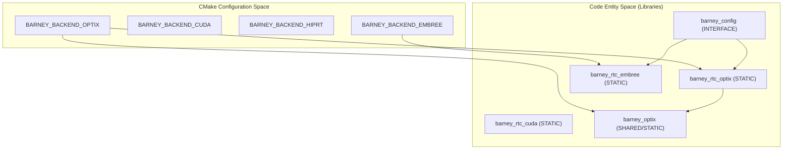
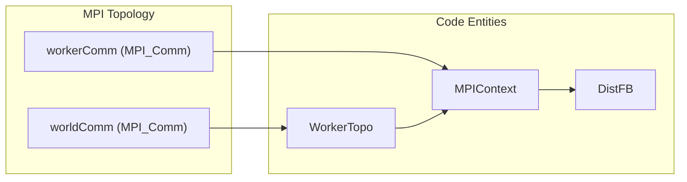

<!-- source: DeepWiki mcp.deepwiki.com · repo NVIDIA/barney · page 1.1 Getting Started: Building and Configuration · fetched 2026-10-26 -->

# Getting Started: Building and Configuration

Relevant source files

The following files were used as context for generating this wiki page:

- [CMakeLists.txt](CMakeLists.txt)
- [barney/CMakeLists.txt](barney/CMakeLists.txt)
- [barney/MPIContext.cpp](barney/MPIContext.cpp)
- [barney/common/barney-common.h](barney/common/barney-common.h)
- [barney/common/barneyConfig.h.in](barney/common/barneyConfig.h.in)
- [rtcore/CMakeLists.txt](rtcore/CMakeLists.txt)

This page provides a technical guide for building Barney from source, covering the CMake configuration system, backend selection, and dependency management. Barney is designed as a modular rendering engine that abstracts hardware-specific ray tracing through a layer called `rtcore`.

## Build System Overview

Barney uses CMake (minimum version 3.24) as its primary build system [CMakeLists.txt:12](). It supports cross-platform builds on Linux and Windows, with specific optimizations for NVIDIA (OptiX/CUDA), AMD (HIP/HIPRT), and CPU (Embree) targets.

### Core Configuration Logic
The build process is centered around `barney_config`, an interface library that propagates necessary include directories, compile definitions, and flags to all subsystems [CMakeLists.txt:158-162]().

The following diagram illustrates the relationship between the configuration entities and the resulting backend libraries:

**Configuration to Backend Entity Map**

Sources: [CMakeLists.txt:158-175](), [rtcore/CMakeLists.txt:135-154](), [barney/CMakeLists.txt:223-239]()

---

## Hardware Backends and Options

Barney allows selecting one or more backends at configuration time. Note that while multiple backends can be compiled into the library, a single context usually instantiates one specific `rtcore` implementation.

### NVIDIA OptiX and CUDA
- **BARNEY_BACKEND_OPTIX**: Enables the NVIDIA OptiX hardware-accelerated backend. It requires the OptiX SDK [CMakeLists.txt:136-142]().
- **BARNEY_BACKEND_CUDA**: Enables a native CUDA software-tracing backend (used when OptiX is not desired but NVIDIA GPUs are present) [CMakeLists.txt:85-103]().
- **CUDA Architectures**: Controlled via `CMAKE_CUDA_ARCHITECTURES`. Defaults to `native` on Linux and `all-major` on Windows [CMakeLists.txt:89-96]().

### AMD HIP and HIPRT
- **USE_HIP**: When `ON`, Barney compiles CUDA sources using `hipcc` for AMD GPUs [CMakeLists.txt:50-60](). It defines `USE_HIP=1` and `BARNEY_HAVE_HIP=1` for the host code [CMakeLists.txt:167]().
- **BARNEY_BACKEND_HIPRT**: Enables AMD's HIPRT for hardware-accelerated BVH traversal on RDNA2+ architectures [CMakeLists.txt:80-84]().

### Intel Embree (CPU)
- **BARNEY_BACKEND_EMBREE**: Enables the CPU-based backend. Barney vendors a specific version of Embree as a submodule and builds it with a custom namespace `embree_for_barney` to avoid symbol collisions [rtcore/CMakeLists.txt:105-106]().
- **ISA Targets**: Automatically detects SSE4.2, AVX2, or NEON based on the host architecture [rtcore/CMakeLists.txt:68-96]().

Sources: [CMakeLists.txt:50-108](), [rtcore/CMakeLists.txt:68-106](), [barney/common/barney-common.h:10-16]()

---

## Submodule Dependencies

Barney relies on several key submodules for core functionality:

| Submodule | Purpose | Build Integration |
| :--- | :--- | :--- |
| **OWL** | OptiX 7 Wrapper Library; manages SBT and launches. | Required for NVIDIA backends [CMakeLists.txt:133-147](). |
| **cuBQL** | CUDA Block-based Query Library; used for BVH construction. | Linked into `barney_optix` [barney/CMakeLists.txt:238](). |
| **NanoVDB** | Sparse VDB volumes support. | Included via `3rdParty/nanovdb` [CMakeLists.txt:176](). |
| **Embree** | CPU Ray Tracing kernels. | Integrated in `rtcore/embree` [rtcore/CMakeLists.txt:135-147](). |

### Version Requirements
The build system enforces specific versions for submodules:
- **OWL**: Minimum version `1.2.9` [CMakeLists.txt:9, 145]().
- **cuBQL**: Minimum version `1.3.1` [CMakeLists.txt:10]().

Sources: [CMakeLists.txt:9-10](), [CMakeLists.txt:144-147](), [barney/CMakeLists.txt:238]()

---

## MPI Support

Enabling `BARNEY_MPI` (OFF by default) builds the distributed rendering components [CMakeLists.txt:21]().

### MPI Implementation Details
When `BARNEY_MPI` is enabled, the build system:
1. Compiles `MPI_SOURCES` including `MPIContext.cpp`, `DistFB.cu`, and global trace strategies like `RQSMPI.cu` and `TwoStage.cu` [barney/CMakeLists.txt:190-203]().
2. Links against `MPI::MPI_C` [barney/CMakeLists.txt:250]().
3. Creates backend-specific MPI libraries, such as `barney_mpi_optix` [barney/CMakeLists.txt:249-252]().

**MPI Context Data Flow**

Sources: [barney/CMakeLists.txt:190-203](), [barney/MPIContext.cpp:83-90](), [barney/MPIContext.cpp:108-112]()

---

## Advanced Configuration Options

### OIDN Denoising
Barney supports the Intel Open Image Denoiser (OIDN).
- **BARNEY_OIDN_CPU**: Links OIDN for CPU-based denoising in the Embree backend [rtcore/CMakeLists.txt:155-157]().
- **BARNEY_DISABLE_DENOISING**: Disables all denoising logic [barney/common/barneyConfig.h.in:6]().

### Compilation Flags
- **Separable Compilation**: Enabled via `CMAKE_CUDA_SEPARABLE_COMPILATION` and `CUDA_RESOLVE_DEVICE_SYMBOLS` to allow cross-file device function calls (e.g., between `rtcore` and the shading kernels) [barney/CMakeLists.txt:31-33]().
- **Relaxed Constexpr**: Enabled via `--expt-relaxed-constexpr` for CUDA [barney/CMakeLists.txt:14, 243]().
- **Big Objects**: `/bigobj` is applied for MSVC to handle large generated object files from template instantiations [barney/CMakeLists.txt:5-12]().

### Installation Layout
The project follows standard GNU installation directories [CMakeLists.txt:36]().
- **RPATH**: On Linux, `INSTALL_RPATH` is set to `$ORIGIN` to ensure shared libraries can find their dependencies in the same directory [barney/CMakeLists.txt:47](). On macOS, it uses `@loader_path` [barney/CMakeLists.txt:45]().

Sources: [CMakeLists.txt:36](), [barney/CMakeLists.txt:5-12](), [barney/CMakeLists.txt:44-49](), [rtcore/CMakeLists.txt:155-157]()

---

