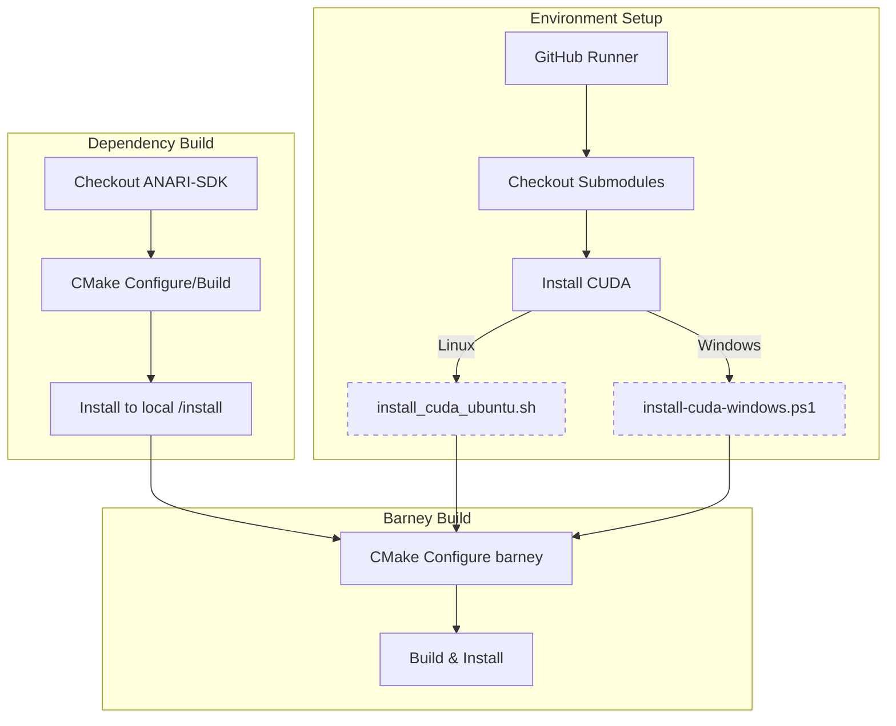
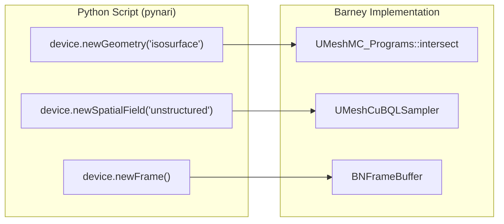

<!-- source: DeepWiki mcp.deepwiki.com · repo NVIDIA/barney · page 1.2 CI/CD and Testing Infrastructure · fetched 2026-10-26 -->

# CI/CD and Testing Infrastructure

Relevant source files

The following files were used as context for generating this wiki page:

- [.github/action-scripts/install-cuda-windows.ps1](.github/action-scripts/install-cuda-windows.ps1)
- [.github/action-scripts/install_cuda_ubuntu.sh](.github/action-scripts/install_cuda_ubuntu.sh)
- [.github/workflows/MPI-Build.yml](.github/workflows/MPI-Build.yml)
- [.github/workflows/Ubuntu.yml](.github/workflows/Ubuntu.yml)
- [.github/workflows/Windows.yml](.github/workflows/Windows.yml)
- [barney/umesh/mc/UMeshMC.dev.cu](barney/umesh/mc/UMeshMC.dev.cu)
- [barney/volume/MCGrid.cuh](barney/volume/MCGrid.cuh)
- [barney/volume/StructuredData.h](barney/volume/StructuredData.h)
- [unitTests/isosurface-umesh.py](unitTests/isosurface-umesh.py)
- [unitTests/isosurface-umesh2.py](unitTests/isosurface-umesh2.py)
- [unitTests/omnicamera.py](unitTests/omnicamera.py)
- [unitTests/reference_unitTest_omnicamera.png](unitTests/reference_unitTest_omnicamera.png)

This page documents the Barney CI/CD pipelines, including the automated build matrix for Linux and Windows, the environment provisioning scripts for CUDA, and the Python-based testing framework used for validation.

## GitHub Actions Workflows

Barney utilizes GitHub Actions to ensure cross-platform compatibility and stability across different hardware backends. The infrastructure is divided into primary OS-specific workflows and specialized builds.

### Build Matrix and Configurations
The CI/CD pipeline tests a variety of configurations, including different compiler versions (GCC), CUDA toolkit versions, and Barney backends (OptiX, CUDA Software Tracer, and Embree).

| OS | Compilers | CUDA Versions | Tested Backends |
| :--- | :--- | :--- | :--- |
| **Ubuntu** | GCC 11, 13, 15 | None, 12.0.0, 13.0.2 | OptiX, CUDA, Embree |
| **Windows** | MSVC (VS 2022, 2026) | 12.6.2, 13.2.0 | OptiX, CUDA, Embree |

#### Ubuntu Workflow (`Ubuntu.yml`)
The Ubuntu workflow supports both x86_64 and ARM architectures. It automates the installation of the ANARI-SDK as a dependency before building Barney.
*   **ARM Support:** Includes builds for `ubuntu-26.04-arm` using GCC 15 and the Embree backend [.github/workflows/Ubuntu.yml:21-25]().
*   **Dependency Management:** Clones and installs the `KhronosGroup/ANARI-SDK` into a local install directory [.github/workflows/Ubuntu.yml:73-93]().
*   **Backend Selection:** Uses CMake flags such as `-DBARNEY_BACKEND_EMBREE=ON` or `-DBARNEY_BACKEND_CUDA=ON` to toggle hardware support [.github/workflows/Ubuntu.yml:25-40]().

#### Windows Workflow (`Windows.yml`)
The Windows workflow targets modern Visual Studio environments and handles CUDA integration through specialized PowerShell scripts.
*   **Generator:** Uses "Visual Studio 17 2022" and "Visual Studio 18 2026" [.github/workflows/Windows.yml:18-38]().
*   **Build Types:** Validates both `Release` and `Debug` configurations [.github/workflows/Windows.yml:22-34]().

#### MPI Workflow (`MPI-Build.yml`)
A dedicated workflow for Ubuntu validates Barney's distributed rendering capabilities by enabling the MPI wrapper layer.
*   **Flag:** Sets `-DBARNEY_MPI=ON` during the CMake configuration step [.github/workflows/MPI-Build.yml:95]().
*   **Packages:** Installs `libopenmpi-dev` to provide the necessary MPI headers and runtime [.github/workflows/MPI-Build.yml:64]().

Sources: [.github/workflows/Ubuntu.yml:13-46](), [.github/workflows/Windows.yml:10-42](), [.github/workflows/MPI-Build.yml:13-41]()

---

## Environment Provisioning

Barney requires specific versions of the CUDA Toolkit for its GPU backends. Since standard CI runners may not have the required versions, the repository includes provisioning scripts.

### CUDA Installation Scripts
The scripts handle repository pinning, keyring updates, and package selection based on the requested CUDA version.

*   **Ubuntu (`install_cuda_ubuntu.sh`):** 
    *   Determines the correct package names (e.g., `cuda-compiler` vs `cuda-nvcc`) based on version logic [.github/action-scripts/install_cuda_ubuntu.sh:94-110]().
    *   Configures `apt` repositories and installs a subset of required packages: `cuda-compiler`, `cuda-cudart-dev`, `cuda-nvtx`, `cuda-nvrtc-dev`, `libcurand-dev`, and `cuda-cccl` [.github/action-scripts/install_cuda_ubuntu.sh:11-18]().
*   **Windows (`install-cuda-windows.ps1`):** 
    *   Maintains a dictionary of known CUDA download URLs for network installation [.github/action-scripts/install-cuda-windows.ps1:18-60]().
    *   Enforces minimum CUDA versions for specific Visual Studio years (e.g., VS 2022 requires CUDA 11.6.0+) [.github/action-scripts/install-cuda-windows.ps1:63-68]().

### CI/CD Data Flow
The following diagram illustrates how the GitHub Actions environment is prepared and how the Barney build consumes these dependencies.

**CI/CD Provisioning Flow**

Sources: [.github/workflows/Ubuntu.yml:51-110](), [.github/action-scripts/install_cuda_ubuntu.sh:11-18](), [.github/action-scripts/install-cuda-windows.ps1:18-68]()

---

## Unit Testing Infrastructure

Barney uses Python-based unit tests via the `pynari` wrapper (a Python interface for ANARI) to validate rendering output.

### Python Testing Framework
Tests are located in the `unitTests/` directory and typically follow a pattern of scene construction, rendering, and image comparison.

*   **Scene Definition:** Tests use `pynari` to create ANARI objects like `newWorld`, `newGeometry`, and `newMaterial` [.unitTests/omnicamera.py:77-83]().
*   **Camera Models:** Specific tests validate different camera types, such as `omnidirectional` [.unitTests/omnicamera.py:86]() or `perspective` [.unitTests/isosurface-umesh.py:123]().
*   **Geometry & Volumes:** Tests cover complex types including `isosurface` and `unstructured` spatial fields [.unitTests/isosurface-umesh.py:66-72]().
*   **Validation:** The scripts render a frame, retrieve the `channel.color` buffer, and save it as a PNG/JPG for manual or automated comparison against reference images [.unitTests/omnicamera.py:108-119]().

### Test Entity Mapping
This diagram maps the Python test entities to the underlying Barney/ANARI concepts.

**Testing Entity Space**

### Key Test Cases
*   **Omnidirectional Camera:** Tests 360-degree rendering by placing spheres around a central camera point [.unitTests/omnicamera.py:64-73]().
*   **Unstructured Mesh (UMesh):** Tests the macro-cell acceleration and intersection of unstructured grids (Tets, Hexes, Wedges, Pyramids) [.unitTests/isosurface-umesh.py:120-128]().
*   **Macro-Cell Validation:** Uses `MCVolumeAccel` and `MCIsoSurfaceAccel` templates to verify that the DDA traversal correctly identifies intersections in scalar fields [.barney/umesh/mc/UMeshMC.dev.cu:90-95]().

Sources: [.unitTests/omnicamera.py:86-119](), [.unitTests/isosurface-umesh.py:66-139](), [.barney/umesh/mc/UMeshMC.dev.cu:26-54]()

---

