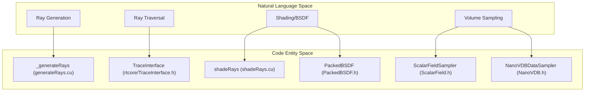
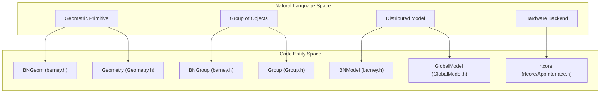

<!-- source: DeepWiki mcp.deepwiki.com · repo NVIDIA/barney · page 10 Glossary · fetched 2026-10-26 -->

# Glossary

Relevant source files

The following files were used as context for generating this wiki page:

- [CMakeLists.txt](CMakeLists.txt)
- [anari/CMakeLists.txt](anari/CMakeLists.txt)
- [anari/Device.cpp](anari/Device.cpp)
- [anari/Device.h](anari/Device.h)
- [anari/Library.cpp](anari/Library.cpp)
- [barney/CMakeLists.txt](barney/CMakeLists.txt)
- [barney/DeviceGroup.cpp](barney/DeviceGroup.cpp)
- [barney/DeviceGroup.h](barney/DeviceGroup.h)
- [barney/MPIContext.cpp](barney/MPIContext.cpp)
- [barney/WorkerTopo.cpp](barney/WorkerTopo.cpp)
- [barney/geometry/IsoSurface.h](barney/geometry/IsoSurface.h)
- [barney/include/barney.h](barney/include/barney.h)
- [barney/kernels/generateRays.cu](barney/kernels/generateRays.cu)
- [barney/kernels/shadeRays.cu](barney/kernels/shadeRays.cu)
- [barney/kernels/traceRays.cu](barney/kernels/traceRays.cu)
- [barney/material/AnariMatte.h](barney/material/AnariMatte.h)
- [barney/material/AnariPBR.h](barney/material/AnariPBR.h)
- [barney/material/Material.h](barney/material/Material.h)
- [barney/packedBSDF/Lambertian.h](barney/packedBSDF/Lambertian.h)
- [barney/packedBSDF/PackedBSDF.h](barney/packedBSDF/PackedBSDF.h)
- [barney/render/Sampler.cpp](barney/render/Sampler.cpp)
- [barney/render/Sampler.h](barney/render/Sampler.h)
- [barney/umesh/common/UMeshField.cu](barney/umesh/common/UMeshField.cu)
- [barney/umesh/common/UMeshField.h](barney/umesh/common/UMeshField.h)
- [barney/umesh/mc/UMeshCuBQLSampler.h](barney/umesh/mc/UMeshCuBQLSampler.h)
- [barney/umesh/os/AWT.dev.cu](barney/umesh/os/AWT.dev.cu)
- [barney/umesh/os/ObjectSpace-common.h](barney/umesh/os/ObjectSpace-common.h)
- [barney/volume/NanoVDB.cu](barney/volume/NanoVDB.cu)
- [barney/volume/NanoVDB.dev.cu](barney/volume/NanoVDB.dev.cu)
- [barney/volume/NanoVDB.h](barney/volume/NanoVDB.h)
- [barney/volume/ScalarField.cpp](barney/volume/ScalarField.cpp)
- [rtcore/CMakeLists.txt](rtcore/CMakeLists.txt)
- [rtcore/embree/AppInterface.h](rtcore/embree/AppInterface.h)

This page provides definitions and technical details for codebase-specific terms, abbreviations, and domain concepts used within Barney. It serves as a reference for onboarding engineers to understand the mapping between high-level rendering concepts and their specific implementations in the Barney source code.

## System Entities and Code Mapping

The following diagrams bridge high-level domain concepts to the specific C++ classes and files that implement them.

### Rendering Core Entities
This diagram maps rendering concepts to the core classes responsible for their execution.

**Sources:** [barney/kernels/generateRays.cu:45-67](), [barney/kernels/shadeRays.cu:1-10](), [barney/volume/NanoVDB.h:74-80](), [barney/packedBSDF/PackedBSDF.h:1-10]().

### Scene Hierarchy Entities
This diagram maps scene description concepts to the Barney object model.

**Sources:** [barney/include/barney.h:58-75](), [barney/geometry/Geometry.h:1-10](), [barney/Group.h:1-10](), [barney/GlobalModel.h:1-10]().

---

## Technical Glossary

### ANARI
The **Analytic Rendering Interface** is a cross-vendor standard API for 3D visualization. Barney implements an ANARI device layer that translates ANARI objects (Worlds, Instances, Surfaces) into Barney's internal primitives.
*   **Implementation:** `BarneyDevice` in `anari/Device.cpp`.
*   **Key Class:** `BarneyDevice` [anari/Device.cpp:17-205]().

### BSDF (Bidirectional Scattering Distribution Function)
Barney uses a "Packed BSDF" approach where different material models (Lambertian, PBR, etc.) are unified into a single structure for efficient GPU execution.
*   **Key Struct:** `PackedBSDF` [barney/packedBSDF/PackedBSDF.h:1-10]().
*   **Specific Models:** `AnariMatte` [barney/material/AnariMatte.h:16-47](), `AnariPBR` [barney/material/AnariPBR.h:1-10]().

### DD (Device Data)
A common pattern in Barney where a "Host" class (running on CPU) has a nested `DD` struct. The `DD` struct contains only POD (Plain Old Data) and GPU-compatible pointers, allowing it to be passed to CUDA/OptiX kernels.
*   **Pattern Example:** `Sampler::DD` [barney/render/Sampler.h:46-78](), `NanoVDBData::DD` [barney/volume/NanoVDB.h:39-45]().

### MC (Macro-Cell)
A spatial acceleration structure used for volume rendering. Macro-cells store the min/max scalar ranges for a sub-region of a volume, allowing the renderer to skip empty space or regions that do not intersect the current transfer function's opacity.
*   **Implementation:** `MCGrid` [barney/volume/MCGrid.h:1-10]().
*   **Usage:** `NanoVDBData_computeMCs` [barney/volume/NanoVDB.cu:27-61]().

### ModelSlot
In Barney's multi-GPU/MPI architecture, a `ModelSlot` represents a specific "view" of the data assigned to a GPU. It manages the local portion of a `GlobalModel`.
*   **Key Class:** `ModelSlot` [barney/ModelSlot.h:1-10]().

### NanoVDB
A GPU-friendly version of the OpenVDB library for sparse volumetric data. Barney supports multiple bit-depths for NanoVDB grids.
*   **Supported Types:** `float`, `Fp4`, `Fp8`, `Fp16`, `FpN` [barney/volume/NanoVDB.h:23-28]().
*   **Sampler:** `NanoVDBDataSampler` [barney/volume/NanoVDB.h:74-96]().

### PLD (Per Logical Device)
A structure used to store hardware-specific handles (like OptiX textures or CUDA buffers) that differ for each physical GPU managed by a single host process.
*   **Implementation:** `TextureSampler::PLD` [barney/render/Sampler.h:175-179]().

### rtcore
The hardware abstraction layer that allows Barney to run on NVIDIA (OptiX/CUDA), AMD (HIP/HIPRT), and CPU (Embree). It defines interfaces for tracing rays and managing device memory.
*   **Interfaces:** `TraceInterface`, `ComputeInterface` [rtcore/ComputeInterface.h:1-15]().
*   **Backends:** `barney_rtc_optix` [rtcore/CMakeLists.txt:205-217](), `barney_rtc_embree` [rtcore/CMakeLists.txt:135-154]().

### SlotContext
A context object that provides access to all registries (Materials, Samplers) and device groups for a specific `ModelSlot`. It acts as the primary "factory" for creating objects within a slot.
*   **Key Struct:** `SlotContext` [barney/render/Sampler.h:19]().

### TiledFB (Tiled Framebuffer)
The internal representation of the image being rendered. Rendering is performed in tiles (e.g., 8x8 or 16x16 pixels) to improve GPU cache locality and load balancing.
*   **Implementation:** `TiledFB` [barney/fb/TiledFB.h:1-10]().
*   **Kernel:** `_generateRays` operates on `TileDesc` [barney/kernels/generateRays.cu:45-67]().

---

## Data Flow: Ray Generation to Shading

The following table describes the lifecycle of a ray within the Barney pipeline.

| Stage | Entity | File | Description |
| :--- | :--- | :--- | :--- |
| **Generation** | `_generateRays` | `generateRays.cu` | Computes ray origin and direction based on `Camera::DD` [barney/kernels/generateRays.cu:93-145](). |
| **Traversal** | `rtc::TraceInterface` | `rtcore/` | Intersects ray with scene BVH using the selected backend (OptiX, HIPRT, or Embree) [rtcore/CMakeLists.txt:51-220](). |
| **Hit Testing** | `.dev.cu` programs | `geometry/` | Geometry-specific intersection code (e.g., `Spheres.dev.cu`) [barney/CMakeLists.txt:205-216](). |
| **Shading** | `shadeRays` | `shadeRays.cu` | Evaluates materials and samples lights to compute pixel color [barney/kernels/shadeRays.cu:1-10](). |
| **Accumulation** | `FrameBuffer` | `fb/` | Blends the new sample into the `TiledFB` using `accumID` [barney/fb/FrameBuffer.h:1-10](). |

**Sources:** [barney/kernels/generateRays.cu:45-145](), [barney/CMakeLists.txt:205-216](), [rtcore/CMakeLists.txt:51-220]().