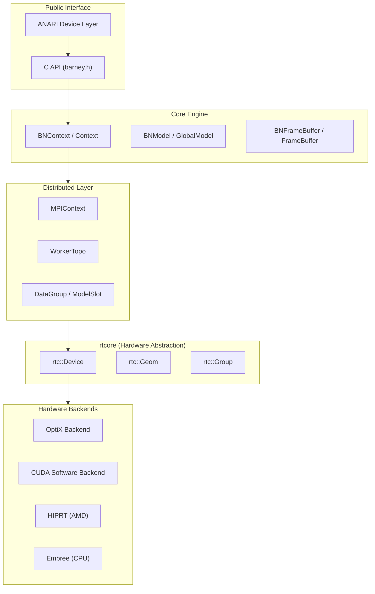
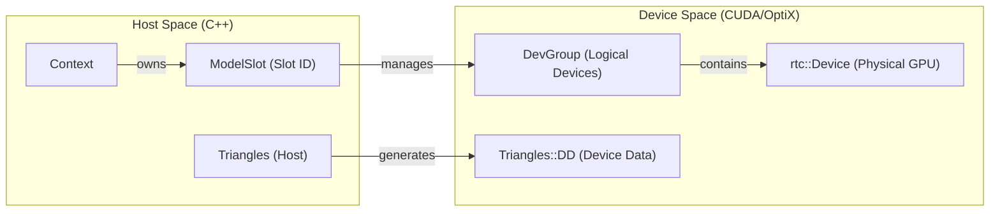

<!-- source: DeepWiki mcp.deepwiki.com · repo NVIDIA/barney · page 2 Architecture Overview · fetched 2026-10-26 -->

# Architecture Overview

Relevant source files

The following files were used as context for generating this wiki page:

- [barney/Context.h](barney/Context.h)
- [barney/GlobalModel.h](barney/GlobalModel.h)
- [barney/ModelSlot.cpp](barney/ModelSlot.cpp)
- [barney/ModelSlot.h](barney/ModelSlot.h)
- [barney/api/Context.h](barney/api/Context.h)
- [barney/api/barney.cu](barney/api/barney.cu)
- [barney/geometry/Triangles.cpp](barney/geometry/Triangles.cpp)
- [barney/geometry/Triangles.h](barney/geometry/Triangles.h)
- [barney/include/barney.h](barney/include/barney.h)
- [barney/umesh/common/UMeshField.cu](barney/umesh/common/UMeshField.cu)
- [barney/umesh/common/UMeshField.h](barney/umesh/common/UMeshField.h)
- [barney/umesh/os/AWT.dev.cu](barney/umesh/os/AWT.dev.cu)
- [barney/umesh/os/ObjectSpace-common.h](barney/umesh/os/ObjectSpace-common.h)
- [rtcore/cudaCommon/Device.cu](rtcore/cudaCommon/Device.cu)

Barney utilizes a layered architecture designed to abstract complex ray tracing hardware while providing a high-performance, distributed rendering engine for scientific visualization. The system is split between a host-side object model and a device-side execution core, supporting multi-GPU and multi-node (MPI) configurations.

### System Layer Diagram

The following diagram illustrates the relationship between the major architectural layers, from the public API down to the hardware-specific backends.

**Barney System Stack**

**Sources:** [barney/include/barney.h:58-75](), [barney/api/barney.cu:100-136](), [barney/Context.h:61-115]()

---

### 1. Public C API (`barney.h`)
The native interface for Barney is a C99-compatible API. It follows a "create-set-commit" pattern common in modern rendering APIs. Users interact with opaque handles such as `BNContext`, `BNModel`, and `BNRenderer`. 

- **Lifecycle:** Objects are created via factory functions (e.g., `bnCameraCreate`), parameters are set using type-specific setters (e.g., `bnSet3f`), and changes are realized via `bnCommit`.
- **Rendering:** The `bnRender` call triggers the distributed rendering pipeline across all configured GPUs and MPI ranks.

For details, see [Public C API (barney.h)](#2.1).

**Sources:** [barney/include/barney.h:235-250](), [barney/api/barney.cu:26-35]()

---

### 2. ANARI Device Layer
Barney provides a first-class implementation of the Khronos ANARI standard. This layer maps ANARI objects (Worlds, Instances, Geometries) directly to Barney's internal objects.

- **Tethering:** In multi-GPU or MPI environments, the ANARI layer uses a "tethering" mechanism to ensure that state changes on the application side are correctly broadcast to all worker nodes.
- **Interoperability:** It allows Barney to be used as a drop-in backend for any visualization tool supporting the ANARI API.

For details, see [ANARI Device Layer](#2.2).

**Sources:** [barney/include/barney.h:23-26](), [barney/api/barney.cu:7-10]()

---

### 3. Core Engine and Distributed Topology
The core of Barney is managed by the `Context` class, which handles the orchestration of GPUs and data distribution.

- **Multi-GPU/MPI Topology:** Barney organizes resources into `WorkerTopo`. Data is partitioned into "Data Groups," where each group holds a subset of the global model. 
- **Host/Device Split:** Host-side classes (e.g., `Triangles`) manage the scene graph and memory, while corresponding `DD` (Device Data) structs (e.g., `Triangles::DD`) are passed to GPU kernels for intersection and shading.

**Topology Mapping**

**Sources:** [barney/Context.h:36-46](), [barney/ModelSlot.h:22-30](), [barney/geometry/Triangles.h:28-34]()

For details, see [Context and Multi-GPU/MPI Topology](#2.3).

---

### 4. `rtcore` Abstraction Layer
The `rtcore` layer is a hardware abstraction layer (HAL) that allows Barney to run on NVIDIA GPUs (OptiX/CUDA), AMD GPUs (HIPRT), and CPUs (Embree).

- **Interfaces:** It provides `AppInterface`, `TraceInterface`, and `ComputeInterface` to standardize how rays are traced and kernels are launched across different backends.
- **Resource Management:** `rtc::Device` handles memory allocation (`allocMem`), stream management, and peer-to-peer access.

| Entity | Role | Code Reference |
| :--- | :--- | :--- |
| `rtc::Device` | Abstract GPU/CPU device | [rtcore/cudaCommon/Device.cu:32-41]() |
| `rtc::Geom` | Abstract geometry object | [barney/geometry/Triangles.cpp:56-60]() |
| `rtc::Buffer` | Device memory wrapper | [barney/geometry/Triangles.cpp:61-64]() |

For details, see [Ray Tracing Core (rtcore)](#3).

**Sources:** [rtcore/cudaCommon/Device.cu:64-74](), [barney/api/barney.cu:100-117]()

---

