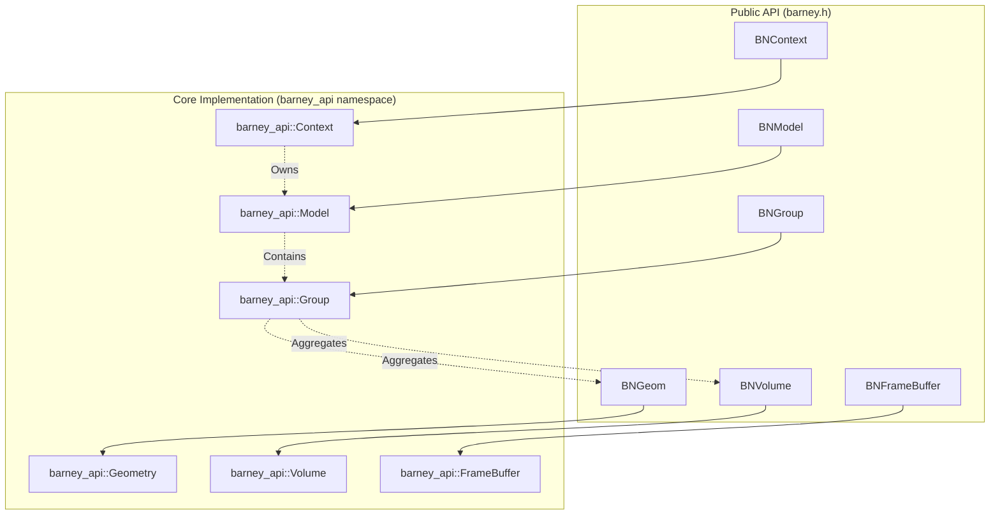
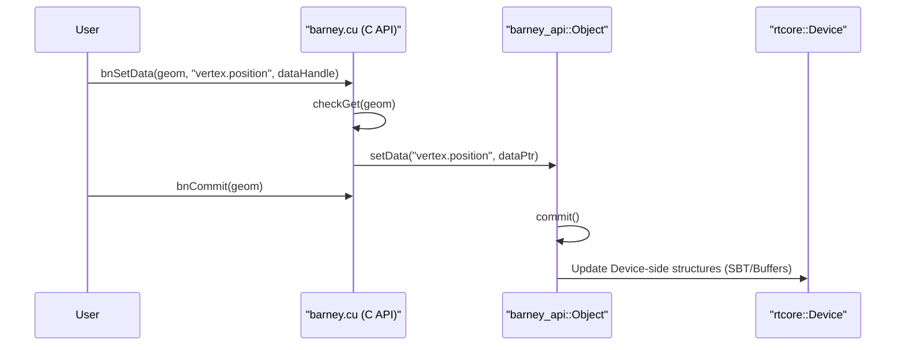

<!-- source: DeepWiki mcp.deepwiki.com · repo NVIDIA/barney · page 2.1 Public C API (barney.h) · fetched 2026-10-26 -->

# Public C API (barney.h)

Relevant source files

The following files were used as context for generating this wiki page:

- [barney/api/barney.cu](barney/api/barney.cu)
- [barney/include/barney.h](barney/include/barney.h)
- [barney/umesh/common/UMeshField.cu](barney/umesh/common/UMeshField.cu)
- [barney/umesh/common/UMeshField.h](barney/umesh/common/UMeshField.h)
- [barney/umesh/os/AWT.dev.cu](barney/umesh/os/AWT.dev.cu)
- [barney/umesh/os/ObjectSpace-common.h](barney/umesh/os/ObjectSpace-common.h)
- [doc/BarneyNative.md](doc/BarneyNative.md)
- [rtcore/cudaCommon/Device.cu](rtcore/cudaCommon/Device.cu)

The Barney Public C API is the primary native interface for the Barney rendering engine. It provides a handle-based, stateful API designed for high-performance scientific visualization and path tracing. It follows a **create-set-commit-render** lifecycle, allowing users to build complex scene hierarchies, manage distributed data across multiple GPUs (via MPI or local multi-GPU), and execute photorealistic rendering.

## API Lifecycle and Object Management

The API operates on opaque handles (e.g., `BNContext`, `BNModel`, `BNGeom`) representing underlying C++ objects. The typical workflow follows these stages:

1.  **Context Creation**: Initialize the engine for a specific hardware backend (OptiX, CUDA, HIPRT, or Embree) and define the GPU topology.
2.  **Object Creation**: Create scene entities such as geometries, volumes, materials, and lights.
3.  **Parameter Setting**: Use `bnSet*` functions to assign data arrays, scalars, or object references to entities.
4.  **Commit**: Call `bnCommit` to signal that an object's parameters are ready. This often triggers internal updates or BVH builds [barney/api/barney.cu:1986-1991]().
5.  **Render**: Execute the rendering pipeline into a `BNFrameBuffer`.

### Natural Language to Code Entity Mapping

The following diagram maps high-level rendering concepts to their specific Barney C API handles and internal C++ implementation classes.

**Concept to Entity Mapping**

**Sources:** [barney/include/barney.h:58-75](), [barney/api/barney.cu:139-227]()

---

## Context and Topology

The `BNContext` is the root object for all Barney operations. It manages the hardware devices and the MPI communicator (if enabled).

### Context Creation
Barney supports multiple backends, selected at context creation. Depending on the build configuration, specific creators are used:
*   **Local Contexts**: `bnContextCreate` (defaults to available backend).
*   **MPI Contexts**: `bnMPIContextCreate` (requires `barney_mpi.h`).

Internally, these call backend-specific functions like `createContext_optix` or `createContext_cuda` [barney/api/barney.cu:103-117]().

### Hardware Info
Users can query the environment's topology using `bnGetHardwareInfo`, which returns a `BNHardwareInfo` struct containing the number of ranks, hosts, and GPUs available to the current process [barney/include/barney.h:223-231]().

**Sources:** [barney/api/barney.cu:98-137](), [barney/include/barney.h:240-250]()

---

## Scene Hierarchy and Data Flow

Barney uses a hierarchical scene graph to manage geometries and volumes. Data is typically passed as `BNData` objects, which wrap raw pointers or arrays.

### Key Scene Objects
| Object | Role | Key Functions |
| :--- | :--- | :--- |
| `BNModel` | The top-level container for a scene. | `bnModelCreate`, `bnBuild` |
| `BNGroup` | A collection of geometries and volumes. | `bnGroupCreate` |
| `BNGeom` | Geometric primitives (triangles, spheres, etc.). | `bnGeometryCreate` |
| `BNVolume` | Volumetric data (structured, unstructured, VDB). | `bnVolumeCreate` |

### Data Types (`BNDataType`)
Barney supports a wide range of data types for vertex attributes, scalar fields, and textures, including:
*   **Scalars**: `BN_FLOAT32`, `BN_INT32`, `BN_UINT8`.
*   **Vectors**: `BN_FLOAT32_VEC3`, `BN_INT32_VEC4`.
*   **Special**: `BN_UFIXED8_RGBA_SRGB` for color data [barney/include/barney.h:104-179]().

### Implementation Flow: Setting Data
When `bnSetData` or `bnSetObject` is called, the API performs a lookup from the opaque handle to the internal `barney_api::Object` and updates its parameter map [barney/api/barney.cu:163-169]().

**Object Parameterization Flow**

**Sources:** [barney/api/barney.cu:1834-1845](), [barney/api/barney.cu:1986-1991]()

---

## Volume Rendering Reference

Volumes in Barney are defined by a `BNScalarField` and a `BNVolume`. The scalar field defines the spatial data, while the volume object associates it with a `BNTransferFunction`.

### Supported Scalar Fields
*   **Structured**: Regular Cartesian grids.
*   **Unstructured (UMesh)**: Supports Tetrahedra, Hexahedra, Prisms, Pyramids, and Polyhedra [barney/include/barney.h:185-191]().
*   **NanoVDB**: Sparse VDB volumes [barney/include/barney.h:31]().

### Unstructured Mesh (UMesh) Detail
UMesh fields require several data arrays:
*   `vertex.position`: `BN_FLOAT3_VEC3` positions.
*   `vertex.data` or `cell.data`: Scalar values.
*   `index`: Indices into the vertex array.
*   `cell.index`: Offsets into the index array per cell.
*   `cell.type`: `BNUnstructuredElementType` per cell [barney/umesh/common/UMeshField.h:153-160]().

**Sources:** [barney/umesh/common/UMeshField.cu:204-236](), [barney/include/barney.h:185-191]()

---

## FrameBuffer and Rendering

The `BNFrameBuffer` manages the output of the rendering process. It supports multiple channels and optional post-processing like denoising.

### FrameBuffer Channels
Users can request specific channels during creation using bitwise flags:
*   `BN_FB_COLOR`: RGBA output.
*   `BN_FB_DEPTH`: Z-buffer.
*   `BN_FB_NORMAL`: World-space normals.
*   `BN_FB_OBJID` / `BN_FB_INSTID`: ID buffers for picking [barney/include/barney.h:95-102]().

### Rendering Parameters
The `BNRenderer` object controls the path tracing process:
*   `pixelSamples`: Samples per pixel per frame.
*   `ambientRadiance`: Global illumination base.
*   `background`: Texture or color for missed rays [doc/BarneyNative.md:14-29]().

### Execution
Rendering is triggered via `bnRender(renderer, model, camera, framebuffer)`. In MPI configurations, this call handles the distributed ray exchange and final image compositing across the `BNFrameBuffer` [barney/api/barney.cu:2140-2160]().

**Sources:** [barney/include/barney.h:95-102](), [barney/api/barney.cu:2140-2160](), [doc/BarneyNative.md:14-27]()

---

