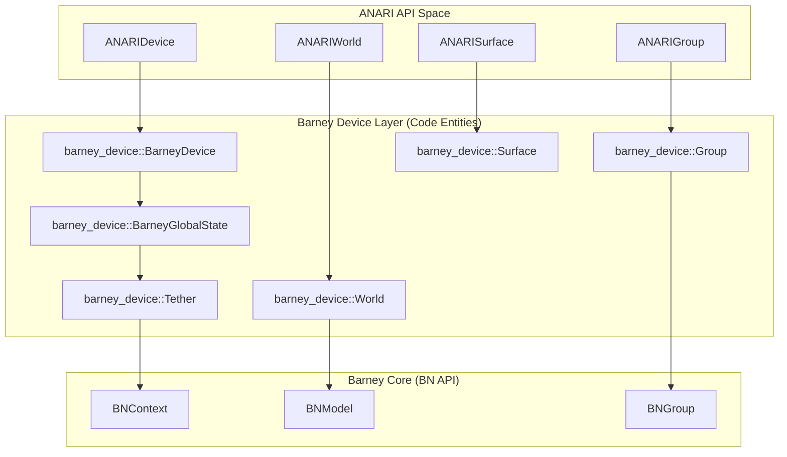
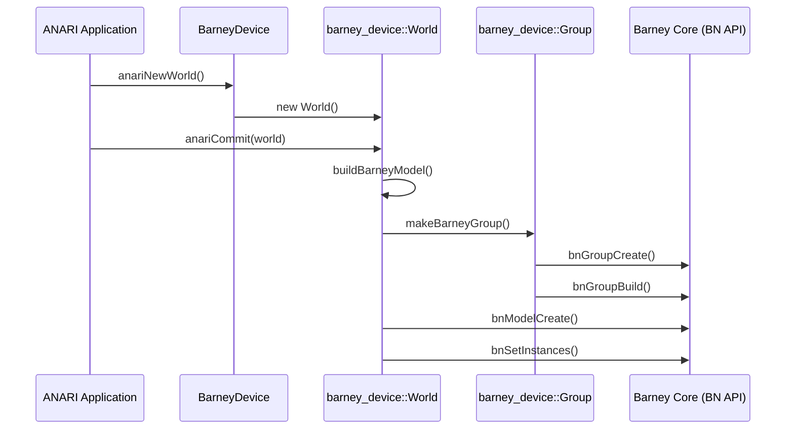

<!-- source: DeepWiki mcp.deepwiki.com · repo NVIDIA/barney · page 2.2 ANARI Device Layer · fetched 2026-10-26 -->

# ANARI Device Layer

Relevant source files

The following files were used as context for generating this wiki page:

- [anari/BarneyGlobalState.cpp](anari/BarneyGlobalState.cpp)
- [anari/BarneyGlobalState.h](anari/BarneyGlobalState.h)
- [anari/CMakeLists.txt](anari/CMakeLists.txt)
- [anari/Device.cpp](anari/Device.cpp)
- [anari/Device.h](anari/Device.h)
- [anari/Group.cpp](anari/Group.cpp)
- [anari/Group.h](anari/Group.h)
- [anari/Instance.cpp](anari/Instance.cpp)
- [anari/Instance.h](anari/Instance.h)
- [anari/Library.cpp](anari/Library.cpp)
- [anari/Library_entryPoint.h.in](anari/Library_entryPoint.h.in)
- [anari/Surface.cpp](anari/Surface.cpp)
- [anari/World.cpp](anari/World.cpp)
- [anari/World.h](anari/World.h)
- [anari/generated/anari_library_barney_mpi_queries.cpp](anari/generated/anari_library_barney_mpi_queries.cpp)
- [anari/generated/anari_library_barney_mpi_queries.h](anari/generated/anari_library_barney_mpi_queries.h)
- [anari/generated/anari_library_barney_queries.cpp](anari/generated/anari_library_barney_queries.cpp)
- [anari/generated/anari_library_barney_queries.h](anari/generated/anari_library_barney_queries.h)
- [doc/ANARI.md](doc/ANARI.md)

The ANARI Device Layer in Barney provides an implementation of the [Khronos ANARI standard](https://www.khronos.org/anari/), allowing Barney to be used as a pluggable rendering backend for any ANARI-compatible application. It translates the ANARI scene graph and state machine into Barney's internal `BNContext` and native object hierarchy.

## Library and Device Entry Points

The ANARI implementation is built as a shared library (`anari_library_barney` or `anari_library_barney_mpi`) [anari/CMakeLists.txt:92-125](). The entry point is defined in `Library_entryPoint.h.in`, which exposes the `anari_library_barney` symbol required by the ANARI loader [anari/Library_entryPoint.h.in:1-14]().

### BarneyLibrary
The `BarneyLibrary` class manages the creation of device instances. It inherits from `anari::LibraryImpl` [anari/Library.cpp:41-48]().
- `newDevice(subtype)`: Creates a new `BarneyDevice` instance [anari/Library.cpp:57-60]().
- `getDeviceExtensions()`: Returns the list of supported ANARI extensions (e.g., `ANARI_KHR_GEOMETRY_TRIANGLE`) [anari/Library.cpp:62-65]().

### BarneyDevice
`BarneyDevice` is the primary interface between the ANARI API and Barney. It implements the factory methods for all ANARI object types [anari/Device.cpp:80-143]().
- **Object Creation**: Maps `newGeometry`, `newVolume`, `newMaterial`, etc., to internal Barney device classes [anari/Device.cpp:80-123]().
- **State Management**: Uses `BarneyGlobalState` to track cross-object state and synchronization [anari/Device.h:14-114]().

**Sources:** [anari/Library.cpp:41-65](), [anari/Device.cpp:80-143](), [anari/Device.h:14-114](), [anari/CMakeLists.txt:92-125]()

---

## BarneyGlobalState and Tethering

Barney uses a "Tethering" mechanism to support multi-GPU and MPI configurations where multiple ANARI devices might share a single underlying `BNContext`.

### Global State Entities
| Entity | Role |
| :--- | :--- |
| `BarneyGlobalState` | Stores device-wide timestamps for scene changes and the `slot` ID [anari/BarneyGlobalState.h:65-93](). |
| `Tether` | Manages the shared `BNContext` and coordinates deferred render calls across tethered devices [anari/BarneyGlobalState.h:43-63](). |
| `TetheredModel` | Ensures that ANARI `World` objects across different devices that represent the same data are mapped to the same `BNModel` [anari/BarneyGlobalState.h:32-39](). |

### Tethering Data Flow
When multiple devices are initialized (e.g., in a multi-GPU setup), they are added to a `Tether::devices` vector [anari/BarneyGlobalState.h:62](). This allows the implementation to synchronize commits and renders.

**Sources:** [anari/BarneyGlobalState.h:32-93](), [anari/BarneyGlobalState.cpp:12-61]()

---

## Device Initialization and Lifecycle

The initialization of a `BarneyDevice` involves setting up the execution backend (CUDA/MPI) and establishing the tethering.

### Initialization Sequence
1. **Instantiation**: `BarneyLibrary::newDevice` creates the object.
2. **Parameter Setting**: The application sets parameters like `cudaDevice` or `mpiComm`.
3. **Commit**: Upon the first `anariCommit(device)`, `initDevice()` is called [anari/Device.h:107-108]().
4. **Context Creation**: If no tether exists, `bnContextCreate` is called to initialize the core engine [anari/BarneyGlobalState.cpp:12-17]().

### Logic: ANARI to Barney Entity Mapping
The following diagram illustrates how ANARI API entities are mapped to internal Barney symbols.

**ANARI to Barney Mapping Diagram**

**Sources:** [anari/Device.cpp:139-204](), [anari/BarneyGlobalState.h:43-93](), [anari/World.cpp:139-143](), [anari/Group.cpp:37-140]()

---

## Scene Translation: World, Group, and Surface

Barney translates the ANARI hierarchy (`World` -> `Instance` -> `Group` -> `Surface`/`Volume`) into Barney's native objects.

### Group Translation
The `barney_device::Group::makeBarneyGroup` function [anari/Group.cpp:37-140]() is responsible for:
1. Iterating through `ANARISurface` objects and extracting `BNGeom` handles via `Surface::getBarneyGeom()` [anari/Group.cpp:66-70]().
2. Collecting `BNVolume` handles from `ANARIVolume` objects [anari/Group.cpp:88-89]().
3. Creating a `BNGroup` using `bnGroupCreate` [anari/Group.cpp:121-125]().
4. Calling `bnGroupBuild` to trigger BVH construction for that group [anari/Group.cpp:131]().

### World and Model Management
The `ANARIWorld` is mapped to a `BNModel`. Barney distinguishes between structural changes and transform updates:
- **Full Rebuild**: Triggered if geometries are added/removed. Calls `World::fullRebuild()` [anari/World.cpp:201-227]().
- **Transform Update**: Triggered if only instance matrices change. Calls `World::transformOnlyUpdate()` [anari/World.cpp:195]().

**Object Lifecycle Diagram**

**Sources:** [anari/World.cpp:168-227](), [anari/Group.cpp:37-140](), [anari/Surface.cpp:59-71]()

---

## Capability Reporting and Queries

Barney uses the ANARI SDK's code generation features to report its capabilities.

1. **JSON Definitions**: The device's features, parameters, and types are defined in `barney_device.json` [anari/CMakeLists.txt:206]().
2. **Query Generation**: During build, if `BARNEY_AUTO_GENERATE_QUERIES` is ON, the `anari_generate_queries` CMake function produces C++ files that implement `query_object_types`, `query_object_info`, and `query_param_info` [anari/CMakeLists.txt:201-209]().
3. **Runtime Queries**: `BarneyDevice` implements `getObjectSubtypes` and `getParameterInfo` by calling these generated functions [anari/Device.cpp:146-173]().

**Sources:** [anari/CMakeLists.txt:17-18](), [anari/CMakeLists.txt:201-209](), [anari/Device.cpp:146-173]()

---

