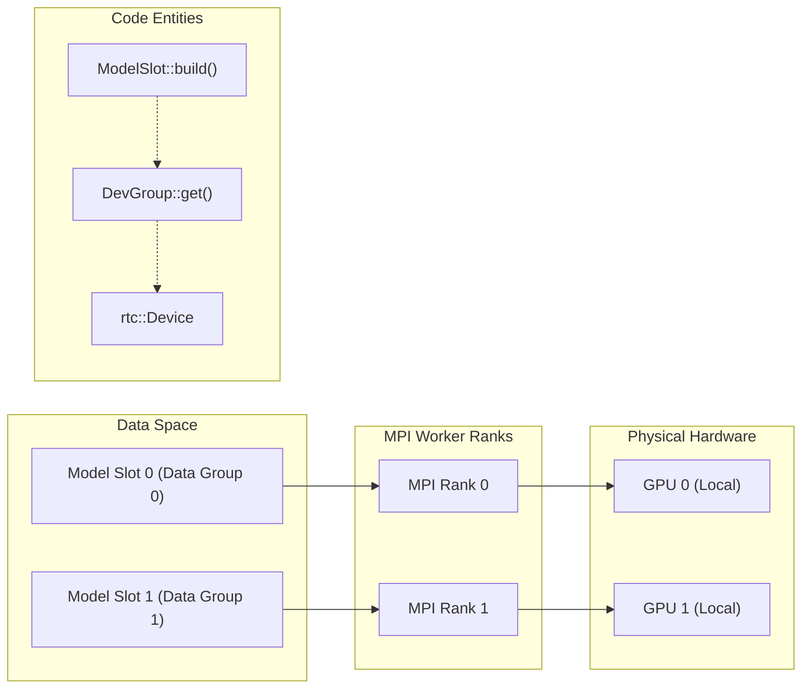

<!-- source: DeepWiki mcp.deepwiki.com · repo NVIDIA/barney · page 2.3 Context and Multi-GPU/MPI Topology · fetched 2026-10-26 -->

# Context and Multi-GPU/MPI Topology

<details>
<summary>Relevant source files</summary>

The following files were used as context for generating this wiki page:

- [barney/CMakeLists.txt](barney/CMakeLists.txt)
- [barney/Context.h](barney/Context.h)
- [barney/DeviceGroup.cpp](barney/DeviceGroup.cpp)
- [barney/DeviceGroup.h](barney/DeviceGroup.h)
- [barney/GlobalModel.h](barney/GlobalModel.h)
- [barney/LocalContext.cpp](barney/LocalContext.cpp)
- [barney/MPIContext.cpp](barney/MPIContext.cpp)
- [barney/ModelSlot.cpp](barney/ModelSlot.cpp)
- [barney/ModelSlot.h](barney/ModelSlot.h)
- [barney/WorkerTopo.cpp](barney/WorkerTopo.cpp)
- [barney/api/Context.h](barney/api/Context.h)
- [barney/geometry/IsoSurface.h](barney/geometry/IsoSurface.h)
- [barney/geometry/Triangles.cpp](barney/geometry/Triangles.cpp)
- [barney/geometry/Triangles.h](barney/geometry/Triangles.h)
- [barney/kernels/shadeRays.cu](barney/kernels/shadeRays.cu)
- [cmake/Findhiprt.cmake](cmake/Findhiprt.cmake)
- [rtcore/AppInterface.h](rtcore/AppInterface.h)
- [rtcore/CMakeLists.txt](rtcore/CMakeLists.txt)
- [rtcore/embree/AppInterface.h](rtcore/embree/AppInterface.h)

</details>


This page details the core infrastructure responsible for managing GPU resources, MPI communication, and the mapping of scene data across distributed compute nodes. Barney uses a hierarchical context system to abstract single-GPU, multi-GPU, and multi-node (MPI) rendering configurations.

## The Context Hierarchy

The `Context` class is the primary interface for managing Barney's execution state. It is specialized into two main implementations based on the execution environment:

1.  **`LocalContext`**: Used for single-node execution. It manages one or more GPUs on the local machine [barney/LocalContext.cpp:1-5]().
2.  **`MPIContext`**: Used for distributed execution across multiple nodes. It encapsulates MPI communicators and coordinates work across a cluster [barney/MPIContext.h:23-25]().

### Context and SlotContext
A `Context` manages one or more **Model Slots**. Each slot represents a partition of the global scene data (a "Data Group"). The `SlotContext` struct holds the state specific to a single data partition on a set of GPUs [barney/Context.h:36-46]().

| Entity | Description |
| :--- | :--- |
| `Context` | Global engine state, manages `WorkerTopo` and all `ModelSlot` objects [barney/Context.h:61-72](). |
| `SlotContext` | Contains references to the `SamplerRegistry`, `MaterialRegistry`, and the specific `DevGroup` assigned to a data partition [barney/Context.h:36-46](). |
| `LocalSlot` | A simple descriptor used during initialization to map a `dataRank` to a list of local `gpuIDs` [barney/api/Context.h:180-183](). |

### Context Class Relationship
The following diagram illustrates how the high-level `Context` interacts with device management and topology entities.

**Diagram: Context Entity Mapping**
```mermaid
graph TD
    subgraph "Public API Space"
        API_Ctx["barney_api::Context"]
    end

    subgraph "Core Engine Space (BARNEY_NS)"
        Ctx["BARNEY_NS::Context"]
        LCtx["BARNEY_NS::LocalContext"]
        MCtx["BARNEY_NS::MPIContext"]
        SCtx["BARNEY_NS::SlotContext"]
    end

    subgraph "Topology & Device Management"
        WT["WorkerTopo"]
        DG["DevGroup"]
        Dev["Device"]
    end

    API_Ctx <|-- Ctx
    Ctx <|-- LCtx
    Ctx <|-- MCtx
    
    Ctx *-- WT
    Ctx *-- SCtx
    SCtx o-- DG
    DG "1" *-- "n" Dev
```
Sources: [barney/Context.h:36-72](), [barney/DeviceGroup.h:99-110](), [barney/MPIContext.h:83-90]()

---

## Worker Topology and Node Discovery

The `WorkerTopo` class describes the global layout of the rendering cluster. It tracks every GPU across all MPI ranks and assigns them to specific data groups.

### Hostname Hashing and Local Rank Discovery
To correctly map MPI ranks to physical hardware, Barney uses hostname hashing to identify which ranks share the same physical node.
*   **`getHostNameHash()`**: Generates a hash of the local machine's hostname [barney/MPIContext.cpp:25]().
*   **`findLocalRank()`**: Uses `MPI_Allgather` on hostname hashes to determine the local index of an MPI rank relative to other ranks on the same host [barney/MPIContext.cpp:27-39](). This is critical for assigning specific `gpuID`s to ranks (e.g., Rank 0 gets GPU 0, Rank 1 gets GPU 1).

### MPI Communicator Splitting
In `MPIContext`, Barney distinguishes between two communicators:
1.  **`world`**: The global communicator containing all ranks [barney/MPIContext.h:105]().
2.  **`workers`**: A sub-communicator containing only ranks that participate in rendering (active workers) [barney/MPIContext.h:106]().

Sources: [barney/MPIContext.cpp:27-77](), [barney/WorkerTopo.h:10-20]()

---

## Device Groups and Logical Mapping

Barney abstracts physical GPUs into `Device` objects, which are further organized into `DevGroup` (Device Groups).

### The Device Class
The `Device` class wraps the `rtc::Device` (the hardware-specific backend like OptiX or CUDA) and manages device-local resources [barney/DeviceGroup.h:34-68]():
*   **`rayQueue`**: A `RayQueue` instance for managing wavefront rays on this specific GPU [barney/DeviceGroup.cpp:66]().
*   **`traceRays`**: The hardware-specific ray tracing kernel [barney/DeviceGroup.cpp:67-68]().
*   **`geomTypes`**: A registry for backend-specific geometry types (e.g., OptiX `OptixProgramGroup`) [barney/DeviceGroup.cpp:60]().

### Data Group Mapping
Data groups allow Barney to render scenes larger than the memory of a single GPU by distributing different parts of the model across different sets of GPUs.

| Mapping Level | Description |
| :--- | :--- |
| **Global Rank** | The unique ID of a GPU across the entire MPI world [barney/DeviceGroup.h:42](). |
| **Local Rank** | The ID of a GPU relative to the current MPI rank [barney/DeviceGroup.h:45](). |
| **Data Rank** | The ID of the scene partition (Model Slot) this GPU is responsible for [barney/WorkerTopo.h:17](). |

**Diagram: Data-to-GPU Flow**

Sources: [barney/ModelSlot.cpp:22-33](), [barney/DeviceGroup.h:99-110](), [barney/WorkerTopo.h:10-20]()

---

## Ray Distribution and Global Convergence

In a distributed environment, rays may need to travel between different data groups to find intersections. This is managed by the `GlobalTraceImpl` abstraction.

### Global Ray Tracing Implementation
The `Context` delegates global ray traversal to specialized implementations [barney/Context.h:48]():
*   **`RQSMPI`**: Standard MPI-based ray queue synchronization [barney/MPIContext.cpp:103]().
*   **`TwoStage`**: An optimized inter-node exchange strategy [barney/MPIContext.cpp:98]().
*   **`All2all`**: Uses `MPI_Alltoall` for massive ray exchanges [barney/MPIContext.cpp:101]().

### Global Termination
To determine if a frame is finished, the context must check if any rays are still active anywhere in the cluster.
*   **`numRaysActiveLocally()`**: Counts active rays in the `RayQueue` of all local GPUs [barney/Context.h:194]().
*   **`numRaysActiveGlobally()`**: Performs an `MPI_Allreduce` (Sum) across the `workers` communicator to check the global ray count [barney/MPIContext.cpp:116-120]().

Sources: [barney/Context.h:149-161](), [barney/MPIContext.cpp:116-120](), [barney/globalTrace/RQSMPI.h:10-15]()

---

