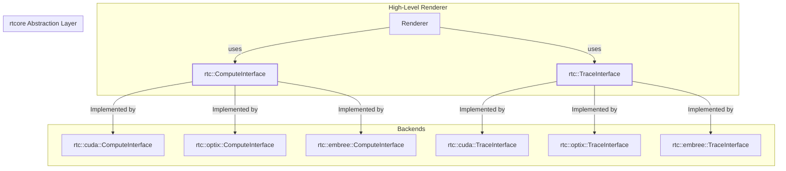
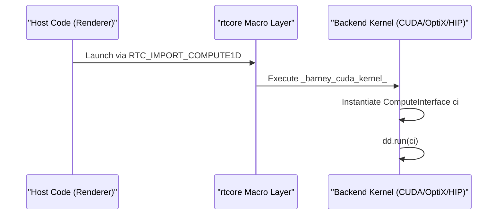

<!-- source: DeepWiki mcp.deepwiki.com · repo NVIDIA/barney · page 3 Ray Tracing Core (rtcore) · fetched 2026-10-26 -->

# Ray Tracing Core (rtcore)

Relevant source files

The following files were used as context for generating this wiki page:

- [barney/render/Ray.h](barney/render/Ray.h)
- [rtcore/ComputeInterface.h](rtcore/ComputeInterface.h)
- [rtcore/TraceInterface.h](rtcore/TraceInterface.h)
- [rtcore/cuda/ProgramInterface.h](rtcore/cuda/ProgramInterface.h)
- [rtcore/cuda/TraceInterface.h](rtcore/cuda/TraceInterface.h)
- [rtcore/cudaCommon/ComputeInterface.h](rtcore/cudaCommon/ComputeInterface.h)
- [rtcore/cudaCommon/cuda-common.h](rtcore/cudaCommon/cuda-common.h)
- [rtcore/cudaCommon/cuda-helper.h](rtcore/cudaCommon/cuda-helper.h)

The `rtcore` layer is Barney's hardware abstraction layer for ray tracing and device compute. Its primary purpose is to insulate the high-level rendering engine from the specifics of different hardware backends (NVIDIA OptiX, native CUDA, AMD HIPRT, or Intel Embree). It provides a unified set of interfaces for tracing rays, managing device memory, and launching compute kernels.

## Core Abstractions

The `rtcore` library defines several key interfaces that must be implemented by each backend. These interfaces allow the renderer to remain backend-agnostic while still achieving hardware-accelerated performance.

### TraceInterface
The `TraceInterface` is the primary mechanism through which device-side programs (such as intersection or any-hit shaders) interact with the ray tracing pipeline. It provides methods to query ray properties, report intersections, and trigger new ray traversals.

*   **State Access**: Provides access to `primID`, `geomID`, and `instID` during traversal [rtcore/cuda/ProgramInterface.h:57-67]().
*   **Ray Queries**: Allows querying world-space and object-space ray origins and directions [rtcore/cuda/ProgramInterface.h:75-85]().
*   **Intersection Reporting**: Used by custom geometry to report hits via `reportIntersection` [rtcore/cuda/ProgramInterface.h:28-29]().
*   **Recursive Tracing**: Supports `traceRay` for secondary ray effects within the backend [rtcore/cuda/ProgramInterface.h:106-111]().

### ComputeInterface
The `ComputeInterface` abstracts standard parallel compute operations. It provides a common way to access thread indices and perform atomic operations across different GPU and CPU architectures.

*   **Launch Indexing**: Provides `launchIndex()`, `getThreadIdx()`, and `getBlockDim()` abstractions [rtcore/cudaCommon/ComputeInterface.h:46-55]().
*   **Atomics**: Implements cross-platform atomics like `atomicAdd`, `fatomicMin`, and `fatomicMax` [rtcore/cudaCommon/ComputeInterface.h:56-59](), [rtcore/cudaCommon/ComputeInterface.h:117-143]().
*   **Texturing**: Wraps hardware-specific texture sampling for 1D, 2D, and 3D textures [rtcore/cudaCommon/ComputeInterface.h:28-39]().

### Bridge to Rendering Space
The following diagram illustrates how the `rtcore` abstractions bridge high-level rendering concepts to backend-specific implementations.

**Entity Mapping: rtcore Abstraction to Implementations**

Sources: [rtcore/ComputeInterface.h:10-34](), [rtcore/TraceInterface.h:12-26]()

---

## Backend Implementations

Barney supports four distinct backends, each residing in its own subdirectory within `rtcore/`.

### [OptiX Backend](#3.1)
The OptiX backend utilizes NVIDIA's OptiX Ray Tracing Framework. It leverages hardware RT cores on RTX GPUs and manages the Shader Binding Table (SBT) and Pipeline State Objects (PSOs). It is the primary backend for high-performance rendering on NVIDIA hardware.
For details, see [OptiX Backend](#3.1).

### [CUDA Software Tracer Backend](#3.2)
This backend provides a native CUDA ray tracing implementation using **cuBQL** for BVH traversal and intersection [rtcore/cuda/TraceInterface.h:15-19](). It is used when OptiX is unavailable or for specific debugging scenarios. It implements a software-based SBT using function pointers [rtcore/cuda/ProgramInterface.h:175-181]().
For details, see [CUDA Software Tracer Backend](#3.2).

### [HIPRT Backend (AMD GPU)](#3.3)
The HIPRT backend targets AMD GPUs using the HIP language and HIPRT library. It utilizes a `cuda_to_hip.h` translation layer to allow Barney's CUDA-centric source code to compile for ROCm environments [rtcore/cudaCommon/cuda_to_hip.h:1-11]().
For details, see [HIPRT Backend (AMD GPU)](#3.3).

### [Embree CPU Backend](#3.4)
The Embree backend provides a CPU-based fallback using Intel's Embree library. It supports multiple ISA targets (SSE, AVX, NEON) and implements the `TraceInterface` by wrapping Embree's ray query API.
For details, see [Embree CPU Backend](#3.4).

---

## Program and Kernel Execution

`rtcore` uses macros to define and export kernels so they can be launched from the host regardless of the backend.

**Execution Flow: Host to Device**

Sources: [rtcore/cudaCommon/ComputeInterface.h:181-196]()

### Key Data Structures
*   **`rtc::AccelHandle`**: An opaque handle to the top-level acceleration structure (BVH) [rtcore/cuda/ProgramInterface.h:106]().
*   **`rtc::Geom::SBTHeader`**: The base structure for all entries in the Shader Binding Table, containing function pointers for hit programs [rtcore/cuda/ProgramInterface.h:124]().
*   **`rtc::Instance`**: Defines an instance in the scene with object-to-world and world-to-object transforms [rtcore/cuda/ProgramInterface.h:15-18]().

| Structure | Role | Source |
| :--- | :--- | :--- |
| `ComputeInterface` | Provides `launchIndex`, `atomicAdd`, and texture samplers. | [rtcore/cudaCommon/ComputeInterface.h:42-61]() |
| `TraceInterface` | Provides `traceRay`, `reportIntersection`, and ray/geometry IDs. | [rtcore/cuda/ProgramInterface.h:20-138]() |
| `SBTHeader` | Stores pointers to `anyHit`, `closestHit`, and `intersect` programs. | [rtcore/cuda/ProgramInterface.h:175-181]() |

Sources: [rtcore/cuda/ProgramInterface.h:1-141](), [rtcore/cudaCommon/ComputeInterface.h:1-196](), [rtcore/cuda/TraceInterface.h:1-100]()

---

