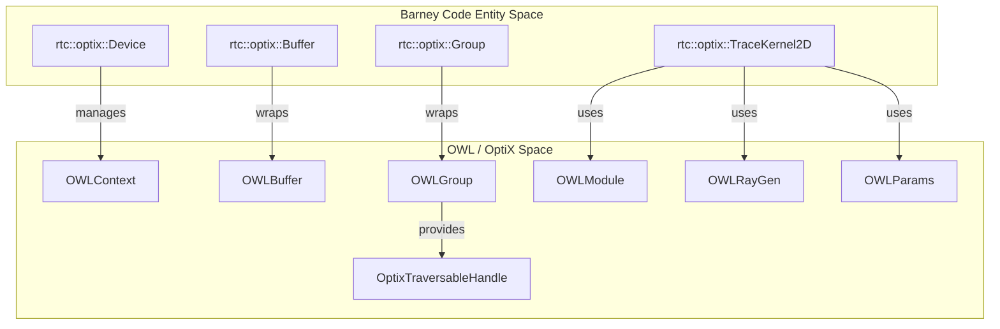
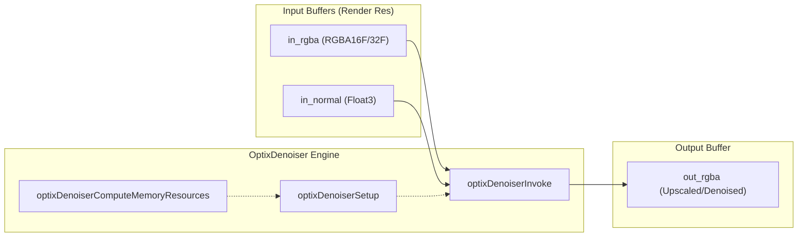

<!-- source: DeepWiki mcp.deepwiki.com · repo NVIDIA/barney · page 3.1 OptiX Backend · fetched 2026-10-26 -->

# OptiX Backend

Relevant source files

The following files were used as context for generating this wiki page:

- [barney/common/Data.h](barney/common/Data.h)
- [barney/render/OptixGlobals.h](barney/render/OptixGlobals.h)
- [rtcore/cuda/Group.h](rtcore/cuda/Group.h)
- [rtcore/embree/Group.cpp](rtcore/embree/Group.cpp)
- [rtcore/embree/Group.h](rtcore/embree/Group.h)
- [rtcore/optix/Buffer.cpp](rtcore/optix/Buffer.cpp)
- [rtcore/optix/Buffer.h](rtcore/optix/Buffer.h)
- [rtcore/optix/Denoiser.cpp](rtcore/optix/Denoiser.cpp)
- [rtcore/optix/Denoiser.h](rtcore/optix/Denoiser.h)
- [rtcore/optix/Device.cpp](rtcore/optix/Device.cpp)
- [rtcore/optix/Device.h](rtcore/optix/Device.h)
- [rtcore/optix/Group.cpp](rtcore/optix/Group.cpp)
- [rtcore/optix/Group.h](rtcore/optix/Group.h)

The OptiX backend provides the high-performance hardware-accelerated ray tracing implementation for Barney on NVIDIA GPUs. It leverages the **OWL (OptiX 7 Wrapper Library)** to manage the complexity of OptiX contexts, module compilation, and Shader Binding Table (SBT) construction.

## Architecture and Device Management

The OptiX backend is centered around the `rtc::optix::Device` class, which extends the common CUDA device abstraction. It initializes an `OWLContext` to manage OptiX resources for a specific physical GPU.

### Key Components

| Class | Description |
| :--- | :--- |
| `rtc::optix::Device` | Manages the `OWLContext` and serves as a factory for buffers, geometries, and groups. |
| `rtc::optix::Buffer` | A wrapper around `OWLBuffer` for managing device memory. |
| `rtc::optix::Group` | Encapsulates `OWLGroup` handles, representing acceleration structures (AS). |
| `rtc::optix::TraceKernel2D` | Manages OptiX ray generation programs and launch parameters. |

The following diagram illustrates the relationship between the OptiX backend entities and the underlying OWL/OptiX resources:

**OptiX Backend Entity Mapping**

Sources: [rtcore/optix/Device.h:51-156](), [rtcore/optix/Buffer.h:14-32](), [rtcore/optix/Group.h:14-25](), [rtcore/optix/Device.h:37-49]()

## Acceleration Structures and Groups

Barney uses a hierarchical acceleration structure system managed via `rtc::optix::Group`. Groups can contain geometries (Triangles or User-defined) or instances of other groups.

*   **Triangles Group**: Created via `owlTrianglesGeomGroupCreate`, optimized for hardware triangle intersection [rtcore/optix/Device.cpp:162-172]().
*   **User Geometry Group**: Created via `owlUserGeomGroupCreate`, used for primitives like spheres or volume macro-cells [rtcore/optix/Device.cpp:174-184]().
*   **Instance Group**: Created via `owlInstanceGroupCreate`, allowing for transforms and instancing of existing groups [rtcore/optix/Device.cpp:186-206]().

The `rtc::AccelHandle` used by the renderer is a direct cast of the `OptixTraversableHandle` obtained from OWL [rtcore/optix/Group.cpp:16-21]().

Sources: [rtcore/optix/Group.cpp:8-41](), [rtcore/optix/Device.cpp:155-208]()

## PTX Embedding and Program Management

Device programs (kernels) are written in `.dev.cu` files and compiled to PTX. These PTX strings are embedded into the binary and linked at runtime.

### Kernel Launch Flow
The `TraceKernel2D` class handles the lifecycle of an OptiX launch:
1.  **Module Creation**: Creates an `OWLModule` from embedded PTX code [rtcore/optix/Device.cpp:125-125]().
2.  **RayGen Creation**: Initializes an `OWLRayGen` program [rtcore/optix/Device.cpp:126-128]().
3.  **Launch Parameters**: Uses `OWLParams` to manage constant data (like `OptixGlobals`) passed to the device [rtcore/optix/Device.cpp:131-136]().
4.  **Async Launch**: Launches the kernel using `owlAsyncLaunch2D` and tracks the associated CUDA stream [rtcore/optix/Device.cpp:141-152]().

The `OptixGlobals` struct acts as the primary Launch Parameter (LP) block, containing pointers to the ray queue, hit information, and the top-level acceleration structure handle [barney/render/OptixGlobals.h:24-59]().

Sources: [rtcore/optix/Device.cpp:115-152](), [barney/render/OptixGlobals.h:17-76]()

## OptiX Denoiser Integration

Barney integrates the `OptixDenoiser` for post-processing. The `Optix8Denoiser` class (requiring OptiX 8.0+) handles HDR denoising and optional 2x upscaling.

### Denoiser Data Flow
The denoiser operates on a set of layers, typically requiring Color (RGBA), Albedo, and Normal buffers.

**Denoiser Execution Pipeline**

### Key Implementation Details:
*   **Memory Management**: The denoiser computes required scratch and state sizes via `optixDenoiserComputeMemoryResources` and allocates them on the device [rtcore/optix/Denoiser.cpp:132-153]().
*   **Upscaling**: Supports `OPTIX_DENOISER_MODEL_KIND_UPSCALE2X`, which doubles the output resolution [rtcore/optix/Denoiser.cpp:28-31]().
*   **Alpha Mode**: Explicitly set to `OPTIX_DENOISER_ALPHA_MODE_COPY` to avoid artifacts during MPI compositing [rtcore/optix/Denoiser.cpp:24-25]().

Sources: [rtcore/optix/Denoiser.cpp:16-45](), [rtcore/optix/Denoiser.cpp:113-196]()

## Buffer and SBT Management

The `rtc::optix::Buffer` class manages memory via `owlDeviceBufferCreate` [rtcore/optix/Buffer.cpp:11-17](). It supports asynchronous uploads via the device's CUDA stream [rtcore/optix/Buffer.h:34-39]().

The **Shader Binding Table (SBT)** is managed by OWL. When geometries or programs are modified, `Device::buildPipeline()` and `Device::buildSBT()` are called to synchronize the OptiX state before the next launch [rtcore/optix/Device.cpp:69-78]().

Sources: [rtcore/optix/Buffer.cpp:5-32](), [rtcore/optix/Device.cpp:69-93]()

---

