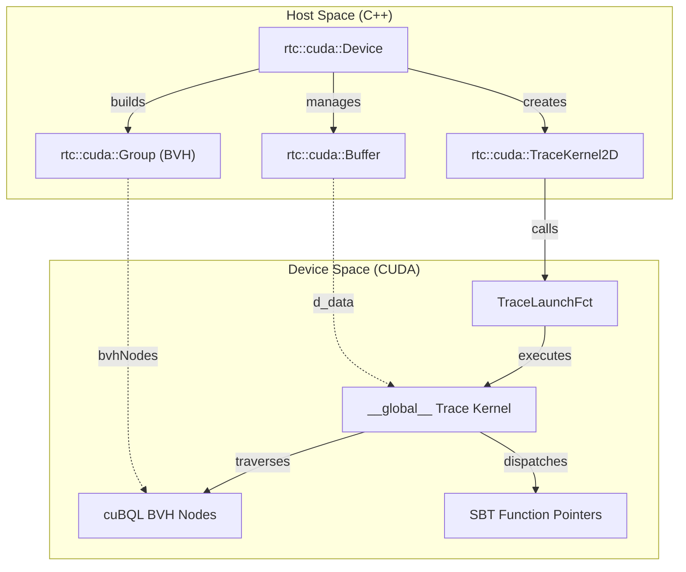
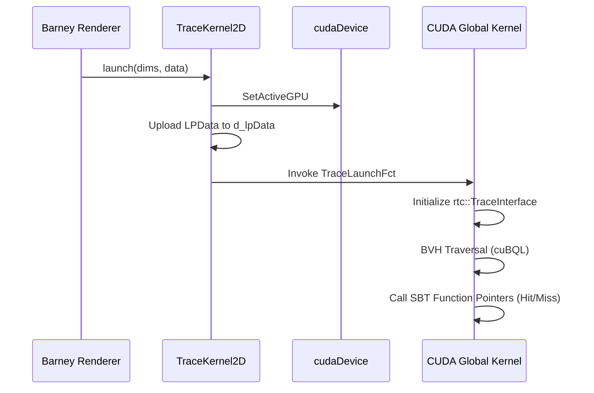

<!-- source: DeepWiki mcp.deepwiki.com · repo NVIDIA/barney · page 3.2 CUDA Software Tracer Backend · fetched 2026-10-26 -->

# CUDA Software Tracer Backend

Relevant source files

The following files were used as context for generating this wiki page:

- [barney/geometry/Triangles.dev.cu](barney/geometry/Triangles.dev.cu)
- [barney/packedBSDF/NVisii.h](barney/packedBSDF/NVisii.h)
- [rtcore/cuda/Buffer.cpp](rtcore/cuda/Buffer.cpp)
- [rtcore/cuda/Buffer.h](rtcore/cuda/Buffer.h)
- [rtcore/cuda/Device.h](rtcore/cuda/Device.h)
- [rtcore/cuda/TraceKernel.h](rtcore/cuda/TraceKernel.h)
- [rtcore/cuda/cudaDevice.cu](rtcore/cuda/cudaDevice.cu)
- [rtcore/cuda/cudaGroup.cu](rtcore/cuda/cudaGroup.cu)
- [rtcore/cudaCommon/Device.h](rtcore/cudaCommon/Device.h)
- [rtcore/cudaCommon/cuda_to_hip.h](rtcore/cudaCommon/cuda_to_hip.h)

The CUDA Software Tracer Backend provides a native ray tracing implementation that operates directly on CUDA kernels without requiring NVIDIA OptiX. It serves as a high-performance alternative for hardware that does not support OptiX or for environments where a unified CUDA/HIP codebase is preferred. This backend utilizes the `cuBQL` library for BVH construction and traversal, and employs a function-pointer-based Shader Binding Table (SBT) to manage separable compilation of geometry intersection and shading programs.

## Architecture Overview

The backend is built upon a hierarchy of classes that mirror the `rtcore` abstraction layer. It extends `rtc::cuda_common::Device` to provide memory management and stream control, while implementing specific ray tracing logic through `rtc::cuda::Device`.

### Key Code Entities

| Entity | File | Description |
| :--- | :--- | :--- |
| `rtc::cuda::Device` | [rtcore/cuda/Device.h:36-70]() | Main interface for the CUDA backend, managing buffers, groups, and kernels. |
| `rtc::cuda::Buffer` | [rtcore/cuda/Buffer.h:14-25]() | Wrapper for device memory allocations (`cudaMalloc`). |
| `rtc::cuda::Group` | [rtcore/cuda/cudaGroup.cu:24-33]() | Base class for acceleration structures (BVHs). |
| `rtc::cuda::TraceKernel2D` | [rtcore/cuda/TraceKernel.h:16-28]() | Handles the launch of 2D ray tracing kernels. |
| `rtc::cuda_common::SetActiveGPU` | [rtcore/cudaCommon/Device.h:21-27]() | RAII utility for switching the active CUDA device context. |

### System Data Flow: Ray Tracing Execution
This diagram illustrates the relationship between the host-side device management and the device-side kernel execution.

**Sources:** [rtcore/cuda/Device.h:36-70](), [rtcore/cuda/TraceKernel.h:14-28](), [rtcore/cuda/cudaGroup.cu:24-33]()

---

## Memory and Buffer Management

The backend uses `rtc::cuda::Buffer` to abstract `cudaMalloc` and `cudaMemcpy` operations. Buffers are bound to a specific `rtc::cuda::Device` and ensure that the correct GPU is active during allocation and transfer using the `SetActiveGPU` RAII helper [rtcore/cuda/Buffer.cpp:12-24]().

- **Allocation:** `Buffer::resize` frees existing memory and allocates a new block on the device [rtcore/cuda/Buffer.cpp:40-46]().
- **Data Transfer:** `Buffer::upload` performs synchronous or asynchronous copies from host to device memory [rtcore/cuda/Buffer.cpp:32-38]().

**Sources:** [rtcore/cuda/Buffer.h:14-25](), [rtcore/cuda/Buffer.cpp:12-46]()

---

## Acceleration Structures (Groups)

Groups in the CUDA backend represent BVHs built over either geometries or instances. The backend uses `cuBQL` (CUDA Bounding Quantized Hierarchy) for GPU-based BVH construction [rtcore/cuda/cudaGroup.cu:7-18]().

### Geometry Groups
`GeomGroup` and its specialized version `TrianglesGeomGroup` aggregate multiple geometry objects into a single BVH.
1. **Bounds Generation:** The kernel `createTriangleBounds` calculates axis-aligned bounding boxes (AABBs) for every triangle in the group [rtcore/cuda/cudaGroup.cu:91-112]().
2. **BVH Build:** `cuBQL::cuda::build` (or `cuBQL::cpuBuilder` if forced) generates the tree structure [rtcore/cuda/cudaGroup.cu:197-210]().

### Instance Groups
`InstanceGroup` allows for top-level acceleration structures that reference other `Group` objects with affine transformations.
- **Transform Management:** `InstanceGroup::setTransforms` updates the instance matrices [rtcore/cuda/cudaGroup.cu:139-142]().
- **Bounds Computation:** The `computeInstanceBounds` kernel transforms the child group's root bounds into world space [rtcore/cuda/cudaGroup.cu:125-137]().

**Sources:** [rtcore/cuda/cudaGroup.cu:57-137](), [rtcore/cuda/cudaGroup.cu:144-175]()

---

## Shader Binding Table (SBT) and Separable Compilation

Unlike the OptiX backend which uses the OptiX-native SBT, the CUDA software tracer implements a manual SBT using CUDA function pointers. This allows the renderer to dispatch to different intersection and shading programs (e.g., `TrianglesPrograms::anyHit`) based on the geometry type encountered during traversal.

### Geometry Programs
Geometry-specific logic is defined in `.dev.cu` files. For example, `Triangles.dev.cu` implements the `anyHit` logic, including:
- **Barycentric Interpolation:** Calculating vertex attributes (normals, texture coordinates) [barney/geometry/Triangles.dev.cu:32-37]().
- **Alpha Testing:** Evaluating material opacity and potentially ignoring intersections [barney/geometry/Triangles.dev.cu:121-134]().
- **Attribute Storage:** Writing hit data to the `HitAttributes` structure [barney/geometry/Triangles.dev.cu:88-115]().

**Sources:** [barney/geometry/Triangles.dev.cu:13-140](), [rtcore/cuda/TraceKernel.h:33-43]()

---

## AMD Compatibility: The `cuda_to_hip` Shim

A critical feature of the CUDA backend is its portability to AMD hardware via a compatibility shim. The header `rtcore/cudaCommon/cuda_to_hip.h` aliases standard CUDA runtime symbols to their HIP equivalents when compiled with `hipcc` [rtcore/cudaCommon/cuda_to_hip.h:16-102]().

| CUDA Symbol | HIP Alias |
| :--- | :--- |
| `cudaStream_t` | `hipStream_t` |
| `cudaMalloc` | `hipMalloc` |
| `cudaMemcpy` | `hipMemcpy` |
| `cudaTextureObject_t` | `hipTextureObject_t` |

This allows the same source code in `rtcore/cuda` and `rtcore/cudaCommon` to be utilized for both the CUDA Software Tracer and the HIP-based backends without code duplication.

**Sources:** [rtcore/cudaCommon/cuda_to_hip.h:28-102]()

---

## Trace Execution Model

Ray tracing is initiated via `rtc::cuda::TraceKernel2D::launch`. This function manages the launch parameters (LP) data and invokes a launch function [rtcore/cuda/TraceKernel.h:16-28]().

**Sources:** [rtcore/cuda/TraceKernel.h:16-28](), [rtcore/cuda/cudaDevice.cu:66-73]()

---

