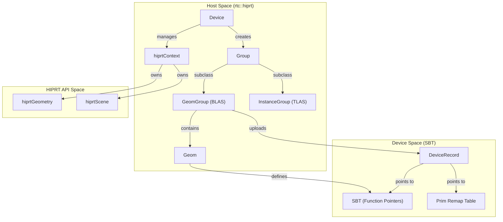
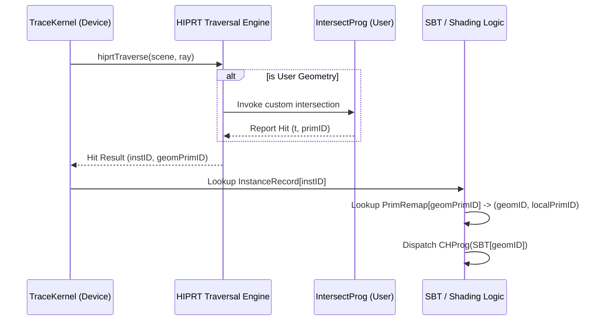

<!-- source: DeepWiki mcp.deepwiki.com · repo NVIDIA/barney · page 3.3 HIPRT Backend (AMD GPU) · fetched 2026-10-26 -->

# HIPRT Backend (AMD GPU)

Relevant source files

The following files were used as context for generating this wiki page:

- [rtcore/hiprt/AppInterface.h](rtcore/hiprt/AppInterface.h)
- [rtcore/hiprt/Buffer.cpp](rtcore/hiprt/Buffer.cpp)
- [rtcore/hiprt/Buffer.h](rtcore/hiprt/Buffer.h)
- [rtcore/hiprt/ComputeInterface.h](rtcore/hiprt/ComputeInterface.h)
- [rtcore/hiprt/Device.cpp](rtcore/hiprt/Device.cpp)
- [rtcore/hiprt/Device.h](rtcore/hiprt/Device.h)
- [rtcore/hiprt/Geom.cpp](rtcore/hiprt/Geom.cpp)
- [rtcore/hiprt/Geom.h](rtcore/hiprt/Geom.h)
- [rtcore/hiprt/GeomType.cpp](rtcore/hiprt/GeomType.cpp)
- [rtcore/hiprt/GeomType.h](rtcore/hiprt/GeomType.h)
- [rtcore/hiprt/Group.cpp](rtcore/hiprt/Group.cpp)
- [rtcore/hiprt/Group.h](rtcore/hiprt/Group.h)
- [rtcore/hiprt/ProgramInterface.h](rtcore/hiprt/ProgramInterface.h)
- [rtcore/hiprt/TraceInterface.h](rtcore/hiprt/TraceInterface.h)
- [rtcore/hiprt/TraceKernel.cpp](rtcore/hiprt/TraceKernel.cpp)
- [rtcore/hiprt/TraceKernel.h](rtcore/hiprt/TraceKernel.h)

The HIPRT backend provides hardware-accelerated ray tracing for Barney on AMD RDNA2+ GPUs. It implements the `rtc` (Ray Tracing Core) abstraction layer by wrapping the AMD HIPRT library. This backend is designed to be binary-compatible with the shading logic of the CUDA Software Tracer backend, allowing the same device-side intersection and shading programs to run on AMD hardware via a `cuda_to_hip` translation layer.

## Architecture and Device Management

The HIPRT backend is centered around the `rtc::hiprt::Device` class, which inherits from `rtc::cuda_common::Device`. It manages a `hiprtContext` that is bound to a specific HIP device and stream to ensure that BVH construction and ray traversal see the same device pointers allocated by Barney.

### System Hierarchy Diagram

The following diagram illustrates the relationship between the host-side management classes and the HIPRT API entities.

**HIPRT Backend Entity Mapping**

Sources: [rtcore/hiprt/Device.h:47-74](), [rtcore/hiprt/Device.cpp:28-52](), [rtcore/hiprt/Group.h:18-47]()

## Acceleration Structure Management

Barney uses a two-level acceleration structure hierarchy. The HIPRT backend maps these to `hiprtGeometry` (Bottom-Level Acceleration Structure - BLAS) and `hiprtScene` (Top-Level Acceleration Structure - TLAS).

### GeomGroup (BLAS)
A `GeomGroup` aggregates multiple `Geom` objects of the same type (either Triangles or User Geoms). 
- **Triangles**: The backend concatenates all vertices and indices from constituent geometries into a single contiguous buffer before calling `hiprtBuildGeometry` [rtcore/hiprt/Group.cpp:151-164]().
- **User Geoms**: The backend invokes a `BoundsKernel` for each geometry to generate AABBs, which are then passed to HIPRT as a `hiprtAABBListPrimitive` [rtcore/hiprt/Group.cpp:9-13]().

### InstanceGroup (TLAS)
An `InstanceGroup` represents a `hiprtScene`. It takes a collection of `Group` pointers and their corresponding affine transformations. The backend manages `hiprtInstance` objects and builds the TLAS using `hiprtBuildScene` [rtcore/hiprt/Group.h:76-111]().

### Shader Binding Table (SBT) Compatibility
To maintain compatibility with the CUDA software backend, the HIPRT backend manually assembles an SBT-like structure. This structure contains function pointers for:
- `AHProg`: Any Hit program [rtcore/hiprt/GeomType.h:23]().
- `CHProg`: Closest Hit program [rtcore/hiprt/GeomType.h:24]().
- `IntersectProg`: Intersection program (for User Geoms) [rtcore/hiprt/GeomType.h:22]().

The `GeomGroup_buildSBTandPrims` function is responsible for packing these pointers along with per-geometry data into a device-side buffer [rtcore/hiprt/Group.cpp:59-115]().

Sources: [rtcore/hiprt/Group.h:36-70](), [rtcore/hiprt/Group.cpp:59-136](), [rtcore/hiprt/Geom.h:24-36]()

## Data Flow and Execution

The execution flow involves translating CUDA-style kernel launches into HIP-compatible launches and using the `TraceInterface` for ray traversal within kernels.

### Ray Traversal Flow
The following diagram shows how a ray moves from the rendering kernel through the HIPRT traversal engine and back into Barney's shading logic.

**Ray Traversal and Shading Dispatch**

Sources: [rtcore/hiprt/Group.h:36-47](), [rtcore/hiprt/Group.cpp:7-13](), [rtcore/hiprt/TraceInterface.h:1-20]()

### Cuda-to-HIP Translation
The backend relies on a translation layer that allows `.cu` files to be compiled as HIP code.
- **Compute Interface**: The `__rtc_launch` macro handles setting the active GPU and launching kernels on the appropriate HIP stream [rtcore/hiprt/ComputeInterface.h:25-26]().
- **Texture Support**: CUDA texture objects and fetches (`tex1D`, `tex2D`, `tex3D`) are mapped to their HIP equivalents via `rtc::cuda_common` [rtcore/hiprt/ComputeInterface.h:15-17]().
- **Buffers**: The `rtc::hiprt::Buffer` class wraps `hipMalloc` and `hipMemcpy` (aliased as `Malloc` and `Memcpy` via the translation layer) [rtcore/hiprt/Buffer.cpp:21-23]().

## Key Classes and Functions

| Entity | Role | File Reference |
| :--- | :--- | :--- |
| `rtc::hiprt::Device` | Main entry point; manages `hiprtContext`. | [rtcore/hiprt/Device.h:47]() |
| `rtc::hiprt::Buffer` | Simple wrapper for device memory allocations. | [rtcore/hiprt/Buffer.h:17]() |
| `rtc::hiprt::Geom` | Host-side representation of geometry data and SBT records. | [rtcore/hiprt/Geom.h:17]() |
| `rtc::hiprt::GeomGroup` | Manages BLAS construction and per-primitive remapping. | [rtcore/hiprt/Group.h:36]() |
| `rtc::hiprt::InstanceGroup` | Manages TLAS construction and instance metadata. | [rtcore/hiprt/Group.h:76]() |
| `GeomGroup_buildSBTandPrims` | Utility to pack function pointers for device-side dispatch. | [rtcore/hiprt/Group.cpp:59]() |

## Implementation Details

### Buffer Management
The `Buffer` class provides a thin abstraction over HIP device memory. It includes support for resizing and asynchronous uploads. It is explicitly bound to the `rtc::cuda_common::Device` to prevent cross-backend type pollution [rtcore/hiprt/Buffer.h:14-28]().

### Denoiser Support
Currently, the HIPRT backend provides a no-op `Denoiser` stub. Hardware-accelerated denoising (e.g., via OIDN on ROCm) is noted as a deferred enhancement [rtcore/hiprt/Device.h:79-93]().

Sources: [rtcore/hiprt/Buffer.cpp:14-45](), [rtcore/hiprt/Device.h:79-93](), [rtcore/hiprt/AppInterface.h:1-31]()

---

